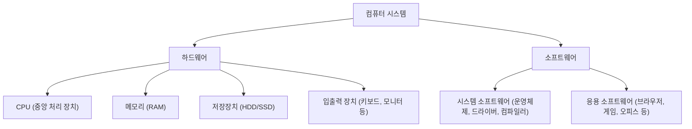
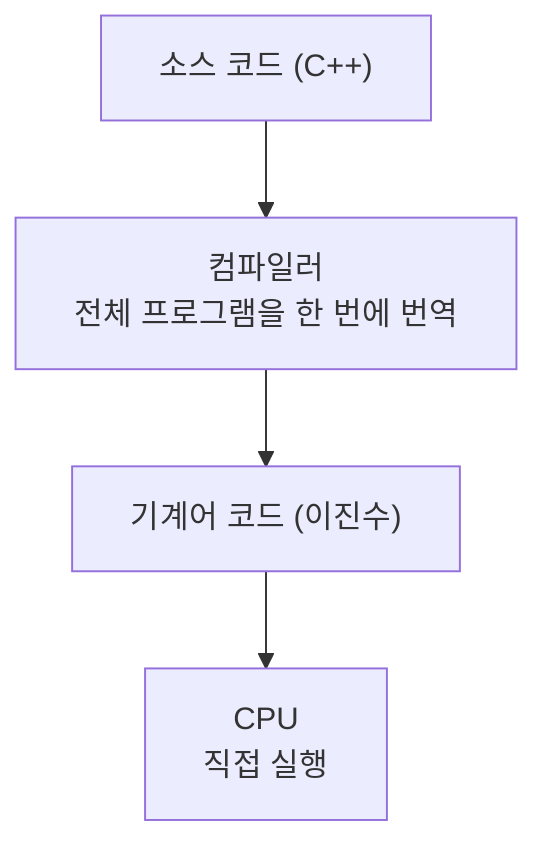
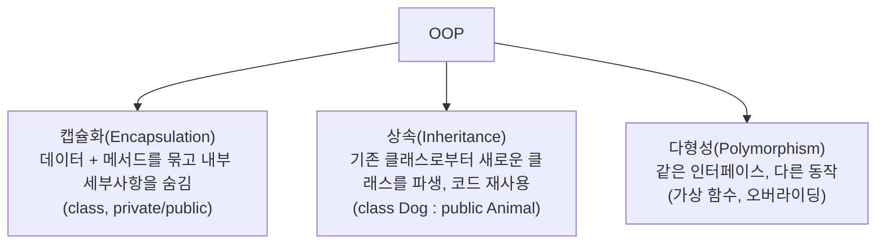
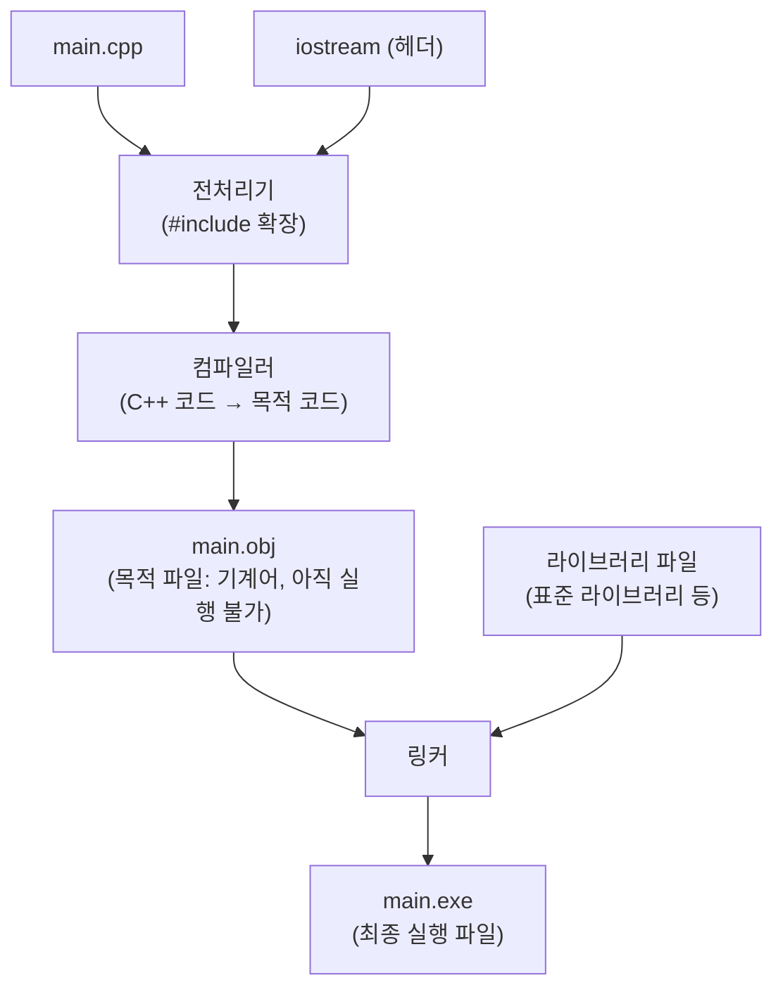

# 1장 — C++ 개요

[레포지토리 안내](../../README.ko.md) | [English](Concepts_Lecture.md) | [한국어](Concepts_Lecture.ko.md)

> **최종 수정일:** 2026-11-19
>
> 명품 C++ Programming, 황기태, Ch 1

> **학습 목표:**
> 1. 소프트웨어의 중요성과 수준별 프로그래밍 언어의 특징을 설명할 수 있다
> 2. C++ 언어의 역사와 표준의 변화를 설명할 수 있다
> 3. C++ 언어의 특징과 객체 지향 프로그래밍, 제네릭 프로그래밍의 개념을 설명할 수 있다
> 4. 편집, 컴파일, 링크, 실행으로 이어지는 C++ 프로그램 개발 과정과 오류의 종류를 설명할 수 있다
> 5. C++ 표준 라이브러리의 구성과 헤더 형식을 설명할 수 있다

---

## 목차

- [1. 컴퓨팅과 프로그래밍](#1-컴퓨팅과-프로그래밍)
  - [1.1 소프트웨어의 중요성](#11-소프트웨어의-중요성)
  - [1.2 프로그래밍 언어](#12-프로그래밍-언어)
  - [1.3 컴파일러](#13-컴파일러)
  - [1.4 컴파일 언어가 만드는 실행 파일의 성질](#14-컴파일-언어가-만드는-실행-파일의-성질)
- [2. C++ 언어](#2-c-언어)
  - [2.1 역사](#21-역사)
  - [2.2 특징](#22-특징)
  - [2.3 객체 지향 프로그래밍](#23-객체-지향-프로그래밍)
  - [2.4 제네릭 프로그래밍](#24-제네릭-프로그래밍)
  - [2.5 C 호환성의 대가](#25-c-호환성의-대가)
  - [2.6 표준 C++의 중요성](#26-표준-c의-중요성)
  - [2.7 C 프로그램과 C++ 프로그램의 비교](#27-c-프로그램과-c-프로그램의-비교)
  - [2.8 컴파일러 확장과 표준 준수 검사](#28-컴파일러-확장과-표준-준수-검사)
  - [2.9 표준의 판에 따라 달라지는 컴파일 결과](#29-표준의-판에-따라-달라지는-컴파일-결과)
- [3. C++ 표준 라이브러리](#3-c-표준-라이브러리)
  - [3.1 표준 라이브러리의 구성](#31-표준-라이브러리의-구성)
  - [3.2 `#include`의 미래: 모듈(Modules)](#32-include의-미래-모듈modules)
  - [3.3 헤더 파일과 이름 공간의 차이](#33-헤더-파일과-이름-공간의-차이)
- [4. C++ 개발 과정](#4-c-개발-과정)
  - [4.1 빌드 파이프라인](#41-빌드-파이프라인)
  - [4.2 오류의 종류](#42-오류의-종류)
  - [4.3 실행과 디버깅](#43-실행과-디버깅)
  - [4.4 분할 컴파일과 링크 오류의 실제](#44-분할-컴파일과-링크-오류의-실제)
  - [4.5 전처리와 번역 단위](#45-전처리와-번역-단위)
  - [4.6 컴파일 옵션과 경고](#46-컴파일-옵션과-경고)
- [요약](#요약)
- [점검 문제](#점검-문제)

---

<br>

## 1. 컴퓨팅과 프로그래밍

### 1.1 소프트웨어의 중요성

현대 사회는 **소프트웨어** 위에서 돌아간다. 스마트폰, 자동차, 은행 시스템, 의료 기기에 이르기까지 소프트웨어가 일상의 거의 모든 면을 제어한다. 하드웨어만으로는 아무것도 할 수 없으며, 소프트웨어가 하드웨어에 목적과 기능을 부여한다.

"Software is eating the world"라는 말처럼 eBay, Facebook, Google, Netflix, Apple, Samsung 같은 기업의 경쟁력은 소프트웨어에서 나온다. 자율 주행 자동차, 인공지능(구글의 알파고, IBM 왓슨), 사물 인터넷(IoT)처럼 4차 산업을 이끄는 기술의 핵심에도 소프트웨어가 있다.



*그림 1. 컴퓨터 시스템을 이루는 하드웨어와 소프트웨어*

**프로그램**은 특정 작업을 수행하기 위해 작성된 명령어의 집합이다. **프로그래밍**(코딩)은 프로그래밍 언어를 사용하여 이 명령어를 설계하고 작성하는 과정이다.

> **핵심:** 소프트웨어는 인간의 의도와 기계의 실행을 연결하는 다리이다. 프로그램이 없으면 아무리 강력한 하드웨어도 유용한 일을 할 수 없다.

### 1.2 프로그래밍 언어

**프로그래밍 언어**는 컴퓨터가 처리할 수 있는 명령을 작성하기 위한 형식 언어이다. 하드웨어로부터의 추상화 수준에 따라 분류한다.

| 수준 | 언어 | 예시 | 가독성 | 이식성 |
|:-----|:----|:-----|:-----:|:-----:|
| 저급 | 기계어 | `10110000 01100001` | 매우 낮음 | 없음 |
| 저급 | 어셈블리어 | `MOV AL, 61h` | 낮음 | 없음 |
| 고급 | C, C++, Java, Python | `cout << "Hello";` | 높음 | 높음 |

*표 1. 추상화 수준에 따른 프로그래밍 언어의 분류*

**기계어** (1세대):
- CPU가 직접 실행하는 이진 코드(`0`과 `1`)로 이루어진다.
- CPU는 본질적으로 기계어만 처리할 수 있다.
- CPU 아키텍처마다 다르므로 완전히 **기계 종속적**이다.

**어셈블리어** (2세대):
- 기계어 명령을 사람이 읽을 수 있는 **니모닉**(mnemonic, 예: `MOV`, `ADD`, `JMP`)으로 나타낸다.
- 기계어와 1:1 대응한다.
- **어셈블러**가 기계어로 번역한다.

**고급 언어** (3세대 이상):
- 자연어에 가까운 문법(`if`, `while`, `class`)을 사용하여 복잡한 작업, 자료 구조, 알고리즘을 사람이 이해하기 쉽게 표현한다.
- 하나의 고급 문장이 여러 기계어 명령으로 번역될 수 있다.
- **컴파일러** 또는 **인터프리터**가 기계어로 번역한다.
- 일반적으로 **기계 독립적**이어서 동일한 소스 코드를 다른 플랫폼에서 컴파일할 수 있다.

같은 계산이 언어 수준에 따라 어떻게 표현되는지 35 + 56을 예로 보면 다음과 같다.

| 기계어 | 어셈블리어 | C++ |
|:-----|:-----|:-----|
| `01010000` | `LOAD AX 35` | `int i;` |
| `00101001` | `LOAD BX 56` | `i = 35 + 56;` |
| `11101011` | `ADD AX BX` | |

*표 2. 35 + 56을 계산하는 코드의 언어별 표현*

어셈블리어 프로그램을 기계어로 바꾸는 과정을 **어셈블**(assemble), 고급 언어 프로그램을 기계어로 바꾸는 과정을 **컴파일**(compile)이라 한다. 표의 기계어와 어셈블리어는 개념을 보이기 위한 예시이며, 실제 명령어와 이진 코드는 CPU마다 다르다.

### 1.3 컴파일러

**컴파일러**는 고급 언어의 소스 코드 전체를 실행 **전에** 기계어로 번역한다. 생성된 바이너리는 CPU에서 직접 실행된다.



*그림 2. 컴파일러가 소스 코드를 기계어로 번역하고 CPU가 실행하는 과정*

| 번역 방식 | 시점 | 언어 | 실행 속도 |
|:---------|:----|:----|:---------|
| **컴파일러** | 실행 전 (전체 한꺼번에) | C, C++, Go, Rust | 빠름 |
| **인터프리터** | 실행 중 (한 줄씩) | Python, JavaScript, Ruby | 느림 |

*표 3. 컴파일러와 인터프리터의 비교*

C++은 **컴파일 언어**이다. 소스 코드가 실행 가능한 바이너리로 완전히 번역된 후에 프로그램이 실행된다.

> **참고:** **Java의 하이브리드 방식.** Java는 컴파일러가 바이트코드를 생성하고, JVM이 런타임에 이를 인터프리트(또는 JIT 컴파일)하는 하이브리드 방식을 사용한다.

### 1.4 컴파일 언어가 만드는 실행 파일의 성질

컴파일러가 만든 실행 파일은 특정 CPU의 기계어로 되어 있다. macOS에서 4.5절의 `hello.cpp`를 컴파일하고 `file` 명령으로 실행 파일의 형식을 확인하면, Apple 실리콘(arm64) 컴퓨터에서는 다음과 같이 나온다.

```text
$ c++ -std=c++17 hello.cpp -o hello
$ file hello
hello: Mach-O 64-bit executable arm64
$ c++ -std=c++17 -target x86_64-apple-macos12 hello.cpp -o hello_x86
$ file hello_x86
hello_x86: Mach-O 64-bit executable x86_64
```

`Mach-O`는 macOS의 실행 파일 형식이고 `arm64`는 CPU의 명령어 집합이다. 같은 소스 파일이라도 `-target` 옵션으로 x86-64용으로 컴파일하면 다른 기계어로 된 다른 실행 파일이 만들어진다. 이 예에서 다음 세 가지 성질을 알 수 있다.

- **소스는 이식되고 실행 파일은 이식되지 않는다.** 고급 언어로 쓴 소스 코드는 여러 플랫폼에서 컴파일할 수 있지만(1.2절의 기계 독립성), 컴파일된 실행 파일은 그 CPU와 운영체제에서만 실행된다. Windows용 `.exe`는 macOS에서 그대로 실행되지 않는다. 플랫폼마다 다시 컴파일해야 하며, 소스가 표준을 지켜야 하는 이유(2.6절)가 여기에 있다.
- **실행할 때 번역이 필요 없다.** 번역은 실행 전에 한 번 끝나므로, 실행하는 컴퓨터에는 컴파일러가 없어도 된다. 실행 중에 한 줄씩 번역하는 인터프리터 방식보다 빠르게 실행되는 주된 이유이다.
- **오류의 일부를 실행 전에 찾는다.** 컴파일러는 번역하면서 문법과 타입을 검사하므로(4.2절), 타입이 맞지 않는 대입처럼 인터프리터 언어라면 그 줄이 실행될 때 드러날 오류를 실행하기 전에 알려 준다.

반대로 소스를 고칠 때마다 다시 컴파일해야 하고, 큰 프로그램은 컴파일에 시간이 걸린다는 단점이 있다. C++은 실행 속도와 하드웨어 제어가 중요한 운영체제, 게임 엔진, 데이터베이스, 임베디드 시스템에서 많이 쓰인다.

---

<br>

## 2. C++ 언어

### 2.1 역사

C++은 Bell 연구소의 **Bjarne Stroustrup**이 만들었다. 그는 **1979년**에 Simula의 객체지향 기능에서 영감을 받아 C를 확장하는 작업을 시작했다. 이 언어는 처음에 **C with Classes**라고 불렸으며, **1983년**에 **C++** 로 이름이 변경되었다. `++`는 C의 증가 연산자로, C에서 한 단계 진화한 언어라는 뜻을 담는다.

핵심 아이디어: **C++ = C + 객체 지향 프로그래밍(OOP)**.

```text
C++ 언어의 역사
──────────────────────────────────────────────────────────────
1967    BCPL (Martin Richards): 컴파일러 작성을 위한 간략화된 CPL
1969    B (Ken Thompson): 초기 UNIX용으로 간략화된 BCPL
1972    C (Dennis Ritchie): 타입이 추가된 B; UNIX 재작성
1979    C with Classes (Bjarne Stroustrup): C + OOP 기능
1983    C++: 이름 변경; 최초 공개 배포
1998    C++98: 최초의 ISO 표준 (ISO/IEC 14882:1998)
2003    C++03: C++98 버그 수정
2011    C++11: 대규모 현대화 (auto, 람다, 이동 의미론,
               스마트 포인터, 범위 기반 for, nullptr)
2014    C++14: C++11의 소규모 개선
2017    C++17: 구조화된 바인딩, std::optional, 파일시스템
2020    C++20: 개념(concepts), 코루틴, 범위(ranges), 모듈,
               3방향 비교 (<=>)
2023    C++23: std::print, deducing this, std::expected,
               std::flat_map, 다차원 첨자 연산자
2026    C++26: 계약(contracts), constexpr 컨테이너, std::execution
──────────────────────────────────────────────────────────────
```

*그림 3. C++ 언어와 표준의 연대표*

> **핵심:** C++11은 고전적인 C++와 현대 C++를 나누는 분기점으로 널리 인식된다. `auto`, 스마트 포인터, 람다 식 등의 C++11 기능으로 인해 많은 코딩 관행이 근본적으로 변화했다.

> **참고:** **C++26.** C++26은 2026년 발행을 목표로 하는 표준이다. 핵심 기능 중 하나는 **계약(contracts)** 으로, 함수의 사전 조건과 사후 조건을 언어 차원에서 명시하는 메커니즘이다. `pre`, `post`, `contract_assert`로 조건을 적으며, 기존의 `assert()` 매크로보다 체계적인 검사 수단을 제공한다. 컴파일러의 C++26 지원 범위는 기능마다 다르므로, 사용하기 전에 컴파일러의 지원 현황을 확인해야 한다.

### 2.2 특징

C++은 C의 저수준 성능과 고수준 추상화를 결합한다. 주요 특징은 다음과 같다.

| 특징 | 설명 |
|:----|:----|
| **C 호환성** | 소스 수준 및 링크 수준에서 C와 호환; 기존 C 프로그램을 그대로 가져다 쓸 수 있어 대부분의 C 코드가 C++로 컴파일되고, C 목적 파일과 라이브러리를 링크할 수 있음 |
| **객체 지향 프로그래밍** | 캡슐화, 다형성, 상속으로 현실 세계의 개체를 모델링 (2.3절) |
| **엄격한 타입 검사** | C보다 강력한 타입 강제; 컴파일 시점에 더 많은 오류를 포착하여 실행 시간 오류의 가능성을 줄이고 디버깅을 쉽게 함 |
| **인라인 함수** | `inline` 키워드로 호출 지점에서의 함수 확장을 컴파일러에 요청하여, 자주 호출되는 작은 함수의 호출 오버헤드를 줄임 (3장) |
| **함수 중복** | 매개변수의 개수나 타입이 다른 같은 이름의 함수를 여러 개 선언 (6장) |
| **디폴트 매개변수** | 인자를 생략하면 매개변수에 미리 정한 기본값이 전달되도록 함수를 선언 (6장) |
| **참조(Reference)** | 기존 변수의 별명(`int& ref = x;`); 많은 경우 포인터보다 안전한 대안 (5장) |
| **참조에 의한 호출** | 함수를 호출할 때 인자를 참조로 전달하여 함수가 원본 변수를 직접 다룸 (5장) |
| **`new` / `delete`** | C의 `malloc`/`free`를 대체하는 동적 메모리 관리 연산자 (4장) |
| **연산자 중복** | 사용자 정의 타입에 대해 연산자(`+`, `-`, `<<` 등)를 재정의 (7장) |
| **제네릭 / 템플릿** | 타입에 독립적인 코드를 작성; 컴파일러가 각 타입에 맞는 특수화 버전을 생성 (2.4절, 10장) |
| **STL (표준 템플릿 라이브러리)** | 풍부한 컨테이너(`vector`, `map`), 알고리즘(`sort`, `find`), 반복자 모음 (10장) |

*표 4. C++ 언어의 주요 특징*

함수 중복, 디폴트 매개변수, 참조, 참조에 의한 호출, `new`와 `delete`, 연산자 중복, 제네릭 함수와 클래스는 C 언어에 없던 기능을 C++이 새로 추가한 것이다.

### 2.3 객체 지향 프로그래밍

**객체 지향 프로그래밍의 세 가지 기둥:**



*그림 4. 객체 지향 프로그래밍의 세 가지 기둥*

**캡슐화(encapsulation)** 는 데이터를 캡슐로 싸서 외부의 접근으로부터 보호하는 것이다. C++에서는 `class` 키워드로 캡슐을 표현한다. **클래스(class)** 는 객체를 만드는 틀(설계도)이고, **객체(object)** 는 그 틀에서 생겨난 실체이며, 객체를 **인스턴스(instance)** 라고도 한다.

```cpp
class Circle {
private:
    int radius;   // 반지름 값
public:
    Circle(int r) { radius = r; }
    double getArea() { return 3.14 * radius * radius; }
};
```

원을 추상화한 `Circle` 클래스에서 `radius`는 `private`이므로 외부에서 접근할 수 없고, 생성자 `Circle(int r)`와 `getArea()`만 공개된다. 이 클래스로 반지름이 다른 원 객체를 여러 개 만들 수 있다. 클래스와 객체는 3장에서 자세히 다룬다.

**다형성(polymorphism)** 은 하나의 기능이 경우에 따라 다르게 보이거나 다르게 작동하는 현상이다. C++은 다음 세 가지 수단으로 다형성을 지원한다.

- **연산자 중복:** 같은 연산자에 피연산자의 타입에 따라 다른 의미를 준다. 예를 들어 `2 + 3`은 5이지만, `string("C") + string("++")`는 두 문자열을 이어 `"C++"`를 만들고, 색을 나타내는 클래스에서는 빨강 객체 + 파랑 객체가 보라 객체가 되도록 정의할 수 있다.
- **함수 중복:** `void add(int a, int b)`, `void add(int a, int b, int c)`, `void add(int a, double d)`처럼 매개변수가 다른 같은 이름의 함수를 여러 개 정의한다.
- **함수 재정의(overriding):** 파생 클래스가 기본 클래스의 가상함수를 다시 정의하여, 같은 함수 호출이 객체의 실제 타입에 따라 다르게 동작한다. 아래 예제의 `speak()`가 그 예이다.

**상속(inheritance)** 관계가 정의되면 자식 클래스의 객체는 따로 정의하지 않고도 부모 클래스의 멤버 함수와 멤버 변수를 사용할 수 있다. 상속은 8장, 가상함수와 재정의는 9장에서 다룬다.

```cpp
#include <iostream>
using namespace std;

class Animal {
public:
    virtual void speak() { cout << "..." << endl; }
};

class Dog : public Animal {
public:
    void speak() override { cout << "Woof!" << endl; }
};

int main() {
    Animal* pet = new Dog();
    pet->speak();   // 출력: Woof!  (다형성)
    delete pet;
    return 0;
}
```

> **참고:** **여러 패러다임의 지원.** C++은 절차적, 객체 지향, 제네릭 프로그래밍 등 여러 프로그래밍 패러다임을 지원한다. 모든 프로그램에 OOP를 사용할 필요는 없다.

C++이 객체 지향을 도입한 목적은 두 가지이다. 첫째는 **소프트웨어 생산성 향상**이다. 소프트웨어의 생명 주기가 짧아지면서 이미 작성한 코드를 재사용할 필요가 커졌고, C++은 클래스 상속과 객체 재사용으로 이를 해결한다. 둘째는 **실세계에 대한 쉬운 모델링**이다. 과거의 소프트웨어는 수학 계산이나 통계 처리가 중심이어서 절차 지향 언어가 적합했지만, 실세계는 객체로 구성되어 있고 현대의 소프트웨어는 객체들의 상호 작용을 묘사해야 하므로 객체를 중심으로 하는 객체 지향 언어가 적합하다.

**절차 지향 프로그래밍**은 실행하고자 하는 절차대로 일련의 명령어를 나열하는 방식이며, 흐름도를 설계하고 흐름도에 따라 프로그램을 작성한다. **객체 지향 프로그래밍**은 객체들을 정의하고, 객체들의 상호 관계와 상호 작용으로 프로그램을 구현한다.

### 2.4 제네릭 프로그래밍

**제네릭 함수(generic function)** 와 **제네릭 클래스(generic class)** 는 동일한 프로그램 코드에 다양한 데이터 타입을 적용할 수 있게 일반화한 함수와 클래스이다. C++에서는 `template` 키워드로 선언하므로 템플릿 함수, 템플릿 클래스라고도 부르며, Java와 C# 같은 다른 언어에도 같은 개념이 있다.

```cpp
template <typename T>
T bigger(T a, T b) {              // 어떤 타입 T에도 적용되는 제네릭 함수
    return (a > b) ? a : b;
}

int main() {
    int i = bigger(3, 7);         // T = int, i = 7
    double d = bigger(2.5, 1.5);  // T = double, d = 2.5
    return 0;
}
```

제네릭 함수와 제네릭 클래스를 활용하여 프로그램을 작성하는 패러다임을 **제네릭 프로그래밍(generic programming)** 이라 하며, 그 중요성이 점점 커지고 있다. 템플릿은 10장에서 자세히 다룬다.

### 2.5 C 호환성의 대가

C++은 C 언어와의 호환성을 추구한다. 덕분에 기존에 개발된 C 프로그램 코드를 활용할 수 있지만, 대가도 있다. C와 마찬가지로 전역 변수와 전역 함수를 쓸 수 있고 `main()`처럼 전역 함수로만 작성할 수 있는 함수도 있어, 모든 데이터와 함수를 클래스 안에 캡슐화한다는 원칙이 무너진다. 또 여러 함수가 전역 변수를 고치면서 생기는 부작용(side effect)의 염려가 있다.

### 2.6 표준 C++의 중요성

**ANSI/ISO C++ 표준**은 서로 다른 컴파일러와 플랫폼에서 C++ 코드가 일관되게 동작하도록 보장한다. **표준 준수 코드**를 작성하는 것이 이식성의 핵심이다.

C++ 표준은 1998년에 ISO와 미국 표준 협회(ANSI, American National Standards Institute)가 처음 제정했으며, 표준 문서는 ISO/IEC 14882이다. 표준은 C++98(1998), C++03(2003), 표준 라이브러리 확장에 관한 기술 보고서 TR1(2007), C++11, C++14, C++17, C++20, C++23으로 발전해 왔다.

| 분류 | 설명 | 예시 |
|:----|:----|:----|
| **표준 프로그램** | ISO 표준에서 정의된 기능만 사용 | `std::cout`, `std::vector` |
| **비표준 프로그램** | 컴파일러별 확장 기능을 사용 | `__cdecl`, `__declspec`, `#pragma once` |

*표 5. 표준 프로그램과 비표준 프로그램의 비교*

표준 C++ 프로그램은 모든 호환 컴파일러(GCC, Clang, MSVC 등)에서 올바르게 컴파일 및 실행된다. 비표준 프로그램은 특정 컴파일러나 플랫폼에서만 컴파일될 수 있다.

예를 들어 표준 규칙대로 작성한 프로그램은 Visual C++, GNU C++, 볼랜드 C++ 같은 모든 표준 컴파일러에서 컴파일되어 운영체제와 컴파일러에 관계없이 같은 실행 결과를 낸다. 반면 `int __cdecl main()`처럼 Visual C++ 전용 키워드를 쓴 프로그램은 Visual C++ 컴파일러에서만 컴파일된다.

```cpp
// 표준 C++: 이식 가능
#include <iostream>
int main() {
    std::cout << "Hello" << std::endl;
    return 0;
}
```

```cpp
// 비표준: 컴파일러별 확장 기능 (MSVC)
void __cdecl myFunc();   // __cdecl은 MSVC 전용 호출 규약
```

> **주의:** 반드시 필요한 경우가 아니라면 컴파일러별 확장 기능의 사용을 피한다. 사용해야 한다면 플랫폼별 `#ifdef` 가드 뒤에 격리하여 나머지 코드의 이식성을 유지한다.

### 2.7 C 프로그램과 C++ 프로그램의 비교

같은 일을 하는 C 프로그램과 C++ 프로그램을 나란히 놓으면, 2.2절의 표에서 말한 차이가 코드의 어디에서 드러나는지 알 수 있다. 다음 두 프로그램은 세 점수의 합과 평균을 출력한다.

```c
#include <stdio.h>

int main(void) {
    int scores[3] = {90, 85, 77};
    int sum = 0;
    int i;
    for (i = 0; i < 3; i++)
        sum += scores[i];
    printf("sum=%d avg=%.2f\n", sum, sum / 3.0);
    return 0;
}
```

```cpp
#include <iostream>
using namespace std;

int main() {
    int scores[3] = {90, 85, 77};
    int sum = 0;
    for (int i = 0; i < 3; i++)
        sum += scores[i];
    cout << "sum=" << sum << " avg=" << sum / 3.0 << endl;
    return 0;
}
```

```text
C:   sum=252 avg=84.00
C++: sum=252 avg=84
```

| 항목 | C 프로그램 | C++ 프로그램 |
|:----|:----|:----|
| 입출력 헤더 | `<stdio.h>` | `<iostream>` (확장자 `.h` 없음, 3.1절) |
| 이름의 범위 | 표준 함수 이름이 전역 범위에 있다 | 표준 이름이 `std` 이름 공간에 있어 `using namespace std;`나 `std::`가 필요하다 |
| `main()`의 매개변수 | 매개변수가 없음을 `(void)`로 밝힌다 | `()`만 써도 매개변수가 없다는 뜻이다 |
| 반복 변수 | 블록 앞에 `int i;`를 선언하는 방식이 C89의 관례이다 | `for (int i = 0; ...)`처럼 사용하는 곳에서 선언한다 |
| 출력 | 형식 지정자 `%d`, `%.2f`로 값의 타입과 모양을 정한다 | `<<`가 값의 타입을 보고 출력 방법을 정한다 |

*표 6. 같은 일을 하는 C 프로그램과 C++ 프로그램의 차이*

두 프로그램의 평균 출력이 다른 것은 출력 방식의 차이 때문이다. `printf`의 `%.2f`는 소수점 아래 두 자리를 지정했고, `cout`은 기본 형식으로 84.0을 `84`로 출력한다. 출력 형식을 바꾸는 방법은 11장의 입출력 스트림에서 다룬다.

C 프로그램은 대부분 그대로 C++ 컴파일러로도 컴파일되지만, 모두 그런 것은 아니다. 다음 C 코드는 C 컴파일러에서는 오류 없이 컴파일되지만 C++에서는 두 가지 이유로 오류가 된다.

```c
#include <stdlib.h>
int main(void) {
    int new = 5;                        /* C에서는 보통 식별자 */
    int *p = malloc(sizeof(int) * new); /* void*가 int*로 묵시적 변환 */
    free(p);
    return 0;
}
```

- **새 예약어:** `new`, `delete`, `class`, `this`, `bool`처럼 C++이 새로 정한 예약어는 C에서 변수 이름으로 쓸 수 있지만 C++에서는 쓸 수 없다. `int new = 5;`를 C++로 컴파일하면 Apple clang은 "expected unqualified-id"라는 오류를 낸다.
- **`void*`의 묵시적 변환:** C는 `malloc()`이 리턴한 `void*`를 다른 포인터 타입에 그대로 대입하게 해 주지만, C++은 엄격한 타입 검사(표 4) 때문에 이를 허용하지 않는다. 변수 이름을 `n`으로 바꾸어도 "cannot initialize a variable of type 'int *' with an rvalue of type 'void *'"라는 오류가 남는다. C++에서는 `(int*)malloc(...)`처럼 명시적으로 형 변환하거나, 4장의 `new int[n]`을 쓴다.

같은 이유로 C에서는 문제없던 `char *s = "abc";`도 C++에서는 문자열 리터럴이 `const char` 배열이므로 Apple clang이 "ISO C++11 does not allow conversion from string literal to 'char *'"라는 경고를 내며, 올바른 선언은 `const char *s = "abc";`이다.

### 2.8 컴파일러 확장과 표준 준수 검사

2.6절에서 본 것처럼 컴파일러는 표준에 없는 기능을 확장으로 제공하기도 한다. 확장 기능을 쓴 코드는 그 컴파일러에서는 잘 동작하므로, 표준이 아니라는 사실을 모르고 쓰기 쉽다. 다음은 C++ 입문자의 코드에서 자주 보는 세 가지 예이다.

| 코드 | 표준 C++에서의 지위 | Apple clang의 반응 |
|:----|:----|:----|
| `int n; cin >> n; int arr[n];` | 배열 크기는 컴파일 시간 상수여야 하므로 표준이 아니다(가변 길이 배열은 C99의 기능) | 확장으로 컴파일하되, 경고 옵션 없이도 "variable length arrays in C++ are a Clang extension" 경고 |
| `#include <bits/stdc++.h>` | GCC의 libstdc++ 구현에만 있는 내부 헤더이다 | "fatal error: 'bits/stdc++.h' file not found" |
| `void main() { }` | `main()`의 리턴 타입은 `int`여야 한다 | "error: 'main' must return 'int'" |

*표 7. 표준이 아닌 코드와 Apple clang의 반응*

- 가변 길이 배열은 GCC와 Clang이 확장으로 받아 주므로 두 컴파일러에서는 실행되지만, MSVC에서는 컴파일 오류가 된다. 실행 중에 크기가 정해지는 배열은 4장의 `new int[n]`이나 10장의 `vector`로 만든다.
- `<bits/stdc++.h>`는 표준 헤더를 한꺼번에 포함하는 GCC의 내부 파일이다. libc++를 쓰는 macOS의 Clang에는 이 파일이 없으므로, 필요한 표준 헤더(`<iostream>`, `<vector>` 등)를 하나씩 포함한다.
- 일부 오래된 컴파일러가 `void main()`을 받아 주었지만, 표준은 `int main()` 또는 `int main(int argc, char *argv[])`만 정한다. `main()`의 끝에서 `return`이 없으면 0을 리턴한 것으로 처리되는 것은 `main()`에만 있는 특별 규칙이다.

표준 준수 여부를 확인하려면 `-std=c++17`처럼 표준 판을 지정하고, `-pedantic`(GCC, Clang) 옵션으로 확장 기능을 쓸 때마다 경고를 받는다. `-std=gnu++17`처럼 `gnu`가 붙은 값은 GNU 확장을 허용하는 모드이므로, 이식할 코드를 확인할 때는 쓰지 않는다.

### 2.9 표준의 판에 따라 달라지는 컴파일 결과

그림 3의 연대표처럼 C++ 표준은 판마다 기능이 더해진다. 같은 소스라도 컴파일할 때 지정한 판에 따라 결과가 달라질 수 있으므로, 어떤 판으로 컴파일하는지 아는 것이 중요하다. 다음 프로그램은 C++17에 추가된 구조적 바인딩(10장)으로 `pair`의 두 값을 `a`와 `b`에 나누어 받는다.

```cpp
#include <iostream>
#include <utility>
int main() {
    std::pair<int, int> p(3, 4);
    auto [a, b] = p;                  // 구조적 바인딩
    std::cout << a + b << std::endl;
    return 0;
}
```

```text
$ c++ -std=c++11 std.cpp -o s11
std.cpp:5:10: warning: decomposition declarations are a C++17 extension [-Wc++17-extensions]
$ c++ -std=c++11 -pedantic-errors std.cpp -o s11e
std.cpp:5:10: error: decomposition declarations are a C++17 extension [-Werror,-Wc++17-extensions]
$ c++ -std=c++17 -Wall std.cpp -o s17
$ ./s17
7
```

`-std=c++11`로 컴파일하면 Apple clang은 이 문법을 "C++17 확장"이라고 경고하면서도 받아 준다. 표준의 판을 엄격히 지키게 하는 `-pedantic-errors`를 함께 쓰면 같은 내용이 오류가 되어 실행 파일이 만들어지지 않는다. `-std=c++17`로 컴파일하면 표준 문법이므로 경고 없이 컴파일되어 7을 출력한다. 컴파일러가 판을 지정하지 않았을 때 쓰는 기본 판은 컴파일러와 그 버전마다 다르므로, 2.8절에서 말한 것처럼 `-std`를 언제나 명시하는 것이 좋다. 이 정리본의 코드는 C++17을 기준으로 한다.

---

<br>

## 3. C++ 표준 라이브러리

### 3.1 표준 라이브러리의 구성

C++은 풍부한 표준 라이브러리를 제공한다. 헤더 형식에 따라 **C에서 물려받은 라이브러리**와 **C++ 고유 라이브러리**로 나뉜다.

| 분류 | 헤더 형식 | 예시 | 설명 |
|:----|:---------|:----|:----|
| C 라이브러리 (C++ 형태) | `<cXXX>` (`.h` 없음) | `<cstring>`, `<cstdio>`, `<cmath>`, `<cstdlib>` | `std` 네임스페이스에 래핑된 C 표준 함수 |
| C++ 라이브러리 | `<XXX>` (`.h` 없음) | `<iostream>`, `<string>`, `<vector>`, `<algorithm>` | C++ 고유 기능: 스트림, 문자열, 컨테이너 등 |

*표 8. 헤더 형식에 따른 C++ 표준 라이브러리의 분류*

기능에 따라서는 다음 세 그룹으로 나눈다.

- **C 라이브러리:** 기존 C 표준 라이브러리를 C++에서 사용할 수 있게 수용한 함수들이며, 이름이 `c`로 시작하는 헤더 파일에 선언된다.
- **C++ 입출력 라이브러리:** 콘솔과 파일 입출력을 위한 라이브러리이다(`<iostream>`, `<fstream>` 등).
- **C++ STL 라이브러리:** 제네릭 프로그래밍을 지원하는 템플릿 라이브러리이다(`<vector>`, `<algorithm>` 등).

**C 헤더와의 주요 차이점:**

1. **`.h` 확장자 없음:** C++ 표준 헤더는 `.h`를 사용하지 않는다. `<iostream.h>`는 표준 이전의 구 버전 C++에서 쓰던 비표준 헤더이며 더 이상 사용되지 않는다.
2. **`std` 네임스페이스:** 모든 표준 라이브러리 이름은 `std` 네임스페이스에 존재한다. `std::` 접두사 또는 `using` 선언으로 접근한다.
3. **C 헤더의 `<cXXX>` 형태:** C의 `<string.h>`는 C++에서 `<cstring>`이 되며, 함수들이 `std::`에 배치된다.

```cpp
#include <iostream>    // C++ 입출력 스트림 라이브러리
#include <string>      // C++ 문자열 클래스
#include <vector>      // C++ 동적 배열
#include <cmath>       // C 수학 함수 (sqrt, pow 등), std:: 내

int main() {
    std::string name = "C++";
    std::vector<int> nums = {1, 2, 3};
    std::cout << name << std::endl;
    std::cout << std::sqrt(2.0) << std::endl;
    return 0;
}
```

> **핵심:** C++ 프로그램에서는 항상 C 형태인 `<string.h>` 대신 C++ 형태인 `<cstring>`을 사용한다. `<cXXX>` 형태는 이름이 `std` 네임스페이스에 배치됨을 보장한다.

### 3.2 `#include`의 미래: 모듈(Modules)

> **참고:** **C++20과 C++23.** 모듈 기능은 C++20 이상, 아래 예제의 `import std;`는 C++23 이상이 필요하다.

C++20에서는 기존의 `#include`와 헤더 파일 모델을 대체하는 **모듈(modules)** 이 도입되었다. 모듈은 헤더의 오랜 문제점인 중복 파싱, 매크로 누출, 불안정한 include 순서 의존성을 해소한다.

```cpp
// 기존 방식 (헤더)
#include <iostream>

// 현대적 방식 (모듈, C++20)
import std;           // 표준 라이브러리 전체를 모듈로 import

int main() {
    std::cout << "모듈에서 Hello!" << std::endl;
    return 0;
}
```

표준 라이브러리 전체를 하나의 모듈로 가져오는 `import std;`는 C++23에서 추가되었다. C++20에서는 `import <iostream>;`처럼 표준 헤더를 헤더 단위(header unit)로 가져올 수 있다.

모듈은 아직 모든 컴파일러와 빌드 시스템에서 완벽하게 지원되지는 않지만, C++이 나아가는 방향을 보여준다. 현재로서는 대부분의 코드베이스에서 `#include`가 표준 관행으로 남아 있다.

### 3.3 헤더 파일과 이름 공간의 차이

`#include <iostream>`과 `using namespace std;`는 거의 언제나 함께 쓰이므로 같은 일을 하는 것처럼 보이지만, 하는 일이 다르다. 헤더 파일은 **선언을 가져오는** 장치이고, 이름 공간은 **이름이 속한 범위**이다.

| 구분 | 헤더 파일 (`#include <iostream>`) | 이름 공간 (`std`) |
|:----|:----|:----|
| 정체 | 선언이 들어 있는 텍스트 파일 | 이름들을 묶는 범위 |
| 처리 단계 | 전처리 단계에서 그 자리에 내용이 복사된다(4.5절) | 컴파일 단계에서 이름을 찾을 때 쓰인다 |
| 빠뜨렸을 때 | `std::cout`의 선언 자체가 없어 `std`라는 이름도 모른다 | 선언은 있지만 `cout`이라는 이름만으로는 찾지 못한다 |

*표 9. 헤더 파일과 이름 공간의 역할*

두 가지를 각각 빠뜨려 보면 차이가 오류 메시지로 드러난다. 먼저 `#include <iostream>` 없이 `std::cout`을 쓰면 다음과 같다.

```cpp
int main() {
    std::cout << "Hello" << std::endl;
    return 0;
}
```

```text
noinc.cpp:2:5: error: use of undeclared identifier 'std'
```

`std` 이름 공간과 그 안의 `cout`은 `<iostream>`(과 그 헤더가 포함하는 헤더들)에 선언되어 있으므로, 헤더를 포함하지 않으면 컴파일러는 `std`라는 이름부터 알지 못한다. 반대로 헤더는 포함하고 `std::`와 using 지시어를 모두 빠뜨리면 다음과 같다.

```cpp
#include <iostream>
int main() {
    cout << "Hello" << endl;
    return 0;
}
```

```text
nostd.cpp:3:5: error: use of undeclared identifier 'cout'; did you mean 'std::cout'?
```

이번에는 선언이 있으므로 컴파일러가 `std::cout`이 있다는 것까지 알고 고칠 방법을 제안한다. `cout`이 `std` 이름 공간 안에 선언되어 있어, 이름 공간을 밝히지 않으면 전역 범위에서 `cout`을 찾다가 실패하기 때문이다. 정리하면 헤더는 "무엇이 있는지" 알려 주고, `std::`나 using 지시어는 "그것을 어느 범위에서 찾을지" 알려 준다. 이름 공간은 2장에서 자세히 다룬다.

---

<br>

## 4. C++ 개발 과정

### 4.1 빌드 파이프라인

C++ 프로그램을 만드는 과정은 다음 네 단계를 따른다.


*그림 5. C++ 프로그램 개발의 네 단계*



*그림 6. 전처리, 컴파일, 링크를 거쳐 실행 파일이 만들어지는 과정*

| 단계 | 입력 | 출력 | 하는 일 |
|:----|:----|:----|:-------|
| **편집** | 없음 | `.cpp` 소스 파일 | 텍스트 편집기 또는 IDE에서 프로그램 작성 |
| **컴파일** | `.cpp` 소스 | `.obj` / `.o` 목적 파일 | C++ 소스를 기계어로 번역; 문법 및 타입 검사 |
| **링크** | `.obj` 파일 + 라이브러리 | `.exe` 실행 파일 | 목적 파일 결합; 외부 참조 해결 (예: `cout`) |
| **실행** | `.exe` 실행 파일 | 프로그램 출력 | 프로그램 실행 및 결과 확인 |

*표 10. 개발 단계별 입력, 출력, 하는 일*

- **편집:** C++ 소스 프로그램은 텍스트 파일이므로 텍스트 편집기로 편집할 수 있으며, 표준 확장자는 `.cpp`이다. 편집, 컴파일, 링킹, 실행, 디버깅의 모든 단계를 통합 지원하는 **통합 개발 환경(IDE)** 을 쓰면 편리하며, 대표적인 예가 Visual Studio이다.
- **컴파일:** C++ 소스 프로그램을 기계어를 가진 목적 파일로 변환한다(`hello.cpp` → `hello.obj`). 소스의 한 줄은 보통 여러 개의 기계어 명령이 되며, 예를 들어 32비트 x86용 Visual C++에서 `std::cout << "Hello";`는 문자열의 주소를 스택에 넣고 `<<` 연산자 함수를 호출하는 명령들로 번역된다.
- **링킹:** 목적 파일은 바로 실행할 수 없다. 링커는 목적 파일과 C++ 표준 라이브러리의 함수를 연결하여 실행 파일을 만든다. 예를 들어 `hello.obj`에 표준 라이브러리의 `cout` 객체와 `<<` 연산자 함수를 합쳐 `hello.exe`를 만든다.

확장자 `.obj`와 `.exe`는 Windows(Visual Studio) 기준이다. Linux와 macOS에서는 목적 파일의 확장자가 `.o`이고, 실행 파일은 확장자 없이 만들어진다(이름을 지정하지 않으면 `a.out`).

> **핵심:** 컴파일과 링킹은 별도의 단계이다. 컴파일러는 소스 파일을 한 번에 하나씩 목적 파일로 번역한다. 링커가 모든 목적 파일(과 라이브러리)을 하나의 실행 파일로 결합한다.

> **[시스템프로그래밍]** 시스템프로그래밍에서 다루는 링커는 각 목적 파일이 정의하는 심볼(함수, 전역 변수)과 참조하는 심볼을 모은 뒤, 참조마다 그 심볼을 정의한 목적 파일이나 라이브러리를 찾아 연결하고(심볼 해석) 코드와 데이터를 실행 파일에 배치하면서 참조를 실제 주소로 고친다(재배치). 4.2절의 링크 오류는 이 심볼 해석에서 정의를 찾지 못한 참조가 남았을 때 생긴다.

### 4.2 오류의 종류

C++ 프로그램의 오류는 **감지 시점**에 따라 세 가지로 분류된다.

| 오류 유형 | 감지 시점 | 원인 | 예시 |
|:---------|:---------|:----|:----|
| **컴파일 오류** | 컴파일 시 | 문법 오류, 타입 불일치, 미선언 식별자 | `;` 누락, 잘못된 타입 변환 |
| **링크 오류** | 링킹 시 | 함수나 변수의 정의 누락, 해결되지 않은 심볼 | 구현이 없는 함수 호출 |
| **런타임 오류** | 실행 시 | 논리 오류, 불법 연산 | 0으로 나누기, 유효하지 않은 메모리 접근 |

*표 11. 감지 시점에 따른 오류의 분류*

**컴파일 오류:**
```cpp
#include <iostream>
using namespace std;

int main() {
    cout << "Hello" << endl  // 세미콜론 누락 → 컴파일 오류
    return 0;
}
```

**링크 오류:**
```cpp
void myFunction();   // 선언만 하고 정의하지 않음

int main() {
    myFunction();    // 링커가 정의를 찾을 수 없음 → 링크 오류
    return 0;
}
```

**런타임 오류:**
```cpp
#include <iostream>
using namespace std;

int main() {
    int a = 10, b = 0;
    cout << a / b << endl;  // 0으로 나누기 → 런타임 오류
    return 0;
}
```

정수를 0으로 나누는 것은 C++ 표준에서 정의되지 않은 동작(undefined behavior)이므로 결과를 예측할 수 없다. x86 계열 프로세서에서는 하드웨어 예외가 발생하여 프로그램이 비정상 종료하지만, ARM 계열 프로세서처럼 예외 없이 어떤 값을 내고 실행을 계속하는 시스템도 있다.

> **주의:** 컴파일 오류는 컴파일러가 잡아주므로 가장 고치기 쉽다. 런타임 오류가 가장 어렵다. 프로그램이 성공적으로 컴파일되고 링크되지만, 실행 중에 잘못된 결과를 출력하거나 비정상 종료하기 때문이다.

### 4.3 실행과 디버깅

실행 파일은 독립적으로 바로 실행할 수 있다. 실행 중에 원하는 결과가 나오지 않거나 프로그램이 비정상 종료하는 오류를 **실행 오류(run-time error)** 라 하며, 4.2절의 런타임 오류가 이에 해당한다.

실행 중에 발생한 오류를 찾는 과정을 **디버깅(debugging)** 이라 하고, 디버깅을 도와주는 프로그램을 **디버거(debugger)** 라 한다. 디버거는 보통 컴파일러를 만드는 회사가 함께 공급한다. **소스 레벨 디버깅**은 C++ 소스를 한 줄씩 실행하면서 변수 값의 변화를 보고 오류를 찾는 방법이며, Visual Studio를 비롯한 대부분의 IDE가 지원한다.

### 4.4 분할 컴파일과 링크 오류의 실제

4.1절의 단계를 명령으로 하나씩 실행하면 컴파일과 링크가 따로 일어난다는 사실과 4.2절의 링크 오류가 생기는 이유를 직접 확인할 수 있다. 다음은 함수 `square()`를 선언하는 헤더 파일, 정의하는 소스 파일, 호출하는 소스 파일로 이루어진 프로그램이다.

```cpp
// util.h
int square(int n);            // 함수의 선언(원형)

// util.cpp
#include "util.h"
int square(int n) { return n * n; }   // 함수의 정의

// main.cpp
#include <iostream>
#include "util.h"
int main() {
    std::cout << square(7) << std::endl;
    return 0;
}
```

macOS의 터미널에서 각 소스 파일을 `-c` 옵션으로 컴파일하면 링크하지 않고 목적 파일만 만들어진다. 마지막 명령이 두 목적 파일을 링크하여 실행 파일 `app`을 만든다.

```text
$ c++ -std=c++17 -c main.cpp -o main.o
$ c++ -std=c++17 -c util.cpp -o util.o
$ c++ main.o util.o -o app
$ ./app
49
```

`main.cpp`를 컴파일할 때 컴파일러는 `util.h`의 원형만 보고 `square(7)` 호출이 올바른지(인자 하나가 `int`이고 리턴값이 `int`인지) 검사한다. 함수의 실제 코드가 어디 있는지는 모르므로 `main.o`에는 "`square(int)`를 호출한다"는 참조만 남는다. 이 참조를 `util.o` 안의 정의와 연결하는 것이 링커의 일이다.

링크할 때 `util.o`를 빼면, `main.o`의 참조를 연결할 정의가 없으므로 링크 오류가 난다.

```text
$ c++ main.o -o app2
Undefined symbols for architecture arm64:
  "square(int)", referenced from:
      _main in main.o
ld: symbol(s) not found for architecture arm64
```

반대로 같은 함수를 정의한 목적 파일이 둘 있으면, 링커가 어느 정의를 쓸지 정할 수 없어 역시 링크 오류가 난다. 다음은 `square()`를 한 번 더 정의한 `util2.cpp`를 컴파일하여 함께 링크한 경우이다.

```text
$ c++ main.o util.o util2.o -o app3
duplicate symbol 'square(int)' in:
    .../util2.o
    .../util.o
ld: 1 duplicate symbols
```

두 오류 모두 컴파일 단계는 통과했다. 컴파일러는 소스 파일을 하나씩 따로 번역하므로 다른 파일에 정의가 있는지, 몇 개 있는지 알 수 없고, 모든 목적 파일을 모은 링커만 이를 판단할 수 있다. 헤더 파일에 함수의 정의를 넣고 그 헤더를 두 소스 파일에서 포함해도 같은 정의가 두 목적 파일에 들어가 두 번째 오류가 생기므로, 헤더 파일에는 보통 선언만 둔다(3장 7절). 오류 메시지의 형식은 링커에 따라 다르며, 위는 macOS의 Apple clang이 사용하는 링커의 출력이다. C 컴파일러로 만든 목적 파일과 C++ 목적 파일을 함께 링크할 때 생기는 링크 오류는 13장 6절에서 다룬다.

### 4.5 전처리와 번역 단위

4.1절의 컴파일 단계는 실제로 전처리, 컴파일, 어셈블의 세 하위 단계로 나뉜다. 전처리기는 `#`으로 시작하는 지시문을 처리하여, `#include`가 가리키는 헤더 파일의 내용을 그 자리에 그대로 복사하고 매크로를 펼친다. 전처리가 끝난 결과, 곧 소스 파일 하나와 그 파일이 포함한 모든 헤더를 합친 것을 **번역 단위(translation unit)** 라고 하며, 컴파일러는 번역 단위를 하나씩 따로 번역한다.

```cpp
#include <iostream>
int main() {
    std::cout << "Hello" << std::endl;
    return 0;
}
```

이 5줄짜리 `hello.cpp`를 `-E` 옵션으로 전처리만 하고 결과의 줄 수를 세면, macOS의 Apple clang에서 64,276줄이 나온다. `<iostream>`이 다시 다른 헤더들을 포함하고, 그 헤더들에 표준 라이브러리 클래스와 함수의 선언이 들어 있기 때문이다. 프로그래머가 쓴 5줄은 이 거대한 번역 단위의 끝부분일 뿐이다.

```text
$ wc -l < hello.cpp
       5
$ c++ -std=c++17 -E hello.cpp | wc -l
   64276
```

번역 단위를 컴파일한 목적 파일에는 그 파일이 **정의한** 기호와 **참조만 하는** 기호가 함께 기록된다. `nm`으로 `hello.o`의 기호를 보면 `main`은 `T`(이 파일에 정의된 코드)로, `std::cout`은 `U`(정의되지 않아 다른 곳에서 찾아야 하는 기호)로 표시된다.

```text
$ c++ -std=c++17 -c hello.cpp -o hello.o
$ nm hello.o | c++filt | grep -E 'cout|main'
                 U std::__1::cout
0000000000000000 T _main
```

`std::cout` 객체의 실체는 C++ 표준 라이브러리(macOS에서는 libc++)에 있으므로, 링커가 실행 파일을 만들 때 이 `U` 기호를 라이브러리의 정의와 연결한다. 4.4절의 "Undefined symbols" 오류는 링커가 어떤 `U` 기호에 대한 정의를 어느 목적 파일과 라이브러리에서도 찾지 못한 경우이다. 출력의 `std::__1`은 libc++가 표준 이름 공간 안에 둔 내부 이름 공간이며, 프로그래머는 `std::cout`으로 쓰면 된다.

헤더가 이렇게 크다는 사실은 3.2절의 모듈이 등장한 배경이기도 하다. 같은 헤더를 포함하는 소스 파일이 여러 개이면 컴파일러는 번역 단위마다 같은 선언 수만 줄을 다시 읽어야 한다.

### 4.6 컴파일 옵션과 경고

명령줄에서 컴파일할 때 쓰는 옵션은 컴파일러의 검사 수준과 결과물의 성질을 정한다. GCC와 Clang에서 자주 쓰는 옵션은 다음과 같다.

| 옵션 | 뜻 | 쓰는 경우 |
|:----|:----|:----|
| `-std=c++17` | 따를 C++ 표준의 판을 정한다 | 언제나. 판에 따라 쓸 수 있는 기능이 다르다 |
| `-c` | 링크하지 않고 목적 파일만 만든다 | 분할 컴파일(4.4절) |
| `-o 이름` | 출력 파일의 이름을 정한다 | 생략하면 실행 파일 이름이 `a.out`이 된다 |
| `-Wall -Wextra` | 흔한 실수에 대한 경고를 켠다 | 언제나. 경고는 오류가 아니어서 실행 파일은 만들어진다 |
| `-g` | 디버거가 쓸 소스 줄 정보를 넣는다 | 디버깅할 때(4.3절) |
| `-O2` | 실행 속도를 높이는 최적화를 한다 | 완성된 프로그램을 빌드할 때 |

*표 12. 자주 쓰는 컴파일 옵션*

경고는 컴파일러가 문법적으로는 맞지만 의도와 다를 가능성이 큰 코드를 알려 주는 것이다. 다음 프로그램에는 두 가지 실수가 있다.

```cpp
#include <iostream>
int main() {
    int x = 3;
    if (x = 5)
        std::cout << "x is 5" << std::endl;
    int y;
    std::cout << y << std::endl;
    return 0;
}
```

```text
$ c++ -std=c++17 -Wall -Wextra warn.cpp -o warn
warn.cpp:4:11: warning: using the result of an assignment as a condition without parentheses [-Wparentheses]
warn.cpp:7:18: warning: variable 'y' is uninitialized when used here [-Wuninitialized]
```

- `if (x = 5)`는 비교 `==`를 쓰려다 대입 `=`를 쓴 실수이다. 대입식의 값은 대입된 5이고 0이 아니므로 조건은 언제나 참이 되며, `x`도 5로 바뀐다. 문법 오류가 아니므로 컴파일은 되지만 Apple clang이 경고한다.
- `y`는 초기화하지 않은 채 읽으므로 출력되는 값이 정해져 있지 않다(정의되지 않은 동작).

같은 파일을 경고 옵션 없이 컴파일해도 Apple clang 21은 기본으로 켜진 경고 일부를 내지만, 어떤 경고가 기본으로 켜지는지는 컴파일러와 판에 따라 다르다. 경고 옵션을 명시하고 경고가 하나도 남지 않게 고치는 습관이 런타임 오류(4.2절)를 줄이는 가장 쉬운 방법이다. 최적화 옵션도 결과물을 바꾼다. 4.5절의 `hello.cpp`를 `-O2`로 컴파일하면 목적 파일의 크기와 기계어가 달라지는데, 이 환경에서 `hello.o`는 9,952바이트, `-O2`로 만든 목적 파일은 4,632바이트였다. 최적화는 프로그램의 의미를 바꾸지 않는 범위에서만 코드를 바꾸지만, 정의되지 않은 동작이 있는 프로그램은 최적화 여부에 따라 다르게 동작할 수 있다.

---

<br>

## 요약

| 개념 | 핵심 요약 |
|:----|:---------|
| 소프트웨어의 중요성 | 소프트웨어가 하드웨어에 목적을 부여하며, 현대 생활과 4차 산업 기술은 프로그램에 의존한다. |
| 프로그래밍 언어 | 기계어(이진수), 어셈블리어(니모닉), 고급 언어(C, C++, Python)로 갈수록 추상화 수준이 높아진다. |
| 컴파일러 | 전체 소스 코드를 실행 전에 기계어로 번역하며, C++은 컴파일 언어이다. |
| C++ 역사 | Bjarne Stroustrup이 1979년에 C with Classes로 시작하여 1983년에 C++로 이름을 바꾸었고, 표준은 C++98, C++11, C++20, C++23, C++26으로 이어진다. |
| C++ = C + OOP | C와 호환되면서 캡슐화, 상속, 다형성을 추가한 언어이다. |
| 주요 특징 | 함수 중복, 디폴트 매개변수, 참조, `new`/`delete`, 연산자 중복, 템플릿, 인라인 함수, STL을 제공한다. |
| 객체 지향의 목적 | 코드 재사용으로 소프트웨어 생산성을 높이고, 객체로 이루어진 실세계를 쉽게 모델링한다. |
| 제네릭 프로그래밍 | `template`으로 선언한 제네릭 함수와 클래스로 여러 타입에 같은 코드를 적용한다. |
| C 호환성의 대가 | 전역 변수와 전역 함수를 쓸 수 있어 캡슐화 원칙이 무너지고 부작용의 염려가 있다. |
| 표준 C++ | ANSI/ISO 표준이 이식성을 보장하므로 컴파일러별 확장 기능의 사용을 자제한다. |
| C++ 라이브러리 | `<cstring>`(C 계승)과 `<iostream>`(C++ 고유)처럼 `.h` 없는 헤더를 쓰며, 이름은 `std` 네임스페이스에 있다. |
| 빌드 파이프라인 | 편집(.cpp), 컴파일(.obj), 링크(.exe), 실행의 순서로 진행된다. |
| 컴파일 오류 | 문법이나 타입의 오류가 컴파일 시에 감지된다. |
| 링크 오류 | 함수나 변수의 정의 누락이 링킹 시에 감지된다. |
| 런타임 오류 | 논리 오류나 불법 연산이 실행 시에 드러나며, 디버거로 찾는다. |
| 분할 컴파일과 링크 오류 | `-c`로 소스 파일을 하나씩 목적 파일로 컴파일한 뒤 링크하며, 정의가 없는 참조는 정의되지 않은 기호 오류를, 같은 정의가 둘이면 중복 기호 오류를 링크 단계에서 낸다. |
| C와 C++ 프로그램의 비교 | C++은 `<iostream>`과 `std` 이름 공간, `<<`를 이용한 출력, 사용하는 곳에서의 변수 선언을 쓰며, 새 예약어와 `void*`의 묵시적 변환 금지 때문에 일부 C 코드는 C++에서 컴파일되지 않는다. |
| 컴파일러 확장 | 가변 길이 배열, `<bits/stdc++.h>`, `void main()`은 표준이 아니며, `-std=c++17 -pedantic`으로 확장 기능의 사용을 경고받을 수 있다. |
| 헤더 파일과 이름 공간 | 헤더 파일은 선언을 가져오는 전처리 단계의 장치이고, 이름 공간은 이름이 속한 범위이므로, 헤더를 빠뜨리면 `std`를 모르고 이름 공간을 빠뜨리면 `cout`을 찾지 못한다. |
| 번역 단위 | 소스 파일 하나와 그 파일이 포함한 모든 헤더를 전처리로 합친 것으로, 컴파일러가 따로 번역하는 단위이며 목적 파일에는 정의한 기호와 참조만 하는 기호가 기록된다. |
| 실행 파일의 성질 | 컴파일된 실행 파일은 특정 CPU와 운영체제의 기계어로 되어 있어 플랫폼마다 다시 컴파일해야 하지만, 실행할 때 번역이 필요 없고 일부 오류를 실행 전에 찾는다. |
| 컴파일 옵션과 경고 | `-std`, `-c`, `-o`, `-Wall -Wextra`, `-g`, `-O2`로 표준 판, 출력, 경고, 디버깅 정보, 최적화를 정하며, 경고는 실행 파일을 막지 않지만 의도와 다른 코드를 알려 준다. |
| 표준의 판과 컴파일 | 같은 소스도 `-std`로 지정한 판에 따라 경고, 오류, 정상 컴파일로 결과가 달라지므로 판을 언제나 명시한다. |

---

<br>

## 점검 문제

1. **컴파일러와 인터프리터:** 컴파일러와 인터프리터의 차이를 번역 시점과 실행 속도의 측면에서 설명하고, C++와 Python이 각각 어느 방식을 쓰는지 쓰라.

   <details>
   <summary>정답</summary>

   컴파일러는 실행 전에 소스 코드 전체를 기계어로 번역하여 실행 파일을 만들고, 인터프리터는 실행 중에 소스를 한 줄씩 번역하며 실행한다. 번역이 미리 끝나 있으므로 일반적으로 컴파일된 프로그램이 더 빠르게 실행된다. C++은 컴파일 방식, Python은 인터프리터 방식을 쓴다.

   </details>

2. **오류의 분류:** 다음 각 경우에 발생하는 오류의 종류를 쓰라. (a) 선언만 하고 정의하지 않은 함수를 호출했다. (b) 문장 끝의 세미콜론을 빠뜨렸다. (c) 실행 중에 정수를 0으로 나누었다.

   <details>
   <summary>정답</summary>

   (a)는 링커가 함수의 정의를 찾지 못하므로 링크 오류이다. (b)는 문법 오류이므로 컴파일 오류이다. (c)는 컴파일과 링크는 성공하지만 실행 중에 드러나므로 런타임 오류이다.

   </details>

3. **개발 과정:** `hello.cpp`에서 `hello.exe`가 만들어져 실행되기까지의 단계와 각 단계의 산출물을 순서대로 쓰고, 목적 파일을 바로 실행할 수 없는 이유를 설명하라.

   <details>
   <summary>정답</summary>

   편집으로 `hello.cpp`를 작성하고, 컴파일(전처리 포함)로 목적 파일 `hello.obj`를 만들고, 링크로 실행 파일 `hello.exe`를 만든 뒤 실행한다. 목적 파일에는 `cout` 객체나 `<<` 연산자 함수처럼 표준 라이브러리에 정의된 코드가 들어 있지 않아 외부 참조가 해결되지 않은 상태이므로, 링커가 라이브러리와 합쳐야 실행할 수 있다.

   </details>

4. **객체 지향의 세 기둥:** 캡슐화, 상속, 다형성을 각각 한 문장으로 설명하고, C++이 다형성을 지원하는 세 가지 수단을 쓰라.

   <details>
   <summary>정답</summary>

   캡슐화는 데이터와 함수를 클래스로 묶고 내부를 외부의 접근으로부터 보호하는 것이다. 상속은 자식 클래스가 부모 클래스의 멤버 변수와 멤버 함수를 따로 정의하지 않고 물려받아 쓰는 것이다. 다형성은 하나의 기능이 경우에 따라 다르게 작동하는 것이다. C++은 연산자 중복, 함수 중복, 함수 재정의(overriding)로 다형성을 지원한다.

   </details>

5. **표준 헤더:** C 헤더 `<string.h>`와 `<math.h>`에 대응하는 C++ 형태의 헤더 이름을 쓰고, C++ 프로그램에서 C++ 형태를 쓰는 이유를 설명하라.

   <details>
   <summary>정답</summary>

   각각 `<cstring>`과 `<cmath>`이다. `<cXXX>` 형태가 C++ 표준 방식이며, 선언된 이름이 `std` 네임스페이스에 배치됨을 보장하기 때문이다.

   </details>

6. **링크 오류의 판별:** 4.4절의 세 파일에서 `util.cpp`의 정의를 `int square(long n) { return n * n; }`으로 바꾸고 `util.h`는 그대로 두면 컴파일과 링크 중 어느 단계에서 어떤 오류가 나는가?

   <details>
   <summary>정답</summary>

   `main.cpp`와 `util.cpp`는 각각 컴파일되지만 링크 단계에서 정의되지 않은 기호 오류가 난다. `main.cpp`는 `util.h`의 원형 `int square(int)`를 보고 그 함수를 호출하는 참조를 만들지만, `util.cpp`에는 `square(long)`이라는 다른 함수만 정의되어 있다. C++에서 매개변수 타입이 다른 두 함수는 서로 다른 함수이므로 링커는 `square(int)`의 정의를 찾지 못한다.

   </details>

7. **C 코드의 C++ 컴파일:** `char *buf = malloc(100);`이 C에서는 컴파일되고 C++에서는 컴파일되지 않는 이유와 C++에서 고치는 방법 두 가지를 쓰라.

   <details>
   <summary>정답</summary>

   C는 `malloc()`이 리턴하는 `void*`를 다른 포인터 타입에 묵시적으로 대입하도록 허용하지만, C++은 타입 검사가 더 엄격하여 `void*`에서 `char*`로의 묵시적 변환을 허용하지 않는다. C++에서는 `char *buf = (char*)malloc(100);`처럼 명시적으로 형 변환하거나, `char *buf = new char[100];`으로 할당하고 나중에 `delete[] buf;`로 반환한다.

   </details>

8. **헤더와 이름 공간:** `#include <string>`을 빠뜨리고 `using namespace std; string s;`를 쓴 프로그램과, `#include <string>`은 있지만 `std::`와 using 지시어 없이 `string s;`를 쓴 프로그램은 각각 왜 컴파일되지 않는가?

   <details>
   <summary>정답</summary>

   첫 번째 프로그램은 `string` 클래스의 선언을 가져오는 헤더가 없으므로, using 지시어가 `std`를 찾게 해도 `std` 안에 `string`의 선언이 없어 이름을 찾지 못한다(다른 헤더가 우연히 `<string>`을 포함했다면 컴파일될 수 있다). 두 번째 프로그램은 선언은 있지만 `string`이 `std` 이름 공간 안에 있으므로, 이름 공간을 밝히지 않으면 전역 범위에서 `string`을 찾다가 실패한다.

   </details>

9. **경고와 오류:** 4.6절의 `warn.cpp`는 경고가 두 개 나오는데도 실행 파일이 만들어진다. 경고와 오류의 차이를 설명하고, `if (x = 5)`를 의도대로 고친 코드와 그때의 출력을 쓰라.

   <details>
   <summary>정답</summary>

   오류는 표준 C++에 맞지 않아 번역할 수 없는 코드이므로 컴파일러가 목적 파일을 만들지 않는다. 경고는 문법적으로는 올바르지만 의도와 다를 가능성이 큰 코드를 알려 주는 것이어서 번역은 계속된다. 의도는 비교이므로 `if (x == 5)`로 고친다. `x`는 3이므로 조건이 거짓이 되어 "x is 5"는 출력되지 않는다. 같은 프로그램의 `y`도 `int y = 0;`처럼 초기화해야 출력값이 정해진다.

   </details>

10. **실행 파일의 이식성:** arm64 Mac에서 컴파일한 실행 파일 `hello`를 x86-64 Linux 컴퓨터에 복사하면 실행되는가? 같은 프로그램을 Linux에서 실행하려면 무엇을 해야 하는가?

    <details>
    <summary>정답</summary>

    실행되지 않는다. `hello`는 arm64 명령어로 된 macOS용 Mach-O 형식의 실행 파일이므로, CPU의 명령어 집합도 운영체제의 실행 파일 형식도 다른 Linux에서는 실행할 수 없다. 소스 파일 `hello.cpp`를 Linux로 옮겨 그곳의 컴파일러로 다시 컴파일해야 한다. 소스가 표준 C++만 썼다면 고치지 않고 컴파일된다.

    </details>
