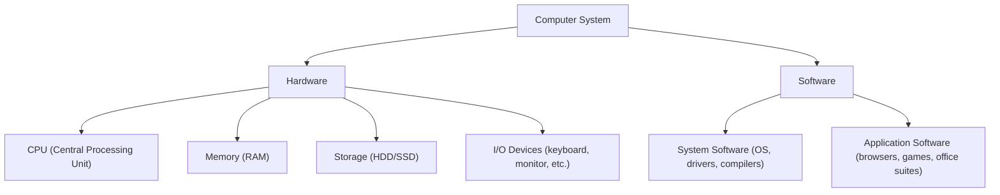
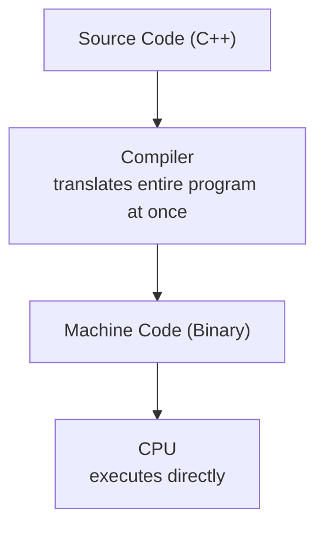
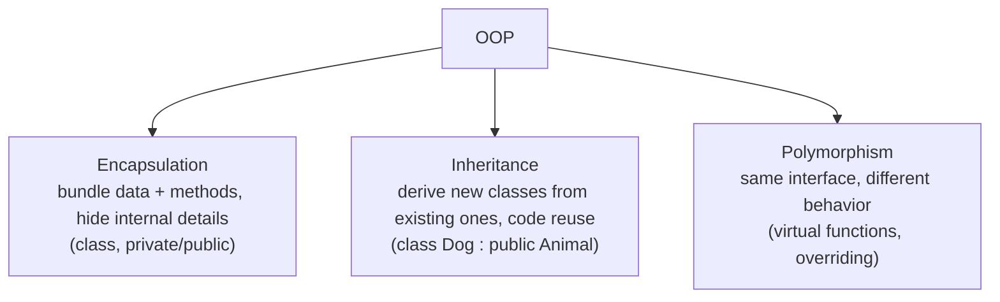
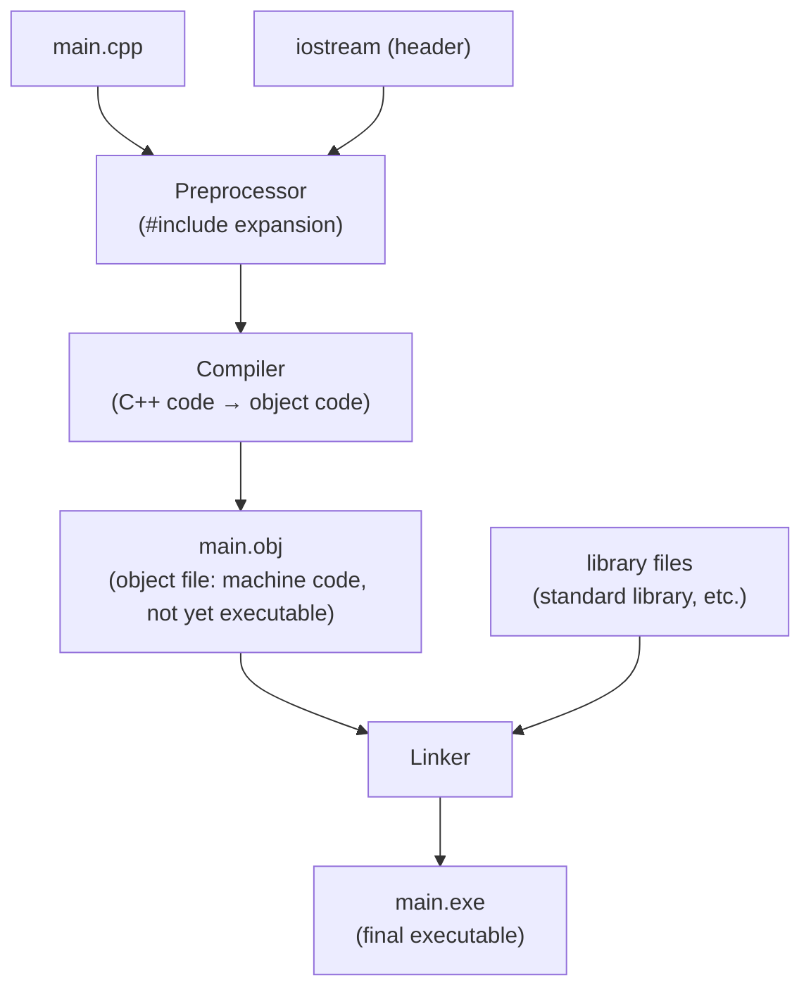

# Chapter 1 — Introduction to C++

[Repository Guide](../../README.md) | [English](Concepts_Lecture.md) | [한국어](Concepts_Lecture.ko.md)

> **Last Updated:** 2026-11-19
>
> 명품 C++ Programming, 황기태, Ch 1

> **Learning Objectives:**
> 1. Explain the importance of software and the characteristics of programming languages at each level
> 2. Explain the history of the C++ language and the evolution of its standard
> 3. Explain the features of C++ and the concepts of object-oriented and generic programming
> 4. Explain the C++ development process from editing through compiling, linking, and execution, and the kinds of errors
> 5. Explain the organization of the C++ standard library and its header styles

---

## Table of Contents

- [1. Computing and Programming](#1-computing-and-programming)
  - [1.1 Importance of Software](#11-importance-of-software)
  - [1.2 Programming Languages](#12-programming-languages)
  - [1.3 Compiler](#13-compiler)
  - [1.4 Properties of the Executables Produced by a Compiled Language](#14-properties-of-the-executables-produced-by-a-compiled-language)
- [2. C++ Language](#2-c-language)
  - [2.1 History](#21-history)
  - [2.2 Features](#22-features)
  - [2.3 Object-Oriented Programming](#23-object-oriented-programming)
  - [2.4 Generic Programming](#24-generic-programming)
  - [2.5 The Cost of C Compatibility](#25-the-cost-of-c-compatibility)
  - [2.6 Standard C++ Importance](#26-standard-c-importance)
  - [2.7 Comparing a C Program with a C++ Program](#27-comparing-a-c-program-with-a-c-program)
  - [2.8 Compiler Extensions and Checking Standard Conformance](#28-compiler-extensions-and-checking-standard-conformance)
  - [2.9 Compile Results That Depend on the Standard Edition](#29-compile-results-that-depend-on-the-standard-edition)
- [3. C++ Standard Libraries](#3-c-standard-libraries)
  - [3.1 Organization of the Standard Library](#31-organization-of-the-standard-library)
  - [3.2 The Future of `#include`: Modules](#32-the-future-of-include-modules)
  - [3.3 The Difference Between Header Files and Namespaces](#33-the-difference-between-header-files-and-namespaces)
- [4. C++ Development Process](#4-c-development-process)
  - [4.1 Build Pipeline](#41-build-pipeline)
  - [4.2 Error Types](#42-error-types)
  - [4.3 Execution and Debugging](#43-execution-and-debugging)
  - [4.4 Separate Compilation and Link Errors in Practice](#44-separate-compilation-and-link-errors-in-practice)
  - [4.5 Preprocessing and Translation Units](#45-preprocessing-and-translation-units)
  - [4.6 Compile Options and Warnings](#46-compile-options-and-warnings)
- [Summary](#summary)
- [Self-Check Questions](#self-check-questions)

---

<br>

## 1. Computing and Programming

### 1.1 Importance of Software

Modern society runs on **software**. From smartphones and automobiles to banking systems and medical devices, software controls virtually every aspect of daily life. Hardware alone is inert; it is software that gives hardware purpose and functionality.

As the saying "Software is eating the world" suggests, the competitiveness of companies such as eBay, Facebook, Google, Netflix, Apple, and Samsung comes from software. Software is also at the core of the technologies driving the Fourth Industrial Revolution, such as self-driving cars, artificial intelligence (Google's AlphaGo, IBM Watson), and the Internet of Things (IoT).



*Figure 1. Hardware and software that make up a computer system*

A **program** is a set of instructions written to perform a specific task. **Programming** (or coding) is the process of designing and writing these instructions using a programming language.

> **Key Point:** Software is the bridge between human intent and machine execution. Without programs, even the most powerful hardware cannot do useful work.

### 1.2 Programming Languages

A **programming language** is a formal notation for writing instructions that a computer can process. Languages are classified by their level of abstraction from the hardware.

| Level | Language | Example | Readability | Portability |
|:------|:---------|:--------|:----------:|:-----------:|
| Low-level | Machine Language | `10110000 01100001` | Very low | None |
| Low-level | Assembly Language | `MOV AL, 61h` | Low | None |
| High-level | C, C++, Java, Python | `cout << "Hello";` | High | High |

*Table 1. Classification of programming languages by abstraction level*

**Machine Language** (1st generation):
- Consists of binary codes (`0`s and `1`s) that the CPU directly executes.
- A CPU can inherently process only machine language.
- Differs for every CPU architecture, so it is completely **machine-dependent**.

**Assembly Language** (2nd generation):
- Represents machine instructions with human-readable **mnemonics** (e.g., `MOV`, `ADD`, `JMP`).
- One-to-one correspondence with machine instructions.
- Requires an **assembler** to translate to machine code.

**High-Level Languages** (3rd generation and above):
- Use natural-language-like syntax (`if`, `while`, `class`) to express complex tasks, data structures, and algorithms in a form people understand easily.
- One high-level statement may translate to many machine instructions.
- Requires a **compiler** or **interpreter** to translate to machine code.
- Generally **machine-independent**, so the same source code can be compiled on different platforms.

The following shows how the same computation, 35 + 56, is expressed at each language level.

| Machine Language | Assembly Language | C++ |
|:-----|:-----|:-----|
| `01010000` | `LOAD AX 35` | `int i;` |
| `00101001` | `LOAD BX 56` | `i = 35 + 56;` |
| `11101011` | `ADD AX BX` | |

*Table 2. Code that computes 35 + 56 in each language*

Converting an assembly program into machine code is called **assembling**, and converting a high-level language program into machine code is called **compiling**. The machine code and assembly in the table are illustrative; actual instructions and binary codes differ from CPU to CPU.

### 1.3 Compiler

A **compiler** translates the entire source code of a high-level language into machine code **before** execution. The resulting binary runs directly on the CPU.



*Figure 2. A compiler translating source code into machine code that the CPU executes*

| Translation Method | When | Languages | Speed |
|:-------------------|:-----|:----------|:------|
| **Compiler** | Before execution (all at once) | C, C++, Go, Rust | Fast execution |
| **Interpreter** | During execution (line by line) | Python, JavaScript, Ruby | Slower execution |

*Table 3. Comparison of compilers and interpreters*

C++ is a **compiled language**. The source code is fully translated into an executable binary before the program can run.

> **Note:** **Java's hybrid approach.** Java uses a hybrid approach in which the compiler produces bytecode, which is then interpreted (or JIT-compiled) by the JVM at runtime.

### 1.4 Properties of the Executables Produced by a Compiled Language

An executable produced by a compiler consists of the machine language of a particular CPU. Compiling the `hello.cpp` of Section 4.5 on macOS and checking the format of the executable with the `file` command gives the following on an Apple silicon (arm64) computer.

```text
$ c++ -std=c++17 hello.cpp -o hello
$ file hello
hello: Mach-O 64-bit executable arm64
$ c++ -std=c++17 -target x86_64-apple-macos12 hello.cpp -o hello_x86
$ file hello_x86
hello_x86: Mach-O 64-bit executable x86_64
```

`Mach-O` is the executable format of macOS, and `arm64` is the instruction set of the CPU. Compiling the same source file for x86-64 with the `-target` option produces a different executable in a different machine language. This example shows three properties.

- **Source code is portable; executables are not.** Source code written in a high-level language can be compiled on many platforms (the machine independence of Section 1.2), but a compiled executable runs only on its CPU and operating system. A Windows `.exe` does not run as it is on macOS. The program must be recompiled for each platform, which is why the source must follow the standard (Section 2.6).
- **No translation is needed at run time.** Translation is finished once before execution, so the computer that runs the program does not need a compiler. This is the main reason it runs faster than an interpreter, which translates line by line during execution.
- **Some errors are found before execution.** The compiler checks syntax and types while translating (Section 4.2), so it reports errors such as an assignment with mismatched types before the program runs, errors that an interpreted language would reveal only when that line runs.

On the other hand, the program must be recompiled every time the source changes, and compiling a large program takes time. C++ is widely used in operating systems, game engines, databases, and embedded systems, where execution speed and hardware control matter.

---

<br>

## 2. C++ Language

### 2.1 History

C++ was created by **Bjarne Stroustrup** at Bell Labs. He began work in **1979**, extending C with object-oriented features inspired by Simula. The language was initially called **C with Classes** and was renamed **C++** in **1983**. The `++` is C's increment operator, meaning a language one step beyond C.

The core idea: **C++ = C + Object-Oriented Programming (OOP)**.

```text
Timeline of C++
──────────────────────────────────────────────────────────────
1967    BCPL (Martin Richards): simplified CPL for compiler writing
1969    B (Ken Thompson): stripped-down BCPL for early UNIX
1972    C (Dennis Ritchie): B with types; rewrote UNIX
1979    C with Classes (Bjarne Stroustrup): C + OOP features
1983    C++: renamed; first public release
1998    C++98: first ISO standard (ISO/IEC 14882:1998)
2003    C++03: bug fixes for C++98
2011    C++11: major modernization (auto, lambda, move semantics,
               smart pointers, range-based for, nullptr)
2014    C++14: minor improvements to C++11
2017    C++17: structured bindings, std::optional, filesystem
2020    C++20: concepts, coroutines, ranges, modules, three-way
               comparison (<=>)
2023    C++23: std::print, deducing this, std::expected,
               std::flat_map, multidimensional subscript operator
2026    C++26: contracts (pre/post/contract_assert), <debugging>,
               <inplace_vector>, <hive>, <simd>, <linalg>,
               constexpr containers (map, set, deque, ...),
               std::execution (async scheduling)
──────────────────────────────────────────────────────────────
```

*Figure 3. Timeline of the C++ language and its standards*

> **Key Point:** C++11 is widely considered the dividing line between classical C++ and modern C++. Many coding practices changed fundamentally with C++11 features like `auto`, smart pointers, and lambda expressions.

> **Note:** **C++26.** C++26 is the standard targeted for publication in 2026. One of its headline features is **contracts**, a language-level mechanism for specifying function preconditions and postconditions. Conditions are written with `pre`, `post`, and `contract_assert`, which provide a more systematic checking facility than the old `assert()` macro. Compiler support for C++26 varies by feature, so check your compiler's support status before using it.

### 2.2 Features

C++ combines the low-level power of C with high-level abstractions. Its key features are as follows.

| Feature | Description |
|:--------|:------------|
| **C Compatibility** | Compatible with C at the source and link level; existing C programs can be reused as they are, so most C code compiles as C++, and C object files and libraries can be linked |
| **Object-Oriented Programming** | Encapsulation, polymorphism, and inheritance for modeling real-world entities (Section 2.3) |
| **Strict Type Checking** | Stronger type enforcement than C; catches more errors at compile time, reducing the chance of runtime errors and making debugging easier |
| **Inline Functions** | The `inline` keyword asks the compiler to expand a function at the call site, reducing the call overhead of small, frequently called functions (Chapter 3) |
| **Function Overloading** | Declare several functions with the same name but different numbers or types of parameters (Chapter 6) |
| **Default Parameters** | Declare a function so that a preset default value is passed to a parameter when the argument is omitted (Chapter 6) |
| **References** | Alias for an existing variable (`int& ref = x;`); safer alternative to pointers in many cases (Chapter 5) |
| **Call by Reference** | Pass arguments by reference in a function call so that the function works directly on the original variables (Chapter 5) |
| **`new` / `delete`** | Dynamic memory management operators replacing C's `malloc`/`free` (Chapter 4) |
| **Operator Overloading** | Redefine operators (`+`, `-`, `<<`, etc.) for user-defined types (Chapter 7) |
| **Generics / Templates** | Write type-independent code; the compiler generates specialized versions for each type (Section 2.4, Chapter 10) |
| **STL (Standard Template Library)** | Rich collection of containers (`vector`, `map`), algorithms (`sort`, `find`), and iterators (Chapter 10) |

*Table 4. Key features of the C++ language*

Function overloading, default parameters, references, call by reference, `new` and `delete`, operator overloading, and generic functions and classes are features that C++ added to the C language.

### 2.3 Object-Oriented Programming

**The three pillars of object-oriented programming:**



*Figure 4. The three pillars of object-oriented programming*

**Encapsulation** wraps data in a capsule to protect it from outside access. In C++, the capsule is expressed with the `class` keyword. A **class** is a mold (blueprint) for making objects, and an **object** is an entity created from that mold; an object is also called an **instance**.

```cpp
class Circle {
private:
    int radius;   // radius value
public:
    Circle(int r) { radius = r; }
    double getArea() { return 3.14 * radius * radius; }
};
```

In the `Circle` class, which abstracts a circle, `radius` is `private` and cannot be accessed from outside; only the constructor `Circle(int r)` and `getArea()` are exposed. This class can create many circle objects with different radii. Classes and objects are covered in detail in Chapter 3.

**Polymorphism** is the phenomenon in which one function appears or behaves differently depending on the situation. C++ supports polymorphism through the following three means.

- **Operator overloading:** The same operator is given different meanings depending on the operand types. For example, `2 + 3` is 5, but `string("C") + string("++")` joins the two strings into `"C++"`, and a class representing colors can define a red object + a blue object to be a purple object.
- **Function overloading:** Several functions with the same name but different parameters are defined, such as `void add(int a, int b)`, `void add(int a, int b, int c)`, and `void add(int a, double d)`.
- **Function overriding:** A derived class redefines a virtual function of its base class, so the same function call behaves differently depending on the actual type of the object. `speak()` in the example below is such a case.

Once an **inheritance** relationship is defined, an object of the child class can use the member functions and member variables of the parent class without defining them separately. Inheritance is covered in Chapter 8, and virtual functions and overriding in Chapter 9.

```cpp
#include <iostream>
using namespace std;

class Animal {
public:
    virtual void speak() { cout << "..." << endl; }
};

class Dog : public Animal {
public:
    void speak() override { cout << "Woof!" << endl; }
};

int main() {
    Animal* pet = new Dog();
    pet->speak();   // Output: Woof!  (polymorphism)
    delete pet;
    return 0;
}
```

> **Note:** **Support for multiple paradigms.** C++ supports multiple programming paradigms, including procedural, object-oriented, and generic programming. You are not forced to use OOP for every program.

C++ introduced object orientation for two purposes. The first is **improving software productivity**. As software life cycles became shorter, the need to reuse already written code grew, and C++ addresses this with class inheritance and object reuse. The second is **easy modeling of the real world**. Software in the past centered on mathematical computation and statistical processing, for which procedural languages were suitable, but the real world consists of objects and modern software must describe the interactions among objects, so object-oriented languages centered on objects are suitable.

**Procedural programming** lists a sequence of instructions in the order of the steps to be executed; the programmer designs a flowchart and writes the program according to it. **Object-oriented programming** defines objects and implements the program through the relationships and interactions among those objects.

### 2.4 Generic Programming

**Generic functions** and **generic classes** are functions and classes generalized so that the same program code can be applied to various data types. In C++ they are declared with the `template` keyword, so they are also called template functions and template classes, and other languages such as Java and C# have the same concept.

```cpp
template <typename T>
T bigger(T a, T b) {              // generic function that works for any type T
    return (a > b) ? a : b;
}

int main() {
    int i = bigger(3, 7);         // T = int, i = 7
    double d = bigger(2.5, 1.5);  // T = double, d = 2.5
    return 0;
}
```

The paradigm of writing programs with generic functions and generic classes is called **generic programming**, and its importance keeps growing. Templates are covered in detail in Chapter 10.

### 2.5 The Cost of C Compatibility

C++ pursues compatibility with the C language. This lets existing C program code be reused, but it comes at a cost. As in C, global variables and global functions can be used, and some functions such as `main()` can only be written as global functions, so the principle of encapsulating all data and functions inside classes breaks down. There is also a risk of side effects when several functions modify global variables.

### 2.6 Standard C++ Importance

The **ANSI/ISO C++ standard** ensures that C++ code behaves consistently across different compilers and platforms. Writing **standard-conformant code** is critical for portability.

The C++ standard was first established in 1998 by ISO and the American National Standards Institute (ANSI), and the standard document is ISO/IEC 14882. The standard has evolved through C++98 (1998), C++03 (2003), the technical report on standard library extensions TR1 (2007), C++11, C++14, C++17, C++20, and C++23.

| Category | Description | Example |
|:---------|:------------|:--------|
| **Standard Program** | Uses only features defined by the ISO standard | `std::cout`, `std::vector` |
| **Non-Standard Program** | Uses compiler-specific extensions | `__cdecl`, `__declspec`, `#pragma once` |

*Table 5. Comparison of standard and non-standard programs*

A standard C++ program compiles and runs correctly on any compliant compiler (GCC, Clang, MSVC, etc.). A non-standard program may compile only on a specific compiler or platform.

For example, a program written by the standard rules compiles on every standard compiler, such as Visual C++, GNU C++, and Borland C++, and produces the same result regardless of the operating system or compiler. In contrast, a program that uses a Visual C++-specific keyword, as in `int __cdecl main()`, compiles only with the Visual C++ compiler.

```cpp
// Standard C++: portable
#include <iostream>
int main() {
    std::cout << "Hello" << std::endl;
    return 0;
}
```

```cpp
// Non-standard: compiler-specific extension (MSVC)
void __cdecl myFunc();   // __cdecl is MSVC-specific calling convention
```

> **Caution:** Avoid compiler-specific extensions unless absolutely necessary. If you must use them, isolate them behind platform-specific `#ifdef` guards so the rest of your code remains portable.

### 2.7 Comparing a C Program with a C++ Program

Placing a C program and a C++ program that do the same work side by side shows where in the code the differences listed in the table of Section 2.2 appear. The following two programs print the sum and the average of three scores.

```c
#include <stdio.h>

int main(void) {
    int scores[3] = {90, 85, 77};
    int sum = 0;
    int i;
    for (i = 0; i < 3; i++)
        sum += scores[i];
    printf("sum=%d avg=%.2f\n", sum, sum / 3.0);
    return 0;
}
```

```cpp
#include <iostream>
using namespace std;

int main() {
    int scores[3] = {90, 85, 77};
    int sum = 0;
    for (int i = 0; i < 3; i++)
        sum += scores[i];
    cout << "sum=" << sum << " avg=" << sum / 3.0 << endl;
    return 0;
}
```

```text
C:   sum=252 avg=84.00
C++: sum=252 avg=84
```

| Item | C program | C++ program |
|:----|:----|:----|
| I/O header | `<stdio.h>` | `<iostream>` (no `.h` extension, Section 3.1) |
| Scope of names | Standard function names are in the global scope | Standard names are in the `std` namespace, so `using namespace std;` or `std::` is needed |
| Parameters of `main()` | `(void)` states that there are no parameters | `()` alone means there are no parameters |
| Loop variable | Declaring `int i;` at the start of the block is the C89 convention | Declared where it is used, as in `for (int i = 0; ...)` |
| Output | Format specifiers `%d` and `%.2f` set the type and appearance of each value | `<<` decides how to print from the type of the value |

*Table 6. Differences between a C program and a C++ program that do the same work*

The two programs print the average differently because of their output methods. `%.2f` in `printf` specifies two digits after the decimal point, while `cout` prints 84.0 as `84` in its default format. Ways to change the output format are covered with the input/output streams in Chapter 11.

Most C programs compile unchanged with a C++ compiler as well, but not all of them. The following C code compiles without errors with a C compiler but is an error in C++ for two reasons.

```c
#include <stdlib.h>
int main(void) {
    int new = 5;                        /* an ordinary identifier in C */
    int *p = malloc(sizeof(int) * new); /* void* converted implicitly to int* */
    free(p);
    return 0;
}
```

- **New keywords:** Keywords that C++ introduced, such as `new`, `delete`, `class`, `this`, and `bool`, can be used as variable names in C but not in C++. Compiling `int new = 5;` as C++ makes Apple clang report "expected unqualified-id".
- **Implicit conversion of `void*`:** C lets the `void*` returned by `malloc()` be assigned directly to another pointer type, but C++ does not allow it because of its stricter type checking (Table 4). Even after renaming the variable to `n`, the error "cannot initialize a variable of type 'int *' with an rvalue of type 'void *'" remains. In C++, either convert explicitly, as in `(int*)malloc(...)`, or use `new int[n]` from Chapter 4.

For the same reason, `char *s = "abc";`, which was fine in C, makes Apple clang warn "ISO C++11 does not allow conversion from string literal to 'char *'" in C++, because a string literal is an array of `const char`; the correct declaration is `const char *s = "abc";`.

### 2.8 Compiler Extensions and Checking Standard Conformance

As seen in Section 2.6, compilers sometimes provide features that are not in the standard as extensions. Code that uses an extension works well with that compiler, so it is easy to use one without knowing that it is not standard. The following are three examples often seen in beginners' C++ code.

| Code | Status in standard C++ | Reaction of Apple clang |
|:----|:----|:----|
| `int n; cin >> n; int arr[n];` | Not standard, because an array size must be a compile-time constant (variable-length arrays are a C99 feature) | Compiles it as an extension, with the warning "variable length arrays in C++ are a Clang extension" even without warning options |
| `#include <bits/stdc++.h>` | An internal header found only in GCC's libstdc++ implementation | "fatal error: 'bits/stdc++.h' file not found" |
| `void main() { }` | The return type of `main()` must be `int` | "error: 'main' must return 'int'" |

*Table 7. Non-standard code and the reactions of Apple clang*

- GCC and Clang accept variable-length arrays as an extension, so the code runs with those two compilers, but it is a compile error with MSVC. Arrays whose size is decided at run time are created with `new int[n]` from Chapter 4 or with `vector` from Chapter 10.
- `<bits/stdc++.h>` is an internal GCC file that includes the standard headers all at once. Clang on macOS, which uses libc++, does not have this file, so the needed standard headers (`<iostream>`, `<vector>`, and so on) are included one by one.
- Some old compilers accepted `void main()`, but the standard specifies only `int main()` and `int main(int argc, char *argv[])`. Treating a missing `return` at the end of `main()` as returning 0 is a special rule that applies only to `main()`.

To check standard conformance, specify the standard edition, as in `-std=c++17`, and get a warning every time an extension is used with the `-pedantic` option (GCC, Clang). Values with `gnu`, such as `-std=gnu++17`, select a mode that allows GNU extensions, so they are not used when checking code that must be portable.

### 2.9 Compile Results That Depend on the Standard Edition

As the timeline of Figure 3 shows, each edition of the C++ standard adds features. Even the same source may give different results depending on the edition specified at compile time, so knowing which edition is used matters. The following program uses the structured binding added in C++17 (Chapter 10) to receive the two values of a `pair` separately in `a` and `b`.

```cpp
#include <iostream>
#include <utility>
int main() {
    std::pair<int, int> p(3, 4);
    auto [a, b] = p;                  // structured binding
    std::cout << a + b << std::endl;
    return 0;
}
```

```text
$ c++ -std=c++11 std.cpp -o s11
std.cpp:5:10: warning: decomposition declarations are a C++17 extension [-Wc++17-extensions]
$ c++ -std=c++11 -pedantic-errors std.cpp -o s11e
std.cpp:5:10: error: decomposition declarations are a C++17 extension [-Werror,-Wc++17-extensions]
$ c++ -std=c++17 -Wall std.cpp -o s17
$ ./s17
7
```

Compiled with `-std=c++11`, Apple clang accepts this syntax while warning that it is a "C++17 extension". Adding `-pedantic-errors`, which makes the compiler hold strictly to the edition, turns the same message into an error, and no executable is produced. Compiled with `-std=c++17`, the syntax is standard, so it compiles without warnings and prints 7. The default edition a compiler uses when none is specified differs by compiler and version, so, as Section 2.8 said, it is best to always specify `-std`. The code in these notes is based on C++17.

---

<br>

## 3. C++ Standard Libraries

### 3.1 Organization of the Standard Library

C++ provides a rich set of standard libraries. By header style, they are divided into **C-inherited libraries** and **C++-specific libraries**.

| Category | Header Style | Examples | Description |
|:---------|:-------------|:---------|:------------|
| C library (C++ form) | `<cXXX>` (no `.h`) | `<cstring>`, `<cstdio>`, `<cmath>`, `<cstdlib>` | C standard functions wrapped in the `std` namespace |
| C++ library | `<XXX>` (no `.h`) | `<iostream>`, `<string>`, `<vector>`, `<algorithm>` | C++-native features: streams, strings, containers, etc. |

*Table 8. Classification of the C++ standard library by header style*

By function, the library is divided into the following three groups.

- **C library:** Functions that adopt the existing C standard library for use in C++; they are declared in header files whose names start with `c`.
- **C++ I/O library:** The library for console and file input and output (`<iostream>`, `<fstream>`, etc.).
- **C++ STL library:** The template library that supports generic programming (`<vector>`, `<algorithm>`, etc.).

**Key differences from C headers:**

1. **No `.h` extension:** C++ standard headers do not use `.h`. `<iostream.h>` is a non-standard header from pre-standard versions of C++ and is no longer used.
2. **`std` namespace:** All standard library names live in the `std` namespace. You access them with `std::` prefix or a `using` declaration.
3. **C headers as `<cXXX>`:** The C library header `<string.h>` becomes `<cstring>` in C++, placing its functions in `std::`.

```cpp
#include <iostream>    // C++ I/O stream library
#include <string>      // C++ string class
#include <vector>      // C++ dynamic array
#include <cmath>       // C math functions (sqrt, pow, etc.) in std::

int main() {
    std::string name = "C++";
    std::vector<int> nums = {1, 2, 3};
    std::cout << name << std::endl;
    std::cout << std::sqrt(2.0) << std::endl;
    return 0;
}
```

> **Key Point:** Always use the C++ form `<cstring>` instead of the C form `<string.h>` in C++ programs. The `<cXXX>` form guarantees that names are placed in the `std` namespace.

### 3.2 The Future of `#include`: Modules

> **Note:** **C++20 and C++23.** The modules feature requires C++20 or later, and `import std;` in the example below requires C++23 or later.

C++20 introduced **modules**, a modern replacement for the traditional `#include` and header-file model. Modules eliminate many long-standing problems with headers: redundant parsing, macro leakage, and fragile include order dependencies.

```cpp
// Traditional approach (headers)
#include <iostream>

// Modern approach (modules, C++20)
import std;           // import the entire standard library as a module

int main() {
    std::cout << "Hello from modules!" << std::endl;
    return 0;
}
```

`import std;`, which imports the entire standard library as a single module, was added in C++23. In C++20, a standard header can be imported as a header unit, as in `import <iostream>;`.

Modules are not yet universally supported across all compilers and build systems, but they represent the direction C++ is heading. For now, `#include` remains the standard practice in most codebases.

### 3.3 The Difference Between Header Files and Namespaces

`#include <iostream>` and `using namespace std;` are almost always used together, so they seem to do the same thing, but they do different things. A header file is a device that **brings in declarations**, and a namespace is the **scope that a name belongs to**.

| Aspect | Header file (`#include <iostream>`) | Namespace (`std`) |
|:----|:----|:----|
| What it is | A text file that contains declarations | A scope that groups names |
| Stage of processing | Its contents are copied into place at the preprocessing stage (Section 4.5) | Used when names are looked up at the compile stage |
| When omitted | There is no declaration of `std::cout`, so even the name `std` is unknown | The declaration exists, but the name `cout` alone cannot be found |

*Table 9. Roles of header files and namespaces*

Omitting each of the two in turn shows the difference in the error messages. First, using `std::cout` without `#include <iostream>` gives the following.

```cpp
int main() {
    std::cout << "Hello" << std::endl;
    return 0;
}
```

```text
noinc.cpp:2:5: error: use of undeclared identifier 'std'
```

The `std` namespace and the `cout` inside it are declared in `<iostream>` (and the headers it includes), so without the header the compiler does not even know the name `std`. Conversely, including the header but omitting both `std::` and the using directive gives the following.

```cpp
#include <iostream>
int main() {
    cout << "Hello" << endl;
    return 0;
}
```

```text
nostd.cpp:3:5: error: use of undeclared identifier 'cout'; did you mean 'std::cout'?
```

This time the declaration exists, so the compiler even knows that `std::cout` exists and suggests a fix. `cout` is declared inside the `std` namespace, so without naming the namespace, the lookup searches the global scope for `cout` and fails. In short, the header tells "what exists", and `std::` or a using directive tells "in which scope to look for it". Namespaces are covered in detail in Chapter 2.

---

<br>

## 4. C++ Development Process

### 4.1 Build Pipeline

The process of creating a C++ program follows the four phases below.


*Figure 5. The four phases of C++ program development*



*Figure 6. Building an executable through preprocessing, compiling, and linking*

| Stage | Input | Output | What It Does |
|:------|:------|:-------|:-------------|
| **Edit** | None | `.cpp` source file | Write the program in a text editor or IDE |
| **Compile** | `.cpp` source | `.obj` / `.o` object file | Translate C++ source to machine code; syntax and type checking |
| **Link** | `.obj` file(s) + libraries | `.exe` executable | Combine object files; resolve external references (e.g., `cout`) |
| **Execute** | `.exe` executable | Program output | Run the program and verify results |

*Table 10. Input, output, and work of each development stage*

- **Edit:** A C++ source program is a text file, so it can be edited with a text editor, and its standard extension is `.cpp`. An **integrated development environment (IDE)** that supports every stage of editing, compiling, linking, running, and debugging is convenient; Visual Studio is a representative example.
- **Compile:** The C++ source program is converted into an object file containing machine code (`hello.cpp` → `hello.obj`). One source line usually becomes several machine instructions; for example, with Visual C++ for 32-bit x86, `std::cout << "Hello";` is translated into instructions that push the address of the string onto the stack and call the `<<` operator function.
- **Link:** An object file cannot be executed directly. The linker connects the object file with functions of the C++ standard library to build an executable. For example, it combines `hello.obj` with the `cout` object and the `<<` operator function from the standard library to make `hello.exe`.

The extensions `.obj` and `.exe` are those of Windows (Visual Studio). On Linux and macOS, object files have the extension `.o`, and executables are built without an extension (named `a.out` if no name is given).

> **Key Point:** Compilation and linking are separate stages. The compiler translates one source file at a time into an object file. The linker then combines all object files (and libraries) into a single executable.

> **[Systems Programming]** The linker, studied in systems programming, collects the symbols (functions and global variables) that each object file defines and references, finds for each reference the object file or library that defines the symbol (symbol resolution), and places the code and data in the executable while fixing each reference to an actual address (relocation). The link error of Section 4.2 arises when a reference is left whose definition this symbol resolution cannot find.

### 4.2 Error Types

Errors in C++ programs are classified into three kinds by **when** they are detected.

| Error Type | When Detected | Cause | Example |
|:-----------|:-------------|:------|:--------|
| **Compile Error** | Compilation | Syntax mistakes, type mismatches, undeclared identifiers | Missing `;`, wrong type conversion |
| **Link Error** | Linking | Missing function or variable definitions, unresolved symbols | Calling a function with no implementation |
| **Runtime Error** | Execution | Logic errors, illegal operations | Division by zero, accessing invalid memory |

*Table 11. Classification of errors by detection time*

**Compile error:**
```cpp
#include <iostream>
using namespace std;

int main() {
    cout << "Hello" << endl  // missing semicolon → compile error
    return 0;
}
```

**Link error:**
```cpp
void myFunction();   // declared but never defined

int main() {
    myFunction();    // linker cannot find the definition → link error
    return 0;
}
```

**Runtime error:**
```cpp
#include <iostream>
using namespace std;

int main() {
    int a = 10, b = 0;
    cout << a / b << endl;  // division by zero → runtime error
    return 0;
}
```

Dividing an integer by zero is undefined behavior in the C++ standard, so the result cannot be predicted. On x86 processors a hardware exception occurs and the program terminates abnormally, but some systems, such as ARM processors, produce some value without an exception and keep running.

> **Caution:** Compile errors are caught by the compiler and are the easiest to fix. Runtime errors are the hardest, because the program compiles and links successfully but produces incorrect results or crashes during execution.

### 4.3 Execution and Debugging

An executable file can be run directly on its own. An error in which the desired result does not come out or the program terminates abnormally during execution is called a **run-time error**, which corresponds to the runtime error in Section 4.2.

The process of finding errors that occur during execution is called **debugging**, and a program that helps with debugging is called a **debugger**. A debugger is usually supplied together with the compiler by the company that makes it. **Source-level debugging** finds errors by executing the C++ source one line at a time while watching how variable values change, and most IDEs, including Visual Studio, support it.

### 4.4 Separate Compilation and Link Errors in Practice

Running the steps of Section 4.1 one command at a time shows directly that compiling and linking happen separately and why the link errors of Section 4.2 arise. The following program consists of a header file that declares the function `square()`, a source file that defines it, and a source file that calls it.

```cpp
// util.h
int square(int n);            // declaration (prototype) of the function

// util.cpp
#include "util.h"
int square(int n) { return n * n; }   // definition of the function

// main.cpp
#include <iostream>
#include "util.h"
int main() {
    std::cout << square(7) << std::endl;
    return 0;
}
```

In a macOS terminal, compiling each source file with the `-c` option produces only an object file without linking. The last command links the two object files into the executable `app`.

```text
$ c++ -std=c++17 -c main.cpp -o main.o
$ c++ -std=c++17 -c util.cpp -o util.o
$ c++ main.o util.o -o app
$ ./app
49
```

When compiling `main.cpp`, the compiler sees only the prototype in `util.h` and checks that the call `square(7)` is correct (one `int` argument and an `int` return value). It does not know where the actual code of the function is, so `main.o` keeps only a reference saying "calls `square(int)`". Connecting this reference to the definition in `util.o` is the job of the linker.

Leaving `util.o` out of the link gives a link error, because there is no definition to connect the reference in `main.o` to.

```text
$ c++ main.o -o app2
Undefined symbols for architecture arm64:
  "square(int)", referenced from:
      _main in main.o
ld: symbol(s) not found for architecture arm64
```

Conversely, when two object files define the same function, the linker cannot decide which definition to use, and this is also a link error. The following links `util2.cpp`, which defines `square()` once more, after compiling it.

```text
$ c++ main.o util.o util2.o -o app3
duplicate symbol 'square(int)' in:
    .../util2.o
    .../util.o
ld: 1 duplicate symbols
```

Both errors passed the compile step. The compiler translates each source file separately, so it cannot know whether a definition exists in another file or how many there are, and only the linker, which gathers all the object files, can decide this. Putting the definition of a function in a header file and including that header in two source files also places the same definition in two object files and causes the second error, which is why header files usually hold only declarations (Section 7 of Chapter 3). The format of the error messages depends on the linker; the above is the output of the linker used by Apple clang on macOS. The link errors that arise when object files from a C compiler are linked with C++ object files are covered in Section 6 of Chapter 13.

### 4.5 Preprocessing and Translation Units

The compile step of Section 4.1 actually consists of three sub-steps: preprocessing, compiling, and assembling. The preprocessor handles the directives that begin with `#`, copying the contents of the header file named by `#include` into its place as it is and expanding macros. The result of preprocessing, that is, one source file combined with all the headers it includes, is called a **translation unit**, and the compiler translates translation units one at a time, separately.

```cpp
#include <iostream>
int main() {
    std::cout << "Hello" << std::endl;
    return 0;
}
```

Preprocessing this 5-line `hello.cpp` alone with the `-E` option and counting the lines of the result gives 64,276 lines with Apple clang on macOS. `<iostream>` includes other headers in turn, and those headers contain the declarations of standard library classes and functions. The 5 lines the programmer wrote are only the tail end of this huge translation unit.

```text
$ wc -l < hello.cpp
       5
$ c++ -std=c++17 -E hello.cpp | wc -l
   64276
```

The object file compiled from a translation unit records both the symbols the file **defines** and the symbols it only **refers to**. Viewing the symbols of `hello.o` with `nm` shows `main` marked `T` (code defined in this file) and `std::cout` marked `U` (a symbol not defined here that must be found elsewhere).

```text
$ c++ -std=c++17 -c hello.cpp -o hello.o
$ nm hello.o | c++filt | grep -E 'cout|main'
                 U std::__1::cout
0000000000000000 T _main
```

The actual `std::cout` object lives in the C++ standard library (libc++ on macOS), so when the linker builds the executable, it connects this `U` symbol to the definition in the library. The "Undefined symbols" error of Section 4.4 is the case in which the linker cannot find a definition for some `U` symbol in any object file or library. The `std::__1` in the output is an internal namespace that libc++ places inside the standard namespace, and the programmer simply writes `std::cout`.

The size of these headers is also part of the background for the modules of Section 3.2. When several source files include the same header, the compiler must read the same tens of thousands of lines of declarations again for each translation unit.

### 4.6 Compile Options and Warnings

The options used when compiling from the command line set the level of checking by the compiler and the properties of the output. Options often used with GCC and Clang are as follows.

| Option | Meaning | When to use |
|:----|:----|:----|
| `-std=c++17` | Sets the edition of the C++ standard to follow | Always; the available features differ by edition |
| `-c` | Produces only an object file without linking | Separate compilation (Section 4.4) |
| `-o name` | Sets the name of the output file | Without it the executable is named `a.out` |
| `-Wall -Wextra` | Turns on warnings about common mistakes | Always; warnings are not errors, so the executable is still produced |
| `-g` | Includes source line information for the debugger | When debugging (Section 4.3) |
| `-O2` | Optimizes for execution speed | When building a finished program |

*Table 12. Frequently used compile options*

A warning reports code that is syntactically valid but likely to differ from the intent. The following program has two mistakes.

```cpp
#include <iostream>
int main() {
    int x = 3;
    if (x = 5)
        std::cout << "x is 5" << std::endl;
    int y;
    std::cout << y << std::endl;
    return 0;
}
```

```text
$ c++ -std=c++17 -Wall -Wextra warn.cpp -o warn
warn.cpp:4:11: warning: using the result of an assignment as a condition without parentheses [-Wparentheses]
warn.cpp:7:18: warning: variable 'y' is uninitialized when used here [-Wuninitialized]
```

- `if (x = 5)` is the mistake of writing the assignment `=` when the comparison `==` was meant. The value of an assignment expression is the assigned 5, which is not 0, so the condition is always true, and `x` is changed to 5 as well. It is not a syntax error, so the code compiles, but Apple clang warns.
- `y` is read without being initialized, so the printed value is not determined (undefined behavior).

Compiling the same file without warning options still makes Apple clang 21 give some warnings that are on by default, but which warnings are on by default differs by compiler and version. Specifying warning options and fixing the code until no warning remains is the easiest way to reduce run-time errors (Section 4.2). The optimization option also changes the output. Compiling `hello.cpp` of Section 4.5 with `-O2` changes the size and the machine code of the object file; in this environment `hello.o` was 9,952 bytes and the object file built with `-O2` was 4,632 bytes. Optimization changes the code only within limits that preserve the meaning of the program, but a program with undefined behavior may behave differently depending on whether it is optimized.

---

<br>

## Summary

| Concept | Key Summary |
|:--------|:-------------|
| Software Importance | Software gives hardware purpose, and modern life and Fourth Industrial Revolution technologies depend on programs. |
| Programming Languages | The level of abstraction rises from machine language (binary) to assembly (mnemonics) to high-level languages (C, C++, Python). |
| Compiler | A compiler translates the entire source code into machine code before execution, and C++ is a compiled language. |
| C++ History | Bjarne Stroustrup started C with Classes in 1979 and renamed it C++ in 1983, and the standard continues through C++98, C++11, C++20, C++23, and C++26. |
| C++ = C + OOP | C++ is compatible with C and adds encapsulation, inheritance, and polymorphism. |
| Key Features | C++ provides function overloading, default parameters, references, `new`/`delete`, operator overloading, templates, inline functions, and the STL. |
| Purpose of OOP | Object orientation raises software productivity through code reuse and makes it easy to model a real world made of objects. |
| Generic Programming | Generic functions and classes declared with `template` apply the same code to many types. |
| Cost of C Compatibility | Global variables and functions remain usable, which breaks the encapsulation principle and risks side effects. |
| Standard C++ | The ANSI/ISO standard ensures portability, so compiler-specific extensions should be avoided. |
| C++ Libraries | Headers such as `<cstring>` (C-inherited) and `<iostream>` (C++-native) have no `.h`, and their names live in the `std` namespace. |
| Build Pipeline | Development proceeds in the order edit (.cpp), compile (.obj), link (.exe), and execute. |
| Compile Error | Syntax or type mistakes are detected during compilation. |
| Link Error | Missing definitions of functions or variables are detected during linking. |
| Runtime Error | Logic errors or illegal operations appear during execution and are found with a debugger. |
| Separate compilation and link errors | Source files are compiled one by one into object files with `-c` and then linked; a reference without a definition causes an undefined symbol error, and two identical definitions cause a duplicate symbol error, both at the link step. |
| Comparing C and C++ programs | C++ uses `<iostream>` and the `std` namespace, output with `<<`, and variable declarations where they are used, and some C code does not compile as C++ because of new keywords and the ban on implicit conversion of `void*`. |
| Compiler extensions | Variable-length arrays, `<bits/stdc++.h>`, and `void main()` are not standard, and `-std=c++17 -pedantic` gives warnings when extensions are used. |
| Header files and namespaces | A header file is a preprocessing device that brings in declarations, and a namespace is the scope a name belongs to, so omitting the header leaves `std` unknown and omitting the namespace leaves `cout` unfound. |
| Translation unit | One source file combined by preprocessing with all the headers it includes, translated separately by the compiler; the object file records the symbols it defines and the symbols it only refers to. |
| Properties of executables | A compiled executable consists of the machine language of a particular CPU and operating system, so it must be recompiled for each platform, but it needs no translation at run time and some errors are found before execution. |
| Compile options and warnings | `-std`, `-c`, `-o`, `-Wall -Wextra`, `-g`, and `-O2` set the standard edition, the output, warnings, debugging information, and optimization; warnings do not block the executable but report code that differs from the intent. |
| Standard edition and compilation | The same source may give a warning, an error, or a normal compilation depending on the edition specified with `-std`, so the edition is always specified. |

---

<br>

## Self-Check Questions

1. **Compiler and interpreter:** Explain the difference between a compiler and an interpreter in terms of translation time and execution speed, and state which approach C++ and Python each use.

   <details>
   <summary>Answer</summary>

   A compiler translates the entire source code into machine code before execution and produces an executable, whereas an interpreter translates and executes the source one line at a time during execution. Because translation is finished in advance, compiled programs generally run faster. C++ uses compilation, and Python uses interpretation.

   </details>

2. **Classifying errors:** State the kind of error in each case. (a) A function that was declared but never defined is called. (b) The semicolon at the end of a statement is missing. (c) An integer is divided by zero during execution.

   <details>
   <summary>Answer</summary>

   (a) is a link error because the linker cannot find the function's definition. (b) is a compile error because it is a syntax mistake. (c) is a runtime error because compiling and linking succeed but the problem appears during execution.

   </details>

3. **Development process:** List in order the stages from `hello.cpp` until `hello.exe` is built and run, with the output of each stage, and explain why an object file cannot be executed directly.

   <details>
   <summary>Answer</summary>

   `hello.cpp` is written by editing, compiling (including preprocessing) produces the object file `hello.obj`, linking produces the executable `hello.exe`, and then it is executed. The object file does not contain code defined in the standard library, such as the `cout` object or the `<<` operator function, so its external references are unresolved; it can run only after the linker combines it with the library.

   </details>

4. **Three pillars of OOP:** Explain encapsulation, inheritance, and polymorphism in one sentence each, and name the three means by which C++ supports polymorphism.

   <details>
   <summary>Answer</summary>

   Encapsulation bundles data and functions into a class and protects the internals from outside access. Inheritance lets a child class inherit and use the member variables and member functions of a parent class without defining them separately. Polymorphism means that one function behaves differently depending on the situation. C++ supports polymorphism through operator overloading, function overloading, and function overriding.

   </details>

5. **Standard headers:** Give the C++-form header names corresponding to the C headers `<string.h>` and `<math.h>`, and explain why C++ programs use the C++ form.

   <details>
   <summary>Answer</summary>

   They are `<cstring>` and `<cmath>`. The `<cXXX>` form is the C++ standard way, and it guarantees that the declared names are placed in the `std` namespace.

   </details>

6. **Identifying link errors:** If, in the three files of Section 4.4, the definition in `util.cpp` is changed to `int square(long n) { return n * n; }` while `util.h` is left unchanged, at which step, compiling or linking, does an error occur, and what error?

   <details>
   <summary>Answer</summary>

   `main.cpp` and `util.cpp` each compile, but an undefined symbol error occurs at the link step. `main.cpp` sees the prototype `int square(int)` in `util.h` and creates a reference that calls that function, but `util.cpp` defines only a different function, `square(long)`. In C++, two functions with different parameter types are different functions, so the linker cannot find the definition of `square(int)`.

   </details>

7. **Compiling C code as C++:** Explain why `char *buf = malloc(100);` compiles in C but not in C++, and give two ways to fix it in C++.

   <details>
   <summary>Answer</summary>

   C allows the `void*` returned by `malloc()` to be assigned implicitly to another pointer type, but C++ checks types more strictly and does not allow the implicit conversion from `void*` to `char*`. In C++, either convert explicitly, as in `char *buf = (char*)malloc(100);`, or allocate with `char *buf = new char[100];` and later release it with `delete[] buf;`.

   </details>

8. **Headers and namespaces:** Why does a program that omits `#include <string>` but writes `using namespace std; string s;` fail to compile, and why does a program that has `#include <string>` but writes `string s;` without `std::` or a using directive fail to compile?

   <details>
   <summary>Answer</summary>

   In the first program there is no header that brings in the declaration of the `string` class, so even though the using directive makes lookup search `std`, there is no declaration of `string` inside `std` and the name is not found (if another header happened to include `<string>`, it might compile). In the second program the declaration exists, but `string` is inside the `std` namespace, so without naming the namespace, the lookup searches the global scope for `string` and fails.

   </details>

9. **Warnings and errors:** The `warn.cpp` of Section 4.6 produces an executable even though it gives two warnings. Explain the difference between warnings and errors, and write the code with `if (x = 5)` fixed as intended and its output.

   <details>
   <summary>Answer</summary>

   An error is code that does not conform to standard C++ and cannot be translated, so the compiler does not produce an object file. A warning reports code that is syntactically valid but likely to differ from the intent, so translation continues. The intent is a comparison, so the fix is `if (x == 5)`. `x` is 3, so the condition is false and "x is 5" is not printed. The `y` in the same program must also be initialized, as in `int y = 0;`, for its output to be determined.

   </details>

10. **Portability of executables:** If the executable `hello` compiled on an arm64 Mac is copied to an x86-64 Linux computer, does it run? What must be done to run the same program on Linux?

    <details>
    <summary>Answer</summary>

    It does not run. `hello` is a macOS executable in the Mach-O format made of arm64 instructions, so it cannot run on Linux, where both the CPU instruction set and the executable format of the operating system differ. The source file `hello.cpp` must be moved to Linux and recompiled with the compiler there. If the source uses only standard C++, it compiles without changes.

    </details>
