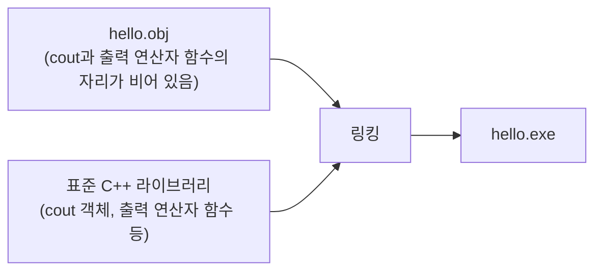

# 1장 연습 문제 — C++ 개요

[레포지토리 안내](../../README.ko.md) | [English](Exercises.md) | [한국어](Exercises.ko.md)

> **최종 수정일:** 2026-10-27
>
> 명품 C++ Programming, 황기태, Ch 1

**문항 출처:** 임영희 교수, 컴퓨터언어Ⅱ (DCCS102-04)

연습 문제 1\~11은 교재 1장 이론 문제의 짝수 번 문항(2\~22번)이다.

---

 

## 목차

- [연습 문제 1: 프로그래밍 언어와 컴파일러에 대한 설명](#연습-문제-1-프로그래밍-언어와-컴파일러에-대한-설명)
- [연습 문제 2: 객체 지향 언어가 아닌 것](#연습-문제-2-객체-지향-언어가-아닌-것)
- [연습 문제 3: 객체 지향 개념이 아닌 것](#연습-문제-3-객체-지향-개념이-아닌-것)
- [연습 문제 4: C 언어의 문법 체계를 계승한 문제점](#연습-문제-4-c-언어의-문법-체계를-계승한-문제점)
- [연습 문제 5: C++ 표준을 따르는 장점](#연습-문제-5-c-표준을-따르는-장점)
- [연습 문제 6: 세 가지 객체 지향 특성의 예](#연습-문제-6-세-가지-객체-지향-특성의-예)
- [연습 문제 7: C++이 C 언어에 추가한 내용](#연습-문제-7-c이-c-언어에-추가한-내용)
- [연습 문제 8: C++ 프로그램에 대한 설명](#연습-문제-8-c-프로그램에-대한-설명)
- [연습 문제 9: 링킹의 의미](#연습-문제-9-링킹의-의미)
- [연습 문제 10: C++ 표준 라이브러리에 포함되지 않는 것](#연습-문제-10-c-표준-라이브러리에-포함되지-않는-것)
- [연습 문제 11: C++ 통합 개발 환경](#연습-문제-11-c-통합-개발-환경)

---

 

## 연습 문제 1: 프로그래밍 언어와 컴파일러에 대한 설명

**교재 문항:** 1장 이론 문제 2번

**문제:** 다음 설명 중에서 틀린 것은?

- ① 사람과 가장 친밀한 프로그래밍 언어가 고급 언어이다.
- ② CPU는 기계어만 이해하고 처리할 수 있다.
- ③ 고수준 언어를 저수준 언어로 번역할 컴파일러가 필요하다.
- ④ 기계어를 익혀서 프로그램을 작성하는 것이 좋은 개발자가 되는 지름길이다.

**[풀이](Solutions.ko.md#연습-문제-1-프로그래밍-언어와-컴파일러에-대한-설명)**

---

 

## 연습 문제 2: 객체 지향 언어가 아닌 것

**교재 문항:** 1장 이론 문제 4번

**문제:** 다음 중 객체 지향 언어가 아닌 것은?

- ① Java
- ② C
- ③ C++
- ④ C#

**[풀이](Solutions.ko.md#연습-문제-2-객체-지향-언어가-아닌-것)**

---

 

## 연습 문제 3: 객체 지향 개념이 아닌 것

**교재 문항:** 1장 이론 문제 6번

**문제:** 다음 중 객체 지향 개념에 포함되지 않는 것은?

- ① 상속
- ② 흐름도
- ③ 캡슐화
- ④ 다형성

**[풀이](Solutions.ko.md#연습-문제-3-객체-지향-개념이-아닌-것)**

---

 

## 연습 문제 4: C 언어의 문법 체계를 계승한 문제점

**교재 문항:** 1장 이론 문제 8번

**문제:** C++ 언어가 C 언어의 문법적 체계를 계승받음으로써 나타난 문제점은?

- ① 개발 과정이 복잡해졌다.
- ② 프로그램 관리가 어려워졌다.
- ③ C 라이브러리를 사용할 수 없게 되어 불편하다.
- ④ 전역 변수가 존재하게 되어 캡슐화의 원칙이 무너졌다.

**[풀이](Solutions.ko.md#연습-문제-4-c-언어의-문법-체계를-계승한-문제점)**

---

 

## 연습 문제 5: C++ 표준을 따르는 장점

**교재 문항:** 1장 이론 문제 10번

**문제:** C++ 표준으로 C++ 프로그램을 작성할 때의 장점은?

- ① 확장성
- ② 호환성
- ③ 실행 성능
- ④ 개발 용이성

**[풀이](Solutions.ko.md#연습-문제-5-c-표준을-따르는-장점)**

---

 

## 연습 문제 6: 세 가지 객체 지향 특성의 예

**교재 문항:** 1장 이론 문제 12번

**문제:** C++ 언어가 가지고 있는 3가지 객체 지향 특성을 주어진 예를 이용하여 설명하라.

- (1) 캡슐화: TV 객체로 캡슐화를 설명하라.
- (2) 다형성: `>` 연산자로 다형성을 설명하라.
- (3) 상속성: "메뚜기는 생물이다"라는 문구로 상속성을 설명하라.

**[풀이](Solutions.ko.md#연습-문제-6-세-가지-객체-지향-특성의-예)**

---

 

## 연습 문제 7: C++이 C 언어에 추가한 내용

**교재 문항:** 1장 이론 문제 14번

**문제:** C++ 언어가 C 언어에 추가한 내용이 아닌 것은?

- ① `delete` 연산자
- ② 함수 중복
- ③ 참조에 의한 호출
- ④ 타입 변환

**[풀이](Solutions.ko.md#연습-문제-7-c이-c-언어에-추가한-내용)**

---

 

## 연습 문제 8: C++ 프로그램에 대한 설명

**교재 문항:** 1장 이론 문제 16번

**문제:** C++ 프로그램에 대해 다음 중 틀린 것은?

- ① C++ 소스 파일은 텍스트 파일이 아니라 바이너리 파일이다.
- ② C++ 소스 파일의 표준 확장자는 `.cpp`이지만 컴파일러에 따라 `.cc`, `.CC`, `.c++` 등의 확장자를 갖기도 한다.
- ③ C++ 소스 파일을 컴파일한 목적 파일의 확장자는 `.obj` 혹은 `.o`와 같이 운영체제에 따라 다를 수 있다.
- ④ C++ 프로그램의 디버깅이란 실행 파일(exe 파일)을 실행할 때 나타나는 오류를 발견하고 수정하는 과정이다.

**[풀이](Solutions.ko.md#연습-문제-8-c-프로그램에-대한-설명)**

---

 

## 연습 문제 9: 링킹의 의미

**교재 문항:** 1장 이론 문제 18번

**문제:** 다음 그림에서 링킹의 의미를 구체적으로 설명하라. 교재의 그림은 퍼즐 조각으로 이루어진 `hello.obj`의 빈 자리를 표준 C++ 라이브러리의 `cout` 조각과 `<<` 조각이 채워 `hello.exe`가 완성되는 모습이다.

*그림 1. hello.obj와 표준 C++ 라이브러리를 링킹하여 hello.exe를 만드는 과정*

**[풀이](Solutions.ko.md#연습-문제-9-링킹의-의미)**

---

 

## 연습 문제 10: C++ 표준 라이브러리에 포함되지 않는 것

**교재 문항:** 1장 이론 문제 20번

**문제:** C++ 표준 라이브러리에 포함되지 않는 것은?

- ① C++ 통신 라이브러리
- ② C++ 입출력 라이브러리
- ③ STL 라이브러리
- ④ C 라이브러리

**[풀이](Solutions.ko.md#연습-문제-10-c-표준-라이브러리에-포함되지-않는-것)**

---

 

## 연습 문제 11: C++ 통합 개발 환경

**교재 문항:** 1장 이론 문제 22번

**문제:** C++ 통합 개발 환경이란 무엇을 말하는가?

**[풀이](Solutions.ko.md#연습-문제-11-c-통합-개발-환경)**
