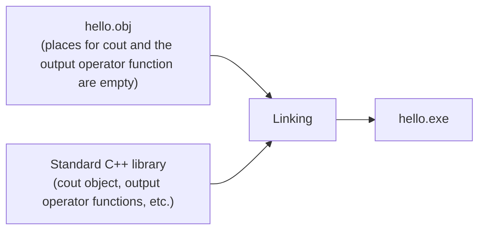

# Chapter 1 Exercises — Introduction to C++

[Repository Guide](../../README.md) | [English](Exercises.md) | [한국어](Exercises.ko.md)

> **Last Updated:** 2026-10-27
>
> 명품 C++ Programming, 황기태, Ch 1

**Problem Source:** Prof. Younghee Im, Computer Language Ⅱ (DCCS102-04)

---

 

## Table of Contents

- [Textbook Theory Problems](#textbook-theory-problems)

---

 

## Textbook Theory Problems

**Textbook:** Even-numbered theory problems of the Chapter 1 exercises

### Theory Problem 2

Which of the following statements is wrong?

- ① A high-level language is the programming language closest to humans.
- ② The CPU can understand and process only machine language.
- ③ A compiler is needed to translate a high-level language into a low-level language.
- ④ Learning machine language and writing programs in it is the shortcut to becoming a good developer.

**[Solution](Solutions.md#theory-problem-2)**

### Theory Problem 4

Which of the following is not an object-oriented language?

- ① Java
- ② C
- ③ C++
- ④ C#

**[Solution](Solutions.md#theory-problem-4)**

### Theory Problem 6

Which of the following is not an object-oriented concept?

- ① Inheritance
- ② Flowchart
- ③ Encapsulation
- ④ Polymorphism

**[Solution](Solutions.md#theory-problem-6)**

### Theory Problem 8

What problem arose because C++ inherited the syntactic system of the C language?

- ① The development process became complicated.
- ② Program management became difficult.
- ③ C libraries can no longer be used, which is inconvenient.
- ④ Global variables exist, so the principle of encapsulation is broken.

**[Solution](Solutions.md#theory-problem-8)**

### Theory Problem 10

What is the advantage of writing a C++ program according to the C++ standard?

- ① Extensibility
- ② Compatibility
- ③ Execution performance
- ④ Ease of development

**[Solution](Solutions.md#theory-problem-10)**

### Theory Problem 12

Explain the three object-oriented features of C++ using the given examples.

- (1) Encapsulation: explain encapsulation with a TV object.
- (2) Polymorphism: explain polymorphism with the `>` operator.
- (3) Inheritance: explain inheritance with the phrase "A grasshopper is a living creature."

**[Solution](Solutions.md#theory-problem-12)**

### Theory Problem 14

Which of the following is not something C++ added to the C language?

- ① The `delete` operator
- ② Function overloading
- ③ Call by reference
- ④ Type conversion

**[Solution](Solutions.md#theory-problem-14)**

### Theory Problem 16

Which of the following statements about C++ programs is wrong?

- ① A C++ source file is not a text file but a binary file.
- ② The standard extension of a C++ source file is `.cpp`, but depending on the compiler it may also have extensions such as `.cc`, `.CC`, and `.c++`.
- ③ The extension of the object file compiled from a C++ source file may differ by operating system, such as `.obj` or `.o`.
- ④ Debugging a C++ program is the process of finding and fixing errors that appear when the executable file (exe file) is run.

**[Solution](Solutions.md#theory-problem-16)**

### Theory Problem 18

Explain concretely the meaning of linking in the following figure. The figure in the textbook shows puzzle pieces: the `cout` piece and the `<<` piece of the standard C++ library fill the empty places of `hello.obj`, completing `hello.exe`.

*Figure 1. Linking hello.obj with the standard C++ library to produce hello.exe*

**[Solution](Solutions.md#theory-problem-18)**

### Theory Problem 20

Which of the following is not included in the C++ standard library?

- ① C++ communication library
- ② C++ input/output library
- ③ STL library
- ④ C library

**[Solution](Solutions.md#theory-problem-20)**

### Theory Problem 22

What is a C++ integrated development environment?

**[Solution](Solutions.md#theory-problem-22)**
