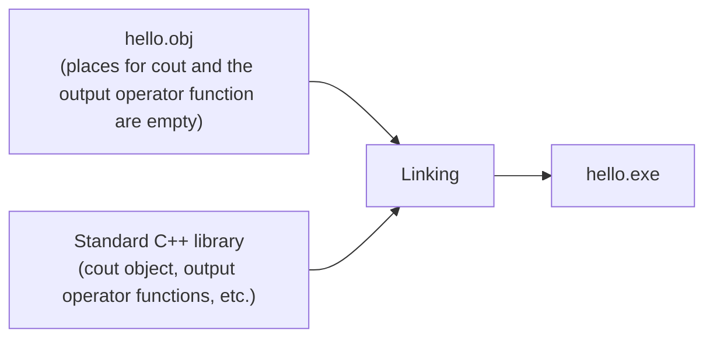

# Chapter 1 Exercises — Introduction to C++

[Repository Guide](../../README.md) | [English](Exercises.md) | [한국어](Exercises.ko.md)

> **Last Updated:** 2026-10-27
>
> 명품 C++ Programming, 황기태, Ch 1

**Problem Source:** Prof. Younghee Im, Computer Language Ⅱ (DCCS102-04)

Exercises 1-11 are the even-numbered theory problems (2-22) of Chapter 1 of the textbook.

---

 

## Table of Contents

- [Exercise 1: Statements About Programming Languages and Compilers](#exercise-1-statements-about-programming-languages-and-compilers)
- [Exercise 2: The Language That Is Not Object-Oriented](#exercise-2-the-language-that-is-not-object-oriented)
- [Exercise 3: The Concept That Is Not Object-Oriented](#exercise-3-the-concept-that-is-not-object-oriented)
- [Exercise 4: Problems from Inheriting the Syntax of C](#exercise-4-problems-from-inheriting-the-syntax-of-c)
- [Exercise 5: Advantages of Following the C++ Standard](#exercise-5-advantages-of-following-the-c-standard)
- [Exercise 6: Examples of the Three Object-Oriented Features](#exercise-6-examples-of-the-three-object-oriented-features)
- [Exercise 7: What C++ Added to the C Language](#exercise-7-what-c-added-to-the-c-language)
- [Exercise 8: Statements About C++ Programs](#exercise-8-statements-about-c-programs)
- [Exercise 9: The Meaning of Linking](#exercise-9-the-meaning-of-linking)
- [Exercise 10: What the C++ Standard Library Does Not Include](#exercise-10-what-the-c-standard-library-does-not-include)
- [Exercise 11: The C++ Integrated Development Environment](#exercise-11-the-c-integrated-development-environment)

---

 

## Exercise 1: Statements About Programming Languages and Compilers

**Textbook Problem:** Chapter 1 theory problem 2

**Problem:** Which of the following statements is wrong?

- ① A high-level language is the programming language closest to humans.
- ② The CPU can understand and process only machine language.
- ③ A compiler is needed to translate a high-level language into a low-level language.
- ④ Learning machine language and writing programs in it is the shortcut to becoming a good developer.

**[Solution](Solutions.md#exercise-1-statements-about-programming-languages-and-compilers)**

---

 

## Exercise 2: The Language That Is Not Object-Oriented

**Textbook Problem:** Chapter 1 theory problem 4

**Problem:** Which of the following is not an object-oriented language?

- ① Java
- ② C
- ③ C++
- ④ C#

**[Solution](Solutions.md#exercise-2-the-language-that-is-not-object-oriented)**

---

 

## Exercise 3: The Concept That Is Not Object-Oriented

**Textbook Problem:** Chapter 1 theory problem 6

**Problem:** Which of the following is not an object-oriented concept?

- ① Inheritance
- ② Flowchart
- ③ Encapsulation
- ④ Polymorphism

**[Solution](Solutions.md#exercise-3-the-concept-that-is-not-object-oriented)**

---

 

## Exercise 4: Problems from Inheriting the Syntax of C

**Textbook Problem:** Chapter 1 theory problem 8

**Problem:** What problem arose because C++ inherited the syntactic system of the C language?

- ① The development process became complicated.
- ② Program management became difficult.
- ③ C libraries can no longer be used, which is inconvenient.
- ④ Global variables exist, so the principle of encapsulation is broken.

**[Solution](Solutions.md#exercise-4-problems-from-inheriting-the-syntax-of-c)**

---

 

## Exercise 5: Advantages of Following the C++ Standard

**Textbook Problem:** Chapter 1 theory problem 10

**Problem:** What is the advantage of writing a C++ program according to the C++ standard?

- ① Extensibility
- ② Compatibility
- ③ Execution performance
- ④ Ease of development

**[Solution](Solutions.md#exercise-5-advantages-of-following-the-c-standard)**

---

 

## Exercise 6: Examples of the Three Object-Oriented Features

**Textbook Problem:** Chapter 1 theory problem 12

**Problem:** Explain the three object-oriented features of C++ using the given examples.

- (1) Encapsulation: explain encapsulation with a TV object.
- (2) Polymorphism: explain polymorphism with the `>` operator.
- (3) Inheritance: explain inheritance with the phrase "A grasshopper is a living creature."

**[Solution](Solutions.md#exercise-6-examples-of-the-three-object-oriented-features)**

---

 

## Exercise 7: What C++ Added to the C Language

**Textbook Problem:** Chapter 1 theory problem 14

**Problem:** Which of the following is not something C++ added to the C language?

- ① The `delete` operator
- ② Function overloading
- ③ Call by reference
- ④ Type conversion

**[Solution](Solutions.md#exercise-7-what-c-added-to-the-c-language)**

---

 

## Exercise 8: Statements About C++ Programs

**Textbook Problem:** Chapter 1 theory problem 16

**Problem:** Which of the following statements about C++ programs is wrong?

- ① A C++ source file is not a text file but a binary file.
- ② The standard extension of a C++ source file is `.cpp`, but depending on the compiler it may also have extensions such as `.cc`, `.CC`, and `.c++`.
- ③ The extension of the object file compiled from a C++ source file may differ by operating system, such as `.obj` or `.o`.
- ④ Debugging a C++ program is the process of finding and fixing errors that appear when the executable file (exe file) is run.

**[Solution](Solutions.md#exercise-8-statements-about-c-programs)**

---

 

## Exercise 9: The Meaning of Linking

**Textbook Problem:** Chapter 1 theory problem 18

**Problem:** Explain concretely the meaning of linking in the following figure. The figure in the textbook shows puzzle pieces: the `cout` piece and the `<<` piece of the standard C++ library fill the empty places of `hello.obj`, completing `hello.exe`.

*Figure 1. Linking hello.obj with the standard C++ library to produce hello.exe*

**[Solution](Solutions.md#exercise-9-the-meaning-of-linking)**

---

 

## Exercise 10: What the C++ Standard Library Does Not Include

**Textbook Problem:** Chapter 1 theory problem 20

**Problem:** Which of the following is not included in the C++ standard library?

- ① C++ communication library
- ② C++ input/output library
- ③ STL library
- ④ C library

**[Solution](Solutions.md#exercise-10-what-the-c-standard-library-does-not-include)**

---

 

## Exercise 11: The C++ Integrated Development Environment

**Textbook Problem:** Chapter 1 theory problem 22

**Problem:** What is a C++ integrated development environment?

**[Solution](Solutions.md#exercise-11-the-c-integrated-development-environment)**
