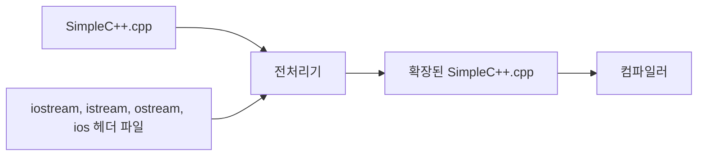

# 2장 — C++ 프로그래밍의 기본

[레포지토리 안내](../../README.ko.md) | [English](Concepts_Lecture.md) | [한국어](Concepts_Lecture.ko.md)

> **최종 수정일:** 2026-10-27
>
> 명품 C++ Programming, 황기태, Ch 2

> **학습 목표:**
> 1. C++ 프로그램의 기본 구조와 `main()` 함수, 주석, `#include` 지시문의 역할을 설명할 수 있다
> 2. `cout`과 `<<` 연산자로 여러 타입의 데이터를 화면에 출력할 수 있다
> 3. `cin`과 `>>` 연산자, `getline`으로 키보드 입력을 받을 수 있다
> 4. 네임스페이스의 개념을 설명하고 `std::` 접두사와 `using` 지시문을 사용할 수 있다
> 5. C 스트링과 `string` 클래스로 문자열을 입력받고 다룰 수 있다
> 6. 전처리기의 헤더 파일 확장과 헤더 파일, 라이브러리의 역할을 구분하여 설명할 수 있다

---

## 목차

- [1. 첫 번째 C++ 프로그램](#1-첫-번째-c-프로그램)
  - [1.1 프로그램 구조](#11-프로그램-구조)
  - [1.2 주석](#12-주석)
  - [1.3 `main` 함수](#13-main-함수)
  - [1.4 `#include <iostream>`](#14-include-iostream)
- [2. 콘솔 출력](#2-콘솔-출력)
  - [2.1 `cout`과 `<<`](#21-cout과-)
  - [2.2 `endl` vs `'\n'`](#22-endl-vs-n)
  - [2.3 `<<` 연산자 세부사항](#23--연산자-세부사항)
- [3. 콘솔 입력](#3-콘솔-입력)
  - [3.1 `cin`과 `>>`](#31-cin과-)
  - [3.2 `getline`](#32-getline)
  - [3.3 `cin` vs `scanf`](#33-cin-vs-scanf)
  - [3.4 실행문 중간의 변수 선언](#34-실행문-중간의-변수-선언)
- [4. 네임스페이스](#4-네임스페이스)
  - [4.1 개념](#41-개념)
  - [4.2 `using namespace std`](#42-using-namespace-std)
- [5. C++ 문자열](#5-c-문자열)
  - [5.1 C 스트링](#51-c-스트링)
  - [5.2 `string` 클래스](#52-string-클래스)
- [6. `auto`를 사용한 현대적 변수 선언](#6-auto를-사용한-현대적-변수-선언)
- [7. 헤더 파일과 전처리기](#7-헤더-파일과-전처리기)
  - [7.1 전처리기의 헤더 확장](#71-전처리기의-헤더-확장)
  - [7.2 `<iostream>`과 `<iostream.h>`](#72-iostream과-iostreamh)
  - [7.3 `#include <헤더파일>`과 `#include "헤더파일"`](#73-include-헤더파일과-include-헤더파일)
  - [7.4 헤더 파일과 라이브러리](#74-헤더-파일과-라이브러리)
- [요약](#요약)
- [점검 문제](#점검-문제)

---

<br>

## 1. 첫 번째 C++ 프로그램

### 1.1 프로그램 구조

모든 C++ 프로그램은 기본적인 구조를 따른다. 가장 간단한 완전한 프로그램을 한 줄씩 주석으로 설명하면 다음과 같다.

```cpp
// hello.cpp
#include <iostream>       // C++ 입출력 스트림 라이브러리
using namespace std;      // std 네임스페이스 사용

int main()                // 진입점 함수
{
    cout << "Hello" << endl;   // 콘솔에 출력
    return 0;             // OS에 종료 코드 반환
}
```

```text
C++ 프로그램 구조
├── 전처리기 지시문          #include <iostream>
├── 네임스페이스 선언        using namespace std;
├── main 함수               int main() { ... }
│   ├── 실행문              cout << "Hello" << endl;
│   └── 리턴문              return 0;
└── 기타 함수               (이후 장에서 학습)
```

*그림 1. C++ 프로그램의 구성 요소*

| 구성 요소 | 역할 |
|:---------|:-----|
| `#include <iostream>` | 입출력 스트림 라이브러리를 포함하여 `cout`과 `cin`을 사용할 수 있게 함 |
| `using namespace std;` | `std::` 접두사 없이 `std` 이름을 직접 사용할 수 있게 함 |
| `int main()` | 진입점 정의; OS가 가장 먼저 호출하는 함수 |
| `{ ... }` | 중괄호로 함수 본문을 구분 |
| `cout << "Hello" << endl;` | `"Hello"`를 출력한 뒤 줄바꿈을 콘솔에 출력 |
| `return 0;` | 정상 종료를 의미하는 종료 코드 0을 OS에 리턴 |

*표 1. C++ 프로그램 구성 요소의 역할*

> **핵심:** 함수 내부의 모든 문장은 세미콜론(`;`)으로 끝나야 한다. 전처리기 지시문(`#include`)에는 세미콜론을 붙이지 **않는다**.

### 1.2 주석

주석은 개발자가 프로그램에 대한 설명이나 특이 사항을 자유롭게 적은 메모이다. 컴파일러가 무시하므로 프로그램의 실행에 영향을 주지 않으며, 사람이 읽기 위해 존재한다. C++은 C와 동일한 주석 형식을 사용한다.

| 종류 | 문법 | 범위 |
|:----|:----|:----|
| 블록 주석 | `/* ... */` | 여러 줄에 걸칠 수 있음 |
| 줄 주석 | `// ...` | `//`부터 줄 끝까지 |

*표 2. C++ 주석의 종류*

```cpp
/* 이것은 블록 주석이다.
   여러 줄에 걸칠 수 있다. */

// 이것은 줄 주석이다.

int x = 10;  // 코드 뒤에 붙이는 인라인 주석
```

> **주의:** 블록 주석은 **중첩할 수 없다**. `/* 외부 /* 내부 */ 아직 안쪽? */`는 컴파일 에러를 일으킨다. `*/`가 첫 번째 매칭에서 주석을 닫기 때문이다.

### 1.3 `main` 함수

`main` 함수는 모든 C++ 프로그램의 **진입점(entry point)** 이다. OS가 컴파일된 프로그램을 실행하면 `main`부터 실행이 시작되고, `main`이 종료하면 프로그램이 종료된다.

| 형태 | 표준? | 비고 |
|:----|:----:|:----|
| `int main()` | 예 | 표준 형태; `int`를 리턴 |
| `int main(void)` | 예 | 명시적 빈 매개변수 목록 |
| `void main()` | **아니오** | 비표준; 일부 컴파일러가 허용하나 이식 불가 |

*표 3. `main` 함수의 형태와 표준 여부*

```cpp
int main()        // 표준 형태
{
    return 0;     // 0 = 성공
}
```

`main`의 리턴값은 OS에 전달되는 종료 코드이다. 0은 정상 종료를 뜻하며, 오류를 알리기 위해 0이 아닌 값을 리턴할 수도 있다. C++에서 `main` 끝에 `return 0;`을 생략하면 컴파일러가 자동으로 `0`을 리턴한다. 이 규칙은 `main`에만 적용되며, 명확성을 위해 명시적으로 작성하는 것이 좋다.

> **주의:** `void main()`은 표준 C++이 **아니다**. 일부 컴파일러(예: MSVC)가 확장 기능으로 허용하지만, 이식성을 위해 피해야 한다. 항상 `int main()`을 사용한다.

### 1.4 `#include <iostream>`

`#include <iostream>`은 컴파일 전에 `<iostream>` 헤더 파일의 내용을 소스에 펼쳐 넣으라고 **전처리기(preprocessor)** 에 내리는 지시이다. `<iostream>` 헤더 파일에는 표준 입출력을 위한 클래스(`ios`, `istream`, `ostream`, `iostream`)와 객체(`cout`, `cin`), `<<`와 `>>` 연산자 함수가 선언되어 있다. 구 버전의 C++에서 쓰던 `<iostream.h>`와의 차이와 전처리 과정은 7절에서 다룬다.

---

<br>

## 2. 콘솔 출력

### 2.1 `cout`과 `<<`

`cout`은 표준 출력(화면)에 연결된 `ostream` 타입의 미리 정의된 객체이다. `<<` 연산자는 데이터를 출력 스트림에 삽입하는 **스트림 삽입 연산자**이다.

```cpp
#include <iostream>
using namespace std;

int main() {
    cout << "Hello, C++!" << endl;
    return 0;
}
```

| 구성 요소 | 설명 |
|:---------|:----|
| `cout` | 화면에 연결된 `ostream` 객체 (`<iostream>`에 선언됨) |
| `<<` | 스트림 삽입 연산자; 데이터를 출력 스트림에 전달 |
| `endl` | 줄바꿈 문자를 삽입하고 출력 버퍼를 **비움(flush)** |

*표 4. 화면 출력의 구성 요소*

`<<`는 원래 C++의 비트 시프트 연산자이며, `ostream` 클래스에서 스트림 삽입 연산자로 재정의(연산자 중복)되었다. 오른쪽 피연산자를 왼쪽의 스트림 객체에 삽입하므로, `cout`에 삽입한 데이터는 `cout`에 연결된 화면에 출력된다. `cout`은 `std` 네임스페이스에 선언되어 있으므로 `using` 지시문이 없으면 `std::cout`으로 써야 한다(4절).

**체이닝:** 하나의 문장에서 여러 `<<` 연산자를 연결할 수 있다.

```cpp
int age = 20;
double gpa = 3.8;

cout << "나이: " << age << ", 학점: " << gpa << endl;
// 출력: 나이: 20, 학점: 3.8
```

C의 `printf`와 달리, `cout`은 출력할 데이터의 **타입을 자동으로 인식**한다. `%d`나 `%f` 같은 형식 지정자가 필요 없다.

```cpp
// C 스타일 — 형식을 지정해야 함
printf("나이: %d, 학점: %.1f\n", age, gpa);

// C++ 스타일 — 타입이 자동 인식됨
cout << "나이: " << age << ", 학점: " << gpa << endl;
```

> **참고:** **타입 안전성.** `cout`은 타입 안전하다. 잘못된 타입을 전달하면 컴파일러가 안전하게 변환하거나 컴파일 오류를 발생시킨다. `printf`의 경우 형식 지정자가 불일치하면 정의되지 않은 동작이 발생한다.

#### 현대적 출력 대안: `std::format`과 `std::print`

> **참고:** **C++20.** 이 기능은 C++20 이상이 필요하다.

C++20에서는 Python 스타일의 문자열 포맷팅을 제공하는 `std::format`이 도입되었다. `cout`의 타입 안전성과 서식 문자열의 가독성을 결합한다.

```cpp
#include <format>
#include <iostream>
using namespace std;

int age = 20;
double gpa = 3.8;

// C++20: std::format은 서식이 적용된 문자열을 반환
cout << format("나이: {}, 학점: {:.1f}", age, gpa) << endl;
// 출력: 나이: 20, 학점: 3.8
```

> **참고:** **C++23.** 이 기능은 C++23 이상이 필요하다.

C++23에서는 `cout` 없이 직접 출력하는 `std::print`가 추가되었다.

```cpp
#include <print>

int age = 20;
double gpa = 3.8;

// C++23: std::print — 서식 구문으로 직접 출력
std::print("나이: {}, 학점: {:.1f}\n", age, gpa);
// 출력: 나이: 20, 학점: 3.8
```

| 방식 | 표준 | 헤더 | 타입 안전 | 서식 제어 |
|:----|:----|:----|:--------:|:--------:|
| `printf` | C | `<cstdio>` | 아니오 | `%d`, `%f` |
| `cout <<` | C++98 | `<iostream>` | 예 | 조작자(manipulator) |
| `std::format` | C++20 | `<format>` | 예 | `{}` 자리 표시자 |
| `std::print` | C++23 | `<print>` | 예 | `{}` 자리 표시자 |

*표 5. 출력 방식의 비교*

### 2.2 `endl` vs `'\n'`

`endl`과 `'\n'` 모두 줄바꿈을 생성하지만, 중요한 차이가 하나 있다.

| 방법 | 줄바꿈? | 버퍼 비움? |
|:----|:------:|:--------:|
| `endl` | 예 | 예 |
| `'\n'` | 예 | 아니오 |

*표 6. `endl`과 `'\n'`의 차이*

```cpp
cout << "Line 1" << endl;   // 줄바꿈 + 버퍼 비움
cout << "Line 2" << '\n';   // 줄바꿈만 (버퍼 비우지 않음)
cout << "Line 3\n";         // 위와 동일 (문자열 리터럴 안의 줄바꿈)
```

**버퍼 비움(flush)** 이란 출력 버퍼에 있는 데이터를 즉시 화면에 쓰는 것이다. 비우지 않으면 데이터가 버퍼가 가득 차거나 프로그램이 종료될 때까지 버퍼에 남아 있을 수 있다. `endl`처럼 스트림에 작용하여 동작을 바꾸는 것을 **조작자(manipulator)** 라 한다.

> **참고:** **출력 성능.** 성능이 중요한 코드(예: 수백만 줄 출력)에서는 `endl`보다 `'\n'`을 선호한다. `endl`이 반복적으로 버퍼를 비우면 출력 속도가 크게 느려질 수 있다.

### 2.3 `<<` 연산자 세부사항

`<<` 연산자는 `bool`, `char`, `short`, `int`, `long`, `float`, `double` 같은 모든 기본 타입과 문자열을 출력할 수 있다.

| 타입 | 예시 |
|:----|:----|
| `bool` | `cout << true;` → `1` (`boolalpha` 사용 시 `true`) |
| `char` | `cout << 'A';` → `A` |
| `int` | `cout << 42;` → `42` |
| `double` | `cout << 3.14;` → `3.14` |
| 문자열 (`const char*`) | `cout << "Hello";` → `Hello` |

*표 7. 타입별 `<<` 출력 예시*

**식과 함수 호출**을 `<<`와 함께 직접 사용할 수 있다.

```cpp
int a = 5, b = 3;
cout << a + b << endl;         // 출력: 8
cout << (a > b) << endl;       // 출력: 1 (true)
```

다음 프로그램은 여러 타입의 값, 식, 함수의 리턴값을 한 번에 출력한다.

```cpp
#include <iostream>

double area(int r) {           // 반지름이 r인 원의 면적을 반환
    return 3.14 * r * r;
}

int main() {
    int n = 3;
    char c = '#';
    std::cout << c << 5.5 << '-' << n << "hello" << true << std::endl;
    std::cout << "n + 5 = " << n + 5 << '\n';
    std::cout << "면적은 " << area(n);   // 함수 area()의 반환값 출력
}
```

```text
#5.5-3hello1
n + 5 = 8
면적은 28.26
```

`true`는 `1`로 출력되고, 값 사이에 공백이 자동으로 들어가지 않는다는 점에 주의한다.

**연산자 우선순위 문제:** `<<` 연산자는 비교 연산자(`>`, `<`, `>=`, `<=`)보다 **우선순위가 높다**.

```cpp
cout << 5 > 3;            // 오류 — (cout << 5) > 3 으로 해석됨
cout << (5 > 3) << endl;  // 정상 — 출력: 1
```

`cout << 5 > 3`은 `(cout << 5) > 3`으로 해석되어, `ostream` 객체를 `3`과 비교하려 하므로 타입 오류가 발생한다.

> **주의:** 비교 연산처럼 `<<`보다 우선순위가 낮은 연산의 결과를 출력할 때는 반드시 **괄호**로 감싸서 우선순위 문제를 방지한다: `cout << (5 > 3)`. 산술 연산(`+`, `-`, `*`, `/`)은 `<<`보다 우선순위가 높아 괄호 없이도 바르게 출력되지만, 괄호로 감싸면 의도가 분명해진다.

---

<br>

## 3. 콘솔 입력

### 3.1 `cin`과 `>>`

`cin`은 표준 입력(키보드)에 연결된 `istream` 타입의 미리 정의된 객체이다. `>>` 연산자는 입력 스트림에서 데이터를 추출하는 **스트림 추출 연산자**이다.

```cpp
#include <iostream>
using namespace std;

int main() {
    int num;
    cout << "숫자를 입력하세요: ";
    cin >> num;
    cout << "입력한 값: " << num << endl;
    return 0;
}
```

| 구성 요소 | 설명 |
|:---------|:----|
| `cin` | 키보드에 연결된 `istream` 객체 (`<iostream>`에 선언됨) |
| `>>` | 스트림 추출 연산자; 입력 스트림에서 데이터를 읽음 |

*표 8. 키보드 입력의 구성 요소*

`>>`도 원래 비트 시프트 연산자이며, `<iostream>`에서 스트림 추출 연산자로 재정의되어 입력 스트림에서 값을 읽어 변수에 저장한다.

**`>>`가 입력을 읽는 방법:**
- 선행 공백(스페이스, 탭, 줄바꿈)을 건너뛴다.
- 다음 공백 구분자까지 문자를 읽는다.
- 읽은 문자를 대상 변수의 타입으로 변환한다.

`cin`은 입력 버퍼를 내장하고 있다. 사용자가 누른 키는 `<Enter>` 키가 입력될 때까지 입력 버퍼에 쌓이며, 그동안 `<Backspace>` 키로 입력한 키를 지울 수 있다. `<Enter>` 키가 입력되면 비로소 `>>` 연산자가 입력 버퍼의 값을 변수에 전달한다.

**체이닝:** 여러 `>>` 연산자를 연결할 수 있다.

```cpp
int a, b;
cout << "두 수를 입력하세요: ";
cin >> a >> b;    // 공백으로 구분된 두 정수를 읽음
cout << "합: " << a + b << endl;
```

```text
입력:  10 20
출력: 합: 30
```

> **핵심:** `cin >> a >> b;`는 공백, 탭, 줄바꿈으로 구분된 두 개의 토큰을 입력에서 읽는다. 첫 번째 토큰은 `a`에, 두 번째는 `b`에 저장된다.

### 3.2 `getline`

`>>` 연산자는 다음 공백까지만 읽으므로, 공백이 포함된 문자열을 읽기에는 적합하지 않다. `getline` 함수는 공백을 포함한 **한 줄 전체**를 `string` 객체에 읽는다.

```cpp
#include <iostream>
#include <string>
using namespace std;

int main() {
    string name;
    cout << "이름을 입력하세요: ";
    getline(cin, name);
    cout << "안녕하세요, " << name << "!" << endl;
    return 0;
}
```

```text
입력:  홍길동
출력: 안녕하세요, 홍길동!
```

**`>>`와 `getline` 혼용의 함정:**

`>>`가 값을 읽으면 뒤따르는 줄바꿈(`'\n'`)이 입력 버퍼에 남는다. 이후 `getline`을 호출하면 이 남은 줄바꿈을 읽고 빈 문자열을 리턴한다.

**해결 방법:** `getline`을 호출하기 전에 `cin.ignore()`를 사용하여 남은 줄바꿈을 버린다.

```cpp
int age;
string name;

cout << "나이를 입력하세요: ";
cin >> age;                    // 숫자를 읽고, '\n'은 버퍼에 남음

cin.ignore();                  // 남은 '\n'을 버림

cout << "이름을 입력하세요: ";
getline(cin, name);            // 이제 올바르게 읽힘
cout << age << " " << name << endl;
```

> **주의:** `>>`와 `getline` 사이에 `cin.ignore()`를 빠뜨리는 것은 C++ 초보자가 가장 흔히 하는 실수 중 하나이다. `getline` 호출이 남은 줄바꿈을 즉시 읽어 건너뛴 것처럼 보인다.

**문제 발생 과정을 단계별로 시각화:**

```text
사용자 입력: 25[Enter]홍길동[Enter]

1단계: cin >> age;
  버퍼 (이전): "25\n홍길동\n"
  읽은 값: 25
  버퍼 (이후): "\n홍길동\n"    ← '\n'이 남아 있음!

2단계 (cin.ignore() 없이):  getline(cin, name);
  버퍼 (이전): "\n홍길동\n"
  읽은 값: ""                    ← 첫 번째 '\n'까지 읽음 (즉시 만남)
  버퍼 (이후): "홍길동\n"
  결과: name은 빈 문자열!

2단계 (cin.ignore() 사용):  getline(cin, name);
  cin.ignore()가 '\n'을 버림
  버퍼 (이전): "홍길동\n"
  읽은 값: "홍길동"              ← 정상!
  버퍼 (이후): ""
```

*그림 2. `cin.ignore()` 유무에 따른 입력 버퍼의 변화*

**더 안전한 버전:** 최대한 안전하게 하려면, 단일 문자가 아닌 다음 줄바꿈까지의 모든 내용을 버리는 `cin.ignore(numeric_limits<streamsize>::max(), '\n')`를 사용한다.

```cpp
#include <limits>   // numeric_limits에 필요

cin >> age;
cin.ignore(numeric_limits<streamsize>::max(), '\n');   // 나머지 줄 전체 버림
getline(cin, name);
```

### 3.3 `cin` vs `scanf`

| 특성 | `cin` (C++) | `scanf` (C) |
|:----|:-----------|:-----------|
| 타입 안전성 | 타입 자동 인식 | 형식을 지정해야 함 (`%d`, `%f`) |
| 형식 지정자 | 불필요 | 필수 |
| 주소 연산자 `&` | 기본 타입에 불필요 | 필수 (`scanf("%d", &x)`) |
| 공백 포함 문자열 | `getline` 사용 | `fgets` 사용 |
| 오류 처리 | 스트림 상태 확인 (`cin.fail()`) | 리턴값 확인 |

*표 9. `cin`과 `scanf`의 비교*

```cpp
// C 스타일
int x;
scanf("%d", &x);      // %d와 &를 사용해야 함

// C++ 스타일
int x;
cin >> x;              // 형식 지정자 없음, & 없음
```

> **참고:** **C++ 입출력의 권장.** C++에서는 `scanf`/`printf`보다 `cin`/`cout`을 선호한다. 타입 안전하고, 사용자 정의 타입으로 확장 가능하며, C++ 스트림과 자연스럽게 통합된다.

### 3.4 실행문 중간의 변수 선언

C++에서는 변수를 블록의 앞부분뿐 아니라 실행문 중간 어디서나 선언할 수 있다. C도 C99부터 같은 방식을 허용하지만, 그 이전의 C(C89)는 블록의 앞부분에서만 변수를 선언하게 했다.

```cpp
#include <iostream>
using namespace std;

int main() {
    cout << "너비를 입력하세요>>";
    int width;                       // 실행문 중간에 변수 선언
    cin >> width;
    cout << "높이를 입력하세요>>";
    int height;
    cin >> height;
    int area = width * height;       // 사각형의 면적 계산
    cout << "면적은 " << area << "\n";
}
```

```text
너비를 입력하세요>>3
높이를 입력하세요>>5
면적은 15
```

- **장점:** 변수 선언부와 실행문 사이를 오가는 번거로움이 없고, 변수를 사용하기 직전에 선언하므로 변수 이름의 타이핑 오류를 줄인다.
- **단점:** 선언된 변수를 한눈에 보기 어렵고, 코드 사이에 흩어진 변수를 찾기 어렵다.

타이핑 오류를 줄이는 효과는 다음 두 코드를 비교하면 알 수 있다. 모든 변수를 앞부분에서 선언하면, `time`에 5를 저장하려다 `timer`로 잘못 입력해도 `timer`가 이미 선언되어 있으므로 컴파일 오류 없이 잘못된 실행 결과만 나온다.

```cpp
int time, timer;
// ...
timer = 5;    // time에 5를 저장하려다 timer로 잘못 입력. 컴파일 오류가 발생하지 않음
// ...
timer = 3;
```

변수를 사용하기 직전에 선언하면, 같은 실수를 했을 때 `timer`가 아직 선언되지 않았으므로 컴파일 오류가 발생하여 실수를 미리 발견한다.

```cpp
int time;
timer = 5;    // timer가 아직 선언되지 않았으므로 컴파일 오류 발생
// ...
int timer;
timer = 3;
```

---

<br>

## 4. 네임스페이스

### 4.1 개념

**네임스페이스(namespace, 이름 공간)** 는 식별자(이름)에 범위를 제공하는 선언 영역이다. 주된 목적은 **이름 충돌을 방지**하는 것이다. 서로 다른 라이브러리가 동일한 이름의 함수나 클래스를 정의할 수 있으며, 네임스페이스가 이들을 분리한다.

이름 충돌은 여러 명이 프로젝트를 나누어 개발할 때나, 오픈 소스 또는 다른 사람이 작성한 소스나 목적 파일을 가져와 컴파일하거나 링크할 때 생기며, 해결하는 데 많은 시간과 노력이 든다. 같은 아파트 단지에 마이클이 여러 명 살면 1동 마이클, 2동 마이클처럼 동을 붙여 구분하듯이, 네임스페이스는 이름 앞에 소속을 붙여 같은 이름을 구분한다.

개발자는 `namespace` 키워드로 자신만의 네임스페이스를 만들 수 있으며, 그 안에 선언된 이름은 다른 네임스페이스의 이름과 별도로 구분된다. 네임스페이스 안의 이름은 `네임스페이스::이름` 형식으로 사용한다.

```cpp
// mike.h
namespace mike {             // mike라는 네임스페이스 생성
    int f();
    int g();
}

// kitae.cpp
#include "mike.h"

namespace kitae {            // kitae라는 네임스페이스 생성
    void f() { /* ... */ }
    void m() {
        f();                 // 같은 네임스페이스의 kitae::f() 호출
        mike::f();           // mike 네임스페이스의 f() 호출
    }
}
```

kitae와 mike가 각자 작성한 `f()` 함수를 네임스페이스 없이 한 프로그램에 합치면 같은 이름이 두 번 정의되어 오류가 발생한다. 위처럼 각자의 네임스페이스에 넣으면 `kitae::f()`와 `mike::f()`로 구분되어 충돌하지 않는다.

C++ 표준 라이브러리는 모든 이름을 `std` 네임스페이스 안에 배치한다.

```cpp
#include <iostream>

int main() {
    std::cout << "Hello" << std::endl;   // 완전한 한정 이름
    return 0;
}
```

| 문법 | 의미 |
|:----|:----|
| `std::cout` | `std` 네임스페이스에 정의된 `cout` |
| `std::endl` | `std` 네임스페이스에 정의된 `endl` |
| `std::string` | `std` 네임스페이스에 정의된 `string` 클래스 |

*표 10. `std::` 접두사를 붙인 이름의 의미*

`std::` 접두사가 없으면 컴파일러가 `cout`의 정의 위치를 알 수 없어 오류를 보고한다.

### 4.2 `using namespace std`

모든 표준 라이브러리 이름 앞에 `std::`를 쓰지 않으려면 **using 지시문**을 사용한다.

```cpp
using namespace std;   // std의 모든 이름을 현재 범위로 가져옴
```

이 선언 이후에는 `cout`, `cin`, `endl`, `string`, `vector` 등을 직접 사용할 수 있다. `<iostream>`에 선언된 이름은 모두 `std` 네임스페이스 안에 있으므로, `<iostream>`을 쓰는 프로그램은 보통 `#include <iostream>` 다음에 `using namespace std;`를 둔다.

```cpp
#include <iostream>
using namespace std;

int main() {
    cout << "std:: 접두사가 필요 없음" << endl;
    return 0;
}
```

**선택적 using 선언:** 특정 이름만 가져온다.

```cpp
#include <iostream>
using std::cout;
using std::endl;

int main() {
    cout << "cout과 endl만 가져옴" << endl;
    // cin은 여전히 std::cin으로 써야 함
    return 0;
}
```

| 방법 | 장점 | 단점 |
|:----|:----|:----|
| `std::cout` (완전 한정) | 모호함 없음; 출처 명확 | 장황함 |
| `using namespace std;` | 간결; 편리 | 대규모 프로젝트에서 이름 충돌 가능 |
| `using std::cout;` (선택적) | 편의성과 안전성의 균형 | 각 이름을 개별적으로 나열해야 함 |

*표 11. 표준 라이브러리 이름을 쓰는 방법의 비교*

> **참고:** **using 지시문의 사용 범위.** 작은 프로그램과 학습용 예제에서는 `using namespace std;`를 사용해도 무방하다. 대규모 프로젝트와 헤더 파일에서는 이름 충돌을 방지하기 위해 완전 한정 이름이나 선택적 `using` 선언을 선호한다.

---

<br>

## 5. C++ 문자열

C++에서 문자열을 표현하는 방식은 두 가지이다. C 언어처럼 `'\0'`으로 끝나는 문자 배열을 쓰는 **C 스트링** 방식과, C++ 표준 라이브러리의 **`string` 클래스**를 쓰는 방식이다.

### 5.1 C 스트링

**C 스트링**은 널 문자 `'\0'`으로 끝나는 `char` 배열이다. 끝에 `'\0'`이 없으면 문자열이 아니라 단순한 문자 배열이다.

```cpp
char name1[6] = {'G', 'r', 'a', 'c', 'e', '\0'};  // 문자열 "Grace"
char name2[5] = {'G', 'r', 'a', 'c', 'e'};        // 문자열이 아닌 단순 문자 배열
char name5[10] = "Grace";                          // 남은 원소는 '\0'으로 초기화
```

```text
name5   [0]  [1]  [2]  [3]  [4]  [5]  [6]  [7]  [8]  [9]
        'G'  'r'  'a'  'c'  'e'  '\0' '\0' '\0' '\0' '\0'
        └─────── "Grace" ───────┘
```

*그림 3. 문자열 "Grace"로 초기화한 배열 name5의 원소*

C 스트링은 C 언어의 문자열 함수(`strcmp()`, `strlen()`, `strcpy()` 등)로 다룬다. 이 함수들은 `<cstring>` 또는 `<string.h>` 헤더 파일에 선언되어 있으며, C++ 표준 방식인 `<cstring>`을 쓰는 것이 바람직하다.

**`cin`으로 문자열 입력:** `cin >> name;`은 키보드에서 읽은 문자열을 `char` 배열 `name`에 저장하고 끝에 `'\0'`을 붙인다. `>>`는 공백 문자를 만나면 입력을 끝내므로, 빈칸이 포함된 문자열은 첫 단어만 읽는다.

```cpp
#include <iostream>
using namespace std;

int main() {
    cout << "이름을 입력하세요>>";
    char name[11];                   // 영문 10자까지 저장 가능
    cin >> name;                     // 공백을 만나기 전까지 읽음
    cout << "이름은 " << name << "입니다\n";
}
```

```text
이름을 입력하세요>>마이클
이름은 마이클입니다
```

```text
이름을 입력하세요>>마 이 클
이름은 마입니다
```

C++17까지의 `>>`는 배열의 크기를 확인하지 않으므로 배열보다 긴 문자열을 입력하면 배열 밖의 메모리를 덮어쓴다. C++20부터는 배열 크기보다 하나 적은 개수의 문자까지만 읽는다. 한글은 인코딩에 따라 한 글자가 2바이트(CP949) 또는 3바이트(UTF-8)를 차지하므로, 저장할 수 있는 한글 글자 수는 영문보다 적다.

다음 프로그램은 C 스트링과 `strcmp()`로 암호를 비교하여, 암호 `C++`가 입력되면 종료한다.

```cpp
#include <iostream>
#include <cstring>                   // strcmp() 사용을 위한 헤더 파일
using namespace std;

int main() {
    char password[11];
    cout << "프로그램을 종료하려면 암호를 입력하세요." << endl;
    while (true) {
        cout << "암호>>";
        cin >> password;
        if (strcmp(password, "C++") == 0) {
            cout << "프로그램을 정상 종료합니다." << endl;
            break;
        }
        else
            cout << "암호가 틀립니다~~" << endl;
    }
}
```

```text
프로그램을 종료하려면 암호를 입력하세요.
암호>>Java
암호가 틀립니다~~
암호>>C
암호가 틀립니다~~
암호>>C++
프로그램을 정상 종료합니다.
```

**`cin.getline()`으로 공백을 포함한 입력:** 빈칸이 포함된 문자열을 C 스트링으로 입력받으려면 `cin.getline(char buf[], int size, char delimitChar)`를 쓴다. `buf`에 최대 `size - 1`개의 문자를 읽고, `delimitChar`를 만나면 입력을 멈추며, 끝에 `'\0'`을 붙인다. `delimitChar`는 입력 버퍼에서 꺼내 버리고 배열에는 저장하지 않으며, 기본값은 `'\n'`(`<Enter>` 키)이다.

```cpp
char address[100];
cin.getline(address, 100, '\n');     // 최대 99개의 문자를 읽음. <Enter>를 만나면 입력 중단
```

```text
입력: Seoul Korea<Enter>

address  [0] [1] [2] [3] [4] [5] [6] [7] [8] [9] [10] [11] ... [99]
         'S' 'e' 'o' 'u' 'l' ' ' 'K' 'o' 'r' 'e' 'a'  '\0' ...
```

*그림 4. `cin.getline()`으로 Seoul Korea를 읽은 배열 address*

### 5.2 `string` 클래스

C++은 C 스타일 문자 배열(`char[]`)의 현대적이고 안전한 대안으로 `std::string` 클래스를 제공한다. `string`은 `<string>` 헤더 파일에 선언된 C++ 표준 클래스로, 문자열 크기에 맞게 내부 버퍼를 스스로 조절하므로 크기 제약이 없고, 문자열 복사, 비교, 수정을 위한 다양한 함수와 연산자를 제공한다. C 스트링보다 다루기 쉬우므로 C++에서는 `string`의 사용을 권장한다.

```cpp
#include <string>     // std::string 사용에 필요
#include <iostream>
using namespace std;

int main() {
    string greeting = "Hello, C++!";
    cout << greeting << endl;
    return 0;
}
```

**`std::string`과 C 스타일 `char[]`의 비교:**

| 특성 | `std::string` (C++) | `char[]` (C) |
|:----|:-------------------|:-------------|
| 헤더 | `#include <string>` | `#include <cstring>` |
| 선언 | `string s = "Hello";` | `char s[] = "Hello";` |
| 연결 | `s1 + s2` | `strcat(s1, s2)` |
| 비교 | `s1 == s2` | `strcmp(s1, s2) == 0` |
| 길이 | `s.length()` 또는 `s.size()` | `strlen(s)` |
| 동적 크기 | 예 (자동으로 확장) | 아니오 (선언 시 고정) |
| 안전? | 예 (범위 관리됨) | 아니오 (수동 버퍼 관리) |

*표 12. `std::string`과 `char[]`의 비교*

**주요 연산:**

```cpp
string a = "Hello";
string b = "World";

// 연결
string c = a + ", " + b + "!";   // "Hello, World!"

// 비교
if (a == b) { /* ... */ }         // == 로 자연스럽게 비교

// 길이
cout << c.length() << endl;       // 13

// getline으로 입력 (공백 포함 한 줄 전체 읽기)
string line;
getline(cin, line);

// 개별 문자 접근
cout << a[0] << endl;             // 'H'
```

다음 프로그램은 `+`로 문자열을 연결하고, `[]`로 문자에 접근하고, `getline()`으로 빈칸이 포함된 문자열을 입력받아 `==`로 비교한다. `getline()`은 `string` 객체로 한 줄을 입력받기 위해 제공되는 전역 함수이다.

```cpp
#include <iostream>
#include <string>                    // string 클래스를 사용하기 위한 헤더 파일
using namespace std;

int main() {
    string song("Falling in love with you");
    string elvis("Elvis Presley");
    string singer;

    cout << song + "를 부른 가수는";                    // +로 문자열 연결
    cout << "(힌트 : 첫글자는 " << elvis[0] << ")?";    // [] 연산자로 문자 접근
    getline(cin, singer);                                // 빈칸을 포함한 문자열 입력
    if (singer == elvis)                                 // 문자열 비교
        cout << "맞았습니다.";
    else
        cout << "틀렸습니다. " + elvis + "입니다." << endl;
}
```

```text
Falling in love with you를 부른 가수는(힌트 : 첫글자는 E)?Elvis Pride
틀렸습니다. Elvis Presley입니다.
```

> **핵심:** `std::string`은 여기서 간략히 소개한다. 자세한 문자열 연산과 멤버 함수는 4장, 반복자는 10장에서 다룬다. 지금은 C++에서 `string`이 `char[]`보다 안전하고 편리하다는 점만 알아두면 된다.

---

<br>

## 6. `auto`를 사용한 현대적 변수 선언

C++11부터 `auto` 키워드를 사용하면 컴파일러가 초기화 값으로부터 변수의 **타입을 추론**한다. 이는 중복을 줄이고 코드 유지보수성을 높인다.

```cpp
auto x = 42;           // int
auto pi = 3.14;        // double
auto name = "Hello"s;  // std::string (s 접미사, "using namespace std::literals" 필요)
auto greeting = string("Hello");  // std::string

// 복잡한 타입에서 특히 유용
vector<int> nums = {1, 2, 3};
auto it = nums.begin();   // vector<int>::iterator — auto로 훨씬 간결
```

**`auto` 사용 시점:**

| `auto` 사용 | 명시적 타입 사용 |
|:-----------|:--------------|
| 우변에서 타입이 명확할 때 | 타입이 불명확하여 가독성이 떨어질 때 |
| 복잡한 타입 (반복자, 람다 등) | 의도적으로 다른 타입을 원할 때 (예: `int x = 3.14;`로 절삭) |
| 범위 기반 for 루프: `for (auto& item : vec)` | 공개 API / 함수 시그니처 (명확성이 중요) |

*표 13. `auto`와 명시적 타입의 사용 시점*

> **참고:** `auto`는 변수가 타입이 없거나 동적 타입이라는 뜻이 아니다. 타입은 **컴파일 시점**에 결정되며 이후 고정된다. C++은 여전히 정적 타입 언어이다.

---

<br>

## 7. 헤더 파일과 전처리기

### 7.1 전처리기의 헤더 확장

`#include <iostream>`을 만나면 전처리기는 `<iostream>` 헤더 파일의 내용을 그 자리에 펼쳐 넣는다. `<iostream>`은 다시 `<istream>`, `<ostream>`, `<ios>` 같은 헤더를 포함하므로, 전처리기는 이들을 모두 펼친 확장된 소스를 만들고 컴파일러는 이 확장된 소스를 컴파일한다. 어떤 헤더가 어떤 헤더를 포함하는지는 컴파일러의 구현마다 다르다.



*그림 5. 전처리기가 헤더 파일을 펼쳐 확장된 소스를 만드는 과정*

`iostream` 같은 표준 헤더 파일은 확장자가 없는 텍스트 파일이며, 컴파일러가 설치된 폴더 아래의 `include` 폴더에 있다. 예를 들어 Visual Studio 2017 Community에서는 `C:\Program Files (x86)\Microsoft Visual Studio\2017\Community\VC\Tools\MSVC\14.10.25017\include`에 있다.

### 7.2 `<iostream>`과 `<iostream.h>`

표준 이전의 구 버전 C++에서는 `#include <iostream.h>`를 썼고, 이름이 `std` 네임스페이스 없이 선언되어 있었다. 표준 C++(C++98 이후)에서는 `#include <iostream>`을 쓰고, 이름이 `std` 네임스페이스에 있으므로 `using namespace std;`나 `std::` 접두사와 함께 쓴다. `<iostream.h>`는 Visual Studio 6.0 같은 구 버전 컴파일러에서만 쓸 수 있다.

### 7.3 `#include <헤더파일>`과 `#include "헤더파일"`

- **`#include <헤더파일>`:** 컴파일러가 설치된 폴더(시스템 include 경로)에서 헤더 파일을 찾는다. `<iostream>`처럼 컴파일러가 제공하는 헤더 파일에 쓴다.
- **`#include "헤더파일"`:** 개발자의 프로젝트 폴더와 개발자가 컴파일 옵션으로 지정한 include 폴더에서 헤더 파일을 찾고, 찾지 못하면 `<>`와 같은 위치에서 다시 찾는다. 개발자가 작성한 헤더 파일에 쓴다.

### 7.4 헤더 파일과 라이브러리

`<cstring>` 헤더 파일에는 `strcpy()` 함수의 코드가 들어 있지 않고 함수의 원형(prototype)만 선언되어 있다. 함수의 코드는 컴파일된 바이너리 형태로 라이브러리 파일(Visual Studio의 경우 `lib` 폴더의 `libcmt.lib` 등)에 들어 있으며, 링크할 때 실행 파일에 들어간다.

헤더 파일이 필요한 이유는 컴파일러가 사용자 프로그램의 `strcpy()` 호출 구문이 정확한지(인자의 개수와 타입, 리턴 타입) 확인해야 하기 때문이다. 마찬가지로 `cout`과 `cin`은 `<iostream>`에 선언된 객체이며, 실제 객체는 표준 라이브러리에 들어 있다.

---

<br>

## 요약

| 개념 | 핵심 요약 |
|:----|:---------|
| 프로그램 구조 | `#include <iostream>`, `using namespace std;`, `int main()`, 실행문, `return 0;`의 순서로 구성된다. |
| 주석 | `/* 블록 */`과 `// 줄`의 두 형식이 있으며 C와 같고, 블록 주석은 중첩할 수 없다. |
| `main` 함수 | 프로그램의 진입점으로 `int`를 리턴하며, `void main()`은 비표준이다. |
| `#include <iostream>` | 전처리기가 입출력 클래스와 `cout`, `cin` 객체가 선언된 헤더를 소스에 펼쳐 넣게 한다. |
| `cout`과 `<<` | `cout`은 출력용 `ostream` 객체이고, `<<`는 타입을 자동 인식하는 스트림 삽입 연산자로 체이닝할 수 있다. |
| `endl` vs `'\n'` | `endl`은 버퍼를 비우고 `'\n'`은 비우지 않으므로, 성능을 위해서는 `'\n'`을 선호한다. |
| `<<` 우선순위 | `<<`는 비교 연산자보다 우선순위가 높으므로 `cout << (5 > 3)`처럼 괄호를 쓴다. |
| `cin`과 `>>` | `cin`은 입력 버퍼를 가진 `istream` 객체이고, `>>`는 공백을 건너뛰며 값을 읽는 스트림 추출 연산자로 체이닝할 수 있다. |
| `getline` | 공백을 포함한 한 줄 전체를 `string`에 읽으며, `>>` 다음에 쓸 때는 먼저 `cin.ignore()`로 남은 줄바꿈을 버린다. |
| `cin` vs `scanf` | `cin`은 타입 안전하고 형식 지정자가 필요 없으며, 기본 타입에 `&`를 붙이지 않는다. |
| 변수 선언 위치 | C++에서는 실행문 중간 어디서나 변수를 선언할 수 있어 사용 직전에 선언하면 타이핑 오류를 줄인다. |
| 네임스페이스 | 이름 충돌을 방지하는 선언 영역이며, 표준 라이브러리는 `std`에 있어 `std::cout`처럼 쓴다. |
| `using namespace std` | `std::` 접두사를 생략하게 하며, `using std::cout`으로 특정 이름만 가져올 수도 있다. |
| C 스트링 | `'\0'`으로 끝나는 `char` 배열이며, `<cstring>`의 함수로 다루고 `cin.getline()`으로 공백을 포함해 입력받는다. |
| `std::string` | `char[]`의 현대적 대안으로, `+`로 연결하고 `==`로 비교하며 `.length()`로 길이를 확인한다. |
| `std::format` / `std::print` | C++20과 C++23의 현대적 출력 서식으로, `{}` 자리 표시자를 쓰며 `cout`처럼 타입 안전하다. |
| `auto` | 컴파일러가 초기화 값에서 타입을 추론하며(C++11), 반복자 같은 복잡한 타입에 유용하고 여전히 정적 타입이다. |
| 헤더 파일과 라이브러리 | 헤더 파일에는 함수의 원형이 선언되어 있고, 함수의 코드는 라이브러리에 있어 링크할 때 실행 파일에 들어간다. |
| `<>`와 `""` | `<>`는 컴파일러가 제공하는 헤더를, `""`는 개발자의 프로젝트 폴더부터 헤더를 찾는다. |

---

<br>

## 점검 문제

1. **연산자 우선순위:** `cout << 5 > 3;`이 컴파일 오류가 되는 이유를 설명하고, `5 > 3`의 결과를 출력하도록 고쳐 쓰라.

   <details>
   <summary>정답</summary>

   `<<`는 `>`보다 우선순위가 높으므로 문장은 `(cout << 5) > 3`으로 해석된다. `cout << 5`의 결과는 `ostream` 객체이며 이를 정수 `3`과 비교할 수 없으므로 컴파일 오류가 발생한다. `cout << (5 > 3);`으로 쓰면 `1`이 출력된다.

   </details>

2. **출력 결과:** `int n = 3; char c = '#';`일 때 `cout << c << 5.5 << '-' << n << "hello" << true;`의 출력을 쓰라.

   <details>
   <summary>정답</summary>

   `#5.5-3hello1`이다. 값 사이에 공백이 들어가지 않고, `true`는 `boolalpha`를 쓰지 않으면 `1`로 출력된다.

   </details>

3. **`>>`와 `getline`의 혼용:** `cin >> age;` 다음에 `getline(cin, name);`을 호출하면 이름을 입력할 기회 없이 `name`이 빈 문자열이 된다. 원인과 해결 방법을 쓰라.

   <details>
   <summary>정답</summary>

   `cin >> age;`는 숫자만 읽고 사용자가 누른 `<Enter>`의 줄바꿈 `'\n'`을 입력 버퍼에 남긴다. `getline`은 첫 번째 `'\n'`까지 읽으므로 남은 줄바꿈을 바로 만나 빈 문자열을 리턴한다. `getline` 앞에서 `cin.ignore();`나 `cin.ignore(numeric_limits<streamsize>::max(), '\n');`로 남은 줄바꿈을 버리면 된다.

   </details>

4. **C 스트링 입력:** `char name[11]; cin >> name;`에 `Kim Minsu`를 입력하면 `name`에 무엇이 저장되는가? 공백을 포함한 한 줄 전체를 읽는 방법 두 가지를 쓰라.

   <details>
   <summary>정답</summary>

   `>>`는 공백을 만나면 입력을 끝내므로 `name`에는 `"Kim"`이 저장된다. 공백을 포함해 읽으려면 C 스트링에는 `cin.getline(name, 11);`을 쓰고, `string` 객체에는 `getline(cin, str);`을 쓴다.

   </details>

5. **헤더 파일과 라이브러리:** `<cstring>` 헤더 파일에 `strcpy()` 함수의 코드가 들어 있는가? 함수의 코드는 어디에 있으며, 헤더 파일은 왜 필요한가?

   <details>
   <summary>정답</summary>

   들어 있지 않다. 헤더 파일에는 `strcpy()`의 원형만 선언되어 있고, 함수의 코드는 컴파일된 바이너리로 라이브러리 파일에 들어 있다가 링크할 때 실행 파일에 들어간다. 헤더 파일은 컴파일러가 `strcpy()` 호출의 인자 개수와 타입, 리턴 타입이 맞는지 확인하는 데 필요하다.

   </details>
