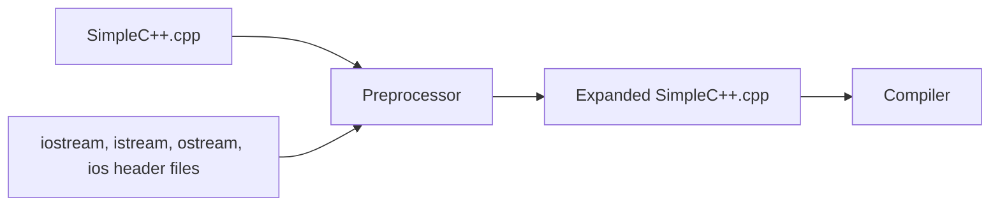

# Chapter 2 — C++ Programming Basics

[Repository Guide](../../README.md) | [English](Concepts_Lecture.md) | [한국어](Concepts_Lecture.ko.md)

> **Last Updated:** 2026-10-19
>
> 명품 C++ Programming, 황기태, Ch 2

> **Learning Objectives:**
> 1. Explain the basic structure of a C++ program and the roles of the `main()` function, comments, and the `#include` directive
> 2. Print data of various types to the screen with `cout` and the `<<` operator
> 3. Read keyboard input with `cin`, the `>>` operator, and `getline`
> 4. Explain the concept of namespaces and use the `std::` prefix and `using` directives
> 5. Read and manipulate strings with C-strings and the `string` class
> 6. Explain how the preprocessor expands header files and distinguish the roles of header files and libraries

---

## Table of Contents

- [1. First C++ Program](#1-first-c-program)
  - [1.1 Program Structure](#11-program-structure)
  - [1.2 Comments](#12-comments)
  - [1.3 `main` Function](#13-main-function)
  - [1.4 `#include <iostream>`](#14-include-iostream)
- [2. Console Output](#2-console-output)
  - [2.1 `cout` and `<<`](#21-cout-and-)
  - [2.2 `endl` vs `'\n'`](#22-endl-vs-n)
  - [2.3 `<<` Operator Details](#23--operator-details)
- [3. Console Input](#3-console-input)
  - [3.1 `cin` and `>>`](#31-cin-and-)
  - [3.2 `getline`](#32-getline)
  - [3.3 `cin` vs `scanf`](#33-cin-vs-scanf)
  - [3.4 Declaring Variables Between Statements](#34-declaring-variables-between-statements)
- [4. Namespace](#4-namespace)
  - [4.1 Concept](#41-concept)
  - [4.2 `using namespace std`](#42-using-namespace-std)
- [5. C++ String](#5-c-string)
  - [5.1 C-Strings](#51-c-strings)
  - [5.2 The `string` Class](#52-the-string-class)
- [6. Modern Variable Declaration with `auto`](#6-modern-variable-declaration-with-auto)
- [7. Header Files and the Preprocessor](#7-header-files-and-the-preprocessor)
  - [7.1 Header Expansion by the Preprocessor](#71-header-expansion-by-the-preprocessor)
  - [7.2 `<iostream>` and `<iostream.h>`](#72-iostream-and-iostreamh)
  - [7.3 `#include <header>` and `#include "header"`](#73-include-header-and-include-header)
  - [7.4 Header Files and Libraries](#74-header-files-and-libraries)
- [Summary](#summary)
- [Self-Check Questions](#self-check-questions)

---

<br>

## 1. First C++ Program

### 1.1 Program Structure

Every C++ program follows a basic structure. Here is the simplest complete program, annotated line by line.

```cpp
// hello.cpp
#include <iostream>       // C++ I/O stream library
using namespace std;      // use the std namespace

int main()                // entry point function
{
    cout << "Hello" << endl;   // output to console
    return 0;             // exit code to OS
}
```

```text
C++ Program Structure
├── Preprocessor Directives   #include <iostream>
├── Namespace Declaration     using namespace std;
├── main Function             int main() { ... }
│   ├── Statements            cout << "Hello" << endl;
│   └── Return Statement      return 0;
└── Other Functions           (defined later in the course)
```

*Figure 1. Components of a C++ program*

| Part | Role |
|:-----|:-----|
| `#include <iostream>` | Include the I/O stream library so `cout` and `cin` can be used |
| `using namespace std;` | Allow direct use of `std` names without the `std::` prefix |
| `int main()` | Define the entry point; OS calls this function first |
| `{ ... }` | Braces delimit the function body |
| `cout << "Hello" << endl;` | Output `"Hello"` followed by a newline to the console |
| `return 0;` | Return exit code 0 (normal termination) to the OS |

*Table 1. Roles of the components of a C++ program*

> **Key Point:** Every statement inside a function must end with a semicolon (`;`). Preprocessor directives (`#include`) do **not** end with a semicolon.

### 1.2 Comments

A comment is a memo in which the developer freely writes an explanation of the program or points to note. Comments are ignored by the compiler, so they do not affect program execution; they exist solely for human readers. C++ uses the same comment styles as C.

| Style | Syntax | Scope |
|:------|:-------|:------|
| Block comment | `/* ... */` | Can span multiple lines |
| Line comment | `// ...` | From `//` to end of line |

*Table 2. Kinds of C++ comments*

```cpp
/* This is a block comment.
   It can span multiple lines. */

// This is a line comment.

int x = 10;  // inline comment after code
```

> **Caution:** Block comments **cannot be nested**. `/* outer /* inner */ still inside? */` causes a compile error because `*/` closes the comment at the first match.

### 1.3 `main` Function

The `main` function is the **entry point** of every C++ program. When the OS runs a compiled program, execution begins at `main`, and the program ends when `main` finishes.

| Form | Standard? | Notes |
|:-----|:---------:|:------|
| `int main()` | Yes | Standard form; returns `int` |
| `int main(void)` | Yes | Explicit empty parameter list |
| `void main()` | **No** | Non-standard; some compilers accept it but it is not portable |

*Table 3. Forms of the `main` function and whether they are standard*

```cpp
int main()        // standard form
{
    return 0;     // 0 = success
}
```

The return value of `main` is an exit code passed to the OS. Zero means normal termination, and a nonzero value can be returned to report an error. In C++, if `return 0;` is omitted at the end of `main`, the compiler implicitly returns `0`. This rule applies only to `main`, and it is good practice to write the return explicitly for clarity.

> **Caution:** `void main()` is **not** standard C++. Although some compilers (e.g., MSVC) accept it as an extension, it should be avoided for portability. Always use `int main()`.

### 1.4 `#include <iostream>`

`#include <iostream>` is an instruction to the **preprocessor** to expand the contents of the `<iostream>` header file into the source before compilation. The `<iostream>` header declares the classes for standard I/O (`ios`, `istream`, `ostream`, `iostream`), the objects (`cout`, `cin`), and the `<<` and `>>` operator functions. The difference from `<iostream.h>`, used in old versions of C++, and the preprocessing step are covered in Section 7.

---

<br>

## 2. Console Output

### 2.1 `cout` and `<<`

`cout` is a predefined object of type `ostream` that is connected to the standard output (screen). The `<<` operator is the **stream insertion operator**, which inserts data into the output stream.

```cpp
#include <iostream>
using namespace std;

int main() {
    cout << "Hello, C++!" << endl;
    return 0;
}
```

| Component | Description |
|:----------|:------------|
| `cout` | `ostream` object connected to the screen (declared in `<iostream>`) |
| `<<` | Stream insertion operator; sends data to the output stream |
| `endl` | Inserts a newline character **and** flushes the output buffer |

*Table 4. Components of screen output*

`<<` is originally C++'s bit-shift operator, redefined (overloaded) in the `ostream` class as the stream insertion operator. It inserts the right operand into the stream object on the left, so data inserted into `cout` appears on the screen connected to `cout`. Because `cout` is declared in the `std` namespace, it must be written as `std::cout` without a `using` directive (Section 4).

**Chaining:** Multiple `<<` operators can be chained in a single statement.

```cpp
int age = 20;
double gpa = 3.8;

cout << "Age: " << age << ", GPA: " << gpa << endl;
// Output: Age: 20, GPA: 3.8
```

Unlike C's `printf`, `cout` **automatically detects the type** of the data being output. There is no need for format specifiers like `%d` or `%f`.

```cpp
// C style — must specify format
printf("Age: %d, GPA: %.1f\n", age, gpa);

// C++ style — type detected automatically
cout << "Age: " << age << ", GPA: " << gpa << endl;
```

> **Note:** **Type safety.** `cout` is type-safe. If you accidentally pass the wrong type, the compiler will either convert it safely or produce a compile error. With `printf`, mismatched format specifiers cause undefined behavior.

#### Modern Output Alternatives: `std::format` and `std::print`

> **Note:** **C++20.** This feature requires C++20 or later.

C++20 introduced `std::format`, which provides Python-like string formatting. It combines the type safety of `cout` with the readability of format strings.

```cpp
#include <format>
#include <iostream>
using namespace std;

int age = 20;
double gpa = 3.8;

// C++20: std::format returns a formatted string
cout << format("Age: {}, GPA: {:.1f}", age, gpa) << endl;
// Output: Age: 20, GPA: 3.8
```

> **Note:** **C++23.** This feature requires C++23 or later.

C++23 goes further with `std::print`, which writes directly to the output without needing `cout`.

```cpp
#include <print>

int age = 20;
double gpa = 3.8;

// C++23: std::print — direct output with format syntax
std::print("Age: {}, GPA: {:.1f}\n", age, gpa);
// Output: Age: 20, GPA: 3.8
```

| Method | Standard | Header | Type-safe | Format control |
|:-------|:---------|:-------|:---------:|:--------------:|
| `printf` | C | `<cstdio>` | No | `%d`, `%f` |
| `cout <<` | C++98 | `<iostream>` | Yes | Manipulators |
| `std::format` | C++20 | `<format>` | Yes | `{}` placeholders |
| `std::print` | C++23 | `<print>` | Yes | `{}` placeholders |

*Table 5. Comparison of output methods*

### 2.2 `endl` vs `'\n'`

Both `endl` and `'\n'` produce a newline, but they differ in one important way.

| Method | Newline? | Flushes Buffer? |
|:-------|:--------:|:---------------:|
| `endl` | Yes | Yes |
| `'\n'` | Yes | No |

*Table 6. Difference between `endl` and `'\n'`*

```cpp
cout << "Line 1" << endl;   // newline + flush
cout << "Line 2" << '\n';   // newline only (no flush)
cout << "Line 3\n";         // same as above (newline in string literal)
```

**Buffer flushing** means the data in the output buffer is immediately written to the screen. Without flushing, the data may stay in the buffer until it fills up or the program ends. Something like `endl` that acts on a stream to change its behavior is called a **manipulator**.

> **Note:** **Output performance.** For performance-sensitive code (e.g., outputting millions of lines), prefer `'\n'` over `endl`. The repeated buffer flushing caused by `endl` can significantly slow down output.

### 2.3 `<<` Operator Details

The `<<` operator can output every basic type, such as `bool`, `char`, `short`, `int`, `long`, `float`, and `double`, as well as strings.

| Type | Example |
|:-----|:--------|
| `bool` | `cout << true;` → `1` (or `true` with `boolalpha`) |
| `char` | `cout << 'A';` → `A` |
| `int` | `cout << 42;` → `42` |
| `double` | `cout << 3.14;` → `3.14` |
| String (`const char*`) | `cout << "Hello";` → `Hello` |

*Table 7. Examples of `<<` output by type*

**Expressions and function calls** can be used directly with `<<`.

```cpp
int a = 5, b = 3;
cout << a + b << endl;         // Output: 8
cout << (a > b) << endl;       // Output: 1 (true)
```

The following program prints values of several types, an expression, and a function's return value at once.

```cpp
#include <iostream>

double area(int r) {           // return the area of a circle with radius r
    return 3.14 * r * r;
}

int main() {
    int n = 3;
    char c = '#';
    std::cout << c << 5.5 << '-' << n << "hello" << true << std::endl;
    std::cout << "n + 5 = " << n + 5 << '\n';
    std::cout << "Area is " << area(n);   // print the return value of area()
}
```

```text
#5.5-3hello1
n + 5 = 8
Area is 28.26
```

Note that `true` is printed as `1` and that no spaces are inserted between values automatically.

**Operator precedence issue:** The `<<` operator has **higher precedence** than comparison operators (`>`, `<`, `>=`, `<=`).

```cpp
cout << 5 > 3;            // ERROR — parsed as (cout << 5) > 3
cout << (5 > 3) << endl;  // OK — Output: 1
```

The expression `cout << 5 > 3` is interpreted as `(cout << 5) > 3`, which tries to compare the `ostream` object with `3`, a type error.

> **Caution:** When outputting the result of an operation with lower precedence than `<<`, such as a comparison, always wrap the expression in **parentheses** to avoid precedence issues: `cout << (5 > 3)`. Arithmetic operators (`+`, `-`, `*`, `/`) have higher precedence than `<<` and print correctly without parentheses, but parentheses make the intent clear.

---

<br>

## 3. Console Input

### 3.1 `cin` and `>>`

`cin` is a predefined object of type `istream` that is connected to the standard input (keyboard). The `>>` operator is the **stream extraction operator**, which extracts data from the input stream.

```cpp
#include <iostream>
using namespace std;

int main() {
    int num;
    cout << "Enter a number: ";
    cin >> num;
    cout << "You entered: " << num << endl;
    return 0;
}
```

| Component | Description |
|:----------|:------------|
| `cin` | `istream` object connected to the keyboard (declared in `<iostream>`) |
| `>>` | Stream extraction operator; reads data from the input stream |

*Table 8. Components of keyboard input*

`>>` is also originally a bit-shift operator, redefined in `<iostream>` as the stream extraction operator that reads a value from the input stream and stores it in a variable.

**How `>>` reads input:**
- Skips leading whitespace (spaces, tabs, newlines).
- Reads characters until the next whitespace delimiter.
- Converts the read characters to the target variable's type.

`cin` has a built-in input buffer. Keys the user types accumulate in the input buffer until the `<Enter>` key is pressed, and meanwhile typed keys can be erased with the `<Backspace>` key. Only when `<Enter>` is pressed does the `>>` operator pass the values in the input buffer to the variable.

**Chaining:** Multiple `>>` operators can be chained.

```cpp
int a, b;
cout << "Enter two numbers: ";
cin >> a >> b;    // reads two integers separated by whitespace
cout << "Sum: " << a + b << endl;
```

```text
Input:  10 20
Output: Sum: 30
```

> **Key Point:** `cin >> a >> b;` reads two tokens separated by spaces, tabs, or newlines from the input. The first token goes into `a`, the second into `b`.

### 3.2 `getline`

The `>>` operator reads only until the next whitespace, which makes it unsuitable for reading strings that contain spaces. The `getline` function reads an **entire line**, including spaces, into a `string` object.

```cpp
#include <iostream>
#include <string>
using namespace std;

int main() {
    string name;
    cout << "Enter your full name: ";
    getline(cin, name);
    cout << "Hello, " << name << "!" << endl;
    return 0;
}
```

```text
Input:  John Doe
Output: Hello, John Doe!
```

**The pitfall of mixing `>>` and `getline`:**

When `>>` reads a value, it leaves the trailing newline (`'\n'`) in the input buffer. If `getline` is called next, it reads this leftover newline and returns an empty string.

**Solution:** Use `cin.ignore()` to discard the leftover newline before calling `getline`.

```cpp
int age;
string name;

cout << "Enter your age: ";
cin >> age;                    // reads the number, leaves '\n' in buffer

cin.ignore();                  // discard the leftover '\n'

cout << "Enter your name: ";
getline(cin, name);            // now reads correctly
cout << age << " " << name << endl;
```

> **Caution:** Forgetting `cin.ignore()` between `>>` and `getline` is one of the most common C++ beginner mistakes. The `getline` call appears to be skipped because it immediately reads the leftover newline.

**Step-by-step visualization of the problem:**

```text
User types: 25[Enter]John Doe[Enter]

Step 1: cin >> age;
  Buffer before: "25\nJohn Doe\n"
  Reads: 25
  Buffer after:  "\nJohn Doe\n"    ← '\n' remains!

Step 2 (WITHOUT cin.ignore()):  getline(cin, name);
  Buffer before: "\nJohn Doe\n"
  Reads: ""                          ← reads up to the first '\n', which is immediate
  Buffer after:  "John Doe\n"
  Result: name is an EMPTY string!

Step 2 (WITH cin.ignore()):  getline(cin, name);
  cin.ignore() discards '\n'
  Buffer before: "John Doe\n"
  Reads: "John Doe"                  ← correct!
  Buffer after:  ""
```

*Figure 2. Changes in the input buffer with and without `cin.ignore()`*

**Robust version with `cin.ignore`:** For maximum safety, use `cin.ignore(numeric_limits<streamsize>::max(), '\n')` which discards everything up to and including the next newline, not just a single character.

```cpp
#include <limits>   // for numeric_limits

cin >> age;
cin.ignore(numeric_limits<streamsize>::max(), '\n');   // discard rest of line
getline(cin, name);
```

### 3.3 `cin` vs `scanf`

| Feature | `cin` (C++) | `scanf` (C) |
|:--------|:------------|:------------|
| Type safety | Type detected automatically | Must specify format (`%d`, `%f`) |
| Format specifiers | Not needed | Required |
| Address-of operator `&` | Not needed for basic types | Required (`scanf("%d", &x)`) |
| String with spaces | Use `getline` | Use `fgets` |
| Error handling | Check stream state (`cin.fail()`) | Check return value |

*Table 9. Comparison of `cin` and `scanf`*

```cpp
// C style
int x;
scanf("%d", &x);      // must use %d and &

// C++ style
int x;
cin >> x;              // no format specifier, no &
```

> **Note:** **Preferring C++ I/O.** In C++, prefer `cin`/`cout` over `scanf`/`printf`. They are type-safe, extensible to user-defined types, and integrate naturally with C++ streams.

### 3.4 Declaring Variables Between Statements

In C++, variables can be declared anywhere among the statements, not only at the beginning of a block. C has allowed the same since C99, but earlier C (C89) required variables to be declared at the beginning of a block.

```cpp
#include <iostream>
using namespace std;

int main() {
    cout << "Enter the width>>";
    int width;                       // variable declared between statements
    cin >> width;
    cout << "Enter the height>>";
    int height;
    cin >> height;
    int area = width * height;       // compute the area of the rectangle
    cout << "The area is " << area << "\n";
}
```

```text
Enter the width>>3
Enter the height>>5
The area is 15
```

- **Advantages:** There is no need to move back and forth between the declaration section and the statements, and declaring a variable right before its use reduces typing errors in variable names.
- **Disadvantages:** It is hard to see all declared variables at a glance, and variables scattered through the code are hard to find.

The effect on typing errors becomes clear by comparing the two pieces of code below. If all variables are declared at the beginning, mistyping `timer` when you meant to store 5 in `time` produces no compile error because `timer` is already declared, and only the result is wrong.

```cpp
int time, timer;
// ...
timer = 5;    // meant to store 5 in time but typed timer; no compile error
// ...
timer = 3;
```

If each variable is declared right before its use, the same mistake causes a compile error because `timer` is not declared yet, so the mistake is caught early.

```cpp
int time;
timer = 5;    // compile error because timer is not declared yet
// ...
int timer;
timer = 3;
```

---

<br>

## 4. Namespace

### 4.1 Concept

A **namespace** is a declarative region that provides a scope for identifiers (names). Its primary purpose is to **prevent name collisions**. Different libraries may define functions or classes with the same name, and namespaces keep them separate.

Name collisions arise when several people split the development of a project, or when source or object files written by others, including open source, are brought in and compiled or linked, and resolving them takes much time and effort. Just as several people named Michael living in one apartment complex are told apart as Michael of Building 1 and Michael of Building 2, a namespace distinguishes identical names by attaching their affiliation.

Developers can create their own namespaces with the `namespace` keyword, and names declared inside one are kept separate from names in other namespaces. A name inside a namespace is used in the form `namespace::name`.

```cpp
// mike.h
namespace mike {             // create a namespace named mike
    int f();
    int g();
}

// kitae.cpp
#include "mike.h"

namespace kitae {            // create a namespace named kitae
    void f() { /* ... */ }
    void m() {
        f();                 // calls kitae::f() in the same namespace
        mike::f();           // calls f() in the mike namespace
    }
}
```

If the `f()` functions written separately by kitae and mike are combined into one program without namespaces, the same name is defined twice and an error occurs. Putting each in its own namespace as above distinguishes them as `kitae::f()` and `mike::f()`, so they do not collide.

The C++ standard library places all its names inside the `std` namespace.

```cpp
#include <iostream>

int main() {
    std::cout << "Hello" << std::endl;   // fully qualified name
    return 0;
}
```

| Syntax | Meaning |
|:-------|:--------|
| `std::cout` | `cout` defined in the `std` namespace |
| `std::endl` | `endl` defined in the `std` namespace |
| `std::string` | `string` class defined in the `std` namespace |

*Table 10. Meaning of names with the `std::` prefix*

Without the `std::` prefix, the compiler does not know where `cout` is defined and will report an error.

### 4.2 `using namespace std`

To avoid writing `std::` before every standard library name, you can use a **using directive**.

```cpp
using namespace std;   // import all names from std into the current scope
```

After this declaration, you can use `cout`, `cin`, `endl`, `string`, `vector`, etc. directly. Because every name declared in `<iostream>` is in the `std` namespace, programs that use `<iostream>` usually place `using namespace std;` after `#include <iostream>`.

```cpp
#include <iostream>
using namespace std;

int main() {
    cout << "No std:: prefix needed" << endl;
    return 0;
}
```

**Selective using declaration:** Import only specific names.

```cpp
#include <iostream>
using std::cout;
using std::endl;

int main() {
    cout << "Only cout and endl imported" << endl;
    // cin would still need std::cin
    return 0;
}
```

| Approach | Pros | Cons |
|:---------|:-----|:-----|
| `std::cout` (fully qualified) | No ambiguity; clear origin | Verbose |
| `using namespace std;` | Concise; convenient | May cause name collisions in large projects |
| `using std::cout;` (selective) | Balance of convenience and safety | Must list each name individually |

*Table 11. Comparison of ways to use standard library names*

> **Note:** **Where to use using directives.** For small programs and learning exercises, `using namespace std;` is perfectly fine. In large projects and header files, prefer fully qualified names or selective `using` declarations to avoid name collisions.

---

<br>

## 5. C++ String

C++ has two ways to represent strings: the **C-string** approach, which uses a character array terminated by `'\0'` as in C, and the approach that uses the **`string` class** of the C++ standard library.

### 5.1 C-Strings

A **C-string** is a `char` array terminated by the null character `'\0'`. Without a terminating `'\0'`, it is not a string but a plain character array.

```cpp
char name1[6] = {'G', 'r', 'a', 'c', 'e', '\0'};  // the string "Grace"
char name2[5] = {'G', 'r', 'a', 'c', 'e'};        // a plain char array, not a string
char name5[10] = "Grace";                          // remaining elements initialized to '\0'
```

```text
name5   [0]  [1]  [2]  [3]  [4]  [5]  [6]  [7]  [8]  [9]
        'G'  'r'  'a'  'c'  'e'  '\0' '\0' '\0' '\0' '\0'
        └─────── "Grace" ───────┘
```

*Figure 3. Elements of the array name5 initialized with the string "Grace"*

C-strings are handled with C string functions (`strcmp()`, `strlen()`, `strcpy()`, etc.). These functions are declared in the `<cstring>` or `<string.h>` header, and `<cstring>`, the C++ standard form, is preferred.

**String input with `cin`:** `cin >> name;` stores the string read from the keyboard in the `char` array `name` and appends `'\0'`. Because `>>` stops at a whitespace character, only the first word of a string containing spaces is read.

```cpp
#include <iostream>
using namespace std;

int main() {
    cout << "Enter your name>>";
    char name[11];                   // holds up to 10 English letters
    cin >> name;                     // reads until a whitespace character
    cout << "Your name is " << name << "\n";
}
```

```text
Enter your name>>Michael
Your name is Michael
```

```text
Enter your name>>Mi chael
Your name is Mi
```

Up to C++17, `>>` does not check the array size, so entering a string longer than the array overwrites memory outside it. Since C++20, it reads at most one character fewer than the array size. A Korean character takes 2 bytes (CP949) or 3 bytes (UTF-8) depending on the encoding, so fewer Korean characters than English letters fit in the same array.

The following program compares a password using a C-string and `strcmp()`, and exits when the password `C++` is entered.

```cpp
#include <iostream>
#include <cstring>                   // header for strcmp()
using namespace std;

int main() {
    char password[11];
    cout << "Enter the password to exit the program." << endl;
    while (true) {
        cout << "Password>>";
        cin >> password;
        if (strcmp(password, "C++") == 0) {
            cout << "The program ends normally." << endl;
            break;
        }
        else
            cout << "Wrong password!" << endl;
    }
}
```

```text
Enter the password to exit the program.
Password>>Java
Wrong password!
Password>>C
Wrong password!
Password>>C++
The program ends normally.
```

**Input including spaces with `cin.getline()`:** To read a string containing spaces into a C-string, use `cin.getline(char buf[], int size, char delimitChar)`. It reads at most `size - 1` characters into `buf`, stops when it meets `delimitChar`, and appends `'\0'`. `delimitChar` is removed from the input buffer and discarded rather than stored in the array, and its default value is `'\n'` (the `<Enter>` key).

```cpp
char address[100];
cin.getline(address, 100, '\n');     // reads at most 99 characters; stops at <Enter>
```

```text
Input: Seoul Korea<Enter>

address  [0] [1] [2] [3] [4] [5] [6] [7] [8] [9] [10] [11] ... [99]
         'S' 'e' 'o' 'u' 'l' ' ' 'K' 'o' 'r' 'e' 'a'  '\0' ...
```

*Figure 4. The array address after reading Seoul Korea with `cin.getline()`*

### 5.2 The `string` Class

C++ provides the `std::string` class as a modern, safer alternative to C-style character arrays (`char[]`). `string` is a C++ standard class declared in the `<string>` header; it adjusts its internal buffer to the size of the string by itself, so there is no size limit, and it provides many functions and operators for copying, comparing, and modifying strings. Because it is easier to handle than C-strings, using `string` is recommended in C++.

```cpp
#include <string>     // required for std::string
#include <iostream>
using namespace std;

int main() {
    string greeting = "Hello, C++!";
    cout << greeting << endl;
    return 0;
}
```

**`std::string` vs C-style `char[]`:**

| Feature | `std::string` (C++) | `char[]` (C) |
|:--------|:--------------------|:-------------|
| Header | `#include <string>` | `#include <cstring>` |
| Declaration | `string s = "Hello";` | `char s[] = "Hello";` |
| Concatenation | `s1 + s2` | `strcat(s1, s2)` |
| Comparison | `s1 == s2` | `strcmp(s1, s2) == 0` |
| Length | `s.length()` or `s.size()` | `strlen(s)` |
| Dynamic size | Yes (grows automatically) | No (fixed at declaration) |
| Safe? | Yes (bounds-managed) | No (manual buffer management) |

*Table 12. Comparison of `std::string` and `char[]`*

**Common operations:**

```cpp
string a = "Hello";
string b = "World";

// Concatenation
string c = a + ", " + b + "!";   // "Hello, World!"

// Comparison
if (a == b) { /* ... */ }         // works naturally with ==

// Length
cout << c.length() << endl;       // 13

// Input with getline (reads entire line including spaces)
string line;
getline(cin, line);

// Accessing individual characters
cout << a[0] << endl;             // 'H'
```

The following program concatenates strings with `+`, accesses a character with `[]`, reads a string containing spaces with `getline()`, and compares strings with `==`. `getline()` is a global function provided for reading a line into a `string` object.

```cpp
#include <iostream>
#include <string>                    // header for the string class
using namespace std;

int main() {
    string song("Falling in love with you");
    string elvis("Elvis Presley");
    string singer;

    cout << "Who sang " + song;                          // concatenate with +
    cout << " (hint: first letter is " << elvis[0] << ")?";  // access a char with []
    getline(cin, singer);                                // read a string with spaces
    if (singer == elvis)                                 // compare strings
        cout << "Correct.";
    else
        cout << "Wrong. It is " + elvis + "." << endl;
}
```

```text
Who sang Falling in love with you (hint: first letter is E)?Elvis Pride
Wrong. It is Elvis Presley.
```

> **Key Point:** `std::string` is introduced briefly here. Detailed string operations and member functions are covered in Chapter 4, and iterators in Chapter 10. For now, know that `string` is safer and more convenient than `char[]` in C++.

---

<br>

## 6. Modern Variable Declaration with `auto`

Since C++11, the `auto` keyword lets the compiler **deduce the type** of a variable from its initializer. This reduces redundancy and makes code more maintainable.

```cpp
auto x = 42;           // int
auto pi = 3.14;        // double
auto name = "Hello"s;  // std::string (with s suffix, requires "using namespace std::literals")
auto greeting = string("Hello");  // std::string

// Especially useful with complex types
vector<int> nums = {1, 2, 3};
auto it = nums.begin();   // vector<int>::iterator — much shorter with auto
```

**When to use `auto`:**

| Use `auto` | Use explicit type |
|:-----------|:-----------------|
| When the type is obvious from the right-hand side | When the type is not obvious and readability suffers |
| With complex types (iterators, lambda, etc.) | When you intentionally want a different type (e.g., `int x = 3.14;` truncates) |
| With range-based for loops: `for (auto& item : vec)` | In public API / function signatures (clarity matters) |

*Table 13. When to use `auto` and when to use an explicit type*

> **Note:** `auto` does not mean the variable is untyped or dynamically typed. The type is determined at **compile time** and is fixed thereafter. C++ remains a statically-typed language.

---

<br>

## 7. Header Files and the Preprocessor

### 7.1 Header Expansion by the Preprocessor

When the preprocessor meets `#include <iostream>`, it expands the contents of the `<iostream>` header file in place. `<iostream>` in turn includes headers such as `<istream>`, `<ostream>`, and `<ios>`, so the preprocessor produces an expanded source with all of them expanded, and the compiler compiles this expanded source. Which header includes which differs among compiler implementations.



*Figure 5. The preprocessor expanding header files into an expanded source*

Standard header files such as `iostream` are text files without an extension, located in the `include` folder under the folder where the compiler is installed. For example, in Visual Studio 2017 Community they are in `C:\Program Files (x86)\Microsoft Visual Studio\2017\Community\VC\Tools\MSVC\14.10.25017\include`.

### 7.2 `<iostream>` and `<iostream.h>`

Old pre-standard versions of C++ used `#include <iostream.h>`, and names were declared without the `std` namespace. Standard C++ (C++98 and later) uses `#include <iostream>`, and because the names are in the `std` namespace, they are used with `using namespace std;` or the `std::` prefix. `<iostream.h>` can be used only with old compilers such as Visual Studio 6.0.

### 7.3 `#include <header>` and `#include "header"`

- **`#include <header>`:** Searches for the header file in the folder where the compiler is installed (the system include path). It is used for header files supplied by the compiler, such as `<iostream>`.
- **`#include "header"`:** Searches the developer's project folder and the include folders the developer specifies as compile options, and if not found, searches the same locations as `<>`. It is used for header files written by the developer.

### 7.4 Header Files and Libraries

The `<cstring>` header file does not contain the code of the `strcpy()` function; only the function's prototype is declared there. The function's code is stored in compiled binary form in a library file (for Visual Studio, files such as `libcmt.lib` in the `lib` folder) and goes into the executable at link time.

Header files are needed because the compiler must check whether the user program's call to `strcpy()` is correct (the number and types of arguments and the return type). Likewise, `cout` and `cin` are objects declared in `<iostream>`, and the actual objects reside in the standard library.

---

<br>

## Summary

| Concept | Key Summary |
|:--------|:-------------|
| Program Structure | A program consists of `#include <iostream>`, `using namespace std;`, `int main()`, statements, and `return 0;` in that order. |
| Comments | There are two styles, `/* block */` and `// line`, the same as in C, and block comments cannot nest. |
| `main` Function | `main` is the entry point of the program and returns `int`, and `void main()` is non-standard. |
| `#include <iostream>` | It makes the preprocessor expand into the source the header that declares the I/O classes and the `cout` and `cin` objects. |
| `cout` and `<<` | `cout` is the `ostream` object for output, and `<<` is the stream insertion operator that detects types automatically and supports chaining. |
| `endl` vs `'\n'` | `endl` flushes the buffer and `'\n'` does not, so `'\n'` is preferred for performance. |
| `<<` Precedence | `<<` has higher precedence than comparison operators, so parentheses are needed, as in `cout << (5 > 3)`. |
| `cin` and `>>` | `cin` is an `istream` object with an input buffer, and `>>` is the stream extraction operator that skips whitespace and supports chaining. |
| `getline` | `getline` reads an entire line including spaces into a `string`, and after `>>` the leftover newline must first be discarded with `cin.ignore()`. |
| `cin` vs `scanf` | `cin` is type-safe, needs no format specifiers, and needs no `&` for basic types. |
| Declaration Position | C++ allows variables to be declared anywhere among statements, and declaring them right before use reduces typing errors. |
| Namespace | A namespace is a declarative region that prevents name collisions, and the standard library is in `std`, used as `std::cout`. |
| `using namespace std` | It allows the `std::` prefix to be omitted, and `using std::cout` imports only a specific name. |
| C-String | A C-string is a `char` array terminated by `'\0'`, handled with `<cstring>` functions and read with spaces using `cin.getline()`. |
| `std::string` | `std::string` is a modern alternative to `char[]` that concatenates with `+`, compares with `==`, and reports its length with `.length()`. |
| `std::format` / `std::print` | They are the modern output formatting of C++20 and C++23, using `{}` placeholders and type-safe like `cout`. |
| `auto` | The compiler deduces the type from the initializer (C++11), which is useful for complex types such as iterators, and the variable remains statically typed. |
| Header Files and Libraries | Header files declare function prototypes, and the function code is in libraries and goes into the executable at link time. |
| `<>` and `""` | `<>` searches for headers supplied by the compiler, and `""` searches starting from the developer's project folder. |

---

<br>

## Self-Check Questions

1. **Operator precedence:** Explain why `cout << 5 > 3;` is a compile error, and rewrite it so that it prints the result of `5 > 3`.

   <details>
   <summary>Answer</summary>

   `<<` has higher precedence than `>`, so the statement is parsed as `(cout << 5) > 3`. The result of `cout << 5` is an `ostream` object, which cannot be compared with the integer `3`, so a compile error occurs. Writing `cout << (5 > 3);` prints `1`.

   </details>

2. **Output:** With `int n = 3; char c = '#';`, write the output of `cout << c << 5.5 << '-' << n << "hello" << true;`.

   <details>
   <summary>Answer</summary>

   It is `#5.5-3hello1`. No spaces are inserted between values, and `true` is printed as `1` unless `boolalpha` is used.

   </details>

3. **Mixing `>>` and `getline`:** If `getline(cin, name);` is called after `cin >> age;`, `name` becomes an empty string without giving the user a chance to type a name. Explain the cause and the fix.

   <details>
   <summary>Answer</summary>

   `cin >> age;` reads only the number and leaves the newline `'\n'` from the user's `<Enter>` in the input buffer. `getline` reads up to the first `'\n'`, so it immediately meets the leftover newline and returns an empty string. Discarding the leftover newline with `cin.ignore();` or `cin.ignore(numeric_limits<streamsize>::max(), '\n');` before `getline` fixes it.

   </details>

4. **C-string input:** If `Kim Minsu` is entered for `char name[11]; cin >> name;`, what is stored in `name`? Give two ways to read an entire line including spaces.

   <details>
   <summary>Answer</summary>

   `>>` stops reading at whitespace, so `name` holds `"Kim"`. To read including spaces, use `cin.getline(name, 11);` for a C-string and `getline(cin, str);` for a `string` object.

   </details>

5. **Header files and libraries:** Does the `<cstring>` header file contain the code of the `strcpy()` function? Where is the function's code, and why is the header file needed?

   <details>
   <summary>Answer</summary>

   It does not. The header file declares only the prototype of `strcpy()`, and the function's code is stored as compiled binary in a library file and goes into the executable at link time. The header file is needed so that the compiler can check that a call to `strcpy()` has the right number and types of arguments and the right return type.

   </details>
