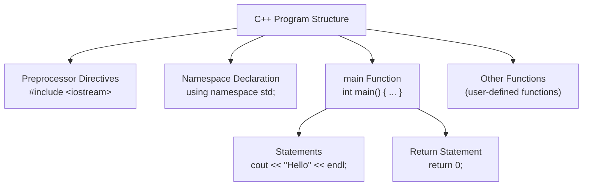
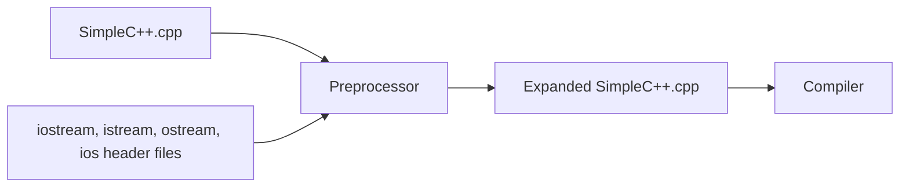

# Chapter 2 — C++ Programming Basics

[Repository Guide](../../README.md) | [English](Concepts_Lecture.md) | [한국어](Concepts_Lecture.ko.md)

> **Last Updated:** 2026-11-19
>
> 명품 C++ Programming, 황기태, Ch 2

> **Learning Objectives:**
> 1. Explain the basic structure of a C++ program and the roles of the `main()` function, comments, and the `#include` directive
> 2. Print data of various types to the screen with `cout` and the `<<` operator
> 3. Read keyboard input with `cin`, the `>>` operator, and `getline`
> 4. Explain the concept of namespaces and use the `std::` prefix and `using` directives
> 5. Read and manipulate strings with C-strings and the `string` class
> 6. Explain how the preprocessor expands header files and distinguish the roles of header files and libraries

---

## Table of Contents

- [1. First C++ Program](#1-first-c-program)
  - [1.1 Program Structure](#11-program-structure)
  - [1.2 Comments](#12-comments)
  - [1.3 `main` Function](#13-main-function)
  - [1.4 `#include <iostream>`](#14-include-iostream)
- [2. Console Output](#2-console-output)
  - [2.1 `cout` and `<<`](#21-cout-and-)
  - [2.2 `endl` vs `'\n'`](#22-endl-vs-n)
  - [2.3 `<<` Operator Details](#23--operator-details)
  - [2.4 The bool Type](#24-the-bool-type)
  - [2.5 How `<<` Chains and How the Output Type Is Decided](#25-how--chains-and-how-the-output-type-is-decided)
- [3. Console Input](#3-console-input)
  - [3.1 `cin` and `>>`](#31-cin-and-)
  - [3.2 `getline`](#32-getline)
  - [3.3 `cin` vs `scanf`](#33-cin-vs-scanf)
  - [3.4 Declaring Variables Between Statements](#34-declaring-variables-between-statements)
  - [3.5 Reading Until the Input Ends](#35-reading-until-the-input-ends)
  - [3.6 Two Ways to Read a Single Character](#36-two-ways-to-read-a-single-character)
- [4. Namespace](#4-namespace)
  - [4.1 Concept](#41-concept)
  - [4.2 `using namespace std`](#42-using-namespace-std)
  - [4.3 Name Conflicts Caused by the using Directive](#43-name-conflicts-caused-by-the-using-directive)
  - [4.4 Nested Namespaces and Namespace Aliases](#44-nested-namespaces-and-namespace-aliases)
- [5. C++ String](#5-c-string)
  - [5.1 C-Strings](#51-c-strings)
  - [5.2 The `string` Class](#52-the-string-class)
  - [5.3 Copying and Comparing C Strings and string Objects](#53-copying-and-comparing-c-strings-and-string-objects)
  - [5.4 Common Mistakes with C Strings](#54-common-mistakes-with-c-strings)
  - [5.5 Comparing Four Ways to Read Strings](#55-comparing-four-ways-to-read-strings)
- [6. Modern Variable Declaration with `auto`](#6-modern-variable-declaration-with-auto)
- [7. Header Files and the Preprocessor](#7-header-files-and-the-preprocessor)
  - [7.1 Header Expansion by the Preprocessor](#71-header-expansion-by-the-preprocessor)
  - [7.2 `<iostream>` and `<iostream.h>`](#72-iostream-and-iostreamh)
  - [7.3 `#include <header>` and `#include "header"`](#73-include-header-and-include-header)
  - [7.4 Header Files and Libraries](#74-header-files-and-libraries)
- [Summary](#summary)
- [Self-Check Questions](#self-check-questions)
- [References](#references)

---

<br>

## 1. First C++ Program

### 1.1 Program Structure

Every C++ program follows a basic structure. Here is the simplest complete program, annotated line by line.

```cpp
// hello.cpp
#include <iostream>       // C++ I/O stream library
using namespace std;      // use the std namespace

int main()                // entry point function
{
    cout << "Hello" << endl;   // output to console
    return 0;             // exit code to OS
}
```



*Figure 1. Components of a C++ program*

| Part | Role |
|:-----|:-----|
| `#include <iostream>` | Include the I/O stream library so `cout` and `cin` can be used |
| `using namespace std;` | Allow direct use of `std` names without the `std::` prefix |
| `int main()` | Define the entry point; OS calls this function first |
| `{ ... }` | Braces delimit the function body |
| `cout << "Hello" << endl;` | Output `"Hello"` followed by a newline to the console |
| `return 0;` | Return exit code 0 (normal termination) to the OS |

*Table 1. Roles of the components of a C++ program*

> **Key Point:** Every statement inside a function must end with a semicolon (`;`). Preprocessor directives (`#include`) do **not** end with a semicolon.

### 1.2 Comments

A comment is a memo in which the developer freely writes an explanation of the program or points to note. Comments are ignored by the compiler, so they do not affect program execution; they exist solely for human readers. C++ uses the same comment styles as C.

| Style | Syntax | Scope |
|:------|:-------|:------|
| Block comment | `/* ... */` | Can span multiple lines |
| Line comment | `// ...` | From `//` to end of line |

*Table 2. Kinds of C++ comments*

```cpp
/* This is a block comment.
   It can span multiple lines. */

// This is a line comment.

int x = 10;  // inline comment after code
```

> **Caution:** Block comments **cannot be nested**. `/* outer /* inner */ still inside? */` causes a compile error because `*/` closes the comment at the first match.

### 1.3 `main` Function

The `main` function is the **entry point** of every C++ program. When the OS runs a compiled program, execution begins at `main`, and the program ends when `main` finishes.

| Form | Standard | Notes |
|:-----|:---------:|:------|
| `int main()` | Yes | Standard form; returns `int` |
| `int main(void)` | Yes | Explicit empty parameter list |
| `void main()` | **No** | Non-standard; some compilers accept it but it is not portable |

*Table 3. Forms of the `main` function and whether they are standard*

```cpp
int main()        // standard form
{
    return 0;     // 0 = success
}
```

The return value of `main` is an exit code passed to the OS. Zero means normal termination, and a nonzero value can be returned to report an error. In C++, if `return 0;` is omitted at the end of `main`, the compiler implicitly returns `0`. This rule applies only to `main`, and it is good practice to write the return explicitly for clarity.

> **Caution:** `void main()` is **not** standard C++. Although some compilers (e.g., MSVC) accept it as an extension, it should be avoided for portability. Always use `int main()`.

### 1.4 `#include <iostream>`

`#include <iostream>` is an instruction to the **preprocessor** to expand the contents of the `<iostream>` header file into the source before compilation. The `<iostream>` header declares the classes for standard I/O (`ios`, `istream`, `ostream`, `iostream`), the objects (`cout`, `cin`), and the `<<` and `>>` operator functions. The difference from `<iostream.h>`, used in old versions of C++, and the preprocessing step are covered in Section 7.

---

<br>

## 2. Console Output

### 2.1 `cout` and `<<`

`cout` is a predefined object of type `ostream` that is connected to the standard output (screen). The `<<` operator is the **stream insertion operator**, which inserts data into the output stream.

```cpp
#include <iostream>
using namespace std;

int main() {
    cout << "Hello, C++!" << endl;
    return 0;
}
```

| Component | Description |
|:----------|:------------|
| `cout` | `ostream` object connected to the screen (declared in `<iostream>`) |
| `<<` | Stream insertion operator; sends data to the output stream |
| `endl` | Inserts a newline character **and** flushes the output buffer |

*Table 4. Components of screen output*

`<<` is originally C++'s bit-shift operator, redefined (overloaded) in the `ostream` class as the stream insertion operator. It inserts the right operand into the stream object on the left, so data inserted into `cout` appears on the screen connected to `cout`. Because `cout` is declared in the `std` namespace, it must be written as `std::cout` without a `using` directive (Section 4).

**Chaining:** Multiple `<<` operators can be chained in a single statement.

```cpp
int age = 20;
double gpa = 3.8;

cout << "Age: " << age << ", GPA: " << gpa << endl;
// Output: Age: 20, GPA: 3.8
```

Unlike C's `printf`, `cout` **automatically detects the type** of the data being output. There is no need for format specifiers like `%d` or `%f`.

```cpp
// C style: must specify format
printf("Age: %d, GPA: %.1f\n", age, gpa);

// C++ style: type detected automatically
cout << "Age: " << age << ", GPA: " << gpa << endl;
```

> **Note:** **Type safety.** `cout` is type-safe. If you accidentally pass the wrong type, the compiler will either convert it safely or produce a compile error. With `printf`, mismatched format specifiers cause undefined behavior.

#### Modern Output Alternatives: `std::format` and `std::print`

> **Note:** **C++20.** This feature requires C++20 or later.

C++20 introduced `std::format`, which provides Python-like string formatting. It combines the type safety of `cout` with the readability of format strings.

```cpp
#include <format>
#include <iostream>
using namespace std;

int age = 20;
double gpa = 3.8;

// C++20: std::format returns a formatted string
cout << format("Age: {}, GPA: {:.1f}", age, gpa) << endl;
// Output: Age: 20, GPA: 3.8
```

> **Note:** **C++23.** This feature requires C++23 or later.

C++23 goes further with `std::print`, which writes directly to the output without needing `cout`.

```cpp
#include <print>

int age = 20;
double gpa = 3.8;

// C++23: std::print, direct output with format syntax
std::print("Age: {}, GPA: {:.1f}\n", age, gpa);
// Output: Age: 20, GPA: 3.8
```

| Method | Standard | Header | Type-safe | Format control |
|:-------|:---------|:-------|:---------:|:--------------:|
| `printf` | C | `<cstdio>` | No | `%d`, `%f` |
| `cout <<` | C++98 | `<iostream>` | Yes | Manipulators |
| `std::format` | C++20 | `<format>` | Yes | `{}` placeholders |
| `std::print` | C++23 | `<print>` | Yes | `{}` placeholders |

*Table 5. Comparison of output methods*

### 2.2 `endl` vs `'\n'`

Both `endl` and `'\n'` produce a newline, but they differ in one important way.

| Method | Newline | Buffer Flush |
|:-------|:--------:|:---------------:|
| `endl` | Yes | Yes |
| `'\n'` | Yes | No |

*Table 6. Difference between `endl` and `'\n'`*

```cpp
cout << "Line 1" << endl;   // newline + flush
cout << "Line 2" << '\n';   // newline only (no flush)
cout << "Line 3\n";         // same as above (newline in string literal)
```

**Buffer flushing** means the data in the output buffer is immediately written to the screen. Without flushing, the data may stay in the buffer until it fills up or the program ends. Something like `endl` that acts on a stream to change its behavior is called a **manipulator**.

> **Note:** **Output performance.** For performance-sensitive code (e.g., outputting millions of lines), prefer `'\n'` over `endl`. The repeated buffer flushing caused by `endl` can significantly slow down output.

### 2.3 `<<` Operator Details

The `<<` operator can output every basic type, such as `bool`, `char`, `short`, `int`, `long`, `float`, and `double`, as well as strings.

| Type | Example |
|:-----|:--------|
| `bool` | `cout << true;` → `1` (or `true` with `boolalpha`) |
| `char` | `cout << 'A';` → `A` |
| `int` | `cout << 42;` → `42` |
| `double` | `cout << 3.14;` → `3.14` |
| String (`const char*`) | `cout << "Hello";` → `Hello` |

*Table 7. Examples of `<<` output by type*

**Expressions and function calls** can be used directly with `<<`.

```cpp
int a = 5, b = 3;
cout << a + b << endl;         // Output: 8
cout << (a > b) << endl;       // Output: 1 (true)
```

The following program prints values of several types, an expression, and a function's return value at once.

```cpp
#include <iostream>

double area(int r) {           // return the area of a circle with radius r
    return 3.14 * r * r;
}

int main() {
    int n = 3;
    char c = '#';
    std::cout << c << 5.5 << '-' << n << "hello" << true << std::endl;
    std::cout << "n + 5 = " << n + 5 << '\n';
    std::cout << "Area is " << area(n);   // print the return value of area()
}
```

```text
#5.5-3hello1
n + 5 = 8
Area is 28.26
```

Note that `true` is printed as `1` and that no spaces are inserted between values automatically.

**Operator precedence issue:** The `<<` operator has **higher precedence** than comparison operators (`>`, `<`, `>=`, `<=`).

```cpp
cout << 5 > 3;            // ERROR: parsed as (cout << 5) > 3
cout << (5 > 3) << endl;  // OK, Output: 1
```

The expression `cout << 5 > 3` is interpreted as `(cout << 5) > 3`, which tries to compare the `ostream` object with `3`, a type error.

> **Caution:** When outputting the result of an operation with lower precedence than `<<`, such as a comparison, always wrap the expression in **parentheses** to avoid precedence issues: `cout << (5 > 3)`. Arithmetic operators (`+`, `-`, `*`, `/`) have higher precedence than `<<` and print correctly without parentheses, but parentheses make the intent clear.

### 2.4 The bool Type

`bool`, which appeared in the first row of Table 7, is a built-in type of C++ that has only two values, true and false. The values are written as the literals `true` and `false`, and the results of comparison and logical operations are `bool`.

> **Definition:** The **bool type** is a built-in C++ type with only the two values `true` and `false`, representing the result of a condition. Mixed with integers, `true` becomes 1 and `false` becomes 0, and converting an integer to `bool` gives `false` for 0 and `true` for any nonzero value.

```cpp
#include <iostream>
using namespace std;

int main() {
    bool isAdult = true;
    bool isEmpty = false;
    bool fromInt = 7;                 // a nonzero integer becomes true
    int fromBool = true + true;       // true becomes 1 and false becomes 0
    cout << isAdult << ' ' << isEmpty << ' ' << fromInt << ' ' << fromBool << endl;
    cout << boolalpha << isAdult << ' ' << (3 > 5) << endl;
    cout << "sizeof(bool)=" << sizeof(bool) << endl;
    return 0;
}
```

```text
1 0 1 2
true false
sizeof(bool)=1
```

- `bool fromInt = 7;` is a nonzero integer, so it becomes `true` and prints as `1`. The value 7 is not preserved.
- `true + true` is 2, because both `bool` values become the `int` 1 and are added.
- By default `cout` prints `bool` as `1` and `0`; once the manipulator `boolalpha` is sent, it prints `true` and `false` from then on. The parentheses around `(3 > 5)` are needed because of the precedence problem of Section 2.3.
- The size of `bool` is 1 byte in this environment. Storing only true and false would need just 1 bit, but memory is addressed in bytes, so it usually takes 1 byte. The size is defined by the implementation.

C originally had no Boolean type and represented true and false with the zero and nonzero values of `int`; C99 added the `_Bool` type and the macros `bool`, `true`, and `false` in `<stdbool.h>`. In C++, `bool`, `true`, and `false` have been keywords from the start, so they can be used without a header. C++ also allows an integer as a condition, as in `if (count)`, because the integer converts to `bool`; to make the intent clear, write a comparison such as `if (count != 0)`.

### 2.5 How `<<` Chains and How the Output Type Is Decided

`cout << a << b` prints from the left in turn because `<<` associates from left to right and the result of the expression `cout << a` is `cout` itself. The expression is interpreted as `(cout << a) << b`: the part in parentheses first prints `a` and yields `cout` as its result, and `<< b` is then applied to that `cout`.

```cpp
#include <iostream>
using namespace std;

int main() {
    ostream &r = (cout << "A");      // the result of cout << "A" is cout itself
    r << "B" << endl;                 // r is another name for cout

    cout << 'A' + 1 << endl;          // adding a char and an int gives an int
    cout << char('A' + 1) << endl;    // converted to char and printed

    const char *s = "Hi";
    cout << s << ' ' << *s << endl;   // a char pointer prints the string, *s the first character
    return 0;
}
```

```text
AB
66
B
Hi H
```

- `ostream &r = (cout << "A");` receives the result of `cout << "A"` in the `ostream` reference `r`. `r` is another name for `cout` itself, so `r << "B"` prints `B` on the same line of the screen, giving `AB`. `ostream` is the type of `cout`, and references declared with `&` are covered in Chapter 5. How to make `<<` return itself as its result is covered with operator overloading in Chapter 7.
- `<<` chooses how to print by the **type** of the value. In `'A' + 1`, the `char` becomes an `int` before the addition, so the result is the `int` 66 and is printed as an integer. To print the character `B`, convert the result to `char`, as in `char('A' + 1)`.
- `s` of type `const char*` is a pointer holding an address, but `<<` treats a `char` pointer as the start of a C string and prints the string up to the null character, `Hi`. `*s` is the first character `H`, of type `char`. Printing another kind of pointer, such as an `int*`, prints the address value in hexadecimal instead.

The format specifiers of printf are a way for the programmer to tell the type, so a mismatch such as passing a `double` to `%d` leads to wrong output at run time. With `<<`, the compiler chooses the printing method from the type, so such mismatches cannot happen. On the other hand, if the type of an expression differs from what was expected, as with `'A' + 1` above, the output also differs, so knowing the exact type of an expression matters.

---

<br>

## 3. Console Input

### 3.1 `cin` and `>>`

`cin` is a predefined object of type `istream` that is connected to the standard input (keyboard). The `>>` operator is the **stream extraction operator**, which extracts data from the input stream.

```cpp
#include <iostream>
using namespace std;

int main() {
    int num;
    cout << "Enter a number: ";
    cin >> num;
    cout << "You entered: " << num << endl;
    return 0;
}
```

| Component | Description |
|:----------|:------------|
| `cin` | `istream` object connected to the keyboard (declared in `<iostream>`) |
| `>>` | Stream extraction operator; reads data from the input stream |

*Table 8. Components of keyboard input*

`>>` is also originally a bit-shift operator, redefined in `<iostream>` as the stream extraction operator that reads a value from the input stream and stores it in a variable.

**How `>>` reads input:**
- Skips leading whitespace (spaces, tabs, newlines).
- Reads characters until the next whitespace delimiter.
- Converts the read characters to the target variable's type.

`cin` has a built-in input buffer. Keys the user types accumulate in the input buffer until the `<Enter>` key is pressed, and meanwhile typed keys can be erased with the `<Backspace>` key. Only when `<Enter>` is pressed does the `>>` operator pass the values in the input buffer to the variable.

**Chaining:** Multiple `>>` operators can be chained.

```cpp
int a, b;
cout << "Enter two numbers: ";
cin >> a >> b;    // reads two integers separated by whitespace
cout << "Sum: " << a + b << endl;
```

```text
Input:  10 20
Output: Sum: 30
```

> **Key Point:** `cin >> a >> b;` reads two tokens separated by spaces, tabs, or newlines from the input. The first token goes into `a`, the second into `b`.

The state `cin` enters when the input does not match the type of the variable, as when letters are typed for an `int` variable, is covered with the input/output streams in Chapter 11.

### 3.2 `getline`

The `>>` operator reads only until the next whitespace, which makes it unsuitable for reading strings that contain spaces. The `getline` function reads an **entire line**, including spaces, into a `string` object.

```cpp
#include <iostream>
#include <string>
using namespace std;

int main() {
    string name;
    cout << "Enter your full name: ";
    getline(cin, name);
    cout << "Hello, " << name << "!" << endl;
    return 0;
}
```

```text
Input:  John Doe
Output: Hello, John Doe!
```

**The pitfall of mixing `>>` and `getline`:**

When `>>` reads a value, it leaves the trailing newline (`'\n'`) in the input buffer. If `getline` is called next, it reads this leftover newline and returns an empty string.

**Solution:** Use `cin.ignore()` to discard the leftover newline before calling `getline`.

```cpp
int age;
string name;

cout << "Enter your age: ";
cin >> age;                    // reads the number, leaves '\n' in buffer

cin.ignore();                  // discard the leftover '\n'

cout << "Enter your name: ";
getline(cin, name);            // now reads correctly
cout << age << " " << name << endl;
```

> **Caution:** Forgetting `cin.ignore()` between `>>` and `getline` is one of the most common C++ beginner mistakes. The `getline` call appears to be skipped because it immediately reads the leftover newline.

**Step-by-step visualization of the problem:**

```text
User types: 25[Enter]John Doe[Enter]

Step 1: cin >> age;
  Buffer before: "25\nJohn Doe\n"
  Reads: 25
  Buffer after:  "\nJohn Doe\n"    ← '\n' remains!

Step 2 (WITHOUT cin.ignore()):  getline(cin, name);
  Buffer before: "\nJohn Doe\n"
  Reads: ""                          ← reads up to the first '\n', which is immediate
  Buffer after:  "John Doe\n"
  Result: name is an EMPTY string!

Step 2 (WITH cin.ignore()):  getline(cin, name);
  cin.ignore() discards '\n'
  Buffer before: "John Doe\n"
  Reads: "John Doe"                  ← correct!
  Buffer after:  ""
```

*Figure 2. Changes in the input buffer with and without `cin.ignore()`*

**Robust version with `cin.ignore`:** For maximum safety, use `cin.ignore(numeric_limits<streamsize>::max(), '\n')` which discards everything up to and including the next newline, not just a single character.

```cpp
#include <limits>   // for numeric_limits

cin >> age;
cin.ignore(numeric_limits<streamsize>::max(), '\n');   // discard rest of line
getline(cin, name);
```

### 3.3 `cin` vs `scanf`

| Feature | `cin` (C++) | `scanf` (C) |
|:--------|:------------|:------------|
| Type safety | Type detected automatically | Must specify format (`%d`, `%f`) |
| Format specifiers | Not needed | Required |
| Address-of operator `&` | Not needed for basic types | Required (`scanf("%d", &x)`) |
| String with spaces | Use `getline` | Use `fgets` |
| Error handling | Check stream state (`cin.fail()`) | Check return value |

*Table 9. Comparison of `cin` and `scanf`*

```cpp
// C style
int x;
scanf("%d", &x);      // must use %d and &

// C++ style
int x;
cin >> x;              // no format specifier, no &
```

> **Note:** **Preferring C++ I/O.** In C++, prefer `cin`/`cout` over `scanf`/`printf`. They are type-safe, extensible to user-defined types, and integrate naturally with C++ streams.

### 3.4 Declaring Variables Between Statements

In C++, variables can be declared anywhere among the statements, not only at the beginning of a block. C has allowed the same since C99, but earlier C (C89) required variables to be declared at the beginning of a block.

```cpp
#include <iostream>
using namespace std;

int main() {
    cout << "Enter the width>>";
    int width;                       // variable declared between statements
    cin >> width;
    cout << "Enter the height>>";
    int height;
    cin >> height;
    int area = width * height;       // compute the area of the rectangle
    cout << "The area is " << area << "\n";
}
```

```text
Enter the width>>3
Enter the height>>5
The area is 15
```

- **Advantages:** There is no need to move back and forth between the declaration section and the statements, and declaring a variable right before its use reduces typing errors in variable names.
- **Disadvantages:** It is hard to see all declared variables at a glance, and variables scattered through the code are hard to find.

The effect on typing errors becomes clear by comparing the two pieces of code below. If all variables are declared at the beginning, mistyping `timer` when you meant to store 5 in `time` produces no compile error because `timer` is already declared, and only the result is wrong.

```cpp
int time, timer;
// ...
timer = 5;    // meant to store 5 in time but typed timer; no compile error
// ...
timer = 3;
```

If each variable is declared right before its use, the same mistake causes a compile error because `timer` is not declared yet, so the mistake is caught early.

```cpp
int time;
timer = 5;    // compile error because timer is not declared yet
// ...
int timer;
timer = 3;
```

### 3.5 Reading Until the Input Ends

The expression `cin >> x` itself also has a value. Used as a condition, it is true if the read succeeds and false if the input has ended or a value that does not fit the type of `x` appears. This property allows input of unknown length to be read to the end.

```cpp
#include <iostream>
using namespace std;

int main() {
    int x, sum = 0, count = 0;
    while (cin >> x) {                // repeat while reading an integer succeeds
        sum += x;
        count++;
    }
    cout << "count " << count << ", sum " << sum << endl;
    return 0;
}
```

```text
$ printf '10 20\n30\n' | ./readsum
count 3, sum 60
$ printf '10 20 abc 30\n' | ./readsum
count 2, sum 30
```

- In the first run, `>>` skips spaces and line breaks (Section 3.1) while reading 10, 20, and 30 in turn, and the loop ends when reading fails at the end of the input (EOF). When typing on the keyboard, the end of input is signaled with Ctrl+D on macOS and Linux and Ctrl+Z on Windows.
- In the second run, `abc` cannot be read as an integer, so reading fails at that point and the loop ends. The 30 after `abc` is not read. After the failure `cin` enters an error state, and all further input also fails.

`printf '...' |` is a shell feature that passes the output of the preceding command to the program's standard input; it is used to give predetermined input instead of the keyboard. How to check and reset the error state of `cin` is covered in Chapter 11.

### 3.6 Two Ways to Read a Single Character

Reading into a `char` variable with `>>` skips whitespace characters, following the rule of Section 3.1, and reads the first non-whitespace character. When spaces and line breaks must be read as they are, use the member function `cin.get()`.

```cpp
#include <iostream>
using namespace std;

int main() {
    char a, b, c;
    cin >> a >> b;                    // skips whitespace and reads one character each
    cin.get(c);                       // reads the next character as it is, including whitespace
    cout << '[' << a << "][" << b << "][" << c << ']' << endl;
    return 0;
}
```

```text
$ printf 'x y z\n' | ./getc
[x][y][ ]
```

The input buffer holds `x`, a space, `y`, a space, `z`, and a line break, in that order. `cin >> a` reads `x`, and `cin >> b` skips the space and reads `y`. The following `cin.get(c)` does not skip, so it reads the space right after `y`, and a blank is printed inside the third pair of brackets. `z` and the line break remain in the buffer. The line break left after `>>` being read by `getline` in Section 3.2 follows the same principle; when input that skips whitespace and input that does not are mixed, the characters left in the buffer must be considered.

---

<br>

## 4. Namespace

### 4.1 Concept

A **namespace** is a declarative region that provides a scope for identifiers (names). Its primary purpose is to **prevent name collisions**. Different libraries may define functions or classes with the same name, and namespaces keep them separate.

Name collisions arise when several people split the development of a project, or when source or object files written by others, including open source, are brought in and compiled or linked, and resolving them takes much time and effort. Just as several people named Michael living in one apartment complex are told apart as Michael of Building 1 and Michael of Building 2, a namespace distinguishes identical names by attaching their affiliation.

Developers can create their own namespaces with the `namespace` keyword, and names declared inside one are kept separate from names in other namespaces. A name inside a namespace is used in the form `namespace::name`.

```cpp
// mike.h
namespace mike {             // create a namespace named mike
    int f();
    int g();
}

// kitae.cpp
#include "mike.h"

namespace kitae {            // create a namespace named kitae
    void f() { /* ... */ }
    void m() {
        f();                 // calls kitae::f() in the same namespace
        mike::f();           // calls f() in the mike namespace
    }
}
```

If the `f()` functions written separately by kitae and mike are combined into one program without namespaces, the same name is defined twice and an error occurs. Putting each in its own namespace as above distinguishes them as `kitae::f()` and `mike::f()`, so they do not collide.

The C++ standard library places all its names inside the `std` namespace.

```cpp
#include <iostream>

int main() {
    std::cout << "Hello" << std::endl;   // fully qualified name
    return 0;
}
```

| Syntax | Meaning |
|:-------|:--------|
| `std::cout` | `cout` defined in the `std` namespace |
| `std::endl` | `endl` defined in the `std` namespace |
| `std::string` | `string` class defined in the `std` namespace |

*Table 10. Meaning of names with the `std::` prefix*

Without the `std::` prefix, the compiler does not know where `cout` is defined and will report an error.

### 4.2 `using namespace std`

To avoid writing `std::` before every standard library name, you can use a **using directive**.

```cpp
using namespace std;   // import all names from std into the current scope
```

After this declaration, you can use `cout`, `cin`, `endl`, `string`, `vector`, etc. directly. Because every name declared in `<iostream>` is in the `std` namespace, programs that use `<iostream>` usually place `using namespace std;` after `#include <iostream>`.

```cpp
#include <iostream>
using namespace std;

int main() {
    cout << "No std:: prefix needed" << endl;
    return 0;
}
```

**Selective using declaration:** Import only specific names.

```cpp
#include <iostream>
using std::cout;
using std::endl;

int main() {
    cout << "Only cout and endl imported" << endl;
    // cin would still need std::cin
    return 0;
}
```

| Approach | Pros | Cons |
|:---------|:-----|:-----|
| `std::cout` (fully qualified) | No ambiguity; clear origin | Verbose |
| `using namespace std;` | Concise; convenient | May cause name collisions in large projects |
| `using std::cout;` (selective) | Balance of convenience and safety | Must list each name individually |

*Table 11. Comparison of ways to use standard library names*

> **Note:** **Where to use using directives.** For small programs and learning exercises, `using namespace std;` is perfectly fine. In large projects and header files, prefer fully qualified names or selective `using` declarations to avoid name collisions.

### 4.3 Name Conflicts Caused by the using Directive

`using namespace std;` lets every name in `std` be used without the `std::` prefix. `std` contains many names the programmer does not know about, so if one of them happens to equal a name the programmer created, a conflict arises. The following program creates a global variable `count`, while `<algorithm>` contains the function `std::count`, which counts elements.

```cpp
#include <iostream>
#include <algorithm>
using namespace std;

int count = 0;                  // global variable count

int main() {
    count++;                    // the global count or std::count?
    cout << count << endl;
    return 0;
}
```

```text
clash.cpp:8:5: error: reference to 'count' is ambiguous
clash.cpp:5:5: note: candidate found by name lookup is 'count'
.../__algorithm/count.h:86:1: note: candidate found by name lookup is 'std::count'
```

A using directive does not declare the names of `std` anew in the current scope; it only makes name lookup search `std` as well. Therefore the declaration `int count = 0;` itself is not an error, and the ambiguity error appears on line 8, where `count` is actually used and both candidates are found [1]. The fixes are as follows.

- Refer to the global variable with the global scope qualifier, as in `::count`.
- Instead of `using namespace std;`, bring in only the needed names, as in `using std::cout;` and `using std::endl;` of Section 4.2.
- Rename the programmer's name to one that does not overlap with the standard library, such as `counter`.

Even without including `<algorithm>`, the same conflict can arise if another header includes `<algorithm>` internally, so this problem is hard to predict from the included headers alone. This is why Table 11 avoids using directives all the more in large projects.

### 4.4 Nested Namespaces and Namespace Aliases

A namespace can be declared inside another namespace, and the names inside it are referred to by joining the namespaces with `::`, starting from the outer one. The same namespace can be opened several times in separate pieces. When names get long, `namespace alias = namespace;` gives a shorter name.

```cpp
#include <iostream>
using namespace std;

namespace company {
    namespace graphics {               // nested namespace
        void draw() { cout << "company::graphics::draw()" << endl; }
    }
}

namespace company {                    // reopens the same namespace
    namespace audio {
        void play() { cout << "company::audio::play()" << endl; }
    }
}

namespace cg = company::graphics;      // namespace alias

int main() {
    company::graphics::draw();
    cg::draw();                        // calls the same function through the alias
    company::audio::play();
    return 0;
}
```

```text
company::graphics::draw()
company::graphics::draw()
company::audio::play()
```

The second `namespace company` does not create a new namespace but reopens the earlier `company`, so the two declarations add `graphics` and then `audio` to the same namespace `company`. The alias `cg` does not create a new namespace but is another name for `company::graphics`, so `cg::draw()` and `company::graphics::draw()` are the same function.

> **Note:** **One-line nested declarations.** Since C++17, a nested namespace can be declared on one line, as in `namespace company::audio { }`, which means the same as `namespace company { namespace audio { } }` [1]. Rewriting the second declaration of the program above in this form gives the same output.

---

<br>

## 5. C++ String

C++ has two ways to represent strings: the **C-string** approach, which uses a character array terminated by `'\0'` as in C, and the approach that uses the **`string` class** of the C++ standard library.

### 5.1 C-Strings

A **C-string** is a `char` array terminated by the null character `'\0'`. Without a terminating `'\0'`, it is not a string but a plain character array.

```cpp
char name1[6] = {'G', 'r', 'a', 'c', 'e', '\0'};  // the string "Grace"
char name2[5] = {'G', 'r', 'a', 'c', 'e'};        // a plain char array, not a string
char name5[10] = "Grace";                          // remaining elements initialized to '\0'
```

```text
name5   [0]  [1]  [2]  [3]  [4]  [5]  [6]  [7]  [8]  [9]
        'G'  'r'  'a'  'c'  'e'  '\0' '\0' '\0' '\0' '\0'
        └─────── "Grace" ───────┘
```

*Figure 3. Elements of the array name5 initialized with the string "Grace"*

C-strings are handled with C string functions (`strcmp()`, `strlen()`, `strcpy()`, etc.). These functions are declared in the `<cstring>` or `<string.h>` header, and `<cstring>`, the C++ standard form, is preferred.

**String input with `cin`:** `cin >> name;` stores the string read from the keyboard in the `char` array `name` and appends `'\0'`. Because `>>` stops at a whitespace character, only the first word of a string containing spaces is read.

```cpp
#include <iostream>
using namespace std;

int main() {
    cout << "Enter your name>>";
    char name[11];                   // holds up to 10 English letters
    cin >> name;                     // reads until a whitespace character
    cout << "Your name is " << name << "\n";
}
```

```text
Enter your name>>Michael
Your name is Michael
```

```text
Enter your name>>Mi chael
Your name is Mi
```

Up to C++17, `>>` does not check the array size, so entering a string longer than the array overwrites memory outside it. Since C++20, it reads at most one character fewer than the array size. A Korean character takes 2 bytes (CP949) or 3 bytes (UTF-8) depending on the encoding, so fewer Korean characters than English letters fit in the same array.

The following program compares a password using a C-string and `strcmp()`, and exits when the password `C++` is entered.

```cpp
#include <iostream>
#include <cstring>                   // header for strcmp()
using namespace std;

int main() {
    char password[11];
    cout << "Enter the password to exit the program." << endl;
    while (true) {
        cout << "Password>>";
        cin >> password;
        if (strcmp(password, "C++") == 0) {
            cout << "The program ends normally." << endl;
            break;
        }
        else
            cout << "Wrong password!" << endl;
    }
}
```

```text
Enter the password to exit the program.
Password>>Java
Wrong password!
Password>>C
Wrong password!
Password>>C++
The program ends normally.
```

**Input including spaces with `cin.getline()`:** To read a string containing spaces into a C-string, use `cin.getline(char buf[], int size, char delimitChar)`. It reads at most `size - 1` characters into `buf`, stops when it meets `delimitChar`, and appends `'\0'`. `delimitChar` is removed from the input buffer and discarded rather than stored in the array, and its default value is `'\n'` (the `<Enter>` key).

```cpp
char address[100];
cin.getline(address, 100, '\n');     // reads at most 99 characters; stops at <Enter>
```

```text
Input: Seoul Korea<Enter>

address  [0] [1] [2] [3] [4] [5] [6] [7] [8] [9] [10] [11] ... [99]
         'S' 'e' 'o' 'u' 'l' ' ' 'K' 'o' 'r' 'e' 'a'  '\0' ...
```

*Figure 4. The array address after reading Seoul Korea with `cin.getline()`*

### 5.2 The `string` Class

C++ provides the `std::string` class as a modern, safer alternative to C-style character arrays (`char[]`). `string` is a C++ standard class declared in the `<string>` header; it adjusts its internal buffer to the size of the string by itself, so there is no size limit, and it provides many functions and operators for copying, comparing, and modifying strings. Because it is easier to handle than C-strings, using `string` is recommended in C++.

```cpp
#include <string>     // required for std::string
#include <iostream>
using namespace std;

int main() {
    string greeting = "Hello, C++!";
    cout << greeting << endl;
    return 0;
}
```

**`std::string` vs C-style `char[]`:**

| Feature | `std::string` (C++) | `char[]` (C) |
|:--------|:--------------------|:-------------|
| Header | `#include <string>` | `#include <cstring>` |
| Declaration | `string s = "Hello";` | `char s[] = "Hello";` |
| Concatenation | `s1 + s2` | `strcat(s1, s2)` |
| Comparison | `s1 == s2` | `strcmp(s1, s2) == 0` |
| Length | `s.length()` or `s.size()` | `strlen(s)` |
| Dynamic size | Yes (grows automatically) | No (fixed at declaration) |
| Safety | Yes (bounds-managed) | No (manual buffer management) |

*Table 12. Comparison of `std::string` and `char[]`*

**Common operations:**

```cpp
string a = "Hello";
string b = "World";

// Concatenation
string c = a + ", " + b + "!";   // "Hello, World!"

// Comparison
if (a == b) { /* ... */ }         // works naturally with ==

// Length
cout << c.length() << endl;       // 13

// Input with getline (reads entire line including spaces)
string line;
getline(cin, line);

// Accessing individual characters
cout << a[0] << endl;             // 'H'
```

The following program concatenates strings with `+`, accesses a character with `[]`, reads a string containing spaces with `getline()`, and compares strings with `==`. `getline()` is a global function provided for reading a line into a `string` object.

```cpp
#include <iostream>
#include <string>                    // header for the string class
using namespace std;

int main() {
    string song("Falling in love with you");
    string elvis("Elvis Presley");
    string singer;

    cout << "Who sang " + song;                          // concatenate with +
    cout << " (hint: first letter is " << elvis[0] << ")?";  // access a char with []
    getline(cin, singer);                                // read a string with spaces
    if (singer == elvis)                                 // compare strings
        cout << "Correct.";
    else
        cout << "Wrong. It is " + elvis + "." << endl;
}
```

```text
Who sang Falling in love with you (hint: first letter is E)?Elvis Pride
Wrong. It is Elvis Presley.
```

> **Key Point:** `std::string` is introduced briefly here. Detailed string operations and member functions are covered in Chapter 4, and iterators in Chapter 10. For now, know that `string` is safer and more convenient than `char[]` in C++.

### 5.3 Copying and Comparing C Strings and string Objects

C strings and `string` objects behave differently when copied and compared. Copying a pointer to a C string copies only the address, so the two names point to the same array, while copying a `string` object creates an independent object with a copy of the contents.

```cpp
#include <iostream>
#include <string>
#include <cstring>
using namespace std;

int main() {
    char c1[10] = "cat";
    char *c2 = c1;                    // pointer copy: points to the same array
    c2[0] = 'b';
    cout << c1 << ' ' << c2 << endl;

    string s1 = "cat";
    string s2 = s1;                   // string copy: an independent copy
    s2[0] = 'b';
    cout << s1 << ' ' << s2 << endl;

    string a = "apple", b = "banana", z = "Zoo";
    cout << boolalpha << (a < b) << ' ' << (z < a) << ' ' << a.compare(b) << endl;
    return 0;
}
```

```text
bat bat
cat bat
true true -1
```

```text
 C string                                  string object

 c1 ┌───┬───┬───┬────┬─────┐               s1 ┌───────┐
    │'b'│'a'│'t'│'\0'│ ... │                  │ "cat" │
    └───┴───┴───┴────┴─────┘                  └───────┘
      ▲                                    s2 ┌───────┐
 c2 ──┘ (points to the same array)            │ "bat" │  (separate contents)
                                              └───────┘
```

*Figure 5. Difference between copying a pointer and copying a string object*

- `c2[0] = 'b'` changes the same array as `c1`, so `c1` also becomes `bat`. `s2`, in contrast, is another object made by copying the contents of `s1`, so `s2[0] = 'b'` does not affect `s1`. This difference leads to the shallow and deep copies of Chapter 5; `string` is a class built to perform deep copies.
- The comparison operators of `string` follow dictionary order, comparing the strings character code by character code from the first character. "apple" and "banana" are ordered by their first characters `a` (97) and `b` (98), so `a < b` is true. "Zoo" is less than "apple" because the code of uppercase `Z` (90) is less than that of lowercase `a` (97), which differs from a real dictionary.
- `compare()` returns 0 if the two strings are equal, a negative value if the calling string comes first, and a positive value if it comes later. This implementation printed -1, but the standard guarantees only the sign.

### 5.4 Common Mistakes with C Strings

**Comparing C strings with `==`.** Even when two `char` arrays hold the same string, `pw == input` is false.

```cpp
char pw[10] = "C++";
char input[10] = "C++";
if (pw == input) cout << "== equal" << endl;          // compares the addresses of the arrays
else cout << "== different" << endl;
if (strcmp(pw, input) == 0) cout << "strcmp equal" << endl;   // compares the contents
```

```text
== different
strcmp equal
```

An array name used in an expression becomes the address of its first element, so `pw == input` compares the addresses of two different arrays and is always false. Apple clang warns "array comparison always evaluates to false" even without warning options. Compare the contents of C strings with `strcmp()` and compare `string` objects with `==`.

**Copying a string longer than the array with `strcpy()`.** Running `strcpy(name, "Christopher");` on `char name[5];` copies 12 bytes, including the null character, into a 5-byte array and overwrites stack memory outside the array. When the length to copy is known at compile time, as here, Apple clang warns "'strcpy' will always overflow; destination buffer has size 5, but the source string has length 12 (including NUL byte)", and running with AddressSanitizer reports `stack-buffer-overflow`. Input whose length becomes known only at run time passes without a warning, which makes it more dangerous. Using `string`, which needs no attention to size, is the safest choice.

### 5.5 Comparing Four Ways to Read Strings

The string input methods seen so far fall into four kinds, by where they store the result (a C string or a `string`) and where they stop reading (at whitespace or at the end of the line). Using the four methods in turn in one program and entering three lines shows how far into the input buffer each method takes.

```cpp
#include <iostream>
#include <string>
using namespace std;

int main() {
    char word[10], line[20];
    string s1, s2;
    cin >> word;                      // (1) up to the whitespace
    cin.ignore();                     // discard the one remaining space
    cin.getline(line, 20);            // (2) to the end of the line, at most 19 characters
    cin >> s1;                        // (3) up to the whitespace, no length limit
    cin.ignore();                     // discard the remaining line break
    getline(cin, s2);                 // (4) to the end of the line, no length limit
    cout << '[' << word << "][" << line << "][" << s1 << "][" << s2 << ']' << endl;
    return 0;
}
```

```text
$ printf 'Hello big world\nC++ Programming\nSeoul Korea\n' | ./strin
[Hello][big world][C++][Programming]
```

1. `cin >> word` reads `Hello` from the first line and stops before the space after it.
2. `cin.ignore()` discards that space, and `cin.getline(line, 20)` reads `big world` up to the end of the line and removes and discards the line break.
3. `cin >> s1` reads `C++` from the second line and stops before the space.
4. `cin.ignore()` discards the space, and `getline(cin, s2)` reads `Programming` up to the end of the line. The third line, `Seoul Korea`, is not read and remains in the buffer.

| Method | Stored in | Stops at | Handling of the stopping character | Length limit |
|:----|:----|:----|:----|:----|
| `cin >> word` | `char` array | Space, tab, line break | Leaves it in the buffer | Array size (not checked through C++17, Section 5.1) |
| `cin.getline(buf, n)` | `char` array | End of line (or a given character) | Removes and discards it | At most `n - 1` characters |
| `cin >> s` | `string` | Space, tab, line break | Leaves it in the buffer | None |
| `getline(cin, s)` | `string` | End of line (or a given character) | Removes and discards it | None |

*Table 13. Four ways to read strings*

The difference in the table, that `>>` leaves the whitespace or line break it stopped at in the buffer while the `getline` family removes and discards the line break, is what creates the pitfall of Section 3.2. Using `getline` after `>>` reads an empty string because of the remaining line break, while `>>` after `getline` skips leading whitespace and causes no problem. To read a whole line that includes spaces without worrying about length, `getline(cin, s)` is the safest.

---

<br>

## 6. Modern Variable Declaration with `auto`

Since C++11, the `auto` keyword lets the compiler **deduce the type** of a variable from its initializer. This reduces redundancy and makes code more maintainable.

```cpp
auto x = 42;           // int
auto pi = 3.14;        // double
auto name = "Hello"s;  // std::string (s suffix, needs std::literals: using namespace std; also works)
auto greeting = string("Hello");  // std::string

// Especially useful with complex types
vector<int> nums = {1, 2, 3};
auto it = nums.begin();   // vector<int>::iterator: much shorter with auto
```

**When to use `auto`:**

| Use `auto` | Use explicit type |
|:-----------|:-----------------|
| When the type is obvious from the right-hand side | When the type is not obvious and readability suffers |
| With complex types (iterators, lambda, etc.) | When you intentionally want a different type (e.g., `int x = 3.14;` truncates) |
| With range-based for loops: `for (auto& item : vec)` | In public API / function signatures (clarity matters) |

*Table 14. When to use `auto` and when to use an explicit type*

> **Note:** `auto` does not mean the variable is untyped or dynamically typed. The type is determined at **compile time** and is fixed thereafter. C++ remains a statically-typed language.

---

<br>

## 7. Header Files and the Preprocessor

### 7.1 Header Expansion by the Preprocessor

When the preprocessor meets `#include <iostream>`, it expands the contents of the `<iostream>` header file in place. `<iostream>` in turn includes headers such as `<istream>`, `<ostream>`, and `<ios>`, so the preprocessor produces an expanded source with all of them expanded, and the compiler compiles this expanded source. Which header includes which differs among compiler implementations.



*Figure 6. The preprocessor expanding header files into an expanded source*

Standard header files such as `iostream` are text files without an extension, located in the `include` folder under the folder where the compiler is installed. For example, in Visual Studio 2017 Community they are in `C:\Program Files (x86)\Microsoft Visual Studio\2017\Community\VC\Tools\MSVC\14.10.25017\include`.

### 7.2 `<iostream>` and `<iostream.h>`

Old pre-standard versions of C++ used `#include <iostream.h>`, and names were declared without the `std` namespace. Standard C++ (C++98 and later) uses `#include <iostream>`, and because the names are in the `std` namespace, they are used with `using namespace std;` or the `std::` prefix. `<iostream.h>` can be used only with old compilers such as Visual Studio 6.0.

### 7.3 `#include <header>` and `#include "header"`

- **`#include <header>`:** Searches for the header file in the folder where the compiler is installed (the system include path). It is used for header files supplied by the compiler, such as `<iostream>`.
- **`#include "header"`:** Searches the developer's project folder and the include folders the developer specifies as compile options, and if not found, searches the same locations as `<>`. It is used for header files written by the developer.

### 7.4 Header Files and Libraries

The `<cstring>` header file does not contain the code of the `strcpy()` function; only the function's prototype is declared there. The function's code is stored in compiled binary form in a library file (for Visual Studio, files such as `libcmt.lib` in the `lib` folder) and goes into the executable at link time.

Header files are needed because the compiler must check whether the user program's call to `strcpy()` is correct (the number and types of arguments and the return type). Likewise, `cout` and `cin` are objects declared in `<iostream>`, and the actual objects reside in the standard library.

---

<br>

## Summary

| Concept | Key Summary |
|:--------|:-------------|
| Program Structure | A program consists of `#include <iostream>`, `using namespace std;`, `int main()`, statements, and `return 0;` in that order. |
| Comments | There are two styles, `/* block */` and `// line`, the same as in C, and block comments cannot nest. |
| `main` Function | `main` is the entry point of the program and returns `int`, and `void main()` is non-standard. |
| `#include <iostream>` | It makes the preprocessor expand into the source the header that declares the I/O classes and the `cout` and `cin` objects. |
| `cout` and `<<` | `cout` is the `ostream` object for output, and `<<` is the stream insertion operator that detects types automatically and supports chaining. |
| `endl` vs `'\n'` | `endl` flushes the buffer and `'\n'` does not, so `'\n'` is preferred for performance. |
| `<<` Precedence | `<<` has higher precedence than comparison operators, so parentheses are needed, as in `cout << (5 > 3)`. |
| `cin` and `>>` | `cin` is an `istream` object with an input buffer, and `>>` is the stream extraction operator that skips whitespace and supports chaining. |
| `getline` | `getline` reads an entire line including spaces into a `string`, and after `>>` the leftover newline must first be discarded with `cin.ignore()`. |
| `cin` vs `scanf` | `cin` is type-safe, needs no format specifiers, and needs no `&` for basic types. |
| Declaration Position | C++ allows variables to be declared anywhere among statements, and declaring them right before use reduces typing errors. |
| Namespace | A namespace is a declarative region that prevents name collisions, and the standard library is in `std`, used as `std::cout`. |
| `using namespace std` | It allows the `std::` prefix to be omitted, and `using std::cout` imports only a specific name. |
| C-String | A C-string is a `char` array terminated by `'\0'`, handled with `<cstring>` functions and read with spaces using `cin.getline()`. |
| `std::string` | `std::string` is a modern alternative to `char[]` that concatenates with `+`, compares with `==`, and reports its length with `.length()`. |
| `std::format` / `std::print` | They are the modern output formatting of C++20 and C++23, using `{}` placeholders and type-safe like `cout`. |
| `auto` | The compiler deduces the type from the initializer (C++11), which is useful for complex types such as iterators, and the variable remains statically typed. |
| Header Files and Libraries | Header files declare function prototypes, and the function code is in libraries and goes into the executable at link time. |
| `<>` and `""` | `<>` searches for headers supplied by the compiler, and `""` searches starting from the developer's project folder. |
| Name conflicts from using directives | Under `using namespace std;`, a programmer's name equal to a name in `std` causes an ambiguity error where the name is used, which is avoided with scope qualification or selective using declarations. |
| Nested namespaces and aliases | Namespaces can be nested and opened several times in separate pieces, and `namespace x = a::b;` gives an alias. |
| bool type | A built-in type with only `true` and `false`; mixed with integers it becomes 1 and 0, a nonzero integer becomes `true`, and `boolalpha` prints `true` and `false`. |
| Reading until the input ends | `while (cin >> x)` repeats while reading succeeds and ends at the end of input or at a value whose type does not fit. |
| Differences in copying and comparing | Copying a C string pointer shares the same array while copying a `string` creates an independent copy, and `string` objects compare in dictionary order. |
| Common mistakes with C strings | `==` compares array addresses, so use `strcmp()`, and `strcpy()` does not check the size of the array, so it can overflow. |
| Chaining `<<` | The result of `cout << a` is `cout` itself, so `cout << a << b` prints in turn as `(cout << a) << b`, and the printing method is decided by the type of the value. |
| Reading a single character | `cin >> ch` skips whitespace before reading, while `cin.get(ch)` reads the next character as it is, including spaces and line breaks. |
| Comparison of string input methods | `>>` reads up to whitespace and leaves the stopping character in the buffer, the `getline` family reads to the end of the line and discards the line break, and methods that store into a `string` have no length limit. |

---

<br>

## Self-Check Questions

1. **Operator precedence:** Explain why `cout << 5 > 3;` is a compile error, and rewrite it so that it prints the result of `5 > 3`.

   <details>
   <summary>Answer</summary>

   `<<` has higher precedence than `>`, so the statement is parsed as `(cout << 5) > 3`. The result of `cout << 5` is an `ostream` object, which cannot be compared with the integer `3`, so a compile error occurs. Writing `cout << (5 > 3);` prints `1`.

   </details>

2. **Output:** With `int n = 3; char c = '#';`, write the output of `cout << c << 5.5 << '-' << n << "hello" << true;`.

   <details>
   <summary>Answer</summary>

   It is `#5.5-3hello1`. No spaces are inserted between values, and `true` is printed as `1` unless `boolalpha` is used.

   </details>

3. **Mixing `>>` and `getline`:** If `getline(cin, name);` is called after `cin >> age;`, `name` becomes an empty string without giving the user a chance to type a name. Explain the cause and the fix.

   <details>
   <summary>Answer</summary>

   `cin >> age;` reads only the number and leaves the newline `'\n'` from the user's `<Enter>` in the input buffer. `getline` reads up to the first `'\n'`, so it immediately meets the leftover newline and returns an empty string. Discarding the leftover newline with `cin.ignore();` or `cin.ignore(numeric_limits<streamsize>::max(), '\n');` before `getline` fixes it.

   </details>

4. **C-string input:** If `Kim Minsu` is entered for `char name[11]; cin >> name;`, what is stored in `name`? Give two ways to read an entire line including spaces.

   <details>
   <summary>Answer</summary>

   `>>` stops reading at whitespace, so `name` holds `"Kim"`. To read including spaces, use `cin.getline(name, 11);` for a C-string and `getline(cin, str);` for a `string` object.

   </details>

5. **Header files and libraries:** Does the `<cstring>` header file contain the code of the `strcpy()` function? Where is the function's code, and why is the header file needed?

   <details>
   <summary>Answer</summary>

   It does not. The header file declares only the prototype of `strcpy()`, and the function's code is stored as compiled binary in a library file and goes into the executable at link time. The header file is needed so that the compiler can check that a call to `strcpy()` has the right number and types of arguments and the right return type.

   </details>

6. **Name conflict:** In the program of Section 4.3, does it compile if both uses of `count` in `count++;` and `cout << count << endl;` are changed to `::count`? What is printed?

   <details>
   <summary>Answer</summary>

   It compiles and prints 1. `::count` refers only to names declared in the global scope, so `std::count`, which the using directive made searchable, is not a candidate. The global variable `count` goes from 0 to 1.

   </details>

7. **bool conversion:** What is the output of `bool b = -1; int n = b + false; cout << boolalpha << b << ' ' << n;`?

   <details>
   <summary>Answer</summary>

   It is `true 1`. -1 is not 0, so `b` becomes `true`. In `b + false`, `true` becomes 1 and `false` becomes 0, so `n` is 1. `boolalpha` affects only `bool` values, so `n` is printed as `1`.

   </details>

8. **Input loop:** What is the output when `5 7 8.5 9` is entered into the program of Section 3.5?

   <details>
   <summary>Answer</summary>

   It is `count 3, sum 20`. After reading 5 and 7, the third read succeeds by reading the integer part 8 of `8.5`. The fourth read fails because the `.` of the remaining `.5` cannot be an integer, so the loop ends and 9 is not read. The sum is 5 + 7 + 8 = 20.

   </details>

9. **Output type:** What is the output of `char c = 'a'; cout << c << ' ' << c + 1 << ' ' << char(c + 1) << endl;`?

   <details>
   <summary>Answer</summary>

   It is `a 98 b`. `c` is a `char`, so it prints as the character `a`. In `c + 1`, the `char` becomes an `int` before the addition, giving the `int` 98, the code 97 of `'a'` plus 1, which prints as an integer. `char(c + 1)` converts that result back to `char`, so it prints as the character `b`.

   </details>

10. **String input:** What is the output when the three lines `Hi`, `C++ Programming`, and `Seoul Korea` are entered into the program of Section 5.5?

    <details>
    <summary>Answer</summary>

    It is `[Hi][C++ Programming][Seoul][Korea]`. After `cin >> word` reads `Hi`, the line break of the first line remains in the buffer, and `cin.ignore()` discards that line break. So `cin.getline(line, 20)` reads the whole second line, `C++ Programming`. Next, `cin >> s1` reads `Seoul` from the third line, `cin.ignore()` discards the space, and `getline(cin, s2)` reads `Korea`. Even without a space in the first line, the character `cin.ignore()` discards simply changes from a space to a line break.

    </details>

---

<br>

## References

1. cppreference.com, "Namespaces," *cppreference.com*. https://en.cppreference.com/w/cpp/language/namespace
