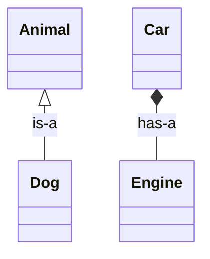

# 3장 실습 — 객체 지향 개념과 클래스 설계

[레포지토리 안내](../../README.ko.md) | [English](Concepts_Lab.md) | [한국어](Concepts_Lab.ko.md)

> **최종 수정일:** 2026-11-18

> **학습 목표:**
> 1. 절차식 방법과 객체 지향 방법을 비교하고 is-a 관계와 has-a 관계를 구분할 수 있다
> 2. 캡슐화, 추상화, 상속, 다형성의 뜻을 예를 들어 설명할 수 있다
> 3. 실세계의 대상을 추상화하여 멤버 변수와 멤버 함수를 정하고 클래스로 작성할 수 있다
> 4. 기본 생성자와 매개변수가 있는 생성자를 추가하여 객체의 초깃값을 정할 수 있다
> 5. `private` 멤버에 get/set 함수로 접근하고 소멸자의 호출 순서를 설명할 수 있다

---

## 목차

- [1. 개요](#1-개요)
- [2. 객체 지향 방법론](#2-객체-지향-방법론)
  - [2.1 절차식 방법과 객체 지향 방법](#21-절차식-방법과-객체-지향-방법)
  - [2.2 객체 사이의 관계](#22-객체-사이의-관계)
  - [2.3 객체 지향의 네 가지 특징](#23-객체-지향의-네-가지-특징)
- [3. 성적표 클래스의 설계](#3-성적표-클래스의-설계)
  - [3.1 추상화로 멤버 정하기](#31-추상화로-멤버-정하기)
  - [3.2 public 멤버로 작성한 클래스](#32-public-멤버로-작성한-클래스)
  - [3.3 생성자와 출력 함수의 추가](#33-생성자와-출력-함수의-추가)
- [4. 점 클래스 연습](#4-점-클래스-연습)
  - [4.1 두 점 사이의 거리](#41-두-점-사이의-거리)
  - [4.2 생성자와 출력 함수](#42-생성자와-출력-함수)
- [5. 접근 제어와 소멸자](#5-접근-제어와-소멸자)
  - [5.1 private 멤버와 get/set 함수](#51-private-멤버와-getset-함수)
  - [5.2 소멸자의 호출 순서](#52-소멸자의-호출-순서)
- [요약](#요약)
- [점검 문제](#점검-문제)

---

<br>

## 1. 개요

> **참고:** 클래스의 선언과 구현, 접근 지정자, 생성자와 소멸자의 문법은 [3장 강의 노트](Concepts_Lecture.ko.md)에서 다룬다. 이 실습은 객체 지향 방법론의 큰 그림을 정리한 뒤, 실세계의 대상을 클래스로 옮기는 과정을 단계별로 따라간다.

| 주제 | 위치 |
|:-----|:-----|
| 객체 지향 방법론의 등장, 절차식 방법과의 비교, 네 가지 특징 | 2절 |
| 성적표 클래스의 단계별 설계 | 3절 |
| 점 클래스의 두 연습 (두 점 사이의 거리, 생성자와 출력 함수) | 4절 |
| `private` 좌표와 get/set 함수를 갖춘 점 클래스 | [HW1 문제 3](../../Coursework/HW01_Classes-and-Objects/Original/Assignment.ko.md) |
| `private` 멤버의 접근과 소멸자 | 5절 |

*표 1. 실습의 주제와 이 노트에서의 위치*

모든 코드는 C++17 표준으로 컴파일하여 실행한다(예: `g++ -std=c++17 -Wall`).

---

<br>

## 2. 객체 지향 방법론

### 2.1 절차식 방법과 객체 지향 방법

초기의 소프트웨어는 소수의 개발자가 만들었고, 한번 개발한 소프트웨어를 다른 개발자가 고치거나 다시 쓰는 일이 드물었다. 개발자와 소프트웨어가 늘면서 기존 소프트웨어를 개선하고 재사용해야 할 필요가 커졌다. C 언어는 프로그램을 여러 단위로 나누어 각 단위를 함수로 만드는 구조적 기법을 도입했지만, 완성된 프로그램을 유지보수하고 확장하는 비용은 여전히 컸다. 이 문제를 줄이려는 노력에서 나온 것이 **객체 지향 방법론(object-oriented methodology)** 이다.

프로그램은 데이터와 데이터를 처리하는 방법(알고리즘)으로 이루어진다. 두 방법은 이 중 무엇을 중심에 두는지가 다르다.

| 관점 | 절차식 방법 | 객체 지향 방법 |
|:-----|:-----|:-----|
| 대표 언어 | Fortran, Basic, C | C++, Java |
| 중심 | 데이터 처리 방법(함수) | 데이터 |
| 설계의 초점 | 처리 절차를 함수로 나누기 | 문제에 맞는 데이터형을 클래스로 설계하기 |
| 문제를 푸는 방식 | 함수를 차례로 호출 | 객체를 만들고 객체 사이의 관계를 이용 |

*표 2. 절차식 방법과 객체 지향 방법의 비교*

객체 지향 방법에서는 데이터형을 **클래스(class)** 로 표현하므로, 클래스를 어떻게 설계하는지가 프로그램의 품질을 좌우한다.

### 2.2 객체 사이의 관계

**객체(object)** 는 사전적으로 사물을 뜻하며, 알고 있는 모든 사물을 객체라 할 수 있다. 객체 지향 방법은 객체를 만들고 객체 사이의 관계를 이용해 문제를 푼다. 객체 사이의 대표적인 관계는 두 가지이다.



*그림 1. is-a 관계(상속)와 has-a 관계(포함)*

- **is-a 관계:** "개는 동물이다"처럼 한 종류가 다른 종류에 속하는 관계이다. C++에서는 기본 클래스(base class)와 파생 클래스(derived class)의 상속으로 구현한다(8장).
- **has-a 관계:** "자동차는 엔진을 가진다"처럼 한 객체가 다른 객체를 부분으로 가지는 관계이다. C++에서는 클래스의 멤버 변수로 다른 클래스의 객체를 포함하여 구현한다.

### 2.3 객체 지향의 네 가지 특징

> **용어 정의:** **캡슐화(encapsulation)** 는 객체를 표현하는 데 필요한 멤버 변수와 멤버 함수를 하나의 클래스로 묶고, 묶인 멤버에 대한 외부의 접근을 허용하거나 막는 것이다.

- **클래스와 멤버:** 클래스는 종류, 부류를 뜻하며, 포유류, 파충류처럼 객체를 특성에 따라 분류한 틀이다. 클래스에는 객체의 특성을 나타내는 데이터인 **멤버 변수**와 작업을 수행하는 함수인 **멤버 함수**(메소드)가 들어간다.
- **접근 제어:** 캡슐화된 멤버에 대한 접근을 허용하거나 막는 것을 접근 제어라 한다. `public` 멤버는 어디서나 접근할 수 있고, `private` 멤버는 그 클래스의 멤버 함수만 접근할 수 있으며, `protected` 멤버는 그 클래스와 그 클래스를 상속받은 클래스의 멤버 함수만 접근할 수 있다. 클래스의 기본 접근 지정은 `private`이다.
- **추상화(abstraction):** 객체를 나타내는 주요 특징을 찾아 규정하는 작업이다. 클래스를 정의할 때 객체의 특성 중 데이터로 나타낼 수 있는 것은 멤버 변수로, 기능이나 행위는 멤버 함수로 만든다.
- **상속(inheritance):** 부모 클래스(기본 클래스)의 특성을 자식 클래스(파생 클래스)가 그대로 물려받아 쓰는 것으로, 이미 작성한 코드를 재사용하게 해 준다. 상속을 주목적으로 만드는 클래스를 **추상 클래스(abstract class)** 라 하며, 추상 클래스는 스스로 객체를 만들 수 없고 이를 상속한 파생 클래스만 객체를 만들 수 있다(9장).
- **다형성(polymorphism):** 이름은 하나이지만 상황에 따라 여러 형태로 동작하는 성질이다. C++은 중복(overloading)과 재정의(overriding)로 다형성을 제공한다.

| 다형성의 형태 | 예 |
|:-----|:-----|
| 연산자 중복 | `3 + 4`의 `+`는 덧셈, `+4`의 `+`는 양수 부호 |
| 함수 중복 | `int getPlus(int a)`와 `int getPlus(int a, int b)`가 공존 |
| 생성자 중복 | 매개변수가 다른 여러 생성자로 객체를 다르게 초기화 (생성자도 함수이므로 중복 가능) |
| 함수 재정의 | 상속에서 부모 클래스의 멤버 함수를 자식 클래스가 자신에게 맞게 다시 정의 |

*표 3. C++에서 다형성이 나타나는 형태*

---

<br>

## 3. 성적표 클래스의 설계

### 3.1 추상화로 멤버 정하기

실세계의 성적표에는 많은 것이 관련되어 있다. 성적표를 관리하는 사람과 입력하는 사람, 관리 프로그램을 만든 회사, 대학과 학과 이름, 학생의 학번, 이름, 학년, 과목 이름, 성적표를 출력할 프린터와 종이, 그리고 점수의 합과 평균을 구하는 동작이 있다. 프로그램에 이 모두가 필요하지는 않으므로, 필요한 정보와 동작만 골라 클래스를 설계한다. 이것이 추상화 과정이다.

이 실습의 성적표 클래스 `Grade`는 다음과 같이 추상화한다.

- **멤버 변수:** 이름 `string name`, 국어와 영어 점수와 합계 `int kor, eng, sum`
- **멤버 함수:** `kor`와 `eng`를 더해 `sum`에 저장하는 `getSum()`, 평균(실수)을 리턴하는 `getAve()`

### 3.2 public 멤버로 작성한 클래스

먼저 모든 멤버를 `public`으로 두고 `main()`에서 학생 Lee의 객체를 만들어 값을 직접 넣는다.

```cpp
#include <iostream>
#include <string>
using namespace std;

class Grade {
public:
    string name;
    int kor, eng, sum;
    void getSum();
    double getAve();
};

void Grade::getSum() {
    sum = kor + eng;
}

double Grade::getAve() {
    return sum / 2.0;
}

int main() {
    Grade Lee;
    Lee.name = "Lee haha";
    Lee.kor = 91;
    Lee.eng = 90;
    Lee.getSum();                 // Lee 객체의 sum 멤버 변수 갱신
    cout << Lee.name << endl;
    cout << Lee.kor << ", " << Lee.eng << endl;
    cout << Lee.sum << ", " << Lee.getAve() << endl;
}
```

```text
Lee haha
91, 90
181, 90.5
```

- 멤버 함수는 클래스 안에서 선언하고, 클래스 밖에서 `Grade::getSum()`처럼 범위 지정 연산자 `::`로 어느 클래스의 함수인지 밝혀 정의한다.
- `getAve()`가 `sum / 2`가 아니라 `sum / 2.0`을 리턴하는 것에 주목할 필요가 있다. `sum / 2`는 정수 나눗셈이어서 181 / 2 = 90이 되지만, 실수 상수 2.0으로 나누면 `sum`이 `double`로 변환되어 90.5가 된다.
- 이 클래스에는 생성자를 작성하지 않았다. 생성자를 하나도 작성하지 않으면 컴파일러가 아무 일도 하지 않는 기본 생성자 `Grade() { }`를 자동으로 넣으므로 `Grade Lee;`가 컴파일된다. 이때 `kor`, `eng`, `sum`은 초기화되지 않은 값을 가지므로, 값을 넣기 전에 읽으면 안 된다.

### 3.3 생성자와 출력 함수의 추가

> **용어 정의:** **생성자(constructor)** 는 객체가 생성될 때 자동으로 호출되어 멤버 변수의 초깃값을 정하는 특별한 멤버 함수이다.

생성자의 이름은 클래스 이름과 같고, 리턴 타입이 없다. 매개변수가 다르면 이름이 같은 생성자를 여러 개 둘 수 있으며(생성자 중복), 객체가 만들어질 때는 반드시 생성자 하나가 실행된다. 소멸자는 이름 앞에 `~`(물결표)가 붙고, 리턴 타입과 매개변수가 없으며, 클래스마다 하나만 있다(5.2절).

`Grade`에 두 생성자와 객체 정보를 출력하는 전용 함수 `showG()`를 추가한다. 인자 없이 만든 객체는 이름 `"Noname"`, 점수 0으로, 인자 3개로 만든 객체는 그 인자로 초기화한다.

```cpp
#include <iostream>
#include <string>
using namespace std;

class Grade {
public:
    string name;
    int kor, eng, sum;
    Grade() {                     // 기본 생성자: 선언과 동시에 정의
        name = "Noname";
        kor = eng = 0;
    }
    Grade(string n, int k, int e);
    void getSum();
    double getAve();
    void showG();
};

Grade::Grade(string n, int k, int e) {
    name = n;
    kor = k;
    eng = e;
}

void Grade::getSum() { sum = kor + eng; }
double Grade::getAve() { return sum / 2.0; }

void Grade::showG() {             // 객체 정보를 출력하는 전용 함수
    cout << name << endl;
    cout << kor << ", " << eng << endl;
    cout << sum << ", " << getAve() << endl;
    cout << "==========" << endl;
}

int main() {
    Grade Lee;
    Lee.getSum();
    Lee.showG();

    Grade Kim("Kim Hi", 93, 84);
    Kim.getSum();
    Kim.showG();
}
```

```text
Noname
0, 0
0, 0
==========
Kim Hi
93, 84
177, 88.5
==========
```

- `Grade Lee;`는 기본 생성자를, `Grade Kim("Kim Hi", 93, 84);`는 인자 3개 생성자를 호출한다. 컴파일러는 인자의 개수와 타입으로 어느 생성자를 쓸지 정한다.
- 생성자를 하나라도 작성하면 컴파일러는 기본 생성자를 자동으로 넣지 않는다. 인자 3개 생성자만 두고 기본 생성자를 지우면 `Grade Lee;`는 컴파일 오류가 된다.
- 출력 코드를 `showG()`로 옮기면 `main()`은 객체를 만들고 요청하는 일만 하고, 객체의 정보를 어떻게 보여 줄지는 클래스가 정한다. 같은 출력 코드를 객체마다 되풀이하지 않아도 된다.

---

<br>

## 4. 점 클래스 연습

### 4.1 두 점 사이의 거리

**문제:** 좌표 `int x, y`를 멤버로 가진 `Point` 클래스로 점 `p1`, `p2`를 만들고, 키보드에서 두 점의 좌표를 입력받아 두 점 사이의 거리를 출력한다. 접근 지정이 주어지지 않은 멤버는 `public`으로 둔다.

```math
\text{length} = \sqrt{(x_2 - x_1)^2 + (y_2 - y_1)^2}
```

```cpp
#include <cmath>
#include <iostream>
using namespace std;

class Point {
public:
    int x, y;                     // 접근 지정이 없으면 public으로 둠
};

int main() {
    Point p1, p2;
    cout << "Input p1(x, y):";
    cin >> p1.x >> p1.y;
    cout << "Input p2(x, y):";
    cin >> p2.x >> p2.y;
    int dx = p2.x - p1.x, dy = p2.y - p1.y;
    double length = sqrt(dx * dx + dy * dy);
    cout << "The distance [p1~p2]: " << length << endl;
}
```

```text
Input p1(x, y):0 1
Input p2(x, y):2 2
The distance [p1~p2]: 2.23607
```

- `sqrt()`는 `<cmath>` 헤더에 있는 제곱근 함수이다. `cin >> p1.x >> p1.y`는 공백으로 구분된 두 정수를 차례로 읽는다.
- 차이 `dx`, `dy`를 정수로 구해 제곱하면 실수 거듭제곱 함수를 쓰지 않아도 된다. (0, 1)과 (2, 2) 사이의 거리는 $`\sqrt{2^2 + 1^2} = \sqrt{5} \approx 2.23607`$이다.

### 4.2 생성자와 출력 함수

**문제:** 다음 구성의 `Point` 클래스를 작성하여 아래 `main()`이 실행 예시처럼 출력하게 한다.

- 좌표 `int x, y`
- 기본 생성자: `x`와 `y`를 0으로 초기화 (선언과 동시에 정의)
- 인자 2개 생성자: 두 정수로 `x`, `y`를 초기화 (선언과 정의를 구분)
- 좌표를 출력하는 `showP()` (선언과 정의를 구분)

```cpp
#include <iostream>
using namespace std;

class Point {
public:
    int x, y;
    Point() { x = 0; y = 0; }     // 기본 생성자: 선언과 동시에 정의
    Point(int x, int y);          // 인자 2개 생성자: 선언과 정의를 구분
    void showP();
};

Point::Point(int x, int y) {
    this->x = x;
    this->y = y;
}

void Point::showP() {
    cout << "x: " << x << ", y: " << y << endl;
}

int main() {
    Point p1;
    Point p2(3, 4);
    p1.showP();
    p2.showP();
}
```

```text
x: 0, y: 0
x: 3, y: 4
```

- **선언과 동시에 정의:** 클래스 안에 함수의 몸체까지 쓰면 그 함수는 자동으로 인라인 함수가 된다(3장 강의 노트 5절). 값을 대입하는 정도의 짧은 함수에 알맞다.
- **선언과 정의의 구분:** 클래스 안에는 원형만 두고 몸체는 `Point::Point(int x, int y)`처럼 밖에서 정의한다.
- 생성자의 매개변수 이름이 멤버 변수 이름과 같으므로 몸체에서 `x`는 매개변수를 가리킨다. 멤버 변수는 `this->x`로 구별한다(4장 실습의 `this` 포인터).

`x`, `y`를 `private`으로 바꾸고 get/set 함수와 키보드 입력을 더한 문제는 [HW1 문제 3](../../Coursework/HW01_Classes-and-Objects/Original/Assignment.ko.md)이다.

---

<br>

## 5. 접근 제어와 소멸자

### 5.1 private 멤버와 get/set 함수

외부에 공개하면 안 되는 멤버는 `public`이 아니라 `private`으로 선언한다. `private` 멤버는 객체가 만들어져 메모리에 자리를 잡은 뒤에도 클래스 밖의 코드가 직접 접근할 수 없다.

```cpp
#include <iostream>
using namespace std;

class Access {
private:                          // 클래스의 기본 접근 지정은 private
    int test;
};

int main() {
    Access one;
    one.test = 3;
    cout << one.test << endl;
}
```

```text
error: 'int Access::test' is private within this context
error: 'int Access::test' is private within this context
```

`main()`은 `Access` 클래스의 멤버 함수가 아니므로 `one.test`에 접근할 수 없어 컴파일 오류가 난다. `private` 멤버를 다루려면 `public` 멤버 함수로 값을 읽는 get 함수와 값을 바꾸는 set 함수를 제공한다.

```cpp
#include <iostream>
using namespace std;

class Access {
    int test;                     // private
public:
    int getTest() { return test; }
    void setTest(int t) { test = t; }
};

int main() {
    Access one;
    one.setTest(3);
    cout << one.getTest() << endl;
}
```

```text
3
```

set 함수를 거치게 하면 클래스가 값의 변경을 통제할 수 있다. 예를 들어 `setTest()` 안에서 음수를 거부하도록 바꾸어도 이 클래스를 쓰는 코드는 고칠 필요가 없다.

### 5.2 소멸자의 호출 순서

> **용어 정의:** **소멸자(destructor)** 는 객체가 메모리에서 사라질 때 자동으로 호출되어, 동적으로 할당한 메모리의 반환처럼 객체가 마무리해야 할 일을 하는 특별한 멤버 함수이다.

```cpp
#include <iostream>
using namespace std;

class Circle {
    int radius;
public:
    Circle() { radius = 1; }
    Circle(int r) { radius = r; }
    ~Circle() { cout << "Destructor: " << radius << endl; }
    int getRadius() { return radius; }
};

int main() {
    Circle pizza;
    Circle donut(3);
    cout << pizza.getRadius() << endl;
    cout << donut.getRadius() << endl;
}
```

```text
1
3
Destructor: 3
Destructor: 1
```

`pizza`와 `donut`은 `main()`의 지역 객체이므로 `main()`이 끝날 때 소멸한다. 지역 객체는 생성된 순서의 반대로 소멸하므로, 나중에 만든 `donut`의 소멸자가 먼저 실행된다(3장 강의 노트 4.7절).

---

<br>

## 요약

| 개념 | 핵심 요약 |
|:-----|:-----|
| 절차식과 객체 지향 | 절차식 방법은 처리 절차(함수)를, 객체 지향 방법은 데이터를 중심에 두고 문제에 맞는 데이터형을 클래스로 설계한다. |
| is-a와 has-a | is-a 관계는 상속으로, has-a 관계는 다른 클래스의 객체를 멤버로 포함하여 구현한다. |
| 캡슐화와 추상화 | 캡슐화는 멤버를 클래스로 묶고 접근을 통제하는 것이며, 추상화는 대상의 주요 특징을 골라 멤버 변수와 멤버 함수로 정하는 작업이다. |
| 다형성 | 연산자 중복, 함수 중복, 생성자 중복, 재정의로 한 이름이 상황에 따라 다르게 동작한다. |
| 생성자 | 클래스 이름과 같고 리턴 타입이 없으며, 생성자를 하나도 작성하지 않을 때만 컴파일러가 기본 생성자를 넣는다. |
| 선언과 정의 | 클래스 안에서 정의한 멤버 함수는 자동으로 인라인 함수가 되고, 밖에서 정의할 때는 `클래스::함수`로 소속을 밝힌다. |
| 접근 제어 | `private` 멤버는 클래스 밖에서 직접 접근할 수 없으므로 `public` get/set 함수로 다룬다. |
| 소멸자 | `~클래스이름` 형태의 함수 하나로, 지역 객체는 생성의 반대 순서로 소멸하며 소멸자가 호출된다. |

---

<br>

## 점검 문제

1. 3.2절의 `getAve()`가 `return sum / 2;`였다면 Lee의 평균은 얼마로 출력되는가? 그 이유는 무엇인가?

   <details>
   <summary>정답</summary>

   90이 출력된다. `sum`과 2가 모두 `int`이므로 181 / 2는 몫만 남는 정수 나눗셈이 되어 90이고, 이 값이 리턴 타입 `double`로 바뀌어도 90.0일 뿐이다. `cout`은 90.0을 `90`으로 출력한다. 소수점 아래를 살리려면 `sum / 2.0`이나 `static_cast<double>(sum) / 2`처럼 피연산자 하나를 실수로 만들어야 한다.

   </details>

2. 3.3절의 `Grade`에서 기본 생성자 `Grade()`를 지우면 어떤 일이 생기는가? 3.2절의 `Grade`에서는 생성자가 없어도 `Grade Lee;`가 컴파일되는 이유와 비교하여 설명하라.

   <details>
   <summary>정답</summary>

   `Grade Lee;`가 컴파일 오류가 된다. 컴파일러는 클래스에 생성자가 하나도 없을 때만 아무 일도 하지 않는 기본 생성자를 자동으로 넣는다. 3.2절의 `Grade`에는 생성자가 없어 기본 생성자가 자동으로 들어갔지만, 3.3절에서는 인자 3개 생성자가 있으므로 기본 생성자가 자동으로 들어가지 않는다. 인자 없이 객체를 만들 수 있게 하려면 기본 생성자를 직접 작성해야 한다.

   </details>

3. 다음 세 관계를 is-a와 has-a로 구분하고 C++에서 각각 어떻게 구현하는지 쓰라. (a) 학생은 사람이다. (b) 학생은 성적표를 가진다. (c) 원은 도형이다.

   <details>
   <summary>정답</summary>

   (a)와 (c)는 is-a 관계이다. `class Student : public Person`, `class Circle : public Shape`처럼 상속으로 구현한다. (b)는 has-a 관계이다. `Student` 클래스에 `Grade` 객체를 멤버 변수로 두어 포함으로 구현한다.

   </details>

4. 5.1절의 `Access`에서 `private:`를 지워도 `one.test = 3;`이 컴파일되지 않는 이유는 무엇인가? `struct`로 선언하면 어떻게 되는가?

   <details>
   <summary>정답</summary>

   `class`로 선언한 클래스의 기본 접근 지정은 `private`이므로, `private:`를 지워도 `test`는 여전히 `private`이다. `struct`로 선언하면 기본 접근 지정이 `public`이므로 `one.test = 3;`이 컴파일된다. C++에서 `struct`와 `class`의 차이는 이 기본 접근 지정(그리고 상속의 기본 접근 지정)뿐이다.

   </details>

5. 5.2절의 `main()`에 `Circle waffle(5);`를 `donut` 다음에 추가하면 출력은 어떻게 바뀌는가?

   <details>
   <summary>정답</summary>

   지역 객체는 생성의 반대 순서로 소멸하므로 마지막에 만든 `waffle`이 가장 먼저 소멸한다. 출력은 1, 3 다음에 `Destructor: 5`, `Destructor: 3`, `Destructor: 1`의 순서가 된다.

   </details>
