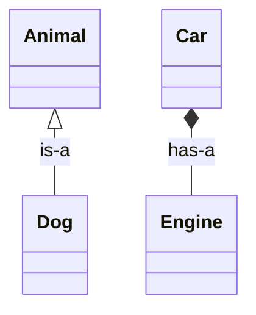

# Chapter 3 Lab — Object-Oriented Concepts and Class Design

[Repository Guide](../../README.md) | [English](Concepts_Lab.md) | [한국어](Concepts_Lab.ko.md)

> **Last Updated:** 2026-11-18

> **Learning Objectives:**
> 1. Compare the procedural and object-oriented approaches and distinguish is-a relationships from has-a relationships
> 2. Explain encapsulation, abstraction, inheritance, and polymorphism with examples
> 3. Abstract a real-world entity into member variables and member functions and write it as a class
> 4. Set the initial values of objects by adding a default constructor and a constructor with parameters
> 5. Access `private` members through get/set functions and explain the order in which destructors are called

---

## Table of Contents

- [1. Overview](#1-overview)
- [2. The Object-Oriented Methodology](#2-the-object-oriented-methodology)
  - [2.1 The Procedural and Object-Oriented Approaches](#21-the-procedural-and-object-oriented-approaches)
  - [2.2 Relationships between Objects](#22-relationships-between-objects)
  - [2.3 Four Characteristics of Object Orientation](#23-four-characteristics-of-object-orientation)
- [3. Designing a Grade Report Class](#3-designing-a-grade-report-class)
  - [3.1 Choosing Members by Abstraction](#31-choosing-members-by-abstraction)
  - [3.2 A Class with public Members](#32-a-class-with-public-members)
  - [3.3 Adding Constructors and an Output Function](#33-adding-constructors-and-an-output-function)
- [4. Point Class Exercises](#4-point-class-exercises)
  - [4.1 The Distance between Two Points](#41-the-distance-between-two-points)
  - [4.2 Constructors and an Output Function](#42-constructors-and-an-output-function)
- [5. Access Control and Destructors](#5-access-control-and-destructors)
  - [5.1 private Members and get/set Functions](#51-private-members-and-getset-functions)
  - [5.2 The Order of Destructor Calls](#52-the-order-of-destructor-calls)
- [Summary](#summary)
- [Self-Check Questions](#self-check-questions)

---

<br>

## 1. Overview

> **Note:** The syntax of class declarations and implementations, access specifiers, constructors, and destructors is covered in the [Chapter 3 lecture notes](Concepts_Lecture.md). This lab first summarizes the big picture of the object-oriented methodology and then follows, step by step, the process of turning a real-world entity into a class.

| Topic | Location |
|:-----|:-----|
| The rise of the object-oriented methodology, its comparison with the procedural approach, its four characteristics | Section 2 |
| Step-by-step design of a grade report class | Section 3 |
| Two exercises on a point class (distance between two points, constructors and an output function) | Section 4 |
| A point class with `private` coordinates and get/set functions | [HW1 Problem 3](../../Coursework/HW01_Classes-and-Objects/Original/Assignment.md) |
| Access to `private` members and destructors | Section 5 |

*Table 1. Topics of the lab and their location in this note*

All code is compiled and run with the C++17 standard (for example, `g++ -std=c++17 -Wall`).

---

<br>

## 2. The Object-Oriented Methodology

### 2.1 The Procedural and Object-Oriented Approaches

Early software was built by a small number of developers, and software once developed was rarely modified or reused by others. As developers and software multiplied, the need to improve and reuse existing software grew. The C language introduced a structured technique that divides a program into units and implements each unit as a function, but the cost of maintaining and extending a finished program remained high. The **object-oriented methodology** emerged from efforts to reduce this problem.

A program consists of data and the methods that process the data (algorithms). The two approaches differ in which of these they put at the center.

| Aspect | Procedural approach | Object-oriented approach |
|:-----|:-----|:-----|
| Typical languages | Fortran, Basic, C | C++, Java |
| Center | Data processing methods (functions) | Data |
| Design focus | Dividing processing steps into functions | Designing data types that fit the problem as classes |
| How problems are solved | Calling functions in sequence | Creating objects and using the relationships between them |

*Table 2. Comparison of the procedural and object-oriented approaches*

In the object-oriented approach, data types are expressed as **classes**, so how classes are designed determines the quality of the program.

### 2.2 Relationships between Objects

An **object** literally means a thing, and every thing we know can be called an object. The object-oriented approach solves problems by creating objects and using the relationships between them. There are two representative relationships between objects.



*Figure 1. The is-a relationship (inheritance) and the has-a relationship (containment)*

- **is-a relationship:** A relationship in which one kind belongs to another kind, as in "a dog is an animal." In C++ it is implemented by inheritance between a base class and a derived class (Chapter 8).
- **has-a relationship:** A relationship in which one object has another object as a part, as in "a car has an engine." In C++ it is implemented by containing an object of another class as a member variable.

### 2.3 Four Characteristics of Object Orientation

> **Definition:** **Encapsulation** is bundling the member variables and member functions needed to represent an object into a single class and allowing or blocking outside access to the bundled members.

- **Classes and members:** A class means a kind or category, a template that classifies objects by their characteristics, like mammals and reptiles. A class contains **member variables**, the data that represent the object's characteristics, and **member functions** (methods), the functions that perform tasks.
- **Access control:** Allowing or blocking access to encapsulated members is called access control. `public` members can be accessed anywhere, `private` members only by the member functions of that class, and `protected` members only by the member functions of that class and of classes that inherit it. The default access of a class is `private`.
- **Abstraction:** The task of finding and specifying the main characteristics that represent an object. When defining a class, the characteristics of an object that can be expressed as data become member variables, and its functions or behaviors become member functions.
- **Inheritance:** A child class (derived class) inherits and uses the characteristics of a parent class (base class) as they are, which lets already written code be reused. A class made mainly to be inherited is called an **abstract class**; an abstract class cannot create objects by itself, and only derived classes that inherit it can create objects (Chapter 9).
- **Polymorphism:** The property that a single name behaves in different forms depending on the situation. C++ provides polymorphism through overloading and overriding.

| Form of polymorphism | Example |
|:-----|:-----|
| Operator overloading | The `+` of `3 + 4` is addition, and the `+` of `+4` is a positive sign |
| Function overloading | `int getPlus(int a)` and `int getPlus(int a, int b)` coexist |
| Constructor overloading | Several constructors with different parameters initialize objects differently (constructors are functions, so they can be overloaded) |
| Function overriding | In inheritance, a child class redefines a member function of the parent class to suit itself |

*Table 3. Forms in which polymorphism appears in C++*

---

<br>

## 3. Designing a Grade Report Class

### 3.1 Choosing Members by Abstraction

Many things are related to a real-world grade report: the people who manage and enter it, the company that made the management program, the names of the university and department, the student's ID, name, year, and course names, the printer and paper used to print the report, and the actions of computing the total and average of the scores. A program does not need all of these, so the class is designed with only the information and actions that are needed. This is the process of abstraction.

The grade report class `Grade` of this lab is abstracted as follows.

- **Member variables:** the name `string name`, and the Korean and English scores and their total `int kor, eng, sum`
- **Member functions:** `getSum()`, which adds `kor` and `eng` and stores the result in `sum`, and `getAve()`, which returns the average (a real number)

### 3.2 A Class with public Members

First, all members are made `public`, and `main()` creates an object for student Lee and assigns values directly.

```cpp
#include <iostream>
#include <string>
using namespace std;

class Grade {
public:
    string name;
    int kor, eng, sum;
    void getSum();
    double getAve();
};

void Grade::getSum() {
    sum = kor + eng;
}

double Grade::getAve() {
    return sum / 2.0;
}

int main() {
    Grade Lee;
    Lee.name = "Lee haha";
    Lee.kor = 91;
    Lee.eng = 90;
    Lee.getSum();                 // Update the sum member variable of Lee
    cout << Lee.name << endl;
    cout << Lee.kor << ", " << Lee.eng << endl;
    cout << Lee.sum << ", " << Lee.getAve() << endl;
}
```

```text
Lee haha
91, 90
181, 90.5
```

- Member functions are declared inside the class and defined outside it with the scope resolution operator `::`, as in `Grade::getSum()`, which states the class they belong to.
- Note that `getAve()` returns `sum / 2.0` rather than `sum / 2`. `sum / 2` is integer division and gives 181 / 2 = 90, but dividing by the floating-point constant 2.0 converts `sum` to `double` and gives 90.5.
- No constructor is written for this class. If no constructor is written at all, the compiler inserts a default constructor `Grade() { }` that does nothing, so `Grade Lee;` compiles. In that case `kor`, `eng`, and `sum` hold uninitialized values and must not be read before values are assigned.

### 3.3 Adding Constructors and an Output Function

> **Definition:** A **constructor** is a special member function called automatically when an object is created to set the initial values of its member variables.

A constructor has the same name as the class and no return type. Several constructors with the same name may exist if their parameters differ (constructor overloading), and exactly one constructor runs whenever an object is created. A destructor has `~` (tilde) before its name, has no return type and no parameters, and exists only once per class (Section 5.2).

Two constructors and a dedicated function `showG()` that prints the object's information are added to `Grade`. An object created without arguments is initialized with the name `"Noname"` and scores of 0, and an object created with three arguments is initialized with those arguments.

```cpp
#include <iostream>
#include <string>
using namespace std;

class Grade {
public:
    string name;
    int kor, eng, sum;
    Grade() {                     // Default constructor: declared and defined together
        name = "Noname";
        kor = eng = 0;
    }
    Grade(string n, int k, int e);
    void getSum();
    double getAve();
    void showG();
};

Grade::Grade(string n, int k, int e) {
    name = n;
    kor = k;
    eng = e;
}

void Grade::getSum() { sum = kor + eng; }
double Grade::getAve() { return sum / 2.0; }

void Grade::showG() {             // Dedicated function that prints the object's information
    cout << name << endl;
    cout << kor << ", " << eng << endl;
    cout << sum << ", " << getAve() << endl;
    cout << "==========" << endl;
}

int main() {
    Grade Lee;
    Lee.getSum();
    Lee.showG();

    Grade Kim("Kim Hi", 93, 84);
    Kim.getSum();
    Kim.showG();
}
```

```text
Noname
0, 0
0, 0
==========
Kim Hi
93, 84
177, 88.5
==========
```

- `Grade Lee;` calls the default constructor, and `Grade Kim("Kim Hi", 93, 84);` calls the three-argument constructor. The compiler decides which constructor to use from the number and types of the arguments.
- Once any constructor is written, the compiler no longer inserts a default constructor automatically. If only the three-argument constructor is kept and the default constructor is deleted, `Grade Lee;` becomes a compile error.
- Moving the output code into `showG()` leaves `main()` only to create objects and make requests, while the class decides how to show an object's information. The same output code need not be repeated for each object.

---

<br>

## 4. Point Class Exercises

### 4.1 The Distance between Two Points

**Problem:** Create points `p1` and `p2` from a `Point` class with coordinates `int x, y` as members, read the coordinates of the two points from the keyboard, and print the distance between them. Members with no specified access are made `public`.

```math
\text{length} = \sqrt{(x_2 - x_1)^2 + (y_2 - y_1)^2}
```

```cpp
#include <cmath>
#include <iostream>
using namespace std;

class Point {
public:
    int x, y;                     // public when no access is specified
};

int main() {
    Point p1, p2;
    cout << "Input p1(x, y):";
    cin >> p1.x >> p1.y;
    cout << "Input p2(x, y):";
    cin >> p2.x >> p2.y;
    int dx = p2.x - p1.x, dy = p2.y - p1.y;
    double length = sqrt(dx * dx + dy * dy);
    cout << "The distance [p1~p2]: " << length << endl;
}
```

```text
Input p1(x, y):0 1
Input p2(x, y):2 2
The distance [p1~p2]: 2.23607
```

- `sqrt()` is the square root function in the `<cmath>` header. `cin >> p1.x >> p1.y` reads two whitespace-separated integers in turn.
- Computing the differences `dx` and `dy` as integers and squaring them avoids a floating-point power function. The distance between (0, 1) and (2, 2) is $`\sqrt{2^2 + 1^2} = \sqrt{5} \approx 2.23607`$.

### 4.2 Constructors and an Output Function

**Problem:** Write a `Point` class with the following structure so that the `main()` below prints as in the sample run.

- Coordinates `int x, y`
- Default constructor: initializes `x` and `y` to 0 (declared and defined together)
- Two-argument constructor: initializes `x` and `y` with two integers (declaration and definition separated)
- `showP()`, which prints the coordinates (declaration and definition separated)

```cpp
#include <iostream>
using namespace std;

class Point {
public:
    int x, y;
    Point() { x = 0; y = 0; }     // Default constructor: declared and defined together
    Point(int x, int y);          // Two-argument constructor: declaration and definition separated
    void showP();
};

Point::Point(int x, int y) {
    this->x = x;
    this->y = y;
}

void Point::showP() {
    cout << "x: " << x << ", y: " << y << endl;
}

int main() {
    Point p1;
    Point p2(3, 4);
    p1.showP();
    p2.showP();
}
```

```text
x: 0, y: 0
x: 3, y: 4
```

- **Declared and defined together:** A function whose body is written inside the class automatically becomes an inline function (Section 5 of the Chapter 3 lecture notes). This suits short functions that only assign values.
- **Declaration and definition separated:** Only the prototype is kept in the class, and the body is defined outside, as in `Point::Point(int x, int y)`.
- The constructor's parameter names are the same as the member variable names, so inside the body `x` refers to the parameter. The member variable is distinguished as `this->x` (the `this` pointer in the Chapter 4 lab).

The problem that makes `x` and `y` `private` and adds get/set functions and keyboard input is [HW1 Problem 3](../../Coursework/HW01_Classes-and-Objects/Original/Assignment.md).

---

<br>

## 5. Access Control and Destructors

### 5.1 private Members and get/set Functions

Members that must not be exposed to the outside are declared `private` rather than `public`. Code outside the class cannot access a `private` member directly, even after the object has been created and occupies memory.

```cpp
#include <iostream>
using namespace std;

class Access {
private:                          // The default access of a class is private
    int test;
};

int main() {
    Access one;
    one.test = 3;
    cout << one.test << endl;
}
```

```text
error: 'int Access::test' is private within this context
error: 'int Access::test' is private within this context
```

`main()` is not a member function of the `Access` class, so it cannot access `one.test`, and a compile error results. To work with a `private` member, provide `public` member functions: a get function that reads the value and a set function that changes it.

```cpp
#include <iostream>
using namespace std;

class Access {
    int test;                     // private
public:
    int getTest() { return test; }
    void setTest(int t) { test = t; }
};

int main() {
    Access one;
    one.setTest(3);
    cout << one.getTest() << endl;
}
```

```text
3
```

Routing changes through a set function lets the class control how the value changes. For example, even if `setTest()` is changed to reject negative numbers, the code that uses this class needs no modification.

### 5.2 The Order of Destructor Calls

> **Definition:** A **destructor** is a special member function called automatically when an object disappears from memory, which performs the work the object must finish, such as returning dynamically allocated memory.

```cpp
#include <iostream>
using namespace std;

class Circle {
    int radius;
public:
    Circle() { radius = 1; }
    Circle(int r) { radius = r; }
    ~Circle() { cout << "Destructor: " << radius << endl; }
    int getRadius() { return radius; }
};

int main() {
    Circle pizza;
    Circle donut(3);
    cout << pizza.getRadius() << endl;
    cout << donut.getRadius() << endl;
}
```

```text
1
3
Destructor: 3
Destructor: 1
```

`pizza` and `donut` are local objects of `main()`, so they are destroyed when `main()` ends. Local objects are destroyed in the reverse order of creation, so the destructor of `donut`, created later, runs first (Section 4.7 of the Chapter 3 lecture notes).

---

<br>

## Summary

| Concept | Key Summary |
|:-----|:-----|
| Procedural and object-oriented | The procedural approach centers on processing steps (functions), whereas the object-oriented approach centers on data and designs data types that fit the problem as classes. |
| is-a and has-a | An is-a relationship is implemented by inheritance, and a has-a relationship by containing an object of another class as a member. |
| Encapsulation and abstraction | Encapsulation bundles members into a class and controls access to them, and abstraction is the task of choosing an entity's main characteristics as member variables and member functions. |
| Polymorphism | Through operator overloading, function overloading, constructor overloading, and overriding, one name behaves differently depending on the situation. |
| Constructor | It has the class's name and no return type, and the compiler inserts a default constructor only when no constructor is written at all. |
| Declaration and definition | A member function defined inside the class automatically becomes inline, and one defined outside states its owner as `Class::function`. |
| Access control | `private` members cannot be accessed directly from outside the class, so they are handled through `public` get/set functions. |
| Destructor | A single function of the form `~ClassName`; local objects are destroyed, with their destructors called, in the reverse order of creation. |

---

<br>

## Self-Check Questions

1. If the `getAve()` of Section 3.2 were `return sum / 2;`, what would Lee's average be printed as? Why?

   <details>
   <summary>Answer</summary>

   It would print 90. Both `sum` and 2 are `int`, so 181 / 2 is integer division that keeps only the quotient, 90, and converting it to the return type `double` merely gives 90.0. `cout` prints 90.0 as `90`. To keep the fractional part, one operand must be made floating-point, as in `sum / 2.0` or `static_cast<double>(sum) / 2`.

   </details>

2. What happens if the default constructor `Grade()` is deleted from the `Grade` of Section 3.3? Explain by comparison with why `Grade Lee;` compiles for the `Grade` of Section 3.2, which has no constructor.

   <details>
   <summary>Answer</summary>

   `Grade Lee;` becomes a compile error. The compiler inserts a do-nothing default constructor automatically only when a class has no constructor at all. The `Grade` of Section 3.2 has no constructor, so a default constructor was inserted, but in Section 3.3 there is a three-argument constructor, so no default constructor is inserted. To allow creating objects without arguments, the default constructor must be written explicitly.

   </details>

3. Classify the following three relationships as is-a or has-a and state how each is implemented in C++. (a) A student is a person. (b) A student has a grade report. (c) A circle is a shape.

   <details>
   <summary>Answer</summary>

   (a) and (c) are is-a relationships. They are implemented by inheritance, as in `class Student : public Person` and `class Circle : public Shape`. (b) is a has-a relationship. It is implemented by containment, placing a `Grade` object as a member variable of the `Student` class.

   </details>

4. Why does `one.test = 3;` still fail to compile even if `private:` is removed from the `Access` of Section 5.1? What happens if it is declared with `struct`?

   <details>
   <summary>Answer</summary>

   The default access of a class declared with `class` is `private`, so even without `private:`, `test` is still `private`. If it is declared with `struct`, the default access is `public`, so `one.test = 3;` compiles. In C++, the only difference between `struct` and `class` is this default access (and the default access of inheritance).

   </details>

5. How does the output change if `Circle waffle(5);` is added after `donut` in the `main()` of Section 5.2?

   <details>
   <summary>Answer</summary>

   Local objects are destroyed in the reverse order of creation, so `waffle`, created last, is destroyed first. After 1 and 3, the output becomes `Destructor: 5`, `Destructor: 3`, and `Destructor: 1`, in that order.

   </details>
