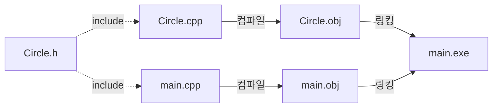

# 3장 — 클래스와 객체

[레포지토리 안내](../../README.ko.md) | [English](Concepts_Lecture.md) | [한국어](Concepts_Lecture.ko.md)

> **최종 수정일:** 2026-10-27
>
> 명품 C++ Programming, 황기태, Ch 3

> **학습 목표:**
> 1. 실세계의 객체와 C++ 객체의 관계, 캡슐화의 목적을 설명할 수 있다
> 2. 멤버 변수와 멤버 함수를 가진 C++ 클래스를 선언부와 구현부로 나누어 작성하고 객체를 생성하여 활용할 수 있다
> 3. 생성자, 위임 생성자, 소멸자를 작성하고 객체의 생성과 소멸 순서를 설명할 수 있다
> 4. `private`, `protected`, `public` 접근 지정자의 차이를 설명할 수 있다
> 5. 인라인 함수의 목적과 장단점, C++ 구조체와 클래스의 차이를 설명할 수 있다
> 6. 클래스를 헤더 파일과 cpp 파일로 분리하여 프로그램을 작성할 수 있다

---

## 목차

- [1. 객체지향 개념](#1-객체지향-개념)
  - [1.1 객체](#11-객체)
  - [1.2 클래스 vs 객체](#12-클래스-vs-객체)
  - [1.3 C에서 C++로: struct vs class](#13-c에서-c로-struct-vs-class)
- [2. 클래스 정의](#2-클래스-정의)
  - [2.1 문법](#21-문법)
  - [2.2 멤버 변수](#22-멤버-변수)
  - [2.3 멤버 함수](#23-멤버-함수)
  - [2.4 접근 지정자](#24-접근-지정자)
- [3. 객체 생성과 사용](#3-객체-생성과-사용)
  - [3.1 선언](#31-선언)
  - [3.2 객체 배열](#32-객체-배열)
- [4. 생성자와 소멸자](#4-생성자와-소멸자)
  - [4.1 생성자](#41-생성자)
  - [4.2 생성자 중복](#42-생성자-중복)
  - [4.3 위임 생성자](#43-위임-생성자)
  - [4.4 멤버 변수의 초기화 방법](#44-멤버-변수의-초기화-방법)
  - [4.5 기본 생성자](#45-기본-생성자)
  - [4.6 소멸자](#46-소멸자)
  - [4.7 실행 순서](#47-실행-순서)
- [5. 인라인 함수](#5-인라인-함수)
- [6. C++ 구조체](#6-c-구조체)
- [7. 헤더 파일과 소스 파일 분리](#7-헤더-파일과-소스-파일-분리)
- [8. 완전한 실행 예제](#8-완전한-실행-예제)
  - [8.1 Circle 클래스: 생성자, getter, 넓이 계산](#81-circle-클래스-생성자-getter-넓이-계산)
  - [8.2 생성자와 소멸자의 실행 순서](#82-생성자와-소멸자의-실행-순서)
  - [8.3 멤버 함수: 클래스 내부 vs 외부 정의](#83-멤버-함수-클래스-내부-vs-외부-정의)
- [9. 흔한 실수 모음](#9-흔한-실수-모음)
  - [9.1 클래스 정의 끝에 세미콜론 빠뜨리기](#91-클래스-정의-끝에-세미콜론-빠뜨리기)
  - [9.2 클래스 외부에서 private 멤버에 접근](#92-클래스-외부에서-private-멤버에-접근)
  - [9.3 다른 생성자를 정의한 후 기본 생성자가 사라짐](#93-다른-생성자를-정의한-후-기본-생성자가-사라짐)
  - [9.4 생성자를 일반 함수처럼 호출](#94-생성자를-일반-함수처럼-호출)
  - [9.5 클래스 정의와 객체 생성을 혼동](#95-클래스-정의와-객체-생성을-혼동)
- [요약](#요약)
- [점검 문제](#점검-문제)

---

<br>

## 1. 객체지향 개념

### 1.1 객체

객체지향 프로그래밍(OOP)에서 **모든 것은 객체로 모델링**된다. TV, 의자, 책, 집, 카메라, 컴퓨터처럼 세상의 모든 것이 객체이다. 객체는 다음 두 가지를 하나로 묶는다.

- **상태(state)**: **멤버 변수**(필드)에 저장되는 데이터이다.
- **행위(behavior)**: **멤버 함수**(메서드)로 정의되는 동작이다.

| 구분 | TV 객체의 예 |
|:-----|:-----|
| 상태 | 켜짐 또는 꺼짐 여부, 현재 방송 중인 채널(channel), 현재 출력되는 음량(volume) |
| 행위 | 켜기(power on), 끄기(power off), 채널 증가, 채널 감소, 음량 증가, 음량 감소 |

*표 1. TV 객체의 상태와 행위*

**캡슐화(encapsulation)** 는 내부 구현을 숨기고 잘 정의된 인터페이스만 외부에 공개하는 원칙이다. 외부에서는 공개된 메서드를 통해서만 객체와 상호작용하며, 내부 데이터의 구조나 변경 방식을 알 필요가 없다.

캡슐에 든 약은 어떤 색이고 어떤 성분인지 보이지 않으며 외부로부터 안전하다. 마찬가지로 객체를 캡슐로 싸서 내부를 보호하고 볼 수 없게 하는 것이 캡슐화이며, 그 목적은 객체 안의 데이터에 대한 보안과 보호, 외부 접근의 제한이다. 다만 객체의 일부는 외부와 정보를 주고받는 인터페이스로 공개한다. TV는 내부 회로를 감추지만 리모컨 객체와 통신하기 위해 전원, 밝기, 채널, 음량 조절 버튼을 노출한다.

```text
┌──────────────────────────┐
│           객체            │
│                          │
│  ┌────────────────────┐  │
│  │  상태 (private)     │  │
│  │  - 멤버 변수         │  │
│  └────────────────────┘  │
│                          │
│  ┌────────────────────┐  │
│  │  행위 (public)      │  │
│  │  - 멤버 함수         │  │
│  └────────────────────┘  │
└──────────────────────────┘
```

*그림 1. 상태와 행위를 묶은 객체의 구조*

#### 캡슐화가 왜 중요한가?

캡슐화가 없으면 누구나 데이터에 **잘못된 값**을 넣을 수 있고, 버그를 막을 방법이 없다.

```cpp
// 나쁜 예: radius가 public — 보호 장치 없음
class Circle {
public:
    int radius;
    double getArea() { return 3.14 * radius * radius; }
};

Circle c;
c.radius = -5;             // 아무도 막지 않는다!
cout << c.getArea();        // 78.5 출력 — "음수" 반지름이 양수 넓이를 만들지만
                            // 의미 없는 결과. 객체가 잘못된 상태에 놓임.
```

캡슐화를 적용하면 클래스가 setter를 통해 **데이터를 검증**하여 잘못된 상태를 방지한다.

```cpp
// 좋은 예: radius는 private — setter가 규칙을 강제
class Circle {
    int radius;
public:
    void setRadius(int r) {
        if (r > 0)
            radius = r;     // 양수만 허용
        else
            radius = 1;     // 안전한 기본값으로 대체
    }
    double getArea() { return 3.14 * radius * radius; }
};

Circle c;
c.setRadius(-5);            // setter가 -5를 거부, radius를 1로 설정
cout << c.getArea();         // 3.14 출력 — 항상 유효한 결과
```

#### 실생활 비유: 은행 계좌

**은행 계좌**를 예로 들면, 잔액(balance)은 비공개 데이터이다. 은행 금고에 들어가서 장부의 숫자를 직접 바꿀 수는 없다. 반드시 **입금**과 **출금** 절차를 거쳐야 하며, 이 절차에서 거래의 유효성을 검사한다 (예: 잔액보다 많은 금액은 출금 불가).

```cpp
class BankAccount {
    int balance;               // private — 직접 접근 불가
public:
    BankAccount() { balance = 0; }
    void deposit(int amount) {
        if (amount > 0)        // 검증: 양수만 입금 가능
            balance += amount;
    }
    bool withdraw(int amount) {
        if (amount > 0 && amount <= balance) {
            balance -= amount;
            return true;       // 성공
        }
        return false;          // 실패: 잘못된 금액 또는 잔액 부족
    }
    int getBalance() { return balance; }
};
```

이것이 실전에서의 캡슐화이다. **데이터는 보호**되고, 모든 변경은 **통제되고 검증된 메서드**를 통해서만 이루어진다.

### 1.2 클래스 vs 객체

| | 클래스 | 객체 |
|:--|:------|:-----|
| 정의 | 설계도 / 틀 | 클래스로부터 생성된 실체(인스턴스) |
| 메모리 | 메모리에 할당되지 않음 | 생성 시 메모리에 할당됨 |
| 비유 | 쿠키 틀 | 쿠키 |
| 개수 | 클래스 정의는 하나 | 하나의 클래스로 여러 객체 생성 가능 |

*표 2. 클래스와 객체의 비교*

클래스는 객체를 만들어 내기 위해 정의한 설계도이며, 객체도 실체도 아니다. 객체는 생성될 때 클래스의 모양을 그대로 가지고 태어나며, 메모리에 생성되므로 **실체(instance)** 라고도 부른다. 각 객체는 멤버 변수의 **독립적인 사본**을 가진다. 한 객체의 데이터를 변경해도 다른 객체에는 영향을 주지 않는다.

```cpp
class Circle {
    int radius;       // 각 Circle 객체가 자신만의 radius를 가짐
public:
    double getArea();
};

Circle a, b;          // 하나의 클래스로 생성된 두 개의 독립적인 객체
```

### 1.3 C에서 C++로: struct vs class

C를 먼저 배웠다면 `struct`를 멤버 함수나 접근 제어 없이 순수 데이터 컨테이너로만 사용했을 것이다. C++에서 `class`는 struct 개념을 훨씬 확장한다.

| 특성 | C `struct` | C++ `class` |
|:-----|:-----------|:------------|
| 데이터 멤버 | 있음 | 있음 |
| 멤버 함수 | 없음 (별도 함수 사용) | 있음 (내부에 포함) |
| 접근 제어 (`private`/`public`) | 없음 (모두 공개) | 있음 (기본값 `private`) |
| 생성자 / 소멸자 | 없음 | 있음 |
| 캡슐화 | 프로그래머의 주의에만 의존 | 컴파일러가 강제 |

*표 3. C의 struct와 C++의 class 비교*

**나란히 비교: 같은 Circle 문제를 C와 C++로**

**C 방식 (struct + 별도 함수):**

```c
#include <stdio.h>

struct Circle {
    int radius;          /* 모든 데이터가 공개 — 제한 방법 없음 */
};

double getArea(struct Circle c) {    /* 함수가 struct와 분리됨 */
    return 3.14 * c.radius * c.radius;
}

int main() {
    struct Circle c;
    c.radius = 5;        /* 직접 접근 — 검증 불가 */
    printf("Area: %.2f\n", getArea(c));

    c.radius = -3;       /* 아무것도 막지 않는다! */
    printf("Area: %.2f\n", getArea(c));
    return 0;
}
```

**C++ 방식 (캡슐화된 class):**

```cpp
#include <iostream>
using namespace std;

class Circle {
    int radius;                      // 기본적으로 private
public:
    Circle(int r) {                  // 생성자가 객체를 초기화
        radius = (r > 0) ? r : 1;
    }
    double getArea() {               // 멤버 함수 — 데이터와 함께 묶임
        return 3.14 * radius * radius;
    }
};

int main() {
    Circle c(5);                     // 생성자로 초기화
    cout << "Area: " << c.getArea() << endl;

    // c.radius = -3;               // 컴파일 에러! radius는 private
    return 0;
}
```

> **핵심:** C에서는 데이터의 유효성을 유지하는 것이 전적으로 프로그래머의 주의에 달려 있다. C++에서는 접근 제어로 데이터에 대한 잘못된 직접 접근을 컴파일 시점에 잡아내고, 생성자와 setter가 값을 검증하여 객체가 유효한 상태를 유지하게 한다.

---

<br>

## 2. 클래스 정의

### 2.1 문법

```cpp
class ClassName {
private:       // 접근 지정자
    // private 멤버
protected:
    // protected 멤버
public:
    // public 멤버
};             // ← 세미콜론 필수!
```

- `class` 키워드로 클래스를 정의한다.
- 멤버는 **접근 지정자** (`private`, `protected`, `public`) 아래에 그룹화된다.
- 접근 지정자를 생략하면 **기본값은 `private`** 이다.
- 닫는 중괄호 뒤에 **세미콜론**을 반드시 붙여야 한다.

클래스는 **클래스 선언부(class declaration)** 와 **클래스 구현부(class implementation)** 로 작성한다. 선언부는 `class` 키워드로 클래스를 선언하고 멤버 변수와 멤버 함수를 선언하며, 멤버 함수는 보통 원형(prototype) 형태로 선언한다. 구현부에는 선언부에 선언된 모든 멤버 함수를 구현(정의)한다. 선언부와 구현부를 분리하는 이유는 클래스를 다른 파일에서 활용하기 위해서이다(7절).

### 2.2 멤버 변수

멤버 변수는 객체의 **상태**(데이터)를 저장한다. 캡슐화를 위해 일반적으로 `private`으로 선언한다.

```cpp
class Rectangle {
private:
    int width;
    int height;
};
```

### 2.3 멤버 함수

멤버 함수는 객체의 **행위**를 정의한다. 외부에서 객체와 상호작용할 수 있도록 일반적으로 `public`으로 선언한다.

멤버 함수는 두 가지 방식으로 정의할 수 있다.

**클래스 내부에서 정의 (암시적 인라인):**

```cpp
class Circle {
    int radius;
public:
    double getArea() {
        return 3.14 * radius * radius;
    }
};
```

**클래스 외부에서 범위 지정 연산자 `::`를 사용하여 정의:**

```cpp
class Circle {
    int radius;
public:
    double getArea();
};

double Circle::getArea() {
    return 3.14 * radius * radius;
}
```

외부 정의 `double Circle::getArea()`는 리턴 타입, 클래스 이름, 범위 지정 연산자 `::`, 멤버 함수 이름과 매개변수의 순서로 쓴다. `Circle::`는 이 함수가 `Circle` 클래스의 멤버임을 나타낸다.

### 2.4 접근 지정자

| 지정자 | 접근 가능 범위 | 일반적 용도 |
|:-------|:-------------|:-----------|
| `private` | 같은 클래스 내부에서만 | 멤버 변수, 내부 도우미 함수 |
| `protected` | 같은 클래스 + 파생 클래스 | 하위 클래스와 공유할 멤버 |
| `public` | 어디서든 | 인터페이스 (멤버 함수, getter) |

*표 4. 접근 지정자별 접근 가능 범위*

```cpp
class Account {
private:
    int balance;          // Account 자신의 메서드만 접근 가능
protected:
    int accountNumber;    // Account + 파생 클래스에서 접근 가능
public:
    int getBalance() {    // 누구나 호출 가능
        return balance;
    }
};
```

> **핵심:** 클래스 외부에서 `private` 멤버에 접근하면 컴파일러가 오류를 발생시킨다. 이것이 C++가 컴파일 시점에 캡슐화를 강제하는 방식이다.

C++의 캡슐화 전략은 객체의 상태를 나타내는 멤버 변수와 중요한 멤버를 다른 클래스나 객체가 접근할 수 없도록 보호하고, 외부와의 인터페이스를 위한 일부 멤버만 접근을 허용하는 것이다. 접근 지정자는 한 클래스 안에서 여러 번, 어떤 순서로든 쓸 수 있으며, 각 지정자는 다음 지정자가 나올 때까지의 멤버에 적용된다. `protected`는 상속과 함께 8장에서 자세히 다룬다.

다음 코드에서 컴파일 오류가 발생하는 곳은 `main()`의 (1), (3), (5)이다. 생성자도 멤버이므로 `private`으로 선언된 생성자는 클래스 외부에서 호출할 수 없다. 반면 멤버 함수 안에서는 `private` 멤버인 `a`와 `f()`에도 자유롭게 접근할 수 있다.

```cpp
class PrivateAccessError {
private:
    int a;
    void f();
    PrivateAccessError();
public:
    int b;
    PrivateAccessError(int x);
    void g();
};

PrivateAccessError::PrivateAccessError() { a = 1; b = 1; }
PrivateAccessError::PrivateAccessError(int x) { a = x; b = x; }
void PrivateAccessError::f() { a = 5; b = 5; }    // 멤버 함수는 private 멤버에 접근 가능
void PrivateAccessError::g() { a = 6; b = 6; }

int main() {
    PrivateAccessError objA;         // (1) 오류: PrivateAccessError()는 private
    PrivateAccessError objB(100);    // (2) 정상
    objB.a = 10;                     // (3) 오류: a는 private
    objB.b = 20;                     // (4) 정상
    objB.f();                        // (5) 오류: f()는 private
    objB.g();                        // (6) 정상
}
```

---

<br>

## 3. 객체 생성과 사용

### 3.1 선언

객체를 선언하면 모든 멤버 변수에 대한 메모리가 할당된다. **점 연산자** (`.`)로 public 멤버에 접근한다.

```cpp
Circle c;               // 객체 생성 — 메모리 할당
c.setRadius(5);         // 점 연산자로 멤버 함수 호출
double area = c.getArea();
```

> **주의:** 클래스 외부에서 `private` 멤버에 직접 접근할 수 없다:
> ```cpp
> c.radius = 5;  // ❌ 컴파일 에러 — radius는 private
> ```
> public setter를 사용하거나 생성자를 통해 값을 전달해야 한다.

다음 프로그램은 `Circle` 객체 `donut`과 `pizza`를 생성하고, 점 연산자로 각 객체의 멤버 변수와 멤버 함수에 접근한다. 객체 사용법만 보이기 위해 `radius`를 `public`으로 두었으며, 실제로는 1.1절처럼 `private`으로 두는 것이 바람직하다.

```cpp
#include <iostream>
using namespace std;

class Circle {                       // Circle 선언부
public:
    int radius;
    double getArea();
};

double Circle::getArea() {           // Circle 구현부
    return 3.14 * radius * radius;
}

int main() {
    Circle donut;                    // 객체 donut 생성
    donut.radius = 1;                // donut의 멤버 변수 접근
    double area = donut.getArea();   // donut의 멤버 함수 호출
    cout << "donut 면적은 " << area << endl;

    Circle pizza;
    pizza.radius = 30;
    area = pizza.getArea();
    cout << "pizza 면적은 " << area << endl;
}
```

```text
donut 면적은 3.14
pizza 면적은 2826
```

### 3.2 객체 배열

객체 배열은 여러 개의 독립적인 인스턴스를 생성한다. 각 원소는 별개의 객체이다.

```cpp
Circle circles[3];     // 3개의 Circle 객체, 각각 독립적인 radius 보유

circles[0].setRadius(1);
circles[1].setRadius(2);
circles[2].setRadius(3);
```

배열 생성 시 각 원소에 대해 **기본 생성자**가 호출된다.

---

<br>

## 4. 생성자와 소멸자

### 4.1 생성자

**생성자(constructor)** 는 객체 생성 시 초기화를 수행하는 특수 멤버 함수이다.

- 클래스와 **같은 이름**을 가진다.
- **리턴 타입이 없다** (`void`도 아님).
- 객체 생성 시 **자동으로 호출**되며, 객체마다 오직 한 번만 실행된다. 프로그래머가 임의로 호출할 수 없다.
- **중복**이 가능하다 (매개변수가 다른 여러 생성자 정의). 객체를 생성할 때는 그중 하나만 실행된다.

생성자의 목적은 객체가 생성될 때 필요한 초기화를 하는 것이다. 멤버 변수의 값을 초기화하는 것 외에도 메모리 할당, 파일 열기, 네트워크 연결 같은 작업을 생성자에서 한다. 같은 탁구공 생산 장치에서 나온 공이 서로 다른 색으로 칠해져 나오듯이, 같은 클래스로 만든 객체도 생성자가 받은 값에 따라 서로 다르게 초기화된다.

#### 생성자가 왜 필요한가?

생성자가 없으면 지역 객체의 멤버 변수에 **쓰레기 값**(이전에 그 메모리에 있던 값)이 들어 있다. 초기화되지 않은 객체를 사용하면 예측 불가능한 동작이 발생한다.

```cpp
class Circle {
    int radius;    // 생성자를 정의하지 않음
public:
    double getArea() { return 3.14 * radius * radius; }
};

Circle c;
cout << c.getArea();   // radius가 쓰레기 값 (예: -858993460) → 의미 없는 결과!
                       // 컴파일과 실행은 되지만, 출력이 잘못됨.
```

생성자는 모든 객체가 **유효한 상태에서 시작**하는 것을 보장한다. 초기화 함수를 따로 호출해야 한다는 것을 프로그래머가 기억할 필요 없이, 초기화가 자동으로 이루어진다.

```cpp
class Circle {
    int radius;
public:
    Circle() {              // 기본 생성자 (매개변수 없음)
        radius = 1;
    }
    Circle(int r) {         // 매개변수가 있는 생성자
        radius = r;
    }
    double getArea() {
        return 3.14 * radius * radius;
    }
};

Circle a;        // Circle() 호출 → radius = 1
Circle b(10);    // Circle(int) 호출 → radius = 10
```

### 4.2 생성자 중복

**매개변수 목록이 다르면** (개수 또는 타입) 여러 생성자를 함께 정의할 수 있다.

```cpp
class Point {
    int x, y;
public:
    Point() { x = 0; y = 0; }
    Point(int a) { x = a; y = a; }
    Point(int a, int b) { x = a; y = b; }
};

Point p1;         // (0, 0)
Point p2(5);      // (5, 5)
Point p3(3, 7);   // (3, 7)
```

### 4.3 위임 생성자

여러 생성자에 같은 초기화 코드가 중복되면, 객체 초기화를 전담하는 **타겟 생성자(target constructor)** 하나를 두고 다른 생성자가 이를 호출하게 하여 코드를 간소화할 수 있다. 타겟 생성자를 호출하여 객체 초기화를 맡기는 생성자를 **위임 생성자(delegating constructor)** 라 한다(C++11). 위임 생성자는 생성자 서두의 콜론(`:`) 뒤에 타겟 생성자를 호출한다.

```cpp
#include <iostream>
using namespace std;

class Circle {
public:
    int radius;
    Circle();                        // 위임 생성자
    Circle(int r);                   // 타겟 생성자
    double getArea();
};

Circle::Circle() : Circle(1) { }     // 타겟 생성자 Circle(int r)를 호출하며 r에 1 전달

Circle::Circle(int r) {              // 객체 초기화를 전담
    radius = r;
    cout << "반지름 " << radius << " 원 생성" << endl;
}

double Circle::getArea() {
    return 3.14 * radius * radius;
}

int main() {
    Circle donut;                    // 매개 변수 없는 생성자 호출
    double area = donut.getArea();
    cout << "donut 면적은 " << area << endl;

    Circle pizza(30);                // 매개 변수 있는 생성자 호출
    area = pizza.getArea();
    cout << "pizza 면적은 " << area << endl;
}
```

```text
반지름 1 원 생성
donut 면적은 3.14
반지름 30 원 생성
pizza 면적은 2826
```

`Circle donut;`은 `Circle()`을 호출하고, `Circle()`은 다시 `Circle(1)`을 호출하므로 출력 문장을 두 생성자에 중복해서 쓰지 않아도 두 객체 모두 생성 메시지를 출력한다.

### 4.4 멤버 변수의 초기화 방법

생성자에서 멤버 변수를 초기화하는 방법은 세 가지이다.

**(1) 생성자 본문에서 대입:**

```cpp
Point::Point() { x = 0; y = 0; }
Point::Point(int a, int b) { x = a; y = b; }
```

**(2) 생성자 서두의 멤버 초기화 리스트(member initializer list):**

```cpp
Point::Point() : x(0), y(0) { }              // 멤버 변수 x, y를 0으로 초기화
Point::Point(int a, int b) : x(a), y(b) { }  // x는 a로, y는 b로 초기화
```

**(3) 클래스 선언부에서 직접 초기화 (C++11):**

```cpp
class Point {
    int x = 0, y = 0;                // 클래스 선언부에서 x, y를 0으로 직접 초기화
public:
    // ...
};
```

(1)은 멤버 변수가 먼저 만들어진 뒤 값을 대입하고, (2)는 멤버 변수가 만들어지는 시점에 바로 초기화한다. `const` 멤버나 참조 멤버처럼 대입할 수 없는 멤버는 (2)나 (3)으로만 초기화할 수 있다. 멤버 초기화 리스트의 멤버는 리스트에 쓴 순서가 아니라 클래스에 선언된 순서대로 초기화된다.

다음은 멤버 초기화 리스트와 위임 생성자를 함께 쓴 예이다.

```cpp
#include <iostream>
using namespace std;

class Point {
    int x, y;
public:
    Point();
    Point(int a, int b);
    void show() { cout << "(" << x << ", " << y << ")" << endl; }
};

Point::Point() : Point(0, 0) { }     // 위임 생성자
Point::Point(int a, int b)           // 타겟 생성자
    : x(a), y(b) { }                 // 멤버 초기화 리스트

int main() {
    Point origin;
    Point target(10, 20);
    origin.show();
    target.show();
}
```

```text
(0, 0)
(10, 20)
```

### 4.5 기본 생성자

객체가 생성될 때는 반드시 생성자가 호출된다. 매개변수가 없는 생성자를 **기본 생성자(default constructor)** 또는 디폴트 생성자라 한다.

프로그래머가 **생성자를 하나도 정의하지 않으면**, 컴파일러가 아무 일도 하지 않는 **기본 생성자**를 자동으로 제공한다 (기본 타입의 멤버 변수는 초기화되지 않음).

그러나 **어떤 생성자라도 하나 정의하면**, 컴파일러는 기본 생성자를 **제공하지 않는다**. 기본 생성자가 필요하면 직접 정의해야 한다.

```cpp
class Box {
    int size;
public:
    Box(int s) { size = s; }   // 매개변수가 있는 생성자만 정의
};

Box a;       // ❌ 컴파일 에러 — 기본 생성자 없음!
Box b(10);   // ✅ 정상
```

> **핵심:** `Box(int s)`를 정의했지만 `Box()`도 필요하다면, 반드시 둘 다 작성해야 한다.

### 4.6 소멸자

**소멸자(destructor)** 는 객체가 소멸될 때 (스코프를 벗어나거나 `delete`될 때, 전역 객체는 프로그램이 종료될 때) 자동으로 호출된다. 객체의 메모리가 소멸되기 직전에 오직 한 번 호출되며, 프로그래머가 임의로 호출하지 않는다.

- 이름: `~ClassName()`
- 매개변수 없음, 리턴 타입 없음 (어떤 값도 리턴할 수 없음).
- **중복 불가** (클래스당 소멸자는 하나뿐).
- **정리 작업** 용도 (동적 메모리 해제, 파일 저장과 닫기, 네트워크 닫기 등).
- 소멸자를 선언하지 않으면 컴파일러가 아무 일도 하지 않고 리턴하는 기본 소멸자를 자동으로 만든다.

```cpp
class MyArray {
    int *data;
public:
    MyArray(int size) {
        data = new int[size];
    }
    ~MyArray() {
        delete[] data;    // 정리: 힙 메모리 해제
    }
};
```

### 4.7 실행 순서

- 객체는 **선언 순서대로 생성**된다.
- 객체는 **역순으로 소멸**된다 (마지막에 생성된 것이 먼저 소멸).
- 지역 객체는 포함하는 **스코프가 종료**될 때 소멸된다.

```cpp
void func() {
    Circle a(1);     // 1번째 생성
    Circle b(2);     // 2번째 생성
}                    // b 먼저 소멸, 그 다음 a 소멸
```

```text
생성 순서: a → b
소멸 순서: b → a
```

*그림 2. 지역 객체 a, b의 생성 순서와 소멸 순서*

객체는 선언된 위치에 따라 지역 객체와 전역 객체로 나뉜다.

- **지역 객체:** 함수 안에 선언된 객체이다. 함수가 실행되어 선언문에 도달할 때 순서대로 생성되고, 함수가 종료하면 생성된 순서의 역순으로 소멸된다.
- **전역 객체:** 함수 바깥에 선언된 객체이다. `main()`이 시작되기 전에 프로그램에 선언된 순서대로 생성되고, 프로그램이 종료할 때 생성된 순서의 역순으로 소멸된다. 순서가 보장되는 것은 한 소스 파일 안에서이며, 여러 소스 파일에 걸친 전역 객체의 생성 순서는 정해져 있지 않다.
- **동적 객체:** `new`로 생성한 객체는 `new`가 실행되는 순간 생성되고 `delete`가 실행될 때 소멸된다(4장).

```cpp
#include <iostream>
using namespace std;

class Circle {
    int radius;
public:
    Circle() : Circle(1) { }
    Circle(int r) {
        radius = r;
        cout << "반지름 " << radius << " 원 생성" << endl;
    }
    ~Circle() {
        cout << "반지름 " << radius << " 원 소멸" << endl;
    }
};

Circle globalDonut(1000);            // 전역 객체
Circle globalPizza(2000);

void f() {
    Circle fDonut(100);              // f()의 지역 객체
    Circle fPizza(200);
}

int main() {
    Circle mainDonut;                // main()의 지역 객체
    Circle mainPizza(30);
    f();
}
```

```text
반지름 1000 원 생성
반지름 2000 원 생성
반지름 1 원 생성
반지름 30 원 생성
반지름 100 원 생성
반지름 200 원 생성
반지름 200 원 소멸
반지름 100 원 소멸
반지름 30 원 소멸
반지름 1 원 소멸
반지름 2000 원 소멸
반지름 1000 원 소멸
```

```text
프로그램 로딩    globalDonut 생성 → globalPizza 생성
main() 시작      mainDonut 생성 → mainPizza 생성
f() 실행         fDonut 생성 → fPizza 생성
f() 종료         fPizza 소멸 → fDonut 소멸
main() 종료      mainPizza 소멸 → mainDonut 소멸
프로그램 종료    globalPizza 소멸 → globalDonut 소멸
```

*그림 3. 전역 객체와 지역 객체의 생성과 소멸 과정*

---

<br>

## 5. 인라인 함수

함수를 호출하면 돌아올 주소와 CPU 레지스터 값을 저장하고, 매개변수를 스택에 넣고, 함수가 끝나면 리턴값을 임시 장소에 저장하고 저장했던 레지스터 값과 돌아갈 주소를 복구하는 부가 작업이 필요하다. 크기가 작은 함수는 실행 시간에 비해 이 호출 오버헤드가 상대적으로 크다. 다음 프로그램은 한 줄짜리 함수 `odd()`를 10000번 호출한다.

```cpp
#include <iostream>
using namespace std;

int odd(int x) {
    return (x % 2);
}

int main() {
    int sum = 0;
    for (int i = 1; i <= 10000; i++) {   // 1에서 10000까지의 홀수의 합 계산
        if (odd(i))                      // odd()가 10000번 호출됨
            sum += i;
    }
    cout << sum;
}
```

```text
25000000
```

**인라인 함수(inline function)** 는 함수 호출 위치에 함수 본문을 삽입하여 함수 호출 오버헤드를 피하도록 컴파일러에게 요청하는 것이다.

```cpp
inline int square(int n) {
    return n * n;
}
```

`odd()`를 `inline int odd(int x)`로 선언하면 컴파일러는 `if (odd(i))`를 `if ((i % 2))`로 확장한 소스를 컴파일하므로 호출 오버헤드가 사라진다. 매크로와 비슷하지만 전처리기가 아니라 컴파일러가 처리하며, 인자의 타입 검사도 이루어진다.

- **작고 자주 호출되는** 함수에 적합하다. C++ 클래스에는 짧은 멤버 함수가 많으므로 인라인 함수가 실행 속도 향상에 도움이 된다.
- 크거나 복잡한 함수에는 컴파일러가 `inline` 힌트를 무시할 수 있다. 재귀 함수, 긴 함수, `static` 변수나 반복문, `goto` 문을 가진 함수는 컴파일러가 인라인 요청을 받아들이지 않을 수 있다.
- **클래스 본문 내부에서 정의된** 멤버 함수는 생성자를 포함하여 암시적으로 인라인이다. 이를 자동 인라인 함수라 하며, `inline`을 따로 쓸 필요가 없다.

인라인 함수의 장점은 프로그램의 실행 시간이 빨라지는 것이고, 단점은 호출 위치마다 코드가 삽입되어 컴파일된 전체 코드의 크기가 커지는 것이다. 교재는 코드 크기가 통계적으로 최대 30%까지 늘어난다고 설명하므로, 짧은 함수만 인라인으로 선언하는 것이 좋다.

```cpp
class Circle {
    int radius;
public:
    // 암시적 인라인 — 클래스 내부에서 정의
    double getArea() { return 3.14 * radius * radius; }
};
```

> **참고:** `inline`은 명령이 아니라 힌트이다. 현대 컴파일러는 키워드와 관계없이 유리한 경우 자동으로 인라인을 수행한다. 현대 C++에서 `inline`의 중요한 의미는 같은 함수 정의가 여러 소스 파일에 포함되어도 오류가 되지 않게 하는 것이며, 덕분에 인라인 함수는 헤더 파일에 정의할 수 있다.

---

<br>

## 6. C++ 구조체

C++에서 `struct`는 상속, 멤버, 접근 지정 등 모든 면에서 `class`와 같다. **유일한 차이**는 기본 접근 지정이다. 멤버의 기본 접근 지정과 상속의 기본 접근 지정이 `struct`는 `public`, `class`는 `private`이다.

| 특성 | `struct` | `class` |
|:----|:--------:|:-------:|
| 기본 접근 수준 | `public` | `private` |
| 멤버 함수 가능 | 가능 | 가능 |
| 생성자/소멸자 가능 | 가능 | 가능 |
| 상속 가능 | 가능 | 가능 |

*표 5. C++ struct와 class의 비교*

```cpp
struct Point {
    int x, y;        // 기본적으로 public
    void print() {
        cout << x << ", " << y << endl;
    }
};

Point p;
p.x = 3;            // ✅ 정상 — 기본이 public
```

> **참고:** **관례.** 대부분 public 멤버를 가진 단순 데이터 구조에는 `struct`를, 캡슐화와 접근 제어가 중요한 경우에는 `class`를 사용한다.

C++가 구조체를 수용한 이유는 C 언어와의 호환성 때문이다. C의 구조체를 100% 수용하여 C 소스를 그대로 가져다 쓸 수 있게 했다. C++에서는 구조체 객체를 생성할 때 `struct` 키워드를 생략한다. C에서처럼 `struct StructName stObj;`로 써도 되지만, C++에서는 `StructName stObj;`로 쓰는 것이 보통이다.

다음은 `Circle` 클래스를 C++ 구조체로 다시 작성한 예이다.

```cpp
#include <iostream>
using namespace std;

struct StructCircle {                // C++ 구조체 선언
private:
    int radius;
public:
    StructCircle(int r) { radius = r; }   // 구조체의 생성자
    double getArea();
};

double StructCircle::getArea() {
    return 3.14 * radius * radius;
}

int main() {
    StructCircle waffle(3);          // struct 키워드 없이 객체 생성
    cout << "면적은 " << waffle.getArea();
}
```

```text
면적은 28.26
```

---

<br>

## 7. 헤더 파일과 소스 파일 분리

규모가 큰 프로젝트에서는 클래스 **선언**을 헤더 파일(`.h`)에, 멤버 함수 **정의**를 소스 파일(`.cpp`)에 분리한다. 클래스마다 선언부는 헤더 파일에, 구현부는 그 헤더 파일을 include하는 cpp 파일에 저장하고, `main()` 같은 전역 함수는 다른 cpp 파일에 두어 필요한 헤더 파일을 include한다. 이렇게 나누는 목적은 클래스의 재사용이다.

**`Circle.h`** (클래스 선언):

```cpp
#ifndef CIRCLE_H
#define CIRCLE_H

class Circle {
    int radius;
public:
    Circle();
    Circle(int r);
    double getArea();
};

#endif
```

**`Circle.cpp`** (멤버 함수 정의):

```cpp
#include "Circle.h"

Circle::Circle() {
    radius = 1;
}

Circle::Circle(int r) {
    radius = r;
}

double Circle::getArea() {
    return 3.14 * radius * radius;
}
```

각 cpp 파일은 따로 컴파일되어 목적 파일이 되고, 링커가 목적 파일들을 합쳐 하나의 실행 파일을 만든다.



*그림 4. 분리된 헤더 파일과 cpp 파일이 실행 파일로 만들어지는 과정*

**인클루드 가드(include guard)** 는 같은 헤더가 여러 번 포함되는 것을 방지한다. 가드가 없는 `Circle.h`를 한 소스 파일에서 두 번 이상 include하면 `Circle` 클래스가 두 번 선언되어 컴파일 오류가 발생한다(Visual C++의 `error C2011: 'Circle': 'class' 형식 재정의`, GCC의 `redefinition of 'class Circle'`). `#ifndef CIRCLE_H`로 시작하는 조건 컴파일 문을 쓰면 첫 번째 include에서만 `CIRCLE_H`가 정의되면서 클래스 선언이 포함되고, 그 뒤의 include에서는 내용이 건너뛰어진다. 조건 컴파일 상수는 다른 상수와 충돌하지 않도록 클래스 이름으로 짓는 것이 좋다.

| 방법 | 문법 |
|:----|:----|
| 전통적 방법 | `#ifndef CIRCLE_H` / `#define CIRCLE_H` / `#endif` |
| 현대적 방법 | `#pragma once` (널리 지원, 간결) |

*표 6. 인클루드 가드를 작성하는 방법*

> **참고:** **`#pragma once`의 지원.** `#pragma once`는 C++ 표준은 아니지만 주요 컴파일러(GCC, Clang, MSVC) 모두 지원한다.

다음은 한 파일에 있던 `Adder` 클래스와 `Calculator` 클래스를 헤더 파일과 cpp 파일로 나눈 예이다. 두 개의 정수를 입력받아 더한 결과를 출력한다.

```cpp
// ===== Adder.h =====
#ifndef ADDER_H
#define ADDER_H

class Adder {                        // 덧셈 모듈 클래스
    int op1, op2;
public:
    Adder(int a, int b);
    int process();
};

#endif

// ===== Calculator.h =====
#ifndef CALCULATOR_H
#define CALCULATOR_H

class Calculator {                   // 계산기 클래스
public:
    void run();
};

#endif
```

```cpp
// ===== Adder.cpp =====
#include "Adder.h"

Adder::Adder(int a, int b) {
    op1 = a; op2 = b;
}

int Adder::process() {
    return op1 + op2;
}

// ===== Calculator.cpp =====
#include <iostream>
using namespace std;

#include "Calculator.h"
#include "Adder.h"

void Calculator::run() {
    cout << "두 개의 수를 입력하세요>>";
    int a, b;
    cin >> a >> b;                   // 정수 두 개 입력
    Adder adder(a, b);               // 덧셈기 생성
    cout << adder.process();         // 덧셈 계산
}

// ===== main.cpp =====
#include "Calculator.h"

int main() {
    Calculator calc;                 // calc 객체 생성
    calc.run();                      // 계산기 시작
}
```

```text
두 개의 수를 입력하세요>>5 -20
-15
```

---

<br>

## 8. 완전한 실행 예제

아래 프로그램들은 독립적으로 실행 가능하다. 아무 파일에 복사하여 `g++ -o program filename.cpp`로 컴파일하고 `./program`으로 실행할 수 있다.

### 8.1 Circle 클래스: 생성자, getter, 넓이 계산

```cpp
#include <iostream>
using namespace std;

class Circle {
    int radius;
public:
    Circle() {
        radius = 1;
    }
    Circle(int r) {
        radius = (r > 0) ? r : 1;    // 검증: 양수가 아니면 거부
    }
    int getRadius() {
        return radius;
    }
    void setRadius(int r) {
        if (r > 0)
            radius = r;
    }
    double getArea() {
        return 3.14 * radius * radius;
    }
};

int main() {
    Circle c1;          // 기본 생성자 → radius = 1
    Circle c2(5);       // 매개변수 생성자 → radius = 5
    Circle c3(-3);      // 잘못된 값 → 생성자가 radius = 1로 설정

    cout << "c1: radius=" << c1.getRadius() << ", area=" << c1.getArea() << endl;
    cout << "c2: radius=" << c2.getRadius() << ", area=" << c2.getArea() << endl;
    cout << "c3: radius=" << c3.getRadius() << ", area=" << c3.getArea() << endl;

    c2.setRadius(10);
    cout << "c2 after setRadius(10): area=" << c2.getArea() << endl;

    return 0;
}
```

**예상 출력:**

```text
c1: radius=1, area=3.14
c2: radius=5, area=78.5
c3: radius=1, area=3.14
c2 after setRadius(10): area=314
```

### 8.2 생성자와 소멸자의 실행 순서

```cpp
#include <iostream>
using namespace std;

class Tracer {
    string name;
public:
    Tracer(string n) : name(n) {
        cout << "  Constructor: " << name << " created" << endl;
    }
    ~Tracer() {
        cout << "  Destructor:  " << name << " destroyed" << endl;
    }
};

void innerFunction() {
    cout << "[Entering innerFunction]" << endl;
    Tracer t3("C");
    Tracer t4("D");
    cout << "[Leaving innerFunction]" << endl;
}

int main() {
    cout << "[Entering main]" << endl;
    Tracer t1("A");
    Tracer t2("B");

    innerFunction();

    cout << "[Leaving main]" << endl;
    return 0;
}
```

**예상 출력:**

```text
[Entering main]
  Constructor: A created
  Constructor: B created
[Entering innerFunction]
  Constructor: C created
  Constructor: D created
[Leaving innerFunction]
  Destructor:  D destroyed
  Destructor:  C destroyed
[Leaving main]
  Destructor:  B destroyed
  Destructor:  A destroyed
```

각 스코프 안에서 소멸은 생성의 **역순**으로 일어난다는 점에 주목할 필요가 있다. 이 예제의 `Tracer`는 `string`을 쓰므로 엄밀하게는 `#include <string>`이 필요하다. GCC와 Clang의 표준 라이브러리에서는 `<iostream>`이 `<string>`을 간접적으로 포함하여 그대로 컴파일되지만, 표준이 이를 보장하지는 않는다.

### 8.3 멤버 함수: 클래스 내부 vs 외부 정의

```cpp
#include <iostream>
using namespace std;

class Rectangle {
    int width, height;
public:
    Rectangle(int w, int h) {
        width = w;
        height = h;
    }

    // 클래스 내부에서 정의 (암시적 인라인)
    int getWidth() { return width; }
    int getHeight() { return height; }

    // 여기서는 선언만 — 정의는 아래에서
    int getArea();
    void print();
};

// 클래스 외부에서 범위 지정 연산자 ::를 사용하여 정의
int Rectangle::getArea() {
    return width * height;
}

void Rectangle::print() {
    cout << width << " x " << height << " = " << getArea() << endl;
}

int main() {
    Rectangle r1(3, 4);
    Rectangle r2(10, 5);

    r1.print();     // 3 x 4 = 12
    r2.print();     // 10 x 5 = 50

    return 0;
}
```

**예상 출력:**

```text
3 x 4 = 12
10 x 5 = 50
```

> **참고:** **정의 위치의 선택.** getter/setter 같은 짧은 한 줄 함수는 클래스 내부에서 정의하는 것이 일반적이다. 긴 함수는 클래스 선언의 가독성을 위해 외부에서 정의한다.

---

<br>

## 9. 흔한 실수 모음

이 절은 클래스를 처음 사용할 때 가장 자주 발생하는 오류를 정리한다. 미리 알아두면 디버깅 시간을 절약할 수 있다.

### 9.1 클래스 정의 끝에 세미콜론 빠뜨리기

```cpp
class Circle {
    int radius;
public:
    double getArea() { return 3.14 * radius * radius; }
}           // 잘못됨: 세미콜론 누락

int main() { ... }
```

컴파일러가 클래스 정의 **뒤쪽 줄**을 가리키는 혼란스러운 에러를 출력한다. 반드시 `};`으로 끝내야 한다.

```cpp
class Circle {
    int radius;
public:
    double getArea() { return 3.14 * radius * radius; }
};          // 올바름
```

### 9.2 클래스 외부에서 private 멤버에 접근

```cpp
Circle c;
c.radius = 5;   // 잘못됨: 컴파일 에러 — radius는 private
```

**해결:** public setter를 사용하거나 생성자를 통해 값을 전달한다.

```cpp
Circle c(5);           // 생성자로 전달
// 또는
c.setRadius(5);        // public setter로 전달
```

### 9.3 다른 생성자를 정의한 후 기본 생성자가 사라짐

**어떤** 생성자라도 하나 정의하면, 컴파일러가 자동으로 제공하던 기본 생성자가 사라진다.

```cpp
class Box {
    int size;
public:
    Box(int s) { size = s; }
};

Box b;       // 잘못됨: 컴파일 에러 — 기본 생성자 없음
```

**해결:** 기본 생성자가 필요하면 직접 정의한다.

```cpp
class Box {
    int size;
public:
    Box() { size = 0; }           // 이제 작동함
    Box(int s) { size = s; }
};

Box b;       // OK — Box() 호출
```

### 9.4 생성자를 일반 함수처럼 호출

생성자는 **객체 생성 시에만** 호출된다. 이미 만들어진 객체에서 다시 호출할 수 없다.

```cpp
Circle c;
c.Circle(5);    // 잘못됨: 생성자를 이렇게 호출할 수 없음
```

**해결:** 생성 시 초기화하거나, setter로 나중에 값을 변경한다.

```cpp
Circle c(5);         // 올바름: 생성 시 생성자 호출
// 나중에:
c.setRadius(10);     // 올바름: setter로 수정
```

### 9.5 클래스 정의와 객체 생성을 혼동

클래스 정의만으로는 객체가 **생성되지 않는다**. 해당 클래스 타입의 변수를 선언해야 비로소 메모리가 할당된다.

```cpp
class Circle {
    int radius;
public:
    Circle(int r) { radius = r; }
};
// 아직 Circle 객체가 존재하지 않음!

Circle c(5);    // 이제서야 객체가 생성되고 메모리가 할당됨
```

---

<br>

## 요약

| 개념 | 핵심 요약 |
|:----|:---------|
| 객체 | 상태(멤버 변수)와 행위(멤버 함수)를 하나로 묶은 것이다. |
| 캡슐화 | 내부는 `private`으로 숨기고 외부와의 인터페이스만 `public`으로 공개하여 데이터를 보호한다. |
| 클래스 vs 객체 | 클래스는 메모리를 차지하지 않는 설계도이고, 객체는 메모리에 할당되는 실체(인스턴스)이다. |
| 클래스 문법 | `class Name { ... };`처럼 쓰며 세미콜론이 필수이고, 기본 접근 지정은 `private`이다. |
| 선언부와 구현부 | 선언부에 멤버를 선언하고, 구현부에 `리턴타입 클래스::함수()` 형식으로 멤버 함수를 정의한다. |
| 멤버 변수 | 객체의 상태를 저장하며 일반적으로 `private`으로 선언한다. |
| 멤버 함수 | 객체의 행위를 정의하며 클래스 내부 또는 외부(`::`)에서 정의한다. |
| 접근 지정자 | `private`은 클래스 내부에서만, `protected`는 클래스와 파생 클래스에서, `public`은 어디서든 접근할 수 있다. |
| 객체 생성 | `ClassName obj;`로 메모리를 할당하고 점 연산자로 멤버에 접근한다. |
| 객체 배열 | `ClassName arr[n];`의 각 원소는 독립된 객체이며 각각 기본 생성자가 호출된다. |
| 생성자 | 클래스와 같은 이름에 리턴 타입이 없고, 객체 생성 시 자동으로 한 번 호출되며 중복할 수 있다. |
| 위임 생성자 | `Circle() : Circle(1) { }`처럼 타겟 생성자를 호출하여 초기화 코드의 중복을 없앤다. |
| 멤버 초기화 | 생성자 본문의 대입, 멤버 초기화 리스트, 클래스 선언부의 직접 초기화로 멤버 변수를 초기화한다. |
| 기본 생성자 | 매개변수가 없는 생성자이며, 생성자를 하나도 정의하지 않은 경우에만 컴파일러가 제공한다. |
| 소멸자 | `~ClassName()` 형식으로 매개변수가 없고 중복할 수 없으며, 객체가 소멸될 때 호출된다. |
| 실행 순서 | 지역 객체는 함수 실행 중, 전역 객체는 `main()` 전에 선언 순서대로 생성되고 각각 역순으로 소멸된다. |
| 인라인 함수 | `inline`으로 선언하거나 클래스 내부에 정의한 함수로, 컴파일러가 호출을 본문으로 대체할 수 있으며 코드 크기가 커진다. |
| C++ `struct` | `class`와 같지만 기본 접근 지정이 `public`이며, C와의 호환성을 위해 존재한다. |
| 파일 분리 | `.h`에 선언, `.cpp`에 정의를 두고, 인클루드 가드로 중복 include를 막는다. |

---

<br>

## 점검 문제

1. **기본 생성자:** 다음 클래스에서 `Box a;`가 컴파일 오류가 되는 이유를 설명하고, `Box a;`를 허용하도록 고치는 방법을 두 가지 쓰라.

   ```cpp
   class Box {
       int size;
   public:
       Box(int s) { size = s; }
   };
   ```

   <details>
   <summary>정답</summary>

   생성자 `Box(int s)`를 정의했으므로 컴파일러가 기본 생성자를 자동으로 만들지 않고, `Box a;`가 호출할 매개변수 없는 생성자가 없기 때문이다. `Box() { size = 0; }`처럼 기본 생성자를 직접 정의하거나, `Box() : Box(0) { }`처럼 타겟 생성자 `Box(int s)`에 초기화를 맡기는 위임 생성자를 정의하면 된다.

   </details>

2. **생성과 소멸 순서:** 전역 객체 `g`, `main()`의 지역 객체 `a`와 `b`(선언 순서대로), `main()`이 호출하는 함수 `f()`의 지역 객체 `c`가 있다. `main()`이 `a`, `b`를 선언한 뒤 `f()`를 호출할 때, 네 객체의 생성 순서와 소멸 순서를 쓰라.

   <details>
   <summary>정답</summary>

   생성 순서는 `g`(`main()` 시작 전), `a`, `b`, `c`(`f()` 실행 중)이다. 소멸 순서는 `c`(`f()` 종료 시), `b`, `a`(`main()` 종료 시), `g`(프로그램 종료 시)이다.

   </details>

3. **접근 지정:** 2.4절의 `PrivateAccessError` 클래스에서 `PrivateAccessError objA;`는 오류인데 `PrivateAccessError objB(100);`은 정상인 이유를 설명하라. 또 멤버 함수 `g()` 안의 `a = 6;`이 정상인 이유를 쓰라.

   <details>
   <summary>정답</summary>

   `objA`는 매개변수 없는 생성자 `PrivateAccessError()`를 호출해야 하는데 이 생성자가 `private`이므로 `main()`에서 호출할 수 없고, `objB(100)`이 호출하는 `PrivateAccessError(int x)`는 `public`이므로 호출할 수 있다. `g()`는 같은 클래스의 멤버 함수이므로 `private` 멤버 `a`에 접근할 수 있다.

   </details>

4. **멤버 초기화 리스트:** `Point::Point(int a, int b) : x(a), y(b) { }`와 `Point::Point(int a, int b) { x = a; y = b; }`의 차이를 설명하고, 반드시 멤버 초기화 리스트(또는 클래스 선언부의 직접 초기화)를 써야 하는 경우를 하나 쓰라.

   <details>
   <summary>정답</summary>

   앞의 것은 멤버 변수가 만들어지는 시점에 `a`, `b`로 바로 초기화하고, 뒤의 것은 멤버 변수가 먼저 만들어진 뒤 생성자 본문에서 값을 대입한다. `const` 멤버 변수나 참조 멤버 변수는 만들어진 뒤 대입할 수 없으므로 멤버 초기화 리스트나 클래스 선언부의 직접 초기화로 초기화해야 한다.

   </details>

5. **인클루드 가드:** 인클루드 가드가 없는 `Circle.h`를 `main.cpp`에서 두 번 include하면 어떤 일이 생기는가? `#ifndef CIRCLE_H`, `#define CIRCLE_H`, `#endif`가 이를 어떻게 막는지 설명하라.

   <details>
   <summary>정답</summary>

   `Circle` 클래스의 선언이 두 번 포함되어 클래스 재정의 컴파일 오류가 발생한다. 첫 번째 include에서는 `CIRCLE_H`가 정의되어 있지 않으므로 `#define CIRCLE_H`와 클래스 선언이 포함되고, 두 번째 include에서는 `CIRCLE_H`가 이미 정의되어 있으므로 `#ifndef`부터 `#endif`까지의 내용이 건너뛰어진다.

   </details>
