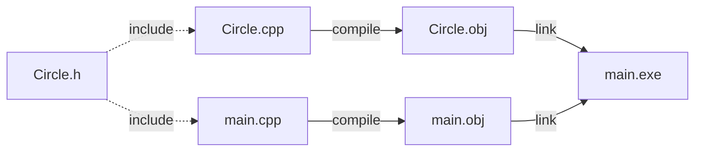

# Chapter 3 — Classes and Objects

[Repository Guide](../../README.md) | [English](Concepts_Lecture.md) | [한국어](Concepts_Lecture.ko.md)

> **Last Updated:** 2026-10-19
>
> 명품 C++ Programming, 황기태, Ch 3

> **Learning Objectives:**
> 1. Explain the relationship between real-world objects and C++ objects, and the purpose of encapsulation
> 2. Write a C++ class with member variables and member functions, split into a declaration and an implementation, and create and use objects
> 3. Write constructors, delegating constructors, and destructors, and explain the order in which objects are constructed and destroyed
> 4. Explain the differences among the `private`, `protected`, and `public` access specifiers
> 5. Explain the purpose, advantages, and disadvantages of inline functions and the difference between C++ structs and classes
> 6. Write a program with classes separated into header files and cpp files

---

## Table of Contents

- [1. Object-Oriented Concepts](#1-object-oriented-concepts)
  - [1.1 Objects](#11-objects)
  - [1.2 Class vs Object](#12-class-vs-object)
  - [1.3 From C to C++: struct vs class](#13-from-c-to-c-struct-vs-class)
- [2. Class Definition](#2-class-definition)
  - [2.1 Syntax](#21-syntax)
  - [2.2 Member Variables](#22-member-variables)
  - [2.3 Member Functions](#23-member-functions)
  - [2.4 Access Specifiers](#24-access-specifiers)
- [3. Object Creation and Usage](#3-object-creation-and-usage)
  - [3.1 Declaration](#31-declaration)
  - [3.2 Object Arrays](#32-object-arrays)
- [4. Constructors and Destructors](#4-constructors-and-destructors)
  - [4.1 Constructor](#41-constructor)
  - [4.2 Constructor Overloading](#42-constructor-overloading)
  - [4.3 Delegating Constructors](#43-delegating-constructors)
  - [4.4 Ways to Initialize Member Variables](#44-ways-to-initialize-member-variables)
  - [4.5 Default Constructor](#45-default-constructor)
  - [4.6 Destructor](#46-destructor)
  - [4.7 Execution Order](#47-execution-order)
- [5. Inline Functions](#5-inline-functions)
- [6. C++ Struct](#6-c-struct)
- [7. Header and Source File Separation](#7-header-and-source-file-separation)
- [8. Complete Runnable Examples](#8-complete-runnable-examples)
  - [8.1 Circle Class with Constructor, Getter, and Area](#81-circle-class-with-constructor-getter-and-area)
  - [8.2 Constructor and Destructor Execution Order](#82-constructor-and-destructor-execution-order)
  - [8.3 Member Functions: Inside vs Outside the Class](#83-member-functions-inside-vs-outside-the-class)
- [9. Common Mistakes](#9-common-mistakes)
  - [9.1 Forgetting the Semicolon After the Class Definition](#91-forgetting-the-semicolon-after-the-class-definition)
  - [9.2 Accessing Private Members from Outside the Class](#92-accessing-private-members-from-outside-the-class)
  - [9.3 No Default Constructor After Defining Another Constructor](#93-no-default-constructor-after-defining-another-constructor)
  - [9.4 Calling the Constructor Like a Regular Function](#94-calling-the-constructor-like-a-regular-function)
  - [9.5 Confusing Class Definition with Object Creation](#95-confusing-class-definition-with-object-creation)
- [Summary](#summary)
- [Self-Check Questions](#self-check-questions)

---

<br>

## 1. Object-Oriented Concepts

### 1.1 Objects

In object-oriented programming (OOP), **everything is modeled as an object**. Everything in the world, such as a TV, a chair, a book, a house, a camera, or a computer, is an object. An object bundles together the following two things.

- **State:** data stored in **member variables** (fields).
- **Behavior:** operations defined by **member functions** (methods).

| Aspect | TV Object Example |
|:-----|:-----|
| State | Whether it is on or off, the channel currently being broadcast, the volume currently being output |
| Behavior | Power on, power off, channel up, channel down, volume up, volume down |

*Table 1. State and behavior of a TV object*

**Encapsulation** is the principle of hiding internal implementation details and exposing only a well-defined interface. The outside world interacts with an object through its public methods without knowing how the internal data is structured or modified.

The color and ingredients of medicine inside a capsule cannot be seen, and the medicine is safe from the outside. Likewise, encapsulation wraps an object in a capsule to protect its internals and hide them from view, with the purpose of securing and protecting the data in the object and restricting outside access. Part of an object, however, is exposed as an interface for exchanging information with the outside. A TV hides its internal circuitry but exposes power, brightness, channel, and volume buttons to communicate with a remote control object.

```text
┌───────────────────────────┐
│          Object           │
│                           │
│  ┌─────────────────────┐  │
│  │  State (private)    │  │
│  │  - member variables │  │
│  └─────────────────────┘  │
│                           │
│  ┌─────────────────────┐  │
│  │  Behavior (public)  │  │
│  │  - member functions │  │
│  └─────────────────────┘  │
└───────────────────────────┘
```

*Figure 1. Structure of an object bundling state and behavior*

#### Why Does Encapsulation Matter?

Without encapsulation, anyone can set data to **invalid values**, and there is nothing to prevent bugs.

```cpp
// BAD: radius is public — no protection
class Circle {
public:
    int radius;
    double getArea() { return 3.14 * radius * radius; }
};

Circle c;
c.radius = -5;             // no one stops this!
cout << c.getArea();        // prints 78.5 — a "negative" radius gives a positive
                            // but meaningless area. The object is in an invalid state.
```

With encapsulation, the class **validates data** through a setter, preventing invalid states.

```cpp
// GOOD: radius is private — setter enforces rules
class Circle {
    int radius;
public:
    void setRadius(int r) {
        if (r > 0)
            radius = r;     // only accept positive values
        else
            radius = 1;     // fallback to a safe default
    }
    double getArea() { return 3.14 * radius * radius; }
};

Circle c;
c.setRadius(-5);            // setter rejects -5, sets radius to 1
cout << c.getArea();         // prints 3.14 — always a valid result
```

#### Practical Analogy: Bank Account

Take a **bank account** as an example: the balance is private data. You cannot walk into the bank vault and change the number on a ledger directly. Instead, you must use **deposit** and **withdraw** operations, which check whether the transaction is valid (e.g., you cannot withdraw more than your balance).

```cpp
class BankAccount {
    int balance;               // private — cannot be touched directly
public:
    BankAccount() { balance = 0; }
    void deposit(int amount) {
        if (amount > 0)        // validation: only positive deposits
            balance += amount;
    }
    bool withdraw(int amount) {
        if (amount > 0 && amount <= balance) {
            balance -= amount;
            return true;       // success
        }
        return false;          // failed: invalid amount or insufficient funds
    }
    int getBalance() { return balance; }
};
```

This is encapsulation in action. The **data is protected**, and all modifications go through **controlled, validated methods**.

### 1.2 Class vs Object

| | Class | Object |
|:--|:------|:-------|
| What | Blueprint / mold | Instance created from a class |
| Memory | Not allocated in memory | Allocated in memory at creation |
| Analogy | Cookie cutter | Cookie |
| Quantity | One class definition | Multiple objects from one class |

*Table 2. Comparison of classes and objects*

A class is a blueprint defined for producing objects; it is neither an object nor an entity. An object is born with exactly the shape of its class when created, and because it is created in memory, it is also called an **instance**. Each object has its own **independent copy** of member variables. Changing one object's data does not affect another.

```cpp
class Circle {
    int radius;       // each Circle object has its own radius
public:
    double getArea();
};

Circle a, b;          // two independent objects from one class
```

### 1.3 From C to C++: struct vs class

If you learned C first, you are used to `struct` as a plain data container with no member functions and no access control. In C++, `class` takes the struct concept much further.

| Feature | C `struct` | C++ `class` |
|:--------|:-----------|:------------|
| Data members | Yes | Yes |
| Member functions | No (use separate functions) | Yes (bundled inside) |
| Access control (`private`/`public`) | No (everything public) | Yes (default `private`) |
| Constructors / Destructors | No | Yes |
| Encapsulation | Manual discipline only | Enforced by the compiler |

*Table 3. Comparison of C struct and C++ class*

**Side-by-side comparison: the same Circle problem in C vs C++**

**C approach (struct + separate functions):**

```c
#include <stdio.h>

struct Circle {
    int radius;          /* all data is public — no way to restrict */
};

double getArea(struct Circle c) {    /* function is separate from struct */
    return 3.14 * c.radius * c.radius;
}

int main() {
    struct Circle c;
    c.radius = 5;        /* direct access — no validation possible */
    printf("Area: %.2f\n", getArea(c));

    c.radius = -3;       /* nothing prevents this! */
    printf("Area: %.2f\n", getArea(c));
    return 0;
}
```

**C++ approach (class with encapsulation):**

```cpp
#include <iostream>
using namespace std;

class Circle {
    int radius;                      // private by default
public:
    Circle(int r) {                  // constructor initializes the object
        radius = (r > 0) ? r : 1;
    }
    double getArea() {               // member function — bundled with data
        return 3.14 * radius * radius;
    }
};

int main() {
    Circle c(5);                     // initialized via constructor
    cout << "Area: " << c.getArea() << endl;

    // c.radius = -3;               // compile error! radius is private
    return 0;
}
```

> **Key Point:** In C, keeping data valid depends entirely on programmer discipline. In C++, access control catches invalid direct access to the data at compile time, and constructors and setters validate values so that objects stay in a valid state.

---

<br>

## 2. Class Definition

### 2.1 Syntax

```cpp
class ClassName {
private:       // access specifier
    // private members
protected:
    // protected members
public:
    // public members
};             // ← semicolon required!
```

- The `class` keyword introduces a class definition.
- Members are grouped under **access specifiers** (`private`, `protected`, `public`).
- If no access specifier is written, the **default is `private`**.
- The closing brace must be followed by a **semicolon**.

A class is written as a **class declaration** and a **class implementation**. The declaration declares the class with the `class` keyword and declares its member variables and member functions, usually declaring member functions as prototypes. The implementation implements (defines) all the member functions declared in the declaration. The two are separated so that the class can be used from other files (Section 7).

### 2.2 Member Variables

Member variables store the **state** (data) of an object. They are typically declared `private` to enforce encapsulation.

```cpp
class Rectangle {
private:
    int width;
    int height;
};
```

### 2.3 Member Functions

Member functions define the **behavior** of an object. They are typically declared `public` so that external code can interact with the object.

A member function can be defined in two ways.

**Inside the class (implicitly inline):**

```cpp
class Circle {
    int radius;
public:
    double getArea() {
        return 3.14 * radius * radius;
    }
};
```

**Outside the class with the scope resolution operator `::`:**

```cpp
class Circle {
    int radius;
public:
    double getArea();
};

double Circle::getArea() {
    return 3.14 * radius * radius;
}
```

An outside definition such as `double Circle::getArea()` is written as the return type, the class name, the scope resolution operator `::`, and the member function name with its parameters, in that order. `Circle::` indicates that the function is a member of the `Circle` class.

### 2.4 Access Specifiers

| Specifier | Accessible From | Typical Use |
|:----------|:----------------|:------------|
| `private` | Only within the same class | Member variables, internal helpers |
| `protected` | Same class + derived classes | Members shared with subclasses |
| `public` | Anywhere | Interface (member functions, getters) |

*Table 4. Accessibility by access specifier*

```cpp
class Account {
private:
    int balance;          // only Account's own methods can access
protected:
    int accountNumber;    // Account + derived classes can access
public:
    int getBalance() {    // anyone can call
        return balance;
    }
};
```

> **Key Point:** If you access a `private` member from outside the class, the compiler raises an error. This is how C++ enforces encapsulation at compile time.

C++'s encapsulation strategy is to protect the member variables that represent an object's state, along with other important members, from access by other classes and objects, and to allow access only to the members needed as an interface to the outside. Access specifiers can appear several times in a class in any order, and each applies to the members up to the next specifier. `protected` is covered in detail with inheritance in Chapter 8.

In the following code, compile errors occur at (1), (3), and (5) in `main()`. A constructor is also a member, so a constructor declared `private` cannot be called from outside the class. Inside member functions, on the other hand, the `private` members `a` and `f()` can be accessed freely.

```cpp
class PrivateAccessError {
private:
    int a;
    void f();
    PrivateAccessError();
public:
    int b;
    PrivateAccessError(int x);
    void g();
};

PrivateAccessError::PrivateAccessError() { a = 1; b = 1; }
PrivateAccessError::PrivateAccessError(int x) { a = x; b = x; }
void PrivateAccessError::f() { a = 5; b = 5; }    // member functions can access private members
void PrivateAccessError::g() { a = 6; b = 6; }

int main() {
    PrivateAccessError objA;         // (1) error: PrivateAccessError() is private
    PrivateAccessError objB(100);    // (2) OK
    objB.a = 10;                     // (3) error: a is private
    objB.b = 20;                     // (4) OK
    objB.f();                        // (5) error: f() is private
    objB.g();                        // (6) OK
}
```

---

<br>

## 3. Object Creation and Usage

### 3.1 Declaration

Declaring an object allocates memory for all its member variables. Use the **dot operator** (`.`) to access public members.

```cpp
Circle c;               // object created — memory allocated
c.setRadius(5);         // call member function via dot operator
double area = c.getArea();
```

> **Caution:** You cannot access `private` members directly from outside the class:
> ```cpp
> c.radius = 5;  // ❌ compile error — radius is private
> ```
> Use a public setter or pass the value through a constructor.

The following program creates the `Circle` objects `donut` and `pizza` and accesses each object's member variable and member function with the dot operator. `radius` is made `public` only to show how objects are used; in practice it should be `private`, as in Section 1.1.

```cpp
#include <iostream>
using namespace std;

class Circle {                       // Circle declaration
public:
    int radius;
    double getArea();
};

double Circle::getArea() {           // Circle implementation
    return 3.14 * radius * radius;
}

int main() {
    Circle donut;                    // create object donut
    donut.radius = 1;                // access donut's member variable
    double area = donut.getArea();   // call donut's member function
    cout << "Area of donut is " << area << endl;

    Circle pizza;
    pizza.radius = 30;
    area = pizza.getArea();
    cout << "Area of pizza is " << area << endl;
}
```

```text
Area of donut is 3.14
Area of pizza is 2826
```

### 3.2 Object Arrays

An array of objects creates multiple independent instances. Each element is a separate object.

```cpp
Circle circles[3];     // 3 Circle objects, each with its own radius

circles[0].setRadius(1);
circles[1].setRadius(2);
circles[2].setRadius(3);
```

The **default constructor** is called for each element when the array is created.

---

<br>

## 4. Constructors and Destructors

### 4.1 Constructor

A **constructor** is a special member function that initializes an object at creation time.

- Has the **same name** as the class.
- Has **no return type** (not even `void`).
- Called **automatically** when an object is created, and runs exactly once per object. The programmer cannot call it arbitrarily.
- Can be **overloaded** (multiple constructors with different parameters). Only one of them runs when an object is created.

The purpose of a constructor is to perform the initialization an object needs when it is created. Besides initializing member variables, constructors perform tasks such as allocating memory, opening files, and connecting to networks. Just as balls from the same ping-pong ball machine come out painted in different colors, objects made from the same class are initialized differently according to the values their constructors receive.

#### Why Are Constructors Needed?

Without a constructor, the member variables of a local object contain **garbage values** (whatever was previously in that memory). Using an uninitialized object leads to unpredictable behavior.

```cpp
class Circle {
    int radius;    // no constructor defined
public:
    double getArea() { return 3.14 * radius * radius; }
};

Circle c;
cout << c.getArea();   // radius is garbage (e.g., -858993460) → nonsensical result!
                       // The program compiles and runs, but the output is wrong.
```

A constructor **guarantees** that every object starts in a valid state. The programmer never has to remember to call a separate init function; initialization is automatic.

```cpp
class Circle {
    int radius;
public:
    Circle() {              // default constructor (no parameters)
        radius = 1;
    }
    Circle(int r) {         // parameterized constructor
        radius = r;
    }
    double getArea() {
        return 3.14 * radius * radius;
    }
};

Circle a;        // calls Circle() → radius = 1
Circle b(10);    // calls Circle(int) → radius = 10
```

### 4.2 Constructor Overloading

Multiple constructors can coexist as long as their **parameter lists differ** (number or types of parameters).

```cpp
class Point {
    int x, y;
public:
    Point() { x = 0; y = 0; }
    Point(int a) { x = a; y = a; }
    Point(int a, int b) { x = a; y = b; }
};

Point p1;         // (0, 0)
Point p2(5);      // (5, 5)
Point p3(3, 7);   // (3, 7)
```

### 4.3 Delegating Constructors

When the same initialization code is repeated in several constructors, the code can be simplified by having one **target constructor** take charge of object initialization and having the other constructors call it. A constructor that calls the target constructor and entrusts it with object initialization is called a **delegating constructor** (C++11). A delegating constructor calls the target constructor after the colon (`:`) at the head of the constructor.

```cpp
#include <iostream>
using namespace std;

class Circle {
public:
    int radius;
    Circle();                        // delegating constructor
    Circle(int r);                   // target constructor
    double getArea();
};

Circle::Circle() : Circle(1) { }     // calls the target constructor Circle(int r) with r = 1

Circle::Circle(int r) {              // takes charge of object initialization
    radius = r;
    cout << "Circle with radius " << radius << " created" << endl;
}

double Circle::getArea() {
    return 3.14 * radius * radius;
}

int main() {
    Circle donut;                    // calls the constructor with no parameters
    double area = donut.getArea();
    cout << "Area of donut is " << area << endl;

    Circle pizza(30);                // calls the constructor with a parameter
    area = pizza.getArea();
    cout << "Area of pizza is " << area << endl;
}
```

```text
Circle with radius 1 created
Area of donut is 3.14
Circle with radius 30 created
Area of pizza is 2826
```

`Circle donut;` calls `Circle()`, which in turn calls `Circle(1)`, so both objects print a creation message without the output statement being duplicated in the two constructors.

### 4.4 Ways to Initialize Member Variables

There are three ways to initialize member variables in a constructor.

**(1) Assignment in the constructor body:**

```cpp
Point::Point() { x = 0; y = 0; }
Point::Point(int a, int b) { x = a; y = b; }
```

**(2) Member initializer list at the head of the constructor:**

```cpp
Point::Point() : x(0), y(0) { }              // initialize members x and y to 0
Point::Point(int a, int b) : x(a), y(b) { }  // initialize x to a and y to b
```

**(3) Direct initialization in the class declaration (C++11):**

```cpp
class Point {
    int x = 0, y = 0;                // initialize x and y to 0 directly in the declaration
public:
    // ...
};
```

With (1), the member variables are created first and then assigned values, whereas (2) initializes them at the moment they are created. Members that cannot be assigned, such as `const` members and reference members, can be initialized only with (2) or (3). Members in a member initializer list are initialized in the order they are declared in the class, not in the order they appear in the list.

The following example uses a member initializer list together with a delegating constructor.

```cpp
#include <iostream>
using namespace std;

class Point {
    int x, y;
public:
    Point();
    Point(int a, int b);
    void show() { cout << "(" << x << ", " << y << ")" << endl; }
};

Point::Point() : Point(0, 0) { }     // delegating constructor
Point::Point(int a, int b)           // target constructor
    : x(a), y(b) { }                 // member initializer list

int main() {
    Point origin;
    Point target(10, 20);
    origin.show();
    target.show();
}
```

```text
(0, 0)
(10, 20)
```

### 4.5 Default Constructor

A constructor is always called when an object is created. A constructor with no parameters is called a **default constructor**.

If **no constructor is defined** by the programmer, the compiler automatically provides a **default constructor** that does nothing (member variables of basic types are left uninitialized).

However, once **any constructor is defined**, the compiler **does NOT** provide a default constructor. If you still need one, you must define it explicitly.

```cpp
class Box {
    int size;
public:
    Box(int s) { size = s; }   // only parameterized constructor
};

Box a;       // ❌ compile error — no default constructor!
Box b(10);   // ✅ OK
```

> **Key Point:** If you define `Box(int s)` but also need `Box()`, you must write both.

### 4.6 Destructor

A **destructor** is called automatically when an object is destroyed (goes out of scope or is `delete`d, or, for global objects, when the program ends). It is called exactly once, right before the object's memory is released, and the programmer does not call it arbitrarily.

- Name: `~ClassName()`
- No parameters, no return type (it cannot return any value).
- **Cannot be overloaded** (only one destructor per class).
- Used for **cleanup** (releasing dynamically allocated memory, saving and closing files, closing network connections, etc.).
- If no destructor is declared, the compiler automatically creates a default destructor that does nothing and simply returns.

```cpp
class MyArray {
    int *data;
public:
    MyArray(int size) {
        data = new int[size];
    }
    ~MyArray() {
        delete[] data;    // cleanup: free heap memory
    }
};
```

### 4.7 Execution Order

- Objects are **constructed** in the order they are declared.
- Objects are **destructed in reverse order** (last created, first destroyed).
- Local objects are destroyed when the enclosing **scope exits**.

```cpp
void func() {
    Circle a(1);     // 1st constructed
    Circle b(2);     // 2nd constructed
}                    // b destroyed first, then a
```

```text
Construction order: a → b
Destruction order:  b → a
```

*Figure 2. Construction and destruction order of local objects a and b*

Objects are classified as local or global by where they are declared.

- **Local objects:** Objects declared inside a function. They are constructed in order as execution reaches their declarations, and when the function ends they are destroyed in the reverse order of construction.
- **Global objects:** Objects declared outside functions. They are constructed in the order declared in the program before `main()` starts, and when the program ends they are destroyed in the reverse order of construction. This order is guaranteed within one source file; the construction order of global objects across multiple source files is unspecified.
- **Dynamic objects:** An object created with `new` is constructed the moment `new` executes and destroyed when `delete` executes (Chapter 4).

```cpp
#include <iostream>
using namespace std;

class Circle {
    int radius;
public:
    Circle() : Circle(1) { }
    Circle(int r) {
        radius = r;
        cout << "Circle with radius " << radius << " created" << endl;
    }
    ~Circle() {
        cout << "Circle with radius " << radius << " destroyed" << endl;
    }
};

Circle globalDonut(1000);            // global objects
Circle globalPizza(2000);

void f() {
    Circle fDonut(100);              // local objects of f()
    Circle fPizza(200);
}

int main() {
    Circle mainDonut;                // local objects of main()
    Circle mainPizza(30);
    f();
}
```

```text
Circle with radius 1000 created
Circle with radius 2000 created
Circle with radius 1 created
Circle with radius 30 created
Circle with radius 100 created
Circle with radius 200 created
Circle with radius 200 destroyed
Circle with radius 100 destroyed
Circle with radius 30 destroyed
Circle with radius 1 destroyed
Circle with radius 2000 destroyed
Circle with radius 1000 destroyed
```

```text
Program loaded    globalDonut created → globalPizza created
main() starts     mainDonut created → mainPizza created
f() runs          fDonut created → fPizza created
f() ends          fPizza destroyed → fDonut destroyed
main() ends       mainPizza destroyed → mainDonut destroyed
Program ends      globalPizza destroyed → globalDonut destroyed
```

*Figure 3. Construction and destruction of global and local objects*

---

<br>

## 5. Inline Functions

Calling a function requires extra work: saving the return address and CPU register values, pushing the parameters onto the stack, and, when the function ends, storing the return value in a temporary location and restoring the saved register values and return address. For a small function, this call overhead is large relative to its execution time. The following program calls the one-line function `odd()` 10000 times.

```cpp
#include <iostream>
using namespace std;

int odd(int x) {
    return (x % 2);
}

int main() {
    int sum = 0;
    for (int i = 1; i <= 10000; i++) {   // sum of the odd numbers from 1 to 10000
        if (odd(i))                      // odd() is called 10000 times
            sum += i;
    }
    cout << sum;
}
```

```text
25000000
```

An **inline function** is a suggestion to the compiler to replace the function call with the function body at the call site, avoiding function call overhead.

```cpp
inline int square(int n) {
    return n * n;
}
```

If `odd()` is declared as `inline int odd(int x)`, the compiler compiles a source in which `if (odd(i))` is expanded to `if ((i % 2))`, so the call overhead disappears. This resembles a macro, but it is handled by the compiler rather than the preprocessor, and argument types are checked.

- Use `inline` for **small, frequently called** functions. C++ classes have many short member functions, so inline functions help improve execution speed.
- The compiler may ignore the `inline` hint for large or complex functions. The compiler may refuse to inline recursive functions, long functions, and functions with `static` variables, loops, or `goto` statements.
- Member functions **defined inside the class body**, including constructors, are implicitly inline. They are called automatic inline functions, and `inline` need not be written.

The advantage of inline functions is faster program execution, and the disadvantage is that the code is inserted at every call site, so the total size of the compiled code grows. The textbook states that the code size statistically grows by up to 30%, so it is best to declare only short functions inline.

```cpp
class Circle {
    int radius;
public:
    // implicitly inline — defined inside the class
    double getArea() { return 3.14 * radius * radius; }
};
```

> **Note:** `inline` is a suggestion, not a command. Modern compilers often inline functions automatically when beneficial, regardless of the keyword. In modern C++, an important meaning of `inline` is that the same function definition may appear in several source files without error, which is why inline functions can be defined in header files.

---

<br>

## 6. C++ Struct

In C++, `struct` is the same as `class` in every respect, including inheritance, members, and access specification. The **only difference** is the default access. Both the default member access and the default inheritance access are `public` for `struct` and `private` for `class`.

| Feature | `struct` | `class` |
|:--------|:--------:|:-------:|
| Default access | `public` | `private` |
| Can have member functions | Yes | Yes |
| Can have constructors/destructors | Yes | Yes |
| Can use inheritance | Yes | Yes |

*Table 5. Comparison of C++ struct and class*

```cpp
struct Point {
    int x, y;        // public by default
    void print() {
        cout << x << ", " << y << endl;
    }
};

Point p;
p.x = 3;            // ✅ OK — public by default
```

> **Note:** **Convention.** Use `struct` for simple data holders with mostly public members. Use `class` when encapsulation and access control are important.

C++ adopted structs for compatibility with the C language. It accepts C structs 100% so that C source can be reused as is. In C++, the `struct` keyword is omitted when creating a struct object. Writing `struct StructName stObj;` as in C is allowed, but in C++ one usually writes `StructName stObj;`.

The following example rewrites the `Circle` class as a C++ struct.

```cpp
#include <iostream>
using namespace std;

struct StructCircle {                // C++ struct declaration
private:
    int radius;
public:
    StructCircle(int r) { radius = r; }   // constructor of the struct
    double getArea();
};

double StructCircle::getArea() {
    return 3.14 * radius * radius;
}

int main() {
    StructCircle waffle(3);          // create an object without the struct keyword
    cout << "The area is " << waffle.getArea();
}
```

```text
The area is 28.26
```

---

<br>

## 7. Header and Source File Separation

For larger projects, class **declarations** go in a header file (`.h`) and member function **definitions** go in a source file (`.cpp`). For each class, the declaration is stored in a header file and the implementation in a cpp file that includes that header, and global functions such as `main()` go in another cpp file that includes the headers it needs. The purpose of this split is class reuse.

**`Circle.h`** (class declaration):

```cpp
#ifndef CIRCLE_H
#define CIRCLE_H

class Circle {
    int radius;
public:
    Circle();
    Circle(int r);
    double getArea();
};

#endif
```

**`Circle.cpp`** (member function definitions):

```cpp
#include "Circle.h"

Circle::Circle() {
    radius = 1;
}

Circle::Circle(int r) {
    radius = r;
}

double Circle::getArea() {
    return 3.14 * radius * radius;
}
```

Each cpp file is compiled separately into an object file, and the linker combines the object files into one executable.



*Figure 4. Building an executable from separated header and cpp files*

**Include guards** prevent the same header from being included multiple times. If a `Circle.h` without a guard is included more than once in one source file, the `Circle` class is declared twice and a compile error occurs (Visual C++'s `error C2011: 'Circle': 'class' type redefinition`, GCC's `redefinition of 'class Circle'`). With the conditional compilation starting with `#ifndef CIRCLE_H`, `CIRCLE_H` is defined and the class declaration is included only at the first include, and the contents are skipped at later includes. The conditional compilation constant is best named after the class to avoid collisions with other constants.

| Method | Syntax |
|:-------|:-------|
| Traditional | `#ifndef CIRCLE_H` / `#define CIRCLE_H` / `#endif` |
| Modern | `#pragma once` (widely supported, simpler) |

*Table 6. Ways to write include guards*

> **Note:** **Support for `#pragma once`.** `#pragma once` is not part of the C++ standard but is supported by all major compilers (GCC, Clang, MSVC).

The following example splits the `Adder` and `Calculator` classes, originally in one file, into header files and cpp files. It reads two integers and prints their sum.

```cpp
// ===== Adder.h =====
#ifndef ADDER_H
#define ADDER_H

class Adder {                        // addition module class
    int op1, op2;
public:
    Adder(int a, int b);
    int process();
};

#endif

// ===== Calculator.h =====
#ifndef CALCULATOR_H
#define CALCULATOR_H

class Calculator {                   // calculator class
public:
    void run();
};

#endif
```

```cpp
// ===== Adder.cpp =====
#include "Adder.h"

Adder::Adder(int a, int b) {
    op1 = a; op2 = b;
}

int Adder::process() {
    return op1 + op2;
}

// ===== Calculator.cpp =====
#include <iostream>
using namespace std;

#include "Calculator.h"
#include "Adder.h"

void Calculator::run() {
    cout << "Enter two numbers>>";
    int a, b;
    cin >> a >> b;                   // read two integers
    Adder adder(a, b);               // create the adder
    cout << adder.process();         // compute the sum
}

// ===== main.cpp =====
#include "Calculator.h"

int main() {
    Calculator calc;                 // create the calc object
    calc.run();                      // start the calculator
}
```

```text
Enter two numbers>>5 -20
-15
```

---

<br>

## 8. Complete Runnable Examples

The programs below are self-contained. Copy any of them into a `.cpp` file, compile with `g++ -o program filename.cpp`, and run with `./program`.

### 8.1 Circle Class with Constructor, Getter, and Area

```cpp
#include <iostream>
using namespace std;

class Circle {
    int radius;
public:
    Circle() {
        radius = 1;
    }
    Circle(int r) {
        radius = (r > 0) ? r : 1;    // validate: reject non-positive values
    }
    int getRadius() {
        return radius;
    }
    void setRadius(int r) {
        if (r > 0)
            radius = r;
    }
    double getArea() {
        return 3.14 * radius * radius;
    }
};

int main() {
    Circle c1;          // default constructor → radius = 1
    Circle c2(5);       // parameterized constructor → radius = 5
    Circle c3(-3);      // invalid value → constructor sets radius = 1

    cout << "c1: radius=" << c1.getRadius() << ", area=" << c1.getArea() << endl;
    cout << "c2: radius=" << c2.getRadius() << ", area=" << c2.getArea() << endl;
    cout << "c3: radius=" << c3.getRadius() << ", area=" << c3.getArea() << endl;

    c2.setRadius(10);
    cout << "c2 after setRadius(10): area=" << c2.getArea() << endl;

    return 0;
}
```

**Expected output:**

```text
c1: radius=1, area=3.14
c2: radius=5, area=78.5
c3: radius=1, area=3.14
c2 after setRadius(10): area=314
```

### 8.2 Constructor and Destructor Execution Order

```cpp
#include <iostream>
using namespace std;

class Tracer {
    string name;
public:
    Tracer(string n) : name(n) {
        cout << "  Constructor: " << name << " created" << endl;
    }
    ~Tracer() {
        cout << "  Destructor:  " << name << " destroyed" << endl;
    }
};

void innerFunction() {
    cout << "[Entering innerFunction]" << endl;
    Tracer t3("C");
    Tracer t4("D");
    cout << "[Leaving innerFunction]" << endl;
}

int main() {
    cout << "[Entering main]" << endl;
    Tracer t1("A");
    Tracer t2("B");

    innerFunction();

    cout << "[Leaving main]" << endl;
    return 0;
}
```

**Expected output:**

```text
[Entering main]
  Constructor: A created
  Constructor: B created
[Entering innerFunction]
  Constructor: C created
  Constructor: D created
[Leaving innerFunction]
  Destructor:  D destroyed
  Destructor:  C destroyed
[Leaving main]
  Destructor:  B destroyed
  Destructor:  A destroyed
```

Notice that within each scope, destruction happens in **reverse order** of construction. `Tracer` in this example uses `string`, so strictly speaking `#include <string>` is required. With the GCC and Clang standard libraries, `<iostream>` indirectly includes `<string>` and the program compiles as is, but the standard does not guarantee this.

### 8.3 Member Functions: Inside vs Outside the Class

```cpp
#include <iostream>
using namespace std;

class Rectangle {
    int width, height;
public:
    Rectangle(int w, int h) {
        width = w;
        height = h;
    }

    // Defined INSIDE the class (implicitly inline)
    int getWidth() { return width; }
    int getHeight() { return height; }

    // Only DECLARED here — defined outside below
    int getArea();
    void print();
};

// Defined OUTSIDE the class using scope resolution operator ::
int Rectangle::getArea() {
    return width * height;
}

void Rectangle::print() {
    cout << width << " x " << height << " = " << getArea() << endl;
}

int main() {
    Rectangle r1(3, 4);
    Rectangle r2(10, 5);

    r1.print();     // 3 x 4 = 12
    r2.print();     // 10 x 5 = 50

    return 0;
}
```

**Expected output:**

```text
3 x 4 = 12
10 x 5 = 50
```

> **Note:** **Choosing where to define.** Short one-liner functions (getters/setters) are commonly defined inside the class. Longer functions are defined outside to keep the class declaration readable.

---

<br>

## 9. Common Mistakes

This section lists the most frequent errors beginners make with classes. Knowing these in advance will save you debugging time.

### 9.1 Forgetting the Semicolon After the Class Definition

```cpp
class Circle {
    int radius;
public:
    double getArea() { return 3.14 * radius * radius; }
}           // WRONG: missing semicolon

int main() { ... }
```

The compiler will produce confusing errors that point to lines **after** the class definition. Always end with `};`.

```cpp
class Circle {
    int radius;
public:
    double getArea() { return 3.14 * radius * radius; }
};          // CORRECT
```

### 9.2 Accessing Private Members from Outside the Class

```cpp
Circle c;
c.radius = 5;   // WRONG: compile error — radius is private
```

**Fix:** Use a public setter or pass the value through a constructor.

```cpp
Circle c(5);           // pass via constructor
// or
c.setRadius(5);        // pass via public setter
```

### 9.3 No Default Constructor After Defining Another Constructor

Once you define **any** constructor, the compiler-generated default constructor disappears.

```cpp
class Box {
    int size;
public:
    Box(int s) { size = s; }
};

Box b;       // WRONG: compile error — no default constructor
```

**Fix:** Explicitly define the default constructor if you need it.

```cpp
class Box {
    int size;
public:
    Box() { size = 0; }           // now this works
    Box(int s) { size = s; }
};

Box b;       // OK — calls Box()
```

### 9.4 Calling the Constructor Like a Regular Function

Constructors are called **only at object creation**. You cannot call them again on an existing object.

```cpp
Circle c;
c.Circle(5);    // WRONG: you cannot call a constructor like this
```

**Fix:** Initialize at creation time, or use a setter to change the value later.

```cpp
Circle c(5);         // CORRECT: constructor called at creation
// or later:
c.setRadius(10);     // CORRECT: use a setter to modify
```

### 9.5 Confusing Class Definition with Object Creation

A class definition does **not** create any object. No memory is allocated until you declare a variable of that class type.

```cpp
class Circle {
    int radius;
public:
    Circle(int r) { radius = r; }
};
// No Circle object exists yet!

Circle c(5);    // NOW an object is created and memory is allocated
```

---

<br>

## Summary

| Concept | Key Summary |
|:--------|:-------------|
| Object | An object bundles state (member variables) and behavior (member functions). |
| Encapsulation | Encapsulation protects data by hiding internals as `private` and exposing only the interface to the outside as `public`. |
| Class vs Object | A class is a blueprint that occupies no memory, and an object is an entity (instance) allocated in memory. |
| Class syntax | A class is written as `class Name { ... };` with a required semicolon, and the default access is `private`. |
| Declaration and Implementation | Members are declared in the declaration, and member functions are defined in the implementation in the form `ReturnType Class::function()`. |
| Member variables | Member variables store object state and are typically declared `private`. |
| Member functions | Member functions define object behavior and are defined inside or outside the class (`::`). |
| Access specifiers | `private` members are accessible only within the class, `protected` within the class and derived classes, and `public` anywhere. |
| Object creation | `ClassName obj;` allocates memory, and members are accessed with the dot operator. |
| Object arrays | Each element of `ClassName arr[n];` is an independent object, and the default constructor is called for each. |
| Constructor | A constructor has the class name and no return type, is called automatically once at object creation, and can be overloaded. |
| Delegating constructor | Calling a target constructor, as in `Circle() : Circle(1) { }`, removes duplicated initialization code. |
| Member initialization | Member variables are initialized by assignment in the constructor body, a member initializer list, or direct initialization in the class declaration. |
| Default constructor | A default constructor takes no parameters, and the compiler provides one only if no constructor is defined. |
| Destructor | A destructor has the form `~ClassName()`, takes no parameters, cannot be overloaded, and is called when the object is destroyed. |
| Execution order | Local objects are constructed during function execution and global objects before `main()`, each in declaration order, and each group is destroyed in reverse. |
| Inline functions | A function declared `inline` or defined inside the class may have its calls replaced with its body by the compiler, at the cost of larger code. |
| C++ `struct` | A struct is the same as a class except that the default access is `public`, and it exists for compatibility with C. |
| File separation | Declarations go in `.h` and definitions in `.cpp`, and include guards prevent duplicate inclusion. |

---

<br>

## Self-Check Questions

1. **Default constructor:** Explain why `Box a;` is a compile error for the following class, and give two ways to fix it so that `Box a;` is allowed.

   ```cpp
   class Box {
       int size;
   public:
       Box(int s) { size = s; }
   };
   ```

   <details>
   <summary>Answer</summary>

   Because the constructor `Box(int s)` is defined, the compiler does not create a default constructor automatically, so there is no parameterless constructor for `Box a;` to call. Define a default constructor directly, as in `Box() { size = 0; }`, or define a delegating constructor that entrusts initialization to the target constructor `Box(int s)`, as in `Box() : Box(0) { }`.

   </details>

2. **Construction and destruction order:** There are a global object `g`, local objects `a` and `b` of `main()` (in declaration order), and a local object `c` of the function `f()` called by `main()`. When `main()` declares `a` and `b` and then calls `f()`, state the construction order and the destruction order of the four objects.

   <details>
   <summary>Answer</summary>

   The construction order is `g` (before `main()` starts), `a`, `b`, and `c` (while `f()` runs). The destruction order is `c` (when `f()` ends), `b`, `a` (when `main()` ends), and `g` (when the program ends).

   </details>

3. **Access specification:** In the `PrivateAccessError` class of Section 2.4, explain why `PrivateAccessError objA;` is an error while `PrivateAccessError objB(100);` is fine. Also explain why `a = 6;` inside the member function `g()` is fine.

   <details>
   <summary>Answer</summary>

   `objA` must call the parameterless constructor `PrivateAccessError()`, which is `private` and cannot be called from `main()`, whereas `PrivateAccessError(int x)`, called by `objB(100)`, is `public` and can be called. `g()` is a member function of the same class, so it can access the `private` member `a`.

   </details>

4. **Member initializer list:** Explain the difference between `Point::Point(int a, int b) : x(a), y(b) { }` and `Point::Point(int a, int b) { x = a; y = b; }`, and give one case in which a member initializer list (or direct initialization in the class declaration) must be used.

   <details>
   <summary>Answer</summary>

   The first initializes the member variables with `a` and `b` at the moment they are created, whereas the second creates the member variables first and then assigns values in the constructor body. `const` member variables and reference member variables cannot be assigned after creation, so they must be initialized with a member initializer list or direct initialization in the class declaration.

   </details>

5. **Include guards:** What happens if `main.cpp` includes a `Circle.h` without an include guard twice? Explain how `#ifndef CIRCLE_H`, `#define CIRCLE_H`, and `#endif` prevent this.

   <details>
   <summary>Answer</summary>

   The declaration of the `Circle` class is included twice, causing a class redefinition compile error. At the first include, `CIRCLE_H` is not yet defined, so `#define CIRCLE_H` and the class declaration are included; at the second include, `CIRCLE_H` is already defined, so everything from `#ifndef` to `#endif` is skipped.

   </details>
