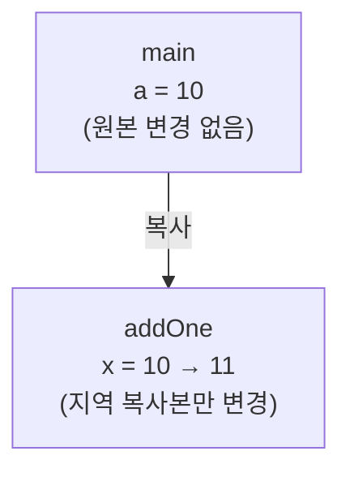
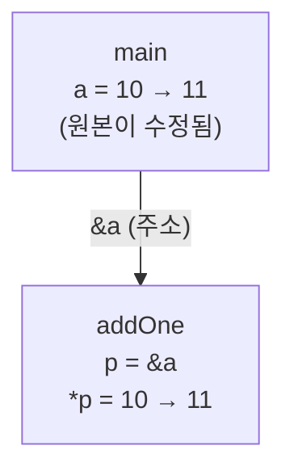
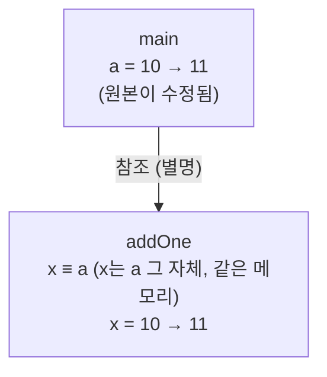

# 5장 — 함수와 복사 제어

[레포지토리 안내](../../README.ko.md) | [English](Concepts_Lecture.md) | [한국어](Concepts_Lecture.ko.md)

> **최종 수정일:** 2026-11-19
>
> 명품 C++ Programming, 황기태, Ch 5

> **학습 목표:**
> 1. 값에 의한 호출, 주소에 의한 호출, 참조에 의한 호출의 차이를 설명할 수 있다
> 2. 객체를 함수에 전달하거나 치환하거나 리턴할 때 일어나는 복사 과정을 설명할 수 있다
> 3. 참조 변수를 선언하고 참조 매개변수와 참조 리턴을 활용할 수 있다
> 4. 얕은 복사와 깊은 복사를 구분하고 깊은 복사 생성자를 작성할 수 있다
> 5. 복사 생성자가 묵시적으로 호출되는 경우를 설명할 수 있다
> 6. 복사 대입 연산자가 호출되는 경우를 복사 생성자와 구분하고, 3의 법칙에 따라 자원을 가진 클래스를 작성할 수 있다

---

## 목차

- [1. 값, 참조, 포인터에 의한 호출](#1-값-참조-포인터에-의한-호출)
  - [1.1 값에 의한 호출 (Call by Value)](#11-값에-의한-호출-call-by-value)
  - [1.2 주소에 의한 호출 (Call by Address)](#12-주소에-의한-호출-call-by-address)
  - [1.3 참조에 의한 호출 (Call by Reference)](#13-참조에-의한-호출-call-by-reference)
  - [1.4 C에서 C++로: 포인터 vs 참조](#14-c에서-c로-포인터-vs-참조)
  - [1.5 참조를 도입한 이유와 사용 지침](#15-참조를-도입한-이유와-사용-지침)
  - [1.6 전체 swap 예제: 세 가지 방법 비교](#16-전체-swap-예제-세-가지-방법-비교)
  - [1.7 비교 표](#17-비교-표)
- [2. 객체의 전달, 치환, 리턴](#2-객체의-전달-치환-리턴)
  - [2.1 값에 의한 호출로 객체 전달](#21-값에-의한-호출로-객체-전달)
  - [2.2 주소와 참조에 의한 객체 전달](#22-주소와-참조에-의한-객체-전달)
  - [2.3 객체 치환](#23-객체-치환)
  - [2.4 객체 리턴](#24-객체-리턴)
- [3. 참조 변수](#3-참조-변수)
  - [3.1 선언](#31-선언)
  - [3.2 참조 매개변수](#32-참조-매개변수)
  - [3.3 참조 리턴](#33-참조-리턴)
  - [3.4 참조 리턴 전체 예제](#34-참조-리턴-전체-예제)
  - [3.5 const 참조와 임시 객체](#35-const-참조와-임시-객체)
  - [3.6 매개변수 전달 방식의 선택](#36-매개변수-전달-방식의-선택)
- [4. 복사 생성자](#4-복사-생성자)
  - [4.1 개념](#41-개념)
  - [4.2 디폴트 복사 생성자](#42-디폴트-복사-생성자)
  - [4.3 얕은 복사의 문제](#43-얕은-복사의-문제)
  - [4.4 얕은 복사 vs 깊은 복사: 메모리 시각화](#44-얕은-복사-vs-깊은-복사-메모리-시각화)
  - [4.5 깊은 복사](#45-깊은-복사)
  - [4.6 깊은 복사 전체 예제: Person 클래스](#46-깊은-복사-전체-예제-person-클래스)
  - [4.7 복사 생성자가 묵시적으로 호출되는 경우](#47-복사-생성자가-묵시적으로-호출되는-경우)
  - [4.8 복사 대입 연산자](#48-복사-대입-연산자)
  - [4.9 3의 법칙](#49-3의-법칙)
- [5. 흔한 실수](#5-흔한-실수)
  - [5.1 지역 변수에 대한 참조 리턴](#51-지역-변수에-대한-참조-리턴)
  - [5.2 포인터 멤버가 있는데 깊은 복사를 잊는 경우](#52-포인터-멤버가-있는데-깊은-복사를-잊는-경우)
  - [5.3 복사 생성자의 매개변수는 참조](#53-복사-생성자의-매개변수는-참조)
  - [5.4 참조 선언과 주소 연산자의 구분](#54-참조-선언과-주소-연산자의-구분)
  - [5.5 자기 대입을 검사하지 않는 대입 연산자](#55-자기-대입을-검사하지-않는-대입-연산자)
  - [5.6 복사 생성자만 작성하고 대입 연산자를 잊는 경우](#56-복사-생성자만-작성하고-대입-연산자를-잊는-경우)
- [요약](#요약)
- [점검 문제](#점검-문제)
- [참고 문헌](#참고-문헌)

---

<br>

## 1. 값, 참조, 포인터에 의한 호출

### 1.1 값에 의한 호출 (Call by Value)

함수가 인자의 **복사본**을 전달받는다. 함수가 호출되면 매개변수가 스택에 생성되고, 호출하는 코드에서 넘어온 값이 매개변수에 복사된다. 함수 내부에서 매개변수를 수정해도 원본 변수에는 **영향을 주지 않는다**. C 언어와 동일한 방식이다.

```cpp
#include <iostream>
using namespace std;

void addOne(int x) {
    x = x + 1;   // 지역 복사본만 수정
    cout << "함수 내부: x = " << x << endl;
}

int main() {
    int a = 10;
    addOne(a);
    cout << "함수 외부: a = " << a << endl;   // a는 여전히 10
    return 0;
}
```

```text
출력:
함수 내부: x = 11
함수 외부: a = 10
```



*그림 1. 값에 의한 호출에서 복사본만 바뀌는 과정*

### 1.2 주소에 의한 호출 (Call by Address)

함수가 원본 변수의 **포인터**를 전달받는다. 매개변수는 포인터 타입이고, 호출자는 `&`로 주소를 명시적으로 전달해야 하며(배열은 배열 이름이 곧 주소이다), 함수는 `*`로 역참조하여 원본을 수정할 수 있다. C 언어와 동일한 방식이다.

```cpp
#include <iostream>
using namespace std;

void addOne(int *p) {
    *p = *p + 1;   // 포인터를 통해 원본 수정
}

int main() {
    int a = 10;
    addOne(&a);     // a의 주소를 전달
    cout << "a = " << a << endl;   // a는 이제 11
    return 0;
}
```



*그림 2. 주소에 의한 호출에서 포인터로 원본을 바꾸는 과정*

### 1.3 참조에 의한 호출 (Call by Reference)

**C++ 전용.** 함수가 원본 변수에 대한 **참조** `&`를 전달받는다. 참조는 원본과 동일한 메모리를 가리키는 별명(alias)이다. 호출 시 `*`나 `&`가 필요 없어 포인터보다 문법이 깔끔하다.

```cpp
#include <iostream>
using namespace std;

void addOne(int &x) {   // x는 원본에 대한 참조
    x = x + 1;          // 원본을 직접 수정
}

int main() {
    int a = 10;
    addOne(a);           // 호출 시 &가 필요 없음
    cout << "a = " << a << endl;   // a는 이제 11
    return 0;
}
```



*그림 3. 참조에 의한 호출에서 별명으로 원본을 바꾸는 과정*

**참조와 포인터로 쓴 swap 예제:**

```cpp
// 참조 버전 (C++ 스타일): 깔끔
void swapRef(int &a, int &b) {
    int temp = a;
    a = b;
    b = temp;
}

// 포인터 버전 (C 스타일): 동작하지만 장황함
void swapPtr(int *a, int *b) {
    int temp = *a;
    *a = *b;
    *b = temp;
}

int main() {
    int x = 10, y = 20;
    swapRef(x, y);     // 깔끔한 호출
    swapPtr(&x, &y);   // 주소를 전달해야 함
    return 0;
}
```

### 1.4 C에서 C++로: 포인터 vs 참조

C 언어에서는 호출자의 변수를 수정하려면 **포인터를 사용할 수밖에 없었다**. 다른 방법이 없었다. C++은 같은 목적을 **더 깔끔하게** 달성할 수 있는 **참조**를 도입했다.

**같은 swap 함수를 C(포인터)와 C++(참조)로 나란히 비교:**

```cpp
/* ===== C 버전 (포인터) ===== */              /* ===== C++ 버전 (참조) ===== */

#include <stdio.h>                            #include <iostream>
                                              using namespace std;

void swap(int *a, int *b) {                   void swap(int &a, int &b) {
    int temp = *a;    // 역참조                int temp = a;     // 직접 접근
    *a = *b;          // 역참조                a = b;            // 직접 접근
    *b = temp;        // 역참조                b = temp;         // 직접 접근
}                                             }

int main() {                                  int main() {
    int x = 10, y = 20;                          int x = 10, y = 20;
    swap(&x, &y);    // 주소 전달                 swap(x, y);      // 변수만 전달
    printf("%d %d\n", x, y);                      cout << x << " " << y << endl;
    return 0;                                     return 0;
}                                             }
```

**핵심 차이점:**

| 측면 | C (포인터) | C++ (참조) |
|:----|:----------|:----------|
| 매개변수 선언 | `int *a` | `int &a` |
| 호출 문법 | `swap(&x, &y)` | `swap(x, y)` |
| 함수 내부 접근 | `*a`, `*b` (역참조 필요) | `a`, `b` (직접, 일반 변수처럼) |
| NULL 위험 | 있음 (`swap(NULL, &y)` 컴파일됨) | 없음 (참조는 유효한 객체에 바인딩) |
| 가독성 | `*` 기호가 여기저기 산재 | 깔끔, 값에 의한 호출처럼 보임 |

*표 1. 같은 swap 함수의 C 포인터 버전과 C++ 참조 버전 비교*

> **핵심:** C에서 왔다면 참조를 자동으로 역참조되고 NULL이 될 수 없는 포인터로 생각하면 된다. 참조는 C++에서 원본을 수정하겠다는 의도를 표현하는 방법이다.

### 1.5 참조를 도입한 이유와 사용 지침

**포인터가 있는데도 C++이 참조를 추가한 이유**

참조는 포인터보다 **안전**하고 **간결**하다.

| 속성 | 포인터 | 참조 |
|:----|:------|:----|
| NULL/nullptr 가능 여부 | 가능, 사용 전 반드시 검사 | **불가**, 유효한 객체로 초기화해야 함 (대상이 소멸하면 댕글링 참조가 될 수 있음) |
| 다른 곳으로 재지정 가능 여부 | 가능, 실수로 재바인딩할 위험 | **불가**, 바인딩이 영구적 |
| `*`로 값 접근 필요 여부 | 필요, 깜빡하면 버그 | **불필요**, 일반 변수처럼 사용 |
| 연산 가능 여부 | 가능 (`p++`, `p+3`), 강력하지만 위험 | **불가**, 의도치 않은 메모리 이동 방지 |
| 초기화 안 한 상태의 허용 여부 | 가능 (`int *p;`는 와일드 포인터) | **불가**, 선언 시 반드시 초기화 |

*표 2. 포인터와 참조의 속성 비교*

**상황별 권장 방식:**

| 상황 | 권장 |
|:----|:-----|
| 호출자의 변수를 수정 | **참조** (더 깔끔하고 안전) |
| 큰 객체를 전달 (읽기 전용) | **const 참조** (`const MyClass &obj`) |
| 선택적 매개변수 (없을 수 있음) | **포인터** (`nullptr`로 없음을 표현 가능) |
| 다른 객체로 재지정 필요 | **포인터** (참조는 재바인딩 불가) |
| 배열 순회나 포인터 산술 | **포인터** (참조에는 산술 연산 없음) |
| 소유권 이전 / 동적 메모리 | **포인터** (또는 모던 C++의 스마트 포인터) |
| 대부분의 경우 기본 선택 | **참조** |

*표 3. 상황별 포인터와 참조의 선택*

### 1.6 전체 swap 예제: 세 가지 방법 비교

다음은 세 가지 매개변수 전달 방식을 모두 비교하는 완전한 실행 가능 프로그램이다.

```cpp
#include <iostream>
using namespace std;

// 방법 1: 값에 의한 호출, 원본을 교환하지 않음
void swapByValue(int a, int b) {
    int temp = a;
    a = b;
    b = temp;
    cout << "  swapByValue 내부: a=" << a << ", b=" << b << endl;
}

// 방법 2: 포인터에 의한 호출, 역참조를 통해 교환
void swapByPointer(int *a, int *b) {
    int temp = *a;
    *a = *b;
    *b = temp;
    cout << "  swapByPointer 내부: *a=" << *a << ", *b=" << *b << endl;
}

// 방법 3: 참조에 의한 호출, 직접 교환
void swapByReference(int &a, int &b) {
    int temp = a;
    a = b;
    b = temp;
    cout << "  swapByReference 내부: a=" << a << ", b=" << b << endl;
}

int main() {
    int x, y;

    // 테스트 1: 값에 의한 호출
    x = 10; y = 20;
    cout << "swapByValue 호출 전:     x=" << x << ", y=" << y << endl;
    swapByValue(x, y);
    cout << "swapByValue 호출 후:     x=" << x << ", y=" << y << endl;
    cout << endl;

    // 테스트 2: 포인터에 의한 호출
    x = 10; y = 20;
    cout << "swapByPointer 호출 전:   x=" << x << ", y=" << y << endl;
    swapByPointer(&x, &y);
    cout << "swapByPointer 호출 후:   x=" << x << ", y=" << y << endl;
    cout << endl;

    // 테스트 3: 참조에 의한 호출
    x = 10; y = 20;
    cout << "swapByReference 호출 전: x=" << x << ", y=" << y << endl;
    swapByReference(x, y);
    cout << "swapByReference 호출 후: x=" << x << ", y=" << y << endl;

    return 0;
}
```

```text
출력:
swapByValue 호출 전:     x=10, y=20
  swapByValue 내부: a=20, b=10
swapByValue 호출 후:     x=10, y=20        ← 교환되지 않음! (복사본이 변경됨)

swapByPointer 호출 전:   x=10, y=20
  swapByPointer 내부: *a=20, *b=10
swapByPointer 호출 후:   x=20, y=10        ← 포인터를 통해 교환됨

swapByReference 호출 전: x=10, y=20
  swapByReference 내부: a=20, b=10
swapByReference 호출 후: x=20, y=10        ← 참조를 통해 교환됨 (가장 깔끔)
```

### 1.7 비교 표

| 특성 | 값에 의한 호출 | 주소에 의한 호출 (포인터) | 참조에 의한 호출 |
|:----|:------------|:---------------------|:-------------|
| **매개변수 선언** | `void f(int x)` | `void f(int *p)` | `void f(int &x)` |
| **호출 문법** | `f(a)` | `f(&a)` | `f(a)` |
| **원본 수정 가능 여부** | 불가 | 가능 (`*p`를 통해) | 가능 (직접) |
| **NULL 가능 여부** | 해당 없음 | 가능 (`nullptr`) | 불가 (유효한 객체를 참조해야 함) |
| **접근 문법** | `x` | `*p` | `x` |
| **언어** | C, C++ 공통 | C, C++ 공통 | **C++ 전용** |
| **적합한 상황** | 읽기 전용, 작은 타입 | 선택적 매개변수(NULL 가능), 배열 | 원본 수정, 큰 객체 |

*표 4. 세 가지 인자 전달 방식의 비교*

---

<br>

## 2. 객체의 전달, 치환, 리턴

### 2.1 값에 의한 호출로 객체 전달

매개변수가 객체이고 값에 의한 호출로 전달하면, 호출하는 쪽은 객체 이름만 쓴다. 함수가 호출되면 매개변수 객체의 공간이 스택에 할당되고, 실인자 객체의 내용이 매개변수 객체에 그대로 복사된다.

이때 매개변수 객체의 보통 생성자(`Circle()`, `Circle(int)`)는 실행되지 않는다. 호출되는 순간의 실인자 객체 상태를 매개변수 객체에 그대로 전달해야 하기 때문이다. 반면 함수가 끝나면 매개변수 객체가 소멸하면서 소멸자는 실행된다. 이처럼 매개변수 객체의 생성자와 소멸자는 비대칭으로 실행된다.

```cpp
#include <iostream>
using namespace std;

class Circle {
    int radius;
public:
    Circle();
    Circle(int r);
    ~Circle();
    double getArea() { return 3.14 * radius * radius; }
    int getRadius() { return radius; }
    void setRadius(int radius) { this->radius = radius; }
};

Circle::Circle() {
    radius = 1;
    cout << "생성자 실행 radius = " << radius << endl;
}

Circle::Circle(int radius) {
    this->radius = radius;
    cout << "생성자 실행 radius = " << radius << endl;
}

Circle::~Circle() {
    cout << "소멸자 실행 radius = " << radius << endl;
}

void increase(Circle c) {      // 값에 의한 호출: c는 waffle의 복사본
    int r = c.getRadius();
    c.setRadius(r + 1);        // 복사본만 31이 된다
}

int main() {
    Circle waffle(30);
    increase(waffle);
    cout << waffle.getRadius() << endl;
}
```

```text
출력:
생성자 실행 radius = 30
소멸자 실행 radius = 31
30
소멸자 실행 radius = 30
```

첫 줄은 `waffle`의 생성, 둘째 줄은 `increase()`가 끝날 때 매개변수 `c`의 소멸, 마지막 줄은 `main()`이 끝날 때 `waffle`의 소멸이다. 반지름이 31로 바뀐 것은 복사본 `c`뿐이므로 `waffle`의 반지름은 30 그대로이다.

```text
 main() 스택                 increase() 스택
┌──────────────┐            ┌──────────────────┐
│ waffle       │    복사    │ c                │
│ radius = 30  ├───────────►│ radius = 30 → 31 │
└──────────────┘            └──────────────────┘
 waffle: 생성자 Circle(30) 실행, main() 끝에서 소멸자 실행
 c: 보통 생성자 실행 안 됨, increase() 끝에서 소멸자 실행
```

*그림 4. 값에 의한 호출로 객체를 전달할 때 매개변수 객체의 생성과 소멸*

> **참고:** 매개변수 객체는 실제로는 **복사 생성자**(4.1절)로 만들어진다. 이 예제의 `Circle`에는 복사 생성자가 없으므로 컴파일러가 만든 디폴트 복사 생성자가 아무것도 출력하지 않고 멤버를 복사한다. 그래서 출력에 생성자 메시지가 보이지 않는다.

### 2.2 주소와 참조에 의한 객체 전달

주소에 의한 호출에서는 객체의 주소만 전달되고, 매개변수는 객체에 대한 포인터 변수로 선언한다. 매개변수 객체가 새로 만들어지지 않으므로 생성자와 소멸자가 모두 실행되지 않으며, 함수 안에서 포인터로 바꾼 내용은 원본 객체에 반영된다. 참조에 의한 호출도 매개변수가 원본 객체의 별명이 될 뿐 새 객체가 생기지 않으므로 같은 성질을 가진다.

```cpp
#include <iostream>
using namespace std;

class Circle {
    int radius;
public:
    Circle(int r) { radius = r; cout << "생성자 실행 radius = " << radius << endl; }
    ~Circle() { cout << "소멸자 실행 radius = " << radius << endl; }
    int getRadius() { return radius; }
    void setRadius(int radius) { this->radius = radius; }
};

void increaseByPointer(Circle *p) {   // 주소에 의한 호출
    p->setRadius(p->getRadius() + 1);
}

void increaseCircle(Circle &c) {      // 참조에 의한 호출
    c.setRadius(c.getRadius() + 1);
}

int main() {
    Circle waffle(30);
    increaseByPointer(&waffle);
    increaseCircle(waffle);
    cout << waffle.getRadius() << endl;
}
```

```text
출력:
생성자 실행 radius = 30
32
소멸자 실행 radius = 32
```

두 함수가 모두 `waffle` 자체를 바꾸므로 반지름이 30에서 32가 되고, 생성자와 소멸자 메시지는 `waffle`에 대해 한 번씩만 나온다.

| 전달 방식 | 매개변수 | 새 객체 생성 | 생성자 실행 | 소멸자 실행 | 원본 변경 |
|:----|:----|:----|:----|:----|:----|
| 값에 의한 호출 | `Circle c` | 예 (실인자의 복사본) | 보통 생성자는 실행 안 됨 (복사 생성자 실행) | 함수가 끝날 때 실행 | 불가 |
| 주소에 의한 호출 | `Circle *p` | 아니오 | 실행 안 됨 | 실행 안 됨 | 가능 (`p->`로 접근) |
| 참조에 의한 호출 | `Circle &c` | 아니오 | 실행 안 됨 | 실행 안 됨 | 가능 (`c.`로 접근) |

*표 5. 객체 전달 방식에 따른 매개변수 객체의 생성과 소멸*

### 2.3 객체 치환

같은 클래스 타입의 객체끼리는 `=`로 치환할 수 있으며, 이를 **객체 치환(object assignment)** 이라 한다. 치환하면 오른쪽 객체의 모든 데이터 멤버가 왼쪽 객체에 복사된다. 교재는 이를 비트 단위 복사라고 설명하는데, 정확히는 컴파일러가 만든 디폴트 대입 연산자가 멤버 단위로 복사하며, 기본 타입 멤버만 있으면 그 결과가 비트 단위 복사와 같다.

치환된 두 객체는 현재 내용만 같을 뿐 각자 독립적인 공간을 유지한다. 따라서 치환 후 한쪽을 바꿔도 다른 쪽은 바뀌지 않는다.

```cpp
Circle c1(5);
Circle c2(30);
c1 = c2;            // c2의 멤버가 c1에 복사된다. c1의 반지름은 30이 된다
c2.setRadius(10);   // c2만 바뀌고 c1은 그대로 30이다
cout << c1.getArea() << " " << c2.getArea() << endl;   // 2826 314
```

> **주의:** 포인터 멤버가 있는 객체를 치환하면 디폴트 대입 연산자도 포인터 값만 복사하므로 4.3절의 얕은 복사 문제가 똑같이 생긴다. 게다가 왼쪽 객체가 원래 가리키던 메모리는 해제되지 않아 누수된다. 그래서 깊은 복사가 필요한 클래스는 복사 생성자와 함께 대입 연산자도 직접 작성한다(4.5절의 3의 법칙).

### 2.4 객체 리턴

함수는 객체를 값으로 리턴할 수 있다. 리턴문에 쓴 객체의 복사본이 호출한 쪽에 전달되고, `c = getCircle();`처럼 쓰면 그 복사본이 `c`에 치환된다.

```cpp
#include <iostream>
using namespace std;

class Circle {
    int radius;
public:
    Circle() { radius = 1; }
    Circle(int radius) { this->radius = radius; }
    void setRadius(int radius) { this->radius = radius; }
    double getArea() { return 3.14 * radius * radius; }
};

Circle getCircle() {
    Circle tmp(30);
    return tmp;            // tmp 객체를 리턴한다
}

int main() {
    Circle c;              // radius = 1로 초기화된다
    cout << c.getArea() << endl;
    c = getCircle();       // 리턴된 객체가 c에 치환된다. c의 반지름은 30이 된다
    cout << c.getArea() << endl;
}
```

```text
출력:
3.14
2826
```

생성자와 소멸자가 메시지를 출력하는 2.1절의 `Circle` 클래스로 같은 `main()`을 실행하면(Apple clang, C++17) 다음과 같이 출력된다.

```text
출력:
생성자 실행 radius = 1
3.14
생성자 실행 radius = 30
소멸자 실행 radius = 30
2826
소멸자 실행 radius = 30
```

셋째 줄은 `getCircle()` 안의 `tmp` 생성이고, 넷째 줄은 리턴된 객체가 `c`에 치환된 뒤 그 리턴값 객체가 소멸하는 것이며, 마지막 줄은 `main()`이 끝날 때 `c`의 소멸이다. 컴파일러는 `tmp`를 리턴값 자리에 직접 만들어 복사를 생략할 수 있으므로(4.7절), 복사 생략을 끄면 `tmp`와 그 복사본이 따로 소멸하여 소멸자 메시지가 한 번 더 나온다.

---

<br>

## 3. 참조 변수

### 3.1 선언

참조 변수는 기존 변수에 대한 **별명(alias)** 이다. 참조 변수를 선언하면 이름만 생기고 새로운 메모리 공간은 할당되지 않으며, 초기화로 지정한 원본과 같은 메모리 주소를 공유한다.

**문법:**

```cpp
int original = 10;
int &ref = original;   // ref는 original의 별명
```

**규칙:**

| 규칙 | 설명 |
|:----|:----|
| 선언 시 반드시 초기화 | `int &ref;`만으로는 오류 |
| 재바인딩 불가 | 한 번 바인딩되면 `ref`는 항상 `original`을 참조 |
| 같은 메모리 주소 | `&ref == &original`은 `true` |
| `ref`를 통한 변경은 `original`에 반영 | 둘은 같은 변수 |

*표 6. 참조 변수의 규칙*

```cpp
#include <iostream>
using namespace std;

int main() {
    int a = 10;
    int &ref = a;

    cout << "a = " << a << ", ref = " << ref << endl;       // 10, 10
    cout << "&a = " << &a << ", &ref = " << &ref << endl;   // 같은 주소

    ref = 20;
    cout << "a = " << a << endl;   // 20 (ref를 통해 a가 변경됨)

    a = 30;
    cout << "ref = " << ref << endl;   // 30 (a의 변경이 ref에 반영됨)

    return 0;
}
```

> **주의:** 참조는 재바인딩할 수 없다. 참조에 대한 `=` 연산자는 바인딩을 변경하지 않고 **값을 복사한다**.

```cpp
int a = 10, b = 50;
int &ref = a;   // ref는 a에 바인딩됨
ref = b;        // ref를 b에 재바인딩하는 것이 아님; b의 값을 a에 복사
// a는 이제 50, ref는 여전히 a를 참조
```

**참조에 대한 포인터:** 참조 변수에 `&`를 적용하면 원본 변수의 주소가 나온다. 다음 예제는 참조를 통한 증가, 값 대입, 포인터를 통한 수정이 모두 원본 `n`에 반영됨을 보여 준다.

```cpp
#include <iostream>
using namespace std;

int main() {
    cout << "i" << '\t' << "n" << '\t' << "refn" << endl;
    int i = 1;
    int n = 2;
    int &refn = n;     // refn은 n의 별명 (새 공간이 생기지 않음)
    n = 4;
    refn++;            // refn = 5, n = 5
    cout << i << '\t' << n << '\t' << refn << endl;

    refn = i;          // refn = 1, n = 1 (재바인딩이 아니라 값 대입)
    refn++;            // refn = 2, n = 2
    cout << i << '\t' << n << '\t' << refn << endl;

    int *p = &refn;    // p는 n의 주소를 가진다
    *p = 20;           // refn = 20, n = 20
    cout << i << '\t' << n << '\t' << refn << endl;
}
```

```text
출력:
i	n	refn
1	5	5
1	2	2
1	20	20
```

**객체에 대한 참조:** 객체에도 참조 변수를 선언할 수 있다. 참조 변수는 포인터가 아니므로 멤버에 점(`.`) 연산자로 접근하며, `refc->setRadius(30);`처럼 쓰면 오류이다.

```cpp
Circle circle;
Circle &refc = circle;     // refc는 circle 객체의 별명
refc.setRadius(10);        // 점(.)으로 멤버에 접근한다
cout << refc.getArea() << " " << circle.getArea() << endl;   // 314 314
```

### 3.2 참조 매개변수

참조의 가장 흔한 용도이다. 함수의 매개변수를 참조 타입으로 선언하면 **참조 매개변수(reference parameter)** 가 되며, 매개변수는 이름만 생기고 호출자의 인자 공간을 공유하는 별명이 된다. 따라서 참조 매개변수에 대한 조작은 곧 실인자 변수에 대한 조작이다.

```cpp
#include <iostream>
using namespace std;

void swap(int &a, int &b) {
    int temp = a;
    a = b;
    b = temp;
}

int main() {
    int x = 10, y = 20;
    swap(x, y);
    cout << "x = " << x << ", y = " << y << endl;   // x = 20, y = 10
    return 0;
}
```

> **핵심:** 참조 매개변수를 사용하면 포인터 문법 없이도 호출자의 변수를 수정할 수 있다. C++에서 **출력 매개변수(output parameter)** 에 선호되는 관용구이다.

**참조 매개변수로 결과 돌려주기:** 다음 `average()`는 오류가 있으면 0을, 아니면 평균을 리턴한다.

```cpp
int average(int a[], int size) {
    if (size <= 0) return 0;     // 오류
    int sum = 0;
    for (int i = 0; i < size; i++) sum += a[i];
    return sum / size;
}
```

이 함수가 0을 리턴하면 평균이 0인지 오류인지 구분할 수 없다. 평균은 참조 매개변수로 돌려주고 리턴값으로는 성공 여부만 알리면 이 문제가 해결된다.

```cpp
#include <iostream>
using namespace std;

bool average(int a[], int size, int &avg) {
    if (size <= 0)
        return false;          // 실패: avg는 바꾸지 않는다
    int sum = 0;
    for (int i = 0; i < size; i++)
        sum += a[i];
    avg = sum / size;          // 참조 매개변수로 평균을 돌려준다
    return true;               // 성공
}

int main() {
    int x[] = {0, 1, 2, 3, 4, 5};
    int avg;
    if (average(x, 6, avg)) cout << "평균은 " << avg << endl;
    else cout << "매개 변수 오류" << endl;

    if (average(x, -2, avg)) cout << "평균은 " << avg << endl;
    else cout << "매개 변수 오류" << endl;
}
```

```text
출력:
평균은 2
매개 변수 오류
```

합 15를 6으로 나눈 정수 나눗셈의 몫이 2이므로 첫 호출은 평균 2를 돌려주고, 둘째 호출은 크기가 음수이므로 `false`를 리턴한다.

**객체를 참조 매개변수로 받기:** 키보드에서 읽은 반지름을 `Circle` 객체에 설정하는 `readRadius()`는 객체를 참조로 받아야 호출한 쪽의 객체가 바뀐다.

```cpp
#include <iostream>
using namespace std;

class Circle {
    int radius;
public:
    Circle() { radius = 1; }
    Circle(int radius) { this->radius = radius; }
    void setRadius(int radius) { this->radius = radius; }
    double getArea() { return 3.14 * radius * radius; }
};

void readRadius(Circle &c) {
    int r;
    cout << "정수 값으로 반지름을 입력하세요>>";
    cin >> r;                  // 반지름 값 입력
    c.setRadius(r);            // 객체 c(= donut)에 반지름 설정
}

int main() {
    Circle donut;
    readRadius(donut);
    cout << "donut의 면적 = " << donut.getArea() << endl;
}
```

```text
출력 (입력 3):
정수 값으로 반지름을 입력하세요>>3
donut의 면적 = 28.26
```

### 3.3 참조 리턴

C 언어의 함수는 기본 타입이나 구조체의 값, 포인터 값처럼 값만 리턴할 수 있다. C++의 함수는 변수에 대한 **참조**도 리턴할 수 있는데, 이는 변수의 값이 아니라 현존하는 공간에 대한 참조를 리턴하는 것이다. 리턴값이 **lvalue**가 되므로 대입문의 왼쪽에 올 수 있다.

```cpp
#include <iostream>
using namespace std;

char c = 'a';

char get() {              // 문자 값을 리턴
    return c;
}

char& find() {            // c에 대한 참조를 리턴
    return c;
}

int main() {
    char a = get();       // a = 'a'
    // get() = 'b';       // 컴파일 오류: 리턴된 값에는 대입할 수 없다
    char b = find();      // b = 'a' (참조가 가리키는 값이 복사된다)
    char &ref = find();   // ref는 c에 대한 참조
    ref = 'M';            // c = 'M'
    find() = 'b';         // find()가 리턴한 공간에 'b' 저장, c = 'b'
    cout << a << ' ' << b << ' ' << c << endl;   // a a b
}
```

값을 리턴하는 `get()`의 결과는 임시 값이므로 `get() = 'b';`는 컴파일 오류이다. 반면 `find()`는 `c`라는 공간을 리턴하므로 그 결과에 대입하면 `c`가 바뀐다. 다음 예제는 배열 원소에 대한 참조를 리턴한다.

```cpp
#include <iostream>
using namespace std;

char& charAt(char str[], int index) {
    return str[index];   // 요소에 대한 참조를 반환
}

int main() {
    char name[] = "Mike";
    cout << name << endl;          // Mike

    charAt(name, 0) = 'L';        // 반환값에 대입!
    cout << name << endl;          // Like

    char &ref = charAt(name, 2);
    ref = 'n';
    cout << name << endl;          // Line

    return 0;
}
```

> **주의:** **지역 변수**에 대한 참조를 리턴하면 안 된다. 지역 변수는 함수 리턴 시 소멸되므로 **댕글링 참조(dangling reference)** 가 된다.

```cpp
int& bad() {
    int local = 10;
    return local;      // 위험: local은 반환 후 소멸됨
}

int main() {
    int &ref = bad();  // ref는 댕글링 참조: 정의되지 않은 동작
    return 0;
}
```

### 3.4 참조 리턴 전체 예제

참조 리턴을 보여주는 완전한 실행 가능 프로그램이다. 함수가 배열 요소에 대한 참조를 리턴하고, 호출자가 리턴된 참조를 통해 원본 배열을 수정한다.

```cpp
#include <iostream>
using namespace std;

int scores[] = {90, 85, 78, 92, 88};  // 5개 점수의 전역 배열

// 주어진 인덱스의 요소에 대한 참조를 반환
int& getScore(int index) {
    return scores[index];
}

void printScores() {
    cout << "점수: ";
    for (int i = 0; i < 5; i++) {
        cout << scores[i];
        if (i < 4) cout << ", ";
    }
    cout << endl;
}

int main() {
    printScores();                 // 점수: 90, 85, 78, 92, 88

    // 반환값을 lvalue로 사용: 반환된 참조를 통해 배열 수정
    getScore(1) = 100;            // scores[1]이 85에서 100으로 변경
    printScores();                 // 점수: 90, 100, 78, 92, 88

    // 반환된 참조를 참조 변수에 저장
    int &ref = getScore(3);       // ref는 scores[3]의 별명
    cout << "ref = " << ref << endl;   // ref = 92

    ref = 50;                     // ref를 수정하면 scores[3]이 수정됨
    printScores();                 // 점수: 90, 100, 78, 50, 88

    // 증가 연산자와 함께 사용
    getScore(0) += 5;             // scores[0]이 90에서 95로 변경
    printScores();                 // 점수: 95, 100, 78, 50, 88

    return 0;
}
```

```text
출력:
점수: 90, 85, 78, 92, 88
점수: 90, 100, 78, 92, 88
ref = 92
점수: 90, 100, 78, 50, 88
점수: 95, 100, 78, 50, 88
```

> **참고:** **유용한 이유.** 참조 리턴을 사용하면 `array[i] = value;`와 같은 깔끔한 API를 만들 수 있다. `std::vector`와 `std::string`의 `operator[]`도 원소에 대한 참조를 리턴하는 이 방식으로 동작한다.

### 3.5 const 참조와 임시 객체

참조 매개변수 앞에 `const`를 붙이면 함수 안에서 그 참조를 통해 원본을 바꿀 수 없다. `const`가 붙은 참조와 붙지 않은 참조는 무엇을 가리킬 수 있는지도 다르다.

> **용어 정의:** **const 참조(reference to const)** 는 `const T &r = x;`처럼 선언하여, 가리키는 대상을 읽을 수만 있고 그 참조를 통해 수정할 수는 없는 참조이다. 변수뿐 아니라 리터럴이나 식의 결과처럼 이름이 없는 임시 값에도 바인딩할 수 있다.

비const 참조 `T &`는 이름이 있어 대입의 왼쪽에 올 수 있는 대상, 곧 변수(lvalue)에만 바인딩된다. 리터럴 `10`이나 식 `a + b`의 결과처럼 그 문장이 끝나면 사라지는 임시 값에 비const 참조를 바인딩하면, 함수가 그 임시 값을 수정해도 호출한 쪽에서는 결과를 볼 수 없으므로 C++은 이를 허용하지 않는다. const 참조는 수정을 하지 않으므로 이런 위험이 없어 임시 값에도 바인딩할 수 있다. 필요하면 컴파일러가 임시 객체를 만들어 그 객체에 바인딩한다.

```cpp
#include <iostream>
#include <string>
using namespace std;

void show(const string &s) { cout << "[" << s << "]" << endl; }   // const 참조
void append(string &s) { s += "!"; }                             // 비const 참조

int main() {
    string word = "hello";
    show(word);          // 변수: 그대로 바인딩
    show("literal");     // 문자열 리터럴: 임시 string 객체를 만들어 바인딩
    show(word + "?");    // 식의 결과(임시 객체)도 바인딩
    append(word);        // 변수만 넘길 수 있다
    // append("literal"); // 컴파일 오류: 임시 객체를 비const 참조에 바인딩할 수 없음
    show(word);

    const int &r = 10;   // 리터럴을 담은 임시 int가 r과 수명을 같이한다
    cout << r + 1 << endl;
    return 0;
}
```

```text
[hello]
[literal]
[hello?]
[hello!]
11
```

- `show("literal")`에서 `"literal"`은 `string`이 아니라 `const char[8]` 타입의 배열이다. 컴파일러는 `string`의 생성자로 임시 `string` 객체를 만들고 `s`를 그 객체에 바인딩한다. 임시 객체는 `show()` 호출이 들어 있는 문장이 끝날 때 소멸한다.
- 주석 처리한 `append("literal");`의 주석을 풀면 Apple clang은 "no matching function for call to 'append'"라는 오류와 함께 "no known conversion from 'const char[8]' to 'string &'"라는 설명을 낸다. 임시 `string`을 만들 수는 있지만 그 임시 객체를 비const 참조에 바인딩할 수 없기 때문이다.
- `const int &r = 10;`처럼 지역 const 참조를 임시 값에 직접 바인딩하면 그 임시 값의 수명이 참조의 수명만큼 늘어난다. 따라서 다음 문장에서 `r`을 읽어도 안전하다. 이 수명 연장은 참조를 임시 값으로 직접 초기화할 때만 적용되며, 함수가 리턴한 참조에는 적용되지 않는다(5.1절).

복사 생성자의 매개변수를 `const ClassName &`로 쓰는 이유(5.3절)도 이 규칙에서 나온다. `const`가 없으면 임시 객체로부터 새 객체를 복사 생성할 수 없다.

### 3.6 매개변수 전달 방식의 선택

1절과 2절에서 본 세 가지 전달 방식과 const 참조를 합치면, 함수의 매개변수를 선언하는 방식은 네 가지가 된다. 고르는 기준은 두 가지이다. 함수가 호출한 쪽의 원본을 바꾸어야 하는가, 그리고 인자를 복사하는 비용이 큰가이다.

| 선언 | 원본 수정 | 복사 비용 | 임시 값 전달 | 주로 쓰는 경우 |
|:----|:----|:----|:----|:----|
| `void f(T x)` | 불가 | 인자 전체를 복사 | 가능 | `int`, `double`, `char`처럼 작은 기본 타입 |
| `void f(const T &x)` | 불가 | 없음 | 가능 | `string`이나 클래스 객체처럼 큰 객체를 읽기만 할 때 |
| `void f(T &x)` | 가능 | 없음 | 불가 | 호출한 쪽의 변수를 바꾸거나 리턴값 외의 결과를 돌려줄 때 |
| `void f(T *x)` | 가능 | 없음 (주소만 복사) | 불가 | 대상이 없을 수 있어 `nullptr`를 허용해야 할 때 |

*표 7. 매개변수 전달 방식의 비교*

이 기준을 2.1절의 `Circle`에 적용하면 다음과 같다. 반지름을 출력하기만 하는 함수는 `void print(const Circle &c)`로 선언하여 복사를 피하고 원본이 바뀌지 않음을 보장한다. 반지름을 키우는 `increase()`처럼 원본을 바꿔야 하는 함수는 `void increase(Circle &c)`로 선언한다. 2.1절처럼 `void increase(Circle c)`로 선언하면 복사본만 바뀌어 원본의 반지름은 그대로 남는다.

값에 의한 호출이 언제나 나쁜 것은 아니다. 함수 안에서 어차피 인자의 복사본을 만들어 고쳐야 한다면, 매개변수를 값으로 받아 그 복사본을 바로 고치는 편이 간단하다. 또 `int` 하나처럼 크기가 포인터와 비슷하거나 작은 타입은 참조로 넘겨도 복사 비용이 줄지 않는다.

---

<br>

## 4. 복사 생성자

### 4.1 개념

**복사 생성자(copy constructor)** 는 기존 객체를 복사하여 새로운 객체를 생성하는 특별한 생성자이다. 자기 클래스에 대한 참조 매개변수를 하나 가지며, 보통 생성자와 함께 중복 선언할 수 있다. 다음 세 가지 상황에서 호출된다.

| 상황 | 예시 |
|:----|:----|
| 다른 객체로 초기화 | `MyClass b = a;` 또는 `MyClass b(a);` |
| 객체를 값으로 전달 | `void f(MyClass obj);`를 `f(a);`로 호출 |
| 객체를 값으로 리턴 | `MyClass f() { MyClass obj; return obj; }` |

*표 8. 복사 생성자가 호출되는 세 가지 상황*

**원형:**

```cpp
ClassName(const ClassName &other);
```

- 매개변수는 자기 클래스에 대한 **참조**여야 하며, 원본을 바꾸지 않으므로 보통 `const` 참조로 쓴다. 교재처럼 `Circle(Circle &c)`로 `const` 없이 써도 복사 생성자이다. 값으로 받는 `ClassName(ClassName other)`는 인자를 복사하려고 자기 자신을 다시 호출해야 하므로 무한 재귀가 되며, 그래서 C++은 이런 선언을 컴파일 오류로 거부한다(5.3절).

```cpp
#include <iostream>
using namespace std;

class Circle {
    int radius;
public:
    Circle(int r) : radius(r) {}
    Circle(const Circle &other) : radius(other.radius) {
        cout << "복사 생성자 호출됨" << endl;
    }
    void show() { cout << "반지름: " << radius << endl; }
};

int main() {
    Circle a(10);
    Circle b(a);       // 복사 생성자 호출됨
    Circle c = a;      // 복사 생성자 호출됨 (Circle c(a)와 동일)
    b.show();          // 반지름: 10
    c.show();          // 반지름: 10
    return 0;
}
```

> **참고:** 교재는 복사 생성자를 한 클래스에 하나만 선언할 수 있다고 설명한다. 표준 C++에서는 `X(X&)`와 `X(const X&)`처럼 매개변수의 `const` 여부가 다른 복사 생성자를 함께 선언할 수도 있지만, 보통은 `const` 참조 버전 하나만 둔다.

### 4.2 디폴트 복사 생성자

복사 생성자를 정의하지 않으면 컴파일러가 자동으로 생성한다. **디폴트 복사 생성자**는 **멤버 단위 복사(member-by-member copy)**, 즉 **얕은 복사(shallow copy)** 를 수행한다.

```cpp
class Point {
    int x, y;
public:
    Point(int x, int y) : x(x), y(y) {}
    // 복사 생성자를 정의하지 않음: 컴파일러가 제공
    void show() { cout << "(" << x << ", " << y << ")" << endl; }
};

int main() {
    Point a(3, 4);
    Point b = a;   // 디폴트 복사 생성자: b.x = a.x, b.y = a.y
    b.show();      // (3, 4)
    return 0;
}
```

컴파일러가 삽입하는 디폴트 복사 생성자는 원본 객체의 각 멤버를 사본(`this`)에 그대로 복사하는 다음 코드와 같은 일을 한다. 포인터 멤버가 있으면 포인터 값(주소)도 그대로 복사된다.

```cpp
Point(const Point &p) {   // 컴파일러가 삽입하는 디폴트 복사 생성자와 같은 동작
    this->x = p.x;
    this->y = p.y;
}
```

> **핵심:** 기본 타입 멤버만 있는 클래스에서는 디폴트 복사 생성자가 올바르게 동작한다. 문제는 클래스에 **포인터 멤버**가 있을 때 발생한다.

### 4.3 얕은 복사의 문제

클래스에 **포인터 멤버**가 있으면, 디폴트 복사 생성자는 포인터가 가리키는 데이터가 아니라 **포인터 값(주소)** 을 복사한다. 두 객체가 **같은 메모리**를 가리키게 된다.

```cpp
class Book {
    char *title;
    int price;
public:
    Book(const char *t, int p) {
        title = new char[strlen(t) + 1];
        strcpy(title, t);
        price = p;
    }
    ~Book() {
        delete[] title;   // 동적 메모리 해제
    }
};
```

```text
얕은 복사 (디폴트 복사 생성자):

Book cpp("C++", 10000);      Book java = cpp;

 cpp                          java
┌─────────────┐              ┌─────────────┐
│ title ──────┼─────┐        │ title ──────┼──────┐
│ price=10000 │     │        │ price=10000 │      │
└─────────────┘     │        └─────────────┘      │
                    ▼                             ▼
              ┌──────────┐  <──────────────── 같은 메모리!
              │  "C++"   │
              └──────────┘

java 소멸 → delete[] title → 메모리 해제
cpp  소멸 → delete[] title → 이중 해제! (크래시)
```

*그림 5. 얕은 복사로 두 Book 객체가 같은 문자열 메모리를 가리키는 상태*

**얕은 복사의 문제점:**

| 문제 | 설명 |
|:----|:----|
| 메모리 공유 | 두 객체가 같은 데이터를 수정하여 의도하지 않은 부작용이 생김 |
| 이중 해제 (double free) | 두 소멸자가 같은 메모리를 `delete[]`하여 크래시 발생 |
| 댕글링 포인터 | 한 객체가 소멸된 후 다른 객체는 해제된 메모리를 가리킴 |

*표 9. 얕은 복사의 문제점*

교재의 `Person` 예제도 같은 문제를 보여 준다. `char *name`을 가진 `Person` 클래스에 복사 생성자를 두지 않고 `Person daughter(father);`로 복사하면, `daughter.changeName("Grace")`가 공유 메모리의 이름을 바꾸어 `father`의 이름까지 Grace가 된다. 프로그램이 끝날 때 객체는 생성의 역순인 `daughter`, `father` 순으로 소멸하는데, `father`의 소멸자가 이미 해제된 메모리를 다시 `delete[]`하므로 프로그램이 비정상 종료된다.

### 4.4 얕은 복사 vs 깊은 복사: 메모리 시각화

다음 ASCII 다이어그램은 포인터 멤버를 가진 객체를 복사하는 전체 과정을 추적한다.

**1단계: 복사 전, 원본 객체가 존재**

```text
  스택 (STACK)                     힙 (HEAP)
┌─────────────────┐
│  original       │
│ ┌─────────────┐ │         ┌─────────────────┐
│ │ name ───────┼─┼────────>│ "Alice"         │
│ │ age = 25    │ │         │ (6 바이트)        │
│ └─────────────┘ │         └─────────────────┘
└─────────────────┘              주소: 0x1000
```

*그림 6. 복사 전 원본 객체의 스택과 힙 배치*

**2a단계: 얕은 복사 후 (디폴트 복사 생성자), 위험**

```text
  스택 (STACK)                     힙 (HEAP)
┌─────────────────┐
│  original       │
│ ┌─────────────┐ │         ┌─────────────────┐
│ │ name ───────┼─┼────┐    │ "Alice"         │
│ │ age = 25    │ │    ├───>│ (6 바이트)        │  ← 공유! 둘 다 여기를 가리킴!
│ └─────────────┘ │    │    └─────────────────┘
└─────────────────┘    │         주소: 0x1000
                       │
┌─────────────────┐    │
│  copy           │    │
│ ┌─────────────┐ │    │
│ │ name ───────┼─┼────┘
│ │ age = 25    │ │
│ └─────────────┘ │
└─────────────────┘

문제 1: copy.name[0] = 'B';  →  original도 "Blice"로 변경!
문제 2: ~copy()가 delete[] 0x1000 실행
         ~original()이 delete[] 0x1000 다시 실행  →  크래시 (이중 해제)
```

*그림 7. 얕은 복사 후 두 객체가 힙 메모리를 공유하는 상태*

**2b단계: 깊은 복사 후 (사용자 정의 복사 생성자), 안전**

```text
  스택 (STACK)                     힙 (HEAP)
┌─────────────────┐
│  original       │
│ ┌─────────────┐ │         ┌─────────────────┐
│ │ name ───────┼─┼────────>│ "Alice"         │
│ │ age = 25    │ │         │ (6 바이트)        │
│ └─────────────┘ │         └─────────────────┘
└─────────────────┘              주소: 0x1000

┌─────────────────┐
│  copy           │
│ ┌─────────────┐ │         ┌─────────────────┐
│ │ name ───────┼─┼────────>│ "Alice"         │  ← 별도 할당
│ │ age = 25    │ │         │ (6 바이트)        │
│ └─────────────┘ │         └─────────────────┘
└─────────────────┘              주소: 0x2000

copy.name[0] = 'B';  →  copy는 "Blice", original은 여전히 "Alice"
~copy()가 delete[] 0x2000 실행     ← 안전
~original()이 delete[] 0x1000 실행 ← 안전, 다른 메모리
```

*그림 8. 깊은 복사 후 두 객체가 각자의 힙 메모리를 가진 상태*

### 4.5 깊은 복사

얕은 복사 문제를 해결하려면 원본이 가진 메모리 크기만큼 **새로운 메모리를 할당**하고 원본의 **내용을 복사**하는 **사용자 정의 복사 생성자**를 작성해야 한다. 이렇게 하면 사본과 원본이 메모리를 공유하지 않는 완전한 복사, 즉 **깊은 복사(deep copy)** 가 된다.

```cpp
#include <iostream>
#include <cstring>
using namespace std;

class Book {
    char *title;
    int price;
public:
    Book(const char *t, int p) {
        title = new char[strlen(t) + 1];
        strcpy(title, t);
        price = p;
    }

    // 깊은 복사 생성자
    Book(const Book &other) {
        title = new char[strlen(other.title) + 1];   // 새로운 메모리 할당
        strcpy(title, other.title);                   // 내용 복사
        price = other.price;
    }

    ~Book() {
        delete[] title;
    }

    void show() {
        cout << title << " " << price << "원" << endl;
    }
};

int main() {
    Book cpp("C++ 가이드", 10000);
    Book java = cpp;   // 깊은 복사 생성자 호출
    cpp.show();        // C++ 가이드 10000원
    java.show();       // C++ 가이드 10000원: 독립적인 복사본
    return 0;          // 두 소멸자 모두 안전하게 실행
}
```

```text
깊은 복사 (사용자 정의 복사 생성자):

Book cpp("C++", 10000);       Book java = cpp;

 cpp                           java
┌─────────────┐               ┌─────────────┐
│ title ──────┼──┐            │ title ──────┼──┐
│ price=10000 │  │            │ price=10000 │  │
└─────────────┘  │            └─────────────┘  │
                 ▼                             ▼
            ┌──────────┐                  ┌──────────┐
            │  "C++"   │                  │  "C++"   │ ← 별도의 메모리
            └──────────┘                  └──────────┘

각 소멸자가 자신의 메모리를 해제: 충돌 없음.
```

*그림 9. 깊은 복사로 각자 문자열 메모리를 가진 두 Book 객체*

> **참고:** **경험 법칙.** 클래스가 동적 메모리를 할당(`new` 사용)한다면 반드시 다음을 구현해야 한다.
> 1. **복사 생성자** (깊은 복사)
> 2. **소멸자** (메모리 `delete`)
> 3. **대입 연산자** (복사 생성자와 같은 이유, 2.3절)
>
> 이것을 **3의 법칙(Rule of Three)** 이라 한다.

### 4.6 깊은 복사 전체 예제: Person 클래스

동적으로 할당된 `name` (`char*`)을 가진 `Person` 클래스의 완전한 실행 가능 프로그램이다. 얕은 복사에서 무엇이 잘못되는지, 깊은 복사가 어떻게 해결하는지를 출력 추적과 함께 보여준다.

```cpp
#include <iostream>
#include <cstring>
using namespace std;

class Person {
    char *name;
    int age;
public:
    // 생성자
    Person(const char *n, int a) {
        name = new char[strlen(n) + 1];
        strcpy(name, n);
        age = a;
        cout << "  [생성자] 생성: " << name << " (나이 " << age << ")" << endl;
        cout << "    name 할당 주소: " << (void*)name << endl;
    }

    // 깊은 복사 생성자
    Person(const Person &other) {
        name = new char[strlen(other.name) + 1];  // 새로운 메모리 할당
        strcpy(name, other.name);                   // 내용 복사
        age = other.age;
        cout << "  [복사 생성자] 복사: " << name << " (나이 " << age << ")" << endl;
        cout << "    원본 name 주소: " << (void*)other.name << endl;
        cout << "    복사본 name 주소: " << (void*)name << endl;
    }

    // 소멸자
    ~Person() {
        cout << "  [소멸자] 삭제: " << name
             << " 주소 " << (void*)name << endl;
        delete[] name;
    }

    // 이름 수정: 독립성 확인용
    void setName(const char *n) {
        delete[] name;
        name = new char[strlen(n) + 1];
        strcpy(name, n);
    }

    void show() const {
        cout << "  " << name << " (나이 " << age << ")" << endl;
    }
};

int main() {
    cout << "=== alice 생성 ===" << endl;
    Person alice("Alice", 25);

    cout << endl << "=== alice를 복사하여 bob 생성 ===" << endl;
    Person bob = alice;   // 깊은 복사 생성자 호출

    cout << endl << "=== 복사 후 ===" << endl;
    alice.show();         // Alice (나이 25)
    bob.show();           // Alice (나이 25)

    cout << endl << "=== bob의 이름을 Bob으로 변경 ===" << endl;
    bob.setName("Bob");
    alice.show();         // Alice (나이 25): 변경 없음! (깊은 복사 성공)
    bob.show();           // Bob (나이 25)

    cout << endl << "=== 소멸자 실행 ===" << endl;
    return 0;
}
```

```text
출력:
=== alice 생성 ===
  [생성자] 생성: Alice (나이 25)
    name 할당 주소: 0x1000          (주소는 실행 시마다 다름)

=== alice를 복사하여 bob 생성 ===
  [복사 생성자] 복사: Alice (나이 25)
    원본 name 주소: 0x1000
    복사본 name 주소: 0x2000           ← 다른 주소 (깊은 복사!)

=== 복사 후 ===
  Alice (나이 25)
  Alice (나이 25)

=== bob의 이름을 Bob으로 변경 ===
  Alice (나이 25)                       ← alice는 영향 없음
  Bob (나이 25)

=== 소멸자 실행 ===
  [소멸자] 삭제: Bob 주소 0x2080     ← bob 고유의 메모리
  [소멸자] 삭제: Alice 주소 0x1000   ← alice 고유의 메모리 (크래시 없음!)
```

소멸자는 생성의 역순으로 실행되므로 `bob`이 먼저, `alice`가 나중에 소멸한다. 출력 예에서 `bob`의 이름 주소가 0x2000에서 0x2080으로 바뀐 것은 `setName()`이 기존 이름을 해제하고 새로 할당했기 때문이다. 할당기가 방금 해제한 블록을 다시 내주면 주소가 그대로일 수도 있다.

> **참고:** **얕은 복사 실험.** 깊은 복사 생성자를 제거(주석 처리)하고 다시 실행하면 디폴트 얕은 복사가 쓰인다. 그러면 `bob`의 이름을 변경할 때 공유 메모리가 해제되어 `alice`도 함께 망가지고, 소멸 시 이중 해제로 프로그램이 크래시된다.

### 4.7 복사 생성자가 묵시적으로 호출되는 경우

복사 생성자는 코드에서 직접 호출하지 않아도 표 8의 세 경우에 컴파일러가 자동으로 호출한다. 다음 예제는 세 경우를 모두 포함한다.

```cpp
#include <iostream>
#include <cstring>
using namespace std;

class Person {
    char *name;
    int id;
public:
    Person(int id, const char *name) {
        this->id = id;
        this->name = new char[strlen(name) + 1];
        strcpy(this->name, name);
    }
    Person(const Person &person) {          // 깊은 복사 생성자
        id = person.id;
        name = new char[strlen(person.name) + 1];
        strcpy(name, person.name);
        cout << "복사 생성자 실행. 원본 객체의 이름 " << name << endl;
    }
    ~Person() { delete[] name; }
    void changeName(const char *name) {
        if (strlen(name) > strlen(this->name)) return;
        strcpy(this->name, name);
    }
};

void f(Person person) {        // (2) 값에 의한 호출: person이 복사 생성된다
    person.changeName("dummy");
}

Person g() {
    Person mother(2, "Jane");
    return mother;             // (3) 리턴: mother의 복사본이 생성될 수 있다
}

int main() {
    Person father(1, "Kitae");
    Person son = father;       // (1) 객체로 초기화: son이 복사 생성된다
    f(father);
    g();
}
```

```text
출력 (Apple clang, C++17):
복사 생성자 실행. 원본 객체의 이름 Kitae
복사 생성자 실행. 원본 객체의 이름 Kitae
```

첫 줄은 `son`의 초기화, 둘째 줄은 `f(father)`의 매개변수 `person`의 생성이다. `g()`의 `return mother;`에서도 개념상 리턴값 객체가 복사 생성되지만 위 출력에는 그 줄이 없다.

> **참고:** **복사 생략(copy elision).** 컴파일러는 리턴할 지역 객체를 호출한 쪽의 리턴값 자리에 직접 만들어 복사 생성자 호출을 생략할 수 있다. 이름 있는 지역 객체를 리턴할 때의 생략(NRVO)은 허용 사항이라 컴파일러와 옵션에 따라 다르고, C++17부터는 `return Person(2, "Jane");`처럼 임시 객체를 리턴할 때의 생략이 보장된다. 위 예제를 `-fno-elide-constructors` 옵션으로 컴파일하면 출력에 "복사 생성자 실행. 원본 객체의 이름 Jane"이 한 줄 더 나온다. 따라서 복사 생성자에는 객체 복사 외의 부수 효과를 넣지 않는 것이 좋다.

### 4.8 복사 대입 연산자

2.3절의 객체 치환 `c1 = c2;`는 실제로는 멤버 함수 하나를 호출하는 식이다. 이미 존재하는 객체에 같은 클래스의 다른 객체를 대입할 때 호출되는 이 함수를 복사 대입 연산자라고 한다.

> **용어 정의:** **복사 대입 연산자(copy assignment operator)** 는 이미 생성된 객체에 같은 클래스의 다른 객체를 대입할 때 호출되는 멤버 함수 `ClassName& operator=(const ClassName&)`이다. 클래스가 이 함수를 선언하지 않으면 컴파일러가 멤버를 하나씩 대입하는 디폴트 복사 대입 연산자를 만든다.

복사 생성자와 복사 대입 연산자는 모두 다른 객체의 내용을 옮겨 오지만 호출되는 시점이 다르다. 판별 기준은 문장에 `=` 기호가 있는지가 아니라, 왼쪽 객체가 그 문장에서 새로 만들어지는지이다.

| 문장 | 호출되는 함수 | 판별 근거 |
|:----|:----|:----|
| `Book b = a;` | 복사 생성자 | `b`가 이 문장에서 생성된다 |
| `Book b(a);` | 복사 생성자 | 위와 같은 초기화의 다른 표기이다 |
| `b = a;` (`b`는 이미 존재) | 복사 대입 연산자 | `b`는 이미 있고 내용만 바뀐다 |
| `f(a);` (`void f(Book x)`) | 복사 생성자 | 매개변수 `x`가 새로 생성된다 |

*표 10. 복사 생성자와 복사 대입 연산자가 호출되는 문장*

디폴트 복사 대입 연산자는 디폴트 복사 생성자와 같이 멤버 단위로 복사한다. 4.3절의 `Book`이라면 `this->title = other.title; this->price = other.price;`와 같은 일을 한다. 포인터 멤버가 있으면 이 동작은 얕은 복사의 두 문제(메모리 공유, 이중 해제)에 더해 세 번째 문제를 만든다. 왼쪽 객체가 대입 전에 가리키던 메모리의 주소를 덮어써 버리므로, 그 메모리를 가리키는 포인터가 하나도 남지 않아 해제할 방법이 사라진다.

```text
대입 전                               java = cpp; 실행 뒤 (디폴트 복사 대입)

 cpp   title ──▶ "C++"                 cpp   title ──▶ "C++" ◀── title  java
 java  title ──▶ "Java"                               "Java"   ← 가리키는 포인터 없음 (누수)
```

*그림 10. 디폴트 복사 대입 연산자가 포인터 멤버를 대입한 결과*

깊은 복사를 하는 복사 대입 연산자는 복사 생성자가 하는 일에 두 가지를 더한다. 왼쪽 객체가 이미 가지고 있던 메모리를 해제해야 하고, 왼쪽과 오른쪽이 같은 객체인 경우를 따로 처리해야 한다.

```cpp
#include <iostream>
#include <cstring>
using namespace std;

class Book {
    char *title;
    int price;
public:
    Book(const char *t, int p) {
        title = new char[strlen(t) + 1];
        strcpy(title, t);
        price = p;
    }
    Book(const Book &other) {                       // 깊은 복사 생성자
        title = new char[strlen(other.title) + 1];
        strcpy(title, other.title);
        price = other.price;
    }
    Book &operator=(const Book &other) {            // 깊은 복사 대입 연산자
        if (this == &other)                         // (1) 자기 대입이면 아무것도 하지 않음
            return *this;
        char *fresh = new char[strlen(other.title) + 1];   // (2) 새 메모리 할당
        strcpy(fresh, other.title);                 // (3) 내용 복사
        delete[] title;                             // (4) 이전 메모리 해제
        title = fresh;                              // (5) 새 메모리로 교체
        price = other.price;
        return *this;                               // (6) 왼쪽 객체의 참조 리턴
    }
    ~Book() { delete[] title; }
    void setTitle(const char *t) {
        char *fresh = new char[strlen(t) + 1];
        strcpy(fresh, t);
        delete[] title;
        title = fresh;
    }
    void show() const { cout << title << " " << price << endl; }
};

int main() {
    Book cpp("C++", 10000), java("Java", 12000), py("Python", 9000);
    java = cpp;               // java.operator=(cpp)
    java.setTitle("Java 2");  // java만 바뀐다
    cpp.show();
    java.show();
    py = java = cpp;          // py.operator=(java.operator=(cpp))
    py.show();
    Book &same = py;          // py의 다른 이름
    py = same;                // 자기 대입: 그대로 유지
    py.show();
    return 0;
}
```

```text
C++ 10000
Java 2 10000
C++ 10000
C++ 10000
```

`operator=`의 각 단계가 하는 일은 다음과 같다.

- **(1) 자기 대입 검사:** `this`는 왼쪽 객체의 주소이고 `&other`는 오른쪽 객체의 주소이다. 두 주소가 같으면 자기 대입(self-assignment)이므로 바로 리턴한다. 자기 대입은 `py = py;`처럼 드러나게 쓰는 경우보다, `Book &same = py;` 뒤의 `py = same;`이나 `i`와 `j`가 같을 때의 `a[i] = a[j];`처럼 다른 이름을 통해 일어나는 경우가 많다.
- **(2), (3) 새 메모리 확보:** 오른쪽 객체의 문자열 길이만큼 새 메모리를 할당하고 내용을 복사한다. 이 시점에는 왼쪽 객체의 원래 메모리가 아직 그대로 있다.
- **(4), (5) 교체:** 새 메모리를 확보한 뒤에 이전 메모리를 해제하고 포인터를 바꾼다. 해제를 먼저 하면, 할당이 실패했을 때 객체가 이미 해제된 메모리를 가리키는 상태로 남는다. 할당 실패를 알리는 예외의 처리는 13장에서 다룬다.
- **(6) 참조 리턴:** 리턴 타입이 `Book&`이므로 대입식의 결과가 왼쪽 객체 자신이다. 대입 연산자는 오른쪽부터 결합하므로 `py = java = cpp;`는 `py.operator=(java.operator=(cpp))`가 되고, 안쪽 호출이 리턴한 `java`의 참조가 바깥 호출의 인자가 된다.

| 실행한 문장 | `cpp` | `java` | `py` |
|:----|:----|:----|:----|
| 객체 생성 | "C++" 10000 | "Java" 12000 | "Python" 9000 |
| `java = cpp;` | "C++" 10000 | "C++" 10000 (별도의 메모리) | "Python" 9000 |
| `java.setTitle("Java 2");` | "C++" 10000 | "Java 2" 10000 | "Python" 9000 |
| `py = java = cpp;` | "C++" 10000 | "C++" 10000 | "C++" 10000 |
| `py = same;` | "C++" 10000 | "C++" 10000 | "C++" 10000 (변화 없음) |

*표 11. Book 객체의 대입 과정에서 각 객체가 가진 값*

`java.setTitle("Java 2")` 뒤에도 `cpp`가 "C++"로 남는 것은 대입 연산자가 새 메모리에 문자열을 복사했기 때문이다. 연산자 함수를 작성하는 일반 규칙과 대입 연산자의 다른 형태는 7장에서 다룬다.

### 4.9 3의 법칙

4.5절의 경험 법칙을 정확히 쓰면 다음과 같다. 클래스에 사용자 정의 소멸자, 사용자 정의 복사 생성자, 사용자 정의 복사 대입 연산자 중 하나가 필요하면, 거의 확실하게 셋 모두가 필요하다 [1]. 이것을 **3의 법칙(rule of three)** 이라고 한다.

세 함수가 함께 필요한 이유는 셋이 같은 자원을 다루기 때문이다. 포인터 멤버가 가리키는 힙 메모리처럼 객체가 소유하는 자원이 있으면, 소멸자는 그 자원을 해제하고, 복사 생성자는 새 객체를 위해 자원을 하나 더 만들고, 복사 대입 연산자는 이미 가진 자원을 다른 객체의 내용으로 바꾼다. 디폴트 버전이 자원을 잘못 다루어 셋 중 하나를 직접 작성해야 했다면, 나머지 둘의 디폴트 버전도 같은 자원을 같은 방식으로 잘못 다룬다.

| 멤버 함수 | 디폴트 동작 | 포인터 멤버가 있을 때의 문제 | 직접 작성할 내용 |
|:----|:----|:----|:----|
| 소멸자 | 포인터가 가리키는 메모리를 해제하지 않음 | 메모리 누수 | `delete[]`로 해제 |
| 복사 생성자 | 포인터 값을 복사 | 메모리 공유, 이중 해제 | 새 메모리를 할당하고 내용을 복사 |
| 복사 대입 연산자 | 포인터 값을 대입 | 이전 메모리의 누수, 메모리 공유, 이중 해제 | 자기 대입 검사, 새 메모리 할당과 복사, 이전 메모리 해제 |

*표 12. 3의 법칙에 속하는 세 멤버 함수*

다음 `MyString`은 세 함수를 모두 작성하고, 각 함수가 실행될 때 메시지를 출력하여 어떤 문장에서 어떤 함수가 불리는지 보여 준다.

```cpp
#include <iostream>
#include <cstring>
using namespace std;

class MyString {
    char *s;
public:
    MyString(const char *str = "") {                   // 생성자
        s = new char[strlen(str) + 1];
        strcpy(s, str);
        cout << "  생성자(" << s << ")" << endl;
    }
    MyString(const MyString &other) {                  // 복사 생성자
        s = new char[strlen(other.s) + 1];
        strcpy(s, other.s);
        cout << "  복사 생성자(" << s << ")" << endl;
    }
    MyString &operator=(const MyString &other) {       // 복사 대입 연산자
        cout << "  대입 연산자(" << s << " <- " << other.s << ")" << endl;
        if (this != &other) {
            char *fresh = new char[strlen(other.s) + 1];
            strcpy(fresh, other.s);
            delete[] s;
            s = fresh;
        }
        return *this;
    }
    ~MyString() {                                      // 소멸자
        cout << "  소멸자(" << s << ")" << endl;
        delete[] s;
    }
};

void byValue(MyString) { }            // 값에 의한 호출
void byRef(const MyString &) { }      // 참조에 의한 호출

int main() {
    cout << "[1] MyString a(\"apple\");" << endl;
    MyString a("apple");
    cout << "[2] MyString b = a;" << endl;
    MyString b = a;
    cout << "[3] MyString c; c = a;" << endl;
    MyString c;
    c = a;
    cout << "[4] byValue(a);" << endl;
    byValue(a);
    cout << "[5] byRef(a);" << endl;
    byRef(a);
    cout << "[6] b = \"kiwi\";" << endl;
    b = "kiwi";
    cout << "[7] main 끝" << endl;
    return 0;
}
```

```text
[1] MyString a("apple");
  생성자(apple)
[2] MyString b = a;
  복사 생성자(apple)
[3] MyString c; c = a;
  생성자()
  대입 연산자( <- apple)
[4] byValue(a);
  복사 생성자(apple)
  소멸자(apple)
[5] byRef(a);
[6] b = "kiwi";
  생성자(kiwi)
  대입 연산자(apple <- kiwi)
  소멸자(kiwi)
[7] main 끝
  소멸자(apple)
  소멸자(kiwi)
  소멸자(apple)
```

출력을 단계별로 읽으면 다음과 같다.

1. `a`는 `const char*`를 받는 생성자로 만들어진다.
2. `b`는 이 문장에서 생성되므로 복사 생성자가 호출된다.
3. `c`는 디폴트 인자 `""`로 먼저 생성되고, 다음 문장 `c = a;`에서 이미 존재하는 `c`에 대입되므로 복사 대입 연산자가 호출된다. 출력의 `( <- apple)`은 대입 전 `c`의 내용이 빈 문자열이었음을 보여 준다.
4. 값에 의한 호출이므로 매개변수 객체가 복사 생성자로 만들어지고, 함수가 끝날 때 소멸한다.
5. 참조에 의한 호출이므로 새 객체가 생기지 않아 아무 메시지도 출력되지 않는다.
6. 오른쪽이 `MyString`이 아니라 문자열 리터럴이므로, 컴파일러는 `const char*`를 받는 생성자로 임시 객체를 하나 만들고 그 임시 객체를 `b`에 대입한다. 임시 객체는 그 문장이 끝날 때 소멸하므로 `소멸자(kiwi)`가 대입 바로 뒤에 나온다. 이처럼 매개변수 하나로 호출할 수 있는 생성자는 다른 타입의 값을 그 클래스의 객체로 바꾸는 변환에 쓰인다.
7. 지역 객체는 생성의 역순인 `c`, `b`, `a` 순서로 소멸한다. `c`는 "apple", `b`는 [6]에서 "kiwi", `a`는 "apple"을 가지고 있다.

생성 메시지(생성자와 복사 생성자)와 소멸 메시지는 각각 5번씩 출력된다. 만들어진 객체 다섯 개(`a`, `b`, `c`, 매개변수 객체, 임시 객체)가 모두 정확히 한 번씩 소멸했다는 뜻이며, 자원을 가진 클래스를 시험할 때 이 두 횟수가 같은지 확인하면 누수나 이중 해제를 찾는 데 도움이 된다.

> **참고:** **복사의 금지와 5의 법칙.** 복사하면 안 되는 자원을 가진 클래스는 C++11부터 `MyString(const MyString&) = delete;`와 `MyString& operator=(const MyString&) = delete;`처럼 두 함수를 삭제된 함수로 선언하여, 복사하려는 코드를 컴파일 오류로 만들 수 있다 [1]. C++11에는 이동 생성자와 이동 대입 연산자가 추가되었는데, 소멸자나 복사 함수를 사용자가 선언하면 이동 함수는 묵시적으로 만들어지지 않으므로, 이동이 필요한 클래스는 다섯 함수를 모두 선언해야 한다는 5의 법칙이 생겼다 [1]. 이동 의미론은 14장에서 다룬다.

---

<br>

## 5. 흔한 실수

### 5.1 지역 변수에 대한 참조 리턴

함수가 지역 변수에 대한 참조를 리턴하면, 변수는 함수 종료 시 소멸된다. 호출자는 **댕글링 참조**를 받게 되며, 이를 사용하면 **정의되지 않은 동작(undefined behavior)** 이 발생한다.

```cpp
// 버그: 댕글링 참조
int& createValue() {
    int x = 42;
    return x;       // x는 여기서 소멸됨!
}

int main() {
    int &ref = createValue();
    cout << ref << endl;   // 정의되지 않은 동작! 42, 쓰레기값, 또는 크래시.
    return 0;
}
```

**해결:** 값으로 리턴하거나, 함수보다 오래 사는 것(클래스 멤버, 전역 변수, static 변수, 힙 할당 데이터)에 대한 참조를 리턴한다.

```cpp
// OK: static 변수에 대한 참조 반환
int& createValue() {
    static int x = 42;   // static: 프로그램 종료까지 존재
    return x;
}

// OK: 값으로 반환 (단순 타입에는 이것으로 충분)
int createValueByVal() {
    int x = 42;
    return x;   // 복사본을 반환: 안전
}
```

### 5.2 포인터 멤버가 있는데 깊은 복사를 잊는 경우

클래스에 포인터 멤버가 있는데 복사 생성자를 구현하지 않으면, 컴파일러의 디폴트 얕은 복사가 소멸 시 이중 해제를 일으킨다. 이는 정의되지 않은 동작이며 대개 크래시로 나타난다.

```cpp
class Buffer {
    int *data;
    int size;
public:
    Buffer(int s) : size(s) {
        data = new int[size];
    }
    ~Buffer() {
        delete[] data;   // 두 객체가 같은 메모리를 삭제하려 함!
    }
    // 버그: 복사 생성자 미정의 → 디폴트 얕은 복사
};

int main() {
    Buffer a(10);
    Buffer b = a;    // 얕은 복사: b.data == a.data (같은 포인터!)
    return 0;        // ~b()가 data 삭제, ~a()가 같은 data 삭제 → 크래시
}
```

**규칙:** 생성자에서 `new`를 사용하고 소멸자에서 `delete`를 사용한다면, **반드시** 복사 생성자(와 대입 연산자)를 작성해야 한다. 이것이 3의 법칙이다.

### 5.3 복사 생성자의 매개변수는 참조

복사 생성자는 매개변수를 **참조**로 받아야 하며, 보통 **const 참조**로 쓴다. 값으로 받으려고 하면 다음과 같은 문제가 생긴다.

```cpp
class Bad {
    int x;
public:
    Bad(int v) : x(v) {}

    // 잘못됨: 매개변수를 값으로 전달
    Bad(Bad other) {     // ← 이것을 호출하려면 컴파일러가 'other'를 복사해야 하는데...
        x = other.x;     //    그러면 이 복사 생성자를 다시 호출하고...
    }                     //    또 복사가 필요하고... → 무한 재귀
};
```

이런 선언을 허용하면 호출할 때마다 복사가 끝없이 이어지므로, 컴파일러는 `Bad(Bad other)`를 오류로 거부한다(Apple clang의 메시지는 "copy constructor must pass its first argument by reference"이다). 매개변수는 다음처럼 참조로 받는다.

```cpp
Bad(const Bad &other) {   // const 참조: 호출 시 복사 불필요
    x = other.x;
}
```

**`const`를 붙이는 이유**는 두 가지이다.
1. 원본 객체를 수정하지 않겠다고 약속한다 (복사 *원본*이므로 당연하다).
2. `const` 객체와 임시 객체로부터의 복사를 허용한다.

`const`가 없는 `Bad(Bad &other)`도 올바른 복사 생성자이지만, 이 경우 `const` 객체나 임시 객체로부터는 복사할 수 없다.

### 5.4 참조 선언과 주소 연산자의 구분

`&` 기호는 문맥에 따라 **두 가지 다른 의미**를 가진다. 많은 초보자가 이것을 혼동한다.

```cpp
int a = 10;

// 문맥 1: 선언, &는 "~에 대한 참조"
int &ref = a;      // ref는 a에 대한 참조(별명)

// 문맥 2: 표현식, &는 "~의 주소"
int *ptr = &a;     // ptr은 a의 주소를 저장
```

**구분하는 방법:**

| 문맥 | 문법 | 의미 | 예시 |
|:----|:-----|:----|:----|
| 타입 선언 시 | `Type &name = ...;` | 참조 (별명) | `int &ref = a;` |
| 매개변수 목록에서 | `void f(Type &param)` | 참조 매개변수 | `void swap(int &a, int &b)` |
| 표현식에서 | `&variable` | 주소 연산자 | `int *p = &a;` |
| 표현식에서 | `*pointer` | 역참조 연산자 | `cout << *p;` |

*표 13. 문맥에 따른 `&`와 `*` 기호의 의미*

**간단한 규칙:** `&`가 **타입 이름 옆에** (선언에서) 나타나면 참조를 선언하는 기호이다. `&`가 **변수 이름 앞에** (표현식에서) 나타나면 주소 연산자이다.

```cpp
int a = 10;
int &ref = a;       // 참조 선언: ref는 a 그 자체
int *ptr = &a;      // 주소 연산: ptr은 a의 주소를 가짐

// 비슷해 보이지만 근본적으로 다르다:
ref = 20;           // a를 20으로 변경 (ref는 별명)
*ptr = 30;          // a를 30으로 변경 (ptr을 역참조)
cout << &ref;       // a의 주소 출력 (별명의 주소 = a의 주소)
cout << ptr;        // a의 주소 출력 (ptr이 주소를 가짐)
```

### 5.5 자기 대입을 검사하지 않는 대입 연산자

다음 대입 연산자는 이전 메모리를 먼저 해제한 뒤 오른쪽 객체의 내용을 복사한다. 왼쪽과 오른쪽이 다른 객체이면 올바르게 동작하지만, 같은 객체이면 `delete[] title;`이 `other.title`이 가리키는 메모리까지 해제하므로, 그다음 줄의 `strlen(other.title)`은 해제된 메모리를 읽는다.

```cpp
#include <iostream>
#include <cstring>
using namespace std;

class Book {
    char *title;
public:
    Book(const char *t) { title = new char[strlen(t) + 1]; strcpy(title, t); }
    ~Book() { delete[] title; }
    Book &operator=(const Book &other) {   // 자기 대입 검사가 없는 잘못된 구현
        delete[] title;                    // other가 자신이면 other.title도 해제된다
        title = new char[strlen(other.title) + 1];   // 해제된 메모리를 읽는다
        strcpy(title, other.title);
        return *this;
    }
    void show() const { cout << title << endl; }
};

int main() {
    Book b("C++");
    Book &same = b;
    b = same;
    b.show();
}
```

해제된 메모리를 읽는 것은 정의되지 않은 동작이어서, 일반적인 실행에서는 우연히 "C++"가 출력되거나 깨진 문자열이 출력될 수 있다. 메모리 오류 검사 도구인 AddressSanitizer를 켜고(`-fsanitize=address`) 컴파일하여 실행하면 첫 줄에서 오류의 종류가 드러난다.

```text
==64263==ERROR: AddressSanitizer: heap-use-after-free on address 0x602000000930 ...
READ of size 2 at 0x602000000930 thread T0
```

**해결:** 4.8절처럼 `if (this == &other) return *this;`로 자기 대입을 먼저 걸러 내고, 새 메모리를 할당하고 복사한 다음에 이전 메모리를 해제한다. 새 메모리를 먼저 확보하는 순서는 자기 대입 검사가 없어도 자기 대입을 안전하게 만들지만, 같은 객체에 대해 쓸모없는 할당과 복사를 피하기 위해 두 방법을 함께 쓰는 것이 보통이다.

### 5.6 복사 생성자만 작성하고 대입 연산자를 잊는 경우

복사 생성자와 소멸자를 올바르게 작성해도 대입 연산자를 작성하지 않으면, `b = a;`는 디폴트 복사 대입 연산자를 호출한다. 그림 10처럼 `b`의 원래 메모리가 누수되고 두 객체가 같은 메모리를 공유하며, 두 객체가 소멸할 때 같은 메모리가 두 번 해제된다. 초기화(`Book b = a;`)만 시험하면 문제가 드러나지 않으므로, 자원을 가진 클래스는 초기화와 대입을 모두 시험해야 한다(4.9절의 `MyString`).

---

<br>

## 요약

| 개념 | 핵심 요약 |
|:----|:---------|
| 값에 의한 호출 | 함수가 인자의 복사본을 받으므로 원본은 바뀌지 않으며, C와 같은 방식이다. |
| 주소에 의한 호출 (포인터) | 호출자가 `&`로 주소를 넘기고 함수가 포인터를 받아 `*`로 원본을 수정하며, C와 같은 방식이다. |
| 참조에 의한 호출 | C++에만 있는 방식으로, 함수가 참조 `&`를 받아 매개변수가 원본의 별명이 되므로 포인터보다 문법이 깔끔하다. |
| C에서 C++로 전환 | C에서는 호출자 변수를 수정하는 방법이 포인터뿐이었고, C++의 참조는 더 깔끔한 대안이다. |
| 참조를 도입한 이유 | 참조는 NULL이 될 수 없고 재바인딩되지 않으며 `*` 문법이 필요 없으므로 기본으로 참조를 쓰고, nullptr나 재지정이 필요할 때만 포인터를 쓴다. |
| 객체의 값 전달 | 매개변수 객체는 실인자를 복사하여 만들어지므로 보통 생성자는 실행되지 않고, 함수가 끝날 때 소멸자만 실행된다. |
| 객체의 주소, 참조 전달 | 새 객체가 만들어지지 않아 생성자와 소멸자가 실행되지 않으며, 함수 안의 변경이 원본 객체에 반영된다. |
| 객체 치환 | `c1 = c2;`는 같은 클래스의 객체끼리 멤버를 복사하며, 치환 후에도 두 객체는 독립된 공간을 유지한다. |
| 객체 리턴 | 값으로 리턴한 객체의 복사본이 호출한 쪽에 전달되며, 컴파일러가 이 복사를 생략할 수 있다. |
| 참조 변수 | `int &ref = a;`는 새 공간 없이 같은 주소를 공유하는 별명을 만들며, 반드시 초기화해야 하고 재바인딩할 수 없다. |
| 참조 매개변수 | `void f(int &x)`가 가장 흔한 용도로, 포인터 문법 없이 호출자 변수를 수정하거나 리턴값 외의 결과를 돌려준다. |
| 참조 리턴 | `char& at(int i)`처럼 참조를 리턴하면 리턴값이 lvalue가 되어 대입할 수 있으며, 지역 변수의 참조는 리턴하면 안 된다. |
| 복사 생성자 | `ClassName(const ClassName &other)` 형태이며, 객체로 초기화할 때, 값으로 전달할 때, 값으로 리턴할 때 호출된다. |
| 디폴트 복사 생성자 | 컴파일러가 만드는 멤버 단위 얕은 복사 생성자로, 기본 타입 멤버만 있을 때는 정상 동작한다. |
| 얕은 복사 문제 | 포인터 멤버가 같은 메모리를 공유하게 되어 이중 해제로 인한 크래시와 댕글링 포인터가 생긴다. |
| 깊은 복사 | 사용자 정의 복사 생성자가 새 메모리를 할당하고 내용을 복사하며, `new`를 사용하는 클래스에 필수이다. |
| 3의 법칙 | 사용자 정의 소멸자, 복사 생성자, 대입 연산자 중 하나가 필요하면 셋 다 필요할 가능성이 높다. |
| 묵시적 복사 생성 | 객체로 초기화, 값에 의한 전달, 값 리턴에서 복사 생성자가 자동 호출되며, 리턴 시에는 복사 생략이 일어날 수 있다. |
| 댕글링 참조 | 지역 변수는 함수 리턴 시 소멸하므로 그 참조를 리턴하면 안 된다. |
| 복사 생성자의 매개변수 | 매개변수는 참조여야 하고 보통 `const &`로 쓰며, 값으로 받는 선언은 무한 재귀가 필요하므로 컴파일 오류이고, `const`는 const 객체로부터의 복사를 허용한다. |
| `&`의 이중 의미 | 선언에서는 참조를, 표현식에서는 주소 연산을 뜻하며, 문맥이 의미를 결정한다. |
| 초기화와 대입의 구분 | 왼쪽 객체가 그 문장에서 생성되면 복사 생성자가, 이미 존재하는 객체에 대입하면 복사 대입 연산자가 호출된다. |
| 복사 대입 연산자 | `ClassName& operator=(const ClassName&)`로 선언하며, 깊은 복사를 하려면 자기 대입 검사, 새 메모리 할당과 복사, 이전 메모리 해제, `*this` 리턴의 순서로 작성한다. |
| 디폴트 복사 대입의 문제 | 포인터 값만 대입하므로 왼쪽 객체의 이전 메모리가 누수되고, 메모리 공유와 이중 해제가 생긴다. |
| 자원을 가진 클래스의 시험 | 생성 메시지와 소멸 메시지의 횟수가 같은지, 초기화와 대입이 모두 올바른지 확인한다. |
| const 참조 | `const T &`는 대상을 수정할 수 없는 참조로, 변수뿐 아니라 리터럴과 식의 결과 같은 임시 값에도 바인딩되며, 비const 참조는 임시 값에 바인딩되지 않는다. |
| 매개변수 전달 방식의 선택 | 작은 기본 타입은 값으로, 읽기만 하는 큰 객체는 const 참조로, 원본을 바꿔야 하면 참조로, 대상이 없을 수 있으면 포인터로 받는다. |

---

<br>

## 점검 문제

1. **객체의 값 전달:** 2.1절의 `Circle`(생성자와 소멸자가 메시지를 출력하고 복사 생성자는 없음)로 `Circle waffle(30); increase(waffle);`을 실행하면 `main()`이 끝날 때까지 생성자 메시지와 소멸자 메시지는 각각 몇 번 출력되는가? 그 이유는 무엇인가?

   <details>
   <summary>정답</summary>

   생성자 메시지는 1번(`waffle`), 소멸자 메시지는 2번(`increase()`가 끝날 때 반지름 31인 `c`, `main()`이 끝날 때 반지름 30인 `waffle`) 출력된다. 매개변수 `c`는 보통 생성자가 아니라 컴파일러가 만든 디폴트 복사 생성자로 만들어지는데, 이 복사 생성자는 아무것도 출력하지 않는다.

   </details>

2. **참조와 대입:** 다음 코드 실행 후 `a`, `b`, `ref`의 값은 각각 얼마인가?

   ```cpp
   int a = 10, b = 50;
   int &ref = a;
   ref = b;
   b = 70;
   ```

   <details>
   <summary>정답</summary>

   `a`는 50, `b`는 70, `ref`는 50이다. `ref = b;`는 `ref`를 `b`에 재바인딩하지 않고 `b`의 값 50을 `a`에 대입한다. 그 뒤 `b`를 바꿔도 `ref`는 여전히 `a`의 별명이므로 영향이 없다.

   </details>

3. **복사 생성자 호출 판별:** `Person`에 복사 생성자가 정의되어 있고 `void f(Person p);`, `void g(Person &p);`가 있을 때, 다음 중 복사 생성자를 호출하는 문장을 모두 고르라. (가) `Person b = a;` (나) 이미 만들어진 `Person c`에 대한 `c = a;` (다) `f(a);` (라) `g(a);`

   <details>
   <summary>정답</summary>

   (가)와 (다)이다. (가)는 객체로 초기화하는 경우이고 (다)는 값에 의한 호출로 매개변수 객체가 만들어지는 경우이다. (나)는 이미 존재하는 객체에 대한 치환이므로 대입 연산자가 호출되고, (라)는 참조 매개변수라 새 객체가 생기지 않는다.

   </details>

4. **복사 생성자의 매개변수:** `Book(Book other);`로 선언한 복사 생성자는 왜 컴파일되지 않는가? 올바른 선언 두 가지를 쓰라.

   <details>
   <summary>정답</summary>

   값으로 받는 매개변수 `other`를 만들려면 `Book`의 복사 생성자를 호출해야 하고, 그 호출이 다시 매개변수 복사를 요구하여 무한 재귀가 되기 때문에 C++은 이 선언을 허용하지 않는다. 올바른 선언은 `Book(const Book &other);`(일반적인 형태)와 `Book(Book &other);`(교재의 형태로, `const` 객체나 임시 객체는 복사할 수 없음)이다.

   </details>

5. **얕은 복사:** 생성자에서 `title = new char[...]`로 할당하고 소멸자에서 `delete[] title;`을 하지만 복사 생성자는 없는 `Book` 클래스에서 `Book a("C++", 10000); Book b = a;`를 실행하면 `main()`이 끝날 때 어떤 일이 생기는가? 어떻게 고치는가?

   <details>
   <summary>정답</summary>

   디폴트 복사 생성자가 `title` 포인터 값만 복사하므로 `a.title`과 `b.title`이 같은 메모리를 가리킨다. `main()`이 끝나면 `b`, `a` 순으로 소멸하면서 같은 메모리를 두 번 `delete[]`하여 정의되지 않은 동작(대개 크래시)이 생긴다. 새 메모리를 할당하고 문자열을 복사하는 깊은 복사 생성자를 작성하고, 3의 법칙에 따라 대입 연산자도 작성하여 고친다.

   </details>

6. **복사 생성자와 대입 연산자의 판별:** 4.9절의 `MyString`으로 다음 코드를 실행하면 생성자, 복사 생성자, 복사 대입 연산자, 소멸자는 각각 몇 번 호출되는가?

   ```cpp
   MyString x("one");
   MyString y = x;
   MyString z("two");
   z = y;
   y = z;
   ```

   <details>
   <summary>정답</summary>

   생성자 2번(`x`, `z`), 복사 생성자 1번(`y`), 복사 대입 연산자 2번(`z = y;`, `y = z;`), 소멸자 3번(`z`, `y`, `x`)이다. `MyString y = x;`는 `y`가 이 문장에서 생성되므로 대입이 아니라 복사 생성이고, `z = y;`와 `y = z;`는 이미 존재하는 객체에 대한 대입이다. 대입은 새 객체를 만들지 않으므로 소멸자 호출 횟수는 객체 수와 같은 3이다.

   </details>

7. **자기 대입:** 4.8절의 `operator=`에서 `if (this == &other) return *this;`를 지우고 나머지 순서((2)~(6))는 그대로 두면 `py = same;`(`same`은 `py`의 참조)의 결과는 어떻게 되는가? 5.5절의 잘못된 구현과 비교하여 쓰라.

   <details>
   <summary>정답</summary>

   올바르게 동작한다. 새 메모리를 먼저 할당하고 `other.title`의 내용을 복사한 다음에 `delete[] title;`을 실행하므로, 복사하는 시점에는 `other.title`(곧 자신의 `title`)이 아직 해제되지 않았다. 해제 뒤에는 `title`이 새 메모리를 가리키므로 결과는 자기 대입 전과 같다. 5.5절의 구현은 해제를 먼저 하므로 복사할 때 이미 해제된 메모리를 읽는다. 다만 검사가 없으면 같은 내용을 위해 할당과 복사를 한 번 더 하므로, 검사를 함께 두는 것이 보통이다.

   </details>

8. **3의 법칙:** 생성자에서 `data = new int[n];`으로 배열을 할당하는 `IntArray` 클래스에 소멸자 `~IntArray() { delete[] data; }`만 작성했다. `IntArray a(3); IntArray b(5); b = a;`를 실행한 뒤 `main()`이 끝날 때 생기는 문제를 모두 쓰라.

   <details>
   <summary>정답</summary>

   세 가지 문제가 생긴다. 첫째, 디폴트 복사 대입 연산자가 `b.data`에 `a.data`의 주소를 대입하므로 `b`가 처음 할당한 원소 5개짜리 배열을 가리키는 포인터가 사라져 누수된다. 둘째, 두 객체가 원소 3개짜리 배열 하나를 공유하므로 한쪽의 원소를 바꾸면 다른 쪽도 바뀐다. 셋째, `main()`이 끝나면 `b`, `a` 순서로 소멸하면서 같은 배열을 두 번 `delete[]`하여 정의되지 않은 동작이 된다. 소멸자를 직접 작성해야 했으므로 3의 법칙에 따라 복사 생성자와 복사 대입 연산자도 깊은 복사로 작성해야 한다.

   </details>

9. **const 참조의 바인딩:** `void f(string &s);`와 `void g(const string &s);`가 있을 때 `f("abc");`, `g("abc");`, `string t = "x"; f(t + "y");` 중 컴파일되는 호출을 고르고 이유를 쓰라.

   <details>
   <summary>정답</summary>

   `g("abc");`만 컴파일된다. `"abc"`와 `t + "y"`는 모두 그 문장이 끝나면 사라지는 임시 `string` 객체를 만든다. 임시 객체는 const 참조에는 바인딩되지만 비const 참조에는 바인딩되지 않으므로 `f("abc");`와 `f(t + "y");`는 컴파일 오류이다.

   </details>

---

<br>

## 참고 문헌

1. cppreference.com, "The rule of three/five/zero," *cppreference.com*. https://en.cppreference.com/w/cpp/language/rule_of_three
