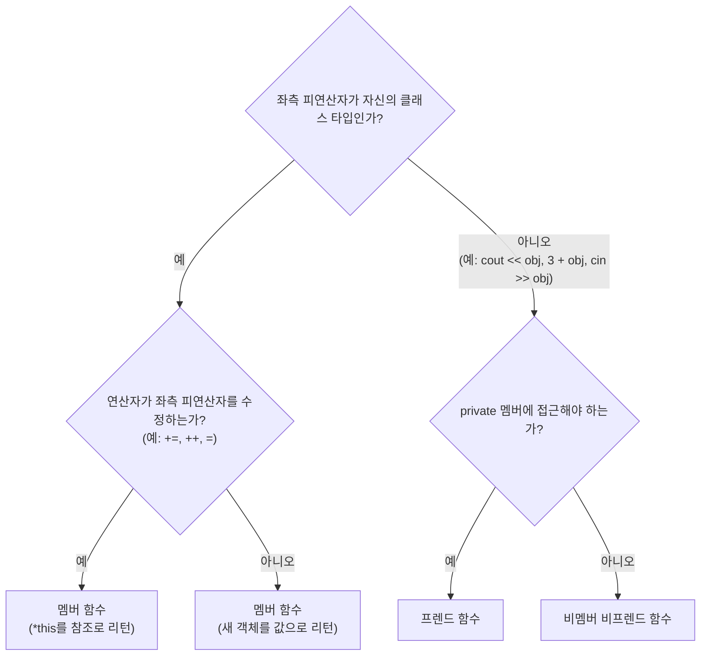

# 7장 — 프렌드 함수와 연산자 중복

[레포지토리 안내](../../README.ko.md) | [English](Concepts_Lecture.md) | [한국어](Concepts_Lecture.ko.md)

> **최종 수정일:** 2026-11-19
>
> 명품 C++ Programming, 황기태, Ch 7

> **학습 목표:**
> 1. 프렌드 함수와 프렌드 클래스의 개념을 이해하고 선언할 수 있다
> 2. 연산자 중복의 개념과 제약을 설명할 수 있다
> 3. 연산자 함수를 멤버 함수와 프렌드 함수로 각각 작성할 수 있다
> 4. 이항 연산자와 단항 연산자를 중복하고 전위와 후위 연산자를 구분하여 작성할 수 있다
> 5. 스트림 연산자와 첨자 연산자를 중복할 수 있다
> 6. 연산자 함수의 리턴 타입과 매개변수 타입을 연산자의 의미에 맞게 정하고 대입 연산자를 작성할 수 있다

---

## 목차

- [1. 프렌드](#1-프렌드)
  - [1.1 프렌드 함수](#11-프렌드-함수)
  - [1.2 프렌드 클래스](#12-프렌드-클래스)
  - [1.3 프렌드 선언의 세 가지 형태](#13-프렌드-선언의-세-가지-형태)
  - [1.4 사용 지침](#14-사용-지침)
- [2. 연산자 중복의 기초](#2-연산자-중복의-기초)
  - [2.1 연산자 중복이 필요한 이유](#21-연산자-중복이-필요한-이유)
  - [2.2 개념](#22-개념)
  - [2.3 중복 가능 / 불가능 연산자](#23-중복-가능--불가능-연산자)
  - [2.4 멤버 함수 vs 프렌드 함수: 판단 가이드](#24-멤버-함수-vs-프렌드-함수-판단-가이드)
  - [2.5 연산자 함수의 리턴 타입과 매개변수 타입](#25-연산자-함수의-리턴-타입과-매개변수-타입)
  - [2.6 중복하면 성질이 바뀌는 연산자](#26-중복하면-성질이-바뀌는-연산자)
- [3. 이항 연산자 중복](#3-이항-연산자-중복)
  - [3.1 멤버 함수로 구현](#31-멤버-함수로-구현)
  - [3.2 프렌드 함수로 구현](#32-프렌드-함수로-구현)
  - [3.3 복합 대입 연산자](#33-복합-대입-연산자)
  - [3.4 비교 연산자](#34-비교-연산자)
  - [3.5 Power 클래스의 이항 연산자](#35-power-클래스의-이항-연산자)
  - [3.6 프렌드 함수로 작성한 이항 연산자](#36-프렌드-함수로-작성한-이항-연산자)
  - [3.7 대입 연산자](#37-대입-연산자)
- [4. 단항 연산자 중복](#4-단항-연산자-중복)
  - [4.1 멤버 함수로 구현](#41-멤버-함수로-구현)
  - [4.2 프렌드 함수로 구현](#42-프렌드-함수로-구현)
  - [4.3 증가 / 감소 연산자](#43-증가--감소-연산자)
  - [4.4 전위 vs 후위: 상세 추적](#44-전위-vs-후위-상세-추적)
  - [4.5 Power 클래스의 전위와 후위 증가 연산자](#45-power-클래스의-전위와-후위-증가-연산자)
- [5. 스트림 연산자 중복](#5-스트림-연산자-중복)
  - [5.1 `operator<<`](#51-operator)
  - [5.2 `operator>>`](#52-operator)
  - [5.3 참조를 리턴하는 `<<` 연산자](#53-참조를-리턴하는--연산자)
- [6. 첨자 연산자](#6-첨자-연산자)
- [7. 완전한 실행 가능 예제](#7-완전한-실행-가능-예제)
  - [7.1 완전한 Vector2D 클래스](#71-완전한-vector2d-클래스)
- [8. 흔한 실수](#8-흔한-실수)
  - [8.1 후위에서 `(int)` 더미 매개변수를 빠뜨림](#81-후위에서-int-더미-매개변수를-빠뜨림)
  - [8.2 참조로 리턴해야 할 때 값으로 리턴](#82-참조로-리턴해야-할-때-값으로-리턴)
  - [8.3 복합 대입 연산자에서 `*this` 리턴을 잊음](#83-복합-대입-연산자에서-this-리턴을-잊음)
  - [8.4 중복할 수 없는 연산자를 중복하려고 시도](#84-중복할-수-없는-연산자를-중복하려고-시도)
  - [8.5 operator<<를 프렌드가 아닌 멤버 함수로 만듦](#85-operator를-프렌드가-아닌-멤버-함수로-만듦)
  - [8.6 스트림 연산자에서 `ostream`을 값으로 받거나 리턴함](#86-스트림-연산자에서-ostream을-값으로-받거나-리턴함)
  - [8.7 산술 연산자가 피연산자를 바꿈](#87-산술-연산자가-피연산자를-바꿈)
- [요약](#요약)
- [점검 문제](#점검-문제)

---

<br>

## 1. 프렌드

### 1.1 프렌드 함수

**프렌드 함수**는 클래스의 `private` 및 `protected` 멤버에 접근할 수 있도록 허용된 **비멤버 함수**이다. 클래스 내부에서 `friend` 키워드로 선언하지만, 멤버 함수는 **아니다**.

클래스의 멤버로 선언하기에는 어울리지 않지만 클래스의 모든 멤버에 자유롭게 접근해야 하는 외부 함수가 있을 때 그 함수를 프렌드로 선언한다.

```cpp
class Box {
    int width;
public:
    Box(int w) : width(w) {}
    friend void printWidth(const Box &b);   // 프렌드 선언
};

// 정의: 멤버 함수가 아님 (Box:: 범위 지정 없음)
void printWidth(const Box &b) {
    cout << b.width << endl;   // private 멤버에 직접 접근
}
```

| 특성 | 설명 |
|:----|:----|
| 클래스 내부에 `friend`로 선언 | private/protected 멤버 접근 권한 부여 |
| 클래스 외부에서 정의할 때 `ClassName::` 범위 지정을 붙이지 않음 | 멤버 함수가 아니기 때문이며, 클래스 안에서 바로 정의할 수도 있음 |
| `this` 포인터 없음 | 객체를 매개변수로 전달받아야 함 |
| `public` / `private` / `protected` 섹션에 영향받지 않음 | `friend` 선언은 클래스 어디에든 위치 가능 |

*표 1. 프렌드 함수의 특성*

> **핵심:** 프렌드 함수는 private 멤버에 접근할 수 있지만, 클래스의 멤버가 아니다. 객체를 통해 점(`.`) 연산자로 호출할 수 없다.

### 1.2 프렌드 클래스

**클래스 전체**가 다른 클래스의 private 멤버에 접근해야 할 때, **프렌드 클래스**로 선언할 수 있다.

```cpp
class Engine {
    int horsepower;
public:
    Engine(int hp) : horsepower(hp) {}
    friend class Car;   // Car가 Engine의 private 멤버에 접근 가능
};

class Car {
public:
    void showHP(const Engine &e) {
        cout << e.horsepower << endl;   // OK: Car는 Engine의 프렌드
    }
};
```

| 규칙 | 설명 |
|:----|:----|
| 클래스 `A` 안에 `friend class B;` | `B`의 모든 멤버 함수가 `A`의 private/protected 멤버에 접근 가능 |
| 프렌드 관계는 **대칭이 아님** | `A`가 `B`를 프렌드로 선언해도 `B`가 `A`를 프렌드로 선언한 것은 아님 |
| 프렌드 관계는 **전이적이지 않음** | `A`→`B`, `B`→`C`라고 해서 `A`→`C`가 되지 않음 |

*표 2. 프렌드 클래스의 규칙*

### 1.3 프렌드 선언의 세 가지 형태

프렌드로 선언할 수 있는 대상은 전역 함수, 다른 클래스의 특정 멤버 함수, 다른 클래스 전체의 세 가지이다.

| 형태 | `Rect` 클래스 안의 선언 | 접근 권한을 얻는 함수 |
|:----|:----|:----|
| 전역 함수 | `friend bool equals(Rect r, Rect s);` | 외부 함수 `equals()` |
| 다른 클래스의 멤버 함수 | `friend bool RectManager::equals(Rect r, Rect s);` | `RectManager`의 `equals()`만 |
| 다른 클래스 전체 | `friend RectManager;` 또는 `friend class RectManager;` | `RectManager`의 모든 멤버 함수 |

*표 3. 프렌드 선언의 세 가지 형태*

다음은 다른 클래스의 멤버 함수를 프렌드로 선언하는 예이다. `RectManager`의 선언이 `Rect`보다 앞에 오므로, `RectManager::equals()`의 매개변수에 쓰인 `Rect`를 컴파일러가 알 수 있도록 `class Rect;`로 **전방 선언(forward declaration)** 을 둔다. 전방 선언이 없으면 아직 선언되지 않은 이름을 참조하는 컴파일 오류가 발생한다.

```cpp
#include <iostream>
using namespace std;

class Rect;   // 전방 선언: RectManager가 Rect를 먼저 참조하기 때문

class RectManager {
public:
    bool equals(Rect r, Rect s);
};

class Rect {
    int width, height;
public:
    Rect(int width, int height) { this->width = width; this->height = height; }
    friend bool RectManager::equals(Rect r, Rect s);   // 다른 클래스의 멤버 함수를 프렌드로 선언
};

bool RectManager::equals(Rect r, Rect s) {
    return r.width == s.width && r.height == s.height;   // Rect의 private 멤버에 접근
}

int main() {
    Rect a(3, 4), b(3, 4);
    RectManager man;
    if (man.equals(a, b)) cout << "equal" << endl;
    else cout << "not equal" << endl;
}
```

두 사각형의 너비와 높이가 같으므로 실행 결과는 다음과 같다.

```text
equal
```

### 1.4 사용 지침

- `friend`는 **불가피한 경우에만** 사용한다. 캡슐화를 깨뜨려 외부 코드에 private 멤버를 노출하기 때문이다.
- 좌측 피연산자가 자신의 클래스 타입이 아닌 연산자를 중복하면서 private 멤버에 접근해야 할 때 **필수적**이다(예: `ostream& operator<<`).
- 가능하면 멤버 함수를 우선하고, 멤버 함수로 불충분할 때만 `friend`를 사용한다.

---

<br>

## 2. 연산자 중복의 기초

### 2.1 연산자 중복이 필요한 이유

연산자 중복이 없으면, 사용자 정의 타입의 연산에 명시적 메서드 호출이 필요하다. 두 접근 방식을 비교하면 다음과 같다.

```cpp
// 연산자 중복 없이: 장황하고 읽기 어려움
Vector2D a(1, 2), b(3, 4), c(5, 6);
Vector2D result = a.add(b).subtract(c);          // 무엇을 계산하는지 알기 어려움
if (result.equals(Vector2D(-1, 0)))
    cout << result.toString() << endl;

// 연산자 중복 사용: 자연스럽고 수학처럼 읽힘
Vector2D a(1, 2), b(3, 4), c(5, 6);
Vector2D result = a + b - c;                     // 명확: (1+3-5, 2+4-6)
if (result == Vector2D(-1, 0))
    cout << result << endl;
```

연산자 중복은 C++을 사용자 정의 타입에 대해 **표현력 있게** 만드는 핵심 기능이다. 클래스의 객체가 기본 타입처럼 동작하게 하여 코드를 더 읽기 쉽고 직관적으로 만든다.

| 중복 없이 | 중복 사용 | 장점 |
|:---------|:---------|:----|
| `a.add(b)` | `a + b` | 수학처럼 읽힘 |
| `a.equals(b)` | `a == b` | 익숙한 구문 |
| `a.multiply(b)` | `a * b` | 시각적 잡음 감소 |
| `cout << a.toString()` | `cout << a` | 스트림과 자연스럽게 통합 |
| `a.addAssign(b)` | `a += b` | 연쇄 호출이 자연스럽게 동작 |

*표 4. 연산자 중복 전후의 표현 비교*

### 2.2 개념

**연산자 중복(Operator Overloading)** 은 사용자 정의 타입(클래스)에 대해 C++ 연산자의 의미를 재정의하는 것이다. `operator` 키워드 뒤에 연산자 기호를 붙여 사용한다.

```cpp
Vector2D operator+(const Vector2D &rhs);   // Vector2D에 대해 + 연산자 중복
```

연산자 함수(operator function)의 일반 형식은 `리턴타입 operator연산자(매개변수리스트);`이며, 연산자 함수를 구현하는 방법은 두 가지이다.

1. 클래스의 멤버 함수로 구현한다.
2. 외부 함수로 구현하고, private 멤버에 접근해야 하면 클래스에 프렌드로 선언한다.

컴파일러는 연산자를 쓴 식을 연산자 함수 호출로 바꾸어 처리한다. 멤버 함수이면 좌측 피연산자 객체의 멤버 함수를 호출하고, 외부 함수이면 피연산자를 모두 인자로 넘긴다.

| 식 | 멤버 함수일 때의 변환 | 외부(프렌드) 함수일 때의 변환 |
|:----|:----|:----|
| `a + b` | `a.operator+(b)` | `operator+(a, b)` |
| `a == b` | `a.operator==(b)` | `operator==(a, b)` |
| `a += b` | `a.operator+=(b)` | `operator+=(a, b)` |
| `2 + a` | 변환 불가 (`int`에는 멤버 함수를 추가할 수 없음) | `operator+(2, a)` |
| `!a`, `++a` | `a.operator!()`, `a.operator++()` | `operator!(a)`, `operator++(a)` |
| `a++` | `a.operator++(0)` | `operator++(a, 0)` |

*표 5. 연산자 식의 연산자 함수 호출 변환*

**제한사항:**

| 제한 | 설명 |
|:----|:----|
| 새로운 연산자를 만들 수 없음 | `operator@`나 `operator$` 등은 불가 |
| **우선순위** 변경 불가 | `*`가 `+`보다 우선하는 것은 그대로 유지 |
| **결합 방향** 변경 불가 | 좌→우 또는 우→좌 결합 방향 그대로 유지 |
| **항(arity)** 변경 불가 | 이항 연산자는 이항으로, 단항 연산자는 단항으로 유지 |
| 피연산자 중 하나는 사용자 정의 타입이어야 함 | `int + int`는 중복할 수 없음 |

*표 6. 연산자 중복의 제한사항*

### 2.3 중복 가능 / 불가능 연산자

| 분류 | 연산자 |
|:----|:------|
| 중복 **가능** | `+` `-` `*` `/` `%` `==` `!=` `<` `>` `<=` `>=` `<<` `>>` `[]` `()` `~` `!` `&` `\|` `^` `++` `--` `+=` `-=` `*=` `/=` `%=` `=` `->` `new` `delete` ... |
| 중복 **불가** | `::` (범위 지정), `.` (멤버 접근), `.*` (멤버 포인터), `?:` (삼항), `sizeof`, `typeid` |

*표 7. 중복할 수 있는 연산자와 중복할 수 없는 연산자*

### 2.4 멤버 함수 vs 프렌드 함수: 판단 가이드

| 관점 | 멤버 함수 | 프렌드 함수 |
|:----|:---------|:----------|
| 좌측 피연산자 | 암묵적으로 `*this` | 명시적으로 첫 번째 매개변수 |
| 우측 피연산자 | 매개변수 | 두 번째 매개변수 |
| private 접근 | 가능 (멤버이므로) | 가능 (friend로 선언) |
| 사용 시점 | 좌측 피연산자가 **자신의 클래스** 타입일 때 (예: `obj + 3`) | 좌측 피연산자가 **자신의 클래스가 아닐** 때 (예: `3 + obj`, `cout << obj`) |

*표 8. 멤버 함수와 프렌드 함수로 구현한 연산자 함수의 비교*

```cpp
// 멤버: 좌측 피연산자가 *this
Vector2D Vector2D::operator+(const Vector2D &rhs);

// 프렌드: 양쪽 피연산자 모두 매개변수
friend Vector2D operator+(const Vector2D &lhs, const Vector2D &rhs);
```

> **핵심:** 좌측 피연산자가 기본 타입이거나 수정할 수 없는 클래스(예: `ostream`)인 경우, **반드시** 프렌드(또는 자유) 함수를 사용해야 한다.

**판단 순서도:**



*그림 1. 연산자 함수의 구현 방식을 고르는 순서도*

**빠른 참조 표:**

| 표현식 | 좌측 피연산자 | 권장 방식 | 이유 |
|:------|:-----------|:---------|:----|
| `obj + obj2` | 자신의 클래스 | 멤버 함수 | 좌측 피연산자가 `*this` |
| `obj += obj2` | 자신의 클래스 | 멤버 함수 | `*this`를 수정하고 리턴 |
| `3 + obj` | `int` (자신의 클래스 아님) | 프렌드 함수 | `int`에 멤버 함수를 추가할 수 없음 |
| `cout << obj` | `ostream` (자신의 클래스 아님) | 프렌드 함수 | `ostream`에 멤버 함수를 추가할 수 없음 |
| `cin >> obj` | `istream` (자신의 클래스 아님) | 프렌드 함수 | `istream`에 멤버 함수를 추가할 수 없음 |
| `++obj` / `obj++` | 자신의 클래스 | 멤버 함수 | 피연산자가 `*this` |
| `obj[i]` | 자신의 클래스 | 멤버 함수 (필수) | `operator[]`는 반드시 멤버여야 함 |
| `obj = obj2` | 자신의 클래스 | 멤버 함수 (필수) | `operator=`는 반드시 멤버여야 함 |

*표 9. 표현식별로 권장하는 연산자 함수의 구현 방식*

### 2.5 연산자 함수의 리턴 타입과 매개변수 타입

연산자 함수의 리턴 타입은 그 연산자가 기본 타입에서 내는 결과를 흉내 내도록 정한다. `int` 변수 `a`, `b`에서 `a + b`는 새 값을 만들고 `a`와 `b`를 바꾸지 않는다. `a += b`는 `a` 자신을 바꾸고, 그 결과인 `a`를 다시 식에 쓸 수 있다(`(a += b) += 1`). `++a`의 결과는 바뀐 `a` 자신이고, `a++`의 결과는 바뀌기 전의 값이며, `a == b`의 결과는 참이나 거짓이다. 연산자 함수가 이 성질을 따르면 클래스의 객체를 기본 타입과 같은 방식으로 쓸 수 있다.

| 식 | 기본 타입에서의 결과 | 멤버 함수의 전형적인 원형 | 리턴 타입을 정하는 이유 |
|:----|:----|:----|:----|
| `a + b` | 새 값 | `T operator+(const T &b) const` | 결과가 새 객체이므로 값으로 리턴 |
| `a += b` | 바뀐 `a` 자신 | `T& operator+=(const T &b)` | 왼쪽 피연산자 자신을 참조로 리턴 |
| `a = b` | 바뀐 `a` 자신 | `T& operator=(const T &b)` | `a = b = c`의 연쇄를 위해 참조로 리턴 |
| `++a` | 바뀐 `a` 자신 | `T& operator++()` | 수정된 객체 자신을 참조로 리턴 |
| `a++` | 바뀌기 전의 값 | `T operator++(int)` | 이전 상태는 객체 안에 남지 않으므로 복사본을 값으로 리턴 |
| `a == b` | 참 또는 거짓 | `bool operator==(const T &b) const` | 조건식에 쓰도록 `bool` 리턴 |
| `a[i]` | 원소 자체 | `E& operator[](int i)` | `a[i] = x`처럼 대입할 수 있도록 참조로 리턴 |
| `cout << a` | `cout` 자신 | `ostream& operator<<(ostream &os, const T &a)` (비멤버) | `cout << a << b`의 연쇄를 위해 스트림의 참조 리턴 |

*표 10. 연산자별 연산자 함수의 리턴 타입*

매개변수 타입에도 두 가지 선택이 있다. 이 장의 `Power` 예제처럼 `Power op2`로 받으면 호출할 때마다 오른쪽 피연산자가 복사되지만, 함수 안에서 `op2`를 바꾸어도 원본에는 영향이 없다. `const Power &op2`로 받으면 복사가 없고, 5장 3.5절에서 본 것처럼 `a + Power(1, 1)` 같은 임시 객체도 받을 수 있다. 피연산자를 바꾸지 않는 연산자 함수는 멤버 함수 원형 끝에 `const`를 붙여, `const` 객체에 대해서도 그 연산자를 쓸 수 있게 한다.

멤버 함수와 비멤버 함수는 피연산자의 형 변환에서도 다르다. 멤버 함수 `a.operator+(b)`에서 왼쪽 피연산자는 이미 그 클래스의 객체여야 하며 형 변환되지 않는다. 오른쪽 피연산자만 생성자를 통해 그 클래스로 변환될 수 있다. 비멤버 함수 `operator+(a, b)`에서는 두 피연산자가 모두 보통 매개변수이므로 둘 다 변환될 수 있다. 이 차이는 3.6절의 `2 + a`와 `a + 2`에서 구체적으로 드러난다.

### 2.6 중복하면 성질이 바뀌는 연산자

표 7에서 `&&`, `||`, `,`(쉼표)는 중복할 수 있는 연산자이지만, 중복하면 기본 타입에서 가지던 중요한 성질 하나를 잃는다. `bool`의 `&&`는 왼쪽 피연산자가 거짓이면 결과가 이미 거짓으로 정해지므로 오른쪽 피연산자를 평가하지 않는다. 이를 **단락 평가(short-circuit evaluation)** 라고 한다. 중복한 `&&`는 연산자 함수의 호출 `operator&&(a, b)`이고, 함수를 호출하려면 인자를 모두 먼저 계산해야 하므로 단락 평가가 일어나지 않는다.

```cpp
#include <iostream>
using namespace std;

class Flag {
    bool value;
public:
    Flag(bool v) : value(v) { }
    bool get() const { return value; }
};

bool operator&&(const Flag &a, const Flag &b) {      // && 중복
    return a.get() && b.get();
}

Flag check(const char *name, bool v) {
    cout << name << " 평가" << endl;
    return Flag(v);
}

bool checkBool(const char *name, bool v) {
    cout << name << " 평가" << endl;
    return v;
}

int main() {
    cout << "[bool의 &&]" << endl;
    bool r1 = checkBool("왼쪽", false) && checkBool("오른쪽", true);
    cout << "결과 " << r1 << endl;
    cout << "[중복한 &&]" << endl;
    bool r2 = check("왼쪽", false) && check("오른쪽", true);
    cout << "결과 " << r2 << endl;
    return 0;
}
```

```text
[bool의 &&]
왼쪽 평가
결과 0
[중복한 &&]
왼쪽 평가
오른쪽 평가
결과 0
```

`bool`끼리의 `&&`에서는 왼쪽이 `false`이므로 "오른쪽 평가"가 출력되지 않는다. 같은 조건을 `Flag`의 `&&`로 쓰면 두 `check()`가 모두 호출되어 "오른쪽 평가"까지 출력된다. 결과값은 같아도 평가 과정이 다르므로, 오른쪽 피연산자에 부수 효과가 있거나 `p != nullptr && p->get()`처럼 왼쪽이 거짓일 때 오른쪽을 평가하면 안 되는 코드는 중복한 `&&`에서 의도대로 동작하지 않는다.

C와 C++의 `&&`, `||`가 단락 평가를 한다는 성질은 프로그래머가 늘 기대하는 것이므로, 클래스에 논리 연산이 필요하면 `&&`, `||`를 중복하기보다 `bool`로 바꾸는 멤버 함수(위의 `get()`)를 두고 `a.get() && b.get()`처럼 기본 타입의 `&&`를 쓰는 편이 안전하다. 쉼표 연산자도 같은 이유로 중복하지 않는다.

---

<br>

## 3. 이항 연산자 중복

### 3.1 멤버 함수로 구현

좌측 피연산자가 `*this`이고, 우측 피연산자가 매개변수이다. 산술 연산자는 결과를 **값으로** 리턴한다.

```cpp
class Vector2D {
    int x, y;
public:
    Vector2D(int x = 0, int y = 0) : x(x), y(y) {}

    Vector2D operator+(const Vector2D &rhs) const {
        return Vector2D(x + rhs.x, y + rhs.y);
    }
};

// 사용
Vector2D a(1, 2), b(3, 4);
Vector2D c = a + b;   // a.operator+(b) 호출  →  (4, 6)
```

### 3.2 프렌드 함수로 구현

양쪽 피연산자 모두 명시적 매개변수이다. 좌측 피연산자가 클래스 타입이 아닐 때 유용하다.

```cpp
class Color {
    int r, g, b;
public:
    Color(int r = 0, int g = 0, int b = 0) : r(r), g(g), b(b) {}

    // 좌측 피연산자가 int이므로 프렌드 필요
    friend Color operator+(int lhs, const Color &rhs) {
        return Color(lhs + rhs.r, lhs + rhs.g, lhs + rhs.b);
    }
};

// 사용
Color sky(100, 150, 200);
Color c = 50 + sky;   // operator+(50, sky) 호출  →  (150, 200, 250)
```

### 3.3 복합 대입 연산자

복합 대입 연산자(`+=`, `-=`, `*=`)는 좌측 피연산자를 수정하고 `*this`를 **참조로** 리턴한다.

```cpp
class Vector2D {
    int x, y;
public:
    Vector2D(int x = 0, int y = 0) : x(x), y(y) {}

    Vector2D& operator*=(int scalar) {
        x *= scalar;
        y *= scalar;
        return *this;   // 참조로 반환
    }
};

// 사용
Vector2D v(3, 4);
v *= 2;   // v가 (6, 8)이 됨
```

| 리턴 타입 | 이유 |
|:---------|:----|
| `ClassName&` (참조) | 객체가 제자리에서 수정되고, `*this`를 참조로 리턴하므로 `c = a += b`나 `(a += b) += c` 같은 연쇄가 의도대로 동작함 |

*표 11. 복합 대입 연산자의 리턴 타입*

### 3.4 비교 연산자

비교 연산자는 `bool`을 리턴한다. 보통 `const` 멤버 함수로 작성한다.

```cpp
class Vector2D {
    int x, y;
public:
    Vector2D(int x = 0, int y = 0) : x(x), y(y) {}

    bool operator==(const Vector2D &rhs) const {
        return x == rhs.x && y == rhs.y;
    }
};

// 사용
Vector2D v1(3, 4), v2(3, 4);
if (v1 == v2)   // 참: 두 성분이 모두 일치
    cout << "같음" << endl;
```

### 3.5 Power 클래스의 이항 연산자

발차기(`kick`)와 주먹(`punch`)의 힘을 가진 `Power` 클래스로 이항 연산자 네 개를 멤버 함수로 작성하면 다음과 같다. 두 `Power` 객체를 더하는 `+`, `Power` 객체에 정수를 더하는 `+`, 두 객체를 비교하는 `==`, 왼쪽 객체에 오른쪽 객체를 더하는 `+=`이다.

```cpp
#include <iostream>
using namespace std;

class Power {
    int kick;
    int punch;
public:
    Power(int kick = 0, int punch = 0) { this->kick = kick; this->punch = punch; }
    void show() { cout << "kick=" << kick << ',' << "punch=" << punch << endl; }
    Power operator+(Power op2);      // a + b
    Power operator+(int op2);        // a + 2
    bool operator==(Power op2);      // a == b
    Power &operator+=(Power op2);    // a += b
};

Power Power::operator+(Power op2) {
    Power tmp;                       // 결과를 담을 임시 객체
    tmp.kick = this->kick + op2.kick;
    tmp.punch = this->punch + op2.punch;
    return tmp;                      // 피연산자는 바뀌지 않는다
}
Power Power::operator+(int op2) {
    Power tmp;
    tmp.kick = kick + op2;
    tmp.punch = punch + op2;
    return tmp;
}
bool Power::operator==(Power op2) {
    return kick == op2.kick && punch == op2.punch;
}
Power &Power::operator+=(Power op2) {
    kick = kick + op2.kick;          // 왼쪽 피연산자 자신을 바꾼다
    punch = punch + op2.punch;
    return *this;                    // 자신의 참조 리턴
}

int main() {
    Power a(3, 5), b(4, 6), c;
    c = a + b;                       // c = a.operator+(b)
    c.show();
    c = a + 2;                       // c = a.operator+(2)
    c.show();
    cout << (a == b ? "같다" : "다르다") << endl;   // a.operator==(b)
    c = a += b;                      // c = a.operator+=(b)
    a.show();
    c.show();
    return 0;
}
```

```text
kick=7,punch=11
kick=5,punch=7
다르다
kick=7,punch=11
kick=7,punch=11
```

- **`c = a + b;`** 컴파일러는 이 식을 `c = a.operator+(b);`로 바꾼다. `operator+()`는 `a`의 멤버 함수로 실행되므로 `this`는 `a`를 가리키고, 오른쪽 피연산자 `b`는 매개변수 `op2`에 복사된다. 함수는 지역 객체 `tmp`에 두 객체의 합 (3 + 4, 5 + 6) = (7, 11)을 만들어 값으로 리턴하고, 그 결과가 `c`에 대입된다. `a`와 `b`는 그대로이다.
- **`c = a + 2;`** 오른쪽 피연산자가 `int`이므로 두 `operator+()` 중 매개변수가 `int`인 함수가 정확한 일치로 선택된다(6장의 함수 중복 해석). 결과는 (3 + 2, 5 + 2) = (5, 7)이다.
- **`a == b`** 는 `a.operator==(b)`가 되어 `bool`을 리턴하므로 조건 연산자나 `if`의 조건에 그대로 쓸 수 있다. (3, 5)와 (4, 6)은 다르므로 "다르다"가 출력된다.
- **`c = a += b;`** 대입 연산자는 오른쪽부터 결합하므로 먼저 `a.operator+=(b)`가 실행되어 `a`가 (7, 11)이 된다. 이 함수는 `*this`, 곧 `a` 자신의 참조를 리턴하므로 바깥의 `c = ...`는 바뀐 `a`의 내용을 `c`에 복사한다. 그래서 `a`와 `c`가 모두 (7, 11)이다.

`+`의 결과는 새 객체이므로 `tmp`를 값으로 리턴하고, `+=`의 결과는 왼쪽 피연산자 자신이므로 참조로 리턴한다. `+`에서 `tmp`의 참조를 리턴하면, `tmp`는 함수가 끝날 때 소멸하는 지역 객체이므로 5장 5.1절의 댕글링 참조가 된다.

### 3.6 프렌드 함수로 작성한 이항 연산자

`2 + a`처럼 왼쪽 피연산자가 `int`이면 컴파일러는 이 식을 `2.operator+(a)`로 바꿀 수 없다. `int`는 클래스가 아니어서 멤버 함수를 추가할 수 없기 때문이다. 이때 컴파일러는 `operator+(2, a)`라는 외부 함수 호출을 찾으므로, 연산자 함수를 외부 함수로 작성하고 `Power`의 private 멤버에 접근할 수 있도록 프렌드로 선언한다.

```cpp
#include <iostream>
using namespace std;

class Power {
    int kick;
    int punch;
public:
    Power(int kick = 0, int punch = 0) { this->kick = kick; this->punch = punch; }
    void show() { cout << "kick=" << kick << ',' << "punch=" << punch << endl; }
    friend Power operator+(int op1, Power op2);     // 2 + a
    friend Power operator+(Power op1, Power op2);   // a + b
};

Power operator+(int op1, Power op2) {    // 외부 함수: Power:: 를 붙이지 않는다
    Power tmp;
    tmp.kick = op1 + op2.kick;           // 프렌드이므로 private 멤버에 접근할 수 있다
    tmp.punch = op1 + op2.punch;
    return tmp;
}
Power operator+(Power op1, Power op2) {
    Power tmp;
    tmp.kick = op1.kick + op2.kick;
    tmp.punch = op1.punch + op2.punch;
    return tmp;
}

int main() {
    Power a(3, 5), b(4, 6), c;
    c = 2 + a;      // c = operator+(2, a)
    c.show();
    c = a + b;      // c = operator+(a, b)
    c.show();
    c = a + 2;      // 2가 Power(2)로 변환되어 operator+(a, Power(2))
    c.show();
    return 0;
}
```

```text
kick=5,punch=7
kick=7,punch=11
kick=5,punch=5
```

- 외부 함수로 구현한 연산자 함수는 피연산자를 모두 매개변수로 받는다. `2 + a`에서 `op1`은 2, `op2`는 `a`의 복사본이다. 멤버 함수가 아니므로 함수 정의에 `Power::`를 붙이지 않으며, 함수 안에 `this`도 없다.
- `a + b`를 프렌드 함수로 구현해도 결과는 3.5절의 멤버 함수와 같은 (7, 11)이다. 다만 같은 식을 처리하는 멤버 함수와 외부 함수를 함께 두면 컴파일러가 둘 중 하나를 고를 수 없어 모호한 호출 오류가 되므로, 한 연산에는 한 가지 방식만 둔다.
- `a + 2`의 결과 (5, 5)는 3.5절의 결과 (5, 7)과 다르다. 이 프로그램에는 `operator+(Power, int)`가 없으므로, 컴파일러는 디폴트 매개변수를 가진 생성자 `Power(int kick = 0, int punch = 0)`으로 2를 `Power(2, 0)`으로 변환한 뒤 `operator+(Power, Power)`를 호출한다. 2.5절에서 본 것처럼 비멤버 함수의 매개변수는 두 피연산자 모두 이렇게 변환될 수 있다.

> **주의:** 생성자를 통한 묵시적 변환은 컴파일 오류 없이 의도와 다른 계산을 만들 수 있다. 위의 `a + 2`는 "두 힘에 2씩 더한다"가 아니라 "kick에만 2를 더한다"로 계산되었다. 정수와의 연산에 다른 의미가 필요하면 `operator+(Power, int)`를 따로 작성하고, 이런 변환을 막으려면 생성자 앞에 `explicit`을 붙여 묵시적 변환에 쓰이지 않게 한다.

### 3.7 대입 연산자

대입 연산자 `=`도 이항 연산자이지만 다른 이항 연산자와 다른 규칙을 가진다.

- **반드시 멤버 함수이다.** `operator=`는 non-static 멤버 함수로만 중복할 수 있다. 표 9의 마지막 행이 이 규칙이다.
- **컴파일러가 만들어 준다.** 클래스가 같은 클래스 타입을 받는 대입 연산자를 선언하지 않으면, 컴파일러가 멤버 단위로 대입하는 디폴트 복사 대입 연산자를 만든다. `Power`처럼 기본 타입 멤버만 가진 클래스는 이것으로 충분하고, 포인터 멤버로 자원을 가진 클래스는 5장 4.8절처럼 깊은 복사를 하는 대입 연산자를 직접 작성해야 한다.
- **다른 타입을 받는 대입 연산자를 추가할 수 있다.** 오른쪽 피연산자가 `int`인 대입 연산자를 작성해도 컴파일러가 만드는 복사 대입 연산자는 그대로 남는다.
- **참조를 리턴한다.** 대입은 오른쪽부터 결합하므로 `b = a = 9;`는 `b.operator=(a.operator=(9))`가 된다. 안쪽 호출이 `a`의 참조를 리턴해야 바깥 호출이 그 객체를 인자로 받는다.

```cpp
#include <iostream>
using namespace std;

class Power {
    int kick;
    int punch;
public:
    Power(int kick = 0, int punch = 0) { this->kick = kick; this->punch = punch; }
    void show() { cout << "kick=" << kick << ',' << "punch=" << punch << endl; }
    Power &operator=(int n) {       // 정수를 대입하는 대입 연산자
        kick = n;
        punch = n;
        return *this;
    }
};

int main() {
    Power a(3, 5), b;
    a = 7;                          // a.operator=(7)
    a.show();
    b = a = 9;                      // b.operator=(a.operator=(9)): 바깥은 복사 대입
    a.show();
    b.show();
    return 0;
}
```

```text
kick=7,punch=7
kick=9,punch=9
kick=9,punch=9
```

`a = 7;`은 직접 작성한 `operator=(int)`를 호출한다. `b = a = 9;`에서 안쪽의 `a = 9`는 같은 함수를 호출하여 `a`를 (9, 9)로 만들고 `a`의 참조를 리턴한다. 바깥의 `b = (a의 참조)`는 오른쪽이 `Power`이므로 컴파일러가 만든 복사 대입 연산자를 호출한다.

C++은 `+`와 `=`를 중복해도 `+=`를 자동으로 만들지 않는다. `a += b`를 쓰려면 3.5절처럼 `operator+=`를 따로 작성해야 한다. 또 `Power b = 9;`는 대입이 아니라 초기화이므로 `operator=`가 아니라 생성자 `Power(9)`가 호출된다(5장 4.8절의 판별 기준).

---

<br>

## 4. 단항 연산자 중복

### 4.1 멤버 함수로 구현

단항 연산자를 멤버 함수로 구현할 때 매개변수는 **없으며**, `*this`가 피연산자이다.

```cpp
class Vector2D {
    int x, y;
public:
    Vector2D(int x = 0, int y = 0) : x(x), y(y) {}

    // ~ 는 수직 벡터를 반환 (원본을 수정하지 않음)
    Vector2D operator~() const {
        return Vector2D(-y, x);
    }
};

// 사용
Vector2D v(3, 4);
Vector2D perp = ~v;   // perp = (-4, 3),  v는 변하지 않음
```

논리 부정 연산자 `!`도 같은 방식으로 중복한다. 다음 `Power` 클래스의 `!a`는 `kick`과 `punch`가 모두 0이면 `true`, 아니면 `false`를 리턴한다.

```cpp
class Power {
    int kick, punch;
public:
    Power(int kick = 0, int punch = 0) { this->kick = kick; this->punch = punch; }

    bool operator!() const {   // 매개변수 없음: *this가 피연산자
        return kick == 0 && punch == 0;
    }
};

// 사용
Power a(0, 0), b(5, 5);
if (!a) cout << "a의 파워가 0이다." << endl;   // 출력됨
if (!b) cout << "b의 파워가 0이다." << endl;   // 출력되지 않음
```

### 4.2 프렌드 함수로 구현

프렌드로 구현할 때는 피연산자가 명시적 매개변수이다.

```cpp
class Color {
    int r, g, b;
public:
    Color(int r = 0, int g = 0, int b = 0) : r(r), g(g), b(b) {}

    // ~ 는 반전 색상을 반환
    friend Color operator~(const Color &obj) {
        return Color(255 - obj.r, 255 - obj.g, 255 - obj.b);
    }
};

// 사용
Color red(255, 0, 0);
Color c = ~red;   // c = (0, 255, 255) (시안),  red는 변하지 않음
```

### 4.3 증가 / 감소 연산자

C++은 더미 `int` 매개변수로 **전위**와 **후위** 형태를 구분한다.

```cpp
class Vector2D {
    int x, y;
public:
    Vector2D(int x = 0, int y = 0) : x(x), y(y) {}

    // 전위 --obj: 수정한 후, 수정된 객체를 참조로 반환
    Vector2D& operator--() {
        x--;
        y--;
        return *this;
    }

    // 후위 obj++: 원본을 저장하고, 수정한 후, 저장한 복사본을 값으로 반환
    Vector2D operator++(int) {   // int는 더미 매개변수
        Vector2D old = *this;
        x++;
        y++;
        return old;
    }
};
```

| 형태 | 시그니처 (멤버) | 리턴 | 동작 |
|:----|:-------------|:----|:----|
| 전위 `++obj` / `--obj` | `ClassName& operator++()` | 수정된 객체의 참조 | 먼저 수정, 그 후 리턴 |
| 후위 `obj++` / `obj--` | `ClassName operator++(int)` | 원본(수정 전)의 복사본 | 복사본 저장, 수정, 복사본 리턴 |

*표 12. 전위와 후위 증가, 감소 연산자의 형태*

> **핵심:** 후위 버전의 `int` 매개변수는 **더미**이며 실제로 사용되지 않는다. 컴파일러는 후위 연산 `a++`를 `a.operator++(0)`처럼 의미 없는 정수를 넘겨 호출하며, 이 매개변수의 유일한 목적은 컴파일러가 전위와 후위를 구분할 수 있게 하는 것이다.

**프렌드 함수로 구현:**

```cpp
class Color {
    int r, g, b;
public:
    Color(int r = 0, int g = 0, int b = 0) : r(r), g(g), b(b) {}

    // 전위 ++obj
    friend Color& operator++(Color &obj) {
        obj.r++;
        obj.g++;
        obj.b++;
        return obj;
    }

    // 후위 obj--
    friend Color operator--(Color &obj, int) {
        Color old = obj;
        obj.r--;
        obj.g--;
        obj.b--;
        return old;
    }
};
```

프렌드로 구현할 때는 피연산자를 참조 매개변수(`Color &obj`)로 받아야 원본 객체가 수정된다. 값으로 받으면 함수 안의 복사본만 바뀐다.

### 4.4 전위 vs 후위: 상세 추적

전위와 후위의 차이를 정확히 이해하는 것이 중요하다. 먼저 기본 타입 `int`로 동작을 추적하면 다음과 같다.

```text
 표현식               단계별 설명                        결과
-------------       ----------------------------    -----------
int x = 5;          x가 5로 초기화                      x=5
int a = ++x;        x가 6이 되고, 그 후 a에 값 대입       x=6, a=6
int b = x++;        b에 값(6) 대입, 그 후 x가 7이 됨      x=7, b=6
int c = --x;        x가 6이 되고, 그 후 c에 값 대입       x=6, c=6
int d = x--;        d에 값(6) 대입, 그 후 x가 5가 됨      x=5, d=6
```

*그림 2. `int` 변수에 대한 전위와 후위 연산의 단계별 추적*

**핵심 규칙:**
- **전위** (`++x`): **먼저** 증가시키고, **새로운** 값을 사용한다.
- **후위** (`x++`): **이전** 값을 사용하고, 그 후 증가시킨다.

다음은 같은 동작을 클래스로 구현한 것이다. 구현의 각 단계가 위의 동작을 그대로 반영한다.

```cpp
class Counter {
    int value;
public:
    Counter(int v = 0) : value(v) {}
    int getValue() const { return value; }

    // 전위 ++obj: 먼저 수정, 수정된 객체를 참조로 반환
    Counter& operator++() {
        value++;            // 단계 1: 수정
        return *this;       // 단계 2: 수정된 객체 반환
    }

    // 후위 obj++: 이전 상태 저장, 수정, 이전 상태를 값으로 반환
    Counter operator++(int) {
        Counter old = *this;  // 단계 1: 이전 상태 저장
        value++;              // 단계 2: 수정
        return old;           // 단계 3: 이전 상태(복사본) 반환
    }
};
```

클래스의 추적은 다음과 같다.

```text
 코드                      value (이전)    리턴값          value (이후)
---------------------    ------------   ------   -----------------------
Counter x(5);                 -          -                  5
Counter a = ++x;              5          6        6 (먼저 수정, 새 값 리턴)
Counter b = x++;              6          6       7 (이전 값 리턴, 그 후 수정)
```

*그림 3. `Counter` 객체에 대한 전위와 후위 연산의 추적*

> **참고:** **전위는 참조로, 후위는 값으로 리턴하는 이유.**
> - 전위는 **실제 수정된 객체**를 리턴한다. 객체가 여전히 존재하므로 참조가 안전하고 효율적이다.
> - 후위는 **이전 상태**를 리턴해야 하지만, 이전 상태는 객체 안에 더 이상 존재하지 않으므로 임시 복사본(값으로 리턴)이어야 한다.

### 4.5 Power 클래스의 전위와 후위 증가 연산자

`Power` 객체의 `++`는 `kick`과 `punch`를 1씩 늘린다. 멤버 함수로 작성하면 전위 `++a`는 `a.operator++()`가 되고, 후위 `a++`는 `a.operator++(0)`이 된다. 후위 함수의 `int` 매개변수는 전위와 구별하기 위한 것이고 값을 쓰지 않으므로, 이름을 생략하고 타입만 써도 된다.

```cpp
#include <iostream>
using namespace std;

class Power {
    int kick;
    int punch;
public:
    Power(int kick = 0, int punch = 0) { this->kick = kick; this->punch = punch; }
    void show() { cout << "kick=" << kick << ',' << "punch=" << punch << endl; }
    Power &operator++();            // 전위 ++a
    Power operator++(int);          // 후위 a++
};

Power &Power::operator++() {
    kick++;
    punch++;
    return *this;                   // 변경된 객체 자신(a)의 참조 리턴
}
Power Power::operator++(int) {
    Power tmp = *this;              // 증가 이전의 객체 상태 저장
    kick++;
    punch++;
    return tmp;                     // 증가 이전의 상태 리턴
}

int main() {
    Power a(3, 5), b;
    b = ++a;                        // b = a.operator++()
    a.show(); b.show();
    b = a++;                        // b = a.operator++(0)
    a.show(); b.show();
    return 0;
}
```

```text
kick=4,punch=6
kick=4,punch=6
kick=5,punch=7
kick=4,punch=6
```

| 실행한 문장 | 호출되는 함수 | 실행 뒤 `a` | 실행 뒤 `b` |
|:----|:----|:----|:----|
| `Power a(3, 5), b;` | 생성자 | (3, 5) | (0, 0) |
| `b = ++a;` | `a.operator++()` | (4, 6) | (4, 6) |
| `b = a++;` | `a.operator++(0)` | (5, 7) | (4, 6) |

*표 13. 전위와 후위 증가 연산자를 실행할 때 a와 b의 값*

전위 함수는 `a`를 먼저 바꾸고 바뀐 `a` 자신을 리턴하므로 `b`가 (4, 6)이 된다. 후위 함수는 `*this`를 `tmp`에 복사해 두고 `a`를 바꾼 뒤 `tmp`를 리턴하므로, `a`는 (5, 7)이 되지만 `b`는 바뀌기 전의 (4, 6)을 받는다.

같은 연산자를 프렌드 함수로 작성하면 피연산자를 매개변수로 받는다. 컴파일러는 `++a`를 `operator++(a)`로, `a++`를 `operator++(a, 0)`으로 바꾼다.

```cpp
#include <iostream>
using namespace std;

class Power {
    int kick;
    int punch;
public:
    Power(int kick = 0, int punch = 0) { this->kick = kick; this->punch = punch; }
    void show() { cout << "kick=" << kick << ',' << "punch=" << punch << endl; }
    friend Power &operator++(Power &op);        // 전위 ++ 연산자 함수 프렌드 선언
    friend Power operator++(Power &op, int);    // 후위 ++ 연산자 함수 프렌드 선언
};

Power &operator++(Power &op) {      // 참조 매개변수: 원본 a를 바꾼다
    op.kick++;
    op.punch++;
    return op;                      // 연산 결과 리턴
}
Power operator++(Power &op, int) {
    Power tmp = op;                 // 변경하기 전의 op 상태 저장
    op.kick++;
    op.punch++;
    return tmp;                     // 변경 이전의 op 리턴
}

int main() {
    Power a(3, 5), b;
    b = ++a;                        // b = operator++(a)
    a.show(); b.show();
    b = a++;                        // b = operator++(a, 0)
    a.show(); b.show();
    return 0;
}
```

```text
kick=4,punch=6
kick=4,punch=6
kick=5,punch=7
kick=4,punch=6
```

출력은 멤버 함수 버전과 같다. 두 함수의 매개변수 `op`는 반드시 참조(`Power &op`)여야 한다. `Power op`로 받으면 `op`는 `a`의 복사본이므로 `op.kick++`가 복사본만 바꾸고 `a`는 그대로 남는다. 멤버 함수 버전에서는 `this`가 `a`를 가리키므로 이런 문제가 없다.

---

<br>

## 5. 스트림 연산자 중복

### 5.1 `operator<<`

삽입 연산자 `<<`는 좌측 피연산자가 `ostream`이므로 반드시 **프렌드**(또는 자유 함수)여야 한다.

```cpp
class Vector2D {
    int x, y;
public:
    Vector2D(int x = 0, int y = 0) : x(x), y(y) {}

    friend ostream& operator<<(ostream &out, const Vector2D &v) {
        out << "(" << v.x << ", " << v.y << ")";
        return out;   // 연쇄를 위해 out 반환
    }
};

// 사용
Vector2D v(3, 4);
cout << "값: " << v << endl;   // "값: (3, 4)" 출력
```

| 사항 | 설명 |
|:----|:----|
| 좌측 피연산자가 `ostream&` | 자신의 클래스의 멤버가 될 수 없음 |
| `ostream&` 리턴 | 연쇄 가능: `cout << a << b << c` |
| 두 번째 매개변수는 `const ClassName&` | 출력 시 객체를 수정하면 안 됨 |

*표 14. 스트림 삽입 연산자 함수의 형식*

> **참고:** **좌측 피연산자가 자신의 클래스인 `<<`.** `<<`가 반드시 비멤버여야 하는 것은 좌측 피연산자가 `ostream`인 스트림 출력의 경우이다. 좌측 피연산자가 자신의 클래스이면 `<<`도 멤버 함수로 중복할 수 있으며, `Power` 객체에 정수를 더하는 `<<`를 5.3절에서 다룬다.

### 5.2 `operator>>`

추출 연산자 `>>`는 같은 패턴을 따르되, `istream`을 사용하고 **비const** 참조를 받는다(객체를 수정하므로). 형식이 틀린 입력에서 실패를 알리는 방법과 `<<` 안에서 필드 폭이 적용되는 방식은 11장 6절에서 다룬다.

```cpp
class Vector2D {
    int x, y;
public:
    Vector2D(int x = 0, int y = 0) : x(x), y(y) {}

    friend istream& operator>>(istream &in, Vector2D &v) {
        in >> v.x >> v.y;   // "3 4" 형태의 입력을 기대
        return in;
    }
};

// 사용
Vector2D v;
cin >> v;   // 사용자가 "3 4" 입력
```

### 5.3 참조를 리턴하는 `<<` 연산자

`<<`의 왼쪽 피연산자가 `Power` 객체이면 `<<`를 `Power`의 멤버 함수로 작성할 수 있다. 다음 `<<`는 `Power` 객체의 `kick`과 `punch`에 정수를 더하고 객체 자신의 참조를 리턴한다.

```cpp
#include <iostream>
using namespace std;

class Power {
    int kick;
    int punch;
public:
    Power(int kick = 0, int punch = 0) { this->kick = kick; this->punch = punch; }
    void show() { cout << "kick=" << kick << ',' << "punch=" << punch << endl; }
    Power &operator<<(int n);       // 연산 후 Power 객체의 참조 리턴
};

Power &Power::operator<<(int n) {
    kick += n;
    punch += n;
    return *this;                   // 이 객체의 참조 리턴
}

int main() {
    Power a(1, 2);
    a << 3 << 5 << 6;               // ((a << 3) << 5) << 6
    a.show();
    return 0;
}
```

```text
kick=15,punch=16
```

`<<`는 왼쪽부터 결합하므로 `a << 3 << 5 << 6`은 `((a << 3) << 5) << 6`, 곧 `a.operator<<(3).operator<<(5).operator<<(6)`이다. 각 호출이 `a`의 참조를 리턴하므로 다음 호출도 `a`에 대해 실행된다.

| 단계 | 호출 | 호출 뒤 `a`의 (kick, punch) | 리턴값 |
|:----|:----|:----|:----|
| 0 | `Power a(1, 2);` | (1, 2) | 없음 |
| 1 | `a.operator<<(3)` | (4, 5) | `a`의 참조 |
| 2 | (1의 결과)`.operator<<(5)` | (9, 10) | `a`의 참조 |
| 3 | (2의 결과)`.operator<<(6)` | (15, 16) | `a`의 참조 |

*표 15. 연쇄된 << 연산을 실행할 때 a의 값*

리턴 타입을 `Power`(값)로 바꾸면 1단계의 리턴값이 `a`의 복사본이 되어, 2단계와 3단계는 그 임시 복사본에 더해진다. 이 연산자는 스트림 출력과 같은 기호를 쓰지만, 왼쪽 피연산자가 `ostream`이 아니라 `Power`이므로 5.1절의 스트림 연산자와는 다른 함수이다.

---

<br>

## 6. 첨자 연산자

`operator[]`는 객체를 배열처럼 접근할 수 있게 한다. 읽기와 쓰기 모두 가능하도록 **참조를** 리턴한다.

```cpp
class Date {
    int year, month, day;
public:
    Date(int y = 0, int m = 0, int d = 0) : year(y), month(m), day(d) {}

    int& operator[](int index) {
        switch (index) {
            case 0: return year;
            case 1: return month;
            case 2: return day;
            default: return year;   // 기본값
        }
    }
};

// 사용
Date d(2026, 3, 16);
d[0] = 2025;   // year를 2025로 설정
d[1] = 12;     // month를 12로 설정
d[2] = 25;     // day를 25로 설정
cout << d[0] << "-" << d[1] << "-" << d[2] << endl;   // 2025-12-25
```

| 사항 | 설명 |
|:----|:----|
| 리턴 타입이 `int&` (참조) | 읽기(`x = d[0]`)와 쓰기(`d[0] = 2025`) 모두 가능 |
| 반드시 **멤버 함수**여야 함 | `operator[]`는 프렌드/자유 함수가 될 수 없음 |
| 매개변수는 보통 `int` | 인덱스를 나타냄 |

*표 16. 첨자 연산자 함수의 형식*

첨자 연산자는 `const` 객체에 대해서도 쓸 수 있어야 한다. `const` 객체에는 `const` 멤버 함수만 호출할 수 있으므로, 읽기 전용인 `const` 버전을 함께 중복한다. 두 함수는 멤버 함수 끝의 `const`로 구별되며, 컴파일러는 객체가 `const`이면 `const` 버전을, 아니면 비`const` 버전을 고른다.

```cpp
#include <iostream>
using namespace std;

class IntArray {
    int data[3] = {10, 20, 30};
public:
    int &operator[](int i) { return data[i]; }               // 비const 객체용: 읽기와 쓰기
    const int &operator[](int i) const { return data[i]; }   // const 객체용: 읽기만
};

void print(const IntArray &arr) {        // arr는 const 참조
    for (int i = 0; i < 3; i++)
        cout << arr[i] << ' ';           // const 버전이 호출된다
    cout << endl;
    // arr[0] = 0;                       // 컴파일 오류: const int&에 대입할 수 없음
}

int main() {
    IntArray a;
    a[1] = 25;                           // 비const 버전이 호출된다
    print(a);
    return 0;
}
```

```text
10 25 30
```

`a[1] = 25;`의 `a`는 `const`가 아니므로 `int&`를 리턴하는 버전이 호출되어 `data[1]`이 25가 된다. `print()` 안의 `arr`는 `const` 참조이므로 `arr[i]`는 `const int&`를 리턴하는 버전을 호출한다. 주석을 풀어 `arr[0] = 0;`을 쓰면 Apple clang은 "cannot assign to return value because function 'operator[]' returns a const value"라는 오류를 낸다. `const` 버전이 없으면 `print()` 안의 `arr[i]`부터 컴파일되지 않는다. 두 버전 모두 첨자의 범위를 검사하지 않으므로, 범위 검사가 필요하면 함수 안에서 `i`가 0 이상 3 미만인지 확인한다.

---

<br>

## 7. 완전한 실행 가능 예제

### 7.1 완전한 Vector2D 클래스

`operator+`, `operator==`, `operator<<`가 함께 자연스럽게 동작하는 완전한 프로그램은 다음과 같다.

```cpp
#include <iostream>
using namespace std;

class Vector2D {
    int x, y;

public:
    Vector2D(int x = 0, int y = 0) : x(x), y(y) {}

    // 이항 +  (멤버: 좌측 피연산자가 *this)
    Vector2D operator+(const Vector2D &rhs) const {
        return Vector2D(x + rhs.x, y + rhs.y);
    }

    // 비교 ==  (멤버: const, bool 반환)
    bool operator==(const Vector2D &rhs) const {
        return x == rhs.x && y == rhs.y;
    }

    // 스트림 <<  (프렌드: 좌측 피연산자가 ostream이지 Vector2D가 아님)
    friend ostream& operator<<(ostream &out, const Vector2D &v) {
        out << "(" << v.x << ", " << v.y << ")";
        return out;
    }
};

int main() {
    Vector2D a(1, 2), b(3, 4);
    Vector2D c = a + b;                // (1+3, 2+4) = (4, 6)

    cout << a << " + " << b << " = " << c << endl;   // (1, 2) + (3, 4) = (4, 6)

    if (c == Vector2D(4, 6))
        cout << "같음!" << endl;       // 같음!

    Vector2D d = a + b + Vector2D(5, 4);
    cout << "(1,2) + (3,4) + (5,4) = " << d << endl;  // (1,2) + (3,4) + (5,4) = (9, 10)

    return 0;
}
```

**예상 출력:**

```text
(1, 2) + (3, 4) = (4, 6)
같음!
(1,2) + (3,4) + (5,4) = (9, 10)
```

---

<br>

## 8. 흔한 실수

### 8.1 후위에서 `(int)` 더미 매개변수를 빠뜨림

```cpp
// 잘못된 코드: 둘 다 전위가 된다!
Counter& operator++();       // 이것은 전위 ++obj
Counter operator++();        // 오류: 반환 타입만으로는 중복할 수 없음

// 올바른 코드: int 더미로 구분
Counter& operator++();       // 전위  ++obj
Counter operator++(int);     // 후위 obj++   (int가 더미 매개변수)
```

`int` 매개변수는 실제로 사용되지 않는다. 유일한 목적은 컴파일러가 전위와 후위를 구분할 수 있게 하는 것이다.

### 8.2 참조로 리턴해야 할 때 값으로 리턴

```cpp
// 잘못된 코드: 복합 대입에서 값으로 반환
Vector2D operator+=(const Vector2D &rhs) {   // Vector2D&이어야 함
    x += rhs.x;
    y += rhs.y;
    return *this;   // 복사본을 반환: (a += b) += c에서 두 번째 +=가 임시 객체에 적용됨
}

// 올바른 코드: 참조로 반환
Vector2D& operator+=(const Vector2D &rhs) {
    x += rhs.x;
    y += rhs.y;
    return *this;   // 실제 객체를 반환: 연쇄가 동작함
}
```

값으로 리턴해도 `a += b += c`는 `a += (b += c)`로 해석되므로 결과가 같다. 그러나 `(a += b) += c`에서는 두 번째 `+=`가 `a`가 아닌 임시 복사본을 수정하므로 `a`에 `c`가 더해지지 않는다.

`operator<<`와 `operator>>`도 마찬가지로 값이 아닌 `ostream&`과 `istream&`으로 리턴해야 한다. 스트림 객체는 복사할 수 없으므로 값으로 리턴하면 컴파일 오류가 발생한다.

### 8.3 복합 대입 연산자에서 `*this` 리턴을 잊음

```cpp
// 잘못된 코드: 객체를 수정하지만 반환을 잊음
void operator+=(const Vector2D &rhs) {   // void 반환: 연쇄 불가!
    x += rhs.x;
    y += rhs.y;
    // 빠짐: return *this;
}

// 올바른 코드:
Vector2D& operator+=(const Vector2D &rhs) {
    x += rhs.x;
    y += rhs.y;
    return *this;   // a += b += c 가능하게 함
}
```

### 8.4 중복할 수 없는 연산자를 중복하려고 시도

다음 연산자들은 중복할 수 **없다**.

| 연산자 | 이름 |
|:------|:----|
| `::` | 범위 지정 |
| `.` | 멤버 접근 |
| `.*` | 멤버 포인터 접근 |
| `?:` | 삼항 조건 |
| `sizeof` | 객체/타입 크기 |
| `typeid` | 런타임 타입 식별 |

*표 17. 중복할 수 없는 연산자*

이들 중 하나를 중복하려고 하면 컴파일러 오류가 발생한다.

### 8.5 operator<<를 프렌드가 아닌 멤버 함수로 만듦

```cpp
// 잘못된 코드: operator<<를 멤버 함수로 구현
class Vector2D {
    int x, y;
public:
    // 컴파일은 되지만 호출 구문이 거꾸로:
    //     vec << cout;     가 아니라     cout << vec;   이어야 함
    ostream& operator<<(ostream &out) {
        out << "(" << x << ", " << y << ")";
        return out;
    }
};
// 사용:  v << cout;  // 컴파일은 되지만 이상해 보임!

// 올바른 코드: operator<<를 프렌드 함수로 구현
class Vector2D {
    int x, y;
public:
    friend ostream& operator<<(ostream &out, const Vector2D &v) {
        out << "(" << v.x << ", " << v.y << ")";
        return out;
    }
};
// 사용:  cout << v;  // 자연스럽고 올바름!
```

> **핵심:** 스트림 출력에서 `<<`의 좌측 피연산자는 `ostream`이지 자신의 클래스가 아니다. `ostream`에 멤버 함수를 추가할 수 없으므로, 스트림 출력용 `operator<<`는 **반드시** 프렌드 또는 자유 함수여야 한다.

### 8.6 스트림 연산자에서 `ostream`을 값으로 받거나 리턴함

```cpp
#include <iostream>
using namespace std;

class Point {
    int x, y;
public:
    Point(int x = 0, int y = 0) : x(x), y(y) {}
    friend ostream operator<<(ostream os, const Point &p);   // 잘못: ostream을 값으로 받고 값으로 리턴
};

ostream operator<<(ostream os, const Point &p) {
    os << "(" << p.x << ", " << p.y << ")";
    return os;
}

int main() {
    Point p(1, 2);
    cout << p << endl;
}
```

```text
osbad.cpp:13:12: error: calling a protected constructor of class 'std::ostream'
osbad.cpp:18:5: error: call to deleted constructor of 'ostream' (aka 'basic_ostream<char>')
```

`ostream` 객체는 복사할 수 없다. `cout`을 값 매개변수 `os`에 넘기려면 `cout`을 복사해야 하는데 `ostream`의 복사 생성자는 삭제되어 있으므로 18번 줄이 오류가 된다. `os`를 값으로 리턴하는 13번 줄도 리턴값으로 쓸 `ostream` 객체를 새로 만들어야 하는데, 그 생성자는 외부에서 호출할 수 없는 protected 멤버이므로 오류가 된다. 스트림은 언제나 `ostream &`로 받고 `ostream &`로 리턴한다. 그래야 함수 안의 출력이 실제 `cout`에 일어나고 `cout << p << endl`의 연쇄가 같은 스트림에 이어진다.

### 8.7 산술 연산자가 피연산자를 바꿈

```cpp
#include <iostream>
using namespace std;

class Power {
    int kick;
public:
    Power(int k = 0) : kick(k) {}
    int get() const { return kick; }
    Power operator+(const Power &op2) {   // 잘못: 왼쪽 피연산자 자신을 바꾼다
        kick += op2.kick;
        return *this;
    }
};

int main() {
    Power a(3), b(4);
    Power c = a + b;
    cout << a.get() << " " << b.get() << " " << c.get() << endl;
}
```

```text
7 4 7
```

이 `operator+`는 컴파일되고 `c`도 올바른 합 7을 갖지만, `a`까지 7로 바뀐다. 기본 타입의 `a + b`는 `a`를 바꾸지 않으므로 이 연산자는 사용하는 사람의 예상을 어긴다. `+`는 3.5절처럼 새 객체 `tmp`에 결과를 만들어 리턴하고, 왼쪽 피연산자를 바꾸는 동작은 `+=`에 맡긴다. 함수 원형 끝에 `const`를 붙여 `Power operator+(const Power &op2) const`로 선언하면, 함수 안에서 `kick += op2.kick;`처럼 멤버를 바꾸는 문장이 컴파일 오류가 되어 이런 실수를 막을 수 있다.

---

<br>

## 요약

| 개념 | 핵심 요약 |
|:----|:---------|
| 연산자 중복이 필요한 이유 | `a.add(b)`를 `a + b`로 쓸 수 있게 하여 사용자 정의 타입을 기본 타입처럼 자연스럽게 사용하게 한다. |
| 프렌드 함수 | 클래스 안에 `friend`로 선언되어 private/protected 멤버에 접근할 수 있는 비멤버 함수이다. |
| 프렌드 클래스 | `friend class B;`는 B의 모든 멤버 함수에 접근을 허용하며, 프렌드 관계는 대칭이 아니고 전이되지도 않는다. |
| 프렌드 선언의 세 가지 형태 | 전역 함수, 다른 클래스의 특정 멤버 함수, 다른 클래스 전체를 프렌드로 선언할 수 있으며, 아직 선언되지 않은 클래스를 참조하려면 전방 선언을 둔다. |
| 프렌드 사용 지침 | 캡슐화를 깨뜨리므로 불가피할 때만 쓰며, 좌측 피연산자가 자신의 클래스가 아닌 일부 연산자 중복에는 필수적이다. |
| 연산자 중복 개념 | `operator` 키워드로 사용자 정의 타입에 대한 연산자를 재정의하며, 새 연산자를 만들거나 우선순위, 결합 방향, 항의 개수를 바꿀 수 없다. |
| 연산자 함수 호출 변환 | `a + b`는 멤버 함수이면 `a.operator+(b)`, 외부 함수이면 `operator+(a, b)`로 바뀌고, `2 + a`는 외부 함수로만 구현할 수 있다. |
| 중복 불가 연산자 | `::`, `.`, `.*`, `?:`, `sizeof`, `typeid`는 중복할 수 없다. |
| 멤버 vs 프렌드 판단 | 좌측 피연산자가 자신의 클래스이면 멤버 함수로, 아니면 비멤버 함수로 작성하고, 비멤버 함수가 private 멤버에 접근해야 하면 프렌드로 선언한다. |
| 이항 연산자 (멤버) | `ReturnType operator+(const ClassName &rhs)` 형식이며 `*this`가 좌측 피연산자이다. |
| 이항 연산자 (프렌드) | `friend ReturnType operator+(const ClassName &lhs, const ClassName &rhs)` 형식이며 두 피연산자가 모두 매개변수이다. |
| 복합 대입 (`+=`, `*=`) | `*this`를 수정하고 `*this`를 참조로 리턴한다. |
| 비교 (`==`, `!=`, `<=`) | `bool`을 리턴하며 보통 `const` 멤버 함수로 작성한다. |
| 단항 연산자 (멤버) | `ReturnType operator~()`처럼 매개변수가 없으며 `*this`가 피연산자이고, `!`도 같은 방식으로 중복한다. |
| 단항 연산자 (프렌드) | `friend ReturnType operator~(const ClassName &obj)`처럼 피연산자가 매개변수이며, 피연산자를 수정하려면 참조로 받는다. |
| 전위 `++`/`--` | `operator++()`는 먼저 수정한 뒤 수정된 객체를 참조로 리턴한다. |
| 후위 `++`/`--` | `operator++(int)`는 복사본을 저장하고 수정한 뒤 복사본을 값으로 리턴하며, `int`는 구분용 더미이다. |
| 전위 vs 후위 추적 | `int x=5; int a=++x;`이면 x=6, a=6이고, 이어서 `int b=x++;`이면 x=7, b=6이다. |
| `operator<<` | 스트림 출력용은 `friend ostream& operator<<(ostream &out, const ClassName &obj)` 형식의 비멤버 함수이며, 연쇄를 위해 `out`을 리턴한다. |
| `operator>>` | `friend istream& operator>>(istream &in, ClassName &obj)` 형식이며 객체를 수정하므로 비const 참조를 받는다. |
| `operator[]` | `int& operator[](int index)`처럼 읽기와 쓰기를 위해 참조를 리턴하며 반드시 멤버 함수여야 한다. |
| 흔한 실수: 후위 더미 | `operator++()`는 전위이고 `operator++(int)`가 후위이며, `int` 더미로 둘을 구분한다. |
| 흔한 실수: 리턴 타입 | 복합 대입과 스트림 연산자는 값이 아닌 참조로 리턴해야 한다. |
| 흔한 실수: `*this` | 복합 대입 연산자는 `return *this;`로 연쇄를 가능하게 해야 한다. |
| 흔한 실수: `<<`를 멤버로 | 스트림 출력용 `operator<<`를 멤버로 만들면 구문이 `obj << cout`으로 뒤집히므로 비멤버(보통 프렌드)로 작성한다. |
| 연산자 함수의 리턴 타입 | 새 값을 만드는 `+`, 후위 `++`는 값으로, 왼쪽 피연산자 자신을 결과로 하는 `+=`, `=`, 전위 `++`, `[]`는 참조로, `==`는 `bool`로, 스트림 `<<`는 스트림의 참조로 리턴한다. |
| 멤버와 비멤버의 형 변환 | 멤버 연산자 함수는 오른쪽 피연산자만 생성자로 변환할 수 있고, 비멤버 연산자 함수는 두 피연산자를 모두 변환할 수 있다. |
| 묵시적 변환의 위험 | 매개변수 하나로 호출할 수 있는 생성자는 `a + 2`의 2를 객체로 바꾸어 의도와 다른 계산을 만들 수 있으며, `explicit`으로 막는다. |
| 대입 연산자 | `operator=`는 멤버 함수여야 하고 참조를 리턴하며, 다른 타입을 받는 대입 연산자를 추가해도 컴파일러가 만드는 복사 대입 연산자는 남는다. |
| const 첨자 연산자 | `const` 객체를 위해 `const E& operator[](int) const`를 비`const` 버전과 함께 중복한다. |
| 참조를 리턴하는 멤버 `<<` | `Power& operator<<(int)`처럼 자신의 참조를 리턴하면 `a << 3 << 5 << 6`이 모두 `a`에 적용된다. |
| 중복하면 성질이 바뀌는 연산자 | 중복한 `&&`, `||`는 함수 호출이므로 두 피연산자를 모두 평가하여 단락 평가를 잃으며, 보통 중복하지 않는다. |

---

<br>

## 점검 문제

1. **프렌드 관계:** 클래스 `A`가 `friend class B;`를 선언하고, 클래스 `B`가 `friend class C;`를 선언했다. (1) `B`의 멤버 함수는 `A`의 private 멤버에 접근할 수 있는가? (2) `A`의 멤버 함수는 `B`의 private 멤버에 접근할 수 있는가? (3) `C`의 멤버 함수는 `A`의 private 멤버에 접근할 수 있는가?

   <details>
   <summary>정답</summary>

   (1) 접근할 수 있다. `A`가 `B`를 프렌드로 선언했기 때문이다. (2) 접근할 수 없다. 프렌드 관계는 대칭이 아니므로 `B`가 `A`를 프렌드로 선언하지 않는 한 `A`는 `B`의 private 멤버에 접근할 수 없다. (3) 접근할 수 없다. 프렌드 관계는 전이되지 않으므로 `C`가 `B`의 프렌드라고 해서 `A`의 프렌드가 되지는 않는다.

   </details>

2. **멤버와 비멤버의 선택:** `kick`과 `punch`를 private 멤버로 가진 `Power` 클래스에서 `b = 2 + a;`를 지원하려면 연산자 함수를 어떤 형태로 작성해야 하는가? 컴파일러가 이 식을 어떤 함수 호출로 바꾸는지 함께 쓰라.

   <details>
   <summary>정답</summary>

   좌측 피연산자 `2`가 `int`이므로 `2.operator+(a)` 같은 멤버 함수 호출로 바꿀 수 없다. 컴파일러는 이 식을 `operator+(2, a)`로 바꾸므로 외부 함수 `Power operator+(int op1, Power op2)`를 작성해야 한다. 이 함수는 private 멤버 `kick`과 `punch`에 접근해야 하므로 `Power` 클래스 안에 `friend Power operator+(int op1, Power op2);`로 선언한다.

   </details>

3. **전위와 후위 추적:** 4.4절의 `Counter` 클래스로 `Counter x(5); Counter a = x++; Counter b = ++x;`를 실행한 뒤 `x`, `a`, `b`의 `value`를 쓰라.

   <details>
   <summary>정답</summary>

   `x`는 7, `a`는 5, `b`는 7이다. `x++`는 증가 전의 상태(5)를 복사해 리턴하므로 `a`는 5가 되고 `x`는 6이 된다. 이어서 `++x`는 `x`를 7로 먼저 증가시킨 뒤 수정된 `x`를 리턴하므로 `b`는 7이 된다.

   </details>

4. **참조 리턴과 연쇄:** 5.3절의 `Power& Power::operator<<(int n)`의 리턴 타입을 `Power`(값)로 바꾸면 `Power a(1, 2); a << 3 << 5 << 6;`을 실행한 뒤 `a`의 kick과 punch는 얼마가 되는가? 그 이유를 쓰라.

   <details>
   <summary>정답</summary>

   kick은 4, punch는 5가 된다. 식은 `((a << 3) << 5) << 6`으로 해석된다. 첫 번째 `a << 3`은 `a` 자신을 수정해 (4, 5)로 만들지만 그 복사본을 리턴하므로, 이어지는 `<< 5`와 `<< 6`은 `a`가 아닌 임시 복사본에 더해진다. 참조를 리턴하면 세 번의 `<<`가 모두 `a`에 적용되어 kick=15, punch=16이 된다.

   </details>

5. **중복 규칙:** 다음 연산자 중 중복할 수 없는 것과 반드시 멤버 함수로 중복해야 하는 것을 각각 고르라: `+`, `::`, `[]`, `<<`, `?:`, `=`, `sizeof`.

   <details>
   <summary>정답</summary>

   중복할 수 없는 연산자는 `::`, `?:`, `sizeof`이다. 반드시 멤버 함수로 중복해야 하는 연산자는 `[]`와 `=`이다. `+`와 `<<`는 멤버 함수와 비멤버 함수 중 어느 쪽으로도 중복할 수 있으며, 좌측 피연산자의 타입에 따라 고른다.

   </details>

6. **묵시적 변환:** 3.6절의 프로그램에서 `Power a(3, 5);`일 때 `a + 2`의 결과가 (5, 5)인 이유를 컴파일러가 바꾼 함수 호출로 설명하라. 3.5절처럼 멤버 함수 `Power operator+(int op2)`를 추가하면 결과는 어떻게 되는가?

   <details>
   <summary>정답</summary>

   3.6절의 프로그램에는 `Power`와 `int`를 받는 연산자 함수가 없으므로, 컴파일러는 생성자 `Power(int kick = 0, int punch = 0)`으로 2를 `Power(2, 0)`으로 바꾸어 `operator+(a, Power(2, 0))`을 호출한다. 그래서 kick만 2가 더해져 (5, 5)가 된다. `Power operator+(int op2)`를 추가하면 `a + 2`는 형 변환이 필요 없는 정확한 일치인 `a.operator+(2)`를 호출하므로, 두 값에 2씩 더한 (5, 7)이 된다.

   </details>

7. **전위와 후위:** 4.5절의 멤버 함수 버전 `Power`로 `Power a(1, 1), b, c; b = a++; c = ++a;`를 실행한 뒤 `a`, `b`, `c`의 (kick, punch)를 쓰라.

   <details>
   <summary>정답</summary>

   `a`는 (3, 3), `b`는 (1, 1), `c`는 (3, 3)이다. `b = a++;`에서 후위 함수가 증가 전의 (1, 1)을 복사해 리턴하므로 `b`는 (1, 1)이고 `a`는 (2, 2)가 된다. `c = ++a;`에서 전위 함수가 `a`를 (3, 3)으로 바꾼 뒤 `a` 자신을 리턴하므로 `c`는 (3, 3)이다.

   </details>

8. **대입 연산자의 판별:** 3.7절의 `Power`에서 다음 세 문장은 각각 어떤 함수를 호출하는가? `Power x = 5;`, `x = 5;`, `Power y; y = x;`

   <details>
   <summary>정답</summary>

   `Power x = 5;`는 `x`를 이 문장에서 만드는 초기화이므로 생성자 `Power(5)`가 호출되어 `x`는 (5, 0)이 된다. `x = 5;`는 이미 존재하는 `x`에 정수를 대입하므로 직접 작성한 `operator=(int)`가 호출되어 `x`는 (5, 5)가 된다. `y = x;`는 오른쪽이 `Power` 객체인 대입이므로 컴파일러가 만든 복사 대입 연산자가 호출된다.

   </details>

9. **단락 평가:** 2.6절의 `Flag`로 `check("A", true) && check("B", false)`를 실행하면 출력되는 줄은 무엇인가? `checkBool()`로 바꾸면 어떻게 되는가?

   <details>
   <summary>정답</summary>

   `Flag` 버전은 "A 평가"와 "B 평가"가 모두 출력되고 결과는 거짓이다. 중복한 `&&`는 두 인자를 모두 계산한 뒤 호출되기 때문이다. `checkBool()` 버전도 왼쪽이 참이어서 오른쪽을 평가해야 결과를 알 수 있으므로 두 줄이 모두 출력된다. 단락 평가가 차이를 만드는 것은 왼쪽이 거짓일 때(`||`는 참일 때)뿐이다.

   </details>
