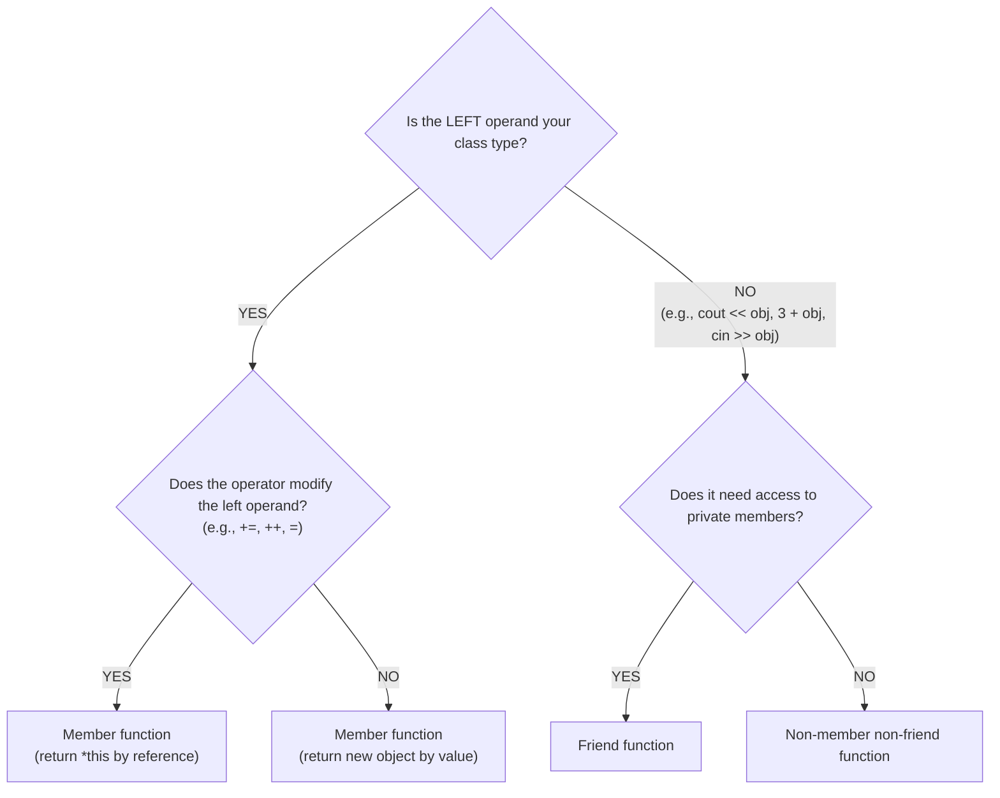

# Chapter 7 — Friend Functions and Operator Overloads

[Repository Guide](../../README.md) | [English](Concepts_Lecture.md) | [한국어](Concepts_Lecture.ko.md)

> **Last Updated:** 2026-11-19
>
> 명품 C++ Programming, 황기태, Ch 7

> **Learning Objectives:**
> 1. Understand friend functions and friend classes and declare them
> 2. Explain the concept and restrictions of operator overloading
> 3. Write operator functions both as member functions and as friend functions
> 4. Overload binary and unary operators, distinguishing prefix from postfix forms
> 5. Overload the stream operators and the subscript operator
> 6. Choose the return and parameter types of operator functions to match the meaning of each operator, and write assignment operators

---

## Table of Contents

- [1. Friend](#1-friend)
  - [1.1 Friend Function](#11-friend-function)
  - [1.2 Friend Class](#12-friend-class)
  - [1.3 Three Forms of Friend Declaration](#13-three-forms-of-friend-declaration)
  - [1.4 Guidelines](#14-guidelines)
- [2. Operator Overloading Basics](#2-operator-overloading-basics)
  - [2.1 The Need for Operator Overloading](#21-the-need-for-operator-overloading)
  - [2.2 Concept](#22-concept)
  - [2.3 Operators That Can / Cannot Be Overloaded](#23-operators-that-can--cannot-be-overloaded)
  - [2.4 Member Function vs Friend Function: Decision Guide](#24-member-function-vs-friend-function-decision-guide)
  - [2.5 Return Types and Parameter Types of Operator Functions](#25-return-types-and-parameter-types-of-operator-functions)
  - [2.6 Operators Whose Properties Change When Overloaded](#26-operators-whose-properties-change-when-overloaded)
- [3. Binary Operator Overloading](#3-binary-operator-overloading)
  - [3.1 As Member Function](#31-as-member-function)
  - [3.2 As Friend Function](#32-as-friend-function)
  - [3.3 Compound Assignment](#33-compound-assignment)
  - [3.4 Comparison Operators](#34-comparison-operators)
  - [3.5 Binary Operators of the Power Class](#35-binary-operators-of-the-power-class)
  - [3.6 Binary Operators Written as Friend Functions](#36-binary-operators-written-as-friend-functions)
  - [3.7 Assignment Operator](#37-assignment-operator)
- [4. Unary Operator Overloading](#4-unary-operator-overloading)
  - [4.1 As Member Function](#41-as-member-function)
  - [4.2 As Friend Function](#42-as-friend-function)
  - [4.3 Increment / Decrement](#43-increment--decrement)
  - [4.4 Prefix vs Postfix: Detailed Trace](#44-prefix-vs-postfix-detailed-trace)
  - [4.5 Prefix and Postfix Increment Operators of the Power Class](#45-prefix-and-postfix-increment-operators-of-the-power-class)
- [5. Stream Operator Overloading](#5-stream-operator-overloading)
  - [5.1 `operator<<`](#51-operator)
  - [5.2 `operator>>`](#52-operator)
  - [5.3 A `<<` Operator That Returns a Reference](#53-a--operator-that-returns-a-reference)
- [6. Subscript Operator](#6-subscript-operator)
- [7. Complete Runnable Examples](#7-complete-runnable-examples)
  - [7.1 Complete Vector2D Class](#71-complete-vector2d-class)
- [8. Common Mistakes](#8-common-mistakes)
  - [8.1 Forgetting the `(int)` Dummy Parameter for Postfix](#81-forgetting-the-int-dummy-parameter-for-postfix)
  - [8.2 Returning by Value When a Reference Should Be Returned](#82-returning-by-value-when-a-reference-should-be-returned)
  - [8.3 Forgetting to Return `*this` in Compound Assignment Operators](#83-forgetting-to-return-this-in-compound-assignment-operators)
  - [8.4 Trying to Overload Operators That Cannot Be Overloaded](#84-trying-to-overload-operators-that-cannot-be-overloaded)
  - [8.5 Making operator<< a Member Function Instead of a Friend](#85-making-operator-a-member-function-instead-of-a-friend)
  - [8.6 Taking or Returning `ostream` by Value in a Stream Operator](#86-taking-or-returning-ostream-by-value-in-a-stream-operator)
  - [8.7 An Arithmetic Operator That Changes Its Operand](#87-an-arithmetic-operator-that-changes-its-operand)
- [Summary](#summary)
- [Self-Check Questions](#self-check-questions)

---

<br>

## 1. Friend

### 1.1 Friend Function

A **friend function** is a non-member function that is granted access to the `private` and `protected` members of a class. It is declared inside the class with the `friend` keyword, but it is **not** a member function.

A function is declared as a friend when it does not fit as a member of the class but still needs free access to all of the class's members.

```cpp
class Box {
    int width;
public:
    Box(int w) : width(w) {}
    friend void printWidth(const Box &b);   // friend declaration
};

// Definition: NOT a member function (no Box:: scope)
void printWidth(const Box &b) {
    cout << b.width << endl;   // direct access to private member
}
```

| Property | Detail |
|:---------|:-------|
| Declared with `friend` inside the class | Grants access to private/protected members |
| When defined **outside** the class, no `ClassName::` scope is written | It is NOT a member function; it can also be defined directly inside the class |
| No `this` pointer | Must receive the object as a parameter |
| Not affected by `public` / `private` / `protected` sections | The `friend` declaration can appear anywhere in the class |

*Table 1. Properties of a friend function*

> **Key Point:** A friend function can access private members, but it is not a member of the class. It cannot be called through an object using the dot operator.

### 1.2 Friend Class

When an **entire class** needs access to another class's private members, you can declare it as a **friend class**.

```cpp
class Engine {
    int horsepower;
public:
    Engine(int hp) : horsepower(hp) {}
    friend class Car;   // Car can access Engine's private members
};

class Car {
public:
    void showHP(const Engine &e) {
        cout << e.horsepower << endl;   // OK: Car is a friend of Engine
    }
};
```

| Rule | Detail |
|:-----|:-------|
| `friend class B;` inside class `A` | All member functions of `B` can access `A`'s private/protected members |
| Friendship is **not symmetric** | `A` friends `B` does NOT mean `B` friends `A` |
| Friendship is **not transitive** | `A` friends `B`, `B` friends `C` does NOT mean `A` friends `C` |

*Table 2. Rules of friend classes*

### 1.3 Three Forms of Friend Declaration

Three kinds of targets can be declared as friends: a global function, a specific member function of another class, and an entire other class.

| Form | Declaration inside class `Rect` | Functions that gain access |
|:-----|:-----|:-----|
| Global function | `friend bool equals(Rect r, Rect s);` | The external function `equals()` |
| Member function of another class | `friend bool RectManager::equals(Rect r, Rect s);` | Only `equals()` of `RectManager` |
| Entire other class | `friend RectManager;` or `friend class RectManager;` | All member functions of `RectManager` |

*Table 3. Three forms of friend declaration*

The following example declares a member function of another class as a friend. Because `RectManager` is declared before `Rect`, a **forward declaration** `class Rect;` is placed first so that the compiler knows the name `Rect` used in the parameters of `RectManager::equals()`. Without the forward declaration, the code fails to compile because it refers to a name that has not been declared yet.

```cpp
#include <iostream>
using namespace std;

class Rect;   // forward declaration: RectManager refers to Rect first

class RectManager {
public:
    bool equals(Rect r, Rect s);
};

class Rect {
    int width, height;
public:
    Rect(int width, int height) { this->width = width; this->height = height; }
    friend bool RectManager::equals(Rect r, Rect s);   // member function of another class as friend
};

bool RectManager::equals(Rect r, Rect s) {
    return r.width == s.width && r.height == s.height;   // accesses Rect's private members
}

int main() {
    Rect a(3, 4), b(3, 4);
    RectManager man;
    if (man.equals(a, b)) cout << "equal" << endl;
    else cout << "not equal" << endl;
}
```

Since the two rectangles have the same width and height, the output is as follows.

```text
equal
```

### 1.4 Guidelines

- Use `friend` **sparingly**, because it breaks encapsulation by exposing private members to external code.
- It is **necessary** when an operator whose left operand is not your class type must access private members (e.g., `ostream& operator<<`).
- Prefer member functions when possible; use `friend` only when member functions are insufficient.

---

<br>

## 2. Operator Overloading Basics

### 2.1 The Need for Operator Overloading

Without operator overloading, operations on user-defined types require explicit method calls. The two approaches compare as follows.

```cpp
// WITHOUT operator overloading: verbose, hard to read
Vector2D a(1, 2), b(3, 4), c(5, 6);
Vector2D result = a.add(b).subtract(c);          // What does this compute?
if (result.equals(Vector2D(-1, 0)))
    cout << result.toString() << endl;

// WITH operator overloading: natural, reads like math
Vector2D a(1, 2), b(3, 4), c(5, 6);
Vector2D result = a + b - c;                     // Obviously: (1+3-5, 2+4-6)
if (result == Vector2D(-1, 0))
    cout << result << endl;
```

Operator overloading is what makes C++ **expressive** for user-defined types. It lets objects of your classes behave like built-in types, making code more readable and intuitive.

| Without overloading | With overloading | Benefit |
|:--------------------|:-----------------|:--------|
| `a.add(b)` | `a + b` | Reads like math |
| `a.equals(b)` | `a == b` | Familiar syntax |
| `a.multiply(b)` | `a * b` | Less visual clutter |
| `cout << a.toString()` | `cout << a` | Seamless stream integration |
| `a.addAssign(b)` | `a += b` | Chaining works naturally |

*Table 4. Expressions with and without operator overloading*

### 2.2 Concept

**Operator overloading** lets you redefine the meaning of C++ operators for user-defined types (classes). You use the `operator` keyword followed by the operator symbol.

```cpp
Vector2D operator+(const Vector2D &rhs);   // overloads + for Vector2D
```

The general form of an operator function is `ReturnType operatorSymbol(ParameterList);`, and there are two ways to implement an operator function.

1. Implement it as a member function of the class.
2. Implement it as an external function, and declare it as a friend of the class if it needs private members.

The compiler handles an operator expression by converting it into a call to the operator function. For a member function, it calls the member function of the left operand object; for an external function, it passes all operands as arguments.

| Expression | Conversion with a member function | Conversion with an external (friend) function |
|:-----|:-----|:-----|
| `a + b` | `a.operator+(b)` | `operator+(a, b)` |
| `a == b` | `a.operator==(b)` | `operator==(a, b)` |
| `a += b` | `a.operator+=(b)` | `operator+=(a, b)` |
| `2 + a` | Not possible (members cannot be added to `int`) | `operator+(2, a)` |
| `!a`, `++a` | `a.operator!()`, `a.operator++()` | `operator!(a)`, `operator++(a)` |
| `a++` | `a.operator++(0)` | `operator++(a, 0)` |

*Table 5. Conversion of operator expressions into operator function calls*

**Restrictions:**

| Restriction | Detail |
|:------------|:-------|
| Cannot create new operators | You cannot invent `operator@` or `operator$` |
| Cannot change **precedence** | `*` still binds tighter than `+` |
| Cannot change **associativity** | Left-to-right or right-to-left stays the same |
| Cannot change **arity** | Binary operators stay binary; unary stay unary |
| At least one operand must be a user-defined type | You cannot overload `int + int` |

*Table 6. Restrictions of operator overloading*

### 2.3 Operators That Can / Cannot Be Overloaded

| Category | Operators |
|:---------|:----------|
| **Can** overload | `+` `-` `*` `/` `%` `==` `!=` `<` `>` `<=` `>=` `<<` `>>` `[]` `()` `~` `!` `&` `\|` `^` `++` `--` `+=` `-=` `*=` `/=` `%=` `=` `->` `new` `delete` ... |
| **Cannot** overload | `::` (scope resolution), `.` (member access), `.*` (pointer-to-member), `?:` (ternary), `sizeof`, `typeid` |

*Table 7. Operators that can and cannot be overloaded*

### 2.4 Member Function vs Friend Function: Decision Guide

| Aspect | Member Function | Friend Function |
|:-------|:---------------|:----------------|
| Left operand | Implicitly `*this` | Explicitly the first parameter |
| Right operand | The parameter | The second parameter |
| Access to privates | Yes (it is a member) | Yes (declared as friend) |
| When to use | Left operand is **your class** type (e.g., `obj + 3`) | Left operand is **NOT** your class type (e.g., `3 + obj`, `cout << obj`) |

*Table 8. Operator functions as member functions and as friend functions*

```cpp
// Member: left operand is *this
Vector2D Vector2D::operator+(const Vector2D &rhs);

// Friend: both operands are parameters
friend Vector2D operator+(const Vector2D &lhs, const Vector2D &rhs);
```

> **Key Point:** If the left operand is a built-in type or a class you cannot modify (such as `ostream`), you **must** use a friend (or free) function.

**Decision Flowchart:**



*Figure 1. Flowchart for choosing how to implement an operator function*

**Quick-reference table:**

| Expression | Left operand | Recommendation | Reason |
|:-----------|:-------------|:---------------|:-------|
| `obj + obj2` | Your class | Member function | Left operand is `*this` |
| `obj += obj2` | Your class | Member function | Modifies and returns `*this` |
| `3 + obj` | `int` (not your class) | Friend function | Cannot add member to `int` |
| `cout << obj` | `ostream` (not your class) | Friend function | Cannot add member to `ostream` |
| `cin >> obj` | `istream` (not your class) | Friend function | Cannot add member to `istream` |
| `++obj` / `obj++` | Your class | Member function | The operand is `*this` |
| `obj[i]` | Your class | Member function (required) | `operator[]` must be a member |
| `obj = obj2` | Your class | Member function (required) | `operator=` must be a member |

*Table 9. Recommended implementation of operator functions by expression*

### 2.5 Return Types and Parameter Types of Operator Functions

The return type of an operator function is chosen to imitate the result that the operator produces for built-in types. For `int` variables `a` and `b`, `a + b` produces a new value and changes neither `a` nor `b`. `a += b` changes `a` itself, and the result, `a`, can be used again in an expression (`(a += b) += 1`). The result of `++a` is the changed `a` itself, the result of `a++` is the value before the change, and the result of `a == b` is true or false. When operator functions follow these properties, objects of a class can be used in the same way as built-in types.

| Expression | Result for built-in types | Typical member function prototype | Reason for the return type |
|:----|:----|:----|:----|
| `a + b` | A new value | `T operator+(const T &b) const` | The result is a new object, so it is returned by value |
| `a += b` | The changed `a` itself | `T& operator+=(const T &b)` | The left operand itself is returned by reference |
| `a = b` | The changed `a` itself | `T& operator=(const T &b)` | Returned by reference for the chain `a = b = c` |
| `++a` | The changed `a` itself | `T& operator++()` | The modified object itself is returned by reference |
| `a++` | The value before the change | `T operator++(int)` | The old state does not remain in the object, so a copy is returned by value |
| `a == b` | True or false | `bool operator==(const T &b) const` | Returns `bool` for use in conditions |
| `a[i]` | The element itself | `E& operator[](int i)` | Returned by reference so that `a[i] = x` can assign |
| `cout << a` | `cout` itself | `ostream& operator<<(ostream &os, const T &a)` (non-member) | Returns a reference to the stream for the chain `cout << a << b` |

*Table 10. Return types of operator functions by operator*

There are also two choices for parameter types. Taking `Power op2`, as the `Power` examples of this chapter do, copies the right operand on every call, but changing `op2` inside the function does not affect the original. Taking `const Power &op2` avoids the copy and, as seen in Section 3.5 of Chapter 5, also accepts temporary objects such as `a + Power(1, 1)`. An operator function that does not change its operand gets `const` at the end of its member function prototype, so that the operator can be used on `const` objects as well.

Member and non-member functions also differ in the conversion of operands. In the member function `a.operator+(b)`, the left operand must already be an object of the class and is not converted. Only the right operand can be converted to the class through a constructor. In the non-member function `operator+(a, b)`, both operands are ordinary parameters, so both can be converted. This difference shows up concretely in `2 + a` and `a + 2` in Section 3.6.

### 2.6 Operators Whose Properties Change When Overloaded

In Table 7, `&&`, `||`, and `,` (comma) are operators that can be overloaded, but overloading them loses an important property they have for built-in types. For `bool`, `&&` does not evaluate its right operand when the left operand is false, because the result is already determined to be false. This is called **short-circuit evaluation**. An overloaded `&&` is the operator function call `operator&&(a, b)`, and calling a function requires computing all its arguments first, so short-circuit evaluation does not happen.

```cpp
#include <iostream>
using namespace std;

class Flag {
    bool value;
public:
    Flag(bool v) : value(v) { }
    bool get() const { return value; }
};

bool operator&&(const Flag &a, const Flag &b) {      // overloading &&
    return a.get() && b.get();
}

Flag check(const char *name, bool v) {
    cout << name << " evaluated" << endl;
    return Flag(v);
}

bool checkBool(const char *name, bool v) {
    cout << name << " evaluated" << endl;
    return v;
}

int main() {
    cout << "[built-in && on bool]" << endl;
    bool r1 = checkBool("left", false) && checkBool("right", true);
    cout << "result " << r1 << endl;
    cout << "[overloaded &&]" << endl;
    bool r2 = check("left", false) && check("right", true);
    cout << "result " << r2 << endl;
    return 0;
}
```

```text
[built-in && on bool]
left evaluated
result 0
[overloaded &&]
left evaluated
right evaluated
result 0
```

With `&&` between `bool` values, the left side is `false`, so "right evaluated" is not printed. Writing the same condition with the `&&` of `Flag` calls both `check()` functions and prints "right evaluated" as well. The result is the same, but the evaluation differs, so code whose right operand has side effects, or code that must not evaluate the right side when the left is false, as in `p != nullptr && p->get()`, does not work as intended with an overloaded `&&`.

Programmers always expect `&&` and `||` in C and C++ to short-circuit, so when a class needs logical operations, it is safer to provide a member function that converts to `bool` (the `get()` above) and use the built-in `&&`, as in `a.get() && b.get()`, than to overload `&&` and `||`. The comma operator is not overloaded for the same reason.

---

<br>

## 3. Binary Operator Overloading

### 3.1 As Member Function

The left operand is `*this`; the right operand is the parameter. Arithmetic operators return the result **by value**.

```cpp
class Vector2D {
    int x, y;
public:
    Vector2D(int x = 0, int y = 0) : x(x), y(y) {}

    Vector2D operator+(const Vector2D &rhs) const {
        return Vector2D(x + rhs.x, y + rhs.y);
    }
};

// Usage
Vector2D a(1, 2), b(3, 4);
Vector2D c = a + b;   // calls a.operator+(b)  →  (4, 6)
```

### 3.2 As Friend Function

Both operands are explicit parameters. Useful when the left operand is not the class type.

```cpp
class Color {
    int r, g, b;
public:
    Color(int r = 0, int g = 0, int b = 0) : r(r), g(g), b(b) {}

    // Left operand is int, not Color → must be friend
    friend Color operator+(int lhs, const Color &rhs) {
        return Color(lhs + rhs.r, lhs + rhs.g, lhs + rhs.b);
    }
};

// Usage
Color sky(100, 150, 200);
Color c = 50 + sky;   // calls operator+(50, sky)  →  (150, 200, 250)
```

### 3.3 Compound Assignment

Compound assignment operators (`+=`, `-=`, `*=`) modify the left operand and return `*this` **by reference**.

```cpp
class Vector2D {
    int x, y;
public:
    Vector2D(int x = 0, int y = 0) : x(x), y(y) {}

    Vector2D& operator*=(int scalar) {
        x *= scalar;
        y *= scalar;
        return *this;   // return by reference
    }
};

// Usage
Vector2D v(3, 4);
v *= 2;   // v becomes (6, 8)
```

| Return type | Why |
|:------------|:----|
| `ClassName&` (reference) | The object is modified in place, and returning `*this` by reference makes chains such as `c = a += b` and `(a += b) += c` work as intended |

*Table 11. Return type of compound assignment operators*

### 3.4 Comparison Operators

Comparison operators return `bool`. They are typically `const` member functions.

```cpp
class Vector2D {
    int x, y;
public:
    Vector2D(int x = 0, int y = 0) : x(x), y(y) {}

    bool operator==(const Vector2D &rhs) const {
        return x == rhs.x && y == rhs.y;
    }
};

// Usage
Vector2D v1(3, 4), v2(3, 4);
if (v1 == v2)   // true: both components match
    cout << "equal" << endl;
```

### 3.5 Binary Operators of the Power Class

With a `Power` class that holds the strength of a kick (`kick`) and a punch (`punch`), four binary operators written as member functions look as follows: `+` that adds two `Power` objects, `+` that adds an integer to a `Power` object, `==` that compares two objects, and `+=` that adds the right object to the left object.

```cpp
#include <iostream>
using namespace std;

class Power {
    int kick;
    int punch;
public:
    Power(int kick = 0, int punch = 0) { this->kick = kick; this->punch = punch; }
    void show() { cout << "kick=" << kick << ',' << "punch=" << punch << endl; }
    Power operator+(Power op2);      // a + b
    Power operator+(int op2);        // a + 2
    bool operator==(Power op2);      // a == b
    Power &operator+=(Power op2);    // a += b
};

Power Power::operator+(Power op2) {
    Power tmp;                       // temporary object that holds the result
    tmp.kick = this->kick + op2.kick;
    tmp.punch = this->punch + op2.punch;
    return tmp;                      // the operands do not change
}
Power Power::operator+(int op2) {
    Power tmp;
    tmp.kick = kick + op2;
    tmp.punch = punch + op2;
    return tmp;
}
bool Power::operator==(Power op2) {
    return kick == op2.kick && punch == op2.punch;
}
Power &Power::operator+=(Power op2) {
    kick = kick + op2.kick;          // changes the left operand itself
    punch = punch + op2.punch;
    return *this;                    // returns a reference to itself
}

int main() {
    Power a(3, 5), b(4, 6), c;
    c = a + b;                       // c = a.operator+(b)
    c.show();
    c = a + 2;                       // c = a.operator+(2)
    c.show();
    cout << (a == b ? "equal" : "different") << endl;   // a.operator==(b)
    c = a += b;                      // c = a.operator+=(b)
    a.show();
    c.show();
    return 0;
}
```

```text
kick=7,punch=11
kick=5,punch=7
different
kick=7,punch=11
kick=7,punch=11
```

- **`c = a + b;`** The compiler turns this expression into `c = a.operator+(b);`. `operator+()` runs as a member function of `a`, so `this` points to `a`, and the right operand `b` is copied into the parameter `op2`. The function builds the sum of the two objects, (3 + 4, 5 + 6) = (7, 11), in the local object `tmp`, returns it by value, and the result is assigned to `c`. `a` and `b` stay as they were.
- **`c = a + 2;`** The right operand is an `int`, so of the two `operator+()` functions, the one whose parameter is `int` is selected as an exact match (overload resolution of Chapter 6). The result is (3 + 2, 5 + 2) = (5, 7).
- **`a == b`** becomes `a.operator==(b)` and returns a `bool`, so it can be used directly in the conditional operator or in the condition of an `if`. (3, 5) and (4, 6) differ, so "different" is printed.
- **`c = a += b;`** Assignment operators associate from right to left, so `a.operator+=(b)` runs first and `a` becomes (7, 11). This function returns `*this`, that is, a reference to `a` itself, so the outer `c = ...` copies the contents of the changed `a` into `c`. Therefore both `a` and `c` are (7, 11).

The result of `+` is a new object, so `tmp` is returned by value, and the result of `+=` is the left operand itself, so it is returned by reference. If `+` returned a reference to `tmp`, it would be the dangling reference of Section 5.1 of Chapter 5, because `tmp` is a local object destroyed when the function ends.

### 3.6 Binary Operators Written as Friend Functions

When the left operand is an `int`, as in `2 + a`, the compiler cannot turn the expression into `2.operator+(a)`. `int` is not a class, so no member function can be added to it. The compiler then looks for an external function call `operator+(2, a)`, so the operator function is written as an external function and declared a friend so that it can access the private members of `Power`.

```cpp
#include <iostream>
using namespace std;

class Power {
    int kick;
    int punch;
public:
    Power(int kick = 0, int punch = 0) { this->kick = kick; this->punch = punch; }
    void show() { cout << "kick=" << kick << ',' << "punch=" << punch << endl; }
    friend Power operator+(int op1, Power op2);     // 2 + a
    friend Power operator+(Power op1, Power op2);   // a + b
};

Power operator+(int op1, Power op2) {    // external function: no Power::
    Power tmp;
    tmp.kick = op1 + op2.kick;           // as a friend, it can access private members
    tmp.punch = op1 + op2.punch;
    return tmp;
}
Power operator+(Power op1, Power op2) {
    Power tmp;
    tmp.kick = op1.kick + op2.kick;
    tmp.punch = op1.punch + op2.punch;
    return tmp;
}

int main() {
    Power a(3, 5), b(4, 6), c;
    c = 2 + a;      // c = operator+(2, a)
    c.show();
    c = a + b;      // c = operator+(a, b)
    c.show();
    c = a + 2;      // 2 is converted to Power(2): operator+(a, Power(2))
    c.show();
    return 0;
}
```

```text
kick=5,punch=7
kick=7,punch=11
kick=5,punch=5
```

- An operator function implemented as an external function takes all operands as parameters. In `2 + a`, `op1` is 2 and `op2` is a copy of `a`. It is not a member function, so `Power::` is not attached to its definition, and there is no `this` inside it.
- Implementing `a + b` as a friend function gives the same result, (7, 11), as the member function of Section 3.5. However, keeping both a member function and an external function that handle the same expression makes the call ambiguous, because the compiler cannot choose between them, so only one form is provided for each operation.
- The result of `a + 2`, (5, 5), differs from the result of Section 3.5, (5, 7). This program has no `operator+(Power, int)`, so the compiler converts 2 into `Power(2, 0)` with the constructor `Power(int kick = 0, int punch = 0)`, which has default parameters, and then calls `operator+(Power, Power)`. As seen in Section 2.5, both operands of a non-member function can be converted in this way.

> **Caution:** Implicit conversion through a constructor can produce an unintended computation without any compile error. The `a + 2` above was computed not as "add 2 to both strengths" but as "add 2 to kick only". If an operation with an integer needs a different meaning, write `operator+(Power, int)` separately, and to prevent such conversions, put `explicit` before the constructor so that it is not used for implicit conversions.

### 3.7 Assignment Operator

The assignment operator `=` is also a binary operator, but it follows rules that differ from those of other binary operators.

- **It must be a member function.** `operator=` can be overloaded only as a non-static member function. The last row of Table 9 is this rule.
- **The compiler provides one.** If a class does not declare an assignment operator that takes its own class type, the compiler generates a default copy assignment operator that assigns member by member. For a class like `Power` with only built-in members this is sufficient, while a class that owns a resource through a pointer member must write a deep-copy assignment operator by hand, as in Section 4.8 of Chapter 5.
- **Assignment operators that take other types can be added.** Writing an assignment operator whose right operand is an `int` leaves the copy assignment operator generated by the compiler in place.
- **It returns a reference.** Assignment associates from right to left, so `b = a = 9;` becomes `b.operator=(a.operator=(9))`. The inner call must return a reference to `a` so that the outer call receives that object as its argument.

```cpp
#include <iostream>
using namespace std;

class Power {
    int kick;
    int punch;
public:
    Power(int kick = 0, int punch = 0) { this->kick = kick; this->punch = punch; }
    void show() { cout << "kick=" << kick << ',' << "punch=" << punch << endl; }
    Power &operator=(int n) {       // assignment operator that assigns an integer
        kick = n;
        punch = n;
        return *this;
    }
};

int main() {
    Power a(3, 5), b;
    a = 7;                          // a.operator=(7)
    a.show();
    b = a = 9;                      // b.operator=(a.operator=(9)): the outer one is copy assignment
    a.show();
    b.show();
    return 0;
}
```

```text
kick=7,punch=7
kick=9,punch=9
kick=9,punch=9
```

`a = 7;` calls the hand-written `operator=(int)`. In `b = a = 9;`, the inner `a = 9` calls the same function, makes `a` (9, 9), and returns a reference to `a`. The outer `b = (reference to a)` has a `Power` on the right, so it calls the copy assignment operator generated by the compiler.

Overloading `+` and `=` does not make C++ generate `+=` automatically. To use `a += b`, `operator+=` must be written separately, as in Section 3.5. Also, `Power b = 9;` is an initialization, not an assignment, so it calls the constructor `Power(9)` rather than `operator=` (the criterion of Section 4.8 of Chapter 5).

---

<br>

## 4. Unary Operator Overloading

### 4.1 As Member Function

Unary operators take **no parameters** when implemented as member functions, and `*this` is the operand.

```cpp
class Vector2D {
    int x, y;
public:
    Vector2D(int x = 0, int y = 0) : x(x), y(y) {}

    // ~ returns the perpendicular vector (does NOT modify the original)
    Vector2D operator~() const {
        return Vector2D(-y, x);
    }
};

// Usage
Vector2D v(3, 4);
Vector2D perp = ~v;   // perp = (-4, 3),  v is unchanged
```

The logical NOT operator `!` is overloaded the same way. In the following `Power` class, `!a` returns `true` if both `kick` and `punch` are 0 and `false` otherwise.

```cpp
class Power {
    int kick, punch;
public:
    Power(int kick = 0, int punch = 0) { this->kick = kick; this->punch = punch; }

    bool operator!() const {   // no parameters: *this is the operand
        return kick == 0 && punch == 0;
    }
};

// Usage
Power a(0, 0), b(5, 5);
if (!a) cout << "a's power is 0." << endl;   // printed
if (!b) cout << "b's power is 0." << endl;   // not printed
```

### 4.2 As Friend Function

When implemented as a friend, the operand is an explicit parameter.

```cpp
class Color {
    int r, g, b;
public:
    Color(int r = 0, int g = 0, int b = 0) : r(r), g(g), b(b) {}

    // ~ returns the inverted color
    friend Color operator~(const Color &obj) {
        return Color(255 - obj.r, 255 - obj.g, 255 - obj.b);
    }
};

// Usage
Color red(255, 0, 0);
Color c = ~red;   // c = (0, 255, 255) (cyan),  red is unchanged
```

### 4.3 Increment / Decrement

C++ distinguishes **prefix** and **postfix** forms using a dummy `int` parameter.

```cpp
class Vector2D {
    int x, y;
public:
    Vector2D(int x = 0, int y = 0) : x(x), y(y) {}

    // Prefix --obj: modify, then return the modified object by reference
    Vector2D& operator--() {
        x--;
        y--;
        return *this;
    }

    // Postfix obj++: save original, modify, return the saved copy by value
    Vector2D operator++(int) {   // int is a dummy parameter
        Vector2D old = *this;
        x++;
        y++;
        return old;
    }
};
```

| Form | Signature (member) | Return | Behavior |
|:-----|:-------------------|:-------|:---------|
| Prefix `++obj` / `--obj` | `ClassName& operator++()` | Reference to modified object | Modify first, then return |
| Postfix `obj++` / `obj--` | `ClassName operator++(int)` | Copy of original (before modification) | Save copy, modify, return copy |

*Table 12. Forms of prefix and postfix increment and decrement operators*

> **Key Point:** The `int` parameter in the postfix version is a **dummy** and is never used. The compiler calls the postfix operation `a++` as `a.operator++(0)`, passing a meaningless integer, and the parameter's sole purpose is to let the compiler distinguish prefix from postfix.

**As friend functions:**

```cpp
class Color {
    int r, g, b;
public:
    Color(int r = 0, int g = 0, int b = 0) : r(r), g(g), b(b) {}

    // Prefix ++obj
    friend Color& operator++(Color &obj) {
        obj.r++;
        obj.g++;
        obj.b++;
        return obj;
    }

    // Postfix obj--
    friend Color operator--(Color &obj, int) {
        Color old = obj;
        obj.r--;
        obj.g--;
        obj.b--;
        return old;
    }
};
```

As friends, the operand must be received as a reference parameter (`Color &obj`) so that the original object is modified. If it is received by value, only the copy inside the function changes.

### 4.4 Prefix vs Postfix: Detailed Trace

Understanding the difference between prefix and postfix is critical. A step-by-step trace with built-in `int` is as follows.

```text
 Expression         Step-by-step                             Result
--------------     ------------------------------------     -----------
int x = 5;         x is initialized to 5                     x=5
int a = ++x;       x becomes 6, THEN a gets the value        x=6, a=6
int b = x++;       b gets the value (6), THEN x becomes 7    x=7, b=6
int c = --x;       x becomes 6, THEN c gets the value        x=6, c=6
int d = x--;       d gets the value (6), THEN x becomes 5    x=5, d=6
```

*Figure 2. Step-by-step trace of prefix and postfix operations on an `int` variable*

**Key rule:**
- **Prefix** (`++x`): increment **first**, then use the **new** value.
- **Postfix** (`x++`): use the **old** value, then increment.

The following implements the same behavior as a class. Each step of the implementation mirrors the behavior above.

```cpp
class Counter {
    int value;
public:
    Counter(int v = 0) : value(v) {}
    int getValue() const { return value; }

    // Prefix ++obj: modify first, return modified object by REFERENCE
    Counter& operator++() {
        value++;            // Step 1: modify
        return *this;       // Step 2: return the modified object
    }

    // Postfix obj++: save old state, modify, return OLD state by VALUE
    Counter operator++(int) {
        Counter old = *this;  // Step 1: save old state
        value++;              // Step 2: modify
        return old;           // Step 3: return the old state (copy)
    }
};
```

The trace for the class is as follows.

```text
Code                   value (before)     returned             value (after)
------------------     --------------     --------     -----------------------------
Counter x(5);                -                -                      5
Counter a = ++x;             5                6         6 (modify first, return new)
Counter b = x++;             6                6         7 (return old, then modify)
```

*Figure 3. Trace of prefix and postfix operations on a `Counter` object*

> **Note:** **Why prefix returns by reference and postfix returns by value.**
> - Prefix returns the **actual modified object**. It still exists, so a reference is safe and efficient.
> - Postfix must return the **old state**, but the old state no longer exists in the object, so it must be a temporary copy (returned by value).

### 4.5 Prefix and Postfix Increment Operators of the Power Class

`++` on a `Power` object increases `kick` and `punch` by 1. Written as member functions, prefix `++a` becomes `a.operator++()`, and postfix `a++` becomes `a.operator++(0)`. The `int` parameter of the postfix function only distinguishes it from the prefix function and its value is not used, so the name can be omitted and only the type written.

```cpp
#include <iostream>
using namespace std;

class Power {
    int kick;
    int punch;
public:
    Power(int kick = 0, int punch = 0) { this->kick = kick; this->punch = punch; }
    void show() { cout << "kick=" << kick << ',' << "punch=" << punch << endl; }
    Power &operator++();            // prefix ++a
    Power operator++(int);          // postfix a++
};

Power &Power::operator++() {
    kick++;
    punch++;
    return *this;                   // returns a reference to the changed object itself (a)
}
Power Power::operator++(int) {
    Power tmp = *this;              // saves the state of the object before the increment
    kick++;
    punch++;
    return tmp;                     // returns the state before the increment
}

int main() {
    Power a(3, 5), b;
    b = ++a;                        // b = a.operator++()
    a.show(); b.show();
    b = a++;                        // b = a.operator++(0)
    a.show(); b.show();
    return 0;
}
```

```text
kick=4,punch=6
kick=4,punch=6
kick=5,punch=7
kick=4,punch=6
```

| Statement executed | Function called | `a` afterward | `b` afterward |
|:----|:----|:----|:----|
| `Power a(3, 5), b;` | Constructor | (3, 5) | (0, 0) |
| `b = ++a;` | `a.operator++()` | (4, 6) | (4, 6) |
| `b = a++;` | `a.operator++(0)` | (5, 7) | (4, 6) |

*Table 13. Values of a and b when the prefix and postfix increment operators run*

The prefix function changes `a` first and returns the changed `a` itself, so `b` becomes (4, 6). The postfix function copies `*this` into `tmp`, changes `a`, and then returns `tmp`, so `a` becomes (5, 7) while `b` receives the unchanged (4, 6).

Written as friend functions, the same operators take the operand as a parameter. The compiler turns `++a` into `operator++(a)` and `a++` into `operator++(a, 0)`.

```cpp
#include <iostream>
using namespace std;

class Power {
    int kick;
    int punch;
public:
    Power(int kick = 0, int punch = 0) { this->kick = kick; this->punch = punch; }
    void show() { cout << "kick=" << kick << ',' << "punch=" << punch << endl; }
    friend Power &operator++(Power &op);        // friend declaration of the prefix ++ operator function
    friend Power operator++(Power &op, int);    // friend declaration of the postfix ++ operator function
};

Power &operator++(Power &op) {      // reference parameter: changes the original a
    op.kick++;
    op.punch++;
    return op;                      // returns the result of the operation
}
Power operator++(Power &op, int) {
    Power tmp = op;                 // saves the state of op before the change
    op.kick++;
    op.punch++;
    return tmp;                     // returns op as it was before the change
}

int main() {
    Power a(3, 5), b;
    b = ++a;                        // b = operator++(a)
    a.show(); b.show();
    b = a++;                        // b = operator++(a, 0)
    a.show(); b.show();
    return 0;
}
```

```text
kick=4,punch=6
kick=4,punch=6
kick=5,punch=7
kick=4,punch=6
```

The output is the same as that of the member function version. The parameter `op` of both functions must be a reference (`Power &op`). Taken as `Power op`, `op` would be a copy of `a`, so `op.kick++` would change only the copy and leave `a` unchanged. In the member function version, `this` points to `a`, so this problem does not arise.

---

<br>

## 5. Stream Operator Overloading

### 5.1 `operator<<`

The insertion operator `<<` must be a **friend** (or free function) because the left operand is `ostream`, not your class.

```cpp
class Vector2D {
    int x, y;
public:
    Vector2D(int x = 0, int y = 0) : x(x), y(y) {}

    friend ostream& operator<<(ostream &out, const Vector2D &v) {
        out << "(" << v.x << ", " << v.y << ")";
        return out;   // return out for chaining
    }
};

// Usage
Vector2D v(3, 4);
cout << "Value: " << v << endl;   // prints "Value: (3, 4)"
```

| Detail | Explanation |
|:-------|:-----------|
| Left operand is `ostream&` | Cannot be a member of your class |
| Returns `ostream&` | Enables chaining: `cout << a << b << c` |
| Second parameter is `const ClassName&` | Output should not modify the object |

*Table 14. Form of the stream insertion operator function*

> **Note:** **`<<` whose left operand is your class.** `<<` must be a non-member only for stream output, where the left operand is `ostream`. If the left operand is your class, `<<` can also be overloaded as a member function, and a `<<` that adds an integer to a `Power` object is covered in Section 5.3.

### 5.2 `operator>>`

The extraction operator `>>` follows the same pattern but uses `istream` and a **non-const** reference (because it modifies the object). How to report failure on malformed input and how the field width applies inside `<<` are covered in Section 6 of Chapter 11.

```cpp
class Vector2D {
    int x, y;
public:
    Vector2D(int x = 0, int y = 0) : x(x), y(y) {}

    friend istream& operator>>(istream &in, Vector2D &v) {
        in >> v.x >> v.y;   // expects input like "3 4"
        return in;
    }
};

// Usage
Vector2D v;
cin >> v;   // user types "3 4"
```

### 5.3 A `<<` Operator That Returns a Reference

When the left operand of `<<` is a `Power` object, `<<` can be written as a member function of `Power`. The following `<<` adds an integer to `kick` and `punch` of a `Power` object and returns a reference to the object itself.

```cpp
#include <iostream>
using namespace std;

class Power {
    int kick;
    int punch;
public:
    Power(int kick = 0, int punch = 0) { this->kick = kick; this->punch = punch; }
    void show() { cout << "kick=" << kick << ',' << "punch=" << punch << endl; }
    Power &operator<<(int n);       // returns a reference to the Power object after the operation
};

Power &Power::operator<<(int n) {
    kick += n;
    punch += n;
    return *this;                   // returns a reference to this object
}

int main() {
    Power a(1, 2);
    a << 3 << 5 << 6;               // ((a << 3) << 5) << 6
    a.show();
    return 0;
}
```

```text
kick=15,punch=16
```

`<<` associates from left to right, so `a << 3 << 5 << 6` is `((a << 3) << 5) << 6`, that is, `a.operator<<(3).operator<<(5).operator<<(6)`. Each call returns a reference to `a`, so the next call also runs on `a`.

| Step | Call | (kick, punch) of `a` after the call | Return value |
|:----|:----|:----|:----|
| 0 | `Power a(1, 2);` | (1, 2) | None |
| 1 | `a.operator<<(3)` | (4, 5) | Reference to `a` |
| 2 | (result of 1)`.operator<<(5)` | (9, 10) | Reference to `a` |
| 3 | (result of 2)`.operator<<(6)` | (15, 16) | Reference to `a` |

*Table 15. Values of a while the chained << operations run*

If the return type is changed to `Power` (by value), the return value of step 1 is a copy of `a`, and steps 2 and 3 add to that temporary copy. This operator uses the same symbol as stream output, but its left operand is `Power`, not `ostream`, so it is a different function from the stream operator of Section 5.1.

---

<br>

## 6. Subscript Operator

The `operator[]` allows objects to be accessed like arrays. It returns a **reference** so the caller can both read and write.

```cpp
class Date {
    int year, month, day;
public:
    Date(int y = 0, int m = 0, int d = 0) : year(y), month(m), day(d) {}

    int& operator[](int index) {
        switch (index) {
            case 0: return year;
            case 1: return month;
            case 2: return day;
            default: return year;   // fallback
        }
    }
};

// Usage
Date d(2026, 3, 16);
d[0] = 2025;   // sets year to 2025
d[1] = 12;     // sets month to 12
d[2] = 25;     // sets day to 25
cout << d[0] << "-" << d[1] << "-" << d[2] << endl;   // 2025-12-25
```

| Detail | Explanation |
|:-------|:-----------|
| Return type is `int&` (reference) | Enables both reading (`x = d[0]`) and writing (`d[0] = 2025`) |
| Must be a **member function** | `operator[]` cannot be a friend/free function |
| Parameter is typically `int` | Represents the index |

*Table 16. Form of the subscript operator function*

The subscript operator should also work on `const` objects. Only `const` member functions can be called on a `const` object, so a read-only `const` version is overloaded alongside. The two functions are distinguished by the `const` at the end of the member function, and the compiler chooses the `const` version for a `const` object and the non-`const` version otherwise.

```cpp
#include <iostream>
using namespace std;

class IntArray {
    int data[3] = {10, 20, 30};
public:
    int &operator[](int i) { return data[i]; }               // for non-const objects: read and write
    const int &operator[](int i) const { return data[i]; }   // for const objects: read only
};

void print(const IntArray &arr) {        // arr is a const reference
    for (int i = 0; i < 3; i++)
        cout << arr[i] << ' ';           // the const version is called
    cout << endl;
    // arr[0] = 0;                       // compile error: cannot assign to a const int&
}

int main() {
    IntArray a;
    a[1] = 25;                           // the non-const version is called
    print(a);
    return 0;
}
```

```text
10 25 30
```

In `a[1] = 25;`, `a` is not `const`, so the version that returns `int&` is called and `data[1]` becomes 25. Inside `print()`, `arr` is a `const` reference, so `arr[i]` calls the version that returns `const int&`. Uncommenting `arr[0] = 0;` makes Apple clang report "cannot assign to return value because function 'operator[]' returns a const value". Without the `const` version, `arr[i]` inside `print()` would not compile in the first place. Neither version checks the range of the subscript, so if a range check is needed, the function must check that `i` is at least 0 and less than 3.

---

<br>

## 7. Complete Runnable Examples

### 7.1 Complete Vector2D Class

A full program in which `operator+`, `operator==`, and `operator<<` work together naturally is as follows.

```cpp
#include <iostream>
using namespace std;

class Vector2D {
    int x, y;

public:
    Vector2D(int x = 0, int y = 0) : x(x), y(y) {}

    // Binary +  (member: left operand is *this)
    Vector2D operator+(const Vector2D &rhs) const {
        return Vector2D(x + rhs.x, y + rhs.y);
    }

    // Comparison ==  (member: const, returns bool)
    bool operator==(const Vector2D &rhs) const {
        return x == rhs.x && y == rhs.y;
    }

    // Stream <<  (friend: left operand is ostream, not Vector2D)
    friend ostream& operator<<(ostream &out, const Vector2D &v) {
        out << "(" << v.x << ", " << v.y << ")";
        return out;
    }
};

int main() {
    Vector2D a(1, 2), b(3, 4);
    Vector2D c = a + b;                // (1+3, 2+4) = (4, 6)

    cout << a << " + " << b << " = " << c << endl;   // (1, 2) + (3, 4) = (4, 6)

    if (c == Vector2D(4, 6))
        cout << "Equal!" << endl;      // Equal!

    Vector2D d = a + b + Vector2D(5, 4);
    cout << "(1,2) + (3,4) + (5,4) = " << d << endl;  // (1,2) + (3,4) + (5,4) = (9, 10)

    return 0;
}
```

**Expected output:**

```text
(1, 2) + (3, 4) = (4, 6)
Equal!
(1,2) + (3,4) + (5,4) = (9, 10)
```

---

<br>

## 8. Common Mistakes

### 8.1 Forgetting the `(int)` Dummy Parameter for Postfix

```cpp
// WRONG: both are prefix!
Counter& operator++();       // This is prefix ++obj
Counter operator++();        // ERROR: cannot overload on return type alone

// CORRECT: use int dummy to distinguish
Counter& operator++();       // Prefix  ++obj
Counter operator++(int);     // Postfix obj++   (int is the dummy parameter)
```

The `int` parameter is never used. Its sole purpose is to let the compiler distinguish prefix from postfix.

### 8.2 Returning by Value When a Reference Should Be Returned

```cpp
// WRONG: returning by value in compound assignment
Vector2D operator+=(const Vector2D &rhs) {   // Should be Vector2D&
    x += rhs.x;
    y += rhs.y;
    return *this;   // Returns a COPY: in (a += b) += c, the second += applies to a temporary
}

// CORRECT: return by reference
Vector2D& operator+=(const Vector2D &rhs) {
    x += rhs.x;
    y += rhs.y;
    return *this;   // Returns the actual object: chaining works
}
```

Even with return by value, `a += b += c` gives the same result because it is parsed as `a += (b += c)`. In `(a += b) += c`, however, the second `+=` modifies a temporary copy instead of `a`, so `c` is never added to `a`.

Likewise, `operator<<` and `operator>>` must return `ostream&` and `istream&`, not by value. Stream objects cannot be copied, so returning them by value is a compile error.

### 8.3 Forgetting to Return `*this` in Compound Assignment Operators

```cpp
// WRONG: modifies the object but forgets to return it
void operator+=(const Vector2D &rhs) {   // void return: cannot chain!
    x += rhs.x;
    y += rhs.y;
    // Missing: return *this;
}

// CORRECT:
Vector2D& operator+=(const Vector2D &rhs) {
    x += rhs.x;
    y += rhs.y;
    return *this;   // Enables  a += b += c
}
```

### 8.4 Trying to Overload Operators That Cannot Be Overloaded

The following operators **cannot** be overloaded.

| Operator | Name |
|:---------|:-----|
| `::` | Scope resolution |
| `.` | Member access |
| `.*` | Pointer-to-member access |
| `?:` | Ternary conditional |
| `sizeof` | Size of object/type |
| `typeid` | Runtime type identification |

*Table 17. Operators that cannot be overloaded*

Attempting to overload any of these will produce a compiler error.

### 8.5 Making operator<< a Member Function Instead of a Friend

```cpp
// WRONG: operator<< as member function
class Vector2D {
    int x, y;
public:
    // This compiles, but the calling syntax is backwards:
    //     vec << cout;     instead of     cout << vec;
    ostream& operator<<(ostream &out) {
        out << "(" << x << ", " << y << ")";
        return out;
    }
};
// Usage:  v << cout;  // Compiles but looks wrong!

// CORRECT: operator<< as friend function
class Vector2D {
    int x, y;
public:
    friend ostream& operator<<(ostream &out, const Vector2D &v) {
        out << "(" << v.x << ", " << v.y << ")";
        return out;
    }
};
// Usage:  cout << v;  // Natural and correct!
```

> **Key Point:** In stream output, the left operand of `<<` is `ostream`, not your class. Since you cannot add member functions to `ostream`, the stream output `operator<<` **must** be a friend or free function.

### 8.6 Taking or Returning `ostream` by Value in a Stream Operator

```cpp
#include <iostream>
using namespace std;

class Point {
    int x, y;
public:
    Point(int x = 0, int y = 0) : x(x), y(y) {}
    friend ostream operator<<(ostream os, const Point &p);   // wrong: takes and returns ostream by value
};

ostream operator<<(ostream os, const Point &p) {
    os << "(" << p.x << ", " << p.y << ")";
    return os;
}

int main() {
    Point p(1, 2);
    cout << p << endl;
}
```

```text
osbad.cpp:13:12: error: calling a protected constructor of class 'std::ostream'
osbad.cpp:18:5: error: call to deleted constructor of 'ostream' (aka 'basic_ostream<char>')
```

`ostream` objects cannot be copied. Passing `cout` to the value parameter `os` would require copying `cout`, but the copy constructor of `ostream` is deleted, so line 18 is an error. Line 13, which returns `os` by value, is also an error, because it must create a new `ostream` object for the return value and the constructor needed for that is a protected member that cannot be called from outside. Streams are always taken as `ostream &` and returned as `ostream &`. Only then does the output inside the function go to the real `cout`, and the chain `cout << p << endl` continues on the same stream.

### 8.7 An Arithmetic Operator That Changes Its Operand

```cpp
#include <iostream>
using namespace std;

class Power {
    int kick;
public:
    Power(int k = 0) : kick(k) {}
    int get() const { return kick; }
    Power operator+(const Power &op2) {   // wrong: changes the left operand itself
        kick += op2.kick;
        return *this;
    }
};

int main() {
    Power a(3), b(4);
    Power c = a + b;
    cout << a.get() << " " << b.get() << " " << c.get() << endl;
}
```

```text
7 4 7
```

This `operator+` compiles and `c` holds the correct sum 7, but `a` is changed to 7 as well. The built-in `a + b` does not change `a`, so this operator breaks the expectation of whoever uses it. `+` should build its result in a new object `tmp` and return it, as in Section 3.5, and the behavior of changing the left operand should be left to `+=`. Declaring the function as `Power operator+(const Power &op2) const`, with `const` at the end of the prototype, turns a statement that changes a member inside the function, such as `kick += op2.kick;`, into a compile error and prevents this mistake.

---

<br>

## Summary

| Concept | Key Summary |
|:--------|:-------------|
| The need for operator overloading | It lets `a.add(b)` be written as `a + b`, so user-defined types are as natural to use as built-in types. |
| Friend function | It is a non-member function declared with `friend` inside the class that can access private/protected members. |
| Friend class | `friend class B;` grants access to all of B's member functions, and friendship is neither symmetric nor transitive. |
| Three forms of friend declaration | A global function, a specific member function of another class, or an entire other class can be declared a friend, and a forward declaration is needed to refer to a class not yet declared. |
| Friend guidelines | Friends break encapsulation, so they are used only when needed, but they are necessary for some overloads whose left operand is not your class. |
| Operator overloading concept | The `operator` keyword redefines operators for user-defined types, and it cannot create new operators or change precedence, associativity, or arity. |
| Operator function call conversion | `a + b` becomes `a.operator+(b)` for a member function and `operator+(a, b)` for an external function, and `2 + a` can only be implemented as an external function. |
| Cannot overload | `::`, `.`, `.*`, `?:`, `sizeof`, and `typeid` cannot be overloaded. |
| Member vs friend decision | If the left operand is your class, write a member function; otherwise write a non-member function, and declare it a friend if it needs private members. |
| Binary as member | It has the form `ReturnType operator+(const ClassName &rhs)`, and `*this` is the left operand. |
| Binary as friend | It has the form `friend ReturnType operator+(const ClassName &lhs, const ClassName &rhs)`, and both operands are parameters. |
| Compound assignment (`+=`, `*=`) | It modifies `*this` and returns `*this` by reference. |
| Comparison (`==`, `!=`, `<=`) | It returns `bool` and is typically written as a `const` member function. |
| Unary as member | Like `ReturnType operator~()`, it has no parameters, `*this` is the operand, and `!` is overloaded the same way. |
| Unary as friend | Like `friend ReturnType operator~(const ClassName &obj)`, the operand is a parameter, received by reference if it must be modified. |
| Prefix `++`/`--` | `operator++()` modifies first and returns the modified object by reference. |
| Postfix `++`/`--` | `operator++(int)` saves a copy, modifies, and returns the copy by value, with `int` as a dummy for distinction. |
| Prefix vs postfix trace | `int x=5; int a=++x;` gives x=6, a=6, and a following `int b=x++;` gives x=7, b=6. |
| `operator<<` | The stream output version is a non-member function of the form `friend ostream& operator<<(ostream &out, const ClassName &obj)` that returns `out` for chaining. |
| `operator>>` | It has the form `friend istream& operator>>(istream &in, ClassName &obj)` and takes a non-const reference because it modifies the object. |
| `operator[]` | Like `int& operator[](int index)`, it returns a reference for reading and writing and must be a member function. |
| Common mistake: postfix dummy | `operator++()` is prefix and `operator++(int)` is postfix, and the `int` dummy distinguishes them. |
| Common mistake: return type | Compound assignment and stream operators must return by reference, not by value. |
| Common mistake: `*this` | Compound assignment operators must `return *this;` to enable chaining. |
| Common mistake: `<<` as member | Making the stream output `operator<<` a member reverses the syntax to `obj << cout`, so it is written as a non-member (usually a friend). |
| Return types of operator functions | `+` and postfix `++`, which produce new values, return by value; `+=`, `=`, prefix `++`, and `[]`, whose result is the left operand itself, return by reference; `==` returns `bool`; stream `<<` returns a reference to the stream. |
| Conversions in member and non-member functions | A member operator function can convert only the right operand through a constructor, while a non-member operator function can convert both operands. |
| Danger of implicit conversion | A constructor that can be called with one parameter can turn the 2 in `a + 2` into an object and produce an unintended computation; `explicit` prevents it. |
| Assignment operator | `operator=` must be a member function and returns a reference, and adding an assignment operator that takes another type leaves the compiler-generated copy assignment operator in place. |
| Const subscript operator | For `const` objects, `const E& operator[](int) const` is overloaded together with the non-`const` version. |
| Member `<<` returning a reference | When it returns a reference to itself, as `Power& operator<<(int)` does, every `<<` in `a << 3 << 5 << 6` applies to `a`. |
| Operators whose properties change when overloaded | An overloaded `&&` or `||` is a function call, so it evaluates both operands and loses short-circuit evaluation, and it is usually not overloaded. |

---

<br>

## Self-Check Questions

1. **Friendship:** Class `A` declares `friend class B;`, and class `B` declares `friend class C;`. (1) Can member functions of `B` access the private members of `A`? (2) Can member functions of `A` access the private members of `B`? (3) Can member functions of `C` access the private members of `A`?

   <details>
   <summary>Answer</summary>

   (1) Yes, because `A` declared `B` as a friend. (2) No. Friendship is not symmetric, so `A` cannot access the private members of `B` unless `B` declares `A` as a friend. (3) No. Friendship is not transitive, so `C` being a friend of `B` does not make it a friend of `A`.

   </details>

2. **Member or non-member:** In a `Power` class with private members `kick` and `punch`, how must the operator function be written to support `b = 2 + a;`? Also state which function call the compiler converts this expression into.

   <details>
   <summary>Answer</summary>

   The left operand `2` is an `int`, so the expression cannot become a member call like `2.operator+(a)`. The compiler converts it into `operator+(2, a)`, so an external function `Power operator+(int op1, Power op2)` must be written. Because this function needs the private members `kick` and `punch`, it is declared inside `Power` as `friend Power operator+(int op1, Power op2);`.

   </details>

3. **Prefix and postfix trace:** Using the `Counter` class of Section 4.4, give the `value` of `x`, `a`, and `b` after `Counter x(5); Counter a = x++; Counter b = ++x;`.

   <details>
   <summary>Answer</summary>

   `x` is 7, `a` is 5, and `b` is 7. `x++` returns a copy of the state before the increment (5), so `a` becomes 5 and `x` becomes 6. Then `++x` first increments `x` to 7 and returns the modified `x`, so `b` becomes 7.

   </details>

4. **Reference return and chaining:** If the return type of `Power& Power::operator<<(int n)` in Section 5.3 is changed to `Power` (by value), what are `a`'s kick and punch after `Power a(1, 2); a << 3 << 5 << 6;`? Explain why.

   <details>
   <summary>Answer</summary>

   kick is 4 and punch is 5. The expression is parsed as `((a << 3) << 5) << 6`. The first `a << 3` modifies `a` itself to (4, 5) but returns a copy, so the following `<< 5` and `<< 6` are added to temporary copies instead of `a`. With a reference return, all three `<<` apply to `a`, giving kick=15, punch=16.

   </details>

5. **Overloading rules:** From the following operators, pick those that cannot be overloaded and those that must be overloaded as member functions: `+`, `::`, `[]`, `<<`, `?:`, `=`, `sizeof`.

   <details>
   <summary>Answer</summary>

   The operators that cannot be overloaded are `::`, `?:`, and `sizeof`. The operators that must be overloaded as member functions are `[]` and `=`. `+` and `<<` can be overloaded either as member or as non-member functions, chosen by the type of the left operand.

   </details>

6. **Implicit conversion:** In the program of Section 3.6 with `Power a(3, 5);`, explain with the function call produced by the compiler why the result of `a + 2` is (5, 5). What is the result if the member function `Power operator+(int op2)` of Section 3.5 is added?

   <details>
   <summary>Answer</summary>

   The program of Section 3.6 has no operator function that takes a `Power` and an `int`, so the compiler converts 2 into `Power(2, 0)` with the constructor `Power(int kick = 0, int punch = 0)` and calls `operator+(a, Power(2, 0))`. Only kick gets 2 added, giving (5, 5). If `Power operator+(int op2)` is added, `a + 2` calls `a.operator+(2)`, an exact match that needs no conversion, so 2 is added to both values, giving (5, 7).

   </details>

7. **Prefix and postfix:** With the member function version of `Power` in Section 4.5, write the (kick, punch) of `a`, `b`, and `c` after `Power a(1, 1), b, c; b = a++; c = ++a;`.

   <details>
   <summary>Answer</summary>

   `a` is (3, 3), `b` is (1, 1), and `c` is (3, 3). In `b = a++;`, the postfix function returns a copy of the value before the increment, (1, 1), so `b` is (1, 1) and `a` becomes (2, 2). In `c = ++a;`, the prefix function changes `a` to (3, 3) and returns `a` itself, so `c` is (3, 3).

   </details>

8. **Identifying assignment:** For the `Power` of Section 3.7, which function does each of the following three statements call? `Power x = 5;`, `x = 5;`, `Power y; y = x;`

   <details>
   <summary>Answer</summary>

   `Power x = 5;` is an initialization that creates `x` in this statement, so the constructor `Power(5)` is called and `x` becomes (5, 0). `x = 5;` assigns an integer to the existing `x`, so the hand-written `operator=(int)` is called and `x` becomes (5, 5). `y = x;` is an assignment whose right side is a `Power` object, so the copy assignment operator generated by the compiler is called.

   </details>

9. **Short-circuit evaluation:** With the `Flag` of Section 2.6, which lines are printed by `check("A", true) && check("B", false)`? What happens with `checkBool()` instead?

   <details>
   <summary>Answer</summary>

   With `Flag`, both "A evaluated" and "B evaluated" are printed and the result is false, because the overloaded `&&` is called after both arguments are computed. With `checkBool()`, both lines are also printed, because the left side is true and the right side must be evaluated to know the result. Short-circuit evaluation makes a difference only when the left side is false (true for `||`).

   </details>
