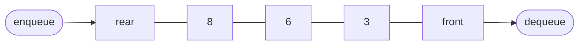

# Chapter 8 Lab — Extending Classes with Inheritance

[Repository Guide](../../README.md) | [English](Concepts_Lab.md) | [한국어](Concepts_Lab.ko.md)

> **Last Updated:** 2026-11-18

> **Learning Objectives:**
> 1. Write a derived class that inherits a base class `public`ly and adds members
> 2. Select and call a base class constructor from a derived class constructor
> 3. Provide a base class's `protected` member to the outside by wrapping it in a `public` function of the derived class
> 4. Explain the first-in first-out behavior of a queue and implement an array-based circular queue with inheritance

---

## Table of Contents

- [1. Overview](#1-overview)
- [2. A Circle with a Name](#2-a-circle-with-a-name)
- [3. A Point with a Color](#3-a-point-with-a-color)
- [4. A Queue That Inherits an Array](#4-a-queue-that-inherits-an-array)
  - [4.1 Queues](#41-queues)
  - [4.2 The Problem of a Linear Queue and the Circular Queue](#42-the-problem-of-a-linear-queue-and-the-circular-queue)
  - [4.3 Implementing MyQueue](#43-implementing-myqueue)
- [Summary](#summary)
- [Self-Check Questions](#self-check-questions)

---

<br>

## 1. Overview

> **Note:** The syntax of inheritance, upcasting, `private`, `protected`, and `public` inheritance and access, the order of constructor and destructor calls, and multiple and virtual inheritance are covered in the [Chapter 8 lecture notes](Concepts_Lecture.md). This lab writes three derived classes that add features to existing classes by inheriting them.

| Topic | Location |
|:-----|:-----|
| `NamedCircle`, which inherits `Circle` and adds a name | Section 2 |
| `ColorPoint`, which inherits `Point`, adds a color, and changes its position through a `protected` function | Section 3 |
| `MyQueue`, which inherits the integer array `BaseArray` and behaves as a queue | Section 4 |
| A `Circle` whose prefix and postfix `++` are written as friend functions | [HW8 Problem 2](../../Coursework/HW08_Friend-Functions-and-Operator-Overloading/Original/Assignment.md#problem-2-week-13-lecture-slides-lab-2) |
| A `ColorPoint` with position and color information, a `Student` hierarchy that processes grades by year | [Chapter 8 Exercises 1 and 2](Exercises.md) |

*Table 1. Topics of the lab and their location*

All code is compiled and run with the C++17 standard (for example, `g++ -std=c++17 -Wall`).

---

<br>

## 2. A Circle with a Name

**Problem:** Inherit the following `Circle` class `public`ly and write a `NamedCircle` class with a `private` member variable `name` (`string`), a constructor, and `show()`. `main()` prints as in the sample run.

```cpp
#include <iostream>
#include <string>
using namespace std;

class Circle {
    int radius;
public:
    Circle(int radius = 0) {
        this->radius = radius;
    }
    int getRadius() { return radius; }
    void setRadius(int radius) {
        this->radius = radius;
    }
    double getArea() {
        return 3.14 * radius * radius;
    }
};

class NamedCircle : public Circle {
    string name;
public:
    NamedCircle(int radius, string name) : Circle(radius) {   // Select the base class constructor
        this->name = name;
    }
    void show() {
        cout << "반지름이 " << getRadius() << "인 " << name << endl;
    }
};

int main() {
    NamedCircle waffle(3, "waffle");    // A circle with radius 3 named waffle
    waffle.show();
}
```

```text
반지름이 3인 waffle
```

- **Selecting the base class constructor:** `: Circle(radius)` means that the base class part is initialized with `Circle(int)` before the body of `NamedCircle`'s constructor runs. Without it, the base class's default constructor is called, which for this `Circle` becomes `Circle(0)` because of the default parameter, creating a circle of radius 0 (Section 3.1 of the Chapter 8 lecture notes). (The output reads "waffle with radius 3.")
- **Inheriting private members:** `radius` is a `private` member of `Circle`, so although it exists inside a `NamedCircle` object, `NamedCircle`'s member functions cannot access it directly. `show()` therefore reads the radius through the inherited `public` function `getRadius()`.

---

<br>

## 3. A Point with a Color

**Problem:** Inherit the following `Point` class `public`ly and write a `ColorPoint` class with a `private` member variable `color` (`string`), a constructor, `show()`, `setPoint()`, and `setColor()`.

```cpp
#include <iostream>
#include <string>
using namespace std;

class Point {
    int x, y;
public:
    Point(int x, int y) {
        this->x = x;
        this->y = y;
    }
    int getX() { return x; }
    int getY() { return y; }
protected:
    void move(int x, int y) {
        this->x = x;
        this->y = y;
    }
};

class ColorPoint : public Point {
    string color;
public:
    ColorPoint(int x, int y, string color) : Point(x, y) {
        this->color = color;
    }
    void setPoint(int x, int y) { move(x, y); }       // A protected member can be called from a derived class
    void setColor(string color) { this->color = color; }
    void show() {
        cout << color << "색으로 (" << getX() << "," << getY() << ")에 위치한 점입니다." << endl;
    }
};

int main() {
    ColorPoint cp(5, 5, "RED");
    cp.setPoint(10, 20);
    cp.setColor("BLUE");
    cp.show();
}
```

```text
BLUE색으로 (10,20)에 위치한 점입니다.
```

- **A base class without a default constructor:** `Point` has only a two-parameter constructor and no default constructor. So `ColorPoint`'s constructor must specify the base class constructor with `: Point(x, y)`; omitting it is a compile error. (The output reads "A point located at (10,20) in BLUE.")
- **protected members:** `move()` is `protected`, so an external function such as `main()` cannot call `cp.move(10, 20)`, but the member function `setPoint()` of the derived class `ColorPoint` can. This design opens the ability to change the position only to derived classes and offers it to the outside only through `setPoint()`, as the derived class defines it.

---

<br>

## 4. A Queue That Inherits an Array

**Problem:** Write a `MyQueue` class that inherits `BaseArray`, which manages an integer array, and behaves as a queue. `MyQueue` is used as in the following `main()`.

```cpp
int main() {
    MyQueue mQ(100);
    int n;
    cout << "큐에 삽입할 5개의 정수를 입력하라>> ";
    for (int i = 0; i < 5; i++) {
        cin >> n;
        mQ.enqueue(n);                  // Insert into the queue
    }
    cout << "큐의 용량:" << mQ.capacity() << ", 큐의 크기:" << mQ.length() << endl;
    cout << "큐의 원소를 순서대로 제거하여 출력한다>> ";
    while (mQ.length() != 0) {
        cout << mQ.dequeue() << ' ';    // Remove from the queue and print
    }
    cout << endl << "큐의 현재 크기 : " << mQ.length() << endl;
}
```

### 4.1 Queues

> **Definition:** A **queue** is a first-in first-out (FIFO) data structure in which the element inserted first is removed first; elements enter at the rear and leave from the front.

Lining up customers at a ticket booth in order of arrival and serving them one by one is how a queue behaves. Queues are used to simulate waiting lines, such as airplanes at an airport or customers at a bank, to model data packets in communication, and as buffers between a printer and a computer. Like stacks, they serve as tools in many algorithms.



*Figure 1. A queue that inserts at the rear and removes from the front*

### 4.2 The Problem of a Linear Queue and the Circular Queue

Inserting and removing elements in a queue that uses `front` and `rear` as indices into an array of size 4 goes as follows.

```text
enqueue(3)    [3][ ][ ][ ]    front = 0, size = 1
enqueue(6)    [3][6][ ][ ]    front = 0, size = 2
enqueue(8)    [3][6][8][ ]    front = 0, size = 3
dequeue() 3   [ ][6][8][ ]    front = 1, size = 2
enqueue(11)   [ ][6][8][11]   front = 1, size = 3
```

Slot 0, emptied by `dequeue()`, is never used again once `rear` reaches the end of the array. Even though the size is 3, there is no place for the next `enqueue()`, so a queue that keeps inserting and removing cannot go on being used. The solution is the **circular queue**, which treats the position after the end of the array as joined to the beginning. The index of the next free slot is `(front + size) % capacity`, and after a removal the front moves with `front = (front + 1) % capacity`.

```text
enqueue(13)   [13][6][8][11]  front = 1, size = 4    slot (1 + 3) % 4 = 0
```

### 4.3 Implementing MyQueue

`BaseArray` dynamically allocates an integer array of fixed size and provides the functions that store and read elements only to derived classes, as `protected`.

```cpp
#include <iostream>
using namespace std;

class BaseArray {
    int capacity;                       // Size of the array
    int* mem;                           // Memory of the integer array
protected:
    BaseArray(int capacity = 100) {
        this->capacity = capacity;
        mem = new int[capacity];
    }
    ~BaseArray() { delete[] mem; }
    void put(int index, int val) { mem[index] = val; }
    int get(int index) { return mem[index]; }
    int getCapacity() { return capacity; }
};

class MyQueue : public BaseArray {
    int front;                          // Index of the next element to remove
    int size;                           // Current number of elements
public:
    MyQueue(int capacity) : BaseArray(capacity) {
        front = 0;
        size = 0;
    }
    void enqueue(int n) {
        if (size == getCapacity()) {
            cout << "queue full" << endl;
            return;
        }
        int rear = (front + size) % getCapacity();   // Next free slot, circularly
        put(rear, n);
        size++;
    }
    int dequeue() {
        if (size == 0) {
            cout << "queue empty" << endl;
            return -1;
        }
        int n = get(front);
        front = (front + 1) % getCapacity();         // Move the front by one, circularly
        size--;
        return n;
    }
    int capacity() { return getCapacity(); }
    int length() { return size; }
};
```

Running `main()` with the integers 1, 3, -5, 7, and 9 as input gives the following.

```text
큐에 삽입할 5개의 정수를 입력하라>> 1 3 -5 7 9
큐의 용량:100, 큐의 크기:5
큐의 원소를 순서대로 제거하여 출력한다>> 1 3 -5 7 9 
큐의 현재 크기 : 0
```

- **The role of inheritance:** `MyQueue` leaves memory management (allocation and release) and element access to `BaseArray` and implements only the queue's rules (where to insert and where to remove). The constructor and destructor of `BaseArray` are `protected`, so a `BaseArray` object cannot be created directly and is used only through derived classes. (The output lines read "enter 5 integers to insert into the queue," "queue capacity, queue size," "remove and print the elements in order," and "current queue size.")
- **front and size:** Computing the rear from `front` and `size` instead of keeping `rear` separately makes the full state (`size == capacity`) and the empty state (`size == 0`) easy to tell apart.
- **Confirming circular behavior:** In a queue of size 4, inserting 3, 6, and 8, removing one, and then inserting 11 and 13 puts 13 into the emptied slot 0, and the next value 15 is rejected because the queue is full. Removing all remaining elements yields 6, 8, 11, and 13, in that order.

---

<br>

## Summary

| Concept | Key Summary |
|:-----|:-----|
| Writing a derived class | It inherits a base class `public`ly and adds member variables and member functions, handling the base class's `private` members through inherited `public` functions. |
| Selecting the base class constructor | The initializer list `: Base(args)` of the derived class constructor selects the base class constructor, and it must be specified if the base class has no default constructor. |
| protected members | External functions cannot access them but member functions of derived classes can, so they serve features opened only to derived classes. |
| Queue | A first-in first-out data structure that inserts at the rear and removes from the front. |
| Circular queue | It joins the position after the end of the array to the beginning and computes indices with `% capacity`, reusing slots emptied by removals. |

---

<br>

## Self-Check Questions

1. What is printed if `: Circle(radius)` is removed from the `NamedCircle` constructor in Section 2?

   <details>
   <summary>Answer</summary>

   Without a specified base class constructor, `Circle`'s default constructor is called. This `Circle`'s constructor is `Circle(int radius = 0)`, which can be called without arguments, so the radius becomes 0 and `반지름이 0인 waffle` is printed. Calling `setRadius(radius)` in the constructor body would fix the radius, but creating it with the correct value from the start through the initializer list is more natural.

   </details>

2. What happens if `main()` in Section 3 calls `cp.move(10, 20);`? If `ColorPoint` is changed to inherit `Point` with `protected` inheritance, can `cp.getX()` be called?

   <details>
   <summary>Answer</summary>

   `move()` is a `protected` member of `Point` and remains `protected` under `public` inheritance, so calling it from `main()`, an external function, is a compile error. With `protected` inheritance, `Point`'s `public` member `getX()` becomes `protected` in `ColorPoint`, so `cp.getX()` cannot be called from `main()` either. It can still be called inside `ColorPoint`'s member functions (Section 2.4 of the Chapter 8 lecture notes).

   </details>

3. If 5, 6, 7, and 8 are inserted into a `MyQueue` of size 4 from Section 4.3, two elements are removed, and then 9 and 10 are inserted, what do the array slots and `front` look like?

   <details>
   <summary>Answer</summary>

   Inserting 5, 6, 7, and 8 fills slots 0-3 in order, with `front = 0` and `size = 4`. Removing two elements yields 5 and 6, leaving `front = 2` and `size = 2`. The slot for 9 is (2 + 2) % 4 = 0 and the slot for 10 is (2 + 3) % 4 = 1, so the array becomes [9, 10, 7, 8] with `front = 2` and `size = 4`. Elements are then removed in the order 7, 8, 9, 10.

   </details>
