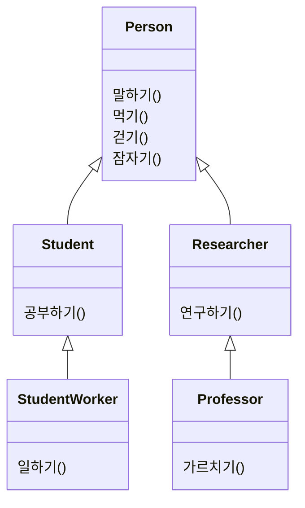
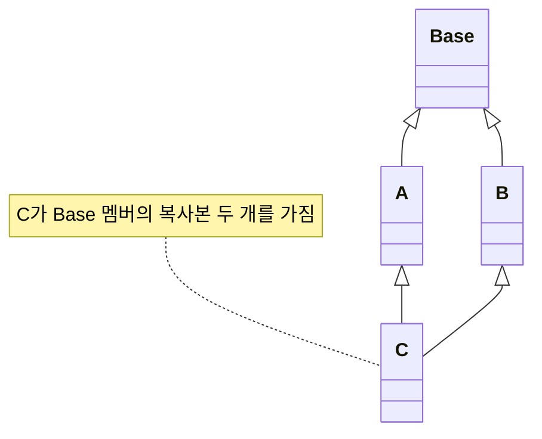

# 8장 — 상속

[레포지토리 안내](../../README.ko.md) | [English](Concepts_Lecture.md) | [한국어](Concepts_Lecture.ko.md)

> **최종 수정일:** 2026-11-19
>
> 명품 C++ Programming, 황기태, Ch 8

> **학습 목표:**
> 1. 상속의 개념을 이해하고 파생 클래스를 선언할 수 있다
> 2. 업캐스팅과 다운캐스팅으로 상속과 객체 포인터의 관계를 설명할 수 있다
> 3. protected 접근 지정과 public, protected, private 상속의 차이를 설명할 수 있다
> 4. 상속 관계에서 생성자와 소멸자의 실행 순서를 추적할 수 있다
> 5. 다중 상속을 선언하고 가상 상속으로 다이아몬드 문제를 해결할 수 있다
> 6. final, override, 상속 생성자 같은 C++11의 상속 기능을 사용할 수 있다

---

## 목차

- [1. 상속의 개념](#1-상속의-개념)
  - [1.1 상속이 필요한 이유](#11-상속이-필요한-이유)
  - [1.2 문법](#12-문법)
  - [1.3 상속되는 것](#13-상속되는-것)
  - [1.4 상속과 객체 포인터](#14-상속과-객체-포인터)
  - [1.5 상속으로 클래스를 간결하게 만드는 사례](#15-상속으로-클래스를-간결하게-만드는-사례)
  - [1.6 IS-A 관계와 HAS-A 관계](#16-is-a-관계와-has-a-관계)
  - [1.7 파생 클래스 객체의 메모리 배치](#17-파생-클래스-객체의-메모리-배치)
- [2. 상속과 접근 제어](#2-상속과-접근-제어)
  - [2.1 `public` 상속](#21-public-상속)
  - [2.2 `protected` 상속](#22-protected-상속)
  - [2.3 `private` 상속](#23-private-상속)
  - [2.4 접근 제어 표](#24-접근-제어-표)
  - [2.5 protected 멤버의 접근 범위](#25-protected-멤버의-접근-범위)
  - [2.6 상속이 중첩될 때의 접근 지정 추적](#26-상속이-중첩될-때의-접근-지정-추적)
- [3. 상속에서의 생성자와 소멸자](#3-상속에서의-생성자와-소멸자)
  - [3.1 생성자 체인](#31-생성자-체인)
  - [3.2 소멸자 체인](#32-소멸자-체인)
  - [3.3 출력 추적 예제](#33-출력-추적-예제)
  - [3.4 여러 단계 상속의 생성자와 소멸자](#34-여러-단계-상속의-생성자와-소멸자)
  - [3.5 기본 클래스에 기본 생성자가 없는 경우](#35-기본-클래스에-기본-생성자가-없는-경우)
  - [3.6 멤버 객체가 있을 때의 생성과 소멸 순서](#36-멤버-객체가-있을-때의-생성과-소멸-순서)
- [4. 멤버 함수 오버라이딩](#4-멤버-함수-오버라이딩)
  - [4.1 오버라이딩](#41-오버라이딩)
  - [4.2 기본 클래스 버전 호출](#42-기본-클래스-버전-호출)
  - [4.3 이름 숨김과 using 선언](#43-이름-숨김과-using-선언)
- [5. 다중 상속](#5-다중-상속)
  - [5.1 다중 상속의 활용: 계산기](#51-다중-상속의-활용-계산기)
  - [5.2 다중 상속의 생성 순서와 이름의 모호성](#52-다중-상속의-생성-순서와-이름의-모호성)
  - [5.3 가상 상속의 객체 구성과 생성자 호출](#53-가상-상속의-객체-구성과-생성자-호출)
  - [5.4 가상 상속이 객체에 더하는 것](#54-가상-상속이-객체에-더하는-것)
- [6. 현대적 상속 기능 (C++11)](#6-현대적-상속-기능-c11)
  - [6.1 `final` 키워드](#61-final-키워드)
  - [6.2 `override` 키워드](#62-override-키워드)
  - [6.3 `using`을 사용한 생성자 상속](#63-using을-사용한-생성자-상속)
- [7. 흔한 실수](#7-흔한-실수)
  - [7.1 파생 클래스 생성자에서 기본 클래스의 멤버를 직접 초기화함](#71-파생-클래스-생성자에서-기본-클래스의-멤버를-직접-초기화함)
  - [7.2 private 상속이나 protected 상속을 한 객체를 업캐스팅함](#72-private-상속이나-protected-상속을-한-객체를-업캐스팅함)
  - [7.3 다이아몬드의 한쪽에만 virtual을 붙임](#73-다이아몬드의-한쪽에만-virtual을-붙임)
- [요약](#요약)
- [점검 문제](#점검-문제)

---

<br>

## 1. 상속의 개념

### 1.1 상속이 필요한 이유

**상속(Inheritance)** 은 새로운 클래스(파생 클래스)가 기존 클래스(기본 클래스)를 재사용하고 확장할 수 있게 한다.

상속은 클래스 사이에 정의되는 관계이며, 객체 사이에는 상속 관계가 없다. 파생 클래스는 기본 클래스의 속성과 기능을 물려받고 자신만의 속성과 기능을 추가하므로, 기본 클래스에서 파생 클래스로 갈수록 클래스의 개념이 구체화된다.

| 장점 | 설명 |
|:----|:----|
| 코드 재사용 | 공통 데이터와 함수를 기본 클래스에 한 번만 작성 |
| IS-A 관계 | `Car`**는** `Vehicle`**이다**; `Manager`**는** `Employee`**이다** |
| 확장성 | 기본 클래스를 수정하지 않고 파생 클래스에서 새 기능 추가 |

*표 1. 상속의 장점*

**용어:**

| 용어 | 동의어 |
|:----|:------|
| 기본 클래스 (Base class) | 부모 클래스 (Parent), 슈퍼 클래스 (Super) |
| 파생 클래스 (Derived class) | 자식 클래스 (Child), 서브 클래스 (Sub) |

*표 2. 기본 클래스와 파생 클래스의 동의어*

```text
   기본 (부모)
       ↑
   파생 (자식)
```

*그림 1. 기본 클래스와 파생 클래스의 상속 관계*

### 1.2 문법

```cpp
class Derived : public Base {
    // 추가 멤버
};
```

- 콜론 `:` 뒤에 접근 지정자(`public`, `protected`, `private`)와 기본 클래스 이름을 적는다.
- **`public` 상속**이 가장 일반적이며 IS-A 관계를 유지한다.
- `class Student : public Person`을 다시 `class StudentWorker : public Student`로 상속받으면, `StudentWorker`는 `Student`의 멤버와 함께 `Student`가 `Person`에게서 물려받은 멤버도 물려받는다.

```cpp
class Vehicle {
    string brand;
    int year;
public:
    Vehicle(string b, int y) : brand(b), year(y) {}
    string getBrand() { return brand; }
    int getYear() { return year; }
protected:
    void updateYear(int y) { year = y; }
};

class Car : public Vehicle {
    int numDoors;
public:
    Car(string b = "Unknown", int y = 2024, int d = 4)
        : Vehicle(b, y), numDoors(d) {}
    void setDoors(int d) { numDoors = d; }
    void setYear(int y) { updateYear(y); }   // 기본 클래스의 protected 멤버 호출
    void show() {
        cout << getBrand() << " (" << getYear() << "), "
             << numDoors << "도어" << endl;
    }
};
```

### 1.3 상속되는 것

기본 클래스의 모든 멤버가 파생 클래스에 상속된다. 단, **접근 가능 여부**는 접근 지정자에 따라 다르다.

| 기본 클래스 멤버 접근 | 파생 클래스에서의 접근 가능 여부 |
|:-------------------|:---------------------|
| `public` | 가능 (직접 접근 가능) |
| `protected` | 가능 (직접 접근 가능) |
| `private` | **불가**: 상속은 되지만 직접 접근할 수 없으며 public/protected getter를 통해 접근 |

*표 3. 기본 클래스 멤버의 접근 지정에 따른 파생 클래스의 접근 가능 여부*

```cpp
class Base {
    int secret;        // private
protected:
    int shared;        // protected
public:
    int open;          // public
    int getSecret() { return secret; }
};

class Derived : public Base {
public:
    void test() {
        // cout << secret;     // 오류: Base의 private 멤버
        cout << shared;        // OK: protected는 접근 가능
        cout << open;          // OK: public은 접근 가능
        cout << getSecret();   // OK: private 멤버에 대한 public getter
    }
};
```

`protected` 멤버는 선언된 클래스와 그 파생 클래스의 멤버 함수에서만 접근할 수 있다. 파생 클래스가 아닌 다른 클래스나 외부 함수(예: `main()`)에서는 기본 클래스 객체를 통해서든 파생 클래스 객체를 통해서든 `protected` 멤버에 접근할 수 없다. 위 예에서 `main()`이 `Derived d;`를 만든 뒤 `d.shared = 1;`을 쓰면 컴파일 오류가 발생한다.

> **핵심:** `private` 멤버는 상속된다(메모리에 존재함). 하지만 파생 클래스에서 직접 접근할 수 없다. 기본 클래스에 정의된 getter를 통해 접근해야 한다.

### 1.4 상속과 객체 포인터

파생 클래스 객체는 기본 클래스 부분을 포함하므로, 기본 클래스 포인터로 파생 클래스 객체를 가리킬 수 있다.

- **업캐스팅(up-casting)** 은 파생 클래스 포인터를 기본 클래스 포인터에 대입하는 것이다. 사람을 동물로 보는 것처럼 항상 안전하므로 명시적 형 변환이 필요 없다. 다만 기본 클래스 포인터로는 기본 클래스에 선언된 멤버만 접근할 수 있다.
- **다운캐스팅(down-casting)** 은 기본 클래스 포인터를 파생 클래스 포인터에 대입하는 것이다. 명시적 형 변환이 반드시 필요하며, 그 포인터가 실제로 파생 클래스 객체를 가리킬 때만 안전하다.

```cpp
#include <iostream>
#include <string>
using namespace std;

class Point {
    int x, y;
public:
    void set(int x, int y) { this->x = x; this->y = y; }
    void showPoint() { cout << "(" << x << "," << y << ")" << endl; }
};

class ColorPoint : public Point {
    string color;
public:
    void setColor(string color) { this->color = color; }
    void showColorPoint() { cout << color << ":"; showPoint(); }
};

int main() {
    ColorPoint cp;
    ColorPoint *pDer = &cp;
    Point *pBase = pDer;            // 업캐스팅: 형 변환 없이 가능

    pDer->set(3, 4);
    pBase->showPoint();             // (3,4)
    pDer->setColor("Red");
    pDer->showColorPoint();         // Red:(3,4)
    // pBase->showColorPoint();     // 컴파일 오류: Point에는 showColorPoint()가 없음

    ColorPoint *pDer2 = (ColorPoint *)pBase;   // 다운캐스팅: 명시적 형 변환 필요
    pDer2->showColorPoint();        // Red:(3,4)
    return 0;
}
```

실행 결과는 다음과 같다.

```text
(3,4)
Red:(3,4)
Red:(3,4)
```

```text
                ColorPoint cp
pDer  ──▶  ┌──────────────────────┐
pBase ──▶  │ x, y                 │  Point 부분: pBase로 접근 가능
           │ set(), showPoint()   │
           ├──────────────────────┤
           │ color                │  ColorPoint 부분: pDer로만 접근 가능
           │ setColor(),          │
           │ showColorPoint()     │
           └──────────────────────┘
```

*그림 2. 파생 클래스 객체의 구성과 포인터 타입에 따른 접근 범위*

| 구분 | 대입 방향 | 형 변환 | 포인터로 접근할 수 있는 멤버 |
|:----|:----|:----|:----|
| 업캐스팅 | 파생 클래스 포인터 → 기본 클래스 포인터 | 필요 없음 | 기본 클래스의 멤버 |
| 다운캐스팅 | 기본 클래스 포인터 → 파생 클래스 포인터 | 명시적 형 변환 필요 | 파생 클래스의 멤버까지 |

*표 4. 업캐스팅과 다운캐스팅의 비교*

> **주의:** 다운캐스팅한 포인터가 실제로는 파생 클래스 객체가 아닌 기본 클래스 객체를 가리키고 있으면, 파생 클래스 멤버에 접근하는 순간 정의되지 않은 동작이 된다. 다운캐스팅은 포인터가 가리키는 객체의 실제 타입을 알 때만 쓴다.

### 1.5 상속으로 클래스를 간결하게 만드는 사례

학생(`Student`), 일하는 학생(`StudentWorker`), 연구원(`Researcher`), 교수(`Professor`)를 각각 독립된 클래스로 만들면, 네 클래스 모두에 말하기, 먹기, 걷기, 잠자기 기능이 따로 들어간다. 그 위에 학생은 공부하기를, 일하는 학생은 공부하기와 일하기를, 연구원은 연구하기를, 교수는 연구하기와 가르치기를 더 가진다. 같은 기능이 네 번 반복되므로, 걷기의 구현을 바꾸려면 네 곳을 고쳐야 한다.

공통 기능을 `Person` 클래스에 한 번만 작성하고 상속 관계로 정리하면 다음과 같다.



*그림 3. 공통 기능을 Person에 모아 상속으로 정리한 클래스 계층*

각 클래스에는 자기에게만 있는 기능 하나씩만 남는다. `StudentWorker`는 `Student`를 상속받으므로 공부하기를, `Student`가 `Person`에게서 물려받은 말하기, 먹기, 걷기, 잠자기를 함께 가진다. 걷기의 구현은 `Person` 한 곳에만 있으므로 그곳만 고치면 다섯 클래스 모두에 반영된다. 이처럼 상속은 클래스 사이의 중복을 없애고, 클래스들을 일반적인 것(`Person`)에서 구체적인 것(`Professor`)으로 이어지는 계층으로 정리한다.

### 1.6 IS-A 관계와 HAS-A 관계

상속을 쓸지 정하는 기준은 두 클래스의 관계를 "파생 클래스는 기본 클래스의 일종이다"라는 문장으로 말할 수 있는지이다. 학생은 사람의 일종이므로 `Student`가 `Person`을 상속받는 것은 자연스럽다. 이런 관계를 **IS-A 관계**라고 한다.

반면 자동차는 엔진의 일종이 아니라 엔진을 가진다. 이런 관계는 **HAS-A 관계**이며, 상속이 아니라 다른 클래스의 객체를 멤버 변수로 두는 **포함(composition)** 으로 표현한다.

```cpp
class Engine { /* ... */ };
class Car : public Engine { };    // 부적절: 자동차는 엔진의 일종이 아니다
class Car2 { Engine engine; };    // 적절: 자동차가 엔진을 가진다
```

`Car`가 `Engine`을 상속받으면 `Engine`의 public 멤버 함수가 모두 `Car`의 public 멤버가 되고, 1.4절의 업캐스팅으로 `Car` 객체를 `Engine *`로 가리킬 수도 있다. 자동차를 엔진처럼 다룰 수 있게 되는 것이므로 설계의 의미가 어긋난다. 코드를 재사용하려는 목적만 있다면 포함이 더 안전한 선택이며, 포함한 멤버 객체의 생성과 소멸 순서는 3.6절에서 다룬다.

### 1.7 파생 클래스 객체의 메모리 배치

파생 클래스의 객체는 그 안에 기본 클래스의 객체 하나를 통째로 포함한다. 이 포함된 부분을 **기본 클래스 부분 객체(base class subobject)** 라고 하며, 단일 상속에서는 보통 파생 클래스 객체의 맨 앞에 놓이고 그 뒤에 파생 클래스가 추가한 멤버가 이어진다. 그림 2를 실제 크기와 위치로 확인하면 다음과 같다.

```cpp
#include <iostream>
using namespace std;

class Point {
public:
    int x = 1, y = 2;
};

class ColorPoint : public Point {
public:
    int color = 3;
};

class A { public: int a = 10; };
class B { public: int b = 20; };
class C : public A, public B { public: int c = 30; };

int main() {
    ColorPoint cp;
    Point *pp = &cp;                                   // 업캐스팅
    cout << "sizeof(Point)=" << sizeof(Point) << ", sizeof(ColorPoint)=" << sizeof(ColorPoint) << endl;
    cout << "&cp == pp ? " << ((void *)&cp == (void *)pp) << endl;
    cout << "color의 위치: +" << (char *)&cp.color - (char *)&cp << endl;

    C obj;
    A *pa = &obj;
    B *pb = &obj;                                      // 두 번째 기본 클래스로 업캐스팅
    cout << "sizeof(C)=" << sizeof(C) << endl;
    cout << "pa - &obj: +" << (char *)pa - (char *)&obj
         << ", pb - &obj: +" << (char *)pb - (char *)&obj << endl;
    cout << "pa->a=" << pa->a << ", pb->b=" << pb->b << endl;
    return 0;
}
```

```text
sizeof(Point)=8, sizeof(ColorPoint)=12
&cp == pp ? 1
color의 위치: +8
sizeof(C)=12
pa - &obj: +0, pb - &obj: +4
pa->a=10, pb->b=20
```

```text
 ColorPoint cp (12바이트)              C obj (12바이트)
   +0 ┌──────────┐ ◀── &cp, pp          +0 ┌──────────┐ ◀── &obj, pa
      │ x = 1    │  Point 부분             │ a = 10   │  A 부분
   +4 │ y = 2    │                      +4 ├──────────┤ ◀── pb
   +8 ├──────────┤                         │ b = 20   │  B 부분
      │ color = 3│  ColorPoint 부분     +8 ├──────────┤
      └──────────┘                         │ c = 30   │  C 부분
                                           └──────────┘
```

*그림 4. 단일 상속과 다중 상속에서 파생 클래스 객체의 배치*

- **단일 상속:** `ColorPoint`의 크기 12바이트는 `Point`의 멤버 8바이트에 `color` 4바이트를 더한 값이다. `Point` 부분이 맨 앞에 있으므로 업캐스팅한 `pp`의 주소는 `&cp`와 같고, `pp`로 접근할 수 있는 범위는 앞쪽 8바이트의 `Point` 부분이다(1.4절). `color`는 그 뒤인 8바이트 위치에 있다.
- **다중 상속:** `C` 객체에는 `A` 부분, `B` 부분, `C`가 추가한 멤버가 상속 목록의 순서대로 놓인다. `A *pa = &obj;`는 맨 앞의 `A` 부분을 가리키므로 주소가 `&obj`와 같지만, `B *pb = &obj;`는 4바이트 뒤의 `B` 부분을 가리키도록 컴파일러가 주소를 조정한다. 그래서 `pb->b`가 올바르게 20을 읽는다. 업캐스팅이 "같은 주소를 다른 타입으로 보는 것"이라는 설명은 단일 상속에서만 맞으며, 다중 상속에서는 포인터 값 자체가 바뀔 수 있다.

이 배치는 C에서 구조체 안에 다른 구조체를 첫 멤버로 넣는 것과 비슷하다. 다만 C++에서는 컴파일러가 기본 클래스 부분의 위치를 알고 업캐스팅 때 주소를 알아서 조정하므로, 프로그래머가 그 위치를 계산할 필요가 없다. 위의 바이트 위치는 macOS의 Apple clang에서 측정한 것이고, 기본 클래스 부분과 멤버의 정확한 배치는 표준이 모두 정하지 않으므로 구현에 따라 다를 수 있다.

---

<br>

## 2. 상속과 접근 제어

**상속 접근 지정자**는 기본 클래스의 멤버가 파생 클래스에서 어떻게 노출되는지를 결정한다. 상속을 선언할 때 `public`, `protected`, `private` 중 하나를 지정하며, 이것이 기본 클래스의 `protected`, `public` 멤버의 접근 속성을 파생 클래스에서 어떻게 계승할지 정한다.

### 2.1 `public` 상속

가장 일반적인 형태이며, 기본 클래스의 접근 수준이 파생 클래스에서 그대로 유지된다.

```cpp
class Derived : public Base { };
```

| 기본 클래스 멤버 | 파생 클래스에서 |
|:-------------|:------------|
| `public` | `public` |
| `protected` | `protected` |
| `private` | 접근 불가 |

*표 5. `public` 상속에서 멤버의 접근 지정 변화*

### 2.2 `protected` 상속

기본 클래스의 public 멤버가 파생 클래스에서 `protected`가 된다. 실무에서 거의 사용하지 않는다.

```cpp
class Derived : protected Base { };
```

| 기본 클래스 멤버 | 파생 클래스에서 |
|:-------------|:------------|
| `public` | `protected` |
| `protected` | `protected` |
| `private` | 접근 불가 |

*표 6. `protected` 상속에서 멤버의 접근 지정 변화*

### 2.3 `private` 상속

기본 클래스의 접근 가능한 모든 멤버가 파생 클래스에서 `private`가 된다. 거의 사용하지 않는다.

```cpp
class Derived : private Base { };
```

| 기본 클래스 멤버 | 파생 클래스에서 |
|:-------------|:------------|
| `public` | `private` |
| `protected` | `private` |
| `private` | 접근 불가 |

*표 7. `private` 상속에서 멤버의 접근 지정 변화*

### 2.4 접근 제어 표

| 기본 클래스 멤버 | `public` 상속 | `protected` 상속 | `private` 상속 |
|:-------------|:------------|:---------------|:-------------|
| `public` | `public` | `protected` | `private` |
| `protected` | `protected` | `protected` | `private` |
| `private` | 접근 불가 | 접근 불가 | 접근 불가 |

*표 8. 상속 유형별 기본 클래스 멤버의 접근 지정 변화*

상속이 여러 단계로 중첩되면 각 단계의 상속 유형이 차례로 적용된다. 예를 들어 `class Derived : private Base`이면 `Base`의 public, protected 멤버가 `Derived` 안에서 private이 되므로, `Derived` 자신의 멤버 함수는 그 멤버를 호출할 수 있지만 `Derived`를 다시 상속받은 클래스의 멤버 함수는 호출할 수 없다.

> **핵심:** 상속 유형에 관계없이, 기본 클래스의 `private` 멤버는 파생 클래스에서 **절대** 직접 접근할 수 없다. `public` 상속만이 IS-A 관계를 유지한다.

### 2.5 protected 멤버의 접근 범위

`protected` 멤버는 파생 클래스의 멤버 함수에서 접근할 수 있지만 클래스 밖의 함수에서는 접근할 수 없다. 다음 예제는 `Point`의 좌표 `x`, `y`를 `protected`로 바꾸고, 파생 클래스 `ColorPoint`에 두 점이 같은지 비교하는 `equals()`를 추가한다.

```cpp
#include <iostream>
#include <string>
using namespace std;

class Point {
protected:
    int x, y;                         // 한 점 (x, y) 좌표값
public:
    void set(int x, int y) { this->x = x; this->y = y; }
    void showPoint() { cout << "(" << x << "," << y << ")" << endl; }
};

class ColorPoint : public Point {
    string color;
public:
    void setColor(string color) { this->color = color; }
    void showColorPoint() { cout << color << ":"; showPoint(); }
    bool equals(ColorPoint p) {
        return x == p.x && y == p.y && color == p.color;   // (1) 같은 클래스의 다른 객체 p의 protected 멤버
    }
};

int main() {
    Point p;
    p.set(2, 3);
    // p.x = 5;                       // (2) 오류: main()은 Point의 protected 멤버에 접근할 수 없다
    p.showPoint();

    ColorPoint cp, cp2;
    // cp.x = 10;                     // (3) 오류: 파생 클래스 객체를 통해서도 마찬가지이다
    cp.set(3, 4);
    cp.setColor("Red");
    cp2.set(3, 4);
    cp2.setColor("Red");
    cp.showColorPoint();
    cout << (cp.equals(cp2) ? "true" : "false") << endl;
    return 0;
}
```

```text
(2,3)
Red:(3,4)
true
```

- **(1)** `equals()`는 `ColorPoint`의 멤버 함수이므로 자기 객체의 `x`, `y`뿐 아니라 매개변수로 받은 다른 `ColorPoint` 객체 `p`의 `p.x`, `p.y`에도 접근할 수 있다. 접근 권한은 객체 단위가 아니라 클래스 단위로 주어지기 때문이다. `cp`와 `cp2`는 좌표와 색이 모두 같으므로 `true`가 출력된다.
- **(2)** `main()`은 `Point`의 멤버도 파생 클래스의 멤버도 아니므로 `p.x`에 접근할 수 없다. 주석을 풀면 Apple clang은 "'x' is a protected member of 'Point'"라는 오류를 낸다.
- **(3)** 파생 클래스 객체 `cp`를 통해 접근해도 접근하는 쪽이 `main()`이므로 같은 오류가 난다. 외부에서 좌표를 바꾸려면 public 멤버 함수 `set()`을 호출해야 한다.

| 접근하는 곳 | private 멤버 | protected 멤버 | public 멤버 |
|:----|:----|:----|:----|
| 같은 클래스의 멤버 함수 | 가능 | 가능 | 가능 |
| 파생 클래스의 멤버 함수 | 불가 | 가능 | 가능 |
| 클래스 밖의 함수 (`main()` 등) | 불가 | 불가 | 가능 |

*표 9. 멤버의 접근 지정과 접근하는 곳에 따른 접근 가능 여부*

### 2.6 상속이 중첩될 때의 접근 지정 추적

2.4절에서 본 것처럼 상속이 여러 단계로 중첩되면 각 단계의 상속 유형이 차례로 적용된다. 다음 코드에서 `Derived`는 `Base`를 private 상속하고, `GrandDerived`는 `Derived`를 다시 private 상속한다.

```cpp
#include <iostream>
using namespace std;

class Base {
    int a;
protected:
    void setA(int a) { this->a = a; }
public:
    void showA() { cout << a; }
};

class Derived : private Base {          // Base의 setA(), showA()가 Derived 안에서 private이 된다
    int b;
protected:
    void setB(int b) { this->b = b; }
public:
    void showB() {
        setA(5);                        // (1) 가능: Derived 자신의 private 멤버
        showA();                        // (2) 가능
        cout << b;
    }
};

class GrandDerived : private Derived {
    int c;
protected:
    void setAB(int x) {
        setA(x);                        // (3) 오류: Derived 안에서 private이 된 멤버
        showA();                        // (4) 오류
        setB(x);                        // (5) 가능: Derived의 protected 멤버
    }
};

int main() { }
```

```text
nest.cpp:28:9: error: 'setA' is a private member of 'Base'
nest.cpp:29:9: error: 'showA' is a private member of 'Base'
```

추적은 두 단계로 한다.

1. `Derived : private Base`에 의해 `Base`의 protected 멤버 `setA()`와 public 멤버 `showA()`는 `Derived` 안에서 private 멤버가 된다. private 멤버는 그 클래스 자신의 멤버 함수에서 접근할 수 있으므로 `Derived::showB()`의 (1), (2)는 문제가 없다.
2. `GrandDerived : private Derived`에서 `GrandDerived`가 물려받는 `Derived`의 멤버 가운데 `setA()`, `showA()`는 이미 `Derived`의 private 멤버이므로 `GrandDerived`의 멤버 함수에서도 접근할 수 없다. 그래서 (3), (4)가 오류이다. `setB()`는 `Derived`의 protected 멤버이므로 파생 클래스인 `GrandDerived`에서 접근할 수 있어 (5)는 문제가 없다.

`Derived`를 `public Base`로 상속하면 `setA()`가 `Derived` 안에서 protected로 남으므로 (3)도 가능해진다. 오류 메시지가 `Base`의 private 멤버라고 표현하는 것은 접근이 막힌 원인이 `Base`를 private으로 상속한 데 있기 때문이다.

---

<br>

## 3. 상속에서의 생성자와 소멸자

### 3.1 생성자 체인

파생 객체가 생성될 때, **기본 클래스 생성자가 먼저** 실행되고, 그다음 파생 클래스 생성자가 실행된다. 기본 클래스 생성자를 명시적으로 호출하지 않으면, 기본 클래스의 **기본 생성자(default constructor)** 가 사용된다.

```cpp
class Base {
public:
    Base() { cout << "Base()" << endl; }
    Base(int x) { cout << "Base(" << x << ")" << endl; }
};

class Derived : public Base {
public:
    // 명시적으로 Base(int) 호출
    Derived(int x, int y) : Base(x) {
        cout << "Derived(" << x << ", " << y << ")" << endl;
    }
};

// 사용
Derived d(10, 20);
// 출력:
//   Base(10)
//   Derived(10, 20)
```

| 상황 | 결과 |
|:----|:----|
| 기본 클래스 생성자를 명시적으로 호출하지 않을 때 | 기본 클래스의 **기본 생성자**가 자동 호출됨 |
| `Derived(args) : Base(args)` 명시적 호출 | 지정한 기본 클래스 생성자가 호출됨 |
| 기본 클래스에 기본 생성자가 없고 파생에서 호출하지 않을 때 | **컴파일 오류** |

*표 10. 파생 클래스 생성자가 호출하는 기본 클래스 생성자*

파생 클래스 생성자에 기본 클래스 생성자를 지정하지 않으면, 컴파일러는 그 생성자에 기본 클래스의 기본 생성자를 호출하는 코드(`: A()`)를 묵시적으로 삽입한다. 매개변수를 가진 파생 클래스 생성자도 마찬가지이다.

```cpp
class A {
public:
    A() { cout << "생성자 A" << endl; }
    A(int x) { cout << "매개변수생성자 A" << x << endl; }
};

class B : public A {
public:
    B() { cout << "생성자 B" << endl; }                     // B() : A()로 컴파일됨
    B(int x) { cout << "매개변수생성자 B" << x << endl; }   // B(int x) : A()로 컴파일됨
    B(int x, int y) : A(x + 3) { cout << "매개변수생성자 B" << x << endl; }   // A(int)를 명시적으로 선택
};

// 사용
B b1(5);      // 출력: 생성자 A, 매개변수생성자 B5
B b2(5, 0);   // 출력: 매개변수생성자 A8, 매개변수생성자 B5
```

### 3.2 소멸자 체인

소멸자는 생성의 **역순**으로 호출된다. 파생 클래스 소멸자가 먼저 실행되고, 그다음 기본 클래스 소멸자가 실행된다.

```cpp
class Base {
public:
    ~Base() { cout << "~Base()" << endl; }
};

class Derived : public Base {
public:
    ~Derived() { cout << "~Derived()" << endl; }
};

// Derived 객체가 범위를 벗어날 때:
//   ~Derived()
//   ~Base()
```

| 순서 | 생성 | 소멸 |
|:----|:----|:----|
| 첫 번째 | 기본 클래스 생성자 | 파생 클래스 소멸자 |
| 두 번째 | 파생 클래스 생성자 | 기본 클래스 소멸자 |

*표 11. 생성자와 소멸자의 실행 순서*

### 3.3 출력 추적 예제

```cpp
#include <iostream>
using namespace std;

class Employee {
    string name;
protected:
    double salary;
    string department;
public:
    Employee(string n, double sal, string dept)
        : name(n), salary(sal), department(dept) {
        cout << "Employee 생성자" << endl;
    }
    ~Employee() { cout << "Employee 소멸자" << endl; }
    string getName() { return name; }
    double getSalary() { return salary; }
    string getDepartment() { return department; }
};

class Manager : public Employee {
    int teamSize;
public:
    Manager(string n, double sal, string dept, int ts)
        : Employee(n, sal, dept), teamSize(ts) {
        cout << "Manager 생성자" << endl;
    }
    ~Manager() { cout << "Manager 소멸자" << endl; }
    double getBonus() {
        return salary * 0.15;
    }
    void display() {
        cout << "이름: " << getName() << endl;
        cout << "부서: " << department << endl;
        cout << "급여: " << salary << endl;
        cout << "팀 규모: " << teamSize << endl;
        cout << "---------------" << endl;
        cout << "보너스: " << getBonus() << endl << endl;
    }
};

int main() {
    Manager m("홍길동", 75000, "개발부", 8);
    m.display();
    return 0;
}
```

**출력:**

```text
Employee 생성자
Manager 생성자
이름: 홍길동
부서: 개발부
급여: 75000
팀 규모: 8
---------------
보너스: 11250

Manager 소멸자
Employee 소멸자
```

> **핵심:** 생성은 기본 → 파생 순서로 진행된다. 소멸은 파생 → 기본 순서로 진행된다. 이렇게 해야 기본 멤버에 의존하는 파생 멤버가 올바르게 초기화되고 정리된다.

### 3.4 여러 단계 상속의 생성자와 소멸자

상속이 여러 단계이면 생성자는 가장 위의 기본 클래스부터, 소멸자는 가장 아래의 파생 클래스부터 실행된다. `C c;`를 선언하면 컴파일러는 `C()`가 `B()`를, `B()`가 `A()`를 먼저 호출하도록 컴파일하므로, 호출은 C, B, A 순서로 일어나지만 생성자 본문은 A, B, C 순서로 실행된다.

```cpp
#include <iostream>
using namespace std;

class A {
public:
    A() { cout << "생성자 A" << endl; }
    ~A() { cout << "소멸자 A" << endl; }
};

class B : public A {
public:
    B() { cout << "생성자 B" << endl; }
    ~B() { cout << "소멸자 B" << endl; }
};

class C : public B {
public:
    C() { cout << "생성자 C" << endl; }
    ~C() { cout << "소멸자 C" << endl; }
};

int main() {
    C c;        // c 생성
    return 0;   // c 소멸
}
```

실행 결과는 다음과 같다.

```text
생성자 A
생성자 B
생성자 C
소멸자 C
소멸자 B
소멸자 A
```

생성자의 매개변수도 각 단계의 멤버 초기화 리스트를 따라 위로 전달된다. 다음 예에서 `SmartTV`의 생성자는 32를 `WideTV(size, true)`로 넘기고, `WideTV`의 생성자는 이를 다시 `TV(size)`로 넘긴다.

```cpp
#include <iostream>
#include <string>
using namespace std;

class TV {
    int size;   // 스크린 크기
public:
    TV() { size = 20; }
    TV(int size) { this->size = size; }
    int getSize() { return size; }
};

class WideTV : public TV {   // TV를 상속받는 WideTV
    bool videoIn;
public:
    WideTV(int size, bool videoIn) : TV(size) {
        this->videoIn = videoIn;
    }
    bool getVideoIn() { return videoIn; }
};

class SmartTV : public WideTV {   // WideTV를 상속받는 SmartTV
    string ipAddr;   // 인터넷 주소
public:
    SmartTV(string ipAddr, int size) : WideTV(size, true) {
        this->ipAddr = ipAddr;
    }
    string getIpAddr() { return ipAddr; }
};

int main() {
    // 32인치 크기에 "192.0.0.1"의 인터넷 주소를 가지는 스마트 TV 객체 생성
    SmartTV htv("192.0.0.1", 32);
    cout << "size=" << htv.getSize() << endl;
    cout << "videoIn=" << boolalpha << htv.getVideoIn() << endl;
    cout << "IP=" << htv.getIpAddr() << endl;
}
```

실행 결과는 다음과 같다.

```text
size=32
videoIn=true
IP=192.0.0.1
```

`htv` 객체 안에서 TV 부분의 `size`는 32, WideTV 부분의 `videoIn`은 `true`, SmartTV 부분의 `ipAddr`은 `"192.0.0.1"`이 된다. `boolalpha`는 `bool` 값을 1, 0 대신 `true`, `false`로 출력하게 하는 조작자이다.

### 3.5 기본 클래스에 기본 생성자가 없는 경우

표 10의 마지막 행을 실제 코드로 확인하면 다음과 같다. `A`에는 매개변수가 있는 생성자만 있으므로 컴파일러가 기본 생성자 `A()`를 만들지 않는다.

```cpp
class A {
public:
    A(int x) { }                  // 매개변수가 있는 생성자만 있음: 기본 생성자 A()가 없다
};

class B : public A {
public:
    B() { }                       // 컴파일러가 B() : A()로 바꾸려 하지만 A()가 없다
};

int main() { B b; }
```

```text
nodef.cpp:8:5: error: constructor for 'B' must explicitly initialize the base class 'A' which does not have a default constructor
```

`B()`에 기본 클래스 생성자를 지정하지 않았으므로 컴파일러는 `A()`를 호출하는 코드를 삽입하려 하지만, `A()`가 없으므로 컴파일 오류가 난다. 해결 방법은 두 가지이다. `B() : A(0) { }`처럼 파생 클래스 생성자가 `A(int)`를 명시적으로 호출하거나, `A`에 기본 생성자 `A() { }`를 추가한다. 앞의 방법이 기본 클래스를 바꾸지 않으므로 보통 더 낫다.

### 3.6 멤버 객체가 있을 때의 생성과 소멸 순서

파생 클래스가 다른 클래스의 객체를 멤버 변수로 가지면(1.6절의 포함), 생성 순서는 다음 세 단계를 따른다.

1. 기본 클래스의 생성자
2. 멤버 객체의 생성자 (클래스 안에 **선언된 순서**대로)
3. 파생 클래스 생성자의 본문

소멸은 이 순서를 정확히 거꾸로 따른다.

```cpp
#include <iostream>
using namespace std;

class Engine {
public:
    Engine() { cout << "Engine 생성" << endl; }
    ~Engine() { cout << "Engine 소멸" << endl; }
};

class Wheel {
public:
    Wheel() { cout << "Wheel 생성" << endl; }
    ~Wheel() { cout << "Wheel 소멸" << endl; }
};

class Vehicle {
public:
    Vehicle() { cout << "Vehicle 생성" << endl; }
    ~Vehicle() { cout << "Vehicle 소멸" << endl; }
};

class Car : public Vehicle {
    Wheel wheel;                  // 선언 순서: wheel이 engine보다 먼저
    Engine engine;
public:
    Car() : engine(), wheel() {   // 초기화 리스트의 순서는 실행 순서를 바꾸지 않는다
        cout << "Car 생성" << endl;
    }
    ~Car() { cout << "Car 소멸" << endl; }
};

int main() {
    Car c;
    cout << "---" << endl;
    return 0;
}
```

```text
Vehicle 생성
Wheel 생성
Engine 생성
Car 생성
---
Car 소멸
Engine 소멸
Wheel 소멸
Vehicle 소멸
```

`Car()`의 멤버 초기화 리스트에는 `engine()`이 `wheel()`보다 먼저 적혀 있지만, 멤버 객체는 클래스에 선언된 순서인 `wheel`, `engine` 순서로 생성된다. 초기화 리스트의 순서가 선언 순서와 다르면 `-Wall`로 컴파일했을 때 Apple clang은 "field 'engine' will be initialized after field 'wheel'"이라는 경고를 낸다. 한 멤버의 초깃값이 다른 멤버의 값에 의존하는 경우에 이 차이가 버그가 되므로, 초기화 리스트는 선언 순서대로 쓰는 것이 좋다. 소멸은 `Car`의 소멸자 본문, `engine`, `wheel`, `Vehicle`의 순서로 생성의 역순이다.

---

<br>

## 4. 멤버 함수 오버라이딩

### 4.1 오버라이딩

파생 클래스가 기본 클래스와 **같은 이름과 시그니처**를 가진 함수를 정의하면, 파생 버전이 기본 버전을 **숨긴다**.

```cpp
class Base {
public:
    void show() { cout << "Base::show()" << endl; }
};

class Derived : public Base {
public:
    void show() { cout << "Derived::show()" << endl; }   // Base::show()를 재정의
};

int main() {
    Derived d;
    d.show();   // Derived::show() 호출
}
```

| 동작 | 설명 |
|:----|:----|
| 같은 이름과 매개변수 | 파생 버전이 기본 버전을 숨김 |
| 파생 객체를 통해 호출 | 파생 버전이 실행됨 |
| 기본 버전은 여전히 존재 | 존재하지만 직접 접근이 숨겨짐 |

*표 12. 파생 클래스에서 같은 이름의 함수를 다시 정의했을 때의 동작*

> **주의:** **함수 재정의와 오버라이딩.** 교재는 가상함수가 아닌 함수를 파생 클래스에서 같은 형식으로 다시 정의하는 것을 **함수 재정의(redefinition)** 라고 부르고, **오버라이딩(overriding)** 은 [9장](../Ch09_Virtual-Functions-and-Abstract-Classes/Concepts_Lecture.ko.md)에서 다루는 가상함수를 재정의하는 경우에 쓴다. 함수 재정의에서는 호출할 함수가 포인터나 객체의 선언 타입으로 정해지므로, 1.4절처럼 기본 클래스 포인터로 `Derived` 객체를 가리킨 뒤 `show()`를 호출하면 `Base::show()`가 실행된다. 또 이름 숨김은 매개변수와 관계없이 이름만으로 일어나므로, 파생 클래스에 같은 이름의 함수가 있으면 매개변수가 다른 기본 클래스의 같은 이름 함수도 파생 클래스 객체로 직접 호출할 수 없다.

### 4.2 기본 클래스 버전 호출

범위 지정 연산자 `Base::functionName()`을 사용하여 파생 클래스에서 기본 클래스 버전을 명시적으로 호출할 수 있다.

```cpp
class Derived : public Base {
public:
    void show() {
        Base::show();   // 기본 버전을 명시적으로 호출
        cout << "Derived::show()" << endl;
    }
};
```

클래스 외부에서 파생 객체를 통해 호출할 수도 있다.

```cpp
Derived d;
d.Base::show();   // Base::show()를 직접 호출
```

### 4.3 이름 숨김과 using 선언

4.1절의 주의 상자에서 본 것처럼, 파생 클래스에 기본 클래스와 같은 이름의 함수를 하나라도 선언하면 기본 클래스의 그 이름을 가진 함수는 매개변수와 관계없이 모두 가려진다. 이를 **이름 숨김(name hiding)** 이라고 한다.

이름 숨김이 일어나는 이유는 컴파일러가 함수 이름을 찾는 순서에 있다. `d.print(7)`을 컴파일할 때 컴파일러는 먼저 `Derived`의 범위에서 `print`라는 이름을 찾는다. 그 범위에서 이름을 하나라도 찾으면 기본 클래스의 범위는 더 찾지 않고, 찾은 함수들만으로 함수 중복 해석(6장)을 한다.

```cpp
#include <iostream>
using namespace std;

class Base {
public:
    void print() { cout << "Base::print()" << endl; }
    void print(int n) { cout << "Base::print(int) " << n << endl; }
};

class Derived : public Base {
public:
    void print() { cout << "Derived::print()" << endl; }   // Base의 print 두 개를 모두 가린다
};

class Derived2 : public Base {
public:
    using Base::print;                                     // Base의 print를 Derived2의 범위로 가져온다
    void print() { cout << "Derived2::print()" << endl; }
};

int main() {
    Derived d;
    d.print();
    // d.print(7);           // 오류: Derived 범위에서 찾은 print()는 인자를 받지 않는다
    d.Base::print(7);        // 범위 지정 연산자로 직접 호출하면 가능하다

    Derived2 d2;
    d2.print();              // Derived2::print()
    d2.print(7);             // using 선언으로 보이게 된 Base::print(int)
    return 0;
}
```

```text
Derived::print()
Base::print(int) 7
Derived2::print()
Base::print(int) 7
```

- `Derived`에서는 `print`를 찾는 과정이 `Derived::print()`에서 끝나므로 `Base::print(int)`는 후보에 들지 않는다. 주석을 풀어 `d.print(7)`을 쓰면 Apple clang은 "too many arguments to function call, expected 0, have 1"이라는 오류를 낸다. 컴파일러가 `print(int)`의 존재 자체를 고려하지 않았음을 보여 준다.
- `d.Base::print(7)`처럼 범위 지정 연산자로 기본 클래스를 지정하면 `Base`의 범위에서 이름을 찾으므로 호출할 수 있다(4.2절).
- `Derived2`의 `using Base::print;`는 **using 선언(using-declaration)** 으로, `Base`의 `print`라는 이름을 가진 함수들을 `Derived2`의 범위에 함께 넣는다. 그러면 `Derived2`의 범위에서 `print()`(자신의 것)와 `print(int)`(`Base`의 것)가 함께 후보가 되어, 인자에 따라 함수 중복처럼 골라진다. 매개변수가 같은 `print()`는 파생 클래스의 것이 우선한다.

6.3절의 `using Base::Base;`도 같은 using 선언이며, 이름이 생성자일 때 기본 클래스의 생성자를 상속받는 특별한 의미를 가진다.

---

<br>

## 5. 다중 상속

C++은 **다중 상속**을 지원한다. 하나의 클래스가 둘 이상의 기본 클래스로부터 상속받는 것이다.

```cpp
class A {
public:
    void funcA() { cout << "A" << endl; }
};

class B {
public:
    void funcB() { cout << "B" << endl; }
};

class C : public A, public B {
    // C는 A와 B 모두로부터 상속
};

int main() {
    C obj;
    obj.funcA();   // A로부터
    obj.funcB();   // B로부터
}
```

파생 클래스의 멤버 함수 안에서도 두 기본 클래스의 멤버를 직접 호출할 수 있다. 예를 들어 `MP3`와 `MobilePhone`을 다중 상속받은 `MusicPhone`의 `dial()`은 `MP3`의 `play()`로 음악을 재생하고 `MobilePhone`의 `sendCall()`로 전화를 걸 수 있다.

**다이아몬드 문제:** 두 기본 클래스가 공통 조상을 공유하면, 파생 클래스가 조상의 멤버를 **두 벌** 상속받을 수 있다.



*그림 5. 다이아몬드 형태의 다중 상속*

이때 `C` 객체로 `Base`의 멤버에 접근하면 두 복사본 중 어느 것을 가리키는지 모호하므로 컴파일 오류가 발생한다.

**가상 상속(virtual inheritance)** 으로 공통 기본 클래스의 공유 복사본 하나만 유지할 수 있다. 파생 클래스를 선언할 때 기본 클래스 앞에 `virtual`을 붙이면, 파생 클래스의 객체가 생성될 때 가상 기본 클래스의 멤버는 한 번만 생성된다.

```cpp
class A : virtual public Base { };
class B : virtual public Base { };
class C : public A, public B { };   // Base의 복사본 하나만 존재
```

> **핵심:** 다중 상속은 복잡성을 높이고 모호성을 유발할 수 있다. 대부분의 실무 상황에서는 권장하지 않으며, 가능하면 컴포지션이나 단일 상속을 사용한다.

### 5.1 다중 상속의 활용: 계산기

다중 상속을 이용하면 이미 만들어진 여러 클래스의 기능을 모은 클래스를 간단히 만들 수 있다. 다음 예제는 덧셈만 하는 `Adder`와 뺄셈만 하는 `Subtractor`를 다중 상속받아 계산기 `Calculator`를 만든다.

```cpp
#include <iostream>
using namespace std;

class Adder {
protected:
    int add(int a, int b) { return a + b; }
};

class Subtractor {
protected:
    int minus(int a, int b) { return a - b; }
};

class Calculator : public Adder, public Subtractor {   // 다중 상속
public:
    int calc(char op, int a, int b);
};

int Calculator::calc(char op, int a, int b) {
    int res = 0;
    switch (op) {
        case '+': res = add(a, b); break;     // Adder::add()
        case '-': res = minus(a, b); break;   // Subtractor::minus()
    }
    return res;
}

int main() {
    Calculator handCalculator;
    cout << "2 + 4 = " << handCalculator.calc('+', 2, 4) << endl;
    cout << "100 - 8 = " << handCalculator.calc('-', 100, 8) << endl;
    return 0;
}
```

```text
2 + 4 = 6
100 - 8 = 92
```

`add()`와 `minus()`는 각 기본 클래스의 protected 멤버이므로 파생 클래스인 `Calculator`의 멤버 함수 `calc()` 안에서 호출할 수 있지만, `main()`에서 `handCalculator.add(2, 4)`처럼 직접 호출할 수는 없다. 외부에는 `calc()` 하나만 공개되고, 덧셈과 뺄셈을 하는 세부 함수는 접근 지정으로 감춰진다.

### 5.2 다중 상속의 생성 순서와 이름의 모호성

다중 상속에서 기본 클래스의 생성자는 파생 클래스 선언의 **상속 목록에 적힌 순서**대로 실행되고, 소멸자는 그 역순으로 실행된다. 두 기본 클래스에 같은 이름의 멤버가 있으면 파생 클래스 객체로 그 이름을 쓸 때 어느 것인지 모호하므로, 범위 지정 연산자로 하나를 골라야 한다.

```cpp
#include <iostream>
using namespace std;

class MP3 {
public:
    MP3() { cout << "MP3 생성" << endl; }
    ~MP3() { cout << "MP3 소멸" << endl; }
    void play() { cout << "음악 재생" << endl; }
    void stop() { cout << "MP3 정지" << endl; }
};

class MobilePhone {
public:
    MobilePhone() { cout << "MobilePhone 생성" << endl; }
    ~MobilePhone() { cout << "MobilePhone 소멸" << endl; }
    void sendCall() { cout << "전화 걸기" << endl; }
    void stop() { cout << "통화 종료" << endl; }
};

class MusicPhone : public MP3, public MobilePhone {   // 상속 목록의 순서: MP3, MobilePhone
public:
    MusicPhone() { cout << "MusicPhone 생성" << endl; }
    ~MusicPhone() { cout << "MusicPhone 소멸" << endl; }
    void dial() {
        play();          // MP3::play()
        sendCall();      // MobilePhone::sendCall()
    }
};

int main() {
    MusicPhone hanPhone;
    hanPhone.dial();
    // hanPhone.stop();         // 오류: MP3::stop()과 MobilePhone::stop() 중 어느 것인지 모호하다
    hanPhone.MP3::stop();       // 범위 지정 연산자로 하나를 고른다
    hanPhone.MobilePhone::stop();
    return 0;
}
```

```text
MP3 생성
MobilePhone 생성
MusicPhone 생성
음악 재생
전화 걸기
MP3 정지
통화 종료
MusicPhone 소멸
MobilePhone 소멸
MP3 소멸
```

- 상속 목록이 `public MP3, public MobilePhone`이므로 `MP3`, `MobilePhone`, `MusicPhone`의 순서로 생성되고, 소멸은 그 역순이다. 생성자의 멤버 초기화 리스트에 기본 클래스를 적는 순서는 이 순서를 바꾸지 않는다.
- `play()`와 `sendCall()`은 한 기본 클래스에만 있으므로 `dial()` 안에서 그대로 호출할 수 있다.
- `stop()`은 두 기본 클래스에 모두 있다. 주석을 풀어 `hanPhone.stop()`을 쓰면 Apple clang은 "member 'stop' found in multiple base classes of different types"라는 오류를 낸다. 컴파일러는 이름만으로 두 함수 중 하나를 고르지 않으므로, `hanPhone.MP3::stop()`처럼 기본 클래스를 지정해야 한다.

### 5.3 가상 상속의 객체 구성과 생성자 호출

다이아몬드 문제(그림 5)를 입출력 클래스로 구체화하면 다음과 같다. `BaseIO`는 입출력 모드 `mode`를 가지고, 입력 클래스 `In`과 출력 클래스 `Out`이 각각 `BaseIO`를 상속받으며, 입출력 클래스 `InOut`이 `In`과 `Out`을 다중 상속받는다. 먼저 `virtual` 없이 상속하면 `InOut` 객체 안에 `BaseIO`가 두 개 생긴다.

```cpp
#include <iostream>
using namespace std;

class BaseIO {
public:
    int mode;
    BaseIO(int m = 0) : mode(m) { cout << "BaseIO(" << m << ") 생성" << endl; }
};

class In : public BaseIO {               // virtual 없음
public:
    In() : BaseIO(1) { cout << "In 생성" << endl; }
};

class Out : public BaseIO {              // virtual 없음
public:
    Out() : BaseIO(2) { cout << "Out 생성" << endl; }
};

class InOut : public In, public Out {
public:
    InOut() { cout << "InOut 생성" << endl; }
};

int main() {
    InOut ioObj;
    // ioObj.mode = 5;                   // 오류: 두 BaseIO 중 어느 것의 mode인지 모호하다
    cout << "In::mode=" << ioObj.In::mode << " Out::mode=" << ioObj.Out::mode << endl;
    cout << "sizeof(BaseIO)=" << sizeof(BaseIO) << " sizeof(InOut)=" << sizeof(InOut) << endl;
    return 0;
}
```

```text
BaseIO(1) 생성
In 생성
BaseIO(2) 생성
Out 생성
InOut 생성
In::mode=1 Out::mode=2
sizeof(BaseIO)=4 sizeof(InOut)=8
```

`BaseIO`의 생성자가 두 번 실행되고, `In`을 거친 `mode`(1)와 `Out`을 거친 `mode`(2)가 서로 다른 값을 가진다. `InOut`의 크기 8바이트는 4바이트인 `int mode` 두 개가 들어 있음을 보여 준다(`int`가 4바이트인 환경). 주석을 풀어 `ioObj.mode = 5;`를 쓰면 Apple clang은 "non-static member 'mode' found in multiple base-class subobjects of type 'BaseIO'"라는 오류를 낸다.

`In`과 `Out`이 `BaseIO`를 가상 상속하면 `BaseIO`가 하나만 생긴다. 다음 입출력 클래스는 각 클래스의 멤버(`readPos`, `writePos`, `safe`)와 생성 메시지를 출력하는 생성자를 가진다.

```cpp
#include <iostream>
using namespace std;

class BaseIO {
public:
    int mode;
    BaseIO(int m = 0) : mode(m) { cout << "BaseIO(" << m << ") 생성" << endl; }
};

class In : virtual public BaseIO {       // In은 BaseIO를 가상 상속
public:
    int readPos = 0;
    In() : BaseIO(1) { cout << "In 생성" << endl; }
};

class Out : virtual public BaseIO {      // Out은 BaseIO를 가상 상속
public:
    int writePos = 0;
    Out() : BaseIO(2) { cout << "Out 생성" << endl; }
};

class InOut : public In, public Out {
public:
    bool safe = false;
    InOut() : BaseIO(3) { cout << "InOut 생성" << endl; }   // 가상 기본 클래스는 가장 아래의 파생 클래스가 생성
};

int main() {
    InOut ioObj;
    ioObj.readPos = 10;
    ioObj.writePos = 20;
    ioObj.safe = true;
    ioObj.mode = 5;                      // BaseIO가 하나뿐이므로 모호하지 않다
    cout << "mode=" << ioObj.mode << " In::mode=" << ioObj.In::mode
         << " Out::mode=" << ioObj.Out::mode << endl;
    return 0;
}
```

```text
BaseIO(3) 생성
In 생성
Out 생성
InOut 생성
mode=5 In::mode=5 Out::mode=5
```

```text
ioObj (InOut 객체)
  In 부분       readPos  = 10
  Out 부분      writePos = 20
  InOut 부분    safe     = true
  BaseIO 부분   mode     = 5      ← In과 Out이 함께 쓰는 하나의 BaseIO
```

*그림 6. 가상 상속을 사용한 InOut 객체의 구성*

- **BaseIO가 한 번만 생성된다.** `BaseIO(...) 생성`이 한 번만 출력되고, `ioObj.mode`, `ioObj.In::mode`, `ioObj.Out::mode`가 모두 같은 변수 5를 가리킨다. 그래서 `ioObj.mode = 5;`가 모호하지 않다.
- **가상 기본 클래스는 가장 아래의 파생 클래스가 생성한다.** `In()`과 `Out()`의 초기화 리스트에 `BaseIO(1)`, `BaseIO(2)`가 있지만, `InOut` 객체를 만들 때는 둘 다 무시되고 `InOut()`이 지정한 `BaseIO(3)`이 호출된다. `BaseIO`가 하나뿐이므로 `In`과 `Out` 중 한쪽이 생성을 맡으면 다른 쪽의 인자가 무시되어 결과가 상속 목록의 순서에 좌우되기 때문에, C++은 객체를 실제로 만드는 가장 아래의 클래스(`InOut`)에 그 책임을 준다. `InOut()`이 `BaseIO`의 생성자를 지정하지 않으면 `BaseIO`의 기본 생성자가 호출된다.
- **가상 기본 클래스가 먼저 생성된다.** 상속 목록이 `In, Out`이어도 가상 기본 클래스 `BaseIO`가 가장 먼저 생성되고, 그다음 `In`, `Out`, `InOut`의 순서로 생성된다.

### 5.4 가상 상속이 객체에 더하는 것

가상 상속을 하면 공통 기본 클래스가 하나로 합쳐지지만, 그 대신 객체가 조금 커진다. 5.3절의 입출력 클래스를 멤버만 남겨 두 방식의 크기를 비교하면 다음과 같다.

```cpp
#include <iostream>
using namespace std;

class BaseIO { public: int mode = 0; };
class In1 : public BaseIO { public: int readPos = 0; };
class Out1 : public BaseIO { public: int writePos = 0; };
class InOut1 : public In1, public Out1 { };                 // 가상 상속 없음

class In2 : virtual public BaseIO { public: int readPos = 0; };
class Out2 : virtual public BaseIO { public: int writePos = 0; };
class InOut2 : public In2, public Out2 { };                 // 가상 상속

int main() {
    cout << "가상 상속 없음: sizeof(InOut1)=" << sizeof(InOut1) << endl;
    cout << "가상 상속:      sizeof(InOut2)=" << sizeof(InOut2) << endl;
    return 0;
}
```

```text
가상 상속 없음: sizeof(InOut1)=16
가상 상속:      sizeof(InOut2)=32
```

가상 상속을 하지 않은 `InOut1`은 `int` 네 개(`In1`의 `mode`, `readPos`, `Out1`의 `mode`, `writePos`)로 16바이트이다. 가상 상속을 한 `InOut2`는 `mode`가 하나뿐이어서 `int`가 세 개로 줄었는데도 32바이트로 더 크다. 공유되는 `BaseIO` 부분의 위치는 객체마다(예를 들어 `In2` 객체 하나만 만들 때와 `InOut2` 안의 `In2` 부분일 때) 달라지므로, 일반적인 구현은 `In2` 부분과 `Out2` 부분에 공유 부분을 찾아가는 데 쓰는 숨은 포인터를 하나씩 넣고, 64비트 환경에서 이 포인터가 8바이트씩을 차지하기 때문이다. 크기와 구현 방법은 컴파일러마다 다르다.

이 숨은 정보 때문에 가상 기본 클래스의 멤버에 접근할 때는 한 단계를 더 거쳐야 하고, 객체도 커진다. 다이아몬드 문제를 해결해야 할 때에만 가상 상속을 쓰고, 공통 기본 클래스가 없는 다중 상속(5.1절의 `Calculator`)에는 쓰지 않는다.

---

<br>

## 6. 현대적 상속 기능 (C++11)

### 6.1 `final` 키워드

C++11에서는 클래스가 **더 이상 상속되지 않게** 하거나 가상함수가 **더 이상 오버라이딩되지 않게** 하는 `final` 지정자가 도입되었다.

**클래스 상속 방지:**

```cpp
class Base final {
    // ...
};

// class Derived : public Base { };  // 오류: Base가 final로 표시됨
```

**함수 오버라이딩 방지:**

```cpp
class Animal {
public:
    virtual void speak() { }
};

class Dog : public Animal {
public:
    void speak() final { cout << "멍!" << endl; }  // 더 이상 오버라이딩 불가
};

class Puppy : public Dog {
public:
    // void speak() { }   // 오류: Dog::speak()가 final로 표시됨
};
```

| 사용법 | 효과 |
|:------|:----|
| `class MyClass final { };` | 어떤 클래스도 `MyClass`를 상속할 수 없음 |
| `void func() final;` | 어떤 파생 클래스도 `func()`를 오버라이딩할 수 없음 |

*표 13. `final` 지정자의 사용법과 효과*

`final`의 활용:
- **안전성:** 중요한 클래스가 의도치 않게 확장되는 것을 막는다.
- **성능:** 컴파일러가 `final` 메서드에 대한 호출을 비가상화(devirtualize)하여 가상함수 오버헤드를 제거할 수 있다.

### 6.2 `override` 키워드

C++11에서는 `override` 지정자도 도입되었다. 이 지정자는 함수가 기본 클래스의 가상함수를 오버라이딩하려는 함수임을 컴파일러에게 알린다. 함수가 실제로 아무것도 오버라이딩하지 않으면(예: 함수명 오타나 매개변수 불일치) 컴파일러가 오류를 발생시킨다.

```cpp
class Base {
public:
    virtual void display() const { }
};

class Derived : public Base {
public:
    void display() const override { }   // OK: Base::display()를 올바르게 오버라이딩
    // void dispaly() const override { } // 오류: 오타, Base에 오버라이딩할 함수 없음
};
```

> **참고:** **팁.** 가상함수를 오버라이딩할 때는 항상 `override`를 사용하는 것이 좋다. 컴파일 시점에 미묘한 버그를 잡아 준다. 이 키워드는 [9장(가상함수와 추상 클래스)](../Ch09_Virtual-Functions-and-Abstract-Classes/Concepts_Lecture.ko.md)에서 자세히 다룬다.

### 6.3 `using`을 사용한 생성자 상속

C++11에서는 `using` 선언을 통해 파생 클래스가 기본 클래스의 생성자를 **상속받을** 수 있다. 수동으로 전달 생성자를 작성할 필요가 없어진다.

```cpp
class Base {
public:
    Base(int x) { cout << "Base(int): " << x << endl; }
    Base(int x, int y) { cout << "Base(int, int): " << x << ", " << y << endl; }
    Base(string s) { cout << "Base(string): " << s << endl; }
};

class Derived : public Base {
public:
    using Base::Base;   // Base의 모든 생성자를 상속

    // Derived만의 생성자도 추가 가능
    Derived() : Base(0) { cout << "Derived 기본 생성자" << endl; }
};

int main() {
    Derived d1(42);          // 상속된 생성자를 통해 Base(int) 호출
    Derived d2(1, 2);        // 상속된 생성자를 통해 Base(int, int) 호출
    Derived d3("hello");     // 상속된 생성자를 통해 Base(string) 호출
    Derived d4;              // Derived 자체의 기본 생성자 호출
    return 0;
}
```

실행 결과는 다음과 같다. `d4`는 `Derived()`가 멤버 초기화 리스트에서 `Base(0)`을 먼저 호출하므로 `Base(int): 0`이 먼저 출력된다.

```text
Base(int): 42
Base(int, int): 1, 2
Base(string): hello
Base(int): 0
Derived 기본 생성자
```

**`using Base::Base` 없이는** 각 기본 클래스 생성자에 대해 전달 생성자를 작성해야 한다.

```cpp
// 번거로운 수동 전달 (C++11 이전 스타일)
class Derived : public Base {
public:
    Derived(int x) : Base(x) { }
    Derived(int x, int y) : Base(x, y) { }
    Derived(string s) : Base(s) { }
};
```

> **참고:** 상속된 생성자는 기본 클래스 부분만 초기화한다. 파생 클래스에 초기화가 필요한 추가 멤버 변수가 있다면, 자체 생성자를 제공하거나 기본 멤버 초기화자(default member initializer)를 사용해야 한다. 또 기본 클래스의 복사 생성자와 이동 생성자는 `using` 선언으로 상속되지 않는다.

---

<br>

## 7. 흔한 실수

### 7.1 파생 클래스 생성자에서 기본 클래스의 멤버를 직접 초기화함

```cpp
class Base {
protected:
    int x;
public:
    Base(int x = 0) : x(x) { }
};

class Derived : public Base {
public:
    Derived(int v) : x(v) { }      // 잘못: 기본 클래스의 멤버를 직접 초기화
};
```

```text
error: member initializer 'x' does not name a non-static data member or base class
```

`x`는 `Derived`가 접근할 수 있는 protected 멤버이지만, 멤버 초기화 리스트에는 그 클래스가 직접 선언한 멤버와 직접 상속받은 기본 클래스, 그리고 5.3절의 가상 기본 클래스만 적을 수 있다. 기본 클래스의 멤버는 기본 클래스의 생성자가 초기화하므로 `Derived(int v) : Base(v) { }`처럼 기본 클래스 생성자에 값을 넘긴다. 생성자 본문에서 `x = v;`로 대입할 수도 있지만, 이 경우 `x`는 먼저 `Base()`에 의해 0으로 초기화된 뒤 다시 대입된다.

### 7.2 private 상속이나 protected 상속을 한 객체를 업캐스팅함

```cpp
class Hidden : private Base { };

int main() {
    Hidden h;
    Base *p = &h;                  // 잘못: private 기본 클래스로 업캐스팅
}
```

```text
error: cannot cast 'Hidden' to its private base class 'Base'
```

1.4절의 업캐스팅이 형 변환 없이 가능한 것은 public 상속에서 파생 클래스가 기본 클래스의 public 인터페이스를 그대로 가지기 때문이다. private 상속이나 protected 상속에서는 기본 클래스의 public 멤버가 외부에 숨겨지므로, 외부 코드가 `Base *`로 그 멤버에 접근하는 길을 막기 위해 업캐스팅도 허용되지 않는다. IS-A 관계(1.6절)를 표현하려면 public 상속을 쓴다.

### 7.3 다이아몬드의 한쪽에만 virtual을 붙임

5.3절의 입출력 클래스에서 `In`만 `virtual public BaseIO`로 상속하고 `Out`은 `public BaseIO`로 상속하면, `InOut` 객체에는 `In`이 공유하는 가상 `BaseIO` 하나와 `Out`의 일반 `BaseIO` 하나, 모두 두 개의 `BaseIO`가 생긴다. `main()`에서 `ioObj.In::mode = 5;`를 실행한 뒤 두 `mode`를 출력하면 `In::mode`는 5, `Out::mode`는 2가 나와 두 변수가 따로 있음을 확인할 수 있다. 이때 범위를 지정하지 않은 `ioObj.mode`는 다시 모호성 오류가 된다. 공통 기본 클래스를 하나로 합치려면 그 클래스를 상속받는 모든 중간 클래스가 `virtual`로 상속해야 한다.

---

<br>

## 요약

| 개념 | 핵심 요약 |
|:----|:---------|
| 상속이 필요한 이유 | 기본(부모) 클래스의 멤버를 파생(자식) 클래스가 물려받아 코드 재사용, IS-A 관계, 확장성을 얻는다. |
| 문법 | `class Derived : public Base { };`처럼 선언하며, `public`이 가장 일반적인 상속 유형이다. |
| 상속되는 것 | 모든 멤버가 상속되지만 `private` 멤버는 직접 접근할 수 없고, `protected` 멤버는 파생 클래스의 멤버 함수에서만 접근할 수 있다. |
| 상속과 객체 포인터 | 업캐스팅은 형 변환 없이 가능하지만 기본 클래스 멤버만 접근할 수 있고, 다운캐스팅은 명시적 형 변환이 필요하다. |
| `public` 상속 | public은 public으로, protected는 protected로 유지되고, private은 접근할 수 없다. |
| `protected` 상속 | public과 protected가 모두 protected가 되며, 거의 사용하지 않는다. |
| `private` 상속 | 접근 가능한 모든 멤버가 private이 되며, 거의 사용하지 않는다. |
| 접근 제어 표 | 상속 유형에 관계없이 기본 클래스의 `private` 멤버는 직접 접근할 수 없다. |
| 생성자 체인 | 기본 클래스 생성자가 먼저, 파생 클래스 생성자가 나중에 실행되며, `Derived(args) : Base(args)`로 기본 클래스 생성자를 명시적으로 선택한다. |
| 기본 생성자의 묵시적 호출 | 기본 클래스 생성자를 지정하지 않으면 컴파일러가 `: Base()` 호출을 삽입하므로, 기본 클래스에 기본 생성자가 없으면 컴파일 오류가 발생한다. |
| 소멸자 체인 | 파생 클래스 소멸자가 먼저, 기본 클래스 소멸자가 나중에 실행되어 생성의 역순을 따른다. |
| 여러 단계 상속 | 생성자 본문은 가장 위의 기본 클래스부터, 소멸자는 가장 아래의 파생 클래스부터 실행되고, 매개변수는 멤버 초기화 리스트를 따라 위로 전달된다. |
| 오버라이딩 | 파생 클래스가 같은 이름의 함수를 다시 정의하면 기본 버전을 숨기며, 가상함수가 아니면 교재는 이를 함수 재정의라고 부른다. |
| 기본 버전 호출 | 파생 클래스 안에서는 `Base::functionName()`, 외부에서는 `obj.Base::func()`로 호출한다. |
| 다중 상속 | `class C : public A, public B { };`처럼 선언하며, 다이아몬드 문제는 가상 상속으로 해결하고 실무에서는 권장하지 않는다. |
| `final` (C++11) | `class X final`은 상속을, `void f() final`은 오버라이딩을 막으며, 컴파일러 최적화를 가능하게 한다. |
| `override` (C++11) | 기본 가상함수를 오버라이딩하려는 의도를 표시하여 시그니처 불일치를 컴파일 시점에 잡는다. |
| 생성자 상속 (C++11) | `using Base::Base;`로 기본 클래스의 생성자를 상속받아 수동 전달 생성자를 쓰지 않아도 된다. |
| 상속을 통한 간결화 | 여러 클래스에 반복되는 기능을 기본 클래스에 한 번만 작성하면 중복이 없어지고 클래스들이 일반에서 구체로 이어지는 계층이 된다. |
| IS-A와 HAS-A | 파생 클래스가 기본 클래스의 일종이면 상속을, 다른 객체를 가지는 관계이면 멤버 객체로 포함을 쓴다. |
| protected의 접근 범위 | 접근 권한은 클래스 단위이므로 파생 클래스의 멤버 함수는 같은 클래스의 다른 객체의 protected 멤버에도 접근할 수 있지만, 클래스 밖의 함수는 접근할 수 없다. |
| 중첩된 상속의 접근 지정 | 각 단계의 상속 유형이 차례로 적용되어, private 상속으로 private이 된 멤버는 그다음 파생 클래스에서 접근할 수 없다. |
| 멤버 객체가 있을 때의 생성 순서 | 기본 클래스, 선언 순서대로의 멤버 객체, 파생 클래스 생성자 본문의 순서로 생성되고 소멸은 그 역순이며, 초기화 리스트의 순서는 이 순서를 바꾸지 않는다. |
| 이름 숨김 | 파생 클래스에 같은 이름의 함수가 하나라도 있으면 기본 클래스의 같은 이름 함수가 모두 가려지며, `using Base::f;`로 다시 보이게 할 수 있다. |
| 다중 상속의 생성 순서와 모호성 | 기본 클래스는 상속 목록의 순서대로 생성되고, 두 기본 클래스에 같은 이름이 있으면 `obj.A::f()`처럼 범위 지정 연산자로 고른다. |
| 가상 기본 클래스의 생성 | 가상 기본 클래스는 한 번만, 가장 먼저 생성되며, 그 생성자는 가장 아래의 파생 클래스가 지정한다. |
| 파생 클래스 객체의 배치 | 파생 클래스 객체 안에는 기본 클래스 부분 객체가 들어 있으며, 단일 상속에서는 보통 맨 앞에 있어 업캐스팅한 주소가 같지만 다중 상속에서는 두 번째 기본 클래스로의 업캐스팅이 주소를 바꾼다. |
| 가상 상속의 비용 | 가상 상속은 공통 기본 클래스를 하나로 합치지만, 공유 부분을 찾기 위한 숨은 정보가 더해져 객체가 커지므로 다이아몬드 문제가 있을 때만 쓴다. |

---

<br>

## 점검 문제

1. **업캐스팅:** 1.4절의 `Point`와 `ColorPoint`에서 `ColorPoint cp; Point *pBase = &cp;` 다음에 `pBase->setColor("Red");`를 쓰면 컴파일되는가? 이유와 함께 `cp`의 색을 설정하는 방법을 쓰라.

   <details>
   <summary>정답</summary>

   컴파일되지 않는다. `pBase`의 타입이 `Point *`이므로 `pBase`로는 `Point`에 선언된 멤버만 접근할 수 있고, `setColor()`는 `ColorPoint`에만 있다. `cp.setColor("Red");`처럼 객체로 직접 호출하거나, `pBase`가 실제로 `ColorPoint` 객체를 가리키므로 `((ColorPoint *)pBase)->setColor("Red");`처럼 다운캐스팅한 뒤 호출하면 된다.

   </details>

2. **생성자 매개변수 전달:** 다음 코드에서 `C c(3, 5, 2);`를 실행한 뒤 `A`의 `x`, `B`의 `y`, `C`의 `m` 값과 세 생성자 본문의 실행 순서를 쓰라.

   ```cpp
   class A {
       int x;
   public:
       A() { x = 0; }
       A(int x) { this->x = x; }
   };
   class B : public A {
       int y;
   public:
       B(int x, int y) : A(x + 5) { this->y = y; }
   };
   class C : public B {
       int m;
   public:
       C(int x, int y, int z) : B(x, y) { m = x * y * z; }
   };
   ```

   <details>
   <summary>정답</summary>

   `x`는 8, `y`는 5, `m`은 30이다. `C(3, 5, 2)`가 `B(3, 5)`를, `B(3, 5)`가 `A(3 + 5)`, 곧 `A(8)`을 호출하므로 호출은 C, B, A 순서이다. 생성자 본문은 A가 먼저 실행되어 `x = 8`, 다음으로 B가 `y = 5`, 마지막으로 C가 `m = 3 * 5 * 2 = 30`을 저장한다.

   </details>

3. **`private` 상속:** 다음 코드에서 컴파일 오류가 발생하는 줄을 모두 고르고 이유를 쓰라.

   ```cpp
   class Base {
       int a;
   protected:
       void setA(int a) { this->a = a; }
   public:
       void showA() { cout << a; }
   };
   class Derived : private Base {
       int b;
   protected:
       void setB(int b) { this->b = b; }
   public:
       void showB() { cout << b; }
   };
   int main() {
       Derived x;
       x.a = 5;        // (1)
       x.setA(10);     // (2)
       x.showA();      // (3)
       x.b = 10;       // (4)
       x.setB(10);     // (5)
       x.showB();      // (6)
   }
   ```

   <details>
   <summary>정답</summary>

   (1)부터 (5)까지 모두 오류이고 (6)만 컴파일된다. (1)의 `a`는 `Base`의 private 멤버이므로 어디서도 접근할 수 없다. (2)와 (3)의 `setA()`, `showA()`는 private 상속으로 `Derived` 안에서 private이 되었으므로 `main()`에서 호출할 수 없다. (4)의 `b`는 `Derived`의 private 멤버이고, (5)의 `setB()`는 `Derived`의 protected 멤버이므로 외부 함수인 `main()`에서 접근할 수 없다. (6)의 `showB()`만 `Derived`의 public 멤버이다. 상속 유형을 `protected`로 바꾸어도 같은 줄에서 오류가 발생한다.

   </details>

4. **다이아몬드 문제:** `class Base { public: int x; };`를 `class A : public Base {};`와 `class B : public Base {};`가 상속하고, `class C : public A, public B {};`로 다중 상속했다. `C c; c.x = 1;`이 컴파일되지 않는 이유와 해결 방법을 쓰라.

   <details>
   <summary>정답</summary>

   `C` 객체 안에 `A`를 거친 `Base`와 `B`를 거친 `Base`가 하나씩, 모두 두 개 들어 있으므로 `c.x`가 어느 `Base`의 `x`인지 모호하여 컴파일 오류가 발생한다. `A`와 `B`를 `class A : virtual public Base {};`, `class B : virtual public Base {};`처럼 가상 상속으로 선언하면 `C` 객체에 `Base`가 한 번만 생성되어 `c.x`가 하나로 정해진다.

   </details>

5. **함수 재정의와 포인터:** `Base`와 `Derived`가 4.1절처럼 가상함수가 아닌 `show()`를 각각 정의할 때, `Derived d; Base *p = &d; p->show();`는 무엇을 출력하는가?

   <details>
   <summary>정답</summary>

   `Base::show()`를 출력한다. 가상함수가 아닌 함수는 포인터의 선언 타입으로 호출할 함수가 정해지므로, `p`가 `Derived` 객체를 가리켜도 `Base *` 타입이면 `Base::show()`가 호출된다. 가리키는 객체의 실제 타입에 따라 `Derived::show()`가 호출되게 하려면 9장의 가상함수가 필요하다.

   </details>

6. **멤버 객체와 생성 순서:** 3.6절의 `Car`에서 멤버 선언 순서를 `Engine engine; Wheel wheel;`로 바꾸고 초기화 리스트는 그대로 둔다면 `Car c;`의 생성 출력 순서는 어떻게 되는가?

   <details>
   <summary>정답</summary>

   Vehicle 생성, Engine 생성, Wheel 생성, Car 생성의 순서이다. 기본 클래스 `Vehicle`이 먼저 생성되고, 멤버 객체는 클래스에 선언된 순서인 `engine`, `wheel`의 순서로 생성된 뒤, 마지막으로 `Car` 생성자의 본문이 실행된다. 이 경우 초기화 리스트의 순서가 선언 순서와 같아지므로 순서에 관한 경고도 사라진다.

   </details>

7. **이름 숨김:** 4.3절의 `Derived`에 `using Base::print;`를 추가하지 않고 `d.print(7)`이 컴파일되게 하는 방법 두 가지를 쓰라.

   <details>
   <summary>정답</summary>

   첫째, 호출하는 쪽에서 `d.Base::print(7)`처럼 범위 지정 연산자로 기본 클래스의 함수를 직접 지정한다. 둘째, `Derived`에 `void print(int n) { Base::print(n); }`처럼 같은 매개변수의 함수를 정의하여 기본 클래스의 함수를 호출하게 한다. `Derived`의 범위에서 `print(int)`를 찾을 수 있으므로 `d.print(7)`이 컴파일된다.

   </details>

8. **가상 상속의 생성자:** 5.3절의 가상 상속 버전에서 `InOut()`을 `InOut() { cout << "InOut 생성" << endl; }`으로 바꾸면 첫 줄의 출력과 `ioObj.mode = 5;` 이전의 `mode` 값은 무엇인가?

   <details>
   <summary>정답</summary>

   첫 줄은 `BaseIO(0) 생성`이고 `mode`는 0이다. 가상 기본 클래스 `BaseIO`는 가장 아래의 파생 클래스인 `InOut`이 생성하는데, `InOut()`이 `BaseIO`의 생성자를 지정하지 않으므로 기본 생성자, 곧 디폴트 인자 0을 쓰는 `BaseIO(int m = 0)`이 호출된다. `In()`과 `Out()`의 `BaseIO(1)`, `BaseIO(2)`는 이때 무시된다.

   </details>

9. **객체 배치:** `int`가 4바이트일 때 `class P { public: int x; }; class Q : public P { public: int y; int z; };`에서 `sizeof(Q)`와, `Q q; P *p = &q;`일 때 `p`가 가리키는 위치를 쓰라.

   <details>
   <summary>정답</summary>

   일반적인 구현에서 `sizeof(Q)`는 `P` 부분의 4바이트와 `y`, `z`의 8바이트를 더한 12바이트이다. 단일 상속이므로 `P` 부분이 `q`의 맨 앞에 있고, `p`는 `q`와 같은 주소, 곧 `P` 부분의 시작을 가리킨다.

   </details>

10. **다중 상속의 업캐스팅:** 1.7절의 `C obj;`에서 `B *pb = &obj;`의 주소가 `&obj`와 다른 이유는 무엇인가? `C *pc = static_cast<C *>(pb);`로 다시 바꾸면 `pc`는 어느 주소를 가리키는가?

    <details>
    <summary>정답</summary>

    `C` 객체 안에서 `B` 부분은 `A` 부분 뒤인 4바이트 위치에 있으므로, `B*`가 `B` 부분을 가리키도록 컴파일러가 업캐스팅할 때 주소에 4를 더하기 때문이다. `static_cast<C *>(pb)`는 반대로 4를 빼므로 `pc`는 다시 `obj`의 시작 주소 `&obj`를 가리킨다. 이 다운캐스팅은 `pb`가 실제로 `C` 객체의 `B` 부분을 가리킬 때만 올바르다.

    </details>

11. **가상 상속의 크기:** 5.4절에서 `InOut2`가 `int` 세 개만 가지는데도 `InOut1`보다 큰 이유를 설명하라. 가상 상속을 쓰기로 정하는 기준은 무엇인가?

    <details>
    <summary>정답</summary>

    가상 기본 클래스 `BaseIO` 부분의 위치는 객체에 따라 달라지므로, 일반적인 구현은 `In2` 부분과 `Out2` 부분에 공유 부분을 찾는 데 쓰는 숨은 포인터를 하나씩 넣는다. 64비트 환경에서 이 포인터들이 8바이트씩 차지하므로 `int` 하나를 덜 가진 `InOut2`가 32바이트로 더 커진다. 가상 상속은 공통 기본 클래스가 두 경로로 상속되는 다이아몬드 구조에서 그 클래스를 하나로 합쳐야 할 때만 쓰고, 공통 기본 클래스가 없는 다중 상속에는 쓰지 않는다.

    </details>

12. **IS-A와 HAS-A:** `Stack` 클래스를 만들면서, 임의 위치의 원소를 읽고 쓰는 public 멤버 함수 `get(i)`와 `put(i, v)`를 가진 `DynArray`의 저장 기능을 재사용하려 한다. `class Stack : public DynArray`와 `class Stack { DynArray arr; ... };` 중 어느 설계가 더 알맞은지 이유와 함께 쓰라.

    <details>
    <summary>정답</summary>

    포함(`DynArray arr;`)이 더 알맞다. 스택은 배열의 일종이 아니라 배열을 이용해 구현하는 것이므로 HAS-A 관계이다. public 상속을 쓰면 `get()`, `put()`을 비롯한 `DynArray`의 public 멤버 함수가 모두 `Stack`의 공개 인터페이스가 되어 스택의 규칙(맨 위에서만 넣고 꺼냄)을 건너뛰는 임의 위치 접근이 가능해지고, `DynArray*`로 업캐스팅하여 스택을 배열처럼 다룰 수도 있다. 포함을 쓰면 `Stack`이 공개할 함수만 직접 정할 수 있다.

    </details>
