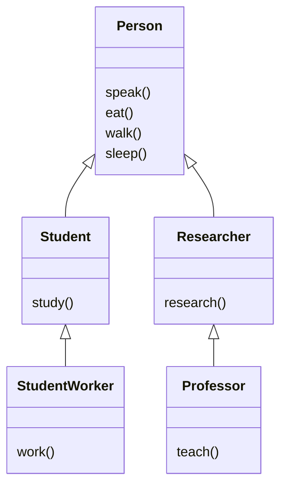
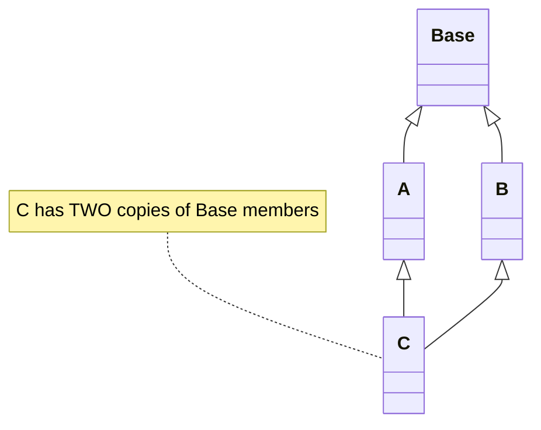

# Chapter 8 — Inheritance

[Repository Guide](../../README.md) | [English](Concepts_Lecture.md) | [한국어](Concepts_Lecture.ko.md)

> **Last Updated:** 2026-11-19
>
> 명품 C++ Programming, 황기태, Ch 8

> **Learning Objectives:**
> 1. Understand the concept of inheritance and declare derived classes
> 2. Explain the relationship between inheritance and object pointers through upcasting and downcasting
> 3. Explain `protected` access and the differences among public, protected, and private inheritance
> 4. Trace the execution order of constructors and destructors in an inheritance hierarchy
> 5. Declare multiple inheritance and resolve the diamond problem with virtual inheritance
> 6. Use the C++11 inheritance features `final`, `override`, and inheriting constructors

---

## Table of Contents

- [1. Inheritance Concepts](#1-inheritance-concepts)
  - [1.1 The Need for Inheritance](#11-the-need-for-inheritance)
  - [1.2 Syntax](#12-syntax)
  - [1.3 Inherited Members](#13-inherited-members)
  - [1.4 Inheritance and Object Pointers](#14-inheritance-and-object-pointers)
  - [1.5 An Example of Simplifying Classes Through Inheritance](#15-an-example-of-simplifying-classes-through-inheritance)
  - [1.6 IS-A and HAS-A Relationships](#16-is-a-and-has-a-relationships)
  - [1.7 Memory Layout of Derived Class Objects](#17-memory-layout-of-derived-class-objects)
- [2. Access Control with Inheritance](#2-access-control-with-inheritance)
  - [2.1 `public` Inheritance](#21-public-inheritance)
  - [2.2 `protected` Inheritance](#22-protected-inheritance)
  - [2.3 `private` Inheritance](#23-private-inheritance)
  - [2.4 Access Table](#24-access-table)
  - [2.5 Scope of Access to protected Members](#25-scope-of-access-to-protected-members)
  - [2.6 Tracing Access Specifiers in Nested Inheritance](#26-tracing-access-specifiers-in-nested-inheritance)
- [3. Constructor and Destructor in Inheritance](#3-constructor-and-destructor-in-inheritance)
  - [3.1 Constructor Chain](#31-constructor-chain)
  - [3.2 Destructor Chain](#32-destructor-chain)
  - [3.3 Example with Output Trace](#33-example-with-output-trace)
  - [3.4 Constructors and Destructors in Multilevel Inheritance](#34-constructors-and-destructors-in-multilevel-inheritance)
  - [3.5 When the Base Class Has No Default Constructor](#35-when-the-base-class-has-no-default-constructor)
  - [3.6 Order of Construction and Destruction with Member Objects](#36-order-of-construction-and-destruction-with-member-objects)
- [4. Member Function Overriding](#4-member-function-overriding)
  - [4.1 Overriding](#41-overriding)
  - [4.2 Calling the Base Version](#42-calling-the-base-version)
  - [4.3 Name Hiding and the using Declaration](#43-name-hiding-and-the-using-declaration)
- [5. Multiple Inheritance](#5-multiple-inheritance)
  - [5.1 Using Multiple Inheritance: A Calculator](#51-using-multiple-inheritance-a-calculator)
  - [5.2 Construction Order and Name Ambiguity in Multiple Inheritance](#52-construction-order-and-name-ambiguity-in-multiple-inheritance)
  - [5.3 Object Layout and Constructor Calls in Virtual Inheritance](#53-object-layout-and-constructor-calls-in-virtual-inheritance)
  - [5.4 What Virtual Inheritance Adds to an Object](#54-what-virtual-inheritance-adds-to-an-object)
- [6. Modern Inheritance Features (C++11)](#6-modern-inheritance-features-c11)
  - [6.1 The `final` Keyword](#61-the-final-keyword)
  - [6.2 The `override` Keyword](#62-the-override-keyword)
  - [6.3 Inheriting Constructors with `using`](#63-inheriting-constructors-with-using)
- [7. Common Mistakes](#7-common-mistakes)
  - [7.1 Initializing a Base Class Member Directly in a Derived Class Constructor](#71-initializing-a-base-class-member-directly-in-a-derived-class-constructor)
  - [7.2 Upcasting an Object That Uses private or protected Inheritance](#72-upcasting-an-object-that-uses-private-or-protected-inheritance)
  - [7.3 Putting virtual on Only One Side of the Diamond](#73-putting-virtual-on-only-one-side-of-the-diamond)
- [Summary](#summary)
- [Self-Check Questions](#self-check-questions)

---

<br>

## 1. Inheritance Concepts

### 1.1 The Need for Inheritance

**Inheritance** lets a new class (derived class) reuse and extend an existing class (base class).

Inheritance is a relationship defined between classes; there is no inheritance relationship between objects. A derived class inherits the attributes and functions of the base class and adds its own, so the concept of a class becomes more specific from the base class toward the derived class.

| Benefit | Explanation |
|:--------|:-----------|
| Code reuse | Common data and functions are written once in the base class |
| IS-A relationship | A `Car` **is a** `Vehicle`; a `Manager` **is an** `Employee` |
| Extensibility | New functionality is added in the derived class without modifying the base |

*Table 1. Benefits of inheritance*

**Terminology:**

| Term | Synonym |
|:-----|:--------|
| Base class | Parent class, Super class |
| Derived class | Child class, Sub class |

*Table 2. Synonyms for base and derived classes*

```text
   Base (Parent)
       ↑
   Derived (Child)
```

*Figure 1. Inheritance relationship between a base class and a derived class*

### 1.2 Syntax

```cpp
class Derived : public Base {
    // additional members
};
```

- The colon `:` is followed by the access specifier (`public`, `protected`, or `private`) and the base class name.
- **`public` inheritance** is the most common and preserves the IS-A relationship.
- If `class Student : public Person` is inherited again as `class StudentWorker : public Student`, `StudentWorker` inherits the members of `Student` together with the members that `Student` inherited from `Person`.

```cpp
class Vehicle {
    string brand;
    int year;
public:
    Vehicle(string b, int y) : brand(b), year(y) {}
    string getBrand() { return brand; }
    int getYear() { return year; }
protected:
    void updateYear(int y) { year = y; }
};

class Car : public Vehicle {
    int numDoors;
public:
    Car(string b = "Unknown", int y = 2024, int d = 4)
        : Vehicle(b, y), numDoors(d) {}
    void setDoors(int d) { numDoors = d; }
    void setYear(int y) { updateYear(y); }   // calls protected base member
    void show() {
        cout << getBrand() << " (" << getYear() << "), "
             << numDoors << " doors" << endl;
    }
};
```

### 1.3 Inherited Members

All members of the base class are inherited by the derived class. However, **accessibility** depends on the access specifier.

| Base member access | Access from derived class |
|:-------------------|:------------------------|
| `public` | Yes (directly accessible) |
| `protected` | Yes (directly accessible) |
| `private` | **No**: inherited but NOT directly accessible; must use public/protected getters |

*Table 3. Accessibility from the derived class by base member access*

```cpp
class Base {
    int secret;        // private
protected:
    int shared;        // protected
public:
    int open;          // public
    int getSecret() { return secret; }
};

class Derived : public Base {
public:
    void test() {
        // cout << secret;     // ERROR: private member of Base
        cout << shared;        // OK: protected is accessible
        cout << open;          // OK: public is accessible
        cout << getSecret();   // OK: public getter for private member
    }
};
```

A `protected` member can be accessed only from member functions of the declaring class and its derived classes. Other classes and external functions (e.g., `main()`) cannot access a `protected` member, whether through a base class object or through a derived class object. In the example above, if `main()` creates `Derived d;` and writes `d.shared = 1;`, it is a compile error.

> **Key Point:** `private` members are inherited (they exist in memory) but cannot be accessed directly from the derived class. Use getters defined in the base class to access them.

### 1.4 Inheritance and Object Pointers

A derived class object contains a base class part, so a base class pointer can point to a derived class object.

- **Upcasting** assigns a derived class pointer to a base class pointer. Like seeing a person as an animal, it is always safe and needs no explicit cast. Through the base class pointer, however, only members declared in the base class are accessible.
- **Downcasting** assigns a base class pointer to a derived class pointer. It always requires an explicit cast and is safe only when the pointer actually points to a derived class object.

```cpp
#include <iostream>
#include <string>
using namespace std;

class Point {
    int x, y;
public:
    void set(int x, int y) { this->x = x; this->y = y; }
    void showPoint() { cout << "(" << x << "," << y << ")" << endl; }
};

class ColorPoint : public Point {
    string color;
public:
    void setColor(string color) { this->color = color; }
    void showColorPoint() { cout << color << ":"; showPoint(); }
};

int main() {
    ColorPoint cp;
    ColorPoint *pDer = &cp;
    Point *pBase = pDer;            // upcasting: no cast needed

    pDer->set(3, 4);
    pBase->showPoint();             // (3,4)
    pDer->setColor("Red");
    pDer->showColorPoint();         // Red:(3,4)
    // pBase->showColorPoint();     // compile error: Point has no showColorPoint()

    ColorPoint *pDer2 = (ColorPoint *)pBase;   // downcasting: explicit cast required
    pDer2->showColorPoint();        // Red:(3,4)
    return 0;
}
```

The output is as follows.

```text
(3,4)
Red:(3,4)
Red:(3,4)
```

```text
                ColorPoint cp
pDer  ──▶  ┌──────────────────────┐
pBase ──▶  │ x, y                 │  Point part: accessible through pBase
           │ set(), showPoint()   │
           ├──────────────────────┤
           │ color                │  ColorPoint part: accessible only through pDer
           │ setColor(),          │
           │ showColorPoint()     │
           └──────────────────────┘
```

*Figure 2. Layout of a derived class object and the access range by pointer type*

| Kind | Direction of assignment | Cast | Members accessible through the pointer |
|:-----|:-----|:-----|:-----|
| Upcasting | Derived class pointer → base class pointer | Not needed | Members of the base class |
| Downcasting | Base class pointer → derived class pointer | Explicit cast required | Members of the derived class as well |

*Table 4. Upcasting and downcasting compared*

> **Caution:** If a downcast pointer actually points to a base class object rather than a derived class object, accessing a derived class member is undefined behavior. Use downcasting only when you know the actual type of the object the pointer points to.

### 1.5 An Example of Simplifying Classes Through Inheritance

If a student (`Student`), a working student (`StudentWorker`), a researcher (`Researcher`), and a professor (`Professor`) are each written as independent classes, all four classes contain their own copies of speaking, eating, walking, and sleeping. On top of these, the student also studies, the working student studies and works, the researcher does research, and the professor does research and teaches. The same functions are repeated four times, so changing the implementation of walking requires changes in four places.

Writing the common functions only once in a `Person` class and organizing the classes by inheritance gives the following.



*Figure 3. Class hierarchy organized by inheritance with the common functions gathered in Person*

Each class keeps only the one function that is its own. `StudentWorker` inherits from `Student`, so it has studying together with the speaking, eating, walking, and sleeping that `Student` inherited from `Person`. The implementation of walking exists only in `Person`, so changing that one place is reflected in all five classes. In this way, inheritance removes duplication between classes and organizes them into a hierarchy that runs from the general (`Person`) to the specific (`Professor`).

### 1.6 IS-A and HAS-A Relationships

The criterion for deciding whether to use inheritance is whether the relationship between the two classes can be stated as "the derived class is a kind of the base class". A student is a kind of person, so it is natural for `Student` to inherit from `Person`. Such a relationship is called an **IS-A relationship**.

A car, on the other hand, is not a kind of engine but has an engine. That relationship is a **HAS-A relationship**, and it is expressed not by inheritance but by **composition**, which keeps an object of the other class as a member variable.

```cpp
class Engine { /* ... */ };
class Car : public Engine { };    // inappropriate: a car is not a kind of engine
class Car2 { Engine engine; };    // appropriate: a car has an engine
```

If `Car` inherits from `Engine`, all the public member functions of `Engine` become public members of `Car`, and a `Car` object can even be pointed to by an `Engine *` through the upcasting of Section 1.4. This lets a car be treated as an engine, which contradicts the meaning of the design. If the only goal is code reuse, composition is the safer choice, and the order of construction and destruction of member objects is covered in Section 3.6.

### 1.7 Memory Layout of Derived Class Objects

An object of a derived class contains a whole object of the base class inside it. This contained part is called the **base class subobject**; in single inheritance it is usually placed at the very front of the derived class object, followed by the members the derived class adds. Checking Figure 2 with actual sizes and positions gives the following.

```cpp
#include <iostream>
using namespace std;

class Point {
public:
    int x = 1, y = 2;
};

class ColorPoint : public Point {
public:
    int color = 3;
};

class A { public: int a = 10; };
class B { public: int b = 20; };
class C : public A, public B { public: int c = 30; };

int main() {
    ColorPoint cp;
    Point *pp = &cp;                                   // upcasting
    cout << "sizeof(Point)=" << sizeof(Point) << ", sizeof(ColorPoint)=" << sizeof(ColorPoint) << endl;
    cout << "&cp == pp ? " << ((void *)&cp == (void *)pp) << endl;
    cout << "position of color: +" << (char *)&cp.color - (char *)&cp << endl;

    C obj;
    A *pa = &obj;
    B *pb = &obj;                                      // upcasting to the second base class
    cout << "sizeof(C)=" << sizeof(C) << endl;
    cout << "pa - &obj: +" << (char *)pa - (char *)&obj
         << ", pb - &obj: +" << (char *)pb - (char *)&obj << endl;
    cout << "pa->a=" << pa->a << ", pb->b=" << pb->b << endl;
    return 0;
}
```

```text
sizeof(Point)=8, sizeof(ColorPoint)=12
&cp == pp ? 1
position of color: +8
sizeof(C)=12
pa - &obj: +0, pb - &obj: +4
pa->a=10, pb->b=20
```

```text
 ColorPoint cp (12 bytes)              C obj (12 bytes)
   +0 ┌──────────┐ ◀── &cp, pp          +0 ┌──────────┐ ◀── &obj, pa
      │ x = 1    │  Point part             │ a = 10   │  A part
   +4 │ y = 2    │                      +4 ├──────────┤ ◀── pb
   +8 ├──────────┤                         │ b = 20   │  B part
      │ color = 3│  ColorPoint part     +8 ├──────────┤
      └──────────┘                         │ c = 30   │  C part
                                           └──────────┘
```

*Figure 4. Layout of derived class objects in single and multiple inheritance*

- **Single inheritance:** The size of `ColorPoint`, 12 bytes, is the 8 bytes of the members of `Point` plus the 4 bytes of `color`. The `Point` part is at the front, so the address of the upcast `pp` equals `&cp`, and what `pp` can reach is the `Point` part in the first 8 bytes (Section 1.4). `color` lies after it, at byte 8.
- **Multiple inheritance:** A `C` object holds the `A` part, the `B` part, and the members `C` adds, in the order of the inheritance list. `A *pa = &obj;` points to the `A` part at the front, so its address equals `&obj`, but for `B *pb = &obj;` the compiler adjusts the address to point to the `B` part 4 bytes later. That is why `pb->b` correctly reads 20. The explanation that upcasting "views the same address as a different type" holds only in single inheritance; in multiple inheritance the pointer value itself can change.

This layout resembles placing another structure as the first member of a structure in C. In C++, however, the compiler knows the position of the base class part and adjusts the address automatically when upcasting, so the programmer does not need to compute that position. The byte positions above were measured with Apple clang on macOS, and the exact layout of base class parts and members is not fully specified by the standard, so it may differ by implementation.

---

<br>

## 2. Access Control with Inheritance

The **inheritance access specifier** determines how base class members are exposed in the derived class. One of `public`, `protected`, or `private` is specified when inheritance is declared, and it decides how the access attributes of the base class's `protected` and `public` members are carried into the derived class.

### 2.1 `public` Inheritance

The most common form, in which base access levels are preserved as they are in the derived class.

```cpp
class Derived : public Base { };
```

| Base member | Becomes in Derived |
|:------------|:-------------------|
| `public` | `public` |
| `protected` | `protected` |
| `private` | inaccessible |

*Table 5. Member access under `public` inheritance*

### 2.2 `protected` Inheritance

Public members of the base become `protected` in the derived class. Rarely used in practice.

```cpp
class Derived : protected Base { };
```

| Base member | Becomes in Derived |
|:------------|:-------------------|
| `public` | `protected` |
| `protected` | `protected` |
| `private` | inaccessible |

*Table 6. Member access under `protected` inheritance*

### 2.3 `private` Inheritance

All accessible base members become `private` in the derived class. Rarely used.

```cpp
class Derived : private Base { };
```

| Base member | Becomes in Derived |
|:------------|:-------------------|
| `public` | `private` |
| `protected` | `private` |
| `private` | inaccessible |

*Table 7. Member access under `private` inheritance*

### 2.4 Access Table

| Base member | `public` inheritance | `protected` inheritance | `private` inheritance |
|:------------|:--------------------|:----------------------|:---------------------|
| `public` | `public` | `protected` | `private` |
| `protected` | `protected` | `protected` | `private` |
| `private` | inaccessible | inaccessible | inaccessible |

*Table 8. Base member access by inheritance type*

When inheritance is nested over several levels, the inheritance type of each level applies in turn. For example, with `class Derived : private Base`, the public and protected members of `Base` become private inside `Derived`, so member functions of `Derived` itself can call them, but member functions of a class that inherits from `Derived` cannot.

> **Key Point:** Regardless of the inheritance type, `private` members of the base class are **never** directly accessible from the derived class. Only `public` inheritance preserves the IS-A relationship.

### 2.5 Scope of Access to protected Members

A `protected` member can be accessed from member functions of a derived class but not from functions outside the class. The following example changes the coordinates `x` and `y` of `Point` to `protected` and adds `equals()`, which compares two points, to the derived class `ColorPoint`.

```cpp
#include <iostream>
#include <string>
using namespace std;

class Point {
protected:
    int x, y;                         // coordinates of a point (x, y)
public:
    void set(int x, int y) { this->x = x; this->y = y; }
    void showPoint() { cout << "(" << x << "," << y << ")" << endl; }
};

class ColorPoint : public Point {
    string color;
public:
    void setColor(string color) { this->color = color; }
    void showColorPoint() { cout << color << ":"; showPoint(); }
    bool equals(ColorPoint p) {
        return x == p.x && y == p.y && color == p.color;   // (1) protected members of another object p of the same class
    }
};

int main() {
    Point p;
    p.set(2, 3);
    // p.x = 5;                       // (2) error: main() cannot access protected members of Point
    p.showPoint();

    ColorPoint cp, cp2;
    // cp.x = 10;                     // (3) error: the same holds through a derived class object
    cp.set(3, 4);
    cp.setColor("Red");
    cp2.set(3, 4);
    cp2.setColor("Red");
    cp.showColorPoint();
    cout << (cp.equals(cp2) ? "true" : "false") << endl;
    return 0;
}
```

```text
(2,3)
Red:(3,4)
true
```

- **(1)** `equals()` is a member function of `ColorPoint`, so it can access not only `x` and `y` of its own object but also `p.x` and `p.y` of another `ColorPoint` object `p` received as a parameter. Access rights are granted per class, not per object. `cp` and `cp2` have the same coordinates and color, so `true` is printed.
- **(2)** `main()` is neither a member of `Point` nor a member of a derived class, so it cannot access `p.x`. Uncommenting the line makes Apple clang report "'x' is a protected member of 'Point'".
- **(3)** Accessing through the derived class object `cp` gives the same error, because the accessing code is still `main()`. To change the coordinates from outside, the public member function `set()` must be called.

| Where the access occurs | private member | protected member | public member |
|:----|:----|:----|:----|
| Member function of the same class | Allowed | Allowed | Allowed |
| Member function of a derived class | Not allowed | Allowed | Allowed |
| Function outside the class (`main()` etc.) | Not allowed | Not allowed | Allowed |

*Table 9. Accessibility by access specifier and by where the access occurs*

### 2.6 Tracing Access Specifiers in Nested Inheritance

As seen in Section 2.4, when inheritance is nested over several levels, the inheritance type of each level applies in turn. In the following code, `Derived` inherits `Base` privately, and `GrandDerived` again inherits `Derived` privately.

```cpp
#include <iostream>
using namespace std;

class Base {
    int a;
protected:
    void setA(int a) { this->a = a; }
public:
    void showA() { cout << a; }
};

class Derived : private Base {          // setA() and showA() of Base become private inside Derived
    int b;
protected:
    void setB(int b) { this->b = b; }
public:
    void showB() {
        setA(5);                        // (1) allowed: a private member of Derived itself
        showA();                        // (2) allowed
        cout << b;
    }
};

class GrandDerived : private Derived {
    int c;
protected:
    void setAB(int x) {
        setA(x);                        // (3) error: a member that became private inside Derived
        showA();                        // (4) error
        setB(x);                        // (5) allowed: a protected member of Derived
    }
};

int main() { }
```

```text
nest.cpp:28:9: error: 'setA' is a private member of 'Base'
nest.cpp:29:9: error: 'showA' is a private member of 'Base'
```

The trace takes two steps.

1. Through `Derived : private Base`, the protected member `setA()` and the public member `showA()` of `Base` become private members inside `Derived`. Private members can be accessed from the member functions of that class itself, so (1) and (2) in `Derived::showB()` are fine.
2. In `GrandDerived : private Derived`, among the members of `Derived` that `GrandDerived` inherits, `setA()` and `showA()` are already private members of `Derived`, so they cannot be accessed from the member functions of `GrandDerived` either. That is why (3) and (4) are errors. `setB()` is a protected member of `Derived`, so it can be accessed from the derived class `GrandDerived`, and (5) is fine.

If `Derived` inherited with `public Base`, `setA()` would remain protected inside `Derived`, and (3) would also become valid. The error message calls them private members of `Base` because the access is blocked by the private inheritance of `Base`.

---

<br>

## 3. Constructor and Destructor in Inheritance

### 3.1 Constructor Chain

When a derived object is created, the **base constructor runs first**, then the derived constructor. If no base constructor is explicitly called, the base's **default constructor** is used.

```cpp
class Base {
public:
    Base() { cout << "Base()" << endl; }
    Base(int x) { cout << "Base(" << x << ")" << endl; }
};

class Derived : public Base {
public:
    // Explicitly calls Base(int)
    Derived(int x, int y) : Base(x) {
        cout << "Derived(" << x << ", " << y << ")" << endl;
    }
};

// Usage
Derived d(10, 20);
// Output:
//   Base(10)
//   Derived(10, 20)
```

| Scenario | What happens |
|:---------|:-------------|
| No explicit base constructor call | Base **default constructor** is called automatically |
| Explicit call `Derived(args) : Base(args)` | The specified base constructor is called |
| Base has no default constructor and derived does not call one | **Compile error** |

*Table 10. Base class constructor called by a derived class constructor*

If a derived class constructor does not specify a base class constructor, the compiler implicitly inserts a call to the base class's default constructor (`: A()`) into that constructor. The same applies to derived class constructors with parameters.

```cpp
class A {
public:
    A() { cout << "Constructor A" << endl; }
    A(int x) { cout << "Param constructor A" << x << endl; }
};

class B : public A {
public:
    B() { cout << "Constructor B" << endl; }                     // compiled as B() : A()
    B(int x) { cout << "Param constructor B" << x << endl; }     // compiled as B(int x) : A()
    B(int x, int y) : A(x + 3) { cout << "Param constructor B" << x << endl; }   // explicitly selects A(int)
};

// Usage
B b1(5);      // output: Constructor A, Param constructor B5
B b2(5, 0);   // output: Param constructor A8, Param constructor B5
```

### 3.2 Destructor Chain

Destructors are called in **reverse** order of construction. The derived destructor runs first, then the base destructor.

```cpp
class Base {
public:
    ~Base() { cout << "~Base()" << endl; }
};

class Derived : public Base {
public:
    ~Derived() { cout << "~Derived()" << endl; }
};

// When a Derived object goes out of scope:
//   ~Derived()
//   ~Base()
```

| Order | Construction | Destruction |
|:------|:------------|:-----------|
| First | Base constructor | Derived destructor |
| Second | Derived constructor | Base destructor |

*Table 11. Execution order of constructors and destructors*

### 3.3 Example with Output Trace

```cpp
#include <iostream>
using namespace std;

class Employee {
    string name;
protected:
    double salary;
    string department;
public:
    Employee(string n, double sal, string dept)
        : name(n), salary(sal), department(dept) {
        cout << "Employee constructor" << endl;
    }
    ~Employee() { cout << "Employee destructor" << endl; }
    string getName() { return name; }
    double getSalary() { return salary; }
    string getDepartment() { return department; }
};

class Manager : public Employee {
    int teamSize;
public:
    Manager(string n, double sal, string dept, int ts)
        : Employee(n, sal, dept), teamSize(ts) {
        cout << "Manager constructor" << endl;
    }
    ~Manager() { cout << "Manager destructor" << endl; }
    double getBonus() {
        return salary * 0.15;
    }
    void display() {
        cout << "Name: " << getName() << endl;
        cout << "Department: " << department << endl;
        cout << "Salary: " << salary << endl;
        cout << "Team size: " << teamSize << endl;
        cout << "---------------" << endl;
        cout << "Bonus: " << getBonus() << endl << endl;
    }
};

int main() {
    Manager m("Alice", 75000, "Engineering", 8);
    m.display();
    return 0;
}
```

**Output:**

```text
Employee constructor
Manager constructor
Name: Alice
Department: Engineering
Salary: 75000
Team size: 8
---------------
Bonus: 11250

Manager destructor
Employee destructor
```

> **Key Point:** Construction proceeds from base to derived. Destruction proceeds from derived to base. This ensures that derived members that depend on base members are properly initialized and cleaned up.

### 3.4 Constructors and Destructors in Multilevel Inheritance

With several levels of inheritance, constructors run from the topmost base class and destructors from the bottommost derived class. When `C c;` is declared, the compiler compiles `C()` to call `B()` first and `B()` to call `A()` first, so the calls happen in the order C, B, A, but the constructor bodies run in the order A, B, C.

```cpp
#include <iostream>
using namespace std;

class A {
public:
    A() { cout << "Constructor A" << endl; }
    ~A() { cout << "Destructor A" << endl; }
};

class B : public A {
public:
    B() { cout << "Constructor B" << endl; }
    ~B() { cout << "Destructor B" << endl; }
};

class C : public B {
public:
    C() { cout << "Constructor C" << endl; }
    ~C() { cout << "Destructor C" << endl; }
};

int main() {
    C c;        // c is created
    return 0;   // c is destroyed
}
```

The output is as follows.

```text
Constructor A
Constructor B
Constructor C
Destructor C
Destructor B
Destructor A
```

Constructor arguments are also passed upward through the initializer list of each level. In the following example, the constructor of `SmartTV` passes 32 to `WideTV(size, true)`, and the constructor of `WideTV` passes it on to `TV(size)`.

```cpp
#include <iostream>
#include <string>
using namespace std;

class TV {
    int size;   // screen size
public:
    TV() { size = 20; }
    TV(int size) { this->size = size; }
    int getSize() { return size; }
};

class WideTV : public TV {   // WideTV inherits from TV
    bool videoIn;
public:
    WideTV(int size, bool videoIn) : TV(size) {
        this->videoIn = videoIn;
    }
    bool getVideoIn() { return videoIn; }
};

class SmartTV : public WideTV {   // SmartTV inherits from WideTV
    string ipAddr;   // internet address
public:
    SmartTV(string ipAddr, int size) : WideTV(size, true) {
        this->ipAddr = ipAddr;
    }
    string getIpAddr() { return ipAddr; }
};

int main() {
    // creates a 32-inch smart TV object with internet address "192.0.0.1"
    SmartTV htv("192.0.0.1", 32);
    cout << "size=" << htv.getSize() << endl;
    cout << "videoIn=" << boolalpha << htv.getVideoIn() << endl;
    cout << "IP=" << htv.getIpAddr() << endl;
}
```

The output is as follows.

```text
size=32
videoIn=true
IP=192.0.0.1
```

Inside the `htv` object, `size` in the TV part is 32, `videoIn` in the WideTV part is `true`, and `ipAddr` in the SmartTV part is `"192.0.0.1"`. `boolalpha` is a manipulator that makes `bool` values print as `true` and `false` instead of 1 and 0.

### 3.5 When the Base Class Has No Default Constructor

The last row of Table 10 looks as follows in actual code. `A` has only a constructor with a parameter, so the compiler does not generate the default constructor `A()`.

```cpp
class A {
public:
    A(int x) { }                  // only a constructor with a parameter: no default constructor A()
};

class B : public A {
public:
    B() { }                       // the compiler tries to make this B() : A(), but A() does not exist
};

int main() { B b; }
```

```text
nodef.cpp:8:5: error: constructor for 'B' must explicitly initialize the base class 'A' which does not have a default constructor
```

`B()` does not specify a base class constructor, so the compiler tries to insert a call to `A()`, but `A()` does not exist and a compile error results. There are two fixes. The derived class constructor can call `A(int)` explicitly, as in `B() : A(0) { }`, or a default constructor `A() { }` can be added to `A`. The first fix is usually better because it leaves the base class unchanged.

### 3.6 Order of Construction and Destruction with Member Objects

When a derived class has an object of another class as a member variable (the composition of Section 1.6), construction follows these three steps.

1. The constructor of the base class
2. The constructors of the member objects (in the **order of declaration** in the class)
3. The body of the derived class constructor

Destruction follows exactly the reverse of this order.

```cpp
#include <iostream>
using namespace std;

class Engine {
public:
    Engine() { cout << "Engine created" << endl; }
    ~Engine() { cout << "Engine destroyed" << endl; }
};

class Wheel {
public:
    Wheel() { cout << "Wheel created" << endl; }
    ~Wheel() { cout << "Wheel destroyed" << endl; }
};

class Vehicle {
public:
    Vehicle() { cout << "Vehicle created" << endl; }
    ~Vehicle() { cout << "Vehicle destroyed" << endl; }
};

class Car : public Vehicle {
    Wheel wheel;                  // order of declaration: wheel before engine
    Engine engine;
public:
    Car() : engine(), wheel() {   // the order of the initializer list does not change the order of execution
        cout << "Car created" << endl;
    }
    ~Car() { cout << "Car destroyed" << endl; }
};

int main() {
    Car c;
    cout << "---" << endl;
    return 0;
}
```

```text
Vehicle created
Wheel created
Engine created
Car created
---
Car destroyed
Engine destroyed
Wheel destroyed
Vehicle destroyed
```

The member initializer list of `Car()` lists `engine()` before `wheel()`, but the member objects are created in the order of declaration in the class, `wheel` and then `engine`. When the order of the initializer list differs from the order of declaration, compiling with `-Wall` makes Apple clang warn "field 'engine' will be initialized after field 'wheel'". The difference becomes a bug when the initial value of one member depends on the value of another, so it is good practice to write the initializer list in the order of declaration. Destruction runs in the reverse order of construction: the body of the `Car` destructor, `engine`, `wheel`, and `Vehicle`.

---

<br>

## 4. Member Function Overriding

### 4.1 Overriding

When a derived class defines a function with the **same name and signature** as a base class function, the derived version **hides** the base version.

```cpp
class Base {
public:
    void show() { cout << "Base::show()" << endl; }
};

class Derived : public Base {
public:
    void show() { cout << "Derived::show()" << endl; }   // redefines Base::show()
};

int main() {
    Derived d;
    d.show();   // calls Derived::show()
}
```

| Behavior | Explanation |
|:---------|:-----------|
| Same name and parameters | Derived version hides the base version |
| Called through derived object | The derived version is invoked |
| Base version is still present | It exists but is hidden from direct access |

*Table 12. Behavior when a derived class redefines a function of the same name*

> **Caution:** **Redefinition and overriding.** The textbook calls redefining a non-virtual function with the same form in a derived class **function redefinition**, and uses **overriding** for redefining a virtual function, covered in [Chapter 9](../Ch09_Virtual-Functions-and-Abstract-Classes/Concepts_Lecture.md). With redefinition, the function to call is decided by the declared type of the pointer or object, so if a base class pointer points to a `Derived` object as in Section 1.4 and calls `show()`, `Base::show()` runs. Also, name hiding happens by name alone regardless of parameters, so if the derived class has a function with the same name, base class functions of that name with different parameters cannot be called directly through a derived class object either.

### 4.2 Calling the Base Version

Use the scope resolution operator `Base::functionName()` to explicitly call the base class version from the derived class.

```cpp
class Derived : public Base {
public:
    void show() {
        Base::show();   // explicitly calls the base version
        cout << "Derived::show()" << endl;
    }
};
```

You can also call it from outside the class on a derived object.

```cpp
Derived d;
d.Base::show();   // calls Base::show() directly
```

### 4.3 Name Hiding and the using Declaration

As seen in the caution box of Section 4.1, once a derived class declares even one function with the same name as a function in the base class, all base class functions with that name are hidden, regardless of their parameters. This is called **name hiding**.

Name hiding arises from the order in which the compiler looks up function names. When compiling `d.print(7)`, the compiler first looks for the name `print` in the scope of `Derived`. If it finds the name there, it does not look further into the scope of the base class, and it performs overload resolution (Chapter 6) only among the functions it found.

```cpp
#include <iostream>
using namespace std;

class Base {
public:
    void print() { cout << "Base::print()" << endl; }
    void print(int n) { cout << "Base::print(int) " << n << endl; }
};

class Derived : public Base {
public:
    void print() { cout << "Derived::print()" << endl; }   // hides both print functions of Base
};

class Derived2 : public Base {
public:
    using Base::print;                                     // brings print of Base into the scope of Derived2
    void print() { cout << "Derived2::print()" << endl; }
};

int main() {
    Derived d;
    d.print();
    // d.print(7);           // error: the print() found in the scope of Derived takes no arguments
    d.Base::print(7);        // calling directly with the scope resolution operator works

    Derived2 d2;
    d2.print();              // Derived2::print()
    d2.print(7);             // Base::print(int), made visible by the using declaration
    return 0;
}
```

```text
Derived::print()
Base::print(int) 7
Derived2::print()
Base::print(int) 7
```

- In `Derived`, the lookup of `print` ends at `Derived::print()`, so `Base::print(int)` is not a candidate. Uncommenting `d.print(7)` makes Apple clang report "too many arguments to function call, expected 0, have 1". This shows that the compiler did not consider the existence of `print(int)` at all.
- When the base class is specified with the scope resolution operator, as in `d.Base::print(7)`, the name is looked up in the scope of `Base`, so the call works (Section 4.2).
- `using Base::print;` in `Derived2` is a **using-declaration**, which brings the functions named `print` from `Base` into the scope of `Derived2`. Then `print()` (its own) and `print(int)` (from `Base`) are candidates together in the scope of `Derived2`, and one is chosen by the arguments, as in function overloading. For `print()` with the same parameters, the derived class version takes precedence.

`using Base::Base;` in Section 6.3 is the same using-declaration, which has the special meaning of inheriting the base class constructors when the name is a constructor.

---

<br>

## 5. Multiple Inheritance

C++ supports **multiple inheritance**, where a class inherits from more than one base class.

```cpp
class A {
public:
    void funcA() { cout << "A" << endl; }
};

class B {
public:
    void funcB() { cout << "B" << endl; }
};

class C : public A, public B {
    // C inherits from both A and B
};

int main() {
    C obj;
    obj.funcA();   // from A
    obj.funcB();   // from B
}
```

Member functions of the derived class can also call members of both base classes directly. For example, `dial()` of `MusicPhone`, which inherits from both `MP3` and `MobilePhone`, can play music with `play()` of `MP3` and make a call with `sendCall()` of `MobilePhone`.

**Diamond problem:** When two base classes share a common ancestor, the derived class may inherit **two copies** of the ancestor's members.



*Figure 5. Diamond-shaped multiple inheritance*

Accessing a member of `Base` through a `C` object is then ambiguous between the two copies, so it is a compile error.

**Virtual inheritance** resolves this by ensuring only one shared copy of the common base. If `virtual` is placed before the base class when declaring the derived classes, the members of the virtual base class are created only once when an object of the derived class is created.

```cpp
class A : virtual public Base { };
class B : virtual public Base { };
class C : public A, public B { };   // only ONE copy of Base
```

> **Key Point:** Multiple inheritance adds complexity and can cause ambiguity. It is discouraged in most practical situations, and composition or single inheritance is preferred when possible.

### 5.1 Using Multiple Inheritance: A Calculator

Multiple inheritance makes it easy to build a class that gathers the functions of several existing classes. The following example builds the calculator `Calculator` by inheriting from both `Adder`, which only adds, and `Subtractor`, which only subtracts.

```cpp
#include <iostream>
using namespace std;

class Adder {
protected:
    int add(int a, int b) { return a + b; }
};

class Subtractor {
protected:
    int minus(int a, int b) { return a - b; }
};

class Calculator : public Adder, public Subtractor {   // multiple inheritance
public:
    int calc(char op, int a, int b);
};

int Calculator::calc(char op, int a, int b) {
    int res = 0;
    switch (op) {
        case '+': res = add(a, b); break;     // Adder::add()
        case '-': res = minus(a, b); break;   // Subtractor::minus()
    }
    return res;
}

int main() {
    Calculator handCalculator;
    cout << "2 + 4 = " << handCalculator.calc('+', 2, 4) << endl;
    cout << "100 - 8 = " << handCalculator.calc('-', 100, 8) << endl;
    return 0;
}
```

```text
2 + 4 = 6
100 - 8 = 92
```

`add()` and `minus()` are protected members of their base classes, so they can be called inside `calc()`, a member function of the derived class `Calculator`, but `main()` cannot call them directly, as in `handCalculator.add(2, 4)`. Only `calc()` is exposed to the outside, and the detailed functions that add and subtract are hidden by their access specifiers.

### 5.2 Construction Order and Name Ambiguity in Multiple Inheritance

In multiple inheritance, the base class constructors run in the **order written in the inheritance list** of the derived class declaration, and the destructors run in the reverse order. If two base classes have members with the same name, using that name through a derived class object is ambiguous, so one must be chosen with the scope resolution operator.

```cpp
#include <iostream>
using namespace std;

class MP3 {
public:
    MP3() { cout << "MP3 created" << endl; }
    ~MP3() { cout << "MP3 destroyed" << endl; }
    void play() { cout << "playing music" << endl; }
    void stop() { cout << "MP3 stopped" << endl; }
};

class MobilePhone {
public:
    MobilePhone() { cout << "MobilePhone created" << endl; }
    ~MobilePhone() { cout << "MobilePhone destroyed" << endl; }
    void sendCall() { cout << "placing a call" << endl; }
    void stop() { cout << "call ended" << endl; }
};

class MusicPhone : public MP3, public MobilePhone {   // order of the inheritance list: MP3, MobilePhone
public:
    MusicPhone() { cout << "MusicPhone created" << endl; }
    ~MusicPhone() { cout << "MusicPhone destroyed" << endl; }
    void dial() {
        play();          // MP3::play()
        sendCall();      // MobilePhone::sendCall()
    }
};

int main() {
    MusicPhone hanPhone;
    hanPhone.dial();
    // hanPhone.stop();         // error: ambiguous between MP3::stop() and MobilePhone::stop()
    hanPhone.MP3::stop();       // choose one with the scope resolution operator
    hanPhone.MobilePhone::stop();
    return 0;
}
```

```text
MP3 created
MobilePhone created
MusicPhone created
playing music
placing a call
MP3 stopped
call ended
MusicPhone destroyed
MobilePhone destroyed
MP3 destroyed
```

- The inheritance list is `public MP3, public MobilePhone`, so the objects are created in the order `MP3`, `MobilePhone`, `MusicPhone`, and destroyed in the reverse order. The order in which base classes are written in the member initializer list of the constructor does not change this order.
- `play()` and `sendCall()` exist in only one base class each, so they can be called as they are inside `dial()`.
- `stop()` exists in both base classes. Uncommenting `hanPhone.stop()` makes Apple clang report "member 'stop' found in multiple base classes of different types". The compiler does not choose between two functions by name alone, so the base class must be specified, as in `hanPhone.MP3::stop()`.

### 5.3 Object Layout and Constructor Calls in Virtual Inheritance

Making the diamond problem (Figure 5) concrete with input/output classes gives the following. `BaseIO` holds the input/output mode `mode`, the input class `In` and the output class `Out` each inherit from `BaseIO`, and the input/output class `InOut` inherits from both `In` and `Out`. First, inheriting without `virtual` creates two `BaseIO` objects inside an `InOut` object.

```cpp
#include <iostream>
using namespace std;

class BaseIO {
public:
    int mode;
    BaseIO(int m = 0) : mode(m) { cout << "BaseIO(" << m << ") created" << endl; }
};

class In : public BaseIO {               // no virtual
public:
    In() : BaseIO(1) { cout << "In created" << endl; }
};

class Out : public BaseIO {              // no virtual
public:
    Out() : BaseIO(2) { cout << "Out created" << endl; }
};

class InOut : public In, public Out {
public:
    InOut() { cout << "InOut created" << endl; }
};

int main() {
    InOut ioObj;
    // ioObj.mode = 5;                   // error: ambiguous which of the two BaseIO objects owns mode
    cout << "In::mode=" << ioObj.In::mode << " Out::mode=" << ioObj.Out::mode << endl;
    cout << "sizeof(BaseIO)=" << sizeof(BaseIO) << " sizeof(InOut)=" << sizeof(InOut) << endl;
    return 0;
}
```

```text
BaseIO(1) created
In created
BaseIO(2) created
Out created
InOut created
In::mode=1 Out::mode=2
sizeof(BaseIO)=4 sizeof(InOut)=8
```

The constructor of `BaseIO` runs twice, and the `mode` reached through `In` (1) and the `mode` reached through `Out` (2) hold different values. The size of `InOut`, 8 bytes, shows that it contains two 4-byte `int mode` members (in an environment where `int` is 4 bytes). Uncommenting `ioObj.mode = 5;` makes Apple clang report "non-static member 'mode' found in multiple base-class subobjects of type 'BaseIO'".

If `In` and `Out` inherit `BaseIO` virtually, only one `BaseIO` is created. In the following input/output classes, each class has its own member (`readPos`, `writePos`, `safe`) and a constructor that prints a creation message.

```cpp
#include <iostream>
using namespace std;

class BaseIO {
public:
    int mode;
    BaseIO(int m = 0) : mode(m) { cout << "BaseIO(" << m << ") created" << endl; }
};

class In : virtual public BaseIO {       // In inherits BaseIO virtually
public:
    int readPos = 0;
    In() : BaseIO(1) { cout << "In created" << endl; }
};

class Out : virtual public BaseIO {      // Out inherits BaseIO virtually
public:
    int writePos = 0;
    Out() : BaseIO(2) { cout << "Out created" << endl; }
};

class InOut : public In, public Out {
public:
    bool safe = false;
    InOut() : BaseIO(3) { cout << "InOut created" << endl; }   // the most derived class constructs the virtual base class
};

int main() {
    InOut ioObj;
    ioObj.readPos = 10;
    ioObj.writePos = 20;
    ioObj.safe = true;
    ioObj.mode = 5;                      // only one BaseIO exists, so this is not ambiguous
    cout << "mode=" << ioObj.mode << " In::mode=" << ioObj.In::mode
         << " Out::mode=" << ioObj.Out::mode << endl;
    return 0;
}
```

```text
BaseIO(3) created
In created
Out created
InOut created
mode=5 In::mode=5 Out::mode=5
```

```text
ioObj (InOut object)
  In part       readPos  = 10
  Out part      writePos = 20
  InOut part    safe     = true
  BaseIO part   mode     = 5      ← the single BaseIO shared by In and Out
```

*Figure 6. Layout of an InOut object that uses virtual inheritance*

- **BaseIO is created only once.** `BaseIO(...) created` is printed only once, and `ioObj.mode`, `ioObj.In::mode`, and `ioObj.Out::mode` all refer to the same variable, 5. That is why `ioObj.mode = 5;` is not ambiguous.
- **The most derived class constructs the virtual base class.** The initializer lists of `In()` and `Out()` contain `BaseIO(1)` and `BaseIO(2)`, but both are ignored when an `InOut` object is created, and the `BaseIO(3)` specified by `InOut()` is called. Because there is only one `BaseIO`, letting either `In` or `Out` construct it would ignore the other's argument and make the result depend on the order of the inheritance list, so C++ gives that responsibility to the lowest class that actually creates the object (`InOut`). If `InOut()` does not specify a `BaseIO` constructor, the default constructor of `BaseIO` is called.
- **The virtual base class is created first.** Even though the inheritance list is `In, Out`, the virtual base class `BaseIO` is created first, followed by `In`, `Out`, and `InOut`.

### 5.4 What Virtual Inheritance Adds to an Object

Virtual inheritance merges the common base class into one, but in exchange the object grows a little. Keeping only the members of the input/output classes of Section 5.3 and comparing the sizes of the two approaches gives the following.

```cpp
#include <iostream>
using namespace std;

class BaseIO { public: int mode = 0; };
class In1 : public BaseIO { public: int readPos = 0; };
class Out1 : public BaseIO { public: int writePos = 0; };
class InOut1 : public In1, public Out1 { };                 // no virtual inheritance

class In2 : virtual public BaseIO { public: int readPos = 0; };
class Out2 : virtual public BaseIO { public: int writePos = 0; };
class InOut2 : public In2, public Out2 { };                 // virtual inheritance

int main() {
    cout << "no virtual inheritance: sizeof(InOut1)=" << sizeof(InOut1) << endl;
    cout << "virtual inheritance:    sizeof(InOut2)=" << sizeof(InOut2) << endl;
    return 0;
}
```

```text
no virtual inheritance: sizeof(InOut1)=16
virtual inheritance:    sizeof(InOut2)=32
```

`InOut1`, without virtual inheritance, is 16 bytes for four `int`s (`mode` and `readPos` of `In1`, `mode` and `writePos` of `Out1`). `InOut2`, with virtual inheritance, has only one `mode`, so the number of `int`s drops to three, yet it is larger at 32 bytes. The position of the shared `BaseIO` part differs from object to object (for example, between an `In2` object created alone and the `In2` part inside an `InOut2`), so common implementations put a hidden pointer used to find the shared part into the `In2` part and into the `Out2` part, and each of these pointers takes 8 bytes in a 64-bit environment. The size and the implementation method differ by compiler.

Because of this hidden information, accessing a member of a virtual base class takes one extra step, and the object grows. Virtual inheritance is used only when the diamond problem must be solved, not for multiple inheritance without a common base class (the `Calculator` of Section 5.1).

---

<br>

## 6. Modern Inheritance Features (C++11)

### 6.1 The `final` Keyword

C++11 introduced the `final` specifier, which makes a class **no longer inheritable** or a virtual function **no longer overridable**.

**Preventing class inheritance:**

```cpp
class Base final {
    // ...
};

// class Derived : public Base { };  // ERROR: Base is marked final
```

**Preventing function overriding:**

```cpp
class Animal {
public:
    virtual void speak() { }
};

class Dog : public Animal {
public:
    void speak() final { cout << "Woof!" << endl; }  // no further override allowed
};

class Puppy : public Dog {
public:
    // void speak() { }   // ERROR: Dog::speak() is marked final
};
```

| Usage | Effect |
|:------|:-------|
| `class MyClass final { };` | No class can inherit from `MyClass` |
| `void func() final;` | No derived class can override `func()` |

*Table 13. Usage and effect of the `final` specifier*

`final` is useful for:
- **Safety:** It prevents unintended extension of a critical class.
- **Performance:** The compiler can devirtualize calls to `final` methods, avoiding the virtual function overhead.

### 6.2 The `override` Keyword

C++11 also introduced the `override` specifier. It tells the compiler that a function is intended to override a base class virtual function. If the function does not actually override anything (e.g., due to a typo in the function name or parameter mismatch), the compiler will produce an error.

```cpp
class Base {
public:
    virtual void display() const { }
};

class Derived : public Base {
public:
    void display() const override { }   // OK: correctly overrides Base::display()
    // void dispaly() const override { } // ERROR: typo, no such function in Base to override
};
```

> **Note:** **Tip.** It is good practice to always use `override` when overriding virtual functions. It catches subtle bugs at compile time. This keyword is covered in detail in [Chapter 9 (Virtual Functions and Abstract Classes)](../Ch09_Virtual-Functions-and-Abstract-Classes/Concepts_Lecture.md).

### 6.3 Inheriting Constructors with `using`

C++11 allows a derived class to **inherit** the constructors of the base class through a `using` declaration, avoiding the need to manually write forwarding constructors.

```cpp
class Base {
public:
    Base(int x) { cout << "Base(int): " << x << endl; }
    Base(int x, int y) { cout << "Base(int, int): " << x << ", " << y << endl; }
    Base(string s) { cout << "Base(string): " << s << endl; }
};

class Derived : public Base {
public:
    using Base::Base;   // inherit ALL constructors from Base

    // Derived can still add its own constructors
    Derived() : Base(0) { cout << "Derived default" << endl; }
};

int main() {
    Derived d1(42);          // calls Base(int) via inherited constructor
    Derived d2(1, 2);        // calls Base(int, int) via inherited constructor
    Derived d3("hello");     // calls Base(string) via inherited constructor
    Derived d4;              // calls Derived's own default constructor
    return 0;
}
```

The output is as follows. For `d4`, `Derived()` first calls `Base(0)` in its initializer list, so `Base(int): 0` is printed first.

```text
Base(int): 42
Base(int, int): 1, 2
Base(string): hello
Base(int): 0
Derived default
```

**Without `using Base::Base`**, you would need to write a forwarding constructor for each base constructor.

```cpp
// Tedious manual forwarding (pre-C++11 style)
class Derived : public Base {
public:
    Derived(int x) : Base(x) { }
    Derived(int x, int y) : Base(x, y) { }
    Derived(string s) : Base(s) { }
};
```

> **Note:** Inherited constructors only initialize the base class portion. If the derived class has additional member variables that need initialization, you should provide your own constructors or use default member initializers. Also, the copy and move constructors of the base class are not inherited by the `using` declaration.

---

<br>

## 7. Common Mistakes

### 7.1 Initializing a Base Class Member Directly in a Derived Class Constructor

```cpp
class Base {
protected:
    int x;
public:
    Base(int x = 0) : x(x) { }
};

class Derived : public Base {
public:
    Derived(int v) : x(v) { }      // wrong: initializes a base class member directly
};
```

```text
error: member initializer 'x' does not name a non-static data member or base class
```

`x` is a protected member that `Derived` can access, but a member initializer list can name only the members the class declares itself, its direct base classes, and the virtual base classes of Section 5.3. Base class members are initialized by the base class constructor, so the value is passed to the base class constructor, as in `Derived(int v) : Base(v) { }`. The constructor body could assign it with `x = v;`, but then `x` is first initialized to 0 by `Base()` and assigned again afterward.

### 7.2 Upcasting an Object That Uses private or protected Inheritance

```cpp
class Hidden : private Base { };

int main() {
    Hidden h;
    Base *p = &h;                  // wrong: upcasting to a private base class
}
```

```text
error: cannot cast 'Hidden' to its private base class 'Base'
```

The upcasting of Section 1.4 works without a cast because, in public inheritance, the derived class keeps the public interface of the base class as it is. In private or protected inheritance, the public members of the base class are hidden from the outside, so upcasting is also forbidden to keep outside code from reaching those members through a `Base *`. To express an IS-A relationship (Section 1.6), use public inheritance.

### 7.3 Putting virtual on Only One Side of the Diamond

If, in the input/output classes of Section 5.3, only `In` inherits with `virtual public BaseIO` while `Out` inherits with `public BaseIO`, an `InOut` object contains two `BaseIO` objects: one virtual `BaseIO` shared through `In` and one ordinary `BaseIO` of `Out`. Running `ioObj.In::mode = 5;` in `main()` and then printing the two `mode` members gives 5 for `In::mode` and 2 for `Out::mode`, which confirms that the two variables are separate. In this case an unqualified `ioObj.mode` is again an ambiguity error. To merge the common base class into one, every intermediate class that inherits from it must inherit with `virtual`.

---

<br>

## Summary

| Concept | Key Summary |
|:--------|:-------------|
| The need for inheritance | A derived (child) class inherits the members of a base (parent) class, gaining code reuse, an IS-A relationship, and extensibility. |
| Syntax | It is declared as `class Derived : public Base { };`, and `public` is the most common inheritance type. |
| Inherited members | All members are inherited, but `private` members are not directly accessible, and `protected` members are accessible only from member functions of derived classes. |
| Inheritance and object pointers | Upcasting needs no cast but gives access only to base class members, while downcasting requires an explicit cast. |
| `public` inheritance | Public stays public, protected stays protected, and private is inaccessible. |
| `protected` inheritance | Both public and protected become protected, and it is rarely used. |
| `private` inheritance | All accessible members become private, and it is rarely used. |
| Access table | `private` members of the base are never directly accessible regardless of the inheritance type. |
| Constructor chain | The base constructor runs first and the derived constructor afterward, and `Derived(args) : Base(args)` selects a base constructor explicitly. |
| Implicit default constructor call | If no base constructor is specified, the compiler inserts a call to `: Base()`, so a base class without a default constructor causes a compile error. |
| Destructor chain | The derived destructor runs first and the base destructor afterward, in reverse order of construction. |
| Multilevel inheritance | Constructor bodies run from the topmost base class and destructors from the bottommost derived class, and arguments are passed upward through the initializer lists. |
| Overriding | Redefining a function of the same name in a derived class hides the base version, and the textbook calls this function redefinition when the function is not virtual. |
| Calling base version | It is called as `Base::functionName()` inside the derived class and as `obj.Base::func()` from outside. |
| Multiple inheritance | It is declared as `class C : public A, public B { };`, the diamond problem is resolved with virtual inheritance, and it is discouraged in practice. |
| `final` (C++11) | `class X final` prevents inheritance and `void f() final` prevents overriding, enabling compiler optimizations. |
| `override` (C++11) | It marks an intent to override a base virtual function and catches signature mismatches at compile time. |
| Inheriting constructors (C++11) | `using Base::Base;` inherits the base class constructors, so manual forwarding constructors are unnecessary. |
| Simplification through inheritance | Writing a function repeated in several classes only once in a base class removes the duplication and turns the classes into a hierarchy that runs from the general to the specific. |
| IS-A and HAS-A | If the derived class is a kind of the base class, use inheritance; if one object has another, use composition with a member object. |
| Scope of protected access | Access rights are per class, so a member function of a derived class can access the protected members of another object of the same class, while functions outside the class cannot. |
| Access specifiers in nested inheritance | The inheritance type of each level applies in turn, so a member made private by private inheritance cannot be accessed in the next derived class. |
| Construction order with member objects | The base class, the member objects in declaration order, and the body of the derived class constructor are created in that order and destroyed in the reverse order, and the order of the initializer list does not change it. |
| Name hiding | If a derived class has even one function with a given name, all base class functions with that name are hidden, and `using Base::f;` makes them visible again. |
| Construction order and ambiguity in multiple inheritance | Base classes are created in the order of the inheritance list, and when two base classes have the same name, one is chosen with the scope resolution operator, as in `obj.A::f()`. |
| Construction of a virtual base class | A virtual base class is created only once and first, and its constructor is specified by the most derived class. |
| Layout of derived class objects | A derived class object contains a base class subobject, which in single inheritance is usually at the front so the upcast address is the same, while in multiple inheritance upcasting to the second base class changes the address. |
| Cost of virtual inheritance | Virtual inheritance merges the common base class into one but adds hidden information for finding the shared part, making objects larger, so it is used only when there is a diamond problem. |

---

<br>

## Self-Check Questions

1. **Upcasting:** With `Point` and `ColorPoint` from Section 1.4, does `pBase->setColor("Red");` compile after `ColorPoint cp; Point *pBase = &cp;`? Explain why and give a way to set the color of `cp`.

   <details>
   <summary>Answer</summary>

   It does not compile. The type of `pBase` is `Point *`, so only members declared in `Point` are accessible through it, and `setColor()` exists only in `ColorPoint`. Call it directly on the object as `cp.setColor("Red");`, or, since `pBase` actually points to a `ColorPoint` object, downcast first as `((ColorPoint *)pBase)->setColor("Red");`.

   </details>

2. **Passing constructor arguments:** In the following code, after `C c(3, 5, 2);` runs, give the values of `x` in `A`, `y` in `B`, and `m` in `C`, and the order in which the three constructor bodies run.

   ```cpp
   class A {
       int x;
   public:
       A() { x = 0; }
       A(int x) { this->x = x; }
   };
   class B : public A {
       int y;
   public:
       B(int x, int y) : A(x + 5) { this->y = y; }
   };
   class C : public B {
       int m;
   public:
       C(int x, int y, int z) : B(x, y) { m = x * y * z; }
   };
   ```

   <details>
   <summary>Answer</summary>

   `x` is 8, `y` is 5, and `m` is 30. `C(3, 5, 2)` calls `B(3, 5)`, and `B(3, 5)` calls `A(3 + 5)`, that is, `A(8)`, so the calls happen in the order C, B, A. The constructor bodies run with A first, storing `x = 8`, then B storing `y = 5`, and finally C storing `m = 3 * 5 * 2 = 30`.

   </details>

3. **`private` inheritance:** Pick every line in the following code that causes a compile error and explain why.

   ```cpp
   class Base {
       int a;
   protected:
       void setA(int a) { this->a = a; }
   public:
       void showA() { cout << a; }
   };
   class Derived : private Base {
       int b;
   protected:
       void setB(int b) { this->b = b; }
   public:
       void showB() { cout << b; }
   };
   int main() {
       Derived x;
       x.a = 5;        // (1)
       x.setA(10);     // (2)
       x.showA();      // (3)
       x.b = 10;       // (4)
       x.setB(10);     // (5)
       x.showB();      // (6)
   }
   ```

   <details>
   <summary>Answer</summary>

   Lines (1) through (5) are all errors, and only (6) compiles. `a` in (1) is a private member of `Base`, so it is not accessible anywhere. `setA()` and `showA()` in (2) and (3) became private inside `Derived` through private inheritance, so `main()` cannot call them. `b` in (4) is a private member of `Derived`, and `setB()` in (5) is a protected member of `Derived`, so the external function `main()` cannot access them. Only `showB()` in (6) is a public member of `Derived`. Changing the inheritance type to `protected` produces errors on the same lines.

   </details>

4. **Diamond problem:** `class Base { public: int x; };` is inherited by `class A : public Base {};` and `class B : public Base {};`, and `class C : public A, public B {};` uses multiple inheritance. Explain why `C c; c.x = 1;` does not compile and how to fix it.

   <details>
   <summary>Answer</summary>

   A `C` object contains two `Base` subobjects, one through `A` and one through `B`, so it is ambiguous which `Base`'s `x` `c.x` refers to, and compilation fails. Declaring `A` and `B` with virtual inheritance, as `class A : virtual public Base {};` and `class B : virtual public Base {};`, creates `Base` only once in a `C` object, so `c.x` refers to a single member.

   </details>

5. **Redefinition and pointers:** When `Base` and `Derived` each define a non-virtual `show()` as in Section 4.1, what does `Derived d; Base *p = &d; p->show();` print?

   <details>
   <summary>Answer</summary>

   It prints `Base::show()`. For a non-virtual function, the function to call is decided by the declared type of the pointer, so even though `p` points to a `Derived` object, `Base::show()` is called because `p` is a `Base *`. Calling `Derived::show()` according to the actual type of the object requires the virtual functions of Chapter 9.

   </details>

6. **Member objects and construction order:** If the member declarations of `Car` in Section 3.6 are changed to `Engine engine; Wheel wheel;` and the initializer list is left as it is, in what order are the creation messages of `Car c;` printed?

   <details>
   <summary>Answer</summary>

   The order is Vehicle created, Engine created, Wheel created, Car created. The base class `Vehicle` is created first, the member objects are created in the order of declaration in the class, `engine` then `wheel`, and finally the body of the `Car` constructor runs. In this case the order of the initializer list matches the order of declaration, so the warning about the order also disappears.

   </details>

7. **Name hiding:** Without adding `using Base::print;` to `Derived` in Section 4.3, give two ways to make `d.print(7)` compile.

   <details>
   <summary>Answer</summary>

   First, the caller specifies the base class function directly with the scope resolution operator, as in `d.Base::print(7)`. Second, `Derived` defines a function with the same parameter that calls the base class function, as in `void print(int n) { Base::print(n); }`. Then `print(int)` can be found in the scope of `Derived`, so `d.print(7)` compiles.

   </details>

8. **Constructor of a virtual base class:** In the virtual inheritance version of Section 5.3, if `InOut()` is changed to `InOut() { cout << "InOut created" << endl; }`, what is the first line of output and what is the value of `mode` before `ioObj.mode = 5;`?

   <details>
   <summary>Answer</summary>

   The first line is `BaseIO(0) created`, and `mode` is 0. The virtual base class `BaseIO` is constructed by the most derived class, `InOut`, and since `InOut()` does not specify a `BaseIO` constructor, the default constructor is called, that is, `BaseIO(int m = 0)` with the default argument 0. The `BaseIO(1)` and `BaseIO(2)` of `In()` and `Out()` are ignored in this case.

   </details>

9. **Object layout:** With a 4-byte `int`, give `sizeof(Q)` for `class P { public: int x; }; class Q : public P { public: int y; int z; };`, and where `p` points for `Q q; P *p = &q;`.

   <details>
   <summary>Answer</summary>

   In common implementations, `sizeof(Q)` is 12 bytes, the 4 bytes of the `P` part plus the 8 bytes of `y` and `z`. With single inheritance the `P` part is at the front of `q`, so `p` points to the same address as `q`, that is, to the start of the `P` part.

   </details>

10. **Upcasting in multiple inheritance:** For `C obj;` of Section 1.7, why does the address of `B *pb = &obj;` differ from `&obj`? If it is converted back with `C *pc = static_cast<C *>(pb);`, which address does `pc` point to?

    <details>
    <summary>Answer</summary>

    Inside a `C` object, the `B` part lies after the `A` part, at byte 4, so the compiler adds 4 to the address when upcasting so that the `B*` points to the `B` part. `static_cast<C *>(pb)` subtracts 4 in the opposite direction, so `pc` again points to the start of `obj`, `&obj`. This downcast is correct only when `pb` actually points to the `B` part of a `C` object.

    </details>

11. **Size with virtual inheritance:** Explain why `InOut2` in Section 5.4 is larger than `InOut1` even though it has only three `int`s. What is the criterion for deciding to use virtual inheritance?

    <details>
    <summary>Answer</summary>

    The position of the `BaseIO` part, the virtual base class, varies from object to object, so common implementations place one hidden pointer used to find the shared part in the `In2` part and in the `Out2` part. In a 64-bit environment these pointers take 8 bytes each, so `InOut2`, with one fewer `int`, grows to 32 bytes. Virtual inheritance is used only when a common base class inherited along two paths in a diamond structure must be merged into one, and not for multiple inheritance without a common base class.

    </details>

12. **IS-A and HAS-A:** A `Stack` class is to be built by reusing the storage of `DynArray`, which has the public member functions `get(i)` and `put(i, v)` that read and write an element at any position. Which design is more suitable, `class Stack : public DynArray` or `class Stack { DynArray arr; ... };`? Give the reason.

    <details>
    <summary>Answer</summary>

    Composition (`DynArray arr;`) is more suitable. A stack is not a kind of array but is implemented using an array, so the relationship is HAS-A. With public inheritance, all public member functions of `DynArray`, including `get()` and `put()`, become part of the public interface of `Stack`, allowing access at arbitrary positions that bypasses the rule of a stack (insert and remove only at the top), and a stack could even be treated as an array through an upcast to `DynArray*`. With composition, `Stack` decides exactly which functions to expose.

    </details>
