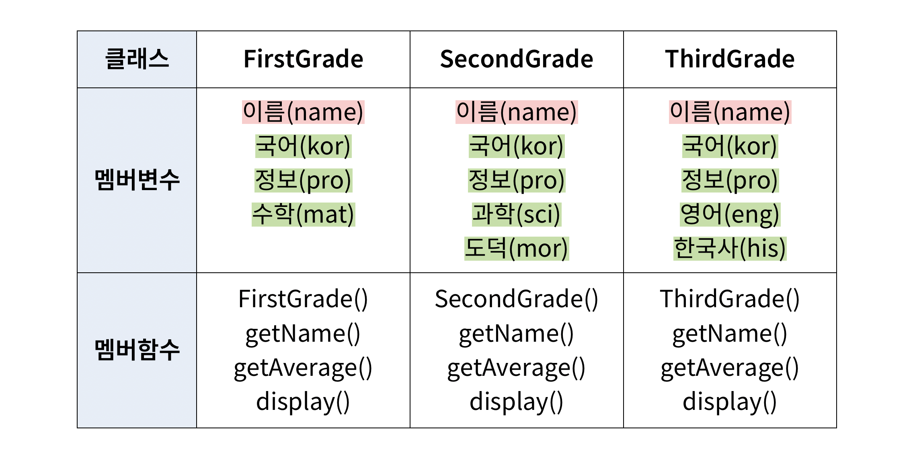

# 8장 연습 문제 — 상속

[레포지토리 안내](../../README.ko.md) | [English](Exercises.md) | [한국어](Exercises.ko.md)

> **최종 수정일:** 2026-10-27
>
> 명품 C++ Programming, 황기태, Ch 8

**문항 출처:** 임영희 교수, 컴퓨터언어Ⅱ (DCCS102-04)

---

<br>

## 목차

- [연습 문제 1: 점의 색상과 위치 정보](#연습-문제-1-점의-색상과-위치-정보)
- [연습 문제 2: 학생 성적 관리](#연습-문제-2-학생-성적-관리)
- [교재 이론 문제](#교재-이론-문제)

---

<br>

## 연습 문제 1: 점의 색상과 위치 정보

**문제:** 예시 코드와 실행 예시를 참고하여 `main()` 함수가 정상적으로 실행되도록 `ColorPoint` 클래스를 정의하라. `ColorPoint` 클래스는 `Point` 클래스의 파생 클래스이다. 교재 8장 실습 문제 3, 4번을 바탕으로 한 문제이다.

**프로그램 요구사항**

- [ 빈칸 ]을 완성하되, 주어진 예시 코드는 변경할 수 없다.

**예시 코드**

```cpp
#include <iostream>
using namespace std;

class Point {
    int x, y;
public:
    Point(int x, int y) { this->x = x; this->y = y; }
    int getX() { return x; }
    int getY() { return y; }
protected:
    void move(int x, int y) { this->x = x; this->y = y; }
};

class ColorPoint : public Point {
    // ColorPoint 클래스 정의
    [ 빈칸 ]
};

int main() {
    ColorPoint cp1(5, 5, "RED");  // 색상 "RED", 위치 (5, 5)로 초기화
    cp1.show();
    cp1.setPoint(10, 20);         // 위치 (10, 20)으로 설정
    cp1.setColor("BLUE");         // 색상 "BLUE"로 설정
    cp1.show();

    ColorPoint cp2(5, 5);         // 색상 "BLACK", 위치 (5, 5)로 초기화
    cp2.show();
    cp2.setPoint(3, 7);           // 위치 (3, 7)로 설정
    cp2.setColor("GREEN");        // 색상 "GREEN"으로 설정
    cp2.show();

    ColorPoint zeroPoint;         // 색상 "BLACK", 위치 (0, 0)로 초기화
    zeroPoint.show();

    return 0;
}
```

**실행 예시**

```text
RED색으로 (5, 5)에 위치한 점입니다.
BLUE색으로 (10, 20)에 위치한 점입니다.
BLACK색으로 (5, 5)에 위치한 점입니다.
GREEN색으로 (3, 7)에 위치한 점입니다.
BLACK색으로 (0, 0)에 위치한 점입니다.

Program ended with exit code: 0
```

**[풀이](Solutions.ko.md#연습-문제-1-점의-색상과-위치-정보)**

---

<br>

## 연습 문제 2: 학생 성적 관리

**문제:** 예시 코드와 실행 예시를 참고하여 `main()` 함수가 정상적으로 실행되도록 상속 구조를 고려하여 `Student` 클래스와 파생 클래스를 완성하라. `Student` 클래스는 세 파생 클래스 `FirstGrade`, `SecondGrade`, `ThirdGrade`에서 중복되는 요소를 가지고 있으며, 세 파생 클래스는 `Student` 클래스 상속을 통해 구현된다.



*그림 1. FirstGrade, SecondGrade, ThirdGrade 클래스의 멤버 변수와 멤버 함수*

세 클래스는 모두 이름(`name`), 국어(`kor`), 정보(`pro`) 점수를 멤버 변수로 가지며, `FirstGrade`는 수학(`mat`), `SecondGrade`는 과학(`sci`)과 도덕(`mor`), `ThirdGrade`는 영어(`eng`)와 한국사(`his`) 점수를 더 가진다. 멤버 함수는 세 클래스 모두 생성자, 이름을 반환하는 `getName()`, 성적 평균을 반환하는 `getAverage()`, 성적을 출력하는 `display()`이다.

그림 1에서 빨간색으로 표시한 요소(이름)는 `private`, 초록색으로 표시한 요소(과목별 점수)는 `protected`로 접근을 제어한다.

**프로그램 요구사항**

- 주어진 예시 코드는 변경할 수 없다.

**예시 코드**

```cpp
#include <iostream>
using namespace std;

int main() {
    // 이름, 국어, 정보, 수학 점수 초기화
    FirstGrade f("홍길동", 90, 81, 88);

    // 이름, 국어, 정보, 과학, 도덕 점수 초기화
    SecondGrade s("장영실", 73, 91, 99, 68);
    
    // 이름, 국어, 정보, 영어, 한국사 점수 초기화
    ThirdGrade t("정도전", 81, 53, 80, 96);
    
    f.display();
    s.display();
    t.display();
    
    return 0;
}
```

**실행 예시**

```text
이름: 홍길동
국어: 90
정보: 81
수학: 88
---------------
평균: 86.3333

이름: 장영실
국어: 73
정보: 91
과학: 99
도덕: 68
---------------
평균: 82.75

이름: 정도전
국어: 81
정보: 53
영어: 80
한국사: 96
---------------
평균: 77.5

Program ended with exit code: 0
```

**[풀이](Solutions.ko.md#연습-문제-2-학생-성적-관리)**

---

<br>

## 교재 이론 문제

**교재:** 8장 연습문제의 이론 문제 중 짝수 번 문항

### 이론 문제 2

객체 지향에서의 상속 개념과 가장 가까운 것은?

- ① TV와 스마트 TV
- ② 천 소파와 가죽 소파
- ③ CPU와 PC
- ④ 자동차 엔진과 변속기

**[풀이](Solutions.ko.md#이론-문제-2)**

### 이론 문제 4

다음 코드에 대해 컴파일 오류가 발생하는 것은?

```cpp
class A {
public: int w;
};
class B : public A {
public: int x;
};
class C : private A {
public: int y;
};
class D : protected B {
public: int z;
};
```

- ① `A a; a.w = 10;`
- ② `B b; b.w = 10;`
- ③ `C c; c.y = 10;`
- ④ `D d; d.w = 10;`

**[풀이](Solutions.ko.md#이론-문제-4)**

### 이론 문제 6

다음 코드에서 컴파일 오류가 발생하는 곳을 있는 대로 골라라.

```cpp
class A {
    int x;
public:
    void setX(int x) { this->x = x; }
};
class B : protected A {
    int y;
public:
    void setXY(int x, int y) { setX(x); this->y = y; }
};
int main() {
    A a;
    B b;
    a.x = 3;      // ①
    b.y = 3;      // ②
    a.setX(5);    // ③
    b.setX(5);    // ④
}
```

**[풀이](Solutions.ko.md#이론-문제-6)**

### 이론 문제 8

다음 클래스와 변수가 선언되어 있을 때 물음에 답하라.

```cpp
class A {
public: int w;
};
class B : public A {
public: int x;
};
class C : public A {
public: int y;
};
class D : public B {
public: int z;
};
A a; B b; C c; D d;
A *ap = &a;
B *bp = &b;
C *cp = &c;
D *dp = &d;
```

(1) 업캐스팅에 해당하지 않는 것은? ① `ap = bp;` ② `ap = cp;` ③ `bp = cp;` ④ `bp = dp;`

(2) 객체 `d`의 멤버를 모두 나열하라.

(3) 객체 `d`의 멤버에 대한 접근 중에서 컴파일 오류가 발생하는 것은? ① `d.x = 10;` ② `dp->x = 10;` ③ `ap = dp; ap->x = 10;` ④ `bp = dp; bp->x = 10;`

(4) 다음 두 줄을 작성하면 두 번째 줄에서 컴파일 오류가 발생한다. 수정하라.

```cpp
ap = dp;
dp = ap;
```

**[풀이](Solutions.ko.md#이론-문제-8)**

### 이론 문제 10

다음 코드에 대해 물음에 답하라.

```cpp
class A {
public:
    A(int x) { cout << "생성자 A " << x << endl; }
};
class B : public A {
public:
    B() { cout << "생성자 B" << endl; }
    B(int x) { cout << "생성자 B " << x << endl; }
};
```

(1) 위 코드에서 컴파일 오류가 발생하는 곳은 어디이며, 그 내용은 무엇인가?

(2) `B b;`를 실행한 결과가 `생성자 A 20`, `생성자 B`의 두 줄이 되도록 생성자 `B()`를 수정하라.

(3) `B b(15);`를 실행한 결과가 `생성자 A 35`, `생성자 B 15`의 두 줄이 되도록 생성자 `B(int x)`를 수정하라.

**[풀이](Solutions.ko.md#이론-문제-10)**

### 이론 문제 12

다중 상속에 관한 설명 중 틀린 것은?

- ① 자바에는 클래스의 다중 상속이 없다.
- ② 기존 클래스를 재사용하여 프로그래밍의 생산성을 높인다.
- ③ 다중 상속으로 인한 모호성이 발생할 수 있다.
- ④ 다중 상속으로 인한 모호성은 실행 시간에 발견되므로 동적 바인딩을 통한 가상 상속으로 해결한다.

**[풀이](Solutions.ko.md#이론-문제-12)**

### 이론 문제 14

다음 클래스가 있을 때 물음에 답하라.

```cpp
class Pen { ... };
class Eraser { ... };
class Lock { ... };
```

(1) 클래스 `Pen`과 `Eraser`를 동시에 상속받는 클래스 `HiPen`을 선언하라.

(2) 클래스 `Pen`, `Eraser`, `Lock`을 동시에 상속받는 클래스 `OmniPen`을 선언하라.

**[풀이](Solutions.ko.md#이론-문제-14)**

### 이론 문제 16

다음 클래스들의 상속 관계가 가진 잠재적 문제점을 지적하고 수정하라.

```cpp
class TV {
public: int screenSize;
};
class ColorTV : public TV {
public: int color;
};
class InternetTV : public TV {
public: string ipAddr;
};
```

**[풀이](Solutions.ko.md#이론-문제-16)**
