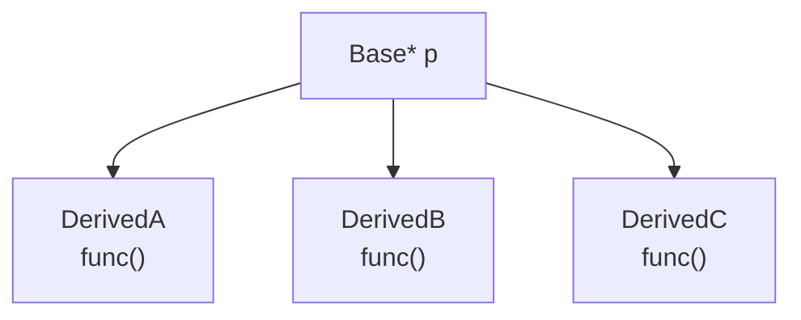

# 9장 — 가상함수와 추상 클래스

[레포지토리 안내](../../README.ko.md) | [English](Concepts_Lecture.md) | [한국어](Concepts_Lecture.ko.md)

> **최종 수정일:** 2026-11-19
>
> 명품 C++ Programming, 황기태, Ch 9

> **학습 목표:**
> 1. 상속 관계에서 함수 재정의(하이딩)와 오버라이딩을 구분할 수 있다
> 2. 가상함수가 동적 바인딩을 일으키는 원리를 vtable과 vptr로 설명할 수 있다
> 3. 가상 소멸자가 필요한 이유를 설명하고 올바르게 선언할 수 있다
> 4. 순수 가상함수로 추상 클래스를 정의하고 이를 상속하는 구체 클래스를 구현할 수 있다
> 5. 기본 클래스 포인터 배열과 가상함수를 활용하여 다형적인 프로그램을 작성할 수 있다
> 6. 동적 바인딩이 일어나는 조건과 일어나지 않는 경우(생성자 안, 값 전달, 범위 지정)를 구분하고, 추상 클래스를 인터페이스로 활용할 수 있다

---

## 목차

- [1. 업캐스팅과 다운캐스팅](#1-업캐스팅과-다운캐스팅)
  - [1.1 업캐스팅](#11-업캐스팅)
  - [1.2 다운캐스팅](#12-다운캐스팅)
  - [1.3 dynamic_cast로 실제 타입 확인하기](#13-dynamic_cast로-실제-타입-확인하기)
- [2. 가상함수](#2-가상함수)
  - [2.1 가상함수가 필요한 이유](#21-가상함수가-필요한-이유)
  - [2.2 virtual 없는 경우의 문제점](#22-virtual-없는-경우의-문제점)
  - [2.3 virtual 키워드](#23-virtual-키워드)
  - [2.4 정적 바인딩 vs 동적 바인딩](#24-정적-바인딩-vs-동적-바인딩)
  - [2.5 동작 원리: vtable과 vptr](#25-동작-원리-vtable과-vptr)
  - [2.6 override 키워드](#26-override-키워드)
  - [2.7 오버라이딩의 성공 조건](#27-오버라이딩의-성공-조건)
  - [2.8 가상함수의 상속](#28-가상함수의-상속)
  - [2.9 final 지시어](#29-final-지시어)
  - [2.10 범위 지정 연산자를 이용한 기본 클래스 가상함수 호출](#210-범위-지정-연산자를-이용한-기본-클래스-가상함수-호출)
  - [2.11 동적 바인딩이 일어나는 조건](#211-동적-바인딩이-일어나는-조건)
  - [2.12 vtable을 따라가는 호출 추적](#212-vtable을-따라가는-호출-추적)
- [3. 가상 소멸자](#3-가상-소멸자)
  - [3.1 문제점](#31-문제점)
  - [3.2 완전한 예제: 메모리 누수](#32-완전한-예제-메모리-누수)
  - [3.3 원칙](#33-원칙)
- [4. 추상 클래스](#4-추상-클래스)
  - [4.1 순수 가상함수](#41-순수-가상함수)
  - [4.2 추상 클래스](#42-추상-클래스)
  - [4.3 구체 클래스](#43-구체-클래스)
  - [4.4 추상 클래스 구현 예제](#44-추상-클래스-구현-예제)
  - [4.5 인터페이스로서의 추상 클래스](#45-인터페이스로서의-추상-클래스)
- [5. 다형성](#5-다형성)
  - [5.1 개념](#51-개념)
  - [5.2 완전한 Shape 계층 구조 예제](#52-완전한-shape-계층-구조-예제)
  - [5.3 완전한 Converter 예제](#53-완전한-converter-예제)
  - [5.4 연결 리스트로 관리하는 도형](#54-연결-리스트로-관리하는-도형)
- [6. 흔한 실수](#6-흔한-실수)
  - [6.1 가상 소멸자 누락](#61-가상-소멸자-누락)
  - [6.2 추상 클래스 인스턴스화 시도](#62-추상-클래스-인스턴스화-시도)
  - [6.3 순수 가상함수 오버라이딩 누락](#63-순수-가상함수-오버라이딩-누락)
  - [6.4 객체 슬라이싱](#64-객체-슬라이싱)
  - [6.5 오버라이딩 vs 함수 중복 vs 하이딩](#65-오버라이딩-vs-함수-중복-vs-하이딩)
  - [6.6 대입과 배열에서 일어나는 객체 슬라이싱](#66-대입과-배열에서-일어나는-객체-슬라이싱)
  - [6.7 const나 매개변수가 달라 오버라이딩에 실패함](#67-const나-매개변수가-달라-오버라이딩에-실패함)
- [요약](#요약)
- [점검 문제](#점검-문제)

---

<br>

## 1. 업캐스팅과 다운캐스팅

### 1.1 업캐스팅

**업캐스팅(Upcasting)** 은 파생 클래스의 포인터(또는 참조)를 기본 클래스의 포인터(또는 참조)로 변환하는 것이다. 모든 파생 객체는 기본 객체의 일종(is-a 관계)이므로 **암시적**으로 변환되며, 항상 **안전**하다.

```cpp
class Base { };
class Derived : public Base { };

Derived d;
Base* p = &d;       // 업캐스팅: 암시적, 항상 안전
Base& r = d;        // 참조를 이용한 업캐스팅
```

기본 클래스 포인터 `p`를 통해서는 **기본 클래스의 멤버에만 접근할 수 있다**. 실제 객체가 `Derived`이더라도 컴파일러는 `Base*` 타입만 보고 접근 범위를 제한한다.

```cpp
class Shape {
public:
    void draw() { cout << "Shape" << endl; }
};

class Circle : public Shape {
public:
    void draw() { cout << "Circle" << endl; }
    double getRadius() { return 5.0; }
};

Circle c;
Shape* p = &c;      // 업캐스팅
p->draw();           // "Shape": Shape::draw() 호출 (정적 바인딩)
// p->getRadius();   // 컴파일 오류: Shape에 getRadius()가 없음
```

> **핵심:** 업캐스팅 후에는 포인터 타입에 따라 접근 가능한 멤버가 결정된다. 파생 클래스에만 있는 멤버는 기본 클래스 포인터로 접근할 수 없다.

### 1.2 다운캐스팅

**다운캐스팅(Downcasting)** 은 기본 클래스 포인터를 파생 클래스 포인터로 변환하는 것이다. **명시적 캐스트**가 필요하며, 실제 객체가 해당 파생 타입이 아닌 경우 **위험**하다.

```cpp
Base* p = new Derived;
Derived* dp = (Derived*)p;   // C 스타일 다운캐스트: 컴파일되지만 위험
```

**안전한 다운캐스팅**을 위해 `dynamic_cast`를 사용한다. 런타임에 타입을 검사하고, 포인터 변환이 불가능하면 `nullptr`을 리턴한다(기본 클래스에 가상함수가 하나 이상 있어야 함). 참조로 변환할 때 실패하면 `std::bad_cast` 예외가 발생한다.

```cpp
Base* p = new Base;
Derived* dp = dynamic_cast<Derived*>(p);  // 런타임 검사
if (dp == nullptr) {
    cout << "캐스트 실패: p가 Derived를 가리키지 않음" << endl;
}
```

> **주의:** `static_cast`나 C 스타일 캐스트로 다운캐스팅하면 런타임 검사를 건너뛴다. 실제 객체가 파생 타입이 아닌 경우 파생 멤버에 접근하면 **정의되지 않은 동작(undefined behavior)** 이 발생한다.

### 1.3 dynamic_cast로 실제 타입 확인하기

1.2절의 `dynamic_cast`는 기본 클래스 포인터가 가리키는 객체의 실제 타입을 실행 중에 검사한다. 여러 종류의 도형을 `Shape*` 배열에 모아 두고, 그중 `Circle`인 것만 골라 `Circle`에만 있는 멤버 함수를 호출하는 예는 다음과 같다.

```cpp
#include <iostream>
using namespace std;

class Shape {
public:
    virtual void draw() const { cout << "Shape" << endl; }
    virtual ~Shape() { }
};
class Circle : public Shape {
    int radius;
public:
    Circle(int r) : radius(r) { }
    void draw() const override { cout << "Circle" << endl; }
    int getRadius() const { return radius; }
};
class Rect : public Shape {
public:
    void draw() const override { cout << "Rect" << endl; }
};

int main() {
    Shape *shapes[3] = { new Circle(5), new Rect(), new Circle(7) };
    int sum = 0;
    for (int i = 0; i < 3; i++) {
        Circle *c = dynamic_cast<Circle *>(shapes[i]);   // 실제로 Circle이면 그 주소, 아니면 nullptr
        if (c != nullptr) {
            cout << i << ": Circle, radius=" << c->getRadius() << endl;
            sum += c->getRadius();
        } else {
            cout << i << ": Circle이 아님" << endl;
        }
    }
    cout << "반지름의 합: " << sum << endl;
    for (int i = 0; i < 3; i++) delete shapes[i];
    return 0;
}
```

```text
0: Circle, radius=5
1: Circle이 아님
2: Circle, radius=7
반지름의 합: 12
```

| `i` | `shapes[i]`가 가리키는 객체 | `dynamic_cast<Circle *>(shapes[i])` | 실행된 분기 |
|:----|:----|:----|:----|
| 0 | `Circle(5)` | 그 `Circle`의 주소 | 반지름 5를 더함 |
| 1 | `Rect` | `nullptr` | "Circle이 아님" 출력 |
| 2 | `Circle(7)` | 그 `Circle`의 주소 | 반지름 7을 더함 |

*표 1. 원소마다 dynamic_cast가 리턴하는 값*

- `dynamic_cast<Circle *>(p)`는 `p`가 실제로 `Circle` 객체(또는 `Circle`의 파생 객체)를 가리키면 `Circle*`로 바꾼 주소를, 아니면 `nullptr`를 리턴한다. 그래서 리턴값을 `nullptr`와 비교하는 것만으로 실제 타입을 알 수 있다. 같은 일을 `static_cast`나 C 스타일 캐스트로 하면 1번 원소도 `Circle*`로 바뀌고, `getRadius()`를 호출하는 순간 정의되지 않은 동작이 된다.
- 실행 중에 타입을 검사하려면 객체에 타입 정보가 있어야 하는데, 이 정보는 가상함수를 가진 클래스의 객체에만 연결된다(2.5절의 vptr). 가상함수가 하나도 없는 `class B { public: int x; };`의 포인터에 `dynamic_cast`를 쓰면 Apple clang은 "'B' is not polymorphic"이라는 컴파일 오류를 낸다. 가상 소멸자 하나만 있어도 다형적인 클래스가 된다.
- 참조로 바꾸는 `dynamic_cast<Circle &>(*p)`는 실패하면 `nullptr`를 돌려줄 수 없으므로 `std::bad_cast` 예외를 던진다. 예외를 처리하는 방법은 13장에서 다룬다.

`dynamic_cast`로 타입을 일일이 검사하는 코드가 많아지면, 새 파생 클래스를 추가할 때마다 그 검사들을 고쳐야 한다. 가능하면 실제 타입에 따라 달라지는 동작을 가상함수로 만들어 2절의 동적 바인딩에 맡기고, `dynamic_cast`는 파생 클래스에만 있는 기능이 반드시 필요한 곳에 한정해 쓴다.

---

<br>

## 2. 가상함수

### 2.1 가상함수가 필요한 이유

그림판 프로그램을 예로 든다. `Shape` 기본 클래스가 있고, `Circle`, `Rectangle`, `Triangle` 같은 파생 클래스가 있다. 모든 도형을 `Shape*` 포인터 배열에 저장하고, 하나의 반복문으로 모두 그리려고 한다:

```cpp
Shape* canvas[100];
canvas[0] = new Circle(10, 20, 5);
canvas[1] = new Rectangle(0, 0, 30, 40);
canvas[2] = new Triangle(5, 5, 10, 20, 15, 5);
// ...

for (int i = 0; i < count; i++) {
    canvas[i]->draw();   // 어떤 draw()가 호출될까?
}
```

**virtual 없이:** `canvas[i]->draw()` 호출 시 항상 `Shape::draw()`가 호출된다. 컴파일러는 `Shape*` 타입만 보기 때문이다. 실제 객체가 `Circle`이든 아니든 상관없이, 컴파일 시점에 이미 `Shape::draw()`를 호출하기로 결정했다. 모든 도형이 똑같은 것을 그리므로 도형마다 다른 그림을 그린다는 목적을 이룰 수 없다.

**virtual 있으면:** `canvas[i]->draw()` 호출 시 실제 객체에 맞는 **올바른** `draw()`가 호출된다. 원이면 `Circle::draw()`, 사각형이면 `Rectangle::draw()` 등이다. 런타임에 실제 객체 타입에 따라 결정된다.

이것이 **OOP 다형성의 핵심**이다: 기본 클래스 포인터로 코드를 작성하면서도, 각 파생 타입에 맞는 동작이 자동으로 수행된다. 가상함수 없이는 상속이 단순한 코드 공유에 불과하지만, 가상함수가 있으면 상속이 **대체 가능성(substitutability)** 을 가능하게 한다.

### 2.2 virtual 없는 경우의 문제점

`virtual` 없이 함수를 선언하면, 호출되는 함수는 **포인터의 타입**에 의해 결정된다. 이를 **정적 바인딩(static binding)** 또는 **이른 바인딩(early binding)** 이라 하며, 컴파일 시점에 결정된다.

```cpp
class Base {
public:
    void func() { cout << "Base::func()" << endl; }
};

class Derived : public Base {
public:
    void func() { cout << "Derived::func()" << endl; }
};

Base* p = new Derived;
p->func();    // 출력: "Base::func()", 정적 바인딩!
delete p;
```

포인터 타입이 `Base*`이므로, `p`가 `Derived` 객체를 가리키고 있더라도 `Base::func()`이 호출된다. 이는 다형성의 목적을 달성하지 못한다.

교재는 이처럼 기본 클래스의 비가상함수와 원형이 같은 함수를 파생 클래스에 다시 작성하는 것을 **함수 재정의(redefine)** 라고 부른다. 이때 파생 객체 안에는 두 `func()`가 모두 존재하며, `Derived*`로 호출하면 `Derived::func()`이, `Base*`로 호출하면 `Base::func()`이 실행된다. 6.5절에서는 이를 하이딩으로 다룬다.

### 2.3 virtual 키워드

기본 클래스 함수에 `virtual`을 붙이면 **동적 바인딩(dynamic binding)** 또는 **늦은 바인딩(late binding)** 이 활성화된다. 런타임에 실제 객체의 타입에 따라 호출할 함수가 결정된다.

```cpp
class Base {
public:
    virtual void func() { cout << "Base::func()" << endl; }
};

class Derived : public Base {
public:
    void func() { cout << "Derived::func()" << endl; }  // 오버라이딩
};

Base* p = new Derived;
p->func();    // 출력: "Derived::func()", 동적 바인딩!
delete p;
```

기본 클래스에서 한 번 `virtual`로 선언하면, 모든 파생 클래스에서 해당 함수는 자동으로 가상함수로 유지된다(명시적으로 `virtual`을 다시 쓰지 않아도 됨).

이처럼 파생 클래스에서 기본 클래스의 가상함수와 같은 원형의 함수를 다시 정의하는 것을 **함수 오버라이딩(function overriding)** 이라 하며, 다형성의 한 형태이다. 오버라이딩한 뒤에도 파생 객체 안에는 `Base::func()`이 남아 있지만, 기본 클래스 포인터로 호출해도 항상 `Derived::func()`이 실행되므로 기본 클래스의 함수는 존재감을 잃는다. 파생 객체에서 기본 클래스의 버전을 호출하려면 2.10절의 범위 지정 연산자를 써야 한다.

### 2.4 정적 바인딩 vs 동적 바인딩

정적 바인딩과 동적 바인딩의 차이를 이해하는 것이 핵심이다. 두 방식은 호출할 함수를 **언제** 결정하는지가 다르다.

**정적 바인딩 (컴파일 타임 바인딩)**
- 컴파일러가 **포인터/참조의 타입**을 기준으로 호출할 함수를 결정한다.
- 비가상(non-virtual) 함수의 기본 동작이다.
- 빠르지만(런타임 조회 없음), 실제 객체 타입을 무시한다.

**동적 바인딩 (런타임 바인딩)**
- 프로그램이 런타임에 **실제 객체 타입**을 기준으로 호출할 함수를 결정한다.
- `virtual` 키워드로 활성화된다.
- 약간 느리지만(vtable 조회), 진정한 다형성을 가능하게 한다.

`virtual` 키워드는 함수를 정적 바인딩에서 동적 바인딩으로 전환하는 스위치이다.

> **[프로그래밍언어]** 프로그래밍언어에서 바인딩은 이름을 그것이 가리키는 대상과 연결하는 일이며, 연결이 일어나는 시점(바인딩 시간)에 따라 컴파일할 때 정해지는 정적 바인딩과 실행 중에 정해지는 동적 바인딩으로 나눈다. C++의 멤버 함수 호출에서는 호출한 이름을 실행할 함수 본문과 연결하는 시점이 이 구분에 해당하여, 일반 멤버 함수는 포인터의 선언 타입으로 컴파일 시간에, 가상함수는 객체의 실제 타입으로 실행 시간에 연결된다.

**나란히 비교(같은 코드, 다른 동작):**

```cpp
#include <iostream>
using namespace std;

// ============ virtual 없음 (정적 바인딩) ============
class AnimalStatic {
public:
    void speak() { cout << "..." << endl; }
};
class DogStatic : public AnimalStatic {
public:
    void speak() { cout << "멍멍!" << endl; }
};
class CatStatic : public AnimalStatic {
public:
    void speak() { cout << "야옹!" << endl; }
};

// ============ virtual 있음 (동적 바인딩) ============
class AnimalDynamic {
public:
    virtual void speak() { cout << "..." << endl; }
    virtual ~AnimalDynamic() { }
};
class DogDynamic : public AnimalDynamic {
public:
    void speak() override { cout << "멍멍!" << endl; }
};
class CatDynamic : public AnimalDynamic {
public:
    void speak() override { cout << "야옹!" << endl; }
};

int main() {
    // --- 정적 바인딩 ---
    AnimalStatic* s1 = new DogStatic;
    AnimalStatic* s2 = new CatStatic;
    s1->speak();   // "..."  (틀림! AnimalStatic::speak 호출)
    s2->speak();   // "..."  (틀림! AnimalStatic::speak 호출)
    delete s1; delete s2;

    // --- 동적 바인딩 ---
    AnimalDynamic* d1 = new DogDynamic;
    AnimalDynamic* d2 = new CatDynamic;
    d1->speak();   // "멍멍!"  (정확! DogDynamic::speak 호출)
    d2->speak();   // "야옹!"  (정확! CatDynamic::speak 호출)
    delete d1; delete d2;

    return 0;
}
```

출력:

```text
...
...
멍멍!
야옹!
```

> **핵심:** 유일한 차이는 기본 클래스의 `virtual` 키워드뿐이다. 상속, 포인터 타입, 함수 호출 등 나머지는 모두 동일하다. `virtual`이 다형성을 작동시키는 것이다.

### 2.5 동작 원리: vtable과 vptr

C++ 컴파일러는 일반적으로 동적 바인딩을 **vtable(가상함수 테이블)** 메커니즘으로 구현한다. C++ 표준이 이 방식을 정하지는 않지만, 주요 컴파일러가 모두 이 방식을 쓴다:

1. **vtable:** 가상함수를 가진 각 클래스는 함수 포인터 테이블을 갖는다. 이 테이블은 각 가상함수를 해당 클래스의 올바른 구현과 매핑한다.
2. **vptr:** 가상함수를 가진 클래스의 각 객체는 자신의 클래스 vtable을 가리키는 숨겨진 포인터(`vptr`)를 포함한다.
3. **런타임 조회:** 기본 클래스 포인터로 가상함수를 호출하면, `vptr`을 따라 vtable에서 함수를 찾아 올바른 버전을 호출한다.

**간단한 vtable 도식 (가상함수 1개):**

```text
┌────────────────┐         ┌──────────────────────┐
│  Base 객체      │         │   Base vtable        │
│  ┌──────────┐  │         │   func → Base::func  │
│  │  vptr   ─┼──┼────────▶│                      │
│  └──────────┘  │         └──────────────────────┘
└────────────────┘

┌────────────────┐         ┌───────────────────────────┐
│ Derived 객체    │         │   Derived vtable          │
│  ┌──────────┐  │         │   func → Derived::func    │
│  │  vptr   ─┼──┼────────▶│                           │
│  └──────────┘  │         └───────────────────────────┘
└────────────────┘
```

*그림 1. 가상함수가 하나인 Base 객체와 Derived 객체의 vptr과 vtable*

**상세 vtable 도식(여러 가상함수를 가진 Shape 계층 구조):**

`class Shape`에 `virtual draw()`와 `virtual area()`가 있고, 파생 클래스 `Circle`과 `Rectangle`이 있는 경우:

```text
 Shape* p = new Circle(5.0);
 p->draw();   // C++는 Circle::draw()를 어떻게 찾는가?

 1단계: p를 따라 Circle 객체로 이동
 2단계: 객체에서 숨겨진 vptr을 읽음
 3단계: vptr을 따라 Circle의 vtable로 이동
 4단계: vtable에서 draw()를 조회 → Circle::draw
 5단계: Circle::draw() 호출

 Circle 객체 (메모리):               Circle의 vtable:
 ┌──────────────────┐             ┌──────────────────────────┐
 │  vptr ───────────┼────────────▶│ draw → Circle::draw      │
 │  radius = 5.0    │             │ area → Circle::area      │
 └──────────────────┘             │ ~dtor → Circle::~Circle  │
                                  └──────────────────────────┘

 Rectangle 객체 (메모리):            Rectangle의 vtable:
 ┌──────────────────┐             ┌───────────────────────────────┐
 │  vptr ───────────┼────────────▶│ draw → Rectangle::draw        │
 │  width = 3.0     │             │ area → Rectangle::area        │
 │  height = 4.0    │             │ ~dtor → Rectangle::~Rectangle │
 └──────────────────┘             └───────────────────────────────┘

 Shape 객체 (메모리):                Shape의 vtable:
 ┌──────────────────┐             ┌──────────────────────────┐
 │  vptr ───────────┼────────────▶│ draw → Shape::draw       │
 └──────────────────┘             │ area → Shape::area       │
                                  │ ~dtor → Shape::~Shape    │
                                  └──────────────────────────┘
```

*그림 2. Shape 계층 구조에서 가상함수 호출을 찾는 단계와 클래스별 vtable*

> **핵심:** **vtable은 클래스당 하나**(해당 클래스의 모든 객체가 공유)이지만, **vptr은 객체당 하나**(각 객체가 자기 클래스의 vtable을 가리키는 포인터를 갖고 있음)이다. `Circle`을 생성하면 vptr이 `Circle`의 vtable을 가리키고, `Rectangle`을 생성하면 vptr이 `Rectangle`의 vtable을 가리킨다. 이것이 같은 `p->draw()` 호출이 실제 객체에 따라 다른 결과를 내는 이유이다.

> **참고:** vtable 메커니즘은 객체당 포인터 하나, 가상함수 호출 시 간접 호출 한 번의 약간의 오버헤드를 추가한다. 이것이 런타임 다형성의 비용이다.

### 2.6 override 키워드

C++11에서 도입된 `override` 키워드는 파생 클래스 함수가 기본 클래스의 가상함수를 오버라이딩한다는 것을 명시한다. 컴파일러가 기본 클래스에 일치하는 가상함수가 있는지 확인하여, 이름 오타나 매개변수 불일치를 컴파일 시점에 잡아준다.

```cpp
class Base {
public:
    virtual void func(int x) { }
};

class Derived : public Base {
public:
    void func(int x) override { }    // OK: Base::func(int)와 일치
    // void func(double x) override; // 컴파일 오류: 일치하는 기본 함수 없음
    // void Fun(int x) override;     // 컴파일 오류: 이름 오타
};
```

> **참고:** **권장 사항.** 가상함수를 오버라이딩할 때는 항상 `override`를 쓰는 것이 좋다. 런타임 비용 없이 컴파일 시점 안전장치를 제공한다.

예를 들어 `Shape`의 `virtual void draw()`를 오버라이딩하려다 `Rect`에 `void drow()`라고 잘못 쓰면, `override`가 없을 때는 새 함수가 추가될 뿐 오류가 나지 않으므로 `Shape*`로 호출한 `draw()`는 `Shape::draw()`를 실행한다. `void drow() override;`라고 쓰면 일치하는 가상함수가 없으므로 컴파일 오류로 실수가 드러난다.

### 2.7 오버라이딩의 성공 조건

오버라이딩이 성립하려면 파생 클래스 함수의 **이름, 매개변수의 타입과 개수, 리턴 타입**이 기본 클래스의 가상함수와 모두 일치해야 한다.

```cpp
class Base {
public:
    virtual void fail();
    virtual void success();
    virtual void g(int);
};

class Derived : public Base {
public:
    virtual int fail();           // 오버라이딩 실패: 반환 타입이 달라 컴파일 오류
    virtual void success();       // 오버라이딩 성공
    virtual void g(int, double);  // 매개변수가 달라 새로운 함수: 정상 컴파일
};
```

- 리턴 타입만 다른 `fail()`은 컴파일 오류이다. 다만 기본 클래스의 가상함수가 기본 클래스에 대한 포인터나 참조를 리턴할 때 파생 클래스에서 파생 클래스에 대한 포인터나 참조를 리턴하도록 바꾸는 **공변 리턴 타입(covariant return type)** 은 허용된다.
- 가상함수의 `virtual` 키워드는 상속되므로 파생 클래스에서 생략할 수 있다. `Derived`의 `virtual void success();`를 `void success();`로 써도 같은 오버라이딩이다.
- 가상함수의 접근 지정은 `private`, `protected`, `public` 중 자유롭게 할 수 있다. 4.4절의 두 번째 `Calculator` 예제는 순수 가상함수 `calc()`를 `protected`로 둔다.

> **참고:** 교재는 `g(int, double)`을 함수 중복 사례로 소개한다. 그러나 기본 클래스와 파생 클래스는 스코프가 다르므로, 파생 클래스에 같은 이름의 함수를 선언하면 기본 클래스의 `g(int)`는 `Derived`의 스코프에서 가려진다(하이딩, 6.5절). 따라서 `Derived` 객체 `d`로 `d.g(1)`을 호출하면 컴파일 오류가 나고, `Base*`를 통해 `g(1)`을 호출해야 `Base::g(int)`가 실행된다. 두 함수를 중복된 함수처럼 함께 쓰려면 `Derived` 안에 `using Base::g;`를 선언한다.

### 2.8 가상함수의 상속

가상함수는 상속 계층이 몇 단계이든 가상함수로 남는다. 다음 예제(교재 예제 9-3)에서 `Base`, `Derived`, `GrandDerived`는 차례로 상속 관계에 있고, 세 포인터가 모두 같은 `GrandDerived` 객체를 가리킨다.

```cpp
#include <iostream>
using namespace std;

class Base {
public:
    virtual void f() { cout << "Base::f() called" << endl; }
};

class Derived : public Base {
public:
    void f() { cout << "Derived::f() called" << endl; }
};

class GrandDerived : public Derived {
public:
    void f() { cout << "GrandDerived::f() called" << endl; }
};

int main() {
    GrandDerived g;
    Base* bp;
    Derived* dp;
    GrandDerived* gp;

    bp = dp = gp = &g;

    bp->f();   // 동적 바인딩
    dp->f();   // 동적 바인딩
    gp->f();
}
```

출력:

```text
GrandDerived::f() called
GrandDerived::f() called
GrandDerived::f() called
```

`Derived`와 `GrandDerived`의 `f()`에는 `virtual`이 없지만 `Base::f()`가 가상이므로 둘 다 가상함수이다. 따라서 포인터 타입이 `Base*`이든 `Derived*`이든 동적 바인딩으로 실제 객체인 `GrandDerived`의 `f()`가 실행된다.

파생 클래스가 가상함수를 오버라이딩하지 않으면, 상속 계층에서 가장 가까운 기본 클래스가 정의한 함수가 사용된다.

```cpp
#include <iostream>
using namespace std;

class B {
public:
    virtual void who() { cout << "Base\n"; }
};

class D1 : public B {
public:
    void who() { cout << "First derivation\n"; }
};

class D2 : public B {
    // who()를 오버라이딩하지 않는다.
};

int main() {
    B base_obj;
    B* p;
    D1 D1_obj;
    D2 D2_obj;

    p = &base_obj;
    p->who();   // B의 who() 호출
    p = &D1_obj;
    p->who();   // D1의 who() 호출
    p = &D2_obj;
    p->who();   // D2에 who()가 없으므로 B의 who() 호출
    return 0;
}
```

출력:

```text
Base
First derivation
Base
```

동적 바인딩은 기본 클래스의 멤버 함수 안에서 가상함수를 호출할 때도 일어난다. 다음 예제에서 `paint()`는 `Shape`의 비가상함수이지만, 그 안의 `draw()` 호출은 `this->draw()`와 같으므로 `this`가 가리키는 실제 객체의 `draw()`가 실행된다.

```cpp
#include <iostream>
using namespace std;

class Shape {
public:
    void paint() {
        draw();   // this->draw(): 동적 바인딩
    }
    virtual void draw() {
        cout << "Shape::draw() called" << endl;
    }
};

class Circle : public Shape {
public:
    virtual void draw() {
        cout << "Circle::draw() called" << endl;
    }
};

int main() {
    Circle circle;
    Shape* pShape = &circle;   // 업캐스팅
    pShape->paint();
}
```

출력:

```text
Circle::draw() called
```

`Shape` 객체에서 `paint()`를 호출하면 `Shape::draw() called`가 출력된다. 이처럼 기본 클래스의 코드가 파생 클래스에서 구현할 함수를 호출하게 할 수 있으며, 4.4절의 추상 클래스 예제가 이 성질을 이용한다.

### 2.9 final 지시어

C++11에서 도입된 `final` 지시어는 두 위치에 쓸 수 있다. `override`와 `final`은 정확히는 예약어가 아니라 특정 위치에서만 특별한 의미를 갖는 식별자이며, 교재는 둘을 지시어라고 부른다.

1. **가상함수의 원형 바로 뒤:** 파생 클래스는 그 가상함수를 오버라이딩할 수 없다.
2. **클래스 이름 뒤:** 다른 클래스가 그 클래스를 상속할 수 없다(상속 차단).

```cpp
class Shape {
public:
    virtual void draw() final;   // 더 이상 오버라이딩할 수 없음
};

class Rect : public Shape {
public:
    void draw();                 // 컴파일 오류: final 함수를 오버라이딩하려 함
};
```

```cpp
class Shape final {
    // ...
};

class Rect : public Shape {      // 컴파일 오류: Shape는 상속할 수 없음
    // ...
};
```

```cpp
class Shape {
    // ...
};

class Rect final : public Shape {   // Rect는 Shape를 상속할 수 있음
    // ...
};

class RoundRect : public Rect {     // 컴파일 오류: Rect는 상속할 수 없음
    // ...
};
```

### 2.10 범위 지정 연산자를 이용한 기본 클래스 가상함수 호출

범위 지정 연산자 `::`를 써서 `기본클래스::가상함수()` 형태로 호출하면 동적 바인딩이 일어나지 않고 정적 바인딩으로 기본 클래스의 함수가 실행된다. 파생 클래스에서 오버라이딩한 함수가 기본 클래스의 기능을 그대로 이용하면서 기능을 덧붙일 때 주로 쓴다.

```cpp
#include <iostream>
using namespace std;

class Shape {
public:
    virtual void draw() {
        cout << "--Shape--";
    }
};

class Circle : public Shape {
public:
    virtual void draw() {
        Shape::draw();   // 기본 클래스의 draw() 호출 (정적 바인딩)
        cout << "Circle" << endl;
    }
};

int main() {
    Circle circle;
    Shape* pShape = &circle;

    pShape->draw();          // 동적 바인딩: Circle::draw() 실행
    pShape->Shape::draw();   // 정적 바인딩: Shape::draw()만 실행
}
```

출력:

```text
--Shape--Circle
--Shape--
```

`pShape->draw()`는 동적 바인딩으로 `Circle::draw()`를 실행하고, 그 안의 `Shape::draw()`가 정적 바인딩으로 `--Shape--`를 먼저 출력한다. `pShape->Shape::draw()`는 처음부터 정적 바인딩이므로 `--Shape--`만 출력한다.

### 2.11 동적 바인딩이 일어나는 조건

2.3절\~2.10절의 내용을 모으면, 가상함수 호출이 동적 바인딩되려면 다음 세 조건이 모두 필요하다.

1. 호출하는 함수가 가상함수이다(기본 클래스에서 `virtual`로 선언되었다).
2. 객체를 기본 클래스의 **포인터나 참조**를 통해 호출한다. 멤버 함수 안에서 이름만으로 호출하는 것은 `this->`를 통한 포인터 호출이므로 여기에 포함된다(2.8절의 `paint()`).
3. 호출에 범위 지정 연산자를 쓰지 않는다(2.10절).

조건이 하나라도 빠지면 컴파일러는 선언된 타입으로 호출할 함수를 정한다.

| 호출 형태 | `Base`의 `f()`가 가상함수일 때 실행되는 함수 | 이유 |
|:----|:----|:----|
| `Base *p = &d; p->f();` | `Derived::f()` | 포인터를 통한 가상함수 호출 |
| `Base &r = d; r.f();` | `Derived::f()` | 참조를 통한 가상함수 호출 |
| `Base b = d; b.f();` | `Base::f()` | `b`는 `Base` 객체이다(슬라이싱, 6.4절) |
| `p->Base::f();` | `Base::f()` | 범위 지정 연산자는 정적 바인딩이다 |
| `Base`의 생성자 안에서 `f();` | `Base::f()` | 생성 중인 객체는 아직 `Base`이다(아래 설명) |

*표 2. 호출 형태에 따른 가상함수의 바인딩*

마지막 행은 특히 주의해야 한다. 8장 3절에서 본 것처럼 파생 클래스 객체는 기본 클래스 부분부터 생성되고, 기본 클래스의 생성자가 실행되는 동안 파생 클래스의 멤버는 아직 초기화되지 않았다. 이 시점에 파생 클래스의 함수가 실행되면 초기화되지 않은 멤버를 쓰게 되므로, C++은 생성자와 소멸자 안의 가상함수 호출을 그 생성자나 소멸자가 속한 클래스의 함수로 처리한다.

```cpp
#include <iostream>
using namespace std;

class Base {
public:
    Base() { cout << "Base 생성자: "; whoAmI(); }       // 생성 중에는 Base의 함수가 호출된다
    virtual ~Base() { cout << "Base 소멸자: "; whoAmI(); }
    virtual void whoAmI() { cout << "Base" << endl; }
    void call() { whoAmI(); }                          // 생성이 끝난 뒤에는 동적 바인딩
};

class Derived : public Base {
    int *data;
public:
    Derived() : data(new int(7)) { cout << "Derived 생성자: "; whoAmI(); }
    ~Derived() { cout << "Derived 소멸자: "; whoAmI(); delete data; }
    void whoAmI() override { cout << "Derived, *data=" << *data << endl; }
};

int main() {
    Derived d;
    cout << "call(): "; d.call();
    return 0;
}
```

```text
Base 생성자: Base
Derived 생성자: Derived, *data=7
call(): Derived, *data=7
Derived 소멸자: Derived, *data=7
Base 소멸자: Base
```

- **`Base` 생성자 안의 `whoAmI()`:** 이 순간 `data`는 아직 할당되지 않았다. 여기서 `Derived::whoAmI()`가 실행되었다면 초기화되지 않은 포인터 `data`를 역참조했을 것이다. 실제로는 `Base::whoAmI()`가 실행되어 "Base"가 출력된다.
- **`call()` 안의 `whoAmI()`:** 객체 생성이 끝난 뒤에는 2.8절과 같이 동적 바인딩되어 `Derived::whoAmI()`가 실행된다.
- **`Base` 소멸자 안의 `whoAmI()`:** 소멸은 파생 클래스부터 진행되므로 `Base`의 소멸자가 실행될 때는 `Derived` 부분이 이미 소멸했고 `data`도 해제되었다. 그래서 이때도 `Base::whoAmI()`가 실행된다.

2.5절의 vtable 모델로 말하면, vtable을 쓰는 일반적인 구현에서 컴파일러는 생성자가 실행되는 동안 객체의 vptr이 그 생성자가 속한 클래스의 vtable을 가리키게 하고, 각 단계의 생성자가 끝날 때마다 다음 단계의 vtable로 바꾼다. 따라서 파생 클래스마다 다르게 동작해야 하는 초기화는 기본 클래스 생성자 안의 가상함수 호출에 맡기지 않고, 파생 클래스의 생성자에서 직접 처리한다.

> **참고:** **가상함수의 디폴트 인자.** 가상함수를 오버라이딩하면서 디폴트 인자의 값을 바꾸면, 실행되는 함수는 동적 바인딩으로 정해지지만 디폴트 인자는 포인터의 선언 타입으로 정해진다. `Base`에 `virtual void show(int n = 1)`, `Derived`에 `void show(int n = 2) override`가 있을 때 `Base *p = &d; p->show();`는 `Derived::show()`를 인자 1로 실행하여 "Derived 1"을 출력하고, `d.show();`는 "Derived 2"를 출력한다. 혼란을 피하려면 오버라이딩하는 함수에서 디폴트 인자를 바꾸지 않는다.

### 2.12 vtable을 따라가는 호출 추적

2.5절의 vtable 모델로 실제 호출을 하나씩 추적하면 동적 바인딩이 어떻게 함수를 고르는지 구체적으로 볼 수 있다. 다음 세 클래스에서 `Base`는 가상함수 `f()`, `g()`와 비가상함수 `h()`를 가지고, `Mid`는 `f()`만, `Leaf`는 `g()`만 오버라이딩한다.

```cpp
#include <iostream>
using namespace std;

class Base {
public:
    virtual void f() { cout << "Base::f" << endl; }
    virtual void g() { cout << "Base::g" << endl; }
    void h() { cout << "Base::h" << endl; }          // 가상함수가 아님
    virtual ~Base() { }
};

class Mid : public Base {
public:
    void f() override { cout << "Mid::f" << endl; }   // f만 오버라이딩
};

class Leaf : public Mid {
public:
    void g() override { cout << "Leaf::g" << endl; }  // g만 오버라이딩
};

int main() {
    Base b; Mid m; Leaf l;
    Base *objs[3] = { &b, &m, &l };
    for (int i = 0; i < 3; i++) {
        objs[i]->f();
        objs[i]->g();
        objs[i]->h();
    }
    return 0;
}
```

```text
Base::f
Base::g
Base::h
Mid::f
Base::g
Base::h
Mid::f
Leaf::g
Base::h
```

vtable을 쓰는 일반적인 구현에서 각 클래스의 vtable에는 가상함수마다 칸이 하나씩 있고, 칸의 순서는 기본 클래스에서 정해진 순서를 파생 클래스도 그대로 따른다. 파생 클래스는 오버라이딩한 함수의 칸만 자기 함수로 바꾸고, 나머지 칸은 기본 클래스의 내용을 물려받는다. 가상 소멸자도 vtable에 칸을 가지지만, 그 칸의 수와 위치는 구현마다 달라 아래 표에는 `f()`와 `g()`의 칸만 적는다.

| vtable | 칸 0: `f()` | 칸 1: `g()` |
|:----|:----|:----|
| `Base`의 vtable | `Base::f` | `Base::g` |
| `Mid`의 vtable | `Mid::f` (오버라이딩) | `Base::g` (물려받음) |
| `Leaf`의 vtable | `Mid::f` (물려받음) | `Leaf::g` (오버라이딩) |

*표 3. 세 클래스의 vtable 칸에 들어 있는 함수*

`objs[2]->g()` 한 번의 호출은 다음 순서로 실행된다.

1. 컴파일러는 `objs[2]`의 타입이 `Base*`이고 `g()`가 `Base`의 가상함수 중 칸 1에 있다는 것을 컴파일할 때 이미 안다. 그래서 "가리키는 객체의 vptr을 읽고, 그 vtable의 칸 1에 있는 함수를 호출하라"는 코드를 만든다.
2. 실행할 때 `objs[2]`는 `l`(`Leaf` 객체)을 가리키므로, 객체 안의 vptr은 `Leaf`의 vtable을 가리킨다.
3. `Leaf`의 vtable 칸 1에는 `Leaf::g`가 있으므로 `Leaf::g`가 호출된다.

같은 방법으로 `objs[2]->f()`는 `Leaf`의 vtable 칸 0을 읽는데, `Leaf`가 `f()`를 오버라이딩하지 않았으므로 그 칸에는 `Mid`에게서 물려받은 `Mid::f`가 있다. 2.8절에서 "오버라이딩하지 않으면 가장 가까운 기본 클래스의 함수가 호출된다"고 한 것이 vtable에서는 이렇게 칸을 물려받는 것으로 나타난다. 반면 비가상함수 `h()`는 vtable에 칸이 없고, 포인터의 타입 `Base*`만 보고 컴파일할 때 `Base::h`로 정해지므로 세 객체 모두에서 `Base::h`가 출력된다.

vptr이 실제로 객체 안에 있다는 것은 객체의 크기로 확인할 수 있다.

```cpp
#include <iostream>
using namespace std;

class Plain { int x; public: void f() { } int get() const { return x; } };
class Virt { int x; public: virtual void f() { } virtual ~Virt() { } int get() const { return x; } };

int main() {
    cout << "sizeof(Plain)=" << sizeof(Plain) << ", sizeof(Virt)=" << sizeof(Virt)
         << ", sizeof(void*)=" << sizeof(void *) << endl;
    return 0;
}
```

```text
sizeof(Plain)=4, sizeof(Virt)=16, sizeof(void*)=8
```

`int` 하나만 가진 `Plain`은 4바이트이지만, 가상함수가 있는 `Virt`는 16바이트이다. 일반적인 구현에서는 64비트 환경의 포인터 크기 8바이트인 vptr이 객체 앞쪽에 들어가고, `int`가 그 뒤에 놓인 뒤 객체 전체의 크기가 포인터 크기의 배수가 되도록 빈 공간이 더해졌기 때문이다(3장 2.6절의 정렬). 가상함수가 몇 개이든 객체마다 늘어나는 것은 vptr 하나이며, 가상함수의 개수는 클래스당 하나인 vtable의 크기에만 영향을 준다. 정확한 크기와 배치는 구현에 따라 다르다.

---

<br>

## 3. 가상 소멸자

### 3.1 문제점

기본 클래스 포인터를 통해 파생 객체를 `delete`할 때, 소멸자가 **가상이 아니면** 일반적인 컴파일러에서는 기본 클래스 소멸자만 호출된다(C++ 표준은 이 경우를 정의되지 않은 동작으로 규정한다). 파생 클래스 소멸자가 호출되지 않아 파생 클래스에서 할당한 **자원이 누수**될 수 있다.

```cpp
class Base {
public:
    ~Base() { cout << "~Base" << endl; }
};

class Derived : public Base {
    int* data;
public:
    Derived() { data = new int[100]; }
    ~Derived() { delete[] data; cout << "~Derived" << endl; }
};

Base* p = new Derived;
delete p;    // 출력: "~Base"만! ~Derived 호출 안 됨 → 메모리 누수
```

### 3.2 완전한 예제: 메모리 누수

문제와 해결을 나란히 보여주는 완전한 실행 가능 프로그램:

```cpp
#include <iostream>
#include <cstring>
using namespace std;

// ============ 버그: 비가상 소멸자 ============
class BadBase {
public:
    ~BadBase() { cout << "[BadBase] 소멸자" << endl; }
};

class BadDerived : public BadBase {
    char* name;
public:
    BadDerived(const char* n) {
        name = new char[strlen(n) + 1];
        strcpy(name, n);
        cout << "[BadDerived] 할당: " << name << endl;
    }
    ~BadDerived() {
        cout << "[BadDerived] 해제: " << name << endl;
        delete[] name;
    }
};

// ============ 수정: 가상 소멸자 ============
class GoodBase {
public:
    virtual ~GoodBase() { cout << "[GoodBase] 소멸자" << endl; }
};

class GoodDerived : public GoodBase {
    char* name;
public:
    GoodDerived(const char* n) {
        name = new char[strlen(n) + 1];
        strcpy(name, n);
        cout << "[GoodDerived] 할당: " << name << endl;
    }
    ~GoodDerived() override {
        cout << "[GoodDerived] 해제: " << name << endl;
        delete[] name;
    }
};

int main() {
    cout << "--- 가상 소멸자 없음 (버그) ---" << endl;
    BadBase* bp = new BadDerived("leak");
    delete bp;   // ~BadBase만 실행! "leak"은 해제 안 됨
    cout << endl;

    cout << "--- 가상 소멸자 있음 (정상) ---" << endl;
    GoodBase* gp = new GoodDerived("safe");
    delete gp;   // ~GoodDerived 먼저 실행 후 ~GoodBase 실행
    cout << endl;

    return 0;
}
```

출력:

```text
--- 가상 소멸자 없음 (버그) ---
[BadDerived] 할당: leak
[BadBase] 소멸자

--- 가상 소멸자 있음 (정상) ---
[GoodDerived] 할당: safe
[GoodDerived] 해제: safe
[GoodBase] 소멸자
```

가상 소멸자가 없는 경우에는 `[BadDerived] 해제: leak`이 출력되지 않는다. `BadDerived`의 소멸자가 실행되지 않아 `name`이 가리키는 메모리가 누수된 것이다. 가상 소멸자가 있는 경우에는 두 소멸자가 파생 클래스, 기본 클래스의 올바른 순서로 실행된다.

### 3.3 원칙

클래스에 **가상함수가 하나라도 있으면** 그 클래스는 기본 클래스 포인터로 다루어질 가능성이 크므로, 소멸자도 **가상**으로 선언해야 한다. 이렇게 하면 기본 클래스 포인터를 통한 `delete` 시 동적 바인딩으로 파생 소멸자가 먼저 호출되고, 파생 소멸자가 끝나면 기본 소멸자가 호출된다.

```cpp
class Base {
public:
    virtual ~Base() { cout << "~Base" << endl; }
    virtual void func() { }
};

class Derived : public Base {
    int* data;
public:
    Derived() { data = new int[100]; }
    ~Derived() { delete[] data; cout << "~Derived" << endl; }
};

Base* p = new Derived;
delete p;    // 출력: "~Derived" 후 "~Base", 정상!
```

> **참고:** **경험 법칙.** 가상함수를 가진 기본 클래스로 사용되는 클래스는 반드시 `virtual` 소멸자를 가져야 한다. 이것은 C++에서 가장 중요한 모범 사례 중 하나이다.

---

<br>

## 4. 추상 클래스

### 4.1 순수 가상함수

**순수 가상함수(pure virtual function)** 는 기본 클래스에 구현이 없고 선언만 있는 가상함수이다. 함수 원형 끝에 `= 0`을 붙여 선언하며, 파생 클래스가 객체를 만들 수 있는 구체 클래스(4.3절)가 되려면 이 함수를 **반드시 구현해야** 한다. 기본 클래스의 가상함수가 파생 클래스에서 재정의할 함수의 형태를 알려 주는 역할만 하고 실행할 코드가 필요 없을 때 순수 가상함수로 선언한다.

```cpp
class Shape {
public:
    virtual double getArea() = 0;   // 순수 가상함수: 본체 없음
    virtual void draw() = 0;        // 순수 가상함수
};
```

### 4.2 추상 클래스

**순수 가상함수가 하나 이상** 있는 클래스를 **추상 클래스(abstract class)** 라 한다. 추상 클래스의 특징:

- **인스턴스화 불가:** 온전한 클래스가 아니므로 직접 객체를 생성할 수 없다.
- **포인터와 참조는 가능:** `Shape* p;`는 유효하다.
- **순수하지 않은 멤버함수 포함 가능:** 부분적인 구현을 제공할 수 있으며, 모든 멤버함수를 순수 가상함수로 선언할 필요는 없다. 순수하지 않은 멤버함수 안에서 순수 가상함수를 호출할 수도 있다(2.8절의 `paint()`와 같은 방식).
- **인터페이스/계약 역할:** 파생 클래스가 구현해야 할 함수의 원형을 보여 준다. 추상 클래스는 객체를 만들기 위한 것이 아니라 상속에서 기본 클래스 역할을 하기 위한 것이다.

```cpp
// Shape s;           // 컴파일 오류: Shape은 추상 클래스
Shape* p;             // OK: 추상 클래스에 대한 포인터
Shape& r = *p;        // OK: 추상 클래스에 대한 참조
```

### 4.3 구체 클래스

**구체 클래스(concrete class)** 는 추상 기본 클래스로부터 상속받은 **모든 순수 가상함수를 구현**한 파생 클래스이다. 구체 클래스만 인스턴스화할 수 있다.

```cpp
class Circle : public Shape {
    double radius;
public:
    Circle(double r) : radius(r) { }
    double getArea() override { return 3.14159 * radius * radius; }
    void draw() override { cout << "Drawing Circle" << endl; }
};

class Rectangle : public Shape {
    double width, height;
public:
    Rectangle(double w, double h) : width(w), height(h) { }
    double getArea() override { return width * height; }
    void draw() override { cout << "Drawing Rectangle" << endl; }
};

Circle c(5.0);        // OK: Circle은 구체 클래스
Rectangle r(3.0, 4.0); // OK: Rectangle은 구체 클래스
```

> **핵심:** 파생 클래스가 모든 순수 가상함수를 오버라이딩하지 않으면 여전히 추상 클래스이며, 인스턴스화할 수 없다.

### 4.4 추상 클래스 구현 예제

교재 예제 9-6은 순수 가상함수만으로 이루어진 추상 클래스 `Calculator`를 상속받아 `GoodCalc` 클래스를 구현한다. `GoodCalc`는 세 순수 가상함수를 모두 구현하므로 구체 클래스이다.

```cpp
#include <iostream>
using namespace std;

class Calculator {
public:
    virtual int add(int a, int b) = 0;              // 두 정수의 합 반환
    virtual int subtract(int a, int b) = 0;         // 두 정수의 차 반환
    virtual double average(int a[], int size) = 0;  // 배열 a의 평균 반환, size는 배열의 크기
};

class GoodCalc : public Calculator {
public:
    int add(int a, int b) { return a + b; }
    int subtract(int a, int b) { return a - b; }
    double average(int a[], int size) {
        double sum = 0;
        for (int i = 0; i < size; i++)
            sum += a[i];
        return sum / size;
    }
};

int main() {
    int a[] = {1, 2, 3, 4, 5};
    Calculator* p = new GoodCalc();
    cout << p->add(2, 3) << endl;
    cout << p->subtract(2, 3) << endl;
    cout << p->average(a, 5) << endl;
    delete p;
}
```

출력:

```text
5
-1
3
```

> **참고:** `Calculator`에는 가상 소멸자가 없으므로, `Calculator*`로 `GoodCalc` 객체를 `delete`하는 마지막 줄은 3.1절의 정의되지 않은 동작에 해당한다. `GoodCalc`에 해제할 자원이 없어 이 예제에서는 문제가 드러나지 않지만, `Calculator`에 `virtual ~Calculator() { }`를 추가하는 것이 올바르다.

교재 예제 9-7의 `Calculator`는 사용자 입력과 결과 출력을 담당하는 `run()`을 구현하고, 실제 계산만 순수 가상함수 `calc()`로 남겨 둔다. 파생 클래스 `Adder`와 `Subtractor`는 `calc()`만 구현하면 된다. `run()` 안의 `calc(a, b)` 호출은 2.8절의 `paint()`처럼 실제 객체의 `calc()`로 동적 바인딩된다.

```cpp
#include <iostream>
using namespace std;

class Calculator {
    void input() {
        cout << "정수 2개를 입력하세요>> ";
        cin >> a >> b;
    }
protected:
    int a, b;
    virtual int calc(int a, int b) = 0;   // 두 정수의 계산 결과 반환
public:
    void run() {
        input();
        cout << "계산된 값은 " << calc(a, b) << endl;
    }
};

class Adder : public Calculator {
protected:
    int calc(int a, int b) {   // 순수 가상함수 구현
        return a + b;
    }
};

class Subtractor : public Calculator {
protected:
    int calc(int a, int b) {   // 순수 가상함수 구현
        return a - b;
    }
};

int main() {
    Adder adder;
    Subtractor subtractor;
    adder.run();
    subtractor.run();
}
```

실행 예시(두 번 모두 `5 3`을 입력한 경우):

```text
정수 2개를 입력하세요>> 5 3
계산된 값은 8
정수 2개를 입력하세요>> 5 3
계산된 값은 2
```

### 4.5 인터페이스로서의 추상 클래스

모든 멤버 함수가 순수 가상함수이고 멤버 변수가 없는 추상 클래스는 구현 없이 "이 클래스의 객체는 이런 함수를 가진다"는 약속만 정한다. 이런 클래스를 **인터페이스(interface)** 라고 부르며, C++에는 인터페이스를 위한 별도의 키워드가 없으므로 추상 클래스로 표현한다. 한 클래스가 여러 인터페이스를 다중 상속받아 모두 구현할 수 있고, 인터페이스에는 멤버 변수가 없으므로 8장 5.3절의 다이아몬드 문제가 생길 여지도 적다.

```cpp
#include <iostream>
#include <string>
using namespace std;

class Printable {                                  // 인터페이스: 순수 가상함수만 가진다
public:
    virtual void print() const = 0;
    virtual ~Printable() { }
};

class Comparable {                                 // 인터페이스
public:
    virtual bool lessThan(const Comparable &other) const = 0;
    virtual ~Comparable() { }
};

class Score : public Printable, public Comparable {   // 두 인터페이스를 구현하는 구체 클래스
    string name;
    int value;
public:
    Score(string n, int v) : name(n), value(v) { }
    void print() const override { cout << name << ":" << value << endl; }
    bool lessThan(const Comparable &other) const override {
        const Score &o = dynamic_cast<const Score &>(other);   // 같은 Score끼리만 비교한다고 가정
        return value < o.value;
    }
};

void printAll(const Printable *items[], int n) {   // Printable만 알면 출력할 수 있다
    for (int i = 0; i < n; i++)
        items[i]->print();
}

int main() {
    Score a("Kim", 82), b("Lee", 95);
    const Printable *list[] = { &a, &b };
    printAll(list, 2);
    const Comparable &ca = a;
    cout << boolalpha << ca.lessThan(b) << endl;   // 82 < 95
    return 0;
}
```

```text
Kim:82
Lee:95
true
```

- `printAll()`은 `Score`를 전혀 모르고 `Printable`의 `print()`만 사용한다. 나중에 `Printable`을 구현하는 다른 클래스를 만들어도 `printAll()`은 고칠 필요가 없다. 5.2절의 개방-폐쇄 원칙이 인터페이스 단위로 적용된 것이다.
- `Score` 객체는 `Printable *`로도, `Comparable &`로도 가리킬 수 있다. 각 포인터와 참조로는 그 인터페이스에 선언된 함수만 호출할 수 있다(1.1절).
- `lessThan()`의 매개변수는 `Comparable`이므로 실제 `Score`의 `value`에 접근하려면 1.2절의 `dynamic_cast`로 `Score`로 바꾸어야 한다. 참조에 대한 `dynamic_cast`가 실패하면 `std::bad_cast` 예외가 발생하며, 예외 처리는 13장에서 다룬다.
- 두 인터페이스 모두 가상 소멸자를 가지므로, `Printable *`나 `Comparable *`로 동적 객체를 `delete`해도 `Score`의 소멸자까지 올바르게 실행된다(3절).

> **참고:** **순수 가상 소멸자.** 구현할 다른 함수가 없지만 클래스를 추상 클래스로 만들고 싶으면 소멸자를 `virtual ~Abstract() = 0;`처럼 순수 가상함수로 선언할 수 있다. 다만 파생 클래스의 소멸자는 끝날 때 기본 클래스의 소멸자를 반드시 호출하므로, 순수 가상 소멸자도 `Abstract::~Abstract() { }`처럼 정의를 가져야 한다. 정의가 없으면 컴파일은 되지만 링크 단계에서 Apple clang의 링커가 `"Abstract::~Abstract()", referenced from: Concrete::~Concrete()`라는 정의되지 않은 기호 오류를 낸다.

---

<br>

## 5. 다형성

### 5.1 개념

**다형성(Polymorphism)** 은 "하나의 인터페이스, 여러 구현"을 의미한다. 기본 클래스 포인터가 런타임에 실제 객체 타입에 따라 서로 다른 파생 클래스 구현을 호출할 수 있다.



*그림 3. 하나의 기본 클래스 포인터가 여러 파생 클래스의 func()를 호출하는 구조*

`p->func()` 호출 시, 포인터 타입이 아닌 `p`가 실제로 가리키는 객체 타입에 따라 올바른 파생 버전이 호출된다.

### 5.2 완전한 Shape 계층 구조 예제

`Shape` 계층 구조를 보여주는 완전한 실행 가능 프로그램이다. 가상 `draw()`와 `area()`, 기본 포인터 배열을 통한 다형적 동작, 그리고 올바른 가상 소멸자 사용법을 보여준다.

```cpp
#include <iostream>
using namespace std;

class Shape {
public:
    virtual void draw() = 0;            // 순수 가상함수
    virtual double area() = 0;          // 순수 가상함수
    virtual ~Shape() { }                // 가상 소멸자
};

class Circle : public Shape {
    double radius;
public:
    Circle(double r) : radius(r) { }
    void draw() override {
        cout << "원 그리기 (반지름=" << radius << ")" << endl;
    }
    double area() override {
        return 3.14159265 * radius * radius;
    }
};

class Rectangle : public Shape {
    double width, height;
public:
    Rectangle(double w, double h) : width(w), height(h) { }
    void draw() override {
        cout << "사각형 그리기 (" << width << "x" << height << ")" << endl;
    }
    double area() override {
        return width * height;
    }
};

class Triangle : public Shape {
    double base, height;
public:
    Triangle(double b, double h) : base(b), height(h) { }
    void draw() override {
        cout << "삼각형 그리기 (밑변=" << base << ", 높이=" << height << ")" << endl;
    }
    double area() override {
        return 0.5 * base * height;
    }
};

// 이 함수는 어떤 Shape에도 동작한다: 과거, 현재, 미래의 Shape 모두.
// Circle, Rectangle, Triangle에 대해 알 필요가 없다.
void printShapeInfo(Shape* s) {
    s->draw();
    cout << "  넓이 = " << s->area() << endl;
}

int main() {
    const int N = 4;
    Shape* canvas[N];
    canvas[0] = new Circle(5.0);
    canvas[1] = new Rectangle(3.0, 4.0);
    canvas[2] = new Triangle(6.0, 3.0);
    canvas[3] = new Circle(2.5);

    // 하나의 반복문으로 모든 도형 타입을 동일하게 처리
    for (int i = 0; i < N; i++) {
        printShapeInfo(canvas[i]);
    }

    // 정리: 가상 소멸자가 올바른 삭제를 보장
    for (int i = 0; i < N; i++) {
        delete canvas[i];
    }

    return 0;
}
```

출력:

```text
원 그리기 (반지름=5)
  넓이 = 78.5398
사각형 그리기 (3x4)
  넓이 = 12
삼각형 그리기 (밑변=6, 높이=3)
  넓이 = 9
원 그리기 (반지름=2.5)
  넓이 = 19.635
```

이 설계의 강점: 나중에 `Pentagon` 클래스를 추가하더라도, 새 클래스를 작성하고 `draw()`와 `area()`를 오버라이딩하기만 하면 된다. `printShapeInfo()` 함수와 `main()`의 반복문은 **수정이 전혀 필요 없다**. 이것이 개방-폐쇄 원칙(Open-Closed Principle)의 실현이다: 확장에는 열려 있고, 수정에는 닫혀 있다.

교재는 같은 원리를 연결 리스트로 보여 준다. `Shape`에 다음 도형을 가리키는 `next` 포인터와 `add()`, `getNext()`, 그리고 `draw()`를 호출하는 `paint()`를 두고, `Circle`, `Rect`, `Line` 객체를 `add()`로 차례로 연결한다. 시작 포인터부터 `Shape*` 포인터로 리스트를 따라가며 `p->paint()`를 호출하면 각 객체가 오버라이딩한 `draw()`가 실행되어 `Circle`, `Rectangle`, `Circle`, `Line`, `Rectangle`이 차례로 출력된다. 도형을 삭제할 때도 `Shape`의 가상 소멸자 덕분에 각 파생 객체가 올바르게 소멸된다.

### 5.3 완전한 Converter 예제

추상 클래스와 다형성을 활용한 완전한 실행 가능 단위 변환 시스템이다. 추상 기본 클래스 `Converter`가 인터페이스를 정의하고, 각 구체 파생 클래스가 특정 변환을 구현한다. `Converter*` 포인터 배열로 모든 변환기를 동일하게 처리한다.

```cpp
#include <iostream>
using namespace std;

class Converter {
protected:
    double before, after;
public:
    Converter(double val) : before(val), after(0) { }
    virtual void compute() = 0;    // 순수 가상함수
    virtual void display() = 0;    // 순수 가상함수
    virtual ~Converter() { }
};

class LiterToGallon : public Converter {
public:
    LiterToGallon(double val) : Converter(val) { }
    void compute() override { after = before / 3.7854; }
    void display() override {
        cout << before << " 리터 = " << after << " 갤런" << endl;
    }
};

class CelsiusToFahrenheit : public Converter {
public:
    CelsiusToFahrenheit(double val) : Converter(val) { }
    void compute() override { after = before * 9.0 / 5.0 + 32; }
    void display() override {
        cout << "섭씨 " << before << "도 = 화씨 " << after << "도" << endl;
    }
};

class KmToMiles : public Converter {
public:
    KmToMiles(double val) : Converter(val) { }
    void compute() override { after = before * 0.621371; }
    void display() override {
        cout << before << " km = " << after << " 마일" << endl;
    }
};

class KgToPounds : public Converter {
public:
    KgToPounds(double val) : Converter(val) { }
    void compute() override { after = before * 2.20462; }
    void display() override {
        cout << before << " kg = " << after << " 파운드" << endl;
    }
};

int main() {
    const int N = 4;
    Converter* conv[N];
    conv[0] = new LiterToGallon(10.0);
    conv[1] = new CelsiusToFahrenheit(100.0);
    conv[2] = new KmToMiles(42.195);
    conv[3] = new KgToPounds(70.0);

    // 하나의 반복문으로 모든 변환기 타입을 처리
    for (int i = 0; i < N; i++) {
        conv[i]->compute();
        conv[i]->display();
    }

    for (int i = 0; i < N; i++) {
        delete conv[i];
    }

    return 0;
}
```

출력:

```text
10 리터 = 2.64173 갤런
섭씨 100도 = 화씨 212도
42.195 km = 26.2187 마일
70 kg = 154.323 파운드
```

새로운 단위 변환(예: `InchToCm`)을 추가할 때는 새 파생 클래스만 작성하면 된다. `main()`의 반복문 로직은 수정할 필요가 없다.

### 5.4 연결 리스트로 관리하는 도형

다형성을 활용하는 전형적인 구조는 기본 클래스의 포인터로 여러 종류의 파생 객체를 한데 모아 관리하는 것이다. 다음 예제는 도형들을 연결 리스트로 이어 두고 차례로 그린다.

```cpp
#include <iostream>
using namespace std;

class Shape {
    Shape *next;                       // 다음 도형을 가리키는 포인터
protected:
    virtual void draw();
public:
    Shape() { next = NULL; }
    virtual ~Shape() { }
    void paint();
    Shape *add(Shape *p);
    Shape *getNext() { return next; }
};

void Shape::paint() { draw(); }        // this->draw(): 실제 객체의 draw()가 실행된다
void Shape::draw() { cout << "--Shape--" << endl; }
Shape *Shape::add(Shape *p) {          // p를 이 도형 뒤에 연결하고 p를 리턴
    this->next = p;
    return p;
}

class Circle : public Shape {
protected:
    virtual void draw() { cout << "Circle" << endl; }
};
class Rect : public Shape {
protected:
    virtual void draw() { cout << "Rectangle" << endl; }
};
class Line : public Shape {
protected:
    virtual void draw() { cout << "Line" << endl; }
};

int main() {
    Shape *pStart = NULL;
    Shape *pLast;
    pStart = new Circle();             // 처음에 원 도형을 생성한다
    pLast = pStart;
    pLast = pLast->add(new Rect());    // 사각형 객체 생성
    pLast = pLast->add(new Circle());  // 원 객체 생성
    pLast = pLast->add(new Line());    // 선 객체 생성
    pLast = pLast->add(new Rect());    // 사각형 객체 생성

    Shape *p = pStart;                 // 현재 연결된 모든 도형을 화면에 그린다
    while (p != NULL) {
        p->paint();
        p = p->getNext();
    }

    p = pStart;                        // 현재 연결된 모든 도형을 삭제한다
    while (p != NULL) {
        Shape *q = p->getNext();       // 다음 도형 주소 기억
        delete p;                      // 기본 클래스의 가상 소멸자 호출
        p = q;                         // 다음 도형 주소를 p에 저장
    }
    return 0;
}
```

```text
Circle
Rectangle
Circle
Line
Rectangle
```

```text
pStart                                                                pLast
  │                                                                     │
  ▼                                                                     ▼
┌────────┐   ┌────────┐   ┌────────┐   ┌────────┐   ┌────────┐
│ Circle │──▶│ Rect   │──▶│ Circle │──▶│ Line   │──▶│ Rect   │──▶ NULL
└────────┘   └────────┘   └────────┘   └────────┘   └────────┘
  next         next         next         next         next
```

*그림 4. main()이 만든 도형 객체의 연결*

이 예제에는 기본 클래스의 역할이 네 단계로 드러난다.

1. **인터페이스 제시:** `Shape`는 객체를 만들기 위한 클래스가 아니라 상속을 위한 기본 클래스이다. 가상함수 `draw()`로 파생 클래스가 구현할 함수의 형태를 보여 준다.
2. **오버라이딩:** `Circle`, `Rect`, `Line`은 `draw()`를 각자의 방식으로 오버라이딩한다. 어떤 경로로 호출되든 자기가 만든 `draw()`가 실행됨을 동적 바인딩이 보장한다.
3. **동적 바인딩 실행:** `p->paint()`는 비가상함수 `Shape::paint()`를 호출하고, 그 안의 `draw()`는 `this->draw()`이므로 `p`가 가리키는 실제 객체의 `draw()`로 동적 바인딩된다(2.8절).
4. **기본 클래스 포인터의 활용:** `pStart`, `pLast`, `p`는 모두 `Shape *`이다. 리스트를 따라가는 반복문은 각 객체의 실제 타입을 알 필요 없이 `paint()`와 `getNext()`만 호출한다.

`add()`는 인자로 받은 도형을 자신의 `next`에 연결하고 그 도형을 리턴한다. `pLast = pLast->add(new Rect());`는 새 도형을 리스트 끝에 붙인 뒤 `pLast`가 새 끝을 가리키게 하므로, 같은 문장을 반복하여 도형을 계속 이어 붙일 수 있다. 마지막 반복문은 `delete p;` 전에 `p->getNext()`를 `q`에 저장한다. 삭제한 뒤에는 `p`가 가리키던 객체의 `next`를 읽을 수 없기 때문이다. `Shape`의 소멸자가 가상이므로 `delete p;`는 실제 객체의 소멸자부터 실행한다.

---

<br>

## 6. 흔한 실수

### 6.1 가상 소멸자 누락

다형성을 사용할 때(기본 포인터로 파생 객체를 삭제할 때), 기본 클래스 소멸자를 `virtual`로 선언하지 않으면 파생 소멸자가 호출되지 않는다. 이것은 아마도 C++에서 가장 흔한 가상함수 관련 버그일 것이다.

```cpp
class Base {
public:
    virtual void doWork() = 0;
    ~Base() { }                  // 버그: virtual이 아님!
};
class Derived : public Base {
    int* data;
public:
    Derived() { data = new int[1000]; }
    ~Derived() { delete[] data; }
    void doWork() override { }
};

Base* p = new Derived;
delete p;   // ~Derived가 호출되지 않음 → 매번 4000바이트 누수
```

주석의 4000바이트는 `int`가 4바이트인 환경에서 `new int[1000]`이 할당하는 크기이다.

**수정:** 가상함수가 있는 클래스에는 반드시 `virtual ~Base() { }` (또는 `virtual ~Base() = default;`)로 선언한다.

### 6.2 추상 클래스 인스턴스화 시도

추상 클래스는 인스턴스화할 수 없다. 컴파일러가 거부한다.

```cpp
class Shape {
public:
    virtual void draw() = 0;
};

// Shape s;          // 컴파일 오류: 추상 타입 'Shape'의 변수를 선언할 수 없음
// new Shape();      // 컴파일 오류: 같은 이유

Shape* p;            // OK: 추상 클래스에 대한 포인터는 가능
```

### 6.3 순수 가상함수 오버라이딩 누락

파생 클래스가 기본 클래스의 **모든** 순수 가상함수를 오버라이딩하지 않으면, 해당 파생 클래스도 **여전히 추상 클래스**이며 인스턴스화할 수 없다.

```cpp
class Shape {
public:
    virtual void draw() = 0;
    virtual double area() = 0;
    virtual ~Shape() { }
};

class IncompleteCircle : public Shape {
    double radius;
public:
    IncompleteCircle(double r) : radius(r) { }
    void draw() override { /* ... */ }
    // area()를 오버라이딩하는 것을 잊었다!
};

// IncompleteCircle c(5.0);  // 컴파일 오류! IncompleteCircle은 여전히 추상 클래스
                              // area()가 오버라이딩되지 않았기 때문
```

**수정:** 모든 순수 가상함수를 오버라이딩하거나, 의도적으로 추상 클래스로 유지한다(예: 중간 기본 클래스로 사용).

### 6.4 객체 슬라이싱

파생 객체를 기본 타입의 매개변수에 **값으로** 전달하면, 파생 부분이 **잘려 나가고** 기본 부분만 복사된다. 매개변수 객체가 실제로 기본 클래스 타입의 객체가 되므로 가상함수가 기대대로 동작하지 않는다.

```cpp
#include <iostream>
using namespace std;

class Animal {
public:
    virtual void speak() { cout << "..." << endl; }
    virtual ~Animal() { }
};

class Dog : public Animal {
public:
    void speak() override { cout << "멍멍!" << endl; }
};

// 잘못됨: Animal을 값으로 받음, 슬라이싱 발생!
void makeItSpeak_bad(Animal a) {
    a.speak();      // 항상 Animal::speak() 호출, Dog::speak()는 절대 호출 안 됨
}

// 올바름: Animal을 참조로 받음, 슬라이싱 없음
void makeItSpeak_good(Animal& a) {
    a.speak();      // 올바른 오버라이딩 호출
}

// 역시 올바름: Animal을 포인터로 받음
void makeItSpeak_ptr(Animal* a) {
    a->speak();     // 올바른 오버라이딩 호출
}

int main() {
    Dog d;
    makeItSpeak_bad(d);    // "...": 슬라이싱됨! Dog 부분 손실
    makeItSpeak_good(d);   // "멍멍!": 정확
    makeItSpeak_ptr(&d);   // "멍멍!": 정확
    return 0;
}
```

**원칙:** 다형성을 사용할 때는 반드시 객체를 **포인터** 또는 **참조**로 전달해야 하며, 값으로 전달하지 않는다.

### 6.5 오버라이딩 vs 함수 중복 vs 하이딩

이 세 개념은 자주 혼동된다. 의미가 매우 다르다:

| | 오버라이딩 (Overriding) | 함수 중복 (Overloading) | 하이딩 (Hiding) |
|:--|:-----------|:------------|:-------|
| **정의** | 같은 이름, 같은 매개변수, 기본 함수가 `virtual` | 같은 이름, **다른** 매개변수, 같은 스코프 | 같은 이름이지만 오버라이딩이 아님(기본 함수가 `virtual`이 **아니거나** 매개변수가 다름) |
| **위치** | 파생 클래스가 기본 가상함수를 재구현 | 같은 클래스(또는 같은 스코프) 내 | 파생 클래스에 기본과 같은 이름의 함수 |
| **효과** | 동적 바인딩으로 런타임에 올바른 버전 호출 | 컴파일러가 인자 타입으로 컴파일 시 선택 | 기본 버전이 숨겨짐; 파생 버전만 보임 |
| **virtual 필요 여부** | 예 | 아니오 | 아니오 (원형이 같은 비가상함수를 다시 정의하면 오버라이딩이 아닌 하이딩이 된다) |

*표 4. 오버라이딩, 함수 중복, 하이딩의 비교*

```cpp
class Base {
public:
    virtual void func(int x) { cout << "Base::func(int)" << endl; }
    void nonVirtual(int x)   { cout << "Base::nonVirtual(int)" << endl; }
};

class Derived : public Base {
public:
    // 오버라이딩: 같은 이름, 같은 매개변수, 기본이 virtual
    void func(int x) override { cout << "Derived::func(int)" << endl; }

    // 하이딩: 같은 이름, 같은 매개변수, 하지만 기본이 virtual이 아님
    void nonVirtual(int x) { cout << "Derived::nonVirtual(int)" << endl; }

    // 중복: 같은 이름, 다른 매개변수 (Derived 스코프 내)
    void func(double x) { cout << "Derived::func(double)" << endl; }
};

int main() {
    Derived d;
    Base* bp = &d;

    bp->func(1);          // "Derived::func(int)": 오버라이딩 (동적 바인딩)
    bp->nonVirtual(1);    // "Base::nonVirtual(int)": 하이딩 (정적 바인딩; 기본 버전 호출)

    d.func(3.14);         // "Derived::func(double)": 중복 (컴파일 시 결정)
    d.func(1);            // "Derived::func(int)": 오버라이딩
    d.nonVirtual(1);      // "Derived::nonVirtual(int)": 하이딩 (Derived 객체에서 파생 버전 호출)
}
```

> **주의:** 하이딩은 거의 항상 버그이다. 오버라이딩하려 했다면 기본에 `virtual`을, 파생에 `override`를 써야 한다. 컴파일러가 `override`가 아무것과도 일치하지 않는다고 말하면, 오버라이딩이 아니라 하이딩을 하고 있을 수 있다.

### 6.6 대입과 배열에서 일어나는 객체 슬라이싱

6.4절의 슬라이싱은 함수 매개변수에서만 일어나는 것이 아니다. 파생 객체로 기본 클래스 타입의 **객체**를 초기화하거나 그 객체에 대입하는 곳이면 어디서든 일어난다.

```cpp
#include <iostream>
using namespace std;

class Shape {
public:
    virtual void draw() const { cout << "Shape" << endl; }
    virtual ~Shape() { }
};

class Circle : public Shape {
    int radius = 5;
public:
    void draw() const override { cout << "Circle r=" << radius << endl; }
};

int main() {
    Circle c;
    Shape s = c;                 // (1) 복사 초기화: Shape 부분만 복사된다
    s.draw();

    Shape arr[2] = { c, Circle() };   // (2) 기본 클래스 타입의 배열: 원소마다 슬라이싱
    arr[0].draw();

    Shape *ptrs[2] = { &c, &arr[1] }; // (3) 포인터 배열: 슬라이싱 없음
    ptrs[0]->draw();
    ptrs[1]->draw();

    const Shape &ref = c;        // (4) 참조: 슬라이싱 없음
    ref.draw();
    return 0;
}
```

```text
Shape
Shape
Circle r=5
Shape
Circle r=5
```

- **(1)** `Shape s = c;`는 `Shape`의 복사 생성자로 `s`를 만든다. 복사 생성자의 매개변수 `const Shape &`는 `c`의 `Shape` 부분을 가리키므로 `radius`는 복사되지 않고, `s`는 처음부터 끝까지 `Shape` 객체이다. 그래서 `s.draw()`는 `Shape::draw()`를 실행한다.
- **(2)** 배열의 원소는 모두 `Shape` 타입의 객체이므로 `Circle` 객체로 초기화해도 원소마다 슬라이싱이 일어난다. 여러 종류의 도형을 한 배열에 모으려면 5.4절처럼 기본 클래스의 **포인터**를 모아야 한다.
- **(3)** `ptrs[0]`은 `c`를 가리키므로 `Circle::draw()`가 실행된다. `ptrs[1]`은 이미 슬라이싱된 `arr[1]`을 가리키므로, 포인터로 호출해도 `Shape::draw()`가 실행된다. 포인터는 슬라이싱을 일으키지 않을 뿐, 이미 잘려 나간 객체를 되살리지는 못한다.
- **(4)** 참조는 `c` 자체의 다른 이름이므로 동적 바인딩으로 `Circle::draw()`가 실행된다.

슬라이싱된 객체는 컴파일 오류나 실행 오류 없이 조용히 다르게 동작하므로 찾기 어렵다. 다형적으로 쓰려는 클래스의 객체는 포인터나 참조로만 다루고, 기본 클래스 타입의 값 변수나 값 배열에 담지 않는다.

### 6.7 const나 매개변수가 달라 오버라이딩에 실패함

2.7절의 성공 조건 가운데 놓치기 쉬운 것이 멤버 함수 끝의 `const`이다. `const`는 함수 원형의 일부이므로, 기본 클래스의 `virtual void draw() const`를 오버라이딩하려다 `const`를 빠뜨리면 이름만 같은 다른 함수가 된다.

```cpp
#include <iostream>
using namespace std;

class Shape {
public:
    virtual void draw() const { cout << "Shape" << endl; }
    virtual ~Shape() { }
};

class Circle : public Shape {
public:
    void draw() { cout << "Circle" << endl; }     // const를 빠뜨림: 오버라이딩이 아니다
};

int main() {
    Circle c;
    Shape *p = &c;
    p->draw();
    return 0;
}
```

```text
ovfail.cpp:12:10: warning: 'Circle::draw' hides overloaded virtual function [-Woverloaded-virtual]
Shape
```

`Circle::draw()`는 `const`가 없으므로 `Shape::draw() const`를 오버라이딩하지 않고 가린다(6.5절의 하이딩). `p->draw()`는 `Shape`의 가상함수를 호출하는데, `Circle`의 vtable에서 그 칸은 여전히 `Shape::draw`이므로 "Shape"가 출력된다. Apple clang은 `-Wall`로 컴파일하면 하이딩을 경고하지만, 경고를 보지 않으면 실행 결과로만 알 수 있다.

함수에 `override`를 붙이면 이 실수가 컴파일 오류가 된다. `void draw() override`로 바꾸면 "non-virtual member function marked 'override' hides virtual member function"이라는 오류가 나서, 기본 클래스에 원형이 같은 가상함수가 없다는 사실을 바로 알려 준다. 매개변수의 타입이 다른 경우(`draw(int)`와 `draw(double)`)도 같은 방식으로 오버라이딩에 실패하므로, 2.6절의 권장대로 오버라이딩하는 모든 함수에 `override`를 붙인다.

---

<br>

## 요약

| 개념 | 핵심 요약 |
|:-----|:---------|
| 업캐스팅 | 파생 클래스의 포인터나 참조를 기본 클래스 타입으로 바꾸는 변환으로, 암시적이고 안전하지만 기본 클래스의 멤버에만 접근할 수 있다. |
| 다운캐스팅 | 기본 클래스 포인터를 파생 클래스 포인터로 바꾸는 변환으로, 명시적 캐스트가 필요하며 `dynamic_cast`를 쓰면 런타임에 안전하게 검사할 수 있다. |
| 정적 바인딩 | `virtual`이 없으면 포인터 타입이 호출할 함수를 컴파일 시점에 결정한다. |
| 동적 바인딩 | `virtual`이 있으면 실제 객체 타입이 호출할 함수를 런타임에 결정한다. |
| `virtual` 키워드 | 함수 호출을 정적 바인딩에서 동적 바인딩으로 바꾸는 스위치로, 진정한 다형성을 가능하게 한다. |
| vtable / vptr | vtable은 클래스마다 하나 있는 함수 포인터 테이블이고, vptr은 객체마다 하나 있으며 자기 클래스의 vtable을 가리킨다. |
| `override` (C++11) | 컴파일러가 기본 클래스에 일치하는 가상함수가 있는지 확인하여 이름 오타와 원형 불일치를 잡아 준다. |
| 오버라이딩의 성공 조건 | 이름, 매개변수의 타입과 개수, 리턴 타입이 모두 일치해야 오버라이딩이 성립하며, `virtual` 키워드는 상속되므로 파생 클래스에서 생략할 수 있다. |
| 가상함수의 상속 | 가상함수는 상속 계층이 몇 단계이든 가상으로 남고, 오버라이딩하지 않은 파생 클래스에서는 가장 가까운 기본 클래스의 함수가 호출된다. |
| `final` (C++11) | 가상함수 원형 뒤에 붙이면 그 함수의 오버라이딩을 금지하고, 클래스 이름 뒤에 붙이면 그 클래스의 상속을 금지한다. |
| 범위 지정 연산자 호출 | `기본클래스::가상함수()` 형태로 호출하면 정적 바인딩으로 기본 클래스의 함수가 실행된다. |
| 가상 소멸자 | 가상함수가 있는 클래스는 소멸자를 가상으로 선언해야 기본 클래스 포인터로 `delete`할 때 파생 클래스의 소멸자까지 올바르게 실행된다. |
| 순수 가상함수 | `virtual void func() = 0;`처럼 선언만 하는 가상함수로, 파생 클래스가 구체 클래스가 되려면 반드시 구현해야 한다. |
| 추상 클래스 | 순수 가상함수가 하나 이상 있는 클래스로, 인스턴스화할 수 없고 파생 클래스가 구현할 함수의 원형을 보여 주는 인터페이스 역할을 한다. |
| 구체 클래스 | 상속받은 모든 순수 가상함수를 구현한 클래스로, 인스턴스화할 수 있다. |
| 다형성 | 하나의 인터페이스로 여러 구현을 다루는 성질로, 기본 클래스 포인터가 실제 객체에 맞는 파생 클래스의 함수를 호출한다. |
| 객체 슬라이싱 | 파생 객체를 기본 클래스 타입의 매개변수에 값으로 전달하면 파생 부분이 잘려 나가므로 포인터나 참조로 전달해야 한다. |
| 오버라이딩 vs 하이딩 | 오버라이딩은 기본 클래스의 가상함수와 원형이 같은 함수를 다시 정의하여 동적 바인딩되고, 하이딩은 오버라이딩이 아닌 같은 이름의 함수가 기본 클래스의 함수를 가려 정적 바인딩된다. |
| 동적 바인딩의 조건 | 가상함수를, 기본 클래스의 포인터나 참조로, 범위 지정 연산자 없이 호출할 때만 동적 바인딩된다. |
| 생성자와 소멸자 안의 가상함수 | 생성과 소멸이 진행되는 동안 객체는 그 생성자나 소멸자가 속한 클래스의 객체로 취급되므로, 기본 클래스의 생성자 안에서 호출한 가상함수는 기본 클래스의 함수가 실행된다. |
| 인터페이스 | 순수 가상함수와 가상 소멸자만 가진 추상 클래스로, 구현 없이 함수의 약속만 정하며 한 클래스가 여러 인터페이스를 구현할 수 있다. |
| 도형 연결 리스트 | 기본 클래스 포인터로 서로 다른 파생 객체를 연결하고, 비가상함수 `paint()` 안의 가상함수 호출로 각 객체의 `draw()`를 실행한다. |
| 대입과 배열의 슬라이싱 | 파생 객체로 기본 클래스 타입의 객체나 배열 원소를 초기화하거나 대입하면 파생 부분이 잘려 나가며, 포인터나 참조로 다루어야 한다. |
| dynamic_cast의 검사 | `dynamic_cast<D*>(p)`는 `p`가 실제로 `D` 객체를 가리킬 때만 주소를, 아니면 `nullptr`를 리턴하며, 가상함수가 있는 다형적 클래스에만 쓸 수 있다. |
| vtable 호출 추적 | 가상함수 호출은 객체의 vptr이 가리키는 vtable에서 컴파일할 때 정해진 칸의 함수를 호출하며, 오버라이딩하지 않은 칸은 기본 클래스의 함수를 물려받는다. |
| vptr과 객체 크기 | 가상함수가 있으면 객체마다 vptr 하나가 더해져 크기가 늘고, 가상함수의 개수는 vtable의 크기에만 영향을 준다. |
| const 불일치와 오버라이딩 | 멤버 함수 끝의 `const`나 매개변수가 다르면 오버라이딩이 아니라 하이딩이 되며, `override`를 붙이면 컴파일 오류로 드러난다. |

---

<br>

## 점검 문제

1. **바인딩 판단:** 다음 코드에서 `p->f()`와 `p->g()`는 각각 무엇을 출력하는가?

   ```cpp
   class A {
   public:
       void f() { cout << "A::f()" << endl; }
       virtual void g() { cout << "A::g()" << endl; }
   };
   class B : public A {
   public:
       void f() { cout << "B::f()" << endl; }
       void g() override { cout << "B::g()" << endl; }
   };

   A* p = new B;
   p->f();
   p->g();
   ```

   <details>
   <summary>정답</summary>

   `p->f()`는 `A::f()`, `p->g()`는 `B::g()`를 출력한다. `f()`는 비가상함수이므로 포인터 타입 `A*`에 따라 컴파일 시점에 `A::f()`로 정적 바인딩된다. `g()`는 가상함수이므로 런타임에 `p`가 실제로 가리키는 `B` 객체의 `g()`로 동적 바인딩된다.

   </details>

2. **가상 소멸자:** 1번의 `A`에 `~A() { cout << "~A()" << endl; }`, `B`에 `~B() { cout << "~B()" << endl; }`가 있을 때 `delete p;`를 실행하면 어떤 소멸자가 어떤 순서로 실행되는가? `~A()`가 비가상인 경우와 `virtual ~A()`인 경우를 각각 답하라.

   <details>
   <summary>정답</summary>

   `~A()`가 비가상이면 소멸자 호출도 포인터 타입에 따라 정적 바인딩되므로 일반적인 컴파일러에서는 `~A()`만 실행되고 `~B()`는 실행되지 않는다(표준상 정의되지 않은 동작). `virtual ~A()`이면 동적 바인딩으로 `~B()`가 먼저 실행되고, `~B()`가 끝난 뒤 `~A()`가 실행된다.

   </details>

3. **추상 클래스 판별:** 다음 선언 가운데 컴파일 오류가 나는 것을 모두 고르고 이유를 쓰라.

   ```cpp
   class Shape {
   public:
       virtual void draw() = 0;
       virtual double area() = 0;
   };
   class Circle : public Shape {
   public:
       void draw() override { }
       double area() override { return 0; }
   };
   class Half : public Shape {
   public:
       void draw() override { }
   };

   Shape s;          // (a)
   Circle c;         // (b)
   Half h;           // (c)
   Shape* p = &c;    // (d)
   ```

   <details>
   <summary>정답</summary>

   (a)와 (c)가 컴파일 오류이다. `Shape`는 순수 가상함수를 가진 추상 클래스이므로 객체를 만들 수 없다. `Half`는 `area()`를 오버라이딩하지 않았으므로 여전히 추상 클래스이다. `Circle`은 두 순수 가상함수를 모두 구현한 구체 클래스이므로 (b)는 정상이고, 추상 클래스에 대한 포인터는 선언할 수 있으므로 (d)도 정상이다.

   </details>

4. **오버라이딩 조건:** `Base`에 `virtual void f(int);`가 있을 때 `Derived`에 다음 함수를 선언하면 각각 오버라이딩, 컴파일 오류, 새 함수(하이딩) 중 무엇인가? (a) `void f(int);` (b) `int f(int);` (c) `void f(double);`

   <details>
   <summary>정답</summary>

   (a)는 오버라이딩이다. 이름, 매개변수, 리턴 타입이 모두 일치하며, `virtual` 키워드는 상속되므로 생략해도 가상함수이다. (b)는 매개변수가 같고 리턴 타입만 다르므로 컴파일 오류이다. (c)는 매개변수가 다르므로 오버라이딩이 아닌 새 함수이며, `Derived`의 스코프에서 `Base::f(int)`를 가린다.

   </details>

5. **범위 지정 연산자:** 2.10절의 예제에서 `Circle::draw()` 안의 `Shape::draw();`를 `draw();`로 바꾸면 `pShape->draw()`를 실행할 때 어떤 일이 일어나는가?

   <details>
   <summary>정답</summary>

   `Circle::draw()` 안의 `draw()`는 `this->draw()`와 같고 `draw()`가 가상함수이므로, 동적 바인딩으로 `Circle::draw()` 자신이 다시 호출된다. 종료 조건이 없는 무한 재귀가 되어 결국 스택 오버플로로 프로그램이 비정상 종료된다. 기본 클래스의 버전을 실행하려면 `Shape::draw()`처럼 범위 지정 연산자로 정적 바인딩을 지시해야 한다.

   </details>

6. **생성자 안의 가상함수:** 2.11절의 `Base` 생성자에 있던 `whoAmI()` 호출을 `Derived` 생성자의 본문 끝으로 옮기면 `Derived d;`의 첫 번째 출력은 무엇이 되는가? 그 이유를 쓰라.

   <details>
   <summary>정답</summary>

   `Derived, *data=7`이 출력된다. `Derived` 생성자의 본문이 실행될 때는 기본 클래스 부분과 `data`의 초기화가 모두 끝났고, 이 시점의 객체는 `Derived`로 취급되므로 `whoAmI()`가 `Derived::whoAmI()`로 호출된다. 원래 코드에서 첫 출력이 "Base"였던 것은 호출 위치가 `Base`의 생성자였기 때문이다.

   </details>

7. **슬라이싱 판별:** `Circle`이 `Shape`를 public 상속하고 `draw()`가 가상함수일 때, 다음 중 `Circle::draw()`가 실행되는 것을 모두 고르라. (가) `Shape s = Circle(); s.draw();` (나) `Circle c; Shape &r = c; r.draw();` (다) `Circle c; Shape *p = &c; p->Shape::draw();` (라) `Shape *p = new Circle(); p->draw();`

   <details>
   <summary>정답</summary>

   (나)와 (라)이다. (가)의 `s`는 슬라이싱된 `Shape` 객체이므로 `Shape::draw()`가 실행된다. (다)는 범위 지정 연산자로 호출했으므로 정적 바인딩되어 `Shape::draw()`가 실행된다. (나)는 참조, (라)는 포인터를 통한 가상함수 호출이므로 동적 바인딩되어 `Circle::draw()`가 실행된다.

   </details>

8. **연결 리스트의 삭제:** 5.4절의 삭제 반복문을 `while (p != NULL) { delete p; p = p->getNext(); }`로 바꾸면 어떤 문제가 생기는가?

   <details>
   <summary>정답</summary>

   `delete p;`로 객체를 해제한 뒤 `p->getNext()`가 해제된 객체의 `next`를 읽으므로 정의되지 않은 동작이 된다. 우연히 실행이 끝날 수도 있지만 결과를 보장할 수 없다. 원래 코드처럼 삭제하기 전에 다음 도형의 주소를 `q`에 저장해 두어야 한다.

   </details>

9. **vtable 추적:** 2.12절의 클래스에 `class Tip : public Leaf { public: void f() override { cout << "Tip::f" << endl; } };`를 추가하고 `Base *p = new Tip; p->f(); p->g(); p->h();`를 실행하면 출력은 무엇인가? `Tip`의 vtable 칸 0과 칸 1에는 무엇이 들어 있는가?

   <details>
   <summary>정답</summary>

   `Tip::f`, `Leaf::g`, `Base::h`가 차례로 출력된다. `Tip`의 vtable 칸 0(`f()`)에는 오버라이딩한 `Tip::f`가, 칸 1(`g()`)에는 `Leaf`에게서 물려받은 `Leaf::g`가 들어 있다. `h()`는 가상함수가 아니므로 포인터 타입 `Base*`에 따라 `Base::h`가 호출된다.

   </details>

10. **dynamic_cast:** 1.3절의 배열에 `new Shape()`를 네 번째 원소로 더하면 `dynamic_cast<Circle *>`의 결과와 출력은 어떻게 되는가? `dynamic_cast<Shape *>(shapes[1])`은 무엇을 리턴하는가?

    <details>
    <summary>정답</summary>

    네 번째 원소는 실제로 `Shape` 객체이고 `Circle`이 아니므로 `dynamic_cast<Circle *>`는 `nullptr`를 리턴하고 "Circle이 아님"이 출력된다. 반지름의 합은 그대로 12이다. `dynamic_cast<Shape *>(shapes[1])`은 `Rect` 객체를 가리키는 포인터를 그 기본 클래스 포인터로 바꾸는 업캐스팅이므로 언제나 성공하여 같은 객체의 주소를 리턴한다.

    </details>

11. **오버라이딩 실패:** 6.7절의 `Circle::draw()`를 `void draw() const`로 고치면 `p->draw()`의 출력은 무엇으로 바뀌는가? 이때 `Circle`의 vtable에서 `draw()`의 칸에는 무엇이 들어가는가?

    <details>
    <summary>정답</summary>

    "Circle"이 출력된다. `const`를 붙이면 원형이 `Shape::draw() const`와 같아져 오버라이딩이 성립하므로, `Circle`의 vtable에서 `draw()`의 칸이 `Circle::draw`로 바뀐다. `p->draw()`는 `p`가 가리키는 `Circle` 객체의 vptr을 따라 그 칸의 함수를 호출하므로 `Circle::draw`가 실행된다. 하이딩 경고도 사라진다.

    </details>

---
