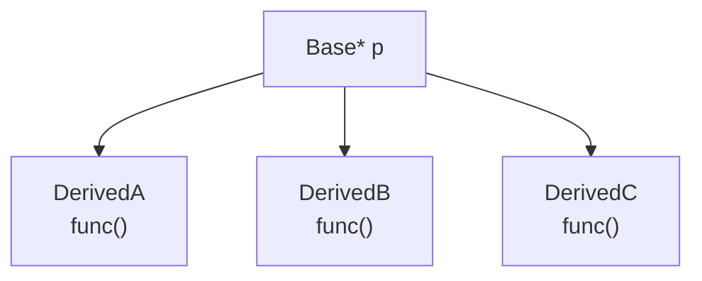

# Chapter 9 — Virtual Functions and Abstract Classes

[Repository Guide](../../README.md) | [English](Concepts_Lecture.md) | [한국어](Concepts_Lecture.ko.md)

> **Last Updated:** 2026-11-19
>
> 명품 C++ Programming, 황기태, Ch 9

> **Learning Objectives:**
> 1. Distinguish function redefinition (hiding) from overriding in an inheritance hierarchy
> 2. Explain how virtual functions produce dynamic binding through the vtable and vptr
> 3. Explain why virtual destructors are needed and declare them correctly
> 4. Define an abstract class with pure virtual functions and implement concrete classes that inherit from it
> 5. Write polymorphic programs with arrays of base class pointers and virtual functions
> 6. Distinguish the conditions for dynamic binding from the cases in which it does not occur (inside constructors, pass by value, scope resolution), and use abstract classes as interfaces

---

## Table of Contents

- [1. Upcasting and Downcasting](#1-upcasting-and-downcasting)
  - [1.1 Upcasting](#11-upcasting)
  - [1.2 Downcasting](#12-downcasting)
  - [1.3 Checking the Actual Type with dynamic_cast](#13-checking-the-actual-type-with-dynamic_cast)
- [2. Virtual Functions](#2-virtual-functions)
  - [2.1 The Need for Virtual Functions](#21-the-need-for-virtual-functions)
  - [2.2 Problem Without virtual](#22-problem-without-virtual)
  - [2.3 virtual Keyword](#23-virtual-keyword)
  - [2.4 Static vs Dynamic Binding](#24-static-vs-dynamic-binding)
  - [2.5 How It Works: vtable and vptr](#25-how-it-works-vtable-and-vptr)
  - [2.6 Override Keyword](#26-override-keyword)
  - [2.7 Conditions for Successful Overriding](#27-conditions-for-successful-overriding)
  - [2.8 Inheritance of Virtual Functions](#28-inheritance-of-virtual-functions)
  - [2.9 The final Specifier](#29-the-final-specifier)
  - [2.10 Calling a Base Class Virtual Function with the Scope Resolution Operator](#210-calling-a-base-class-virtual-function-with-the-scope-resolution-operator)
  - [2.11 Conditions for Dynamic Binding](#211-conditions-for-dynamic-binding)
  - [2.12 Tracing Calls Through the vtable](#212-tracing-calls-through-the-vtable)
- [3. Virtual Destructors](#3-virtual-destructors)
  - [3.1 Problem](#31-problem)
  - [3.2 Complete Example: The Memory Leak](#32-complete-example-the-memory-leak)
  - [3.3 Rule](#33-rule)
- [4. Abstract Classes](#4-abstract-classes)
  - [4.1 Pure Virtual Function](#41-pure-virtual-function)
  - [4.2 Abstract Class](#42-abstract-class)
  - [4.3 Concrete Class](#43-concrete-class)
  - [4.4 Abstract Class Implementation Examples](#44-abstract-class-implementation-examples)
  - [4.5 Abstract Classes as Interfaces](#45-abstract-classes-as-interfaces)
- [5. Polymorphism](#5-polymorphism)
  - [5.1 Concept](#51-concept)
  - [5.2 Complete Shape Hierarchy Example](#52-complete-shape-hierarchy-example)
  - [5.3 Complete Converter Example](#53-complete-converter-example)
  - [5.4 Shapes Managed in a Linked List](#54-shapes-managed-in-a-linked-list)
- [6. Common Mistakes](#6-common-mistakes)
  - [6.1 Forgetting Virtual Destructor](#61-forgetting-virtual-destructor)
  - [6.2 Trying to Instantiate an Abstract Class](#62-trying-to-instantiate-an-abstract-class)
  - [6.3 Forgetting to Override All Pure Virtual Functions](#63-forgetting-to-override-all-pure-virtual-functions)
  - [6.4 Object Slicing](#64-object-slicing)
  - [6.5 Overriding vs Overloading vs Hiding](#65-overriding-vs-overloading-vs-hiding)
  - [6.6 Object Slicing in Assignments and Arrays](#66-object-slicing-in-assignments-and-arrays)
  - [6.7 Overriding That Fails Because of const or Parameters](#67-overriding-that-fails-because-of-const-or-parameters)
- [Summary](#summary)
- [Self-Check Questions](#self-check-questions)

---

<br>

## 1. Upcasting and Downcasting

### 1.1 Upcasting

**Upcasting** converts a derived class pointer (or reference) to a base class pointer (or reference). It is **implicit** and always **safe** because every derived object **is-a** base object.

```cpp
class Base { };
class Derived : public Base { };

Derived d;
Base* p = &d;       // upcasting: implicit, always safe
Base& r = d;        // upcasting with reference
```

Through the base pointer `p`, **only base class members are accessible**. Even though the actual object is `Derived`, the compiler sees the `Base*` type and restricts access to `Base`'s interface.

```cpp
class Shape {
public:
    void draw() { cout << "Shape" << endl; }
};

class Circle : public Shape {
public:
    void draw() { cout << "Circle" << endl; }
    double getRadius() { return 5.0; }
};

Circle c;
Shape* p = &c;      // upcasting
p->draw();           // "Shape": calls Shape::draw() (static binding)
// p->getRadius();   // compile error: Shape has no getRadius()
```

> **Key Point:** After upcasting, the pointer type determines which members are visible. The derived-only members are hidden from the base pointer.

### 1.2 Downcasting

**Downcasting** converts a base class pointer to a derived class pointer. It requires an **explicit cast** and is **dangerous** if the actual object is not the target derived type.

```cpp
Base* p = new Derived;
Derived* dp = (Derived*)p;   // C-style downcast: compiles, but risky
```

Use `dynamic_cast` for **safe downcasting**. It performs a runtime check and returns `nullptr` if a pointer cast is invalid (requires at least one virtual function in the base class). A failed cast to a reference throws a `std::bad_cast` exception.

```cpp
Base* p = new Base;
Derived* dp = dynamic_cast<Derived*>(p);  // runtime check
if (dp == nullptr) {
    cout << "Cast failed: p does not point to Derived" << endl;
}
```

> **Caution:** Downcasting with `static_cast` or C-style casts bypasses runtime checks. If the actual object is not the derived type, accessing derived members causes **undefined behavior**.

### 1.3 Checking the Actual Type with dynamic_cast

The `dynamic_cast` of Section 1.2 checks at run time the actual type of the object a base class pointer points to. The following example gathers shapes of several kinds in a `Shape*` array, picks out only the ones that are `Circle`, and calls a member function that exists only in `Circle`.

```cpp
#include <iostream>
using namespace std;

class Shape {
public:
    virtual void draw() const { cout << "Shape" << endl; }
    virtual ~Shape() { }
};
class Circle : public Shape {
    int radius;
public:
    Circle(int r) : radius(r) { }
    void draw() const override { cout << "Circle" << endl; }
    int getRadius() const { return radius; }
};
class Rect : public Shape {
public:
    void draw() const override { cout << "Rect" << endl; }
};

int main() {
    Shape *shapes[3] = { new Circle(5), new Rect(), new Circle(7) };
    int sum = 0;
    for (int i = 0; i < 3; i++) {
        Circle *c = dynamic_cast<Circle *>(shapes[i]);   // its address if it actually is a Circle, otherwise nullptr
        if (c != nullptr) {
            cout << i << ": Circle, radius=" << c->getRadius() << endl;
            sum += c->getRadius();
        } else {
            cout << i << ": not a Circle" << endl;
        }
    }
    cout << "sum of radii: " << sum << endl;
    for (int i = 0; i < 3; i++) delete shapes[i];
    return 0;
}
```

```text
0: Circle, radius=5
1: not a Circle
2: Circle, radius=7
sum of radii: 12
```

| `i` | Object `shapes[i]` points to | `dynamic_cast<Circle *>(shapes[i])` | Branch taken |
|:----|:----|:----|:----|
| 0 | `Circle(5)` | The address of that `Circle` | Adds radius 5 |
| 1 | `Rect` | `nullptr` | Prints "not a Circle" |
| 2 | `Circle(7)` | The address of that `Circle` | Adds radius 7 |

*Table 1. The value dynamic_cast returns for each element*

- `dynamic_cast<Circle *>(p)` returns the address converted to `Circle*` if `p` actually points to a `Circle` object (or an object derived from `Circle`), and `nullptr` otherwise. So comparing the return value with `nullptr` alone tells the actual type. Doing the same with `static_cast` or a C-style cast would also convert element 1 to `Circle*`, and calling `getRadius()` would then be undefined behavior.
- Checking the type at run time requires type information in the object, and that information is attached only to objects of classes with virtual functions (the vptr of Section 2.5). Using `dynamic_cast` on a pointer to `class B { public: int x; };`, which has no virtual function, makes Apple clang report the compile error "'B' is not polymorphic". A single virtual destructor is enough to make a class polymorphic.
- `dynamic_cast<Circle &>(*p)`, which converts to a reference, cannot return `nullptr` on failure, so it throws a `std::bad_cast` exception. How to handle exceptions is covered in Chapter 13.

When code that checks types one by one with `dynamic_cast` grows, those checks must be changed every time a new derived class is added. Where possible, behavior that depends on the actual type is made a virtual function and left to the dynamic binding of Section 2, and `dynamic_cast` is limited to places that truly need a feature found only in a derived class.

---

<br>

## 2. Virtual Functions

### 2.1 The Need for Virtual Functions

Consider a drawing program as an example. There is a `Shape` base class and derived classes like `Circle`, `Rectangle`, and `Triangle`. All shapes are stored in a single array of `Shape*` pointers, and the goal is to draw them all in one loop:

```cpp
Shape* canvas[100];
canvas[0] = new Circle(10, 20, 5);
canvas[1] = new Rectangle(0, 0, 30, 40);
canvas[2] = new Triangle(5, 5, 10, 20, 15, 5);
// ...

for (int i = 0; i < count; i++) {
    canvas[i]->draw();   // Which draw() gets called?
}
```

**Without virtual:** Every call to `canvas[i]->draw()` calls `Shape::draw()`, because the compiler only sees the `Shape*` type. It does not matter that the object is actually a `Circle`; the compiler already decided at compile time to call `Shape::draw()`. Every shape draws the same thing, so the program cannot achieve its purpose of drawing each shape differently.

**With virtual:** Every call to `canvas[i]->draw()` calls the **correct** `draw()` for the actual object: `Circle::draw()` for circles, `Rectangle::draw()` for rectangles, and so on. The decision happens at runtime based on the actual object type.

This is **the core of OOP polymorphism**: writing code that operates on base class pointers but automatically does the right thing for each derived type. Without virtual functions, inheritance is just code sharing; with virtual functions, inheritance enables **substitutability**.

### 2.2 Problem Without virtual

Without `virtual`, the function that gets called is determined by the **pointer type**, not the actual object type. This is called **static binding** (or **early binding**), and the decision is made at compile time.

```cpp
class Base {
public:
    void func() { cout << "Base::func()" << endl; }
};

class Derived : public Base {
public:
    void func() { cout << "Derived::func()" << endl; }
};

Base* p = new Derived;
p->func();    // Output: "Base::func()", static binding!
delete p;
```

The pointer type is `Base*`, so `Base::func()` is called even though `p` points to a `Derived` object. This defeats the purpose of polymorphism.

The textbook calls this rewriting of a non-virtual base class function with the same prototype in a derived class **function redefinition (redefine)**. The derived object then contains both `func()` functions: calling through a `Derived*` runs `Derived::func()`, and calling through a `Base*` runs `Base::func()`. Section 6.5 treats this as hiding.

### 2.3 virtual Keyword

Adding `virtual` to the base class function enables **dynamic binding** (or **late binding**). At runtime, the actual object type determines which function is called.

```cpp
class Base {
public:
    virtual void func() { cout << "Base::func()" << endl; }
};

class Derived : public Base {
public:
    void func() { cout << "Derived::func()" << endl; }  // overrides
};

Base* p = new Derived;
p->func();    // Output: "Derived::func()", dynamic binding!
delete p;
```

Once a function is declared `virtual` in the base class, it remains virtual in all derived classes, even without explicitly writing `virtual` again.

Defining a function in a derived class with the same prototype as a base class virtual function in this way is called **function overriding**, and it is one form of polymorphism. After overriding, `Base::func()` still exists inside the derived object, but calling through a base class pointer always runs `Derived::func()`, so the base class function loses its presence. To call the base class version on a derived object, use the scope resolution operator of Section 2.10.

### 2.4 Static vs Dynamic Binding

Understanding the difference between static and dynamic binding is essential. The two differ in **when** the function to call is decided.

**Static Binding (Compile-Time Binding)**
- The compiler decides which function to call based on the **pointer/reference type**.
- This is the default for non-virtual functions.
- Fast (no runtime lookup), but ignores the actual object type.

**Dynamic Binding (Runtime Binding)**
- The program decides which function to call at runtime based on the **actual object type**.
- Activated by the `virtual` keyword.
- Slightly slower (vtable lookup), but enables true polymorphism.

The `virtual` keyword is the switch that changes a function from static binding to dynamic binding.

> **[Programming Languages]** In programming languages, binding is the association of a name with the entity it denotes, and bindings are classified by the time at which they are made (binding time) into static bindings, fixed at compile time, and dynamic bindings, made during execution. In a C++ member function call, this distinction applies to the time at which the called name is associated with the function body to run: a non-virtual member function is bound at compile time by the declared type of the pointer, and a virtual function is bound at run time by the actual type of the object.

**Side-by-Side Comparison (Same Code, Different Behavior):**

```cpp
#include <iostream>
using namespace std;

// ============ WITHOUT virtual (static binding) ============
class AnimalStatic {
public:
    void speak() { cout << "..." << endl; }
};
class DogStatic : public AnimalStatic {
public:
    void speak() { cout << "Woof!" << endl; }
};
class CatStatic : public AnimalStatic {
public:
    void speak() { cout << "Meow!" << endl; }
};

// ============ WITH virtual (dynamic binding) ============
class AnimalDynamic {
public:
    virtual void speak() { cout << "..." << endl; }
    virtual ~AnimalDynamic() { }
};
class DogDynamic : public AnimalDynamic {
public:
    void speak() override { cout << "Woof!" << endl; }
};
class CatDynamic : public AnimalDynamic {
public:
    void speak() override { cout << "Meow!" << endl; }
};

int main() {
    // --- Static binding ---
    AnimalStatic* s1 = new DogStatic;
    AnimalStatic* s2 = new CatStatic;
    s1->speak();   // "..."  (wrong! calls AnimalStatic::speak)
    s2->speak();   // "..."  (wrong! calls AnimalStatic::speak)
    delete s1; delete s2;

    // --- Dynamic binding ---
    AnimalDynamic* d1 = new DogDynamic;
    AnimalDynamic* d2 = new CatDynamic;
    d1->speak();   // "Woof!"  (correct! calls DogDynamic::speak)
    d2->speak();   // "Meow!"  (correct! calls CatDynamic::speak)
    delete d1; delete d2;

    return 0;
}
```

Output:

```text
...
...
Woof!
Meow!
```

> **Key Point:** The only difference is the `virtual` keyword on the base class. Everything else, including the inheritance, the pointer types, and the function calls, is identical. `virtual` is what makes polymorphism work.

### 2.5 How It Works: vtable and vptr

C++ compilers typically implement dynamic binding through the **vtable** (virtual function table) mechanism. The C++ standard does not prescribe this technique, but all major compilers use it:

1. **vtable:** Each class that has virtual functions gets a table of function pointers. The table maps each virtual function to the correct implementation for that class.
2. **vptr:** Each object of a class with virtual functions contains a hidden pointer (`vptr`) that points to its class's vtable.
3. **Runtime lookup:** When a virtual function is called through a base pointer, the program follows the `vptr` to the vtable, looks up the function, and calls the correct version.

**Simple vtable diagram (one virtual function):**

```text
┌────────────────┐         ┌──────────────────────┐
│  Base object   │         │   Base vtable        │
│  ┌──────────┐  │         │   func → Base::func  │
│  │  vptr   ─┼──┼────────▶│                      │
│  └──────────┘  │         └──────────────────────┘
└────────────────┘

┌────────────────┐         ┌───────────────────────────┐
│ Derived object │         │   Derived vtable          │
│  ┌──────────┐  │         │   func → Derived::func    │
│  │  vptr   ─┼──┼────────▶│                           │
│  └──────────┘  │         └───────────────────────────┘
└────────────────┘
```

*Figure 1. vptr and vtable of a Base object and a Derived object with one virtual function*

**Detailed vtable diagram (Shape hierarchy with multiple virtual functions):**

Consider `class Shape` with `virtual draw()` and `virtual area()`, and derived classes `Circle` and `Rectangle`:

```text
 Shape* p = new Circle(5.0);
 p->draw();   // How does C++ find Circle::draw()?

 Step 1: Follow p to the Circle object
 Step 2: Read the hidden vptr from the object
 Step 3: Follow vptr to Circle's vtable
 Step 4: Look up draw() in the vtable → Circle::draw
 Step 5: Call Circle::draw()

 Circle object in memory:         Circle's vtable:
 ┌──────────────────┐             ┌──────────────────────────┐
 │  vptr ───────────┼────────────▶│ draw → Circle::draw      │
 │  radius = 5.0    │             │ area → Circle::area      │
 └──────────────────┘             │ ~dtor → Circle::~Circle  │
                                  └──────────────────────────┘

 Rectangle object in memory:      Rectangle's vtable:
 ┌──────────────────┐             ┌───────────────────────────────┐
 │  vptr ───────────┼────────────▶│ draw → Rectangle::draw        │
 │  width = 3.0     │             │ area → Rectangle::area        │
 │  height = 4.0    │             │ ~dtor → Rectangle::~Rectangle │
 └──────────────────┘             └───────────────────────────────┘

 Shape object in memory:          Shape's vtable:
 ┌──────────────────┐             ┌──────────────────────────┐
 │  vptr ───────────┼────────────▶│ draw → Shape::draw       │
 └──────────────────┘             │ area → Shape::area       │
                                  │ ~dtor → Shape::~Shape    │
                                  └──────────────────────────┘
```

*Figure 2. Steps for resolving a virtual function call and the per-class vtables in the Shape hierarchy*

> **Key Point:** **The vtable is per-class** (shared by all objects of that class), but **the vptr is per-object** (each object carries its own pointer to its class's vtable). When you create a `Circle`, its vptr is set to point to `Circle`'s vtable. When you create a `Rectangle`, its vptr points to `Rectangle`'s vtable. This is why the same `p->draw()` call produces different results depending on the actual object.

> **Note:** The vtable mechanism adds a small overhead: one pointer per object and one indirect call per virtual function invocation. This is the cost of runtime polymorphism.

### 2.6 Override Keyword

C++11 introduced the `override` keyword. Placing `override` on a derived function tells the compiler to verify that the base class has a matching virtual function. This catches typos and signature mismatches at compile time.

```cpp
class Base {
public:
    virtual void func(int x) { }
};

class Derived : public Base {
public:
    void func(int x) override { }    // OK: matches Base::func(int)
    // void func(double x) override; // compile error: no matching base function
    // void Fun(int x) override;     // compile error: typo in name
};
```

> **Note:** **Best Practice.** Always use `override` when overriding virtual functions. It is a compile-time safety net at zero runtime cost.

For example, suppose `Rect` is meant to override `virtual void draw()` of `Shape` but the function is mistyped as `void drow()`. Without `override`, this merely adds a new function and no error occurs, so `draw()` called through a `Shape*` runs `Shape::draw()`. Writing `void drow() override;` exposes the mistake as a compile error because no matching virtual function exists.

### 2.7 Conditions for Successful Overriding

Overriding succeeds only if the **name, parameter types and count, and return type** of the derived class function all match the base class virtual function.

```cpp
class Base {
public:
    virtual void fail();
    virtual void success();
    virtual void g(int);
};

class Derived : public Base {
public:
    virtual int fail();           // overriding fails: different return type, compile error
    virtual void success();       // overriding succeeds
    virtual void g(int, double);  // different parameters, a new function: compiles normally
};
```

- `fail()`, which differs only in return type, is a compile error. However, when the base class virtual function returns a pointer or reference to the base class, changing the derived class version to return a pointer or reference to the derived class is allowed; this is a **covariant return type**.
- The `virtual` keyword of a virtual function is inherited, so it may be omitted in the derived class. Writing `virtual void success();` in `Derived` as `void success();` is the same overriding.
- A virtual function may have any access specifier: `private`, `protected`, or `public`. The second `Calculator` example in Section 4.4 makes the pure virtual function `calc()` `protected`.

> **Note:** The textbook presents `g(int, double)` as a case of overloading. However, the base class and the derived class have different scopes, so declaring a function with the same name in the derived class hides the base class `g(int)` in the scope of `Derived` (hiding, Section 6.5). Therefore calling `d.g(1)` on a `Derived` object `d` is a compile error, and `Base::g(int)` runs only when `g(1)` is called through a `Base*`. To use both functions together like overloads, declare `using Base::g;` inside `Derived`.

### 2.8 Inheritance of Virtual Functions

A virtual function remains virtual no matter how many levels the inheritance hierarchy has. In the following example (textbook Example 9-3), `Base`, `Derived`, and `GrandDerived` inherit from one another in turn, and all three pointers point to the same `GrandDerived` object.

```cpp
#include <iostream>
using namespace std;

class Base {
public:
    virtual void f() { cout << "Base::f() called" << endl; }
};

class Derived : public Base {
public:
    void f() { cout << "Derived::f() called" << endl; }
};

class GrandDerived : public Derived {
public:
    void f() { cout << "GrandDerived::f() called" << endl; }
};

int main() {
    GrandDerived g;
    Base* bp;
    Derived* dp;
    GrandDerived* gp;

    bp = dp = gp = &g;

    bp->f();   // dynamic binding
    dp->f();   // dynamic binding
    gp->f();
}
```

Output:

```text
GrandDerived::f() called
GrandDerived::f() called
GrandDerived::f() called
```

The `f()` functions of `Derived` and `GrandDerived` have no `virtual`, but both are virtual functions because `Base::f()` is virtual. Therefore, whether the pointer type is `Base*` or `Derived*`, dynamic binding runs the `f()` of the actual object, `GrandDerived`.

If a derived class does not override a virtual function, the function defined by the nearest base class in the inheritance hierarchy is used.

```cpp
#include <iostream>
using namespace std;

class B {
public:
    virtual void who() { cout << "Base\n"; }
};

class D1 : public B {
public:
    void who() { cout << "First derivation\n"; }
};

class D2 : public B {
    // who() is not overridden.
};

int main() {
    B base_obj;
    B* p;
    D1 D1_obj;
    D2 D2_obj;

    p = &base_obj;
    p->who();   // calls B's who()
    p = &D1_obj;
    p->who();   // calls D1's who()
    p = &D2_obj;
    p->who();   // D2 has no who(), so B's who() is called
    return 0;
}
```

Output:

```text
Base
First derivation
Base
```

Dynamic binding also occurs when a virtual function is called inside a member function of the base class. In the following example, `paint()` is a non-virtual function of `Shape`, but the call to `draw()` inside it is the same as `this->draw()`, so the `draw()` of the actual object that `this` points to runs.

```cpp
#include <iostream>
using namespace std;

class Shape {
public:
    void paint() {
        draw();   // this->draw(): dynamic binding
    }
    virtual void draw() {
        cout << "Shape::draw() called" << endl;
    }
};

class Circle : public Shape {
public:
    virtual void draw() {
        cout << "Circle::draw() called" << endl;
    }
};

int main() {
    Circle circle;
    Shape* pShape = &circle;   // upcasting
    pShape->paint();
}
```

Output:

```text
Circle::draw() called
```

Calling `paint()` on a `Shape` object prints `Shape::draw() called`. In this way, base class code can call a function that derived classes implement, and the abstract class examples of Section 4.4 rely on this property.

### 2.9 The final Specifier

The `final` specifier, introduced in C++11, can be used in two places. Strictly speaking, `override` and `final` are not reserved words but identifiers with a special meaning only in specific positions, and the textbook calls both of them specifiers.

1. **Right after a virtual function prototype:** derived classes cannot override that virtual function.
2. **After a class name:** no other class can inherit from that class (inheritance is blocked).

```cpp
class Shape {
public:
    virtual void draw() final;   // can no longer be overridden
};

class Rect : public Shape {
public:
    void draw();                 // compile error: attempts to override a final function
};
```

```cpp
class Shape final {
    // ...
};

class Rect : public Shape {      // compile error: Shape cannot be inherited
    // ...
};
```

```cpp
class Shape {
    // ...
};

class Rect final : public Shape {   // Rect can inherit from Shape
    // ...
};

class RoundRect : public Rect {     // compile error: Rect cannot be inherited
    // ...
};
```

### 2.10 Calling a Base Class Virtual Function with the Scope Resolution Operator

Calling a function in the form `BaseClass::virtualFunction()` with the scope resolution operator `::` suppresses dynamic binding, and the base class function runs through static binding. This is mainly used when an overriding function in a derived class reuses the base class behavior and adds to it.

```cpp
#include <iostream>
using namespace std;

class Shape {
public:
    virtual void draw() {
        cout << "--Shape--";
    }
};

class Circle : public Shape {
public:
    virtual void draw() {
        Shape::draw();   // calls the base class draw() (static binding)
        cout << "Circle" << endl;
    }
};

int main() {
    Circle circle;
    Shape* pShape = &circle;

    pShape->draw();          // dynamic binding: runs Circle::draw()
    pShape->Shape::draw();   // static binding: runs only Shape::draw()
}
```

Output:

```text
--Shape--Circle
--Shape--
```

`pShape->draw()` runs `Circle::draw()` through dynamic binding, and the `Shape::draw()` inside it prints `--Shape--` first through static binding. `pShape->Shape::draw()` is statically bound from the start, so it prints only `--Shape--`.

### 2.11 Conditions for Dynamic Binding

Gathering Sections 2.3-2.10, a virtual function call is dynamically bound only when all three of the following conditions hold.

1. The function called is a virtual function (declared `virtual` in the base class).
2. The object is called through a **pointer or reference** of the base class type. Calling by name alone inside a member function counts, because it is a pointer call through `this->` (the `paint()` of Section 2.8).
3. The call does not use the scope resolution operator (Section 2.10).

If even one condition is missing, the compiler chooses the function by the declared type.

| Form of the call | Function executed when `f()` of `Base` is virtual | Reason |
|:----|:----|:----|
| `Base *p = &d; p->f();` | `Derived::f()` | Virtual function call through a pointer |
| `Base &r = d; r.f();` | `Derived::f()` | Virtual function call through a reference |
| `Base b = d; b.f();` | `Base::f()` | `b` is a `Base` object (slicing, Section 6.4) |
| `p->Base::f();` | `Base::f()` | The scope resolution operator means static binding |
| `f();` inside the constructor of `Base` | `Base::f()` | The object under construction is still a `Base` (explained below) |

*Table 2. Binding of virtual functions by form of the call*

The last row deserves particular attention. As seen in Section 3 of Chapter 8, a derived class object is constructed starting from its base class part, and while the base class constructor runs, the members of the derived class have not been initialized yet. If a derived class function ran at this point, it would use uninitialized members, so C++ treats a virtual function call inside a constructor or destructor as a call to the function of the class to which that constructor or destructor belongs.

```cpp
#include <iostream>
using namespace std;

class Base {
public:
    Base() { cout << "Base constructor: "; whoAmI(); }       // during construction, Base's function is called
    virtual ~Base() { cout << "Base destructor: "; whoAmI(); }
    virtual void whoAmI() { cout << "Base" << endl; }
    void call() { whoAmI(); }                          // dynamic binding after construction is finished
};

class Derived : public Base {
    int *data;
public:
    Derived() : data(new int(7)) { cout << "Derived constructor: "; whoAmI(); }
    ~Derived() { cout << "Derived destructor: "; whoAmI(); delete data; }
    void whoAmI() override { cout << "Derived, *data=" << *data << endl; }
};

int main() {
    Derived d;
    cout << "call(): "; d.call();
    return 0;
}
```

```text
Base constructor: Base
Derived constructor: Derived, *data=7
call(): Derived, *data=7
Derived destructor: Derived, *data=7
Base destructor: Base
```

- **`whoAmI()` inside the `Base` constructor:** At this moment `data` has not been allocated yet. Had `Derived::whoAmI()` run here, it would have dereferenced the uninitialized pointer `data`. In fact `Base::whoAmI()` runs and "Base" is printed.
- **`whoAmI()` inside `call()`:** After the object has been constructed, the call is dynamically bound as in Section 2.8, and `Derived::whoAmI()` runs.
- **`whoAmI()` inside the `Base` destructor:** Destruction proceeds from the derived class, so when the destructor of `Base` runs, the `Derived` part has already been destroyed and `data` has been released. So `Base::whoAmI()` runs here as well.

In terms of the vtable model of Section 2.5, in the usual implementations that use vtables the compiler makes the vptr of the object point to the vtable of the class whose constructor is running, and switches it to the vtable of the next level each time a constructor finishes. Initialization that must behave differently for each derived class is therefore not left to a virtual function call inside the base class constructor but handled directly in the derived class constructor.

> **Note:** **Default arguments of virtual functions.** If an overriding function changes the value of a default argument, the function executed is chosen by dynamic binding, but the default argument is chosen by the declared type of the pointer. With `virtual void show(int n = 1)` in `Base` and `void show(int n = 2) override` in `Derived`, `Base *p = &d; p->show();` runs `Derived::show()` with the argument 1 and prints "Derived 1", while `d.show();` prints "Derived 2". To avoid confusion, do not change default arguments in overriding functions.

### 2.12 Tracing Calls Through the vtable

Tracing actual calls one by one with the vtable model of Section 2.5 shows concretely how dynamic binding chooses a function. In the following three classes, `Base` has the virtual functions `f()` and `g()` and the non-virtual function `h()`, `Mid` overrides only `f()`, and `Leaf` overrides only `g()`.

```cpp
#include <iostream>
using namespace std;

class Base {
public:
    virtual void f() { cout << "Base::f" << endl; }
    virtual void g() { cout << "Base::g" << endl; }
    void h() { cout << "Base::h" << endl; }          // not a virtual function
    virtual ~Base() { }
};

class Mid : public Base {
public:
    void f() override { cout << "Mid::f" << endl; }   // overrides only f
};

class Leaf : public Mid {
public:
    void g() override { cout << "Leaf::g" << endl; }  // overrides only g
};

int main() {
    Base b; Mid m; Leaf l;
    Base *objs[3] = { &b, &m, &l };
    for (int i = 0; i < 3; i++) {
        objs[i]->f();
        objs[i]->g();
        objs[i]->h();
    }
    return 0;
}
```

```text
Base::f
Base::g
Base::h
Mid::f
Base::g
Base::h
Mid::f
Leaf::g
Base::h
```

In the usual implementations that use vtables, each class's vtable has one slot per virtual function, and derived classes keep the slot order set in the base class. A derived class replaces only the slots of the functions it overrides with its own functions and inherits the contents of the other slots from the base class. A virtual destructor also has slots in the vtable, but their number and position differ by implementation, so the table below lists only the slots of `f()` and `g()`.

| vtable | Slot 0: `f()` | Slot 1: `g()` |
|:----|:----|:----|
| vtable of `Base` | `Base::f` | `Base::g` |
| vtable of `Mid` | `Mid::f` (overridden) | `Base::g` (inherited) |
| vtable of `Leaf` | `Mid::f` (inherited) | `Leaf::g` (overridden) |

*Table 3. Functions in the vtable slots of the three classes*

The single call `objs[2]->g()` runs in the following order.

1. At compile time, the compiler already knows that the type of `objs[2]` is `Base*` and that `g()` is in slot 1 among the virtual functions of `Base`. So it generates code that says "read the vptr of the object pointed to, and call the function in slot 1 of that vtable".
2. At run time, `objs[2]` points to `l` (a `Leaf` object), so the vptr inside the object points to the vtable of `Leaf`.
3. Slot 1 of the vtable of `Leaf` holds `Leaf::g`, so `Leaf::g` is called.

In the same way, `objs[2]->f()` reads slot 0 of the vtable of `Leaf`, and since `Leaf` does not override `f()`, that slot holds `Mid::f`, inherited from `Mid`. What Section 2.8 described as "without overriding, the function of the nearest base class is called" appears in the vtable as this inheritance of slots. The non-virtual function `h()`, on the other hand, has no slot in the vtable and is fixed as `Base::h` at compile time from the pointer type `Base*` alone, so `Base::h` is printed for all three objects.

The size of objects confirms that the vptr actually is inside the object.

```cpp
#include <iostream>
using namespace std;

class Plain { int x; public: void f() { } int get() const { return x; } };
class Virt { int x; public: virtual void f() { } virtual ~Virt() { } int get() const { return x; } };

int main() {
    cout << "sizeof(Plain)=" << sizeof(Plain) << ", sizeof(Virt)=" << sizeof(Virt)
         << ", sizeof(void*)=" << sizeof(void *) << endl;
    return 0;
}
```

```text
sizeof(Plain)=4, sizeof(Virt)=16, sizeof(void*)=8
```

`Plain`, which has only one `int`, is 4 bytes, but `Virt`, which has virtual functions, is 16 bytes. In usual implementations, the vptr, 8 bytes, the size of a pointer in a 64-bit environment, goes at the front of the object, the `int` follows it, and empty space is added so that the size of the whole object is a multiple of the pointer size (the alignment of Section 2.6 of Chapter 3). However many virtual functions there are, each object grows by only one vptr; the number of virtual functions affects only the size of the vtable, of which there is one per class. The exact size and layout depend on the implementation.

---

<br>

## 3. Virtual Destructors

### 3.1 Problem

When deleting a derived object through a base pointer, if the destructor is **not virtual**, typical compilers call only the base class destructor (the C++ standard defines this case as undefined behavior). The derived class destructor is skipped, potentially **leaking resources** allocated by the derived class.

```cpp
class Base {
public:
    ~Base() { cout << "~Base" << endl; }
};

class Derived : public Base {
    int* data;
public:
    Derived() { data = new int[100]; }
    ~Derived() { delete[] data; cout << "~Derived" << endl; }
};

Base* p = new Derived;
delete p;    // Output: "~Base" only! ~Derived never called → memory leak
```

### 3.2 Complete Example: The Memory Leak

This complete, runnable program demonstrates the problem and the fix side by side:

```cpp
#include <iostream>
#include <cstring>
using namespace std;

// ============ BUG: Non-virtual destructor ============
class BadBase {
public:
    ~BadBase() { cout << "[BadBase] destructor" << endl; }
};

class BadDerived : public BadBase {
    char* name;
public:
    BadDerived(const char* n) {
        name = new char[strlen(n) + 1];
        strcpy(name, n);
        cout << "[BadDerived] allocated: " << name << endl;
    }
    ~BadDerived() {
        cout << "[BadDerived] freeing: " << name << endl;
        delete[] name;
    }
};

// ============ FIX: Virtual destructor ============
class GoodBase {
public:
    virtual ~GoodBase() { cout << "[GoodBase] destructor" << endl; }
};

class GoodDerived : public GoodBase {
    char* name;
public:
    GoodDerived(const char* n) {
        name = new char[strlen(n) + 1];
        strcpy(name, n);
        cout << "[GoodDerived] allocated: " << name << endl;
    }
    ~GoodDerived() override {
        cout << "[GoodDerived] freeing: " << name << endl;
        delete[] name;
    }
};

int main() {
    cout << "--- Without virtual destructor (BUG) ---" << endl;
    BadBase* bp = new BadDerived("leak");
    delete bp;   // Only ~BadBase runs! "leak" is never freed.
    cout << endl;

    cout << "--- With virtual destructor (CORRECT) ---" << endl;
    GoodBase* gp = new GoodDerived("safe");
    delete gp;   // ~GoodDerived runs first, then ~GoodBase.
    cout << endl;

    return 0;
}
```

Output:

```text
--- Without virtual destructor (BUG) ---
[BadDerived] allocated: leak
[BadBase] destructor

--- With virtual destructor (CORRECT) ---
[GoodDerived] allocated: safe
[GoodDerived] freeing: safe
[GoodBase] destructor
```

Without a virtual destructor, `[BadDerived] freeing: leak` never appears. The destructor of `BadDerived` does not run, so the memory that `name` points to is leaked. With a virtual destructor, both destructors run in the proper order: derived class first, then base class.

### 3.3 Rule

If a class has **any virtual function**, it is likely to be handled through base class pointers, so its destructor should also be **virtual**. This ensures that `delete` through a base pointer calls the derived destructor first through dynamic binding, and the base destructor runs when the derived destructor finishes.

```cpp
class Base {
public:
    virtual ~Base() { cout << "~Base" << endl; }
    virtual void func() { }
};

class Derived : public Base {
    int* data;
public:
    Derived() { data = new int[100]; }
    ~Derived() { delete[] data; cout << "~Derived" << endl; }
};

Base* p = new Derived;
delete p;    // Output: "~Derived" then "~Base", correct!
```

> **Note:** **Rule of Thumb.** Any class intended to be used as a base class with virtual functions should have a `virtual` destructor. This is one of the most important C++ best practices.

---

<br>

## 4. Abstract Classes

### 4.1 Pure Virtual Function

A **pure virtual function** is a virtual function that has only a declaration and no implementation in the base class. It is declared by appending `= 0` to the function prototype, and a derived class **must implement** it to become a concrete class (Section 4.3) from which objects can be created. A base class virtual function is declared pure when it only shows the form of the function that derived classes redefine and needs no code to run.

```cpp
class Shape {
public:
    virtual double getArea() = 0;   // pure virtual: no body
    virtual void draw() = 0;        // pure virtual
};
```

### 4.2 Abstract Class

A class that contains **at least one pure virtual function** is an **abstract class**. An abstract class:

- **Cannot be instantiated:** it is not a complete class, so objects of it cannot be created directly.
- **Can have pointers and references:** `Shape* p;` is valid.
- **Can have non-pure member functions:** it may provide partial implementations, and not every member function has to be pure virtual. A non-pure member function may even call a pure virtual function (in the same way as `paint()` in Section 2.8).
- **Serves as an interface/contract:** it shows the prototypes of the functions that derived classes must implement. An abstract class exists not to create objects but to serve as a base class in inheritance.

```cpp
// Shape s;           // compile error: Shape is abstract
Shape* p;             // OK: pointer to abstract class
Shape& r = *p;        // OK: reference to abstract class
```

### 4.3 Concrete Class

A **concrete class** is a derived class that implements **all** pure virtual functions inherited from the abstract base. Only concrete classes can be instantiated.

```cpp
class Circle : public Shape {
    double radius;
public:
    Circle(double r) : radius(r) { }
    double getArea() override { return 3.14159 * radius * radius; }
    void draw() override { cout << "Drawing Circle" << endl; }
};

class Rectangle : public Shape {
    double width, height;
public:
    Rectangle(double w, double h) : width(w), height(h) { }
    double getArea() override { return width * height; }
    void draw() override { cout << "Drawing Rectangle" << endl; }
};

Circle c(5.0);        // OK: Circle is concrete
Rectangle r(3.0, 4.0); // OK: Rectangle is concrete
```

> **Key Point:** If a derived class does not override all pure virtual functions, it is still abstract and cannot be instantiated.

### 4.4 Abstract Class Implementation Examples

Textbook Example 9-6 implements a `GoodCalc` class by inheriting from an abstract class `Calculator` that consists only of pure virtual functions. `GoodCalc` implements all three pure virtual functions, so it is a concrete class.

```cpp
#include <iostream>
using namespace std;

class Calculator {
public:
    virtual int add(int a, int b) = 0;              // returns the sum of two integers
    virtual int subtract(int a, int b) = 0;         // returns the difference of two integers
    virtual double average(int a[], int size) = 0;  // returns the average of array a; size is the array size
};

class GoodCalc : public Calculator {
public:
    int add(int a, int b) { return a + b; }
    int subtract(int a, int b) { return a - b; }
    double average(int a[], int size) {
        double sum = 0;
        for (int i = 0; i < size; i++)
            sum += a[i];
        return sum / size;
    }
};

int main() {
    int a[] = {1, 2, 3, 4, 5};
    Calculator* p = new GoodCalc();
    cout << p->add(2, 3) << endl;
    cout << p->subtract(2, 3) << endl;
    cout << p->average(a, 5) << endl;
    delete p;
}
```

Output:

```text
5
-1
3
```

> **Note:** `Calculator` has no virtual destructor, so the last line, which deletes a `GoodCalc` object through a `Calculator*`, is the undefined behavior described in Section 3.1. `GoodCalc` has no resources to release, so the problem does not show in this example, but the correct fix is to add `virtual ~Calculator() { }` to `Calculator`.

In textbook Example 9-7, `Calculator` implements `run()`, which handles user input and result output, and leaves only the actual calculation as the pure virtual function `calc()`. The derived classes `Adder` and `Subtractor` only need to implement `calc()`. The call `calc(a, b)` inside `run()` is dynamically bound to the `calc()` of the actual object, like `paint()` in Section 2.8.

```cpp
#include <iostream>
using namespace std;

class Calculator {
    void input() {
        cout << "Enter two integers>> ";
        cin >> a >> b;
    }
protected:
    int a, b;
    virtual int calc(int a, int b) = 0;   // returns the result of calculating two integers
public:
    void run() {
        input();
        cout << "Calculated value: " << calc(a, b) << endl;
    }
};

class Adder : public Calculator {
protected:
    int calc(int a, int b) {   // implements the pure virtual function
        return a + b;
    }
};

class Subtractor : public Calculator {
protected:
    int calc(int a, int b) {   // implements the pure virtual function
        return a - b;
    }
};

int main() {
    Adder adder;
    Subtractor subtractor;
    adder.run();
    subtractor.run();
}
```

Sample run (entering `5 3` both times):

```text
Enter two integers>> 5 3
Calculated value: 8
Enter two integers>> 5 3
Calculated value: 2
```

### 4.5 Abstract Classes as Interfaces

An abstract class in which every member function is pure virtual and which has no member variables defines only a promise, "objects of this class have these functions", with no implementation. Such a class is called an **interface**, and because C++ has no separate keyword for interfaces, it is expressed with an abstract class. One class can inherit several interfaces through multiple inheritance and implement them all, and since interfaces have no member variables, there is little room for the diamond problem of Section 5.3 of Chapter 8.

```cpp
#include <iostream>
#include <string>
using namespace std;

class Printable {                                  // interface: only pure virtual functions
public:
    virtual void print() const = 0;
    virtual ~Printable() { }
};

class Comparable {                                 // interface
public:
    virtual bool lessThan(const Comparable &other) const = 0;
    virtual ~Comparable() { }
};

class Score : public Printable, public Comparable {   // concrete class implementing two interfaces
    string name;
    int value;
public:
    Score(string n, int v) : name(n), value(v) { }
    void print() const override { cout << name << ":" << value << endl; }
    bool lessThan(const Comparable &other) const override {
        const Score &o = dynamic_cast<const Score &>(other);   // assumes that only Score objects are compared
        return value < o.value;
    }
};

void printAll(const Printable *items[], int n) {   // knowing Printable is enough to print
    for (int i = 0; i < n; i++)
        items[i]->print();
}

int main() {
    Score a("Kim", 82), b("Lee", 95);
    const Printable *list[] = { &a, &b };
    printAll(list, 2);
    const Comparable &ca = a;
    cout << boolalpha << ca.lessThan(b) << endl;   // 82 < 95
    return 0;
}
```

```text
Kim:82
Lee:95
true
```

- `printAll()` knows nothing about `Score` and uses only `print()` of `Printable`. Even if another class implementing `Printable` is written later, `printAll()` needs no change. This is the open-closed principle of Section 5.2 applied at the level of interfaces.
- A `Score` object can be pointed to both by a `Printable *` and by a `Comparable &`. Through each pointer and reference, only the functions declared in that interface can be called (Section 1.1).
- The parameter of `lessThan()` is a `Comparable`, so reaching the `value` of the actual `Score` requires converting it to `Score` with the `dynamic_cast` of Section 1.2. A failed `dynamic_cast` on a reference throws a `std::bad_cast` exception, and exception handling is covered in Chapter 13.
- Both interfaces have virtual destructors, so deleting a dynamic object through a `Printable *` or a `Comparable *` also runs the destructor of `Score` correctly (Section 3).

> **Note:** **Pure virtual destructor.** To make a class abstract when it has no other function to leave unimplemented, the destructor can be declared as a pure virtual function, as in `virtual ~Abstract() = 0;`. However, a derived class destructor always calls the base class destructor when it finishes, so a pure virtual destructor must also have a definition, such as `Abstract::~Abstract() { }`. Without the definition, the code compiles, but at link time the linker used by Apple clang reports an undefined symbol error, `"Abstract::~Abstract()", referenced from: Concrete::~Concrete()`.

---

<br>

## 5. Polymorphism

### 5.1 Concept

**Polymorphism** means "one interface, multiple implementations." A base class pointer can call different derived class implementations depending on the actual object type at runtime.



*Figure 3. Structure in which one base class pointer calls func() of several derived classes*

Through `p->func()`, the correct derived version is called based on what `p` actually points to, not on the pointer type.

### 5.2 Complete Shape Hierarchy Example

A complete, runnable program demonstrating a `Shape` hierarchy with virtual `draw()` and `area()`, polymorphic behavior through an array of base pointers, and proper virtual destructor usage.

```cpp
#include <iostream>
using namespace std;

class Shape {
public:
    virtual void draw() = 0;            // pure virtual
    virtual double area() = 0;          // pure virtual
    virtual ~Shape() { }                // virtual destructor
};

class Circle : public Shape {
    double radius;
public:
    Circle(double r) : radius(r) { }
    void draw() override {
        cout << "Drawing Circle (radius=" << radius << ")" << endl;
    }
    double area() override {
        return 3.14159265 * radius * radius;
    }
};

class Rectangle : public Shape {
    double width, height;
public:
    Rectangle(double w, double h) : width(w), height(h) { }
    void draw() override {
        cout << "Drawing Rectangle (" << width << "x" << height << ")" << endl;
    }
    double area() override {
        return width * height;
    }
};

class Triangle : public Shape {
    double base, height;
public:
    Triangle(double b, double h) : base(b), height(h) { }
    void draw() override {
        cout << "Drawing Triangle (base=" << base << ", height=" << height << ")" << endl;
    }
    double area() override {
        return 0.5 * base * height;
    }
};

// This function works with ANY Shape: past, present, or future.
// It does not need to know about Circle, Rectangle, or Triangle.
void printShapeInfo(Shape* s) {
    s->draw();
    cout << "  Area = " << s->area() << endl;
}

int main() {
    const int N = 4;
    Shape* canvas[N];
    canvas[0] = new Circle(5.0);
    canvas[1] = new Rectangle(3.0, 4.0);
    canvas[2] = new Triangle(6.0, 3.0);
    canvas[3] = new Circle(2.5);

    // One loop handles ALL shape types uniformly
    for (int i = 0; i < N; i++) {
        printShapeInfo(canvas[i]);
    }

    // Clean up: virtual destructor ensures proper deletion
    for (int i = 0; i < N; i++) {
        delete canvas[i];
    }

    return 0;
}
```

Output:

```text
Drawing Circle (radius=5)
  Area = 78.5398
Drawing Rectangle (3x4)
  Area = 12
Drawing Triangle (base=6, height=3)
  Area = 9
Drawing Circle (radius=2.5)
  Area = 19.635
```

The power of this design: if you later add a `Pentagon` class, you only need to write the new class and override `draw()` and `area()`. The `printShapeInfo()` function and the loop in `main()` require **zero changes**. This is the Open-Closed Principle in action: open for extension, closed for modification.

The textbook demonstrates the same principle with a linked list. `Shape` has a `next` pointer to the next shape, `add()`, `getNext()`, and a `paint()` that calls `draw()`, and `Circle`, `Rect`, and `Line` objects are linked one after another with `add()`. Following the list from the start pointer with a `Shape*` pointer and calling `p->paint()` runs the `draw()` that each object overrides, printing `Circle`, `Rectangle`, `Circle`, `Line`, and `Rectangle` in order. When the shapes are deleted, the virtual destructor of `Shape` also ensures that each derived object is destroyed correctly.

### 5.3 Complete Converter Example

A complete, runnable unit conversion system using abstract classes and polymorphism. The abstract base `Converter` defines the interface, and each concrete derived class implements a specific conversion. An array of `Converter*` pointers processes all converters uniformly.

```cpp
#include <iostream>
using namespace std;

class Converter {
protected:
    double before, after;
public:
    Converter(double val) : before(val), after(0) { }
    virtual void compute() = 0;    // pure virtual
    virtual void display() = 0;    // pure virtual
    virtual ~Converter() { }
};

class LiterToGallon : public Converter {
public:
    LiterToGallon(double val) : Converter(val) { }
    void compute() override { after = before / 3.7854; }
    void display() override {
        cout << before << " liters = " << after << " gallons" << endl;
    }
};

class CelsiusToFahrenheit : public Converter {
public:
    CelsiusToFahrenheit(double val) : Converter(val) { }
    void compute() override { after = before * 9.0 / 5.0 + 32; }
    void display() override {
        cout << before << " C = " << after << " F" << endl;
    }
};

class KmToMiles : public Converter {
public:
    KmToMiles(double val) : Converter(val) { }
    void compute() override { after = before * 0.621371; }
    void display() override {
        cout << before << " km = " << after << " miles" << endl;
    }
};

class KgToPounds : public Converter {
public:
    KgToPounds(double val) : Converter(val) { }
    void compute() override { after = before * 2.20462; }
    void display() override {
        cout << before << " kg = " << after << " lbs" << endl;
    }
};

int main() {
    const int N = 4;
    Converter* conv[N];
    conv[0] = new LiterToGallon(10.0);
    conv[1] = new CelsiusToFahrenheit(100.0);
    conv[2] = new KmToMiles(42.195);
    conv[3] = new KgToPounds(70.0);

    // One loop processes ALL converter types
    for (int i = 0; i < N; i++) {
        conv[i]->compute();
        conv[i]->display();
    }

    for (int i = 0; i < N; i++) {
        delete conv[i];
    }

    return 0;
}
```

Output:

```text
10 liters = 2.64173 gallons
100 C = 212 F
42.195 km = 26.2187 miles
70 kg = 154.323 lbs
```

Adding a new unit conversion (e.g., `InchToCm`) requires only writing a new derived class. The `main()` loop logic needs no modification.

### 5.4 Shapes Managed in a Linked List

A typical structure that uses polymorphism gathers derived objects of several kinds through base class pointers and manages them together. The following example links shapes into a linked list and draws them one after another.

```cpp
#include <iostream>
using namespace std;

class Shape {
    Shape *next;                       // pointer to the next shape
protected:
    virtual void draw();
public:
    Shape() { next = NULL; }
    virtual ~Shape() { }
    void paint();
    Shape *add(Shape *p);
    Shape *getNext() { return next; }
};

void Shape::paint() { draw(); }        // this->draw(): draw() of the actual object runs
void Shape::draw() { cout << "--Shape--" << endl; }
Shape *Shape::add(Shape *p) {          // links p after this shape and returns p
    this->next = p;
    return p;
}

class Circle : public Shape {
protected:
    virtual void draw() { cout << "Circle" << endl; }
};
class Rect : public Shape {
protected:
    virtual void draw() { cout << "Rectangle" << endl; }
};
class Line : public Shape {
protected:
    virtual void draw() { cout << "Line" << endl; }
};

int main() {
    Shape *pStart = NULL;
    Shape *pLast;
    pStart = new Circle();             // first create a circle
    pLast = pStart;
    pLast = pLast->add(new Rect());    // create a rectangle object
    pLast = pLast->add(new Circle());  // create a circle object
    pLast = pLast->add(new Line());    // create a line object
    pLast = pLast->add(new Rect());    // create a rectangle object

    Shape *p = pStart;                 // draw all the shapes currently linked
    while (p != NULL) {
        p->paint();
        p = p->getNext();
    }

    p = pStart;                        // delete all the shapes currently linked
    while (p != NULL) {
        Shape *q = p->getNext();       // remember the address of the next shape
        delete p;                      // calls the virtual destructor of the base class
        p = q;                         // store the address of the next shape in p
    }
    return 0;
}
```

```text
Circle
Rectangle
Circle
Line
Rectangle
```

```text
pStart                                                                pLast
  │                                                                     │
  ▼                                                                     ▼
┌────────┐   ┌────────┐   ┌────────┐   ┌────────┐   ┌────────┐
│ Circle │──▶│ Rect   │──▶│ Circle │──▶│ Line   │──▶│ Rect   │──▶ NULL
└────────┘   └────────┘   └────────┘   └────────┘   └────────┘
  next         next         next         next         next
```

*Figure 4. Links between the shape objects created by main()*

The example shows the role of the base class in four steps.

1. **Presenting the interface:** `Shape` is not a class for creating objects but a base class for inheritance. Through the virtual function `draw()` it shows the form of the function that derived classes implement.
2. **Overriding:** `Circle`, `Rect`, and `Line` each override `draw()` in their own way. Dynamic binding guarantees that each class's own `draw()` runs no matter how it is called.
3. **Executing dynamic binding:** `p->paint()` calls the non-virtual function `Shape::paint()`, and the `draw()` inside it is `this->draw()`, so it is dynamically bound to the `draw()` of the actual object `p` points to (Section 2.8).
4. **Using base class pointers:** `pStart`, `pLast`, and `p` are all `Shape *`. The loop that follows the list calls only `paint()` and `getNext()`, without needing to know the actual type of each object.

`add()` links the shape it receives to its own `next` and returns that shape. `pLast = pLast->add(new Rect());` attaches the new shape to the end of the list and makes `pLast` point to the new end, so the same statement can be repeated to keep attaching shapes. The last loop stores `p->getNext()` in `q` before `delete p;`, because after the deletion the `next` of the object `p` pointed to can no longer be read. The destructor of `Shape` is virtual, so `delete p;` runs the destructor of the actual object first.

---

<br>

## 6. Common Mistakes

### 6.1 Forgetting Virtual Destructor

When using polymorphism (deleting derived objects through base pointers), forgetting to make the base destructor `virtual` causes the derived destructor to be skipped. This is probably the single most common virtual function bug in C++.

```cpp
class Base {
public:
    virtual void doWork() = 0;
    ~Base() { }                  // BUG: not virtual!
};
class Derived : public Base {
    int* data;
public:
    Derived() { data = new int[1000]; }
    ~Derived() { delete[] data; }
    void doWork() override { }
};

Base* p = new Derived;
delete p;   // ~Derived is NEVER called → 4000 bytes leaked every time
```

The 4000 bytes in the comment is the size that `new int[1000]` allocates in an environment where `int` is 4 bytes.

**Fix:** Always declare `virtual ~Base() { }` (or `virtual ~Base() = default;`) when a class has any virtual function.

### 6.2 Trying to Instantiate an Abstract Class

Abstract classes cannot be instantiated. The compiler will reject it.

```cpp
class Shape {
public:
    virtual void draw() = 0;
};

// Shape s;          // compile error: cannot declare variable 's' to be of abstract type 'Shape'
// new Shape();      // compile error: same reason

Shape* p;            // OK: pointer to abstract class is fine
```

### 6.3 Forgetting to Override All Pure Virtual Functions

If a derived class does not override **every** pure virtual function from its base, it is **still abstract** and cannot be instantiated.

```cpp
class Shape {
public:
    virtual void draw() = 0;
    virtual double area() = 0;
    virtual ~Shape() { }
};

class IncompleteCircle : public Shape {
    double radius;
public:
    IncompleteCircle(double r) : radius(r) { }
    void draw() override { /* ... */ }
    // Forgot to override area()!
};

// IncompleteCircle c(5.0);  // compile error! IncompleteCircle is STILL abstract
                              // because area() is not overridden
```

**Fix:** Override every pure virtual function, or intentionally keep the class abstract (e.g., as an intermediate base class).

### 6.4 Object Slicing

When a derived object is passed **by value** to a function expecting the base type, the derived part is **sliced off** and only the base part is copied. Virtual functions no longer work as expected because the parameter object is now genuinely an object of the base class type, not of the derived class.

```cpp
#include <iostream>
using namespace std;

class Animal {
public:
    virtual void speak() { cout << "..." << endl; }
    virtual ~Animal() { }
};

class Dog : public Animal {
public:
    void speak() override { cout << "Woof!" << endl; }
};

// WRONG: takes Animal by VALUE, slicing occurs!
void makeItSpeak_bad(Animal a) {
    a.speak();      // always calls Animal::speak(), never Dog::speak()
}

// CORRECT: takes Animal by REFERENCE, no slicing
void makeItSpeak_good(Animal& a) {
    a.speak();      // calls the correct override
}

// ALSO CORRECT: takes Animal by POINTER
void makeItSpeak_ptr(Animal* a) {
    a->speak();     // calls the correct override
}

int main() {
    Dog d;
    makeItSpeak_bad(d);    // "...": SLICED! Dog part is lost
    makeItSpeak_good(d);   // "Woof!": correct
    makeItSpeak_ptr(&d);   // "Woof!": correct
    return 0;
}
```

**Rule:** When working with polymorphism, always pass objects by **pointer** or **reference**, never by value.

### 6.5 Overriding vs Overloading vs Hiding

These three concepts are frequently confused. They have very different meanings:

| | Overriding | Overloading | Hiding |
|:--|:-----------|:------------|:-------|
| **What** | Same name, same parameters, base function is `virtual` | Same name, **different** parameters, same scope | Same name but not overriding (base function is **not** `virtual`, **or** the parameters differ) |
| **Where** | Derived class re-implements base virtual function | Same class (or same scope) | Derived class has same-name function as base |
| **Effect** | Dynamic binding calls the correct version at runtime | Compiler picks based on argument types at compile time | Base version is hidden; only derived version is visible |
| **virtual required** | Yes | No | No (redefining a non-virtual function with the same prototype is hiding, not overriding) |

*Table 4. Comparison of overriding, overloading, and hiding*

```cpp
class Base {
public:
    virtual void func(int x) { cout << "Base::func(int)" << endl; }
    void nonVirtual(int x)   { cout << "Base::nonVirtual(int)" << endl; }
};

class Derived : public Base {
public:
    // OVERRIDING: same name, same params, base is virtual
    void func(int x) override { cout << "Derived::func(int)" << endl; }

    // HIDING: same name, same params, but base is NOT virtual
    void nonVirtual(int x) { cout << "Derived::nonVirtual(int)" << endl; }

    // OVERLOADING: same name, DIFFERENT params (within Derived's scope)
    void func(double x) { cout << "Derived::func(double)" << endl; }
};

int main() {
    Derived d;
    Base* bp = &d;

    bp->func(1);          // "Derived::func(int)": OVERRIDING (dynamic binding)
    bp->nonVirtual(1);    // "Base::nonVirtual(int)": HIDING (static binding; base version called)

    d.func(3.14);         // "Derived::func(double)": OVERLOADING (resolved at compile time)
    d.func(1);            // "Derived::func(int)": OVERRIDING
    d.nonVirtual(1);      // "Derived::nonVirtual(int)": HIDING (derived version called on Derived object)
}
```

> **Caution:** Hiding is almost always a bug. If you intend to override, use `virtual` in the base and `override` in the derived. If the compiler says `override` does not match anything, you might be hiding instead of overriding.

### 6.6 Object Slicing in Assignments and Arrays

The slicing of Section 6.4 does not occur only with function parameters. It occurs anywhere a derived object initializes or is assigned to an **object** of the base class type.

```cpp
#include <iostream>
using namespace std;

class Shape {
public:
    virtual void draw() const { cout << "Shape" << endl; }
    virtual ~Shape() { }
};

class Circle : public Shape {
    int radius = 5;
public:
    void draw() const override { cout << "Circle r=" << radius << endl; }
};

int main() {
    Circle c;
    Shape s = c;                 // (1) copy initialization: only the Shape part is copied
    s.draw();

    Shape arr[2] = { c, Circle() };   // (2) array of the base class type: each element is sliced
    arr[0].draw();

    Shape *ptrs[2] = { &c, &arr[1] }; // (3) array of pointers: no slicing
    ptrs[0]->draw();
    ptrs[1]->draw();

    const Shape &ref = c;        // (4) reference: no slicing
    ref.draw();
    return 0;
}
```

```text
Shape
Shape
Circle r=5
Shape
Circle r=5
```

- **(1)** `Shape s = c;` creates `s` with the copy constructor of `Shape`. The copy constructor's parameter `const Shape &` refers to the `Shape` part of `c`, so `radius` is not copied and `s` is a `Shape` object through and through. That is why `s.draw()` runs `Shape::draw()`.
- **(2)** Every element of the array is an object of type `Shape`, so each element is sliced even when it is initialized with a `Circle` object. To gather several kinds of shapes in one array, gather base class **pointers**, as in Section 5.4.
- **(3)** `ptrs[0]` points to `c`, so `Circle::draw()` runs. `ptrs[1]` points to `arr[1]`, which has already been sliced, so `Shape::draw()` runs even through the pointer. A pointer only avoids causing slicing; it cannot restore an object that has already been cut.
- **(4)** A reference is another name for `c` itself, so dynamic binding runs `Circle::draw()`.

A sliced object behaves differently without any compile or run-time error, so slicing is hard to find. Objects of a class meant for polymorphic use are handled only through pointers or references, never stored in value variables or value arrays of the base class type.

### 6.7 Overriding That Fails Because of const or Parameters

Among the success conditions of Section 2.7, the one most easily missed is the `const` at the end of a member function. `const` is part of the function prototype, so omitting it while trying to override `virtual void draw() const` of the base class creates a different function with only the same name.

```cpp
#include <iostream>
using namespace std;

class Shape {
public:
    virtual void draw() const { cout << "Shape" << endl; }
    virtual ~Shape() { }
};

class Circle : public Shape {
public:
    void draw() { cout << "Circle" << endl; }     // const omitted: not an override
};

int main() {
    Circle c;
    Shape *p = &c;
    p->draw();
    return 0;
}
```

```text
ovfail.cpp:12:10: warning: 'Circle::draw' hides overloaded virtual function [-Woverloaded-virtual]
Shape
```

`Circle::draw()` has no `const`, so it does not override `Shape::draw() const` but hides it (the hiding of Section 6.5). `p->draw()` calls the virtual function of `Shape`, and in the vtable of `Circle` that slot is still `Shape::draw`, so "Shape" is printed. Apple clang warns about the hiding when compiling with `-Wall`, but without noticing the warning, the problem shows only in the output.

Attaching `override` to the function turns this mistake into a compile error. Changing it to `void draw() override` gives the error "non-virtual member function marked 'override' hides virtual member function", which immediately reports that the base class has no virtual function with the same prototype. Different parameter types (`draw(int)` versus `draw(double)`) make overriding fail in the same way, so, as Section 2.6 recommends, attach `override` to every overriding function.

---

<br>

## Summary

| Concept | Key Summary |
|:--------|:-------------|
| Upcasting | Upcasting converts a derived class pointer or reference to the base class type; it is implicit and safe, but only base class members are accessible. |
| Downcasting | Downcasting converts a base class pointer to a derived class pointer; it requires an explicit cast, and `dynamic_cast` checks it safely at runtime. |
| Static binding | Without `virtual`, the pointer type determines the function to call at compile time. |
| Dynamic binding | With `virtual`, the actual object type determines the function to call at runtime. |
| `virtual` keyword | The `virtual` keyword is the switch that changes a call from static binding to dynamic binding and enables true polymorphism. |
| vtable / vptr | The vtable is a function pointer table, one per class, and the vptr is one per object and points to its class's vtable. |
| `override` (C++11) | The compiler verifies that the base class has a matching virtual function, catching name typos and prototype mismatches. |
| Conditions for overriding | Overriding succeeds only when the name, parameter types and count, and return type all match, and the inherited `virtual` keyword may be omitted in the derived class. |
| Inheritance of virtual functions | A virtual function stays virtual at every level of the hierarchy, and a derived class that does not override it uses the function of the nearest base class. |
| `final` (C++11) | Placed after a virtual function prototype, `final` forbids overriding that function, and placed after a class name, it forbids inheriting from that class. |
| Scope resolution call | Calling in the form `BaseClass::virtualFunction()` runs the base class function through static binding. |
| Virtual destructor | A class with virtual functions needs a virtual destructor so that `delete` through a base class pointer also runs the derived class destructor correctly. |
| Pure virtual function | A pure virtual function such as `virtual void func() = 0;` has only a declaration, and a derived class must implement it to become concrete. |
| Abstract class | An abstract class has at least one pure virtual function, cannot be instantiated, and serves as an interface that shows the prototypes derived classes implement. |
| Concrete class | A concrete class implements all inherited pure virtual functions and can be instantiated. |
| Polymorphism | Polymorphism handles multiple implementations through one interface, with a base class pointer calling the derived class function that matches the actual object. |
| Object slicing | Passing a derived object by value to a base class parameter slices off the derived part, so objects should be passed by pointer or reference. |
| Overriding vs Hiding | Overriding redefines a base class virtual function with the same prototype and is dynamically bound, while hiding is a same-name function that is not an override, hides the base class function, and is statically bound. |
| Conditions for dynamic binding | Dynamic binding occurs only when a virtual function is called through a base class pointer or reference without the scope resolution operator. |
| Virtual functions in constructors and destructors | During construction and destruction the object is treated as an object of the class to which the constructor or destructor belongs, so a virtual function called inside the base class constructor runs the base class function. |
| Interface | An abstract class with only pure virtual functions and a virtual destructor, which defines only a promise of functions without implementation; one class can implement several interfaces. |
| Linked list of shapes | Different derived objects are linked through base class pointers, and the virtual function call inside the non-virtual `paint()` runs each object's `draw()`. |
| Slicing in assignments and arrays | Initializing or assigning an object or array element of the base class type from a derived object cuts off the derived part, so objects must be handled through pointers or references. |
| Checking with dynamic_cast | `dynamic_cast<D*>(p)` returns the address only when `p` actually points to a `D` object and `nullptr` otherwise, and it can be used only with polymorphic classes that have virtual functions. |
| Tracing calls through the vtable | A virtual function call invokes the function in the slot, fixed at compile time, of the vtable pointed to by the object's vptr, and slots that are not overridden inherit the base class functions. |
| vptr and object size | With virtual functions, each object gains one vptr and grows in size, and the number of virtual functions affects only the size of the vtable. |
| const mismatch and overriding | If the `const` at the end of a member function or the parameters differ, the result is hiding, not overriding, and `override` reveals it as a compile error. |

---

<br>

## Self-Check Questions

1. **Binding:** In the following code, what do `p->f()` and `p->g()` each print?

   ```cpp
   class A {
   public:
       void f() { cout << "A::f()" << endl; }
       virtual void g() { cout << "A::g()" << endl; }
   };
   class B : public A {
   public:
       void f() { cout << "B::f()" << endl; }
       void g() override { cout << "B::g()" << endl; }
   };

   A* p = new B;
   p->f();
   p->g();
   ```

   <details>
   <summary>Answer</summary>

   `p->f()` prints `A::f()` and `p->g()` prints `B::g()`. `f()` is non-virtual, so it is statically bound to `A::f()` at compile time according to the pointer type `A*`. `g()` is virtual, so at runtime it is dynamically bound to the `g()` of the `B` object that `p` actually points to.

   </details>

2. **Virtual destructor:** Suppose `A` in Question 1 has `~A() { cout << "~A()" << endl; }` and `B` has `~B() { cout << "~B()" << endl; }`. When `delete p;` runs, which destructors run and in what order? Answer for the case where `~A()` is non-virtual and the case of `virtual ~A()`.

   <details>
   <summary>Answer</summary>

   If `~A()` is non-virtual, the destructor call is also statically bound by the pointer type, so typical compilers run only `~A()` and not `~B()` (undefined behavior under the standard). With `virtual ~A()`, dynamic binding runs `~B()` first, and `~A()` runs after `~B()` finishes.

   </details>

3. **Identifying abstract classes:** Choose every declaration below that causes a compile error and explain why.

   ```cpp
   class Shape {
   public:
       virtual void draw() = 0;
       virtual double area() = 0;
   };
   class Circle : public Shape {
   public:
       void draw() override { }
       double area() override { return 0; }
   };
   class Half : public Shape {
   public:
       void draw() override { }
   };

   Shape s;          // (a)
   Circle c;         // (b)
   Half h;           // (c)
   Shape* p = &c;    // (d)
   ```

   <details>
   <summary>Answer</summary>

   (a) and (c) are compile errors. `Shape` is an abstract class with pure virtual functions, so no object of it can be created. `Half` does not override `area()`, so it is still abstract. `Circle` is a concrete class that implements both pure virtual functions, so (b) is fine, and a pointer to an abstract class can be declared, so (d) is also fine.

   </details>

4. **Overriding conditions:** When `Base` has `virtual void f(int);`, is each of the following declarations in `Derived` an override, a compile error, or a new function (hiding)? (a) `void f(int);` (b) `int f(int);` (c) `void f(double);`

   <details>
   <summary>Answer</summary>

   (a) is an override. The name, parameters, and return type all match, and the `virtual` keyword is inherited, so the function is virtual even without it. (b) has the same parameters and differs only in return type, so it is a compile error. (c) has different parameters, so it is a new function rather than an override, and it hides `Base::f(int)` in the scope of `Derived`.

   </details>

5. **Scope resolution operator:** In the example of Section 2.10, what happens when `pShape->draw()` runs if `Shape::draw();` inside `Circle::draw()` is changed to `draw();`?

   <details>
   <summary>Answer</summary>

   `draw()` inside `Circle::draw()` is the same as `this->draw()`, and `draw()` is virtual, so dynamic binding calls `Circle::draw()` itself again. This becomes infinite recursion with no termination condition, and the program eventually terminates abnormally with a stack overflow. To run the base class version, static binding must be requested with the scope resolution operator, as in `Shape::draw()`.

   </details>

6. **Virtual function inside a constructor:** If the call to `whoAmI()` in the `Base` constructor of Section 2.11 is moved to the end of the body of the `Derived` constructor, what is the first line printed by `Derived d;`? Explain why.

   <details>
   <summary>Answer</summary>

   `Derived, *data=7` is printed. When the body of the `Derived` constructor runs, the base class part and the initialization of `data` are both finished, and at this point the object is treated as a `Derived`, so `whoAmI()` is called as `Derived::whoAmI()`. The first output of the original code was "Base" because the call was located in the constructor of `Base`.

   </details>

7. **Identifying slicing:** When `Circle` publicly inherits from `Shape` and `draw()` is virtual, which of the following run `Circle::draw()`? (a) `Shape s = Circle(); s.draw();` (b) `Circle c; Shape &r = c; r.draw();` (c) `Circle c; Shape *p = &c; p->Shape::draw();` (d) `Shape *p = new Circle(); p->draw();`

   <details>
   <summary>Answer</summary>

   (b) and (d). In (a), `s` is a sliced `Shape` object, so `Shape::draw()` runs. (c) is called with the scope resolution operator, so it is statically bound and `Shape::draw()` runs. (b) is a virtual function call through a reference and (d) through a pointer, so both are dynamically bound and run `Circle::draw()`.

   </details>

8. **Deleting the linked list:** What goes wrong if the deletion loop of Section 5.4 is changed to `while (p != NULL) { delete p; p = p->getNext(); }`?

   <details>
   <summary>Answer</summary>

   After the object is released by `delete p;`, `p->getNext()` reads the `next` of the released object, which is undefined behavior. The run may happen to finish, but the result is not guaranteed. As in the original code, the address of the next shape must be saved in `q` before the deletion.

   </details>

9. **vtable trace:** If `class Tip : public Leaf { public: void f() override { cout << "Tip::f" << endl; } };` is added to the classes of Section 2.12 and `Base *p = new Tip; p->f(); p->g(); p->h();` is run, what is printed? What do slots 0 and 1 of the vtable of `Tip` hold?

   <details>
   <summary>Answer</summary>

   `Tip::f`, `Leaf::g`, and `Base::h` are printed in turn. Slot 0 (`f()`) of the vtable of `Tip` holds the overriding `Tip::f`, and slot 1 (`g()`) holds `Leaf::g`, inherited from `Leaf`. `h()` is not a virtual function, so `Base::h` is called according to the pointer type `Base*`.

   </details>

10. **dynamic_cast:** If `new Shape()` is added as a fourth element of the array of Section 1.3, what are the result of `dynamic_cast<Circle *>` and the output? What does `dynamic_cast<Shape *>(shapes[1])` return?

    <details>
    <summary>Answer</summary>

    The fourth element is actually a `Shape` object, not a `Circle`, so `dynamic_cast<Circle *>` returns `nullptr` and "not a Circle" is printed. The sum of radii remains 12. `dynamic_cast<Shape *>(shapes[1])` converts a pointer to a `Rect` object into a pointer to its base class, which is an upcast, so it always succeeds and returns the address of the same object.

    </details>

11. **Failed overriding:** If `Circle::draw()` in Section 6.7 is changed to `void draw() const`, what does `p->draw()` print now? What goes into the `draw()` slot of the vtable of `Circle` in that case?

    <details>
    <summary>Answer</summary>

    "Circle" is printed. With `const` added, the prototype matches `Shape::draw() const` and overriding holds, so the `draw()` slot in the vtable of `Circle` becomes `Circle::draw`. `p->draw()` follows the vptr of the `Circle` object `p` points to and calls the function in that slot, so `Circle::draw` runs. The hiding warning also disappears.

    </details>

---
