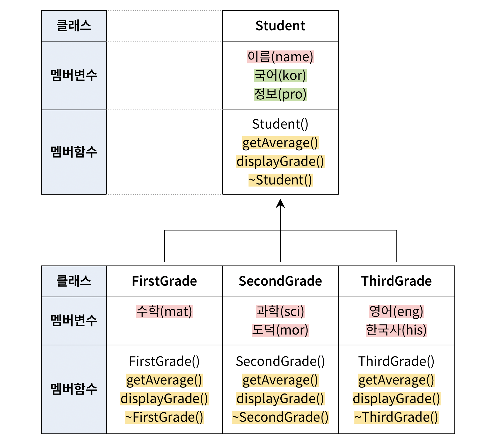
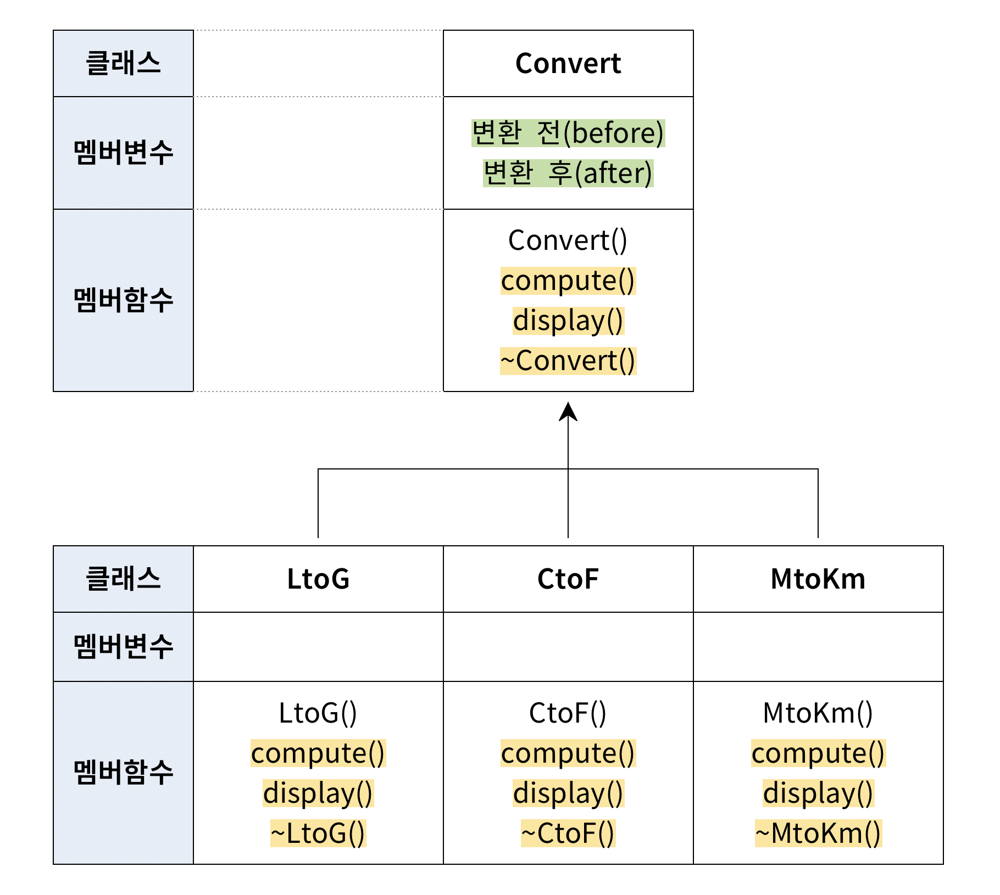

# 9장 연습 문제 — 가상함수와 추상 클래스

[레포지토리 안내](../../README.ko.md) | [English](Exercises.md) | [한국어](Exercises.ko.md)

> **최종 수정일:** 2026-10-19

**문항 출처:** 임영희 교수, 컴퓨터언어Ⅱ (DCCS102-04)

---

<br>

## 연습 문제 1: 가상함수를 사용한 학생 성적 관리

**문제:** 예시 코드와 실행 예시를 참고하여 `main()` 함수를 완성하고, 정상적으로 실행되도록 상속 구조를 고려하여 `Student` 클래스와 파생 클래스를 완성하라. `Student` 클래스는 세 파생 클래스 `FirstGrade`, `SecondGrade`, `ThirdGrade`에서 중복되는 요소를 가지고 있으며, 세 파생 클래스는 `Student` 클래스 상속을 통해 구현된다.



*그림 1. Student 클래스와 세 학년 파생 클래스의 설계도*

위 클래스 설계도에서 빨간색으로 표시한 요소는 `private`, 초록색으로 표시한 요소는 `protected`로 접근을 제어하고, 노란색으로 표시한 요소는 `virtual` 키워드를 사용해 가상함수로 선언하거나 재정의한다. 각 클래스는 멤버변수로 이름과 과목별 성적을, 멤버함수로 생성자, 소멸자, 성적 평균을 구하는 `getAverage()`, 성적을 출력하는 `displayGrade()`를 가진다. 설계도의 내용을 표로 옮기면 다음과 같다.

| 클래스 | 멤버변수 | 멤버함수 |
|:-----|:-----|:-----|
| `Student` | `name`(이름, `private`), `kor`(국어, `protected`), `pro`(정보, `protected`) | 생성자 `Student()`와 가상함수 `getAverage()`, `displayGrade()`, `~Student()` |
| `FirstGrade` | `mat`(수학, `private`) | 생성자 `FirstGrade()`와 가상함수 `getAverage()`, `displayGrade()`, `~FirstGrade()` |
| `SecondGrade` | `sci`(과학, `private`), `mor`(도덕, `private`) | 생성자 `SecondGrade()`와 가상함수 `getAverage()`, `displayGrade()`, `~SecondGrade()` |
| `ThirdGrade` | `eng`(영어, `private`), `his`(한국사, `private`) | 생성자 `ThirdGrade()`와 가상함수 `getAverage()`, `displayGrade()`, `~ThirdGrade()` |

*표 1. Student 계층의 멤버와 접근 제어*

**프로그램 요구사항:**

1. 주어진 예시 코드는 변경할 수 없다.
2. `Student` 클래스의 멤버함수 `getAverage()`는 순수 가상함수로 선언하라.
3. `Student` 클래스의 `displayGrade()` 함수는 이름과 국어, 정보 과목의 성적을 출력하도록 작성하라.
4. 클래스 설계도에 제시된 요소 외에 추가로 멤버변수와 멤버함수를 선언하거나 정의할 수 없다.

**예시 코드:**

```cpp
#include <iostream>
#include <string>
using namespace std;

int main() {
    Student* p[4];
    p[0] = new FirstGrade("고길동", 80, 70, 70);
    p[1] = new SecondGrade("둘리", 70, 60, 90, 70);
    p[2] = new ThirdGrade("또치", 90, 100, 90, 100);
    p[3] = new SecondGrade("도우너", 80, 90, 60, 100);

    for (int i = 0; i < 4; i++) {
        // 기본 클래스 포인터 p를 사용하여 displayGrade()를 올바르게 구현하시오.
        [ 빈칸 ]
    }

    // delete 연산자를 사용해 동적할당 영역에 대한 반환 코드를 작성하시오.
    [ 빈칸 ]

    return 0;
}
```

**실행 예시:**

```text
[1학년]
이름: 고길동
국어: 80
정보: 70
수학: 70
---------------
평균: 73.3333

[2학년]
이름: 둘리
국어: 70
정보: 60
과학: 90
도덕: 70
---------------
평균: 72.5

[3학년]
이름: 또치
국어: 90
정보: 100
영어: 90
한국사: 100
---------------
평균: 95

[2학년]
이름: 도우너
국어: 80
정보: 90
과학: 60
도덕: 100
---------------
평균: 82.5

Program ended with exit code: 0
```

**[풀이](Solutions.ko.md#연습-문제-1-가상함수를-사용한-학생-성적-관리)**

---

<br>

## 연습 문제 2: 가상함수를 사용한 단위 변환

**문제:** 예시 코드와 실행 예시를 참고하여 `main()` 함수를 완성하고, 정상적으로 실행되도록 상속 구조를 고려하여 `Convert` 클래스와 파생 클래스를 완성하라. `Convert` 클래스는 단위 변환을 수행하는 세 파생 클래스 `LtoG`(리터-갤런), `CtoF`(섭씨-화씨), `MtoKm`(마일-킬로미터)에서 중복되는 요소를 가지고 있으며, 세 파생 클래스는 `Convert` 클래스 상속을 통해 구현된다.



*그림 2. Convert 클래스와 세 단위 변환 파생 클래스의 설계도*

위 클래스 설계도에서 초록색으로 표시한 요소는 `protected`로 접근을 제어하고, 노란색으로 표시한 요소는 `virtual` 키워드를 사용해 가상함수로 선언하거나 재정의한다. `Convert` 클래스는 변환 전후의 값을 멤버변수로 가지고, 각 클래스는 변환을 계산하는 `compute()`와 결과를 출력하는 `display()`를 멤버함수로 가진다. 설계도의 내용을 표로 옮기면 다음과 같다.

| 클래스 | 멤버변수 | 멤버함수 |
|:-----|:-----|:-----|
| `Convert` | `before`(변환 전 값, `protected`), `after`(변환 후 값, `protected`) | 생성자 `Convert()`와 가상함수 `compute()`, `display()`, `~Convert()` |
| `LtoG` | 없음 | 생성자 `LtoG()`와 가상함수 `compute()`, `display()`, `~LtoG()` |
| `CtoF` | 없음 | 생성자 `CtoF()`와 가상함수 `compute()`, `display()`, `~CtoF()` |
| `MtoKm` | 없음 | 생성자 `MtoKm()`와 가상함수 `compute()`, `display()`, `~MtoKm()` |

*표 2. Convert 계층의 멤버와 접근 제어*

**프로그램 요구사항:**

1. 주어진 예시 코드는 변경할 수 없다.
2. `Convert` 클래스의 멤버함수 `compute()`와 `display()`는 순수 가상함수로 선언하라.
3. 각 파생 클래스의 변환 공식은 아래와 같다.
   ```text
   LtoG 클래스:   갤런(G) = 리터(L) / 3.7854
   CtoF 클래스:   화씨(F) = 섭씨(C) * 9 / 5 + 32
   MtoKm 클래스:  킬로미터(Km) = 마일(M) * 1.609344
   ```
4. `compute()` 함수는 `before` 값을 변환하여 `after`에 저장하고, `display()` 함수는 변환 결과를 실행 예시와 같은 형식으로 출력하도록 작성하라.
5. 클래스 설계도에 제시된 요소 외에 추가로 멤버변수와 멤버함수를 선언하거나 정의할 수 없다.

**예시 코드:**

```cpp
#include <iostream>
#include <string>
using namespace std;

int main() {
    Convert* p[3] = { 
        new MtoKm(23.2), new LtoG(10.3), new CtoF(24.5)
    };

    for (int i = 0; i < 3; i++) {
        // 기본 클래스 포인터 p를 사용하여 단위 변환을 수행하시오.
        [ 빈칸 ]

        // 기본 클래스 포인터 p를 사용하여 변환 결과를 출력하시오.
        [ 빈칸 ]
    }

    // delete 연산자를 사용해 동적할당 영역에 대한 반환 코드를 작성하시오.
    [ 빈칸 ]

    return 0;
}
```

**실행 예시:**

```text
23.2 마일 = 37.3368 킬로미터
10.3 리터 = 2.72098 갤런
섭씨 24.5도 = 화씨 76.1도

Program ended with exit code: 0
```

**[풀이](Solutions.ko.md#연습-문제-2-가상함수를-사용한-단위-변환)**
