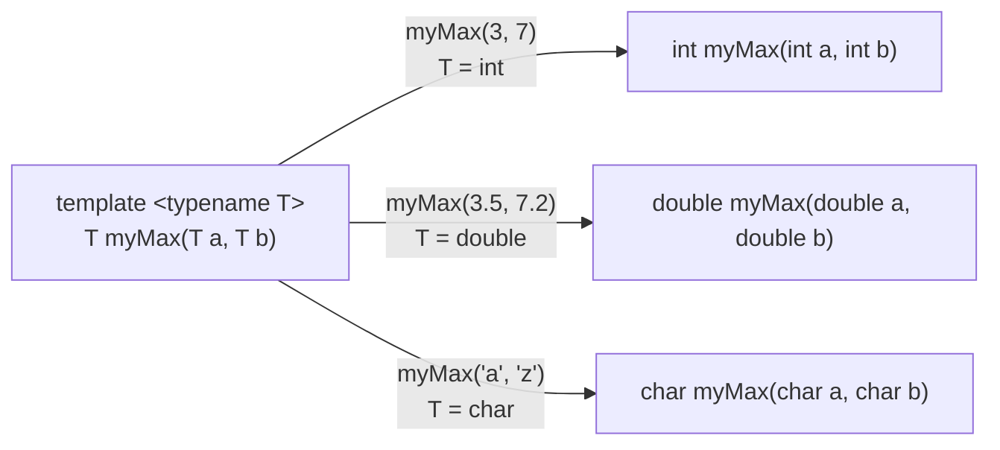
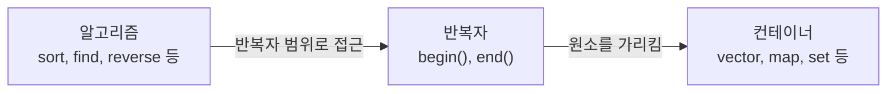

# 10장 — 템플릿과 표준 라이브러리 (STL)

[레포지토리 안내](../../README.ko.md) | [English](Concepts_Lecture.md) | [한국어](Concepts_Lecture.ko.md)

> **최종 수정일:** 2026-10-27
>
> 명품 C++ Programming, 황기태, Ch 10

> **학습 목표:**
> 1. 함수 템플릿과 클래스 템플릿을 작성하고 컴파일러가 템플릿을 구체화하는 과정을 설명할 수 있다
> 2. 템플릿과 같은 이름의 일반 함수가 함께 있을 때 어느 함수가 호출되는지 판단할 수 있다
> 3. STL의 컨테이너, 반복자, 알고리즘을 구분하고 vector, string, map, set을 활용할 수 있다
> 4. sort, find, binary_search 같은 알고리즘 함수를 반복자 범위에 적용할 수 있다
> 5. auto, 범위 기반 for, 람다식으로 STL 코드를 간결하게 작성할 수 있다
> 6. 템플릿 정의를 헤더에 두는 이유와 반복자 무효화 같은 흔한 오류를 설명할 수 있다

---

## 목차

- [1. 함수 템플릿](#1-함수-템플릿)
  - [1.1 제네릭 프로그래밍](#11-제네릭-프로그래밍)
  - [1.2 문법](#12-문법)
  - [1.3 템플릿 구체화](#13-템플릿-구체화)
  - [1.4 다중 템플릿 매개변수](#14-다중-템플릿-매개변수)
  - [1.5 템플릿 함수와 일반 함수의 중복](#15-템플릿-함수와-일반-함수의-중복)
  - [1.6 예제](#16-예제)
  - [1.7 템플릿의 장단점](#17-템플릿의-장단점)
- [2. 클래스 템플릿](#2-클래스-템플릿)
  - [2.1 문법](#21-문법)
  - [2.2 구체화](#22-구체화)
  - [2.3 템플릿에서의 연산자 오버로딩](#23-템플릿에서의-연산자-오버로딩)
  - [2.4 디폴트 템플릿 매개변수](#24-디폴트-템플릿-매개변수)
- [3. STL의 구성](#3-stl의-구성)
  - [3.1 STL의 구성 요소](#31-stl의-구성-요소)
  - [3.2 헤더 파일과 네임스페이스](#32-헤더-파일과-네임스페이스)
  - [3.3 반복자](#33-반복자)
- [4. vector (심화)](#4-vector-심화)
  - [4.1 선언과 초기화](#41-선언과-초기화)
  - [4.2 원소 접근](#42-원소-접근)
  - [4.3 변경 연산](#43-변경-연산)
  - [4.4 크기와 용량](#44-크기와-용량)
  - [4.5 2차원 vector](#45-2차원-vector)
  - [4.6 순회 방법](#46-순회-방법)
  - [4.7 함수에 전달하기](#47-함수에-전달하기)
  - [4.8 완성 예제](#48-완성-예제)
- [5. string](#5-string)
  - [5.1 std::string vs C 스타일 char\[\]](#51-stdstring-vs-c-스타일-char)
  - [5.2 생성과 연결](#52-생성과-연결)
  - [5.3 접근과 검색](#53-접근과-검색)
  - [5.4 비교](#54-비교)
  - [5.5 변환](#55-변환)
  - [5.6 순회와 입력](#56-순회와-입력)
- [6. map과 set](#6-map과-set)
  - [6.1 map](#61-map)
  - [6.2 unordered_map](#62-unordered_map)
  - [6.3 set](#63-set)
  - [6.4 unordered_set](#64-unordered_set)
  - [6.5 실전 예제: 단어 빈도 세기](#65-실전-예제-단어-빈도-세기)
- [7. algorithm](#7-algorithm)
  - [7.1 정렬](#71-정렬)
  - [7.2 검색](#72-검색)
  - [7.3 개수 세기와 누적](#73-개수-세기와-누적)
  - [7.4 시퀀스 변경](#74-시퀀스-변경)
  - [7.5 이진 탐색](#75-이진-탐색)
  - [7.6 완성 예제: 점수 기준 학생 정렬](#76-완성-예제-점수-기준-학생-정렬)
- [8. 모던 C++ 기능](#8-모던-c-기능)
  - [8.1 auto (C++11)](#81-auto-c11)
  - [8.2 범위 기반 for (C++11)](#82-범위-기반-for-c11)
  - [8.3 람다 표현식 (C++11)](#83-람다-표현식-c11)
  - [8.4 구조적 바인딩 (C++17)](#84-구조적-바인딩-c17)
  - [8.5 std::optional (C++17)](#85-stdoptional-c17)
  - [8.6 Concepts (C++20)](#86-concepts-c20)
  - [8.7 std::ranges (C++20)](#87-stdranges-c20)
  - [8.8 std::print (C++23)](#88-stdprint-c23)
  - [8.9 C++26 미리보기](#89-c26-미리보기)
- [9. 코딩 테스트를 위한 실전 패턴](#9-코딩-테스트를-위한-실전-패턴)
  - [9.1 EOF까지 입력 읽기](#91-eof까지-입력-읽기)
  - [9.2 사용자 정의 객체 정렬](#92-사용자-정의-객체-정렬)
  - [9.3 map으로 빈도 세기](#93-map으로-빈도-세기)
  - [9.4 set으로 중복 제거](#94-set으로-중복-제거)
  - [9.5 스택과 큐](#95-스택과-큐)
  - [9.6 priority_queue로 Top-K 문제](#96-priority_queue로-top-k-문제)
  - [9.7 pair와 make_pair](#97-pair와-make_pair)
- [10. 템플릿 컴파일 주의사항](#10-템플릿-컴파일-주의사항)
  - [10.1 템플릿 정의는 헤더에 있어야 한다](#101-템플릿-정의는-헤더에-있어야-한다)
  - [10.2 흔한 오류](#102-흔한-오류)
- [11. 흔한 실수 모음](#11-흔한-실수-모음)
  - [11.1 insert/erase 후 반복자 무효화](#111-inserterase-후-반복자-무효화)
  - [11.2 map의 \[\]는 기본 항목을 생성한다](#112-map의-는-기본-항목을-생성한다)
  - [11.3 각 STL 컴포넌트의 #include 누락](#113-각-stl-컴포넌트의-include-누락)
  - [11.4 범위 기반 for: 복사 vs 참조](#114-범위-기반-for-복사-vs-참조)
- [요약](#요약)
- [점검 문제](#점검-문제)
- [참고 문헌](#참고-문헌)

---

<br>

## 1. 함수 템플릿

### 1.1 제네릭 프로그래밍

**제네릭 프로그래밍(generic programming)** 은 함수나 클래스를 한 번만 작성하면 **어떤 타입에든** 동작하게 하는 기법이다. 템플릿 없이는 동일한 로직을 각 타입(`int`, `double`, `char` 등)마다 중복 작성해야 한다. 함수 중복(overloading)으로 처리해도 매개변수 타입만 다르고 본문은 같은 함수를 타입마다 따로 써야 한다.

```cpp
// 템플릿 없이 — 코드 중복
int maxInt(int a, int b) { return (a > b) ? a : b; }
double maxDouble(double a, double b) { return (a > b) ? a : b; }
char maxChar(char a, char b) { return (a > b) ? a : b; }
```

템플릿은 컴파일러가 타입별 함수를 자동으로 생성하게 하여 이러한 중복을 제거한다.

> **용어 정의:** **제네릭(generic)** 또는 일반화는 함수나 클래스를 일반화하고 매개변수 타입을 지정하여 틀에서 찍어 내듯 함수나 클래스 코드를 생산하는 기법이다. **템플릿(template)** 은 함수나 클래스를 일반화하는 C++ 도구로 `template` 키워드로 선언하며, 일반화를 위한 데이터 타입을 **제네릭 타입(generic type)** 이라 한다.

### 1.2 문법

함수 템플릿은 `template` 키워드와 꺾쇠괄호 안의 **템플릿 매개변수 목록**으로 선언한다.

```cpp
template <typename T>
T myMax(T a, T b) {
    return (a > b) ? a : b;
}
```

- `template <typename T>`는 타입 매개변수 `T` 하나를 가진 템플릿을 선언한다.
- 이 문맥에서 `typename`과 `class`는 같은 뜻이므로 `template <class T>`로 써도 된다. 교재는 `class`를 쓴다.
- `T`는 함수를 호출할 때 실제 타입으로 대체되는 **자리 표시자(placeholder)** 이다.

### 1.3 템플릿 구체화

템플릿 함수가 특정 타입으로 호출되면, 컴파일러가 해당 타입에 대한 **구체적인 함수**를 생성한다. 이 과정을 **구체화(instantiation)** 라 하며, 컴파일 시간에 일어난다. 그림 1은 `myMax` 템플릿 하나에서 인자 타입마다 다른 함수가 만들어지는 모습이다.



*그림 1. myMax 템플릿에서 인자 타입별로 구체화된 함수*

**암시적 구체화:** 컴파일러가 인자 타입으로부터 `T`를 추론한다.

```cpp
int result1 = myMax(3, 7);        // T를 int로 추론 → myMax<int>(3, 7)
double result2 = myMax(3.5, 7.2); // T를 double로 추론 → myMax<double>(3.5, 7.2)
```

**명시적 템플릿 인자:** 프로그래머가 `myMax<double>`처럼 `T`를 직접 지정한다. 이때도 함수 `myMax<double>`은 컴파일러가 암시적으로 구체화한다. C++에서 명시적 구체화(explicit instantiation)라고 부르는 것은 이와 다른 문법으로, 10.1절에서 다룬다.

```cpp
double result3 = myMax<double>(3, 7.2);  // T를 명시적으로 double로 지정
```

> **핵심:** 템플릿에 사용된 각 타입마다 컴파일러가 별도의 구체 함수를 생성한다. `myMax<int>`와 `myMax<double>`은 컴파일된 바이너리에서 서로 다른 두 함수이다.

### 1.4 다중 템플릿 매개변수

템플릿은 하나 이상의 타입 매개변수를 가질 수 있다:

```cpp
template <typename T1, typename T2>
void printPair(T1 a, T2 b) {
    cout << a << ", " << b << endl;
}

printPair(10, 3.14);       // T1=int, T2=double
printPair("Hello", 42);    // T1=const char*, T2=int
```

다음 `mcopy()`는 원본 배열과 대상 배열의 원소 타입을 각각 `T1`, `T2`로 두어, 한 타입의 배열을 다른 타입의 배열로 복사한다. 타입 매개변수 세 개는 `template <class T1, class T2, class T3>`처럼 선언한다.

```cpp
template <class T1, class T2>
void mcopy(T1 src[], T2 dest[], int n) {   // src[]의 n개 원소를 dest[]에 복사
    for (int i = 0; i < n; i++)
        dest[i] = (T2)src[i];             // T1 타입의 값을 T2 타입으로 변환
}

int x[] = {1, 2, 3, 4, 5};
double d[5];
mcopy(x, d, 5);   // T1 = int, T2 = double로 구체화
char c[5] = {'H', 'e', 'l', 'l', 'o'}, e[5];
mcopy(c, e, 5);   // T1, T2 모두 char로 구체화
```

### 1.5 템플릿 함수와 일반 함수의 중복

템플릿이 모든 타입에 맞게 동작하지는 않는다. 다음 `print()` 템플릿은 `int`와 `double` 배열을 숫자로 출력하지만, `T`가 `char`로 구체화되면 원소 1, 2, 3, 4, 5를 문자 코드로 보고 숫자 대신 그 코드의 문자(화면에 보이지 않는 제어 문자)를 출력한다. 이 문제는 `char` 배열을 받는 일반 함수 `print()`를 중복 정의하여 해결한다.

```cpp
template <class T>
void print(T array[], int n) {
    for (int i = 0; i < n; i++)
        cout << array[i] << '\t';
    cout << endl;
}

void print(char array[], int n) {         // char 배열을 위한 중복 함수
    for (int i = 0; i < n; i++)
        cout << (int)array[i] << '\t';    // int로 변환하여 정수 출력
    cout << endl;
}

int x[] = {1, 2, 3, 4, 5};
double d[5] = {1.1, 2.2, 3.3, 4.4, 5.5};
char c[5] = {1, 2, 3, 4, 5};
print(x, 5);   // 템플릿에서 구체화: 1  2  3  4  5
print(d, 5);   // 템플릿에서 구체화: 1.1  2.2  3.3  4.4  5.5
print(c, 5);   // 중복 함수 호출: 1  2  3  4  5
```

이름이 같은 일반 함수와 템플릿이 함께 있으면 컴파일러는 다음 규칙으로 호출할 함수를 고른다.

1. 일반 함수와 템플릿에서 구체화한 함수가 인자에 똑같이 잘 맞으면 일반 함수를 우선한다. 위의 `print(c, 5)`가 이 경우이다. 반대로 일반 함수는 형 변환을 거쳐야 맞고 템플릿은 그대로 맞으면 템플릿이 선택된다.
2. 호출할 수 있는 템플릿이 여럿이고 똑같이 잘 맞으면 더 특수화된 템플릿을 고른다. 예를 들어 `T bigger(T a, T b)`와 `Rectangle<T> bigger(Rectangle<T> a, Rectangle<T> b)`가 모두 있으면 `Rectangle<double>` 인자에는 뒤의 템플릿이 쓰인다.

> **핵심:** 템플릿이 특정 타입에서 원하는 대로 동작하지 않으면 그 타입에 맞는 일반 함수를 중복 정의한다. 인자에 똑같이 잘 맞으면 일반 함수가 템플릿보다 우선 바인딩된다.

### 1.6 예제

**제네릭 swap:**

```cpp
template <typename T>
void mySwap(T& a, T& b) {
    T temp = a;
    a = b;
    b = temp;
}

int x = 1, y = 2;
mySwap(x, y);       // x=2, y=1

string s1 = "hi", s2 = "bye";
mySwap(s1, s2);     // s1="bye", s2="hi"
```

**제네릭 배열 출력:**

```cpp
template <typename T>
void printArray(T arr[], int size) {
    for (int i = 0; i < size; i++) {
        cout << arr[i] << "  ";
    }
    cout << endl;
}

int nums[] = {1, 2, 3, 4};
printArray(nums, 4);        // 1  2  3  4

double vals[] = {1.1, 2.2, 3.3};
printArray(vals, 3);        // 1.1  2.2  3.3
```

**제네릭 배열 역순:**

```cpp
template <typename T>
void reverseArray(T arr[], int size) {
    for (int i = 0; i < size / 2; i++) {
        T temp = arr[i];
        arr[i] = arr[size - 1 - i];
        arr[size - 1 - i] = temp;
    }
}

int data[] = {1, 10, 100, 1000};
reverseArray(data, 4);      // {1000, 100, 10, 1}
```

### 1.7 템플릿의 장단점

템플릿은 함수와 클래스 코드를 재사용하게 하여 소프트웨어의 생산성과 유용성을 높인다. 반면 다음과 같은 단점이 있다.

- 컴파일러에 따라 템플릿 기능을 지원하지 않거나 일부만 지원할 수 있어 포팅(이식)에 취약하다. 표준을 따르는 최신 컴파일러는 템플릿을 지원하지만, 오래된 컴파일러에서는 문제가 될 수 있다.
- 템플릿 코드의 컴파일 오류 메시지는 길고 알아보기 어려워 디버깅이 힘들다. C++20의 Concepts(8.6절)는 이 문제를 줄이기 위해 도입되었다.

제네릭 함수나 제네릭 클래스를 활용하는 이러한 프로그래밍 기법이 1.1절의 제네릭 프로그래밍(일반화 프로그래밍)이다. C++는 이를 위해 STL(3절)을 제공하며, Java와 C# 같은 많은 언어도 제네릭을 지원한다.

---

<br>

## 2. 클래스 템플릿

### 2.1 문법

클래스 템플릿은 하나 이상의 타입이 매개변수화된 클래스를 정의한다. 클래스 정의 앞에 `template <typename T>`를 붙인다.

```cpp
template <typename T>
class Container {
    T data;
    int size;
public:
    Container(T d, int s) : data(d), size(s) { }
    T getData();
    void setData(T d);
};
```

클래스 **외부**에서 멤버함수를 정의할 때는 템플릿 접두사를 반복하고 `ClassName<T>::`를 사용한다:

```cpp
template <typename T>
T Container<T>::getData() {
    return data;
}

template <typename T>
void Container<T>::setData(T d) {
    data = d;
}
```

타입 매개변수가 둘 이상인 클래스 템플릿도 같은 방식으로 선언한다. 예를 들어 `template <class T1, class T2> class GClass { T1 data1; T2 data2; ... };`로 선언하고, `GClass<int, double> x;`처럼 타입을 순서대로 지정하여 사용하며, 멤버 함수는 `GClass<T1, T2>::set(T1 a, T2 b)`처럼 정의한다.

### 2.2 구체화

클래스 템플릿이 특정 타입으로 사용될 때마다 컴파일러는 **별도의 클래스**를 생성한다.

```cpp
Container<int> c1(42, 1);       // int용 Container 클래스 생성
Container<string> c2("hello", 5); // string용 Container 클래스 생성
Container<double> c3(3.14, 1);  // double용 Container 클래스 생성
```

`Container<int>`와 `Container<string>`은 완전히 다른 클래스이며, 런타임에 코드를 공유하지 않는다.

제네릭 타입에는 기본 타입뿐 아니라 포인터 타입과 클래스 타입도 지정할 수 있고, 구체화한 클래스의 객체를 `new`로 동적 생성할 수도 있다. 다음은 2.4절의 `Stack` 템플릿을 여러 타입으로 구체화한 예이다. `Point`는 기본값이 있는 생성자 `Point(int x = 0, int y = 0)`을 가진 클래스이다.

```cpp
Stack<int*> ipStack;           // int* 포인터만 저장하는 스택
Stack<Point> pointStack;       // Point 객체를 복사하여 저장하는 스택
Stack<Point*> pStack;          // Point* 포인터를 저장하는 스택
Stack<string> stringStack;     // 문자열을 저장하는 스택

Stack<char>* p = new Stack<char>();   // 구체화한 클래스의 객체를 동적 생성
p->push('a');
cout << p->pop() << endl;             // a
delete p;
```

### 2.3 템플릿에서의 연산자 오버로딩

템플릿 클래스에서도 일반 클래스처럼 연산자를 오버로딩할 수 있다. 흔한 필요는 비교 연산자를 오버로딩하여 `bigger()` 같은 템플릿 함수가 사용자 정의 타입에서도 동작하게 하는 것이다.

```cpp
template <typename T>
class Rectangle {
    T width, height;
public:
    Rectangle(T w = 1, T h = 1) : width(w), height(h) { }
    T getArea() const { return width * height; }
    bool operator>(const Rectangle<T>& other) const {
        return this->getArea() > other.getArea();
    }
};

template <typename T>
T bigger(T a, T b) {
    if (a > b) return a;
    else return b;
}

Rectangle<double> r1(10.2, 23.5);
Rectangle<double> r2(20.4, 13.7);
Rectangle<double> r3 = bigger(r1, r2);  // operator>를 사용하여 비교
cout << r3.getArea() << endl;            // 279.48 (r2의 면적)
```

> **핵심:** 연산자(`>`, `==`, `<` 등)에 의존하는 템플릿 함수를 사용할 때, 타입 `T`는 해당 연산자가 정의되어 있어야 한다. 기본 타입은 자동으로 지원되지만, 사용자 정의 클래스는 직접 오버로딩해야 한다.

`operator>`의 `other`는 `const` 참조이므로, 그 객체에서 호출하는 `getArea()`도 `const` 멤버 함수로 선언해야 컴파일된다. 연산자를 정의하는 대신 `Rectangle<T>`를 매개변수로 받는 `bigger()` 템플릿을 따로 정의해도 된다. 두 `bigger()` 템플릿을 모두 호출할 수 있으면 더 특수화된 쪽이 선택된다(1.5절).

### 2.4 디폴트 템플릿 매개변수

함수 매개변수와 마찬가지로, 템플릿 매개변수에도 **기본값(default)** 을 지정할 수 있다:

```cpp
template <typename T = int>
class Stack {
    T data[100];
    int top;
public:
    Stack() : top(-1) { }
    void push(T item) { data[++top] = item; }
    T pop() { return data[top--]; }
};

Stack<> s1;            // T는 int로 기본 설정
Stack<double> s2;      // T는 double
Stack<string> s3;      // T는 string
```

> **참고:** C++14까지는 기본값을 쓸 때도 `Stack<>`처럼 꺾쇠괄호를 써야 한다. C++17부터는 클래스 템플릿 인자 추론(CTAD) 덕분에 `Stack s1;`이라고만 써도 `T`가 기본값 `int`로 정해진다.

> **주의:** `cout << s.pop() << ' ' << s.pop();`처럼 한 출력문에서 `pop()`을 두 번 호출하면 두 호출의 실행 순서가 출력 순서와 다를 수 있다. C++14까지는 `<<`의 피연산자를 평가하는 순서가 정해져 있지 않아서, `"c++"`, `"java"` 순으로 넣은 스택에서 컴파일러가 오른쪽 `pop()`을 먼저 실행하면 `c++ java`가 출력된다. 이 현상을 cout이 데이터를 스택에 쌓았다가 꺼내는 동작으로 설명하기도 하지만, 실제 원인은 피연산자의 평가 순서이다. C++17부터는 `<<`의 왼쪽 피연산자를 먼저 평가하도록 정해져 `java c++`가 출력된다. 순서가 중요하면 `pop()` 호출을 별도의 문장으로 나눈다.

---

<br>

## 3. STL의 구성

**STL(Standard Template Library)** 은 C++ 표준 라이브러리 가운데 제네릭 클래스와 제네릭 함수를 모아 놓은 부분이다. 개발자는 STL을 이용하여 자료 구조와 알고리즘을 직접 구현하지 않고도 응용 프로그램을 쉽게 작성할 수 있다.

### 3.1 STL의 구성 요소

STL은 세 가지 요소로 구성된다.

- **컨테이너(container):** 데이터를 담아 두는 자료 구조를 구현한 템플릿 클래스이다. `vector`, `list`, `stack`, `queue`, `map`, `set` 등이 있다.
- **반복자(iterator):** 컨테이너의 원소들을 순회하면서 접근하기 위한 객체로, 원소에 대한 포인터 역할을 한다.
- **알고리즘(algorithm):** 컨테이너 원소의 복사, 검색, 삭제, 정렬 같은 기능을 구현한 템플릿 함수이다. 컨테이너의 멤버 함수가 아닌 전역 함수이며, 반복자를 통해 원소에 접근한다.



*그림 2. STL의 컨테이너, 반복자, 알고리즘의 관계*

알고리즘은 컨테이너를 직접 다루지 않고 반복자로만 원소에 접근하므로, 하나의 알고리즘 함수를 여러 종류의 컨테이너에 쓸 수 있다.

### 3.2 헤더 파일과 네임스페이스

컨테이너 클래스를 사용하려면 그 클래스가 선언된 헤더 파일을 포함한다. 예를 들어 `vector`는 `#include <vector>`, `list`는 `#include <list>`가 필요하다. 알고리즘 함수는 대부분 `#include <algorithm>` 하나로 사용할 수 있으며, `accumulate`처럼 `<numeric>`에 있는 함수는 예외이다. STL은 모두 네임스페이스 `std`에 선언되어 있다.

### 3.3 반복자

반복자는 컨테이너의 원소를 순차적으로 접근하기 위한 객체이다. 반복자 변수는 구체적인 컨테이너 타입을 지정하여 선언한다.

```cpp
vector<int> v = {5, 4, 0, 9};
vector<int>::iterator it;   // 원소가 int인 vector의 원소를 가리키는 반복자
it = v.begin();             // 첫 번째 원소를 가리킴
```

`v.begin()`은 첫 번째 원소를, `v.end()`는 마지막 원소의 **다음** 위치를 가리킨다. 따라서 반복자 범위 `[v.begin(), v.end())`는 모든 원소를 포함한다. `it != v.end()`인 동안 `it++`로 이동하며 `*it`로 원소를 읽거나 쓴다. `v.end()`는 원소를 가리키지 않으므로 `*v.end()`처럼 역참조하면 정의되지 않은 동작이다.

```text
인덱스       0     1     2     3
          ┌─────┬─────┬─────┬─────┐
원소      │  5  │  4  │  0  │  9  │
          └─────┴─────┴─────┴─────┘
             ▲                       ▲
         v.begin()                v.end()
          첫 원소           마지막 원소의 다음
```

*그림 3. vector에서 begin()과 end()가 가리키는 위치*

다음은 반복자로 모든 원소에 2를 곱하는 예이다.

```cpp
vector<int> v = {1, 2, 3};
for (vector<int>::iterator it = v.begin(); it != v.end(); it++) {
    int n = *it;    // it가 가리키는 원소 값 읽기
    n = n * 2;
    *it = n;        // it가 가리키는 원소에 값 쓰기
}
// v = {2, 4, 6}
```

---

<br>

## 4. vector (심화)

`vector`는 초보자에게 **가장 중요한 STL 컨테이너**이며, 실무 C++ 프로그래밍과 코딩 테스트에서 가장 자주 사용되는 컨테이너이다. 원소가 추가될 때 자동으로 메모리를 관리하고 크기가 늘어나는 동적 배열이다.

**헤더:** `#include <vector>`

### 4.1 선언과 초기화

```cpp
#include <vector>
using namespace std;

vector<int> v1;                    // 빈 벡터
vector<int> v2(5);                 // 원소 5개, 모두 0으로 초기화
vector<int> v3(5, 42);            // 원소 5개, 모두 42로 초기화
vector<int> v4 = {1, 2, 3, 4, 5}; // 초기화 리스트 (C++11)
vector<int> v5{10, 20, 30};       // 중괄호 초기화 (C++11)
vector<int> v6(v4);               // v4의 복사본
vector<int> v7(v4.begin(), v4.begin() + 3); // {1, 2, 3} — 반복자 범위로 생성
```

### 4.2 원소 접근

```cpp
vector<int> v = {10, 20, 30, 40, 50};

v[0];           // 10 — 범위 검사 없음 (범위 밖이면 정의되지 않은 동작)
v.at(1);        // 20 — 범위 검사 있음 (잘못된 인덱스면 std::out_of_range 예외)
v.front();      // 10 — 첫 번째 원소
v.back();       // 50 — 마지막 원소
```

| 메서드 | 반환값 | 범위 검사 |
|:-------|:-------|:----------|
| `v[i]` | 인덱스 `i`의 원소 | 없음 (범위 밖이면 정의되지 않은 동작) |
| `v.at(i)` | 인덱스 `i`의 원소 | 있음 (`std::out_of_range` 예외 발생) |
| `v.front()` | 첫 번째 원소 | 없음 |
| `v.back()` | 마지막 원소 | 없음 |

*표 1. vector의 원소 접근 메서드와 범위 검사*

> **참고:** **팁.** 디버깅 시에는 `at()`을 사용하고, 인덱스가 유효함을 확인한 후에는 성능이 중요한 코드에서 `[]`를 사용하라.

### 4.3 변경 연산

```cpp
vector<int> v = {10, 20, 30};

v.push_back(40);                 // {10, 20, 30, 40} — 끝에 추가
v.pop_back();                    // {10, 20, 30} — 끝에서 제거

v.insert(v.begin() + 1, 15);    // {10, 15, 20, 30} — 위치 앞에 삽입
v.erase(v.begin() + 2);         // {10, 15, 30} — 단일 원소 삭제
v.erase(v.begin(), v.begin()+2);// {30} — 범위 [first, last) 삭제

v.clear();                       // {} — 모든 원소 제거

v.resize(5);                     // {0, 0, 0, 0, 0} — 크기를 5로 변경 (0으로 채움)
v.resize(3, 99);                 // {0, 0, 0} — 크기를 3으로 축소 (99는 미사용)
v.resize(5, 99);                 // {0, 0, 0, 99, 99} — 크기를 5로 확장, 새 원소 = 99
```

| 메서드 | 효과 | 시간 복잡도 |
|:-------|:-----|:-----------|
| `push_back(val)` | 끝에 추가 | 분할 상환 O(1) |
| `pop_back()` | 마지막 원소 제거 | O(1) |
| `insert(pos, val)` | `pos` 앞에 삽입 | O(n) |
| `erase(pos)` | `pos` 위치의 원소 제거 | O(n) |
| `erase(first, last)` | `[first, last)` 범위 제거 | O(n) |
| `clear()` | 모든 원소 제거 | O(n) |
| `resize(n)` | 크기를 `n`으로 변경 | O(n) |

*표 2. vector의 변경 연산과 시간 복잡도*

### 4.4 크기와 용량

`vector`는 두 가지 별도의 개념이 있다: **size**(현재 저장된 원소 수)와 **capacity**(할당된 메모리 슬롯 수).

```cpp
vector<int> v;
v.reserve(100);     // 100개 원소 공간을 미리 할당 (원소는 생성되지 않음)

cout << v.size();       // 0 — 아직 원소 없음
cout << v.capacity();   // >= 100 — 할당된 공간
cout << v.empty();      // true (1)

v.push_back(1);
v.push_back(2);
cout << v.size();       // 2
cout << v.capacity();   // >= 100 (여전히 미리 할당된 상태)

v.shrink_to_fit();      // capacity를 size에 맞추도록 요청
```

그림 4는 위 코드에서 `reserve(100)` 후 원소 두 개를 넣은 상태이다. size는 실제 원소 수인 2이고, capacity는 할당된 칸 수인 100 이상이다.

```text
   0     1     2     3          99
┌─────┬─────┬─────┬─────┬─────┬─────┐
│  1  │  2  │     │     │ ... │     │
└─────┴─────┴─────┴─────┴─────┴─────┘
├── size ───┤
├──────────── capacity ─────────────┤
```

*그림 4. reserve(100) 후 원소 두 개를 넣은 vector의 size와 capacity*

| 메서드 | 반환값 / 효과 |
|:-------|:-------------|
| `size()` | 원소 개수 |
| `capacity()` | 할당된 저장 공간 (>= size) |
| `empty()` | size가 0이면 `true` |
| `reserve(n)` | 최소 `n`개 원소를 위한 공간 미리 할당 |
| `shrink_to_fit()` | capacity를 size에 맞추도록 요청 |

*표 3. vector의 크기와 용량 관련 메서드*

> **참고:** **성능 팁.** 원소 수를 미리 알고 있다면 루프 전에 `reserve()`를 호출하라. 반복적인 재할당을 피할 수 있다(재할당 시 기존 원소를 모두 새 공간으로 복사하거나 이동해야 한다).

### 4.5 2차원 vector

2차원 벡터는 `vector`의 `vector`이다.

```cpp
// 0으로 초기화된 3x4 행렬 선언
vector<vector<int>> matrix(3, vector<int>(4, 0));

matrix[0][0] = 1;
matrix[1][2] = 5;

// 2차원 벡터 순회
for (int i = 0; i < matrix.size(); i++) {
    for (int j = 0; j < matrix[i].size(); j++) {
        cout << matrix[i][j] << " ";
    }
    cout << endl;
}

// 동적 행 추가
vector<vector<int>> jagged;
jagged.push_back({1, 2, 3});
jagged.push_back({4, 5});         // 행마다 길이가 다를 수 있음
jagged.push_back({6, 7, 8, 9});
```

### 4.6 순회 방법

벡터를 순회하는 일반적인 방법은 다음 다섯 가지이다.

```cpp
vector<int> v = {10, 20, 30, 40};

// 1. 인덱스 기반 루프
for (int i = 0; i < v.size(); i++) {
    cout << v[i] << " ";
}

// 2. 반복자 루프
for (vector<int>::iterator it = v.begin(); it != v.end(); it++) {
    cout << *it << " ";
}

// 3. 범위 기반 for (C++11) — 각 원소를 복사
for (int x : v) {
    cout << x << " ";
}

// 4. 참조를 사용한 범위 기반 for (C++11) — 복사 없음, 수정 가능
for (int& x : v) {
    x *= 2;   // 원본 벡터가 수정됨
}
// v는 이제 {20, 40, 60, 80}

// 5. const 참조를 사용한 범위 기반 for — 복사 없음, 읽기 전용
for (const int& x : v) {
    cout << x << " ";
}
```

> **참고:** **모범 사례.** 읽기 전용 접근에는 `for (const auto& x : v)`를, 원소 수정이 필요할 때는 `for (auto& x : v)`를 사용하라.

### 4.7 함수에 전달하기

비용이 큰 복사를 피하려면 항상 벡터를 **참조**로 전달해야 한다. 함수가 벡터를 읽기만 한다면 `const`를 사용한다.

```cpp
// 읽기 전용 — const 참조로 전달
void printVector(const vector<int>& v) {
    for (const auto& x : v) {
        cout << x << " ";
    }
    cout << endl;
}

// 제자리 수정 — 참조로 전달
void doubleAll(vector<int>& v) {
    for (auto& x : v) {
        x *= 2;
    }
}

// 새 벡터 반환 — 값으로 반환 (이동 시맨틱스로 효율적)
vector<int> createVector(int n) {
    vector<int> result(n);
    for (int i = 0; i < n; i++) result[i] = i + 1;
    return result;   // 복사가 아닌 이동 (C++11)
}
```

### 4.8 완성 예제

**N개의 수를 입력받아 정렬하고 출력:**

```cpp
#include <iostream>
#include <vector>
#include <algorithm>
using namespace std;

int main() {
    int n;
    cout << "Enter count: ";
    cin >> n;

    vector<int> nums(n);
    cout << "Enter " << n << " numbers: ";
    for (int i = 0; i < n; i++) {
        cin >> nums[i];
    }

    sort(nums.begin(), nums.end());

    cout << "Sorted: ";
    for (const auto& x : nums) {
        cout << x << " ";
    }
    cout << endl;

    cout << "Min: " << nums.front() << endl;
    cout << "Max: " << nums.back() << endl;

    return 0;
}
```

```text
Enter count: 5
Enter 5 numbers: 30 10 50 20 40
Sorted: 10 20 30 40 50
Min: 10
Max: 50
```

---

<br>

## 5. string

`std::string`은 C++ 표준 라이브러리의 일부이며 문자의 STL 컨테이너처럼 동작한다. 자체 메모리를 관리하고 풍부한 연산 기능을 제공한다.

**헤더:** `#include <string>`

### 5.1 std::string vs C 스타일 char[]

| 특성 | `std::string` | `char[]` / `char*` |
|:----|:--------------|:--------------------|
| 메모리 관리 | 자동 (동적) | 수동 |
| 크기 추적 | `s.size()` / `s.length()` | `strlen(s)` (호출마다 O(n)) |
| 연결 | `s1 + s2` 또는 `s1 += s2` | `strcat()` (버퍼 관리 필요) |
| 비교 | `==`, `<`, `>` | `strcmp()` |
| 안전성 | `at()`으로 범위 검사 | 버퍼 오버플로우 위험 |
| 대입 | `s1 = s2` | `strcpy()` 사용 필요 |
| 함수 전달 | 참조로 전달 | 포인터로 전달 |

*표 4. std::string과 C 스타일 문자열의 비교*

> **참고:** **권장.** C++ 코드에서는 항상 C 스타일 문자열보다 `std::string`을 사용하라.

### 5.2 생성과 연결

```cpp
#include <string>
using namespace std;

string s1;                     // 빈 문자열 ""
string s2 = "Hello";          // C 문자열 리터럴에서 생성
string s3("World");           // 생성자 형태
string s4(5, 'x');            // "xxxxx" — 'x'를 5번 반복
string s5 = s2;               // s2의 복사본

// 연결
string greeting = s2 + " " + s3;   // "Hello World"
s2 += "!";                         // "Hello!" — 제자리에서 추가
s2.append(" C++");                 // "Hello! C++" — 추가하는 다른 방법
```

### 5.3 접근과 검색

```cpp
string s = "Hello World";

// 개별 문자 접근
s[0];              // 'H'
s.at(4);           // 'o' — 범위 검사 있음

// 부분 문자열
s.substr(0, 5);    // "Hello" — substr(시작_위치, 길이)
s.substr(6);       // "World" — 6번 위치부터 끝까지

// 검색
s.find("World");       // 6 — 첫 번째 발견 위치
s.find("xyz");         // string::npos — 찾지 못함
s.find('o');           // 4 — 첫 번째 'o'
s.find('o', 5);        // 7 — 5번 위치부터 첫 번째 'o'
s.rfind('o');          // 7 — 마지막 발견 위치 (역방향 검색)
```

| 메서드 | 반환값 |
|:-------|:-------|
| `find(str)` | 첫 번째 발견 위치, 없으면 `string::npos` |
| `find(str, pos)` | `pos`부터 검색 시작 |
| `rfind(str)` | 마지막 발견 위치 |
| `substr(pos, len)` | `pos`에서 길이 `len`인 부분 문자열 |
| `substr(pos)` | `pos`부터 끝까지 부분 문자열 |

*표 5. string의 검색과 부분 문자열 메서드*

### 5.4 비교

```cpp
string a = "apple";
string b = "banana";

a == b;     // false
a != b;     // true
a < b;      // true — 사전순 비교 ('a' < 'b')
a > b;      // false

// compare()는 같으면 0, a < b이면 음수, a > b이면 양수 반환
a.compare(b);    // 음수 값
```

### 5.5 변환

```cpp
#include <string>
using namespace std;

// 숫자 -> 문자열
string s1 = to_string(42);       // "42"
string s2 = to_string(3.14);     // "3.140000"

// 문자열 -> 숫자
int n = stoi("123");              // 123
double d = stod("3.14");          // 3.14
long l = stol("1000000");         // 1000000
long long ll = stoll("999999999999"); // 999999999999

// 변환 실패 시 std::invalid_argument 예외 발생
// stoi("abc");   // 예외 발생
```

| 함수 | 변환 |
|:----|:-----|
| `to_string(num)` | 숫자 -> 문자열 |
| `stoi(str)` | 문자열 -> `int` |
| `stol(str)` | 문자열 -> `long` |
| `stoll(str)` | 문자열 -> `long long` |
| `stod(str)` | 문자열 -> `double` |
| `stof(str)` | 문자열 -> `float` |

*표 6. 문자열과 숫자의 변환 함수*

### 5.6 순회와 입력

```cpp
#include <iostream>
#include <string>
using namespace std;

int main() {
    // 범위 기반 for
    string s = "Hello";
    for (char c : s) {
        cout << c << " ";   // H e l l o
    }
    cout << endl;

    // 문자 수정
    for (char& c : s) {
        c = toupper(c);
    }
    // s는 이제 "HELLO"

    // 입력: cin >>은 단어 하나만 읽음 (공백에서 멈춤)
    string word;
    cin >> word;          // 입력: "Hello World" -> word = "Hello"

    // 입력: getline은 전체 줄을 읽음 (공백 포함)
    string line;
    getline(cin, line);   // 입력: "Hello World" -> line = "Hello World"

    // 주의: cin >>과 getline을 혼용할 때
    int n;
    cin >> n;             // 숫자를 읽고, '\n'이 버퍼에 남음
    cin.ignore();         // 남은 '\n'을 버림
    getline(cin, line);   // 이제 다음 줄 전체를 올바르게 읽음

    return 0;
}
```

> **주의:** `cin >> variable` 후에 개행 문자가 입력 버퍼에 남는다. 바로 `getline()`을 호출하면 빈 줄을 읽는다. `cin >>`과 `getline()` 사이에 항상 `cin.ignore()`를 호출하라.

---

<br>

## 6. map과 set

### 6.1 map

`map<K, V>`는 키 기준으로 정렬된 **키-값 쌍**을 저장한다. 내부적으로 균형 이진 탐색 트리(보통 레드-블랙 트리)를 사용하여 O(log n) 연산을 제공한다.

**헤더:** `#include <map>`

```cpp
#include <map>
#include <string>
#include <iostream>
using namespace std;

int main() {
    map<string, int> ages;

    // 삽입
    ages["Alice"] = 20;               // [] 연산자 — 삽입 또는 갱신
    ages["Bob"] = 22;
    ages.insert({"Charlie", 25});      // insert() — 키가 이미 있으면 덮어쓰지 않음
    ages.insert(make_pair("Dave", 30));

    // 접근
    cout << ages["Alice"] << endl;     // 20

    // 존재 확인 (중요: []로 확인하면 안 됨 — 기본값 항목이 생성됨!)
    if (ages.find("Eve") != ages.end()) {
        cout << "Found Eve" << endl;
    } else {
        cout << "Eve not found" << endl;   // 이 분기가 실행됨
    }

    if (ages.count("Bob") > 0) {       // count는 map에서 0 또는 1 반환
        cout << "Bob exists" << endl;
    }

    // 삭제
    ages.erase("Charlie");             // 키로 삭제

    // 순회 — 원소가 키 기준으로 정렬됨
    for (auto it = ages.begin(); it != ages.end(); it++) {
        cout << it->first << ": " << it->second << endl;
    }
    // Alice: 20
    // Bob: 22
    // Dave: 30

    // 크기
    cout << "Size: " << ages.size() << endl;   // 3

    return 0;
}
```

| 메서드 | 설명 | 시간 |
|:-------|:-----|:-----|
| `m[key] = val` | 삽입 또는 갱신 | O(log n) |
| `m[key]` | 값 접근 (키가 없으면 기본값 생성!) | O(log n) |
| `m.at(key)` | 값 접근 (키가 없으면 예외 발생) | O(log n) |
| `m.insert({k, v})` | 키가 없을 때만 삽입 | O(log n) |
| `m.find(key)` | 반복자 반환 (없으면 `end()`) | O(log n) |
| `m.count(key)` | 0 또는 1 반환 | O(log n) |
| `m.erase(key)` | 키로 삭제 | O(log n) |
| `m.size()` | 키-값 쌍의 수 | O(1) |

*표 7. map의 주요 메서드와 시간 복잡도*

### 6.2 unordered_map

`unordered_map<K, V>`는 트리 대신 **해시 테이블**을 사용한다. **평균 O(1)** 탐색을 제공하지만 원소가 **정렬되지 않는다**.

**헤더:** `#include <unordered_map>`

```cpp
#include <unordered_map>
#include <string>
using namespace std;

unordered_map<string, int> freq;
freq["apple"] = 3;
freq["banana"] = 5;

// map과 동일한 인터페이스: [], find, count, erase, insert, size
```

**map과 unordered_map의 선택 기준:**

| 항목 | `map` | `unordered_map` |
|:--|:------|:----------------|
| 순서 | 키 기준 정렬 | 순서 없음 |
| 탐색 | O(log n) | 평균 O(1), 최악 O(n) |
| 사용 시점 | 정렬된 순서나 범위 쿼리가 필요할 때 | 가장 빠른 탐색이 필요할 때 |
| 키 요구사항 | `operator<`가 정의되어야 함 | `std::hash`와 `operator==`가 정의되어야 함 |

*표 8. map과 unordered_map의 비교*

> **[자료구조]** 자료구조에서 배우는 이진 탐색 트리는 각 노드의 왼쪽 서브트리에 더 작은 키를, 오른쪽 서브트리에 더 큰 키를 두어 중위 순회로 키 순서를 얻으며, 레드-블랙 트리 같은 균형 이진 탐색 트리는 높이를 O(log n)으로 유지하여 탐색, 삽입, 삭제를 O(log n)에 마친다. 해시 테이블은 해시 함수로 키를 버킷 번호로 바꾸어 평균 O(1)에 접근하지만 많은 키가 한 버킷에 몰리면 O(n)까지 느려지므로, 표 8에서 `map`과 `unordered_map`의 순서와 탐색 시간이 다른 것은 두 자료구조의 이 성질에서 나온다.

### 6.3 set

`set<T>`는 **고유한 원소**를 정렬된 순서로 저장한다. 내부적으로 균형 이진 탐색 트리를 사용한다.

**헤더:** `#include <set>`

```cpp
#include <set>
#include <iostream>
using namespace std;

int main() {
    set<int> s;

    s.insert(30);
    s.insert(10);
    s.insert(20);
    s.insert(10);     // 중복 — 무시됨

    cout << s.size() << endl;   // 3

    // 소속 확인
    if (s.find(20) != s.end()) {
        cout << "20 exists" << endl;
    }
    if (s.count(99) == 0) {
        cout << "99 not found" << endl;
    }

    // 삭제
    s.erase(10);       // 원소 10 제거

    // 순회 — 원소가 정렬됨
    for (const auto& x : s) {
        cout << x << " ";    // 20 30
    }
    cout << endl;

    return 0;
}
```

| 메서드 | 설명 | 시간 |
|:-------|:-----|:-----|
| `s.insert(val)` | 원소 삽입 (중복이면 무시) | O(log n) |
| `s.find(val)` | 반복자 반환 (없으면 `end()`) | O(log n) |
| `s.count(val)` | 0 또는 1 반환 | O(log n) |
| `s.erase(val)` | 원소 제거 | O(log n) |
| `s.size()` | 원소 개수 | O(1) |

*표 9. set의 주요 메서드와 시간 복잡도*

### 6.4 unordered_set

`unordered_set<T>`는 `set`의 해시 기반 버전이다. 연산은 평균 O(1)이고 원소에 순서가 없다.

**헤더:** `#include <unordered_set>`

```cpp
#include <unordered_set>
using namespace std;

unordered_set<int> us = {1, 2, 3, 4, 5};
us.insert(3);              // 중복 — 무시됨
us.count(3);               // 1
us.erase(2);               // 원소 2 제거
```

### 6.5 실전 예제: 단어 빈도 세기

```cpp
#include <iostream>
#include <map>
#include <string>
using namespace std;

int main() {
    map<string, int> freq;
    string word;

    cout << "Enter words (Ctrl+D to stop):" << endl;
    while (cin >> word) {
        freq[word]++;      // []는 키가 없으면 값 0인 항목을 만든 후 증가시킴
    }

    cout << "\nWord frequencies:" << endl;
    for (const auto& pair : freq) {
        cout << pair.first << ": " << pair.second << endl;
    }

    return 0;
}
```

```text
Enter words (Ctrl+D to stop):
the cat sat on the mat the cat
^D

Word frequencies:
cat: 2
mat: 1
on: 1
sat: 1
the: 3
```

---

<br>

## 7. algorithm

`<algorithm>` 헤더는 반복자 범위에 대해 동작하는 제네릭 함수를 제공한다. 코딩 테스트와 일상적인 C++ 프로그래밍에 필수적이다.

**헤더:** `#include <algorithm>`

### 7.1 정렬

`sort()`의 두 인자는 정렬 범위의 첫 원소를 가리키는 반복자와 마지막 원소의 **다음** 위치를 가리키는 반복자이다(3.3절). 예를 들어 `sort(v.begin() + 2, v.begin() + 5)`는 세 번째부터 다섯 번째까지의 세 원소만 정렬한다.

```cpp
#include <algorithm>
#include <vector>
using namespace std;

vector<int> v = {30, 10, 50, 20, 40};

// 기본: 오름차순
sort(v.begin(), v.end());          // {10, 20, 30, 40, 50}

// 내림차순 — 비교자 사용
sort(v.begin(), v.end(), greater<int>());  // {50, 40, 30, 20, 10}

// 람다로 커스텀 비교자
sort(v.begin(), v.end(), [](int a, int b) {
    return a > b;                  // 내림차순
});

// 벡터의 일부만 정렬
sort(v.begin(), v.begin() + 3);   // 처음 3개 원소만 정렬
```

> **참고:** 표준은 `sort`의 비교 횟수가 O(n log n)임을 보장하며, 대부분의 구현은 IntroSort(퀵소트, 힙소트, 삽입 정렬의 하이브리드)를 사용한다. `sort`는 같은 값을 가진 원소의 원래 순서를 보존하지 않으므로(불안정 정렬), 그 순서를 보존해야 하면 `stable_sort`를 쓴다.

### 7.2 검색

```cpp
vector<int> v = {10, 20, 30, 40, 50};

// find — 첫 번째 일치하는 원소의 반복자 반환, 없으면 end()
auto it = find(v.begin(), v.end(), 30);
if (it != v.end()) {
    cout << "Found at index " << (it - v.begin()) << endl;  // 인덱스 2
}

// min_element / max_element — 최솟값/최댓값의 반복자 반환
auto minIt = min_element(v.begin(), v.end());
auto maxIt = max_element(v.begin(), v.end());
cout << "Min: " << *minIt << endl;   // 10
cout << "Max: " << *maxIt << endl;   // 50
```

### 7.3 개수 세기와 누적

```cpp
#include <algorithm>
#include <numeric>      // accumulate를 위해
#include <vector>
using namespace std;

vector<int> v = {1, 2, 3, 2, 4, 2, 5};

// count — 값의 출현 횟수
int c = count(v.begin(), v.end(), 2);   // 3

// accumulate — 모든 원소의 합 (<numeric>에서)
int sum = accumulate(v.begin(), v.end(), 0);   // 19
// 세 번째 인자(0)가 초기값

// accumulate — 커스텀 연산으로
int product = accumulate(v.begin(), v.end(), 1, [](int a, int b) {
    return a * b;
});
// 1 * 1 * 2 * 3 * 2 * 4 * 2 * 5 = 480
```

### 7.4 시퀀스 변경

```cpp
vector<int> v = {1, 2, 3, 4, 5};

// reverse
reverse(v.begin(), v.end());       // {5, 4, 3, 2, 1}

// unique + erase 관용구 — 연속 중복 제거
vector<int> w = {1, 1, 2, 3, 3, 3, 4, 4, 5};
// 중요: 모든 중복을 제거하려면 먼저 정렬되어 있어야 함
auto last = unique(w.begin(), w.end());   // 중복을 끝으로 이동
w.erase(last, w.end());                   // 실제로 제거
// w = {1, 2, 3, 4, 5}

// fill
vector<int> u(5);
fill(u.begin(), u.end(), 42);     // {42, 42, 42, 42, 42}
```

### 7.5 이진 탐색

이 함수들은 범위가 **정렬되어 있어야** 한다.

```cpp
vector<int> v = {10, 20, 30, 40, 50};

// binary_search — true/false 반환
bool found = binary_search(v.begin(), v.end(), 30);   // true

// lower_bound — 값 이상인 첫 번째 원소의 반복자
auto lb = lower_bound(v.begin(), v.end(), 25);
cout << *lb << endl;    // 30 (25 이상인 첫 번째 원소)

// upper_bound — 값 초과인 첫 번째 원소의 반복자
auto ub = upper_bound(v.begin(), v.end(), 30);
cout << *ub << endl;    // 40 (30 초과인 첫 번째 원소)

// 위치/인덱스 구하기
int idx = lower_bound(v.begin(), v.end(), 30) - v.begin();   // 2
```

| 함수 | 반환값 | 정렬 필요 |
|:----|:-------|:---------|
| `binary_search(b, e, val)` | `true` / `false` | 예 |
| `lower_bound(b, e, val)` | val 이상인 첫 번째 반복자 | 예 |
| `upper_bound(b, e, val)` | val 초과인 첫 번째 반복자 | 예 |

*표 10. 이진 탐색 함수의 반환값*

### 7.6 완성 예제: 점수 기준 학생 정렬

```cpp
#include <iostream>
#include <vector>
#include <string>
#include <algorithm>
using namespace std;

struct Student {
    string name;
    int score;
};

int main() {
    vector<Student> students = {
        {"Alice", 85},
        {"Bob", 92},
        {"Charlie", 78},
        {"Dave", 92},
        {"Eve", 88}
    };

    // 점수 내림차순 정렬; 동점이면 이름 오름차순
    sort(students.begin(), students.end(), [](const Student& a, const Student& b) {
        if (a.score != b.score) return a.score > b.score;   // 높은 점수 우선
        return a.name < b.name;                              // 동점이면 알파벳순
    });

    for (const auto& s : students) {
        cout << s.name << ": " << s.score << endl;
    }
    // Bob: 92
    // Dave: 92
    // Eve: 88
    // Alice: 85
    // Charlie: 78

    return 0;
}
```

---

<br>

## 8. 모던 C++ 기능

### 8.1 auto (C++11)

`auto` 키워드는 초기화자로부터 컴파일러가 **타입을 추론**하게 한다. 반복자 등 복잡한 타입에 특히 유용하다.

```cpp
auto x = 42;               // int
auto y = 3.14;             // double
auto s = string("hello");  // std::string

// auto 없이 — 장황함
vector<int>::iterator it1 = v.begin();

// auto 사용 — 간결함
auto it2 = v.begin();      // 같은 타입, 자동으로 추론됨

// map과 함께 — 훨씬 깔끔함
map<string, vector<int>> data;
// auto 없이:
for (map<string, vector<int>>::iterator it = data.begin(); it != data.end(); it++) { }
// auto 사용:
for (auto it = data.begin(); it != data.end(); it++) { }
```

> **참고:** **가이드라인.** 타입이 문맥에서 명확하거나 지나치게 길 때 `auto`를 사용하라. 타입이 불분명할 때는 피하라. 예를 들어 `auto result = computeSomething();`만 보고는 `result`의 타입을 알 수 없다.

C++11 이전의 `auto`는 지역 변수가 스택에 자동 할당됨을 나타내는 저장 클래스 지정자였고, 생략해도 의미가 같았기 때문에 거의 쓰이지 않았다. C++11부터는 변수 선언문의 초기화 식에서 타입을 추론하라는 뜻으로 바뀌었다. 함수의 리턴 타입과 포인터 타입도 이 방식으로 추론된다.

```cpp
int square(int x) { return x * x; }

auto ret = square(3);   // square()의 리턴 타입이 int이므로 ret는 int
int n = 10;
auto* p = &n;           // p는 int*
int& ref = n;           // ref는 n에 대한 참조
auto ref2 = ref;        // ref2는 int (참조가 아닌 복사본)
auto& ref3 = ref;       // ref3는 int& (n을 참조)
```

> **주의:** `auto`는 초기화 식의 참조와 최상위 `const`를 벗겨 내고 타입을 추론한다. 그래서 참조 변수 `ref`로 초기화한 `ref2`는 `int&`가 아니라 `int`이며, `ref2`를 바꿔도 `n`은 바뀌지 않는다. 참조가 필요하면 `auto&`로 선언한다.

### 8.2 범위 기반 for (C++11)

컨테이너를 순회하는 더 깔끔한 문법:

```cpp
vector<int> v = {1, 2, 3, 4, 5};

// 값으로 (각 원소를 복사)
for (auto x : v) {
    cout << x << " ";
}

// 참조로 (복사 없음, 수정 가능)
for (auto& x : v) {
    x *= 2;
}

// const 참조로 (복사 없음, 읽기 전용 — 읽기 접근에 권장)
for (const auto& x : v) {
    cout << x << " ";
}
```

`begin()`과 `end()`를 제공하는 모든 컨테이너(`string`, `map`, `set` 등)와 내장 배열에서 동작한다.

### 8.3 람다 표현식 (C++11)

람다는 인라인으로 정의되는 **익명 함수**로, C++11에서 도입되었다. 기본 문법은 `[캡처](매개변수) { 본문 }`이다.

```cpp
// 기본 람다
auto greet = [](const string& name) {
    cout << "Hello, " << name << "!" << endl;
};
greet("World");   // Hello, World!

// 반환 타입이 있는 람다
auto add = [](int a, int b) -> int {
    return a + b;
};

// 주변 범위의 변수 캡처
int factor = 3;
auto multiply = [factor](int x) { return x * factor; };  // 값으로 캡처
cout << multiply(10) << endl;   // 30

int total = 0;
auto accumulate_fn = [&total](int x) { total += x; };    // 참조로 캡처
accumulate_fn(5);
accumulate_fn(10);
cout << total << endl;   // 15

// 일반적 용법: 커스텀 정렬 비교자
vector<int> v = {3, 1, 4, 1, 5};
sort(v.begin(), v.end(), [](int a, int b) { return a > b; });  // 내림차순

// 일반적 용법: for_each
for_each(v.begin(), v.end(), [](int x) { cout << x << " "; });
```

**캡처 모드:**

| 캡처 | 의미 |
|:-----|:-----|
| `[]` | 아무것도 캡처하지 않음 |
| `[x]` | `x`를 값으로 캡처 (복사) |
| `[&x]` | `x`를 참조로 캡처 |
| `[=]` | 사용된 모든 변수를 값으로 캡처 |
| `[&]` | 사용된 모든 변수를 참조로 캡처 |
| `[=, &x]` | 모두 값으로, `x`만 참조로 |

*표 11. 람다식의 캡처 방식*

람다라는 이름은 수학 함수를 단순하게 표현하는 람다 대수의 람다식에서 왔다. 예를 들어 $f(x, y) = x + y$는 람다식으로 $(x, y) \to x + y$로 쓰고, $((x, y) \to x + y)(2, 3) = 2 + 3 = 5$로 계산한다. C++ 람다식은 다음 네 부분으로 구성된다.

```text
[캡처 리스트](매개변수 리스트) -> 리턴 타입 { 함수 바디 }
```

- **캡처 리스트:** 람다식에서 사용할 바깥 변수의 목록이다.
- **매개변수 리스트:** 일반 함수의 매개변수 리스트와 같다.
- **리턴 타입:** `-> 타입`으로 쓰며, 생략하면 컴파일러가 `return` 문에서 추론한다.
- **함수 바디:** 람다식이 실행할 코드이다.

람다식은 정의하자마자 인자를 붙여 바로 호출할 수 있다. 람다식의 타입은 컴파일러만 아는 이름 없는 타입이므로, 람다식을 변수에 저장하려면 `auto`로 선언한다.

```cpp
[](int x, int y) { cout << "Sum: " << x + y << endl; }(2, 3);   // 정의와 동시에 호출, Sum: 5

double pi = 3.14;
auto calc = [pi](int r) -> double { return pi * r * r; };   // 캡처 리스트와 리턴 타입 지정
cout << calc(3) << endl;                                     // 28.26

int sum = 0;
[&sum](int x, int y) { sum = x + y; }(2, 3);   // 참조로 캡처한 sum에 5 저장
cout << sum << endl;                           // 5
```

`for_each()`의 세 번째 인자에는 람다식 대신 일반 함수를 넘길 수도 있다. 예를 들어 `for_each(v.begin(), v.end(), print);`는 각 원소를 인자로 하여 `void print(int n)`을 호출한다.

### 8.4 구조적 바인딩 (C++17)

> **참고:** **C++17.** 이 기능은 C++17 이상에서 사용할 수 있다.

구조적 바인딩을 사용하면 pair, tuple, 구조체를 이름이 있는 변수로 분해할 수 있다.

```cpp
// map에서 — 깔끔한 순회
map<string, int> ages = {{"Alice", 20}, {"Bob", 22}};

for (const auto& [name, age] : ages) {
    cout << name << " is " << age << endl;
}
// 이전 방식:
for (const auto& p : ages) {
    cout << p.first << " is " << p.second << endl;
}

// pair에서
pair<int, string> p = {42, "answer"};
auto [num, text] = p;
cout << num << ": " << text << endl;   // 42: answer

// 구조체에서
struct Point { int x, y; };
Point pt = {3, 4};
auto [px, py] = pt;
```

### 8.5 std::optional (C++17)

> **참고:** **C++17.** 이 기능은 C++17 이상에서 사용할 수 있다.

`std::optional<T>`는 값이 있을 수도 없을 수도 있음을 나타낸다. `-1`이나 `nullptr` 같은 특수 센티넬 값 대신 사용하는 안전한 대안이다.

```cpp
#include <optional>
#include <string>
using namespace std;

optional<int> findIndex(const vector<int>& v, int target) {
    for (int i = 0; i < v.size(); i++) {
        if (v[i] == target) return i;     // 값을 반환
    }
    return nullopt;                        // "값 없음" 반환
}

int main() {
    vector<int> v = {10, 20, 30};

    auto result = findIndex(v, 20);
    if (result.has_value()) {
        cout << "Found at index " << result.value() << endl;  // 1
    }

    // value_or로 간결하게
    int idx = findIndex(v, 99).value_or(-1);   // -1 (찾지 못함)

    return 0;
}
```

### 8.6 Concepts (C++20)

> **참고:** **C++20.** 이 기능은 C++20 이상에서 사용할 수 있다.

Concepts는 템플릿 매개변수를 제약하여 타입이 요구사항을 충족하지 않을 때 명확한 오류 메시지를 제공한다.

```cpp
#include <concepts>

template <typename T>
requires std::integral<T>
T gcd(T a, T b) {
    while (b != 0) {
        T temp = b;
        b = a % b;
        a = temp;
    }
    return a;
}

// 더 짧은 문법:
template <std::integral T>
T gcd2(T a, T b) { /* ... */ }

// auto를 사용한 더 짧은 형태:
auto gcd3(std::integral auto a, std::integral auto b) { /* ... */ }

gcd(12, 8);     // OK — int는 integral
// gcd(3.14, 2.0); // 컴파일 오류 — double은 integral이 아님 (명확한 메시지!)
```

### 8.7 std::ranges (C++20)

> **참고:** **C++20.** 이 기능은 C++20 이상에서 사용할 수 있다.

Ranges 라이브러리는 시퀀스를 다루는 더 깔끔한 방법을 제공하며, `begin()`과 `end()`를 따로 전달할 필요가 없다.

```cpp
#include <ranges>
#include <algorithm>
#include <vector>
using namespace std;

vector<int> v = {5, 3, 1, 4, 2};

// 기존 방식: sort(v.begin(), v.end());
ranges::sort(v);                    // {1, 2, 3, 4, 5}

// Views — 지연 평가, 조합 가능한 변환
auto even = v | views::filter([](int x) { return x % 2 == 0; });
// even은 지연 평가로 생성: 2, 4

auto squared = v | views::transform([](int x) { return x * x; });
// squared는 지연 평가로 생성: 1, 4, 9, 16, 25

// 뷰 조합
auto result = v | views::filter([](int x) { return x > 2; })
                | views::transform([](int x) { return x * 10; });
// result는 지연 평가로 생성: 30, 40, 50
```

### 8.8 std::print (C++23)

> **참고:** **C++23.** 이 기능은 C++23 이상에서 사용할 수 있다.

`std::print`는 Python 스타일의 형식화된 출력을 C++에 제공한다.

```cpp
#include <print>

std::print("Hello, {}!\n", "World");           // Hello, World!
std::print("x = {}, y = {}\n", 3, 4);         // x = 3, y = 4
std::println("No need for \\n with println");  // 자동으로 개행 추가
```

> **참고:** 최신 GCC, Clang, MSVC의 표준 라이브러리는 `std::print`를 지원하지만, 많은 코딩 테스트 채점 환경은 아직 C++23 기능을 지원하지 않는다.

### 8.9 C++26 미리보기

> **참고:** **C++26.** C++26은 2026년에 비준될 예정이며, 대부분의 기능은 아직 컴파일러가 지원하지 않는다. 아래 내용은 참고용이다.

C++26은 **안전성**, **성능**, **병렬 컴퓨팅**에 초점을 맞춘 대규모 추가 기능을 포함한다 [1].

#### 계약 (Contracts: `pre`, `post`, `contract_assert`)

C++26의 핵심 기능으로, 기존의 `assert()` 매크로가 하던 검사를 언어 차원의 선제 조건과 후속 조건으로 표현한다.

```cpp
// C++26 계약 문법 (일부 최신 컴파일러만 지원)
int divide(const int a, const int b)
    pre(b != 0)                     // 선제 조건: b는 0이 아니어야 함
    post(r: r * b + a % b == a)     // 후속 조건: 결과 * b + 나머지 == a
{
    return a / b;
}

void process(int* ptr)
    pre(ptr != nullptr)             // 선제 조건: 포인터가 유효해야 함
{
    contract_assert(*ptr > 0);      // 런타임 단언 (assert() 대체)
    // ...
}
```

> **참고:** 후속 조건에서 값으로 받은 매개변수(`a`, `b`)를 사용하려면 그 매개변수를 `const`로 선언해야 한다. 함수 본문이 매개변수를 바꾸면 후속 조건이 원래 인자가 아닌 바뀐 값을 검사하게 되기 때문이다. 또 정수 나눗셈은 몫만 남기므로, 후속 조건을 `r * b == a`로 쓰면 7 / 2처럼 나누어떨어지지 않는 인자에서 위반이 된다. 위 코드는 나머지를 더해 모든 인자에서 성립하게 했다.

| 특성 | 기존 (`assert`) | 새로운 방식 (Contracts) |
|:----|:--------------|:-------------------|
| 문법 | 매크로 (`#include <cassert>`) | 언어 키워드 |
| 범위 | 런타임만 | 컴파일 타임 + 런타임 |
| 모듈 경계 | 매크로는 export되지 않으므로 가져오는 쪽에서 `<cassert>`를 다시 포함해야 함 | 언어 기능이므로 이런 제약이 없음 |
| 선제 조건 | 함수 내부에서 수동 검사 | 시그니처에 `pre(조건)` |
| 후속 조건 | 미지원 | `post(결과: 조건)` |

*표 12. assert와 계약의 비교*

> **핵심:** 계약이 필요한 이유 중 하나는 C++20 모듈이 매크로를 내보내지(export) 않는다는 점이다. 모듈을 가져오는 쪽에서 `assert()`를 쓰려면 `<cassert>`를 직접 포함해야 하지만, 계약은 언어 기능이라 이런 제약이 없고 함수가 요구하는 조건을 선언에 드러낸다. `contract_assert`는 `assert()`를 대체하는 표준화된 방법이다.

#### 새로운 컨테이너와 라이브러리

| 헤더 | 설명 |
|:----|:----|
| `<inplace_vector>` | 용량이 고정된 가변 크기 벡터. 원소를 객체 안에 직접 저장하므로 힙 할당과 재할당이 없고, 배열의 성능과 vector 인터페이스를 결합한다 |
| `<hive>` | 원소를 블록 단위로 대량 할당하고, 삭제된 자리를 건너뛰기 필드(skipfield)로 표시하여 순회할 때 건너뛰며 이후 삽입에 재사용하는 고성능 컨테이너. 삽입과 삭제가 다른 원소의 포인터와 반복자를 무효화하지 않는다 |
| `<debugging>` | 표준화된 디버깅 유틸리티. 디버거가 연결되어 있는지 확인하고(`is_debugger_present`), 프로그램에서 중단점(breakpoint)을 발생시킨다(`breakpoint`, `breakpoint_if_debugging`) |
| `<simd>` | CPU 아키텍처(AVX, SSE, NEON 등)에 걸친 통합 SIMD(단일 명령, 다중 데이터) 인터페이스 |
| `<linalg>` | `<mdspan>`을 활용한 선형대수 연산(행렬과 벡터의 곱셈, 변환 등) |
| `<hazard_pointer>` | 잠금 없는(lock-free) 자료 구조에서 다른 스레드가 읽고 있는 객체가 회수되지 않도록 보호하는 안전한 메모리 회수 기법. 보호 객체는 RAII 방식으로 관리된다 |
| `<rcu>` | Read-Copy-Update: 읽는 쪽은 잠금 없이 데이터를 읽고, 쓰는 쪽은 사본을 고쳐 원자적으로 교체한 뒤 기존 읽기가 끝나면 옛 데이터를 회수하는 동기화 기법 |

*표 13. C++26에 추가되는 헤더*

#### `constexpr` 전면 확대

C++26에서는 `deque`, `list`, `map`, `set` 같은 대부분의 표준 컨테이너와 유틸리티를 `constexpr` 문맥에서 쓸 수 있게 된다.

```cpp
// C++26: constexpr 컨테이너 (vector, array뿐만 아니라 전부)
constexpr std::map<std::string, int> scores = {{"Alice", 95}, {"Bob", 87}};
constexpr std::set<int> primes = {2, 3, 5, 7, 11};
constexpr std::deque<int> dq = {1, 2, 3};

// 예외까지 constexpr화
// constexpr 함수에서 컴파일 타임에 throw/catch 가능
```

> **주의:** 상수 평가 중에 할당한 메모리는 그 평가가 끝나기 전에 해제되어야 한다. 그래서 위 코드처럼 메모리를 할당한 컨테이너를 `constexpr` 변수로 남기는 선언은 C++26에서도 컴파일되지 않는다. 컨테이너는 `constexpr` 함수 안에서 만들어 쓰고, 계산 결과만 반환하거나 `std::array`처럼 할당하지 않는 타입에 담는다.

#### `std::execution` (비동기 스케줄링)

센더(sender), 리시버(receiver), 스케줄러를 포함하는 포괄적인 비동기 프로그래밍 프레임워크이다.

```cpp
// C++26: std::execution (개념적 — 문법은 변경될 수 있음)
#include <execution>

auto work = std::execution::just(42)
          | std::execution::then([](int x) { return x * 2; })
          | std::execution::then([](int x) { return x + 1; });
// 스케줄: 42 → 84 → 85
```

> **참고:** NVIDIA가 오픈 소스 참조 구현인 stdexec를 제공한다 [2].

---

<br>

## 9. 코딩 테스트를 위한 실전 패턴

### 9.1 EOF까지 입력 읽기

```cpp
#include <iostream>
using namespace std;

int main() {
    int x;
    // 방법 1: while (cin >> x)
    while (cin >> x) {
        cout << x * 2 << endl;
    }

    // 방법 2: 줄 단위 읽기
    string line;
    while (getline(cin, line)) {
        cout << line << endl;
    }

    // 방법 3: 개수가 주어진 경우
    int n;
    cin >> n;
    for (int i = 0; i < n; i++) {
        cin >> x;
        // x 처리
    }

    return 0;
}
```

### 9.2 사용자 정의 객체 정렬

```cpp
#include <algorithm>
#include <vector>
#include <string>
using namespace std;

struct Person {
    string name;
    int age;
};

int main() {
    vector<Person> people = {{"Alice", 30}, {"Bob", 25}, {"Charlie", 30}};

    // 방법 1: 람다 비교자 (가장 유연함)
    sort(people.begin(), people.end(), [](const Person& a, const Person& b) {
        if (a.age != b.age) return a.age < b.age;
        return a.name < b.name;
    });

    // 방법 2: 구조체에 operator< 오버로딩
    // struct Person {
    //     ...
    //     bool operator<(const Person& other) const {
    //         if (age != other.age) return age < other.age;
    //         return name < other.name;
    //     }
    // };
    // sort(people.begin(), people.end());  // operator< 사용

    return 0;
}
```

### 9.3 map으로 빈도 세기

```cpp
#include <map>
#include <vector>
using namespace std;

vector<int> nums = {1, 3, 2, 3, 1, 1, 2, 4};
map<int, int> freq;

for (int x : nums) {
    freq[x]++;
}
// freq = {1: 3, 2: 2, 3: 2, 4: 1}

// 가장 많이 나온 원소 찾기
int maxVal = 0, maxKey = 0;
for (const auto& [key, val] : freq) {   // C++17 구조적 바인딩
    if (val > maxVal) {
        maxVal = val;
        maxKey = key;
    }
}
// maxKey = 1, maxVal = 3
```

### 9.4 set으로 중복 제거

```cpp
#include <set>
#include <vector>
using namespace std;

vector<int> nums = {1, 3, 2, 3, 1, 1, 2, 4};

// 방법 1: set
set<int> unique_nums(nums.begin(), nums.end());
// unique_nums = {1, 2, 3, 4}

// 방법 2: sort + unique + erase (제자리 수정, 벡터 타입 유지)
sort(nums.begin(), nums.end());
nums.erase(unique(nums.begin(), nums.end()), nums.end());
// nums = {1, 2, 3, 4}
```

### 9.5 스택과 큐

**헤더:** `#include <stack>`, `#include <queue>`

```cpp
#include <stack>
#include <queue>
using namespace std;

// Stack — LIFO (Last In, First Out, 후입선출)
stack<int> st;
st.push(10);
st.push(20);
st.push(30);
cout << st.top() << endl;    // 30
st.pop();                     // 30 제거
cout << st.top() << endl;    // 20
cout << st.size() << endl;   // 2
cout << st.empty() << endl;  // false

// Queue — FIFO (First In, First Out, 선입선출)
queue<int> q;
q.push(10);
q.push(20);
q.push(30);
cout << q.front() << endl;   // 10
cout << q.back() << endl;    // 30
q.pop();                      // 10 제거
cout << q.front() << endl;   // 20
```

| 항목 | `stack<T>` | `queue<T>` |
|:--|:-----------|:-----------|
| 추가 | `push(val)` | `push(val)` |
| 제거 | `pop()` | `pop()` |
| 접근 | `top()` | `front()`, `back()` |
| 순서 | LIFO | FIFO |

*표 14. stack과 queue의 연산 비교*

### 9.6 priority_queue로 Top-K 문제

**헤더:** `#include <queue>`

`priority_queue`는 기본적으로 **최대 힙**이므로 가장 큰 원소가 항상 맨 위(`top()`)에 있다.

```cpp
#include <queue>
#include <vector>
using namespace std;

// 최대 힙 (기본)
priority_queue<int> maxPQ;
maxPQ.push(30);
maxPQ.push(10);
maxPQ.push(50);
maxPQ.push(20);
cout << maxPQ.top() << endl;   // 50 (최댓값)
maxPQ.pop();
cout << maxPQ.top() << endl;   // 30

// 최소 힙
priority_queue<int, vector<int>, greater<int>> minPQ;
minPQ.push(30);
minPQ.push(10);
minPQ.push(50);
minPQ.push(20);
cout << minPQ.top() << endl;   // 10 (최솟값)

// 크기 K의 최대 힙을 사용하여 Top-K 최솟값 구하기
vector<int> data = {7, 3, 9, 1, 5, 8, 2, 6, 4, 10};
int k = 3;
priority_queue<int> topK;

for (int x : data) {
    topK.push(x);
    if (topK.size() > k) {
        topK.pop();             // 최댓값 제거 — K개의 최솟값만 유지
    }
}
// topK에는 {3, 2, 1} — 가장 작은 3개 원소
```

### 9.7 pair와 make_pair

**헤더:** `#include <utility>` (`<map>`, `<algorithm>` 등에 의해 자동 포함되기도 함)

```cpp
#include <utility>
#include <vector>
#include <algorithm>
using namespace std;

pair<int, string> p1 = {42, "answer"};
pair<int, string> p2 = make_pair(42, "answer");  // 동일

cout << p1.first << endl;     // 42
cout << p1.second << endl;    // "answer"

// pair는 사전순으로 비교됨: 먼저 .first로, 같으면 .second로
pair<int, int> a = {1, 5};
pair<int, int> b = {1, 3};
cout << (a > b) << endl;      // true (first가 같고, 5 > 3)

// 일반적 패턴: 정렬 시 원래 인덱스를 보존하기 위해 (값, 인덱스) 쌍 저장
vector<pair<int, int>> indexed;
vector<int> nums = {30, 10, 50, 20};
for (int i = 0; i < nums.size(); i++) {
    indexed.push_back({nums[i], i});
}
sort(indexed.begin(), indexed.end());
// indexed = {{10,1}, {20,3}, {30,0}, {50,2}}
// 최솟값 10은 원래 인덱스 1에 있었음을 알 수 있다
```

---

<br>

## 10. 템플릿 컴파일 주의사항

### 10.1 템플릿 정의는 헤더에 있어야 한다

일반 클래스와 달리, **템플릿 정의는 보통의 방식으로 `.h`와 `.cpp` 파일에 나눌 수 없다**. 컴파일러가 구체 코드를 생성하려면 구체화 시점에 완전한 템플릿 정의를 볼 수 있어야 한다.

```cpp
// MyTemplate.h — 올바른 방법: 모든 것을 헤더에 작성
template <typename T>
class MyTemplate {
    T data;
public:
    MyTemplate(T d) : data(d) { }
    T getData();
};

template <typename T>
T MyTemplate<T>::getData() {
    return data;     // 정의도 헤더에 있어야 함
}
```

템플릿 멤버함수 정의를 `.cpp` 파일에 넣으면, 다른 번역 단위에서 템플릿을 구체화할 수 없어 링커가 **"undefined reference"** 오류를 발생시킨다.

```cpp
// 잘못된 방법: MyTemplate.cpp — 링커 오류 발생
template <typename T>
T MyTemplate<T>::getData() {
    return data;
}
// MyTemplate<int>를 사용하는 다른 .cpp 파일에서 링크 실패!
```

> **참고:** **원칙.** 특별한 이유가 없으면 템플릿 클래스 선언과 멤버함수 정의를 모두 **헤더 파일**에 두어야 한다.

예외적으로, 템플릿을 사용할 타입이 정해져 있다면 `.cpp` 파일에 **명시적 구체화(explicit instantiation)** 를 적어 정의를 분리할 수 있다. 명시적 구체화는 컴파일러가 지정한 타입의 코드를 그 번역 단위에서 생성하게 한다.

```cpp
// MyTemplate.cpp
#include "MyTemplate.h"   // 클래스 선언만 있는 헤더

template <typename T>
T MyTemplate<T>::getData() {
    return data;
}

template class MyTemplate<int>;      // MyTemplate<int>의 모든 멤버를 여기서 생성
template class MyTemplate<double>;   // MyTemplate<double>도 생성
```

이 경우 명시적으로 구체화한 `int`와 `double` 이외의 타입으로 `MyTemplate`을 사용하면 다시 링크 오류가 난다.

### 10.2 흔한 오류

**사용자 정의 타입에 연산자 누락:**

```cpp
template <typename T>
T bigger(T a, T b) {
    if (a > b) return a;   // 타입 T에 operator>가 필요
    else return b;
}

class Point {
    int x, y;
public:
    Point(int x, int y) : x(x), y(y) { }
};

Point p1(1, 2), p2(3, 4);
// bigger(p1, p2);   // 컴파일 오류 — Point에 operator>가 없음
```

해결하려면 `Point` 클래스에 `operator>`를 오버로딩한다:

```cpp
class Point {
    int x, y;
public:
    Point(int x, int y) : x(x), y(y) { }
    bool operator>(const Point& other) const {
        return (x + y) > (other.x + other.y);
    }
};

Point p1(1, 2), p2(3, 4);
Point p3 = bigger(p1, p2);  // 이제 동작 — operator> 사용
```

**타입 불일치:**

```cpp
template <typename T>
T myMax(T a, T b) {
    return (a > b) ? a : b;
}

// myMax(3, 7.5);    // 컴파일 오류 — T가 int와 double 동시에 될 수 없음
myMax<double>(3, 7.5);  // OK — T를 명시적으로 double로 지정
```

> **참고:** **팁.** 단일 타입 매개변수 템플릿 함수에 서로 다른 타입의 인자를 전달하면 컴파일러가 `T`를 추론할 수 없다. `myMax<double>`처럼 템플릿 인자를 명시하거나 두 번째 템플릿 매개변수를 추가해야 한다.

---

<br>

## 11. 흔한 실수 모음

### 11.1 insert/erase 후 반복자 무효화

`vector`에서 원소를 삽입하거나 삭제하면 기존 반복자가 **무효화**될 수 있다. 무효화된 반복자를 사용하면 **정의되지 않은 동작**이 발생한다.

```cpp
vector<int> v = {1, 2, 3, 4, 5};

// 잘못된 방법 — erase 후 반복자가 무효화됨
for (auto it = v.begin(); it != v.end(); it++) {
    if (*it % 2 == 0) {
        v.erase(it);   // 나쁨: 'it'이 무효화되고, 다음 it++은 정의되지 않은 동작
    }
}

// 올바른 방법 — erase가 다음 유효한 반복자를 반환
for (auto it = v.begin(); it != v.end(); ) {
    if (*it % 2 == 0) {
        it = v.erase(it);   // erase가 다음 원소의 반복자를 반환
    } else {
        it++;
    }
}
// v = {1, 3, 5}
```

### 11.2 map의 []는 기본 항목을 생성한다

map의 `[]` 연산자는 키가 존재하지 않으면 **기본 생성된 값으로 새 항목을 삽입**한다. 이것은 매우 흔한 버그의 원인이다.

```cpp
map<string, int> m;

// 잘못된 방법 — 확인만 하려 했는데 {"Alice", 0} 항목이 생성됨!
if (m["Alice"] == 0) {
    cout << "Alice not found" << endl;
}
// m에 이제 {"Alice": 0}이 존재 — 의도하지 않은 부작용!

// 올바른 방법 — find()나 count()로 존재 여부 확인
if (m.find("Alice") == m.end()) {
    cout << "Alice not found" << endl;
}
// 또는
if (m.count("Alice") == 0) {
    cout << "Alice not found" << endl;
}
```

### 11.3 각 STL 컴포넌트의 #include 누락

각 STL 컴포넌트는 자체 헤더가 필요하다. C++20까지는 일부 언어처럼 표준 라이브러리 전체를 한 번에 가져오는 문장이 없다. C++23에서는 `import std;`로 표준 라이브러리 전체를 모듈로 가져올 수 있지만, 컴파일러와 빌드 도구의 지원이 아직 고르지 않다.

```cpp
// 각각 별도의 #include가 필요
#include <vector>           // vector
#include <string>           // string
#include <map>              // map
#include <unordered_map>    // unordered_map
#include <set>              // set
#include <unordered_set>    // unordered_set
#include <algorithm>        // sort, find, reverse 등
#include <numeric>          // accumulate, iota 등
#include <stack>            // stack
#include <queue>            // queue, priority_queue
#include <utility>          // pair, make_pair
#include <optional>         // optional (C++17)
```

> **참고:** **팁.** GCC의 `<bits/stdc++.h>`처럼 표준 헤더를 모두 포함하는 헤더를 쓰거나 다른 표준 헤더가 내부적으로 포함해 주는 경우에는, 필요한 헤더를 빠뜨려도 컴파일될 수 있다. 하지만 이는 비표준이며 이식성이 없다. 항상 올바른 헤더를 포함하라.

### 11.4 범위 기반 for: 복사 vs 참조

```cpp
vector<string> names = {"Alice", "Bob", "Charlie"};

// 복사 — 반복마다 문자열을 복사 (큰 객체에 비용이 큼!)
for (auto x : names) {
    x = "Modified";       // 복사본만 수정, 원본은 변경 안 됨
}
// names는 변경 없음: {"Alice", "Bob", "Charlie"}

// 참조 — 복사 없음, 원본 수정
for (auto& x : names) {
    x = "Modified";       // 원본 벡터가 수정됨
}
// names는 이제: {"Modified", "Modified", "Modified"}

// const 참조 — 복사 없음, 읽기 전용 (읽기 접근에 최적)
for (const auto& x : names) {
    cout << x << endl;    // 효율적이고 안전
    // x = "change";      // 컴파일 오류 — const
}
```

> **참고:** **경험 법칙.**
> - `for (auto x : v)`는 복사 비용이 적은 타입(`int`, `char`, `double`)에만 사용한다.
> - `for (const auto& x : v)`는 모든 타입의 읽기 전용 접근에 사용한다.
> - `for (auto& x : v)`는 원소 수정이 필요할 때 사용한다.

---

<br>

## 요약

| 개념 | 핵심 요약 |
|:-----|:---------|
| 제네릭 프로그래밍 | 함수나 클래스를 한 번 작성하여 여러 타입에 쓰므로 타입마다 같은 코드를 중복 작성하지 않아도 된다. |
| 함수 템플릿 문법 | 함수 앞에 `template <typename T>`를 붙이며, `T`는 실제 타입으로 대체되는 자리 표시자이다. |
| 템플릿 구체화 | 컴파일러가 호출에 쓰인 타입마다 구체 함수를 생성하며, `T`는 인자에서 추론되거나 `myMax<double>`처럼 명시된다. |
| 다중 매개변수 | `template <typename T1, typename T2>`처럼 타입 매개변수를 여럿 두면 서로 다른 타입을 함께 처리할 수 있다. |
| 일반 함수와 템플릿의 중복 | 일반 함수와 템플릿 구체화 함수가 인자에 똑같이 잘 맞으면 일반 함수가 우선하고, 템플릿끼리는 더 특수화된 쪽이 선택된다. |
| 템플릿의 장단점 | 코드 재사용으로 생산성을 높이지만, 컴파일러별 지원 차이와 알아보기 어려운 오류 메시지가 단점이다. |
| 클래스 템플릿 문법 | `template <typename T> class Name { };`로 선언하고, 클래스 밖의 멤버 정의에는 `Name<T>::`를 쓴다. |
| 클래스 구체화 | `Name<int> obj;`처럼 쓰면 타입마다 별도의 클래스가 생성되며, 포인터 타입과 클래스 타입도 지정할 수 있다. |
| 템플릿 연산자 오버로딩 | 템플릿 함수가 쓰는 연산자(예: `operator>`)는 사용자 정의 타입에서 직접 정의해야 한다. |
| 디폴트 템플릿 매개변수 | `template <typename T = int>`는 타입을 지정하지 않으면 기본 타입을 쓰게 한다. |
| STL의 구성 | STL은 컨테이너(템플릿 클래스), 반복자, 알고리즘(템플릿 함수)으로 구성되며 모두 네임스페이스 `std`에 있다. |
| 반복자 | 컨테이너 원소를 가리키는 포인터 같은 객체로, `begin()`은 첫 원소를, `end()`는 마지막 원소의 다음 위치를 가리킨다. |
| `vector` | 크기가 자동으로 늘어나는 동적 배열로 `push_back`, `[]`, `at()`, `front()`, `back()`, `size()`, `capacity()`, `reserve()`를 제공한다. |
| 2차원 vector | `vector<vector<int>> matrix(rows, vector<int>(cols, 0));`처럼 vector의 vector로 만든다. |
| `string` | `std::string`은 C 스타일 `char[]`를 대체하며 `+`, `find`, `substr`, `stoi`, `to_string` 같은 연산을 제공한다. |
| `map` / `unordered_map` | 키-값 저장소로, `map`은 키 순서로 정렬된 O(log n) 구조이고 `unordered_map`은 평균 O(1)의 해시 구조이다. |
| `set` / `unordered_set` | 고유한 원소를 저장하며, `set`은 정렬된 O(log n) 구조이고 `unordered_set`은 평균 O(1)의 해시 구조이다. |
| `sort` | `sort(begin, end)` 또는 비교자(람다 등)를 받는 `sort(begin, end, comp)`로 반복자 범위를 정렬한다. |
| `find`, `count` | 반복자 범위에서 선형 검색과 개수 세기를 한다. |
| `binary_search` | 정렬된 범위에서 O(log n)으로 검색하며, 위치가 필요하면 `lower_bound`와 `upper_bound`를 쓴다. |
| `accumulate` | `<numeric>`에 있는 합계와 리듀스 함수로, 초기값을 인자로 받는다. |
| `auto` (C++11) | 초기화 식에서 타입을 추론하며, 참조를 벗겨 내므로 참조가 필요하면 `auto&`를 쓴다. |
| 범위 기반 for (C++11) | `for (const auto& x : container)`처럼 쓰면 컨테이너를 간결하게 순회할 수 있다. |
| 람다 (C++11) | `[캡처](매개변수){ 본문 }` 형태의 익명 함수로, `sort`와 `for_each`에 인라인 함수로 넘길 때 유용하다. |
| 구조적 바인딩 (C++17) | `auto [key, value] = pair;`처럼 pair, tuple, 구조체를 이름 있는 변수로 분해한다. |
| `std::optional` (C++17) | `has_value()`와 `value_or()`로 값이 없을 수 있는 결과를 안전하게 다룬다. |
| `stack` / `queue` | LIFO와 FIFO 컨테이너 어댑터로 `push`, `pop`, `top` 또는 `front`를 제공한다. |
| `priority_queue` | 기본은 최대 힙이고 `greater<>`를 주면 최소 힙이 되며, Top-K 문제에 유용하다. |
| `pair` | `pair<T1,T2>`는 사전순으로 비교되므로 `sort`와 함께 쓰기 좋다. |
| 헤더에 정의 | 템플릿 정의 전체를 헤더에 두어야 하며, 명시적 구체화 없이 `.cpp`로 분리하면 링크 오류가 난다. |
| 반복자 무효화 | vector의 `insert`와 `erase`는 반복자를 무효화하므로 `erase()`의 반환값으로 반복자를 갱신한다. |
| `map[]`의 항목 생성 | 존재 여부는 항목을 만드는 `[]`가 아니라 `find()`나 `count()`로 확인한다. |
| for의 복사와 참조 | `for(auto x:v)`는 복사, `for(auto& x:v)`는 참조, `for(const auto& x:v)`는 읽기 전용 참조로 순회한다. |

---

<br>

## 점검 문제

1. **템플릿 인자 추론:** 다음 세 호출 중 컴파일 오류가 나는 것을 고르고 이유를 설명하라. 그 호출을 고치는 방법도 두 가지 쓰라.

   ```cpp
   template <typename T>
   T myMax(T a, T b) { return (a > b) ? a : b; }

   myMax(3, 7);       // (a)
   myMax(2.5, 1.5);   // (b)
   myMax(3, 7.5);     // (c)
   ```

   <details>
   <summary>정답</summary>

   (c)가 오류이다. 첫 번째 인자 3에서는 `T`가 `int`로, 두 번째 인자 7.5에서는 `double`로 추론되어 `T`를 하나로 정할 수 없다. 템플릿 인자 추론에서는 암시적 형 변환을 고려하지 않는다. `myMax<double>(3, 7.5)`처럼 템플릿 인자를 명시하거나(결과 7.5), `template <typename T1, typename T2>`처럼 타입 매개변수를 둘로 늘리거나, `myMax(3.0, 7.5)`처럼 인자의 타입을 맞추어 고친다.

   </details>

2. **템플릿과 일반 함수의 선택:** 템플릿 `template <class T> void print(T array[], int n)`과 일반 함수 `void print(char array[], int n)`이 함께 있을 때 `char c[5] = {1, 2, 3, 4, 5}; print(c, 5);`는 어느 함수를 호출하는가? 일반 함수가 없으면 출력은 어떻게 달라지는가?

   <details>
   <summary>정답</summary>

   두 함수가 인자에 똑같이 정확히 맞으므로 일반 함수가 우선하여 원소를 `int`로 바꾸어 `1 2 3 4 5`를 출력한다. 일반 함수가 없으면 템플릿이 `T = char`로 구체화되어 각 원소를 문자로 출력하므로, 숫자 대신 문자 코드 1~5에 해당하는 제어 문자가 출력되어 화면에서 알아볼 수 없다.

   </details>

3. **반복자 범위:** `vector<int> v = {50, 20, 40, 10, 30};`에 `sort(v.begin() + 1, v.begin() + 4);`를 실행한 뒤 `v`의 내용을 쓰라. 또 `v.end()`가 가리키는 위치를 설명하라.

   <details>
   <summary>정답</summary>

   범위는 인덱스 1부터 4의 앞까지, 즉 인덱스 1, 2, 3의 원소 20, 40, 10이다. 이 세 원소만 정렬되어 `v = {50, 10, 20, 40, 30}`이 된다. `v.end()`는 마지막 원소 30의 다음 위치를 가리키며 원소를 가리키지 않으므로 역참조하면 안 된다.

   </details>

4. **auto와 참조:** 다음 코드를 실행한 뒤 `n`, `a`, `b`의 값을 쓰라.

   ```cpp
   int n = 10;
   int& ref = n;
   auto a = ref;
   auto& b = ref;
   a = 20;
   b = 30;
   ```

   <details>
   <summary>정답</summary>

   `n = 30`, `a = 20`, `b = 30`이다. `auto`는 참조를 벗겨 내므로 `a`는 `n`의 값을 복사한 독립된 `int`이고, `a = 20`은 `n`을 바꾸지 않는다. `b`는 `auto&`이므로 `n`을 참조하는 `int&`이고, `b = 30`이 `n`을 30으로 바꾼다.

   </details>

5. **템플릿과 링크 오류:** 클래스 템플릿 `MyTemplate`의 멤버 함수 정의를 `MyTemplate.cpp`에만 두고 `main.cpp`에서 `MyTemplate<int>`를 사용하면 어떤 오류가 나는가? 이유와 해결 방법 두 가지를 쓰라.

   <details>
   <summary>정답</summary>

   링크 단계에서 `MyTemplate<int>::getData()` 같은 멤버 함수를 찾지 못하는 "undefined reference" 오류가 난다. `main.cpp`는 헤더의 선언만 보므로 호출 코드만 만들고, `MyTemplate.cpp`는 정의를 가졌지만 그 안에서 `int`로 사용되지 않아 `MyTemplate<int>`의 코드를 생성하지 않기 때문이다. 멤버 함수 정의를 헤더로 옮기거나, `MyTemplate.cpp`에 `template class MyTemplate<int>;`라는 명시적 구체화를 추가하여 해결한다.

   </details>

---

<br>

## 참고 문헌

[1] cppreference.com, "C++26," https://en.cppreference.com/w/cpp/26.

[2] NVIDIA, "stdexec," GitHub, https://github.com/NVIDIA/stdexec.
