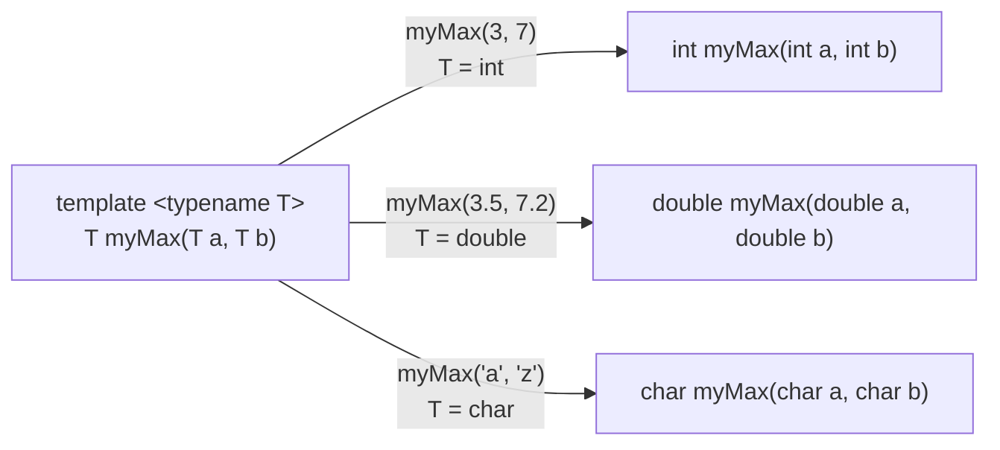
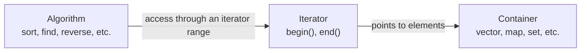

# Chapter 10 — Templates and the Standard Library (STL)

[Repository Guide](../../README.md) | [English](Concepts_Lecture.md) | [한국어](Concepts_Lecture.ko.md)

> **Last Updated:** 2026-10-19
>
> 명품 C++ Programming, 황기태, Ch 10

> **Learning Objectives:**
> 1. Write function templates and class templates and explain how the compiler instantiates a template
> 2. Determine which function is called when a template and an ordinary function share a name
> 3. Distinguish STL containers, iterators, and algorithms and use vector, string, map, and set
> 4. Apply algorithm functions such as sort, find, and binary_search to iterator ranges
> 5. Write concise STL code with auto, range-based for, and lambda expressions
> 6. Explain why template definitions belong in headers and recognize common errors such as iterator invalidation

---

## Table of Contents

- [1. Function Templates](#1-function-templates)
  - [1.1 Generic Programming](#11-generic-programming)
  - [1.2 Syntax](#12-syntax)
  - [1.3 Template Instantiation](#13-template-instantiation)
  - [1.4 Multiple Template Parameters](#14-multiple-template-parameters)
  - [1.5 Overloading Template Functions with Ordinary Functions](#15-overloading-template-functions-with-ordinary-functions)
  - [1.6 Examples](#16-examples)
  - [1.7 Advantages and Disadvantages of Templates](#17-advantages-and-disadvantages-of-templates)
- [2. Class Templates](#2-class-templates)
  - [2.1 Syntax](#21-syntax)
  - [2.2 Instantiation](#22-instantiation)
  - [2.3 Operator Overloading in Templates](#23-operator-overloading-in-templates)
  - [2.4 Default Template Parameters](#24-default-template-parameters)
- [3. Components of the STL](#3-components-of-the-stl)
  - [3.1 STL Components](#31-stl-components)
  - [3.2 Header Files and Namespace](#32-header-files-and-namespace)
  - [3.3 Iterators](#33-iterators)
- [4. vector (In Depth)](#4-vector-in-depth)
  - [4.1 Declaration and Initialization](#41-declaration-and-initialization)
  - [4.2 Element Access](#42-element-access)
  - [4.3 Modifiers](#43-modifiers)
  - [4.4 Size and Capacity](#44-size-and-capacity)
  - [4.5 2D vector](#45-2d-vector)
  - [4.6 Iterating](#46-iterating)
  - [4.7 Passing to Functions](#47-passing-to-functions)
  - [4.8 Complete Example](#48-complete-example)
- [5. string](#5-string)
  - [5.1 std::string vs C-style char\[\]](#51-stdstring-vs-c-style-char)
  - [5.2 Construction and Concatenation](#52-construction-and-concatenation)
  - [5.3 Access and Search](#53-access-and-search)
  - [5.4 Comparison](#54-comparison)
  - [5.5 Conversion](#55-conversion)
  - [5.6 Iteration and Input](#56-iteration-and-input)
- [6. map and set](#6-map-and-set)
  - [6.1 map](#61-map)
  - [6.2 unordered_map](#62-unordered_map)
  - [6.3 set](#63-set)
  - [6.4 unordered_set](#64-unordered_set)
  - [6.5 Practical Example: Word Frequency](#65-practical-example-word-frequency)
- [7. algorithm](#7-algorithm)
  - [7.1 Sorting](#71-sorting)
  - [7.2 Searching](#72-searching)
  - [7.3 Counting and Accumulating](#73-counting-and-accumulating)
  - [7.4 Modifying Sequences](#74-modifying-sequences)
  - [7.5 Binary Search](#75-binary-search)
  - [7.6 Complete Example: Sort Students by Score](#76-complete-example-sort-students-by-score)
- [8. Modern C++ Features](#8-modern-c-features)
  - [8.1 auto (C++11)](#81-auto-c11)
  - [8.2 Range-based for (C++11)](#82-range-based-for-c11)
  - [8.3 Lambda Expressions (C++11)](#83-lambda-expressions-c11)
  - [8.4 Structured Bindings (C++17)](#84-structured-bindings-c17)
  - [8.5 std::optional (C++17)](#85-stdoptional-c17)
  - [8.6 Concepts (C++20)](#86-concepts-c20)
  - [8.7 std::ranges (C++20)](#87-stdranges-c20)
  - [8.8 std::print (C++23)](#88-stdprint-c23)
  - [8.9 C++26 Preview](#89-c26-preview)
- [9. Practical Patterns for Coding Tests](#9-practical-patterns-for-coding-tests)
  - [9.1 Reading Input Until EOF](#91-reading-input-until-eof)
  - [9.2 Sorting Custom Objects](#92-sorting-custom-objects)
  - [9.3 Frequency Counting with map](#93-frequency-counting-with-map)
  - [9.4 Unique Elements with set](#94-unique-elements-with-set)
  - [9.5 Stack and Queue](#95-stack-and-queue)
  - [9.6 priority_queue for Top-K Problems](#96-priority_queue-for-top-k-problems)
  - [9.7 pair and make_pair](#97-pair-and-make_pair)
- [10. Template Compilation Notes](#10-template-compilation-notes)
  - [10.1 Template Definition Must Be in Header](#101-template-definition-must-be-in-header)
  - [10.2 Common Errors](#102-common-errors)
- [11. Common Mistakes](#11-common-mistakes)
  - [11.1 Iterator Invalidation After insert/erase](#111-iterator-invalidation-after-inserterase)
  - [11.2 Using \[\] on map Creates Default Entry](#112-using--on-map-creates-default-entry)
  - [11.3 Forgetting #include for Each STL Component](#113-forgetting-include-for-each-stl-component)
  - [11.4 Range-based for: Copy vs Reference](#114-range-based-for-copy-vs-reference)
- [Summary](#summary)
- [Self-Check Questions](#self-check-questions)
- [References](#references)

---

<br>

## 1. Function Templates

### 1.1 Generic Programming

**Generic programming** is a technique that lets you write a function or class once and have it work for **any type**. Without templates, you would need to duplicate the same logic for each type (`int`, `double`, `char`, etc.). Function overloading does not solve this either: you still write a separate function for each type, and the functions differ only in their parameter types while their bodies are the same.

```cpp
// Without templates — duplicated code
int maxInt(int a, int b) { return (a > b) ? a : b; }
double maxDouble(double a, double b) { return (a > b) ? a : b; }
char maxChar(char a, char b) { return (a > b) ? a : b; }
```

Templates eliminate this redundancy by letting the compiler generate type-specific versions automatically.

> **Definition:** **Generic** programming, or generalization, is a technique that generalizes a function or class and, given the parameter types, produces function or class code from it like stamping copies from a mold. A **template** is the C++ tool that generalizes functions and classes and is declared with the `template` keyword; the data type used for the generalization is called a **generic type**.

### 1.2 Syntax

A function template is declared with the `template` keyword followed by a **template parameter list** in angle brackets.

```cpp
template <typename T>
T myMax(T a, T b) {
    return (a > b) ? a : b;
}
```

- `template <typename T>` declares a template with one type parameter `T`.
- `typename` and `class` mean the same thing in this context, so `template <class T>` is equivalent. The textbook uses `class`.
- `T` is a **placeholder** that is replaced with the actual type when the function is called.

### 1.3 Template Instantiation

When a template function is called with a specific type, the compiler generates a **concrete function** for that type. This process is called **instantiation**, and it happens at compile time. Figure 1 shows how a single `myMax` template yields a different function for each argument type.



*Figure 1. Functions instantiated from the myMax template for each argument type*

**Implicit instantiation:** the compiler deduces `T` from the argument types.

```cpp
int result1 = myMax(3, 7);        // T deduced as int → myMax<int>(3, 7)
double result2 = myMax(3.5, 7.2); // T deduced as double → myMax<double>(3.5, 7.2)
```

**Explicit template arguments:** the programmer specifies `T` directly, as in `myMax<double>`. The compiler still instantiates the function `myMax<double>` implicitly. What C++ calls explicit instantiation is a different construct, covered in Section 10.1.

```cpp
double result3 = myMax<double>(3, 7.2);  // T explicitly set to double
```

> **Key Point:** Each distinct type used with a template causes the compiler to generate a separate concrete function. `myMax<int>` and `myMax<double>` are two different functions in the compiled binary.

### 1.4 Multiple Template Parameters

A template can have more than one type parameter:

```cpp
template <typename T1, typename T2>
void printPair(T1 a, T2 b) {
    cout << a << ", " << b << endl;
}

printPair(10, 3.14);       // T1=int, T2=double
printPair("Hello", 42);    // T1=const char*, T2=int
```

The following `mcopy()` uses `T1` and `T2` for the element types of the source and destination arrays, so it can copy an array of one type into an array of another type. Three type parameters are declared as `template <class T1, class T2, class T3>`.

```cpp
template <class T1, class T2>
void mcopy(T1 src[], T2 dest[], int n) {   // copy n elements of src[] to dest[]
    for (int i = 0; i < n; i++)
        dest[i] = (T2)src[i];             // convert the T1 value to type T2
}

int x[] = {1, 2, 3, 4, 5};
double d[5];
mcopy(x, d, 5);   // instantiated with T1 = int, T2 = double
char c[5] = {'H', 'e', 'l', 'l', 'o'}, e[5];
mcopy(c, e, 5);   // instantiated with T1 and T2 both char
```

### 1.5 Overloading Template Functions with Ordinary Functions

A template does not behave correctly for every type. The following `print()` template prints `int` and `double` arrays as numbers, but when `T` is instantiated as `char`, it treats the elements 1, 2, 3, 4, 5 as character codes and prints the corresponding characters (invisible control characters) instead of numbers. The fix is to overload `print()` with an ordinary function that takes a `char` array.

```cpp
template <class T>
void print(T array[], int n) {
    for (int i = 0; i < n; i++)
        cout << array[i] << '\t';
    cout << endl;
}

void print(char array[], int n) {         // overloaded function for char arrays
    for (int i = 0; i < n; i++)
        cout << (int)array[i] << '\t';    // convert to int and print the integer
    cout << endl;
}

int x[] = {1, 2, 3, 4, 5};
double d[5] = {1.1, 2.2, 3.3, 4.4, 5.5};
char c[5] = {1, 2, 3, 4, 5};
print(x, 5);   // instantiated from the template: 1  2  3  4  5
print(d, 5);   // instantiated from the template: 1.1  2.2  3.3  4.4  5.5
print(c, 5);   // calls the overloaded function: 1  2  3  4  5
```

When an ordinary function and a template have the same name, the compiler chooses the function to call by the following rules.

1. If the ordinary function and the function instantiated from the template match the arguments equally well, the ordinary function wins. `print(c, 5)` above is this case. Conversely, if the ordinary function needs a type conversion and the template matches as is, the template is chosen.
2. If several templates can be called and match equally well, the more specialized template is chosen. For example, if both `T bigger(T a, T b)` and `Rectangle<T> bigger(Rectangle<T> a, Rectangle<T> b)` exist, the second template is used for `Rectangle<double>` arguments.

> **Key Point:** If a template does not behave as intended for a particular type, overload it with an ordinary function for that type. When both match the arguments equally well, the ordinary function is bound in preference to the template.

### 1.6 Examples

**Generic swap:**

```cpp
template <typename T>
void mySwap(T& a, T& b) {
    T temp = a;
    a = b;
    b = temp;
}

int x = 1, y = 2;
mySwap(x, y);       // x=2, y=1

string s1 = "hi", s2 = "bye";
mySwap(s1, s2);     // s1="bye", s2="hi"
```

**Generic print array:**

```cpp
template <typename T>
void printArray(T arr[], int size) {
    for (int i = 0; i < size; i++) {
        cout << arr[i] << "  ";
    }
    cout << endl;
}

int nums[] = {1, 2, 3, 4};
printArray(nums, 4);        // 1  2  3  4

double vals[] = {1.1, 2.2, 3.3};
printArray(vals, 3);        // 1.1  2.2  3.3
```

**Generic reverse array:**

```cpp
template <typename T>
void reverseArray(T arr[], int size) {
    for (int i = 0; i < size / 2; i++) {
        T temp = arr[i];
        arr[i] = arr[size - 1 - i];
        arr[size - 1 - i] = temp;
    }
}

int data[] = {1, 10, 100, 1000};
reverseArray(data, 4);      // {1000, 100, 10, 1}
```

### 1.7 Advantages and Disadvantages of Templates

Templates let you reuse function and class code, which raises the productivity and usefulness of software. On the other hand, they have the following disadvantages.

- Some compilers may not support templates or may support them only partly, so template code is weak in portability. Modern standard-conforming compilers support templates, but older compilers can cause problems.
- Compile error messages for template code are long and hard to read, which makes debugging difficult. C++20 Concepts (Section 8.6) were introduced to reduce this problem.

This programming technique, which makes use of generic functions and generic classes, is the generic programming of Section 1.1. C++ provides the STL (Section 3) for it, and many other languages such as Java and C# also support generics.

---

<br>

## 2. Class Templates

### 2.1 Syntax

A class template defines a class where one or more types are parameterized. The class definition is prefixed with `template <typename T>`.

```cpp
template <typename T>
class Container {
    T data;
    int size;
public:
    Container(T d, int s) : data(d), size(s) { }
    T getData();
    void setData(T d);
};
```

Member functions defined **outside** the class must repeat the template prefix and use `ClassName<T>::`:

```cpp
template <typename T>
T Container<T>::getData() {
    return data;
}

template <typename T>
void Container<T>::setData(T d) {
    data = d;
}
```

A class template with two or more type parameters is declared in the same way. For example, it is declared as `template <class T1, class T2> class GClass { T1 data1; T2 data2; ... };`, used by listing the types in order as in `GClass<int, double> x;`, and its member functions are defined as `GClass<T1, T2>::set(T1 a, T2 b)`.

### 2.2 Instantiation

Each time a class template is used with a specific type, the compiler generates a **separate class**.

```cpp
Container<int> c1(42, 1);       // generates Container class for int
Container<string> c2("hello", 5); // generates Container class for string
Container<double> c3(3.14, 1);  // generates Container class for double
```

`Container<int>` and `Container<string>` are entirely different classes, and they do not share code at runtime.

A generic type can be a pointer type or a class type as well as a built-in type, and an object of an instantiated class can be created dynamically with `new`. The following example instantiates the `Stack` template of Section 2.4 with several types. `Point` is a class whose constructor `Point(int x = 0, int y = 0)` has default arguments.

```cpp
Stack<int*> ipStack;           // stack that stores only int* pointers
Stack<Point> pointStack;       // stack that stores copies of Point objects
Stack<Point*> pStack;          // stack that stores Point* pointers
Stack<string> stringStack;     // stack that stores strings

Stack<char>* p = new Stack<char>();   // create an object of the instantiated class dynamically
p->push('a');
cout << p->pop() << endl;             // a
delete p;
```

### 2.3 Operator Overloading in Templates

Template classes can overload operators just like regular classes. A common need is to overload comparison operators so that template functions like `bigger()` can work with custom types.

```cpp
template <typename T>
class Rectangle {
    T width, height;
public:
    Rectangle(T w = 1, T h = 1) : width(w), height(h) { }
    T getArea() const { return width * height; }
    bool operator>(const Rectangle<T>& other) const {
        return this->getArea() > other.getArea();
    }
};

template <typename T>
T bigger(T a, T b) {
    if (a > b) return a;
    else return b;
}

Rectangle<double> r1(10.2, 23.5);
Rectangle<double> r2(20.4, 13.7);
Rectangle<double> r3 = bigger(r1, r2);  // uses operator> to compare
cout << r3.getArea() << endl;            // 279.48 (area of r2)
```

> **Key Point:** When using a template function that relies on operators (like `>`, `==`, `<`), the type `T` must have those operators defined. For built-in types this is automatic; for custom classes you must overload them.

Because `other` in `operator>` is a `const` reference, `getArea()`, which is called on that object, must also be declared as a `const` member function for the code to compile. Instead of defining the operator, you can also define a separate `bigger()` template that takes `Rectangle<T>` parameters. When both `bigger()` templates can be called, the more specialized one is chosen (Section 1.5).

### 2.4 Default Template Parameters

Template parameters can have **default values**, just like function parameters:

```cpp
template <typename T = int>
class Stack {
    T data[100];
    int top;
public:
    Stack() : top(-1) { }
    void push(T item) { data[++top] = item; }
    T pop() { return data[top--]; }
};

Stack<> s1;            // T defaults to int
Stack<double> s2;      // T is double
Stack<string> s3;      // T is string
```

> **Note:** Up to C++14, you still need the angle brackets when using the default, as in `Stack<>`. Since C++17, class template argument deduction (CTAD) lets you write just `Stack s1;`, and `T` becomes the default `int`.

> **Caution:** If one output statement calls `pop()` twice, as in `cout << s.pop() << ' ' << s.pop();`, the two calls may run in a different order from the output order. Up to C++14, the order in which the operands of `<<` are evaluated is unspecified, so for a stack into which `"c++"` and then `"java"` were pushed, a compiler that runs the right `pop()` first prints `c++ java`. This behavior is sometimes explained as cout pushing the data onto a stack and popping it, but the actual cause is the evaluation order of the operands. Since C++17, the left operand of `<<` is evaluated first, so the statement prints `java c++`. If the order matters, put the `pop()` calls in separate statements.

---

<br>

## 3. Components of the STL

The **STL (Standard Template Library)** is the part of the C++ standard library that collects generic classes and generic functions. With the STL, developers can write applications easily without implementing data structures and algorithms themselves.

### 3.1 STL Components

The STL consists of three components.

- **Container:** a template class that implements a data structure for holding data. Examples are `vector`, `list`, `stack`, `queue`, `map`, and `set`.
- **Iterator:** an object for traversing and accessing the elements of a container; it acts as a pointer to an element.
- **Algorithm:** a template function that implements operations on container elements such as copying, searching, deleting, and sorting. Algorithms are global functions, not member functions of containers, and they access elements through iterators.



*Figure 2. Relationship between STL containers, iterators, and algorithms*

Because an algorithm accesses elements only through iterators instead of handling the container directly, one algorithm function works with many kinds of containers.

### 3.2 Header Files and Namespace

To use a container class, include the header file in which the class is declared. For example, `vector` needs `#include <vector>` and `list` needs `#include <list>`. Most algorithm functions are available through the single header `#include <algorithm>`; functions in `<numeric>`, such as `accumulate`, are the exception. All of the STL is declared in the namespace `std`.

### 3.3 Iterators

An iterator is an object for accessing the elements of a container in sequence. An iterator variable is declared by naming the specific container type.

```cpp
vector<int> v = {5, 4, 0, 9};
vector<int>::iterator it;   // iterator to elements of a vector whose elements are int
it = v.begin();             // points to the first element
```

`v.begin()` points to the first element, and `v.end()` points to the position **after** the last element. The iterator range `[v.begin(), v.end())` therefore contains all elements. While `it != v.end()`, you move with `it++` and read or write the element with `*it`. Because `v.end()` does not point to an element, dereferencing it as in `*v.end()` is undefined behavior.

```text
index        0     1     2     3
          ┌─────┬─────┬─────┬─────┐
element   │  5  │  4  │  0  │  9  │
          └─────┴─────┴─────┴─────┘
             ▲                       ▲
         v.begin()                v.end()
       first element         one past the last
```

*Figure 3. Positions that begin() and end() point to in a vector*

The following example multiplies every element by 2 using an iterator.

```cpp
vector<int> v = {1, 2, 3};
for (vector<int>::iterator it = v.begin(); it != v.end(); it++) {
    int n = *it;    // read the value of the element it points to
    n = n * 2;
    *it = n;        // write a value to the element it points to
}
// v = {2, 4, 6}
```

---

<br>

## 4. vector (In Depth)

`vector` is the **most important STL container** for beginners and arguably the most frequently used container in real-world C++ and coding tests. It is a dynamic array that manages its own memory and grows automatically as elements are added.

**Header:** `#include <vector>`

### 4.1 Declaration and Initialization

```cpp
#include <vector>
using namespace std;

vector<int> v1;                    // empty vector
vector<int> v2(5);                 // 5 elements, all initialized to 0
vector<int> v3(5, 42);            // 5 elements, all initialized to 42
vector<int> v4 = {1, 2, 3, 4, 5}; // initializer list (C++11)
vector<int> v5{10, 20, 30};       // brace initialization (C++11)
vector<int> v6(v4);               // copy of v4
vector<int> v7(v4.begin(), v4.begin() + 3); // {1, 2, 3} — from iterator range
```

### 4.2 Element Access

```cpp
vector<int> v = {10, 20, 30, 40, 50};

v[0];           // 10 — no bounds checking (undefined behavior if out of range)
v.at(1);        // 20 — bounds-checked (throws std::out_of_range if invalid)
v.front();      // 10 — first element
v.back();       // 50 — last element
```

| Method | Returns | Bounds Check |
|:-------|:--------|:-------------|
| `v[i]` | Element at index `i` | No (undefined behavior if out of range) |
| `v.at(i)` | Element at index `i` | Yes (throws `std::out_of_range`) |
| `v.front()` | First element | No |
| `v.back()` | Last element | No |

*Table 1. vector element access methods and bounds checking*

> **Note:** **Tip.** Use `at()` during debugging; use `[]` in performance-critical code after you have verified the index is valid.

### 4.3 Modifiers

```cpp
vector<int> v = {10, 20, 30};

v.push_back(40);                 // {10, 20, 30, 40} — add to end
v.pop_back();                    // {10, 20, 30} — remove from end

v.insert(v.begin() + 1, 15);    // {10, 15, 20, 30} — insert before position
v.erase(v.begin() + 2);         // {10, 15, 30} — erase single element
v.erase(v.begin(), v.begin()+2);// {30} — erase range [first, last)

v.clear();                       // {} — remove all elements

v.resize(5);                     // {0, 0, 0, 0, 0} — resize to 5 (fill with 0)
v.resize(3, 99);                 // {0, 0, 0} — shrink to 3 (99 unused here)
v.resize(5, 99);                 // {0, 0, 0, 99, 99} — grow to 5, new elements = 99
```

| Method | Effect | Time Complexity |
|:-------|:-------|:----------------|
| `push_back(val)` | Add to end | Amortized O(1) |
| `pop_back()` | Remove last element | O(1) |
| `insert(pos, val)` | Insert before `pos` | O(n) |
| `erase(pos)` | Remove element at `pos` | O(n) |
| `erase(first, last)` | Remove range `[first, last)` | O(n) |
| `clear()` | Remove all elements | O(n) |
| `resize(n)` | Resize to `n` elements | O(n) |

*Table 2. vector modifiers and their time complexity*

### 4.4 Size and Capacity

`vector` has two separate concepts: **size** (number of elements currently stored) and **capacity** (total allocated memory slots).

```cpp
vector<int> v;
v.reserve(100);     // pre-allocate space for 100 elements (no elements created)

cout << v.size();       // 0 — no elements yet
cout << v.capacity();   // >= 100 — allocated space
cout << v.empty();      // true (1)

v.push_back(1);
v.push_back(2);
cout << v.size();       // 2
cout << v.capacity();   // >= 100 (still pre-allocated)

v.shrink_to_fit();      // request to reduce capacity to match size
```

Figure 4 shows the state in the code above after `reserve(100)` and two insertions. The size is 2, the number of actual elements, and the capacity is at least 100, the number of allocated slots.

```text
   0     1     2     3          99
┌─────┬─────┬─────┬─────┬─────┬─────┐
│  1  │  2  │     │     │ ... │     │
└─────┴─────┴─────┴─────┴─────┴─────┘
├── size ───┤
├──────────── capacity ─────────────┤
```

*Figure 4. Size and capacity of a vector holding two elements after reserve(100)*

| Method | Returns / Effect |
|:-------|:-----------------|
| `size()` | Number of elements |
| `capacity()` | Allocated storage (>= size) |
| `empty()` | `true` if size is 0 |
| `reserve(n)` | Pre-allocate space for at least `n` elements |
| `shrink_to_fit()` | Request to reduce capacity to size |

*Table 3. vector size and capacity methods*

> **Note:** **Performance Tip.** If you know the number of elements in advance, call `reserve()` before the loop. This avoids repeated reallocations (each reallocation copies or moves all existing elements to the new storage).

### 4.5 2D vector

A 2D vector is simply a `vector` of `vector`s.

```cpp
// Declare a 3x4 matrix initialized to 0
vector<vector<int>> matrix(3, vector<int>(4, 0));

matrix[0][0] = 1;
matrix[1][2] = 5;

// Iterate over 2D vector
for (int i = 0; i < matrix.size(); i++) {
    for (int j = 0; j < matrix[i].size(); j++) {
        cout << matrix[i][j] << " ";
    }
    cout << endl;
}

// Dynamic row addition
vector<vector<int>> jagged;
jagged.push_back({1, 2, 3});
jagged.push_back({4, 5});         // rows can have different lengths
jagged.push_back({6, 7, 8, 9});
```

### 4.6 Iterating

There are five common ways to iterate over a vector:

```cpp
vector<int> v = {10, 20, 30, 40};

// 1. Index-based loop
for (int i = 0; i < v.size(); i++) {
    cout << v[i] << " ";
}

// 2. Iterator loop
for (vector<int>::iterator it = v.begin(); it != v.end(); it++) {
    cout << *it << " ";
}

// 3. Range-based for (C++11) — copies each element
for (int x : v) {
    cout << x << " ";
}

// 4. Range-based for with reference (C++11) — no copy, can modify
for (int& x : v) {
    x *= 2;   // modifies the original vector
}
// v is now {20, 40, 60, 80}

// 5. Range-based for with const reference — no copy, read-only
for (const int& x : v) {
    cout << x << " ";
}
```

> **Note:** **Best Practice.** Use `for (const auto& x : v)` for read-only access and `for (auto& x : v)` when you need to modify elements.

### 4.7 Passing to Functions

Always pass vectors by **reference** to avoid expensive copies. Use `const` if the function only reads the vector.

```cpp
// Read-only — pass by const reference
void printVector(const vector<int>& v) {
    for (const auto& x : v) {
        cout << x << " ";
    }
    cout << endl;
}

// Modify in place — pass by reference
void doubleAll(vector<int>& v) {
    for (auto& x : v) {
        x *= 2;
    }
}

// Return a new vector — return by value (move semantics make this efficient)
vector<int> createVector(int n) {
    vector<int> result(n);
    for (int i = 0; i < n; i++) result[i] = i + 1;
    return result;   // moved, not copied (C++11)
}
```

### 4.8 Complete Example

**Read N numbers, sort them, and print:**

```cpp
#include <iostream>
#include <vector>
#include <algorithm>
using namespace std;

int main() {
    int n;
    cout << "Enter count: ";
    cin >> n;

    vector<int> nums(n);
    cout << "Enter " << n << " numbers: ";
    for (int i = 0; i < n; i++) {
        cin >> nums[i];
    }

    sort(nums.begin(), nums.end());

    cout << "Sorted: ";
    for (const auto& x : nums) {
        cout << x << " ";
    }
    cout << endl;

    cout << "Min: " << nums.front() << endl;
    cout << "Max: " << nums.back() << endl;

    return 0;
}
```

```text
Enter count: 5
Enter 5 numbers: 30 10 50 20 40
Sorted: 10 20 30 40 50
Min: 10
Max: 50
```

---

<br>

## 5. string

`std::string` is part of the C++ standard library and behaves like an STL container of characters. It manages its own memory and provides a rich set of operations.

**Header:** `#include <string>`

### 5.1 std::string vs C-style char[]

| Feature | `std::string` | `char[]` / `char*` |
|:--------|:--------------|:--------------------|
| Memory management | Automatic (dynamic) | Manual |
| Size tracking | `s.size()` / `s.length()` | `strlen(s)` (O(n) each call) |
| Concatenation | `s1 + s2` or `s1 += s2` | `strcat()` (must manage buffer) |
| Comparison | `==`, `<`, `>` | `strcmp()` |
| Safety | Bounds-checked with `at()` | Buffer overflow risk |
| Assignment | `s1 = s2` | Must use `strcpy()` |
| Pass to function | By reference | By pointer |

*Table 4. Comparison of std::string and C-style strings*

> **Note:** **Recommendation.** Always prefer `std::string` over C-style strings in C++ code.

### 5.2 Construction and Concatenation

```cpp
#include <string>
using namespace std;

string s1;                     // empty string ""
string s2 = "Hello";          // from C-string literal
string s3("World");           // constructor form
string s4(5, 'x');            // "xxxxx" — 5 copies of 'x'
string s5 = s2;               // copy of s2

// Concatenation
string greeting = s2 + " " + s3;   // "Hello World"
s2 += "!";                         // "Hello!" — append in place
s2.append(" C++");                 // "Hello! C++" — another way to append
```

### 5.3 Access and Search

```cpp
string s = "Hello World";

// Access individual characters
s[0];              // 'H'
s.at(4);           // 'o' — bounds-checked

// Substring
s.substr(0, 5);    // "Hello" — substr(start_pos, length)
s.substr(6);       // "World" — from position 6 to end

// Search
s.find("World");       // 6 — position of first occurrence
s.find("xyz");         // string::npos — not found
s.find('o');           // 4 — first 'o'
s.find('o', 5);        // 7 — first 'o' starting from position 5
s.rfind('o');          // 7 — last occurrence (reverse find)
```

| Method | Returns |
|:-------|:--------|
| `find(str)` | Position of first occurrence, or `string::npos` if not found |
| `find(str, pos)` | Search starting from `pos` |
| `rfind(str)` | Position of last occurrence |
| `substr(pos, len)` | Substring of length `len` starting at `pos` |
| `substr(pos)` | Substring from `pos` to end |

*Table 5. string search and substring methods*

### 5.4 Comparison

```cpp
string a = "apple";
string b = "banana";

a == b;     // false
a != b;     // true
a < b;      // true — lexicographic comparison ('a' < 'b')
a > b;      // false

// compare() returns 0 if equal, negative if a < b, positive if a > b
a.compare(b);    // negative value
```

### 5.5 Conversion

```cpp
#include <string>
using namespace std;

// Number to string
string s1 = to_string(42);       // "42"
string s2 = to_string(3.14);     // "3.140000"

// String to number
int n = stoi("123");              // 123
double d = stod("3.14");          // 3.14
long l = stol("1000000");         // 1000000
long long ll = stoll("999999999999"); // 999999999999

// These throw std::invalid_argument if conversion fails
// stoi("abc");   // throws exception
```

| Function | Conversion |
|:---------|:-----------|
| `to_string(num)` | Number -> string |
| `stoi(str)` | String -> `int` |
| `stol(str)` | String -> `long` |
| `stoll(str)` | String -> `long long` |
| `stod(str)` | String -> `double` |
| `stof(str)` | String -> `float` |

*Table 6. Conversion functions between strings and numbers*

### 5.6 Iteration and Input

```cpp
#include <iostream>
#include <string>
using namespace std;

int main() {
    // Range-based for
    string s = "Hello";
    for (char c : s) {
        cout << c << " ";   // H e l l o
    }
    cout << endl;

    // Modify characters
    for (char& c : s) {
        c = toupper(c);
    }
    // s is now "HELLO"

    // Input: cin >> reads a single word (stops at whitespace)
    string word;
    cin >> word;          // input: "Hello World" -> word = "Hello"

    // Input: getline reads the entire line (including spaces)
    string line;
    getline(cin, line);   // input: "Hello World" -> line = "Hello World"

    // CAUTION: mixing cin >> and getline
    int n;
    cin >> n;             // reads number, leaves '\n' in buffer
    cin.ignore();         // discard the leftover '\n'
    getline(cin, line);   // now reads the full next line correctly

    return 0;
}
```

> **Caution:** After `cin >> variable`, a newline character remains in the input buffer. If you call `getline()` next, it reads an empty line. Always call `cin.ignore()` between `cin >>` and `getline()`.

---

<br>

## 6. map and set

### 6.1 map

`map<K, V>` stores **key-value pairs** sorted by key. Internally it uses a balanced binary search tree (typically a red-black tree), providing O(log n) operations.

**Header:** `#include <map>`

```cpp
#include <map>
#include <string>
#include <iostream>
using namespace std;

int main() {
    map<string, int> ages;

    // Insert
    ages["Alice"] = 20;               // [] operator — inserts or updates
    ages["Bob"] = 22;
    ages.insert({"Charlie", 25});      // insert() — does NOT overwrite if key exists
    ages.insert(make_pair("Dave", 30));

    // Access
    cout << ages["Alice"] << endl;     // 20

    // Check existence (IMPORTANT: do NOT use [] to check — it creates a default entry!)
    if (ages.find("Eve") != ages.end()) {
        cout << "Found Eve" << endl;
    } else {
        cout << "Eve not found" << endl;   // this branch executes
    }

    if (ages.count("Bob") > 0) {       // count returns 0 or 1 for map
        cout << "Bob exists" << endl;
    }

    // Erase
    ages.erase("Charlie");             // remove by key

    // Iterate — elements are ordered by key
    for (auto it = ages.begin(); it != ages.end(); it++) {
        cout << it->first << ": " << it->second << endl;
    }
    // Alice: 20
    // Bob: 22
    // Dave: 30

    // Size
    cout << "Size: " << ages.size() << endl;   // 3

    return 0;
}
```

| Method | Description | Time |
|:-------|:------------|:-----|
| `m[key] = val` | Insert or update | O(log n) |
| `m[key]` | Access value (creates default if key missing!) | O(log n) |
| `m.at(key)` | Access value (throws if key missing) | O(log n) |
| `m.insert({k, v})` | Insert only if key does not exist | O(log n) |
| `m.find(key)` | Returns iterator (or `end()` if not found) | O(log n) |
| `m.count(key)` | Returns 0 or 1 | O(log n) |
| `m.erase(key)` | Remove by key | O(log n) |
| `m.size()` | Number of key-value pairs | O(1) |

*Table 7. Main map methods and their time complexity*

### 6.2 unordered_map

`unordered_map<K, V>` uses a **hash table** instead of a tree. It provides **O(1) average** lookup but elements are **not sorted**.

**Header:** `#include <unordered_map>`

```cpp
#include <unordered_map>
#include <string>
using namespace std;

unordered_map<string, int> freq;
freq["apple"] = 3;
freq["banana"] = 5;

// Same interface as map: [], find, count, erase, insert, size
```

**Choosing between map and unordered_map:**

| Aspect | `map` | `unordered_map` |
|:--|:------|:----------------|
| Ordering | Sorted by key | No ordering |
| Lookup | O(log n) | O(1) average, O(n) worst |
| Use when | You need sorted order or range queries | You need fastest possible lookup |
| Key requirement | Must support `operator<` | Must support `std::hash` and `operator==` |

*Table 8. Comparison of map and unordered_map*

### 6.3 set

`set<T>` stores **unique elements** in sorted order. It is internally implemented as a balanced binary search tree.

**Header:** `#include <set>`

```cpp
#include <set>
#include <iostream>
using namespace std;

int main() {
    set<int> s;

    s.insert(30);
    s.insert(10);
    s.insert(20);
    s.insert(10);     // duplicate — ignored

    cout << s.size() << endl;   // 3

    // Check membership
    if (s.find(20) != s.end()) {
        cout << "20 exists" << endl;
    }
    if (s.count(99) == 0) {
        cout << "99 not found" << endl;
    }

    // Erase
    s.erase(10);       // remove element 10

    // Iterate — elements are sorted
    for (const auto& x : s) {
        cout << x << " ";    // 20 30
    }
    cout << endl;

    return 0;
}
```

| Method | Description | Time |
|:-------|:------------|:-----|
| `s.insert(val)` | Insert element (ignored if duplicate) | O(log n) |
| `s.find(val)` | Returns iterator (or `end()` if not found) | O(log n) |
| `s.count(val)` | Returns 0 or 1 | O(log n) |
| `s.erase(val)` | Remove element | O(log n) |
| `s.size()` | Number of elements | O(1) |

*Table 9. Main set methods and their time complexity*

### 6.4 unordered_set

`unordered_set<T>` is the hash-based version of `set`. Its operations take O(1) on average, and its elements have no order.

**Header:** `#include <unordered_set>`

```cpp
#include <unordered_set>
using namespace std;

unordered_set<int> us = {1, 2, 3, 4, 5};
us.insert(3);              // duplicate — ignored
us.count(3);               // 1
us.erase(2);               // remove element 2
```

### 6.5 Practical Example: Word Frequency

```cpp
#include <iostream>
#include <map>
#include <string>
using namespace std;

int main() {
    map<string, int> freq;
    string word;

    cout << "Enter words (Ctrl+D to stop):" << endl;
    while (cin >> word) {
        freq[word]++;      // [] creates entry with value 0 if key is new, then increments
    }

    cout << "\nWord frequencies:" << endl;
    for (const auto& pair : freq) {
        cout << pair.first << ": " << pair.second << endl;
    }

    return 0;
}
```

```text
Enter words (Ctrl+D to stop):
the cat sat on the mat the cat
^D

Word frequencies:
cat: 2
mat: 1
on: 1
sat: 1
the: 3
```

---

<br>

## 7. algorithm

The `<algorithm>` header provides generic functions that operate on iterator ranges. These are essential for coding tests and everyday C++ programming.

**Header:** `#include <algorithm>`

### 7.1 Sorting

The two arguments of `sort()` are an iterator to the first element of the range to sort and an iterator to the position **after** the last element (Section 3.3). For example, `sort(v.begin() + 2, v.begin() + 5)` sorts only the three elements from the third to the fifth.

```cpp
#include <algorithm>
#include <vector>
using namespace std;

vector<int> v = {30, 10, 50, 20, 40};

// Default: ascending order
sort(v.begin(), v.end());          // {10, 20, 30, 40, 50}

// Descending order with comparator
sort(v.begin(), v.end(), greater<int>());  // {50, 40, 30, 20, 10}

// Custom comparator with lambda
sort(v.begin(), v.end(), [](int a, int b) {
    return a > b;                  // descending
});

// Sort part of the vector
sort(v.begin(), v.begin() + 3);   // sort only first 3 elements
```

> **Note:** The standard guarantees that `sort` makes O(n log n) comparisons, and most implementations use IntroSort (a hybrid of quicksort, heapsort, and insertion sort). `sort` does not preserve the original order of elements with equal values (it is not stable), so use `stable_sort` when that order must be kept.

### 7.2 Searching

```cpp
vector<int> v = {10, 20, 30, 40, 50};

// find — returns iterator to first match, or end() if not found
auto it = find(v.begin(), v.end(), 30);
if (it != v.end()) {
    cout << "Found at index " << (it - v.begin()) << endl;  // index 2
}

// min_element / max_element — returns iterator to min/max
auto minIt = min_element(v.begin(), v.end());
auto maxIt = max_element(v.begin(), v.end());
cout << "Min: " << *minIt << endl;   // 10
cout << "Max: " << *maxIt << endl;   // 50
```

### 7.3 Counting and Accumulating

```cpp
#include <algorithm>
#include <numeric>      // for accumulate
#include <vector>
using namespace std;

vector<int> v = {1, 2, 3, 2, 4, 2, 5};

// count — count occurrences of a value
int c = count(v.begin(), v.end(), 2);   // 3

// accumulate — sum all elements (from <numeric>)
int sum = accumulate(v.begin(), v.end(), 0);   // 19
// The third argument (0) is the initial value

// accumulate with custom operation
int product = accumulate(v.begin(), v.end(), 1, [](int a, int b) {
    return a * b;
});
// 1 * 1 * 2 * 3 * 2 * 4 * 2 * 5 = 480
```

### 7.4 Modifying Sequences

```cpp
vector<int> v = {1, 2, 3, 4, 5};

// reverse
reverse(v.begin(), v.end());       // {5, 4, 3, 2, 1}

// unique + erase idiom — remove consecutive duplicates
vector<int> w = {1, 1, 2, 3, 3, 3, 4, 4, 5};
// IMPORTANT: vector must be sorted first for unique to remove ALL duplicates
auto last = unique(w.begin(), w.end());   // moves duplicates to end
w.erase(last, w.end());                   // actually remove them
// w = {1, 2, 3, 4, 5}

// fill
vector<int> u(5);
fill(u.begin(), u.end(), 42);     // {42, 42, 42, 42, 42}
```

### 7.5 Binary Search

These functions require the range to be **sorted**.

```cpp
vector<int> v = {10, 20, 30, 40, 50};

// binary_search — returns true/false
bool found = binary_search(v.begin(), v.end(), 30);   // true

// lower_bound — iterator to first element >= value
auto lb = lower_bound(v.begin(), v.end(), 25);
cout << *lb << endl;    // 30 (first element >= 25)

// upper_bound — iterator to first element > value
auto ub = upper_bound(v.begin(), v.end(), 30);
cout << *ub << endl;    // 40 (first element > 30)

// Find position/index
int idx = lower_bound(v.begin(), v.end(), 30) - v.begin();   // 2
```

| Function | Returns | Requires Sorted |
|:---------|:--------|:----------------|
| `binary_search(b, e, val)` | `true` / `false` | Yes |
| `lower_bound(b, e, val)` | Iterator to first >= val | Yes |
| `upper_bound(b, e, val)` | Iterator to first > val | Yes |

*Table 10. Return values of the binary search functions*

### 7.6 Complete Example: Sort Students by Score

```cpp
#include <iostream>
#include <vector>
#include <string>
#include <algorithm>
using namespace std;

struct Student {
    string name;
    int score;
};

int main() {
    vector<Student> students = {
        {"Alice", 85},
        {"Bob", 92},
        {"Charlie", 78},
        {"Dave", 92},
        {"Eve", 88}
    };

    // Sort by score descending; if same score, by name ascending
    sort(students.begin(), students.end(), [](const Student& a, const Student& b) {
        if (a.score != b.score) return a.score > b.score;   // higher score first
        return a.name < b.name;                              // alphabetical if tied
    });

    for (const auto& s : students) {
        cout << s.name << ": " << s.score << endl;
    }
    // Bob: 92
    // Dave: 92
    // Eve: 88
    // Alice: 85
    // Charlie: 78

    return 0;
}
```

---

<br>

## 8. Modern C++ Features

### 8.1 auto (C++11)

The `auto` keyword lets the compiler **deduce the type** from the initializer. This is especially useful with complex types like iterators.

```cpp
auto x = 42;               // int
auto y = 3.14;             // double
auto s = string("hello");  // std::string

// Without auto — verbose
vector<int>::iterator it1 = v.begin();

// With auto — concise
auto it2 = v.begin();      // same type, deduced automatically

// With map — much cleaner
map<string, vector<int>> data;
// Without auto:
for (map<string, vector<int>>::iterator it = data.begin(); it != data.end(); it++) { }
// With auto:
for (auto it = data.begin(); it != data.end(); it++) { }
```

> **Note:** **Guideline.** Use `auto` when the type is obvious from context or overly verbose. Avoid it when the type is not clear; for example, `auto result = computeSomething();` alone does not tell you the type of `result`.

Before C++11, `auto` was a storage class specifier meaning that a local variable is allocated automatically on the stack, and it was rarely written because omitting it meant the same thing. Since C++11, it means that the type should be deduced from the initializer in the variable declaration. Function return types and pointer types are deduced in the same way.

```cpp
int square(int x) { return x * x; }

auto ret = square(3);   // ret is int because square() returns int
int n = 10;
auto* p = &n;           // p is int*
int& ref = n;           // ref is a reference to n
auto ref2 = ref;        // ref2 is int (a copy, not a reference)
auto& ref3 = ref;       // ref3 is int& (refers to n)
```

> **Caution:** `auto` strips references and top-level `const` from the initializer when it deduces the type. So `ref2`, initialized from the reference variable `ref`, is `int`, not `int&`, and changing `ref2` does not change `n`. Declare the variable with `auto&` when you need a reference.

### 8.2 Range-based for (C++11)

A cleaner syntax for iterating over containers:

```cpp
vector<int> v = {1, 2, 3, 4, 5};

// By value (copies each element)
for (auto x : v) {
    cout << x << " ";
}

// By reference (no copy, can modify)
for (auto& x : v) {
    x *= 2;
}

// By const reference (no copy, read-only — RECOMMENDED for read access)
for (const auto& x : v) {
    cout << x << " ";
}
```

It works with any container that provides `begin()` and `end()` (such as `string`, `map`, and `set`) and with built-in arrays.

### 8.3 Lambda Expressions (C++11)

A lambda is an **anonymous function** defined inline, introduced in C++11. Its basic syntax is `[capture](parameters) { body }`.

```cpp
// Basic lambda
auto greet = [](const string& name) {
    cout << "Hello, " << name << "!" << endl;
};
greet("World");   // Hello, World!

// Lambda with return type
auto add = [](int a, int b) -> int {
    return a + b;
};

// Capture variables from surrounding scope
int factor = 3;
auto multiply = [factor](int x) { return x * factor; };  // capture by value
cout << multiply(10) << endl;   // 30

int total = 0;
auto accumulate_fn = [&total](int x) { total += x; };    // capture by reference
accumulate_fn(5);
accumulate_fn(10);
cout << total << endl;   // 15

// Common use: custom sort comparator
vector<int> v = {3, 1, 4, 1, 5};
sort(v.begin(), v.end(), [](int a, int b) { return a > b; });  // descending

// Common use: for_each
for_each(v.begin(), v.end(), [](int x) { cout << x << " "; });
```

**Capture modes:**

| Capture | Meaning |
|:--------|:--------|
| `[]` | Capture nothing |
| `[x]` | Capture `x` by value (copy) |
| `[&x]` | Capture `x` by reference |
| `[=]` | Capture all used variables by value |
| `[&]` | Capture all used variables by reference |
| `[=, &x]` | All by value, except `x` by reference |

*Table 11. Lambda capture modes*

The name lambda comes from lambda expressions in lambda calculus, which express mathematical functions in a simple form. For example, $f(x, y) = x + y$ is written as the lambda expression $(x, y) \to x + y$ and evaluated as $((x, y) \to x + y)(2, 3) = 2 + 3 = 5$. A C++ lambda expression consists of the following four parts.

```text
[capture list](parameter list) -> return type { function body }
```

- **Capture list:** the list of outside variables that the lambda uses.
- **Parameter list:** the same as the parameter list of an ordinary function.
- **Return type:** written as `-> type`; if omitted, the compiler deduces it from the `return` statement.
- **Function body:** the code that the lambda executes.

A lambda can be called immediately by appending arguments to its definition. The type of a lambda is an unnamed type known only to the compiler, so declare a variable with `auto` to store a lambda.

```cpp
[](int x, int y) { cout << "Sum: " << x + y << endl; }(2, 3);   // defined and called at once, Sum: 5

double pi = 3.14;
auto calc = [pi](int r) -> double { return pi * r * r; };   // capture list and return type
cout << calc(3) << endl;                                     // 28.26

int sum = 0;
[&sum](int x, int y) { sum = x + y; }(2, 3);   // store 5 in sum, captured by reference
cout << sum << endl;                           // 5
```

The third argument of `for_each()` can also be an ordinary function instead of a lambda. For example, `for_each(v.begin(), v.end(), print);` calls `void print(int n)` with each element as the argument.

### 8.4 Structured Bindings (C++17)

> **Note:** **C++17.** This feature requires C++17 or later.

Structured bindings allow you to decompose a pair, tuple, or struct into named variables.

```cpp
// With map — clean iteration
map<string, int> ages = {{"Alice", 20}, {"Bob", 22}};

for (const auto& [name, age] : ages) {
    cout << name << " is " << age << endl;
}
// Instead of:
for (const auto& p : ages) {
    cout << p.first << " is " << p.second << endl;
}

// With pair
pair<int, string> p = {42, "answer"};
auto [num, text] = p;
cout << num << ": " << text << endl;   // 42: answer

// With struct
struct Point { int x, y; };
Point pt = {3, 4};
auto [px, py] = pt;
```

### 8.5 std::optional (C++17)

> **Note:** **C++17.** This feature requires C++17 or later.

`std::optional<T>` represents a value that may or may not be present. It is a safe alternative to using special sentinel values (like `-1` or `nullptr`).

```cpp
#include <optional>
#include <string>
using namespace std;

optional<int> findIndex(const vector<int>& v, int target) {
    for (int i = 0; i < v.size(); i++) {
        if (v[i] == target) return i;     // return a value
    }
    return nullopt;                        // return "no value"
}

int main() {
    vector<int> v = {10, 20, 30};

    auto result = findIndex(v, 20);
    if (result.has_value()) {
        cout << "Found at index " << result.value() << endl;  // 1
    }

    // Shorthand with value_or
    int idx = findIndex(v, 99).value_or(-1);   // -1 (not found)

    return 0;
}
```

### 8.6 Concepts (C++20)

> **Note:** **C++20.** This feature requires C++20 or later.

Concepts constrain template parameters, providing clear error messages when a type does not meet requirements.

```cpp
#include <concepts>

template <typename T>
requires std::integral<T>
T gcd(T a, T b) {
    while (b != 0) {
        T temp = b;
        b = a % b;
        a = temp;
    }
    return a;
}

// Shorter syntax:
template <std::integral T>
T gcd2(T a, T b) { /* ... */ }

// Even shorter with auto:
auto gcd3(std::integral auto a, std::integral auto b) { /* ... */ }

gcd(12, 8);     // OK — int is integral
// gcd(3.14, 2.0); // compile error — double is not integral (clear message!)
```

### 8.7 std::ranges (C++20)

> **Note:** **C++20.** This feature requires C++20 or later.

The Ranges library provides a cleaner way to work with sequences, eliminating the need to pass `begin()` and `end()` separately.

```cpp
#include <ranges>
#include <algorithm>
#include <vector>
using namespace std;

vector<int> v = {5, 3, 1, 4, 2};

// Instead of: sort(v.begin(), v.end());
ranges::sort(v);                    // {1, 2, 3, 4, 5}

// Views — lazy, composable transformations
auto even = v | views::filter([](int x) { return x % 2 == 0; });
// even lazily produces: 2, 4

auto squared = v | views::transform([](int x) { return x * x; });
// squared lazily produces: 1, 4, 9, 16, 25

// Compose views
auto result = v | views::filter([](int x) { return x > 2; })
                | views::transform([](int x) { return x * 10; });
// result lazily produces: 30, 40, 50
```

### 8.8 std::print (C++23)

> **Note:** **C++23.** This feature requires C++23 or later.

`std::print` brings Python-like formatted output to C++.

```cpp
#include <print>

std::print("Hello, {}!\n", "World");           // Hello, World!
std::print("x = {}, y = {}\n", 3, 4);         // x = 3, y = 4
std::println("No need for \\n with println");  // adds newline automatically
```

> **Note:** The standard libraries of recent GCC, Clang, and MSVC support `std::print`, but many coding test judges do not yet support C++23 features.

### 8.9 C++26 Preview

> **Note:** **C++26.** C++26 is expected to be ratified in 2026, and compilers do not yet support most of its features. The information below is for awareness only.

C++26 brings significant additions focused on **safety**, **performance**, and **parallel computing** [1].

#### Contracts (`pre`, `post`, `contract_assert`)

Contracts are the headline feature of C++26: they express the checks that the old `assert()` macro performed as language-level preconditions and postconditions.

```cpp
// C++26 Contracts syntax (supported only by some recent compilers)
int divide(const int a, const int b)
    pre(b != 0)                     // precondition: b must not be zero
    post(r: r * b + a % b == a)     // postcondition: result * b + remainder == a
{
    return a / b;
}

void process(int* ptr)
    pre(ptr != nullptr)             // precondition: pointer must be valid
{
    contract_assert(*ptr > 0);      // runtime assertion (replaces assert())
    // ...
}
```

> **Note:** To use a value parameter (`a`, `b`) in a postcondition, that parameter must be declared `const`. Otherwise the function body could change the parameter, and the postcondition would check the changed value instead of the original argument. Also, integer division keeps only the quotient, so writing the postcondition as `r * b == a` would be violated for arguments that do not divide evenly, such as 7 / 2. The code above adds the remainder so that the condition holds for all arguments.

| Feature | Old (`assert`) | New (Contracts) |
|:--------|:--------------|:----------------|
| Syntax | Macro (`#include <cassert>`) | Language keyword |
| Scope | Runtime only | Compile-time + runtime |
| Module boundaries | Macros are not exported, so each importer must include `<cassert>` itself | No such restriction because it is a language feature |
| Precondition | Manual check inside function | `pre(condition)` in signature |
| Postcondition | Not supported | `post(result: condition)` |

*Table 12. Comparison of assert and contracts*

> **Key Point:** One reason contracts are needed is that C++20 modules do not export macros. Code that imports a module must include `<cassert>` itself to use `assert()`, whereas contracts are a language feature without this restriction and they state the conditions a function requires in its declaration. `contract_assert` is the standardized replacement for `assert()`.

#### New Containers and Libraries

| Header | Description |
|:-------|:------------|
| `<inplace_vector>` | A variable-size vector with fixed capacity. It stores its elements inside the object itself, so there is no heap allocation or reallocation, and it combines array performance with the vector interface |
| `<hive>` | A high-performance container that allocates elements in bulk blocks, marks erased slots with a skipfield so that iteration skips them, and reuses those slots for later insertions. Insertion and erasure do not invalidate pointers or iterators to other elements |
| `<debugging>` | Standardized debugging utilities. They check whether a debugger is attached (`is_debugger_present`) and trigger a breakpoint from the program (`breakpoint`, `breakpoint_if_debugging`) |
| `<simd>` | Unified SIMD (Single Instruction, Multiple Data) interface across CPU architectures (AVX, SSE, NEON, etc.) |
| `<linalg>` | Linear algebra operations using `<mdspan>` (matrix and vector multiplication, transformations, etc.) |
| `<hazard_pointer>` | A safe memory reclamation technique for lock-free data structures that keeps an object from being reclaimed while another thread is reading it. The protecting objects are managed in RAII style |
| `<rcu>` | Read-Copy-Update: a synchronization technique in which readers read data without locks, writers modify a copy and swap it in atomically, and the old data is reclaimed after the existing readers finish |

*Table 13. Headers added in C++26*

#### `constexpr` Everywhere

In C++26, most standard containers and utilities, such as `deque`, `list`, `map`, and `set`, become usable in `constexpr` contexts.

```cpp
// C++26: constexpr containers (not just vector and array)
constexpr std::map<std::string, int> scores = {{"Alice", 95}, {"Bob", 87}};
constexpr std::set<int> primes = {2, 3, 5, 7, 11};
constexpr std::deque<int> dq = {1, 2, 3};

// Even exceptions become constexpr
// constexpr functions can now throw and catch at compile time
```

> **Caution:** Memory allocated during constant evaluation must be freed before that evaluation ends. A declaration like the code above, which leaves a container holding allocated memory in a `constexpr` variable, therefore does not compile even in C++26. Build and use containers inside `constexpr` functions, and return only the computed result or store it in a type that does not allocate, such as `std::array`.

#### `std::execution` (Async Scheduling)

It is a comprehensive asynchronous programming framework with senders, receivers, and schedulers.

```cpp
// C++26: std::execution (conceptual — syntax may evolve)
#include <execution>

auto work = std::execution::just(42)
          | std::execution::then([](int x) { return x * 2; })
          | std::execution::then([](int x) { return x + 1; });
// Schedules: 42 → 84 → 85
```

> **Note:** NVIDIA provides an open-source reference implementation, stdexec [2].

---

<br>

## 9. Practical Patterns for Coding Tests

### 9.1 Reading Input Until EOF

```cpp
#include <iostream>
using namespace std;

int main() {
    int x;
    // Method 1: while (cin >> x)
    while (cin >> x) {
        cout << x * 2 << endl;
    }

    // Method 2: reading lines
    string line;
    while (getline(cin, line)) {
        cout << line << endl;
    }

    // Method 3: known count
    int n;
    cin >> n;
    for (int i = 0; i < n; i++) {
        cin >> x;
        // process x
    }

    return 0;
}
```

### 9.2 Sorting Custom Objects

```cpp
#include <algorithm>
#include <vector>
#include <string>
using namespace std;

struct Person {
    string name;
    int age;
};

int main() {
    vector<Person> people = {{"Alice", 30}, {"Bob", 25}, {"Charlie", 30}};

    // Method 1: Lambda comparator (most flexible)
    sort(people.begin(), people.end(), [](const Person& a, const Person& b) {
        if (a.age != b.age) return a.age < b.age;
        return a.name < b.name;
    });

    // Method 2: Overload operator< in the struct
    // struct Person {
    //     ...
    //     bool operator<(const Person& other) const {
    //         if (age != other.age) return age < other.age;
    //         return name < other.name;
    //     }
    // };
    // sort(people.begin(), people.end());  // uses operator<

    return 0;
}
```

### 9.3 Frequency Counting with map

```cpp
#include <map>
#include <vector>
using namespace std;

vector<int> nums = {1, 3, 2, 3, 1, 1, 2, 4};
map<int, int> freq;

for (int x : nums) {
    freq[x]++;
}
// freq = {1: 3, 2: 2, 3: 2, 4: 1}

// Find the most frequent element
int maxVal = 0, maxKey = 0;
for (const auto& [key, val] : freq) {   // C++17 structured bindings
    if (val > maxVal) {
        maxVal = val;
        maxKey = key;
    }
}
// maxKey = 1, maxVal = 3
```

### 9.4 Unique Elements with set

```cpp
#include <set>
#include <vector>
using namespace std;

vector<int> nums = {1, 3, 2, 3, 1, 1, 2, 4};

// Method 1: set
set<int> unique_nums(nums.begin(), nums.end());
// unique_nums = {1, 2, 3, 4}

// Method 2: sort + unique + erase (in-place, preserves vector type)
sort(nums.begin(), nums.end());
nums.erase(unique(nums.begin(), nums.end()), nums.end());
// nums = {1, 2, 3, 4}
```

### 9.5 Stack and Queue

**Header:** `#include <stack>` and `#include <queue>`

```cpp
#include <stack>
#include <queue>
using namespace std;

// Stack — LIFO (Last In, First Out)
stack<int> st;
st.push(10);
st.push(20);
st.push(30);
cout << st.top() << endl;    // 30
st.pop();                     // removes 30
cout << st.top() << endl;    // 20
cout << st.size() << endl;   // 2
cout << st.empty() << endl;  // false

// Queue — FIFO (First In, First Out)
queue<int> q;
q.push(10);
q.push(20);
q.push(30);
cout << q.front() << endl;   // 10
cout << q.back() << endl;    // 30
q.pop();                      // removes 10
cout << q.front() << endl;   // 20
```

| Aspect | `stack<T>` | `queue<T>` |
|:--|:-----------|:-----------|
| Add | `push(val)` | `push(val)` |
| Remove | `pop()` | `pop()` |
| Access | `top()` | `front()`, `back()` |
| Order | LIFO | FIFO |

*Table 14. Comparison of stack and queue operations*

### 9.6 priority_queue for Top-K Problems

**Header:** `#include <queue>`

`priority_queue` is a **max-heap** by default, so the largest element is always on top (`top()`).

```cpp
#include <queue>
#include <vector>
using namespace std;

// Max-heap (default)
priority_queue<int> maxPQ;
maxPQ.push(30);
maxPQ.push(10);
maxPQ.push(50);
maxPQ.push(20);
cout << maxPQ.top() << endl;   // 50 (largest)
maxPQ.pop();
cout << maxPQ.top() << endl;   // 30

// Min-heap
priority_queue<int, vector<int>, greater<int>> minPQ;
minPQ.push(30);
minPQ.push(10);
minPQ.push(50);
minPQ.push(20);
cout << minPQ.top() << endl;   // 10 (smallest)

// Top-K smallest elements using max-heap of size K
vector<int> data = {7, 3, 9, 1, 5, 8, 2, 6, 4, 10};
int k = 3;
priority_queue<int> topK;

for (int x : data) {
    topK.push(x);
    if (topK.size() > k) {
        topK.pop();             // remove the largest — keep only K smallest
    }
}
// topK contains: {3, 2, 1} — the 3 smallest elements
```

### 9.7 pair and make_pair

**Header:** `#include <utility>` (also included automatically by `<map>`, `<algorithm>`, etc.)

```cpp
#include <utility>
#include <vector>
#include <algorithm>
using namespace std;

pair<int, string> p1 = {42, "answer"};
pair<int, string> p2 = make_pair(42, "answer");  // equivalent

cout << p1.first << endl;     // 42
cout << p1.second << endl;    // "answer"

// Pairs are compared lexicographically: first by .first, then by .second
pair<int, int> a = {1, 5};
pair<int, int> b = {1, 3};
cout << (a > b) << endl;      // true (same first, 5 > 3)

// Common pattern: store (value, index) pairs for sorting with original indices
vector<pair<int, int>> indexed;
vector<int> nums = {30, 10, 50, 20};
for (int i = 0; i < nums.size(); i++) {
    indexed.push_back({nums[i], i});
}
sort(indexed.begin(), indexed.end());
// indexed = {{10,1}, {20,3}, {30,0}, {50,2}}
// Now you know: smallest value 10 was originally at index 1
```

---

<br>

## 10. Template Compilation Notes

### 10.1 Template Definition Must Be in Header

Unlike regular classes, **template definitions cannot be separated** into `.h` and `.cpp` files in the usual way. The compiler needs to see the full template definition at the point of instantiation to generate the concrete code.

```cpp
// MyTemplate.h — CORRECT: put everything in the header
template <typename T>
class MyTemplate {
    T data;
public:
    MyTemplate(T d) : data(d) { }
    T getData();
};

template <typename T>
T MyTemplate<T>::getData() {
    return data;     // definition must also be in the header
}
```

If you put the template member function definitions in a `.cpp` file, the linker will produce an **"undefined reference"** error because the compiler cannot instantiate the template when it compiles other translation units.

```cpp
// BAD: MyTemplate.cpp — will cause linker error
template <typename T>
T MyTemplate<T>::getData() {
    return data;
}
// Other .cpp files using MyTemplate<int> will fail to link!
```

> **Note:** **Rule.** Unless there is a specific reason, keep both template class declarations and member function definitions in the **header file**.

As an exception, if the types the template will be used with are known in advance, you can separate the definitions by writing an **explicit instantiation** in the `.cpp` file. An explicit instantiation makes the compiler generate the code for the specified type in that translation unit.

```cpp
// MyTemplate.cpp
#include "MyTemplate.h"   // header with the class declaration only

template <typename T>
T MyTemplate<T>::getData() {
    return data;
}

template class MyTemplate<int>;      // generate all members of MyTemplate<int> here
template class MyTemplate<double>;   // also generate MyTemplate<double>
```

In this case, using `MyTemplate` with any type other than the explicitly instantiated `int` and `double` causes a linker error again.

### 10.2 Common Errors

**Missing operator for custom types:**

```cpp
template <typename T>
T bigger(T a, T b) {
    if (a > b) return a;   // requires operator> for type T
    else return b;
}

class Point {
    int x, y;
public:
    Point(int x, int y) : x(x), y(y) { }
};

Point p1(1, 2), p2(3, 4);
// bigger(p1, p2);   // compile error — Point has no operator>
```

To fix this, overload `operator>` in the `Point` class:

```cpp
class Point {
    int x, y;
public:
    Point(int x, int y) : x(x), y(y) { }
    bool operator>(const Point& other) const {
        return (x + y) > (other.x + other.y);
    }
};

Point p1(1, 2), p2(3, 4);
Point p3 = bigger(p1, p2);  // now works — uses operator>
```

**Type mismatch:**

```cpp
template <typename T>
T myMax(T a, T b) {
    return (a > b) ? a : b;
}

// myMax(3, 7.5);    // compile error — T cannot be both int and double
myMax<double>(3, 7.5);  // OK — explicitly set T to double
```

> **Note:** **Tip.** When a template function is called with arguments of different types and the template has a single type parameter, the compiler cannot deduce `T`. Either specify the template argument explicitly, as in `myMax<double>`, or add a second template parameter.

---

<br>

## 11. Common Mistakes

### 11.1 Iterator Invalidation After insert/erase

Inserting or erasing elements in a `vector` can **invalidate** existing iterators. Using an invalidated iterator causes **undefined behavior**.

```cpp
vector<int> v = {1, 2, 3, 4, 5};

// WRONG — iterator invalidated after erase
for (auto it = v.begin(); it != v.end(); it++) {
    if (*it % 2 == 0) {
        v.erase(it);   // BAD: 'it' is now invalid, and the next it++ is undefined
    }
}

// CORRECT — erase returns the next valid iterator
for (auto it = v.begin(); it != v.end(); ) {
    if (*it % 2 == 0) {
        it = v.erase(it);   // erase returns iterator to next element
    } else {
        it++;
    }
}
// v = {1, 3, 5}
```

### 11.2 Using [] on map Creates Default Entry

The `[]` operator on a map **inserts a default-constructed value** if the key does not exist. This is a very common source of bugs.

```cpp
map<string, int> m;

// WRONG — this creates an entry {"Alice", 0} even though we just wanted to check!
if (m["Alice"] == 0) {
    cout << "Alice not found" << endl;
}
// m now contains {"Alice": 0} — unintended side effect!

// CORRECT — use find() or count() to check existence
if (m.find("Alice") == m.end()) {
    cout << "Alice not found" << endl;
}
// or
if (m.count("Alice") == 0) {
    cout << "Alice not found" << endl;
}
```

### 11.3 Forgetting #include for Each STL Component

Each STL component requires its own header. Up to C++20, C++ has no single statement that brings in the whole standard library, unlike some languages. C++23 lets you import the whole standard library as a module with `import std;`, but support in compilers and build tools is still uneven.

```cpp
// Each needs its own #include
#include <vector>           // vector
#include <string>           // string
#include <map>              // map
#include <unordered_map>    // unordered_map
#include <set>              // set
#include <unordered_set>    // unordered_set
#include <algorithm>        // sort, find, reverse, etc.
#include <numeric>          // accumulate, iota, etc.
#include <stack>            // stack
#include <queue>            // queue, priority_queue
#include <utility>          // pair, make_pair
#include <optional>         // optional (C++17)
```

> **Note:** **Tip.** Code may compile without the correct includes when it uses a header that includes every standard header, such as GCC's `<bits/stdc++.h>`, or when another standard header happens to include the missing one internally. But this is non-standard and non-portable. Always include the correct headers.

### 11.4 Range-based for: Copy vs Reference

```cpp
vector<string> names = {"Alice", "Bob", "Charlie"};

// COPY — each iteration copies the string (expensive for large objects!)
for (auto x : names) {
    x = "Modified";       // modifies the copy, not the original
}
// names is unchanged: {"Alice", "Bob", "Charlie"}

// REFERENCE — no copy, modifies the original
for (auto& x : names) {
    x = "Modified";       // modifies the original vector
}
// names is now: {"Modified", "Modified", "Modified"}

// CONST REFERENCE — no copy, read-only (BEST for read access)
for (const auto& x : names) {
    cout << x << endl;    // efficient, safe
    // x = "change";      // compile error — const
}
```

> **Note:** **Rule of Thumb.**
> - Use `for (auto x : v)` only for cheap-to-copy types (`int`, `char`, `double`).
> - Use `for (const auto& x : v)` for read-only access to any type.
> - Use `for (auto& x : v)` when you need to modify elements.

---

<br>

## Summary

| Concept | Key Summary |
|:--------|:-------------|
| Generic programming | A function or class is written once and used with many types, so the same code does not have to be duplicated for each type. |
| Function template syntax | `template <typename T>` is placed before the function, and `T` is a placeholder replaced with the actual type. |
| Template instantiation | The compiler generates a concrete function for each type used in a call, and `T` is either deduced from the arguments or given explicitly as in `myMax<double>`. |
| Multiple parameters | With several type parameters, as in `template <typename T1, typename T2>`, a template can handle different types together. |
| Overloading templates with ordinary functions | When an ordinary function and a template instantiation match the arguments equally well, the ordinary function wins, and among templates the more specialized one is chosen. |
| Advantages and disadvantages of templates | Templates raise productivity through code reuse, but differences in compiler support and hard-to-read error messages are their drawbacks. |
| Class template syntax | A class template is declared as `template <typename T> class Name { };`, and member definitions outside the class use `Name<T>::`. |
| Class instantiation | Writing `Name<int> obj;` generates a separate class for each type, and pointer types and class types can also be used. |
| Operator overloading in templates | Operators used by a template function (e.g., `operator>`) must be defined by custom types themselves. |
| Default template parameters | `template <typename T = int>` makes the template use the default type when no type is specified. |
| Components of the STL | The STL consists of containers (template classes), iterators, and algorithms (template functions), all in the namespace `std`. |
| Iterators | An iterator is a pointer-like object to container elements; `begin()` points to the first element and `end()` to the position after the last. |
| `vector` | A dynamic array that grows automatically and provides `push_back`, `[]`, `at()`, `front()`, `back()`, `size()`, `capacity()`, and `reserve()`. |
| 2D vector | A 2D vector is built as a vector of vectors, as in `vector<vector<int>> matrix(rows, vector<int>(cols, 0));`. |
| `string` | `std::string` replaces C-style `char[]` and provides operations such as `+`, `find`, `substr`, `stoi`, and `to_string`. |
| `map` / `unordered_map` | They are key-value stores; `map` is sorted by key with O(log n) operations, and `unordered_map` is a hash structure with O(1) average operations. |
| `set` / `unordered_set` | They store unique elements; `set` is sorted with O(log n) operations, and `unordered_set` is a hash structure with O(1) average operations. |
| `sort` | `sort(begin, end)` or `sort(begin, end, comp)` with a comparator such as a lambda sorts an iterator range. |
| `find`, `count` | They perform linear search and counting on iterator ranges. |
| `binary_search` | It searches a sorted range in O(log n), and `lower_bound` and `upper_bound` give positions when needed. |
| `accumulate` | It is the sum and reduce function in `<numeric>` and takes an initial value as an argument. |
| `auto` (C++11) | It deduces the type from the initializer and strips references, so use `auto&` when a reference is needed. |
| Range-based for (C++11) | Writing `for (const auto& x : container)` traverses a container concisely. |
| Lambda (C++11) | A lambda written as `[capture](params){ body }` is an anonymous function that is useful as an inline function for `sort` and `for_each`. |
| Structured bindings (C++17) | `auto [key, value] = pair;` decomposes pairs, tuples, and structs into named variables. |
| `std::optional` (C++17) | It handles results that may have no value safely with `has_value()` and `value_or()`. |
| `stack` / `queue` | They are LIFO and FIFO container adapters that provide `push`, `pop`, and `top` or `front`. |
| `priority_queue` | It is a max-heap by default and becomes a min-heap with `greater<>`, which is useful for top-K problems. |
| `pair` | `pair<T1,T2>` is compared lexicographically, so it works well with `sort`. |
| Templates in headers | The full template definition must be in the header, and separating it into a `.cpp` file without explicit instantiation causes linker errors. |
| Iterator invalidation | `insert` and `erase` on a vector invalidate iterators, so update the iterator with the return value of `erase()`. |
| `map[]` creates entries | Check existence with `find()` or `count()`, not with `[]`, which creates an entry. |
| Copy vs reference in for | `for(auto x:v)` traverses by copy, `for(auto& x:v)` by reference, and `for(const auto& x:v)` by read-only reference. |

---

<br>

## Self-Check Questions

1. **Template argument deduction:** Which of the following three calls causes a compile error, and why? Give two ways to fix that call.

   ```cpp
   template <typename T>
   T myMax(T a, T b) { return (a > b) ? a : b; }

   myMax(3, 7);       // (a)
   myMax(2.5, 1.5);   // (b)
   myMax(3, 7.5);     // (c)
   ```

   <details>
   <summary>Answer</summary>

   (c) is the error. `T` is deduced as `int` from the first argument 3 and as `double` from the second argument 7.5, so it cannot be fixed to one type. Template argument deduction does not consider implicit conversions. Fix it by specifying the template argument as in `myMax<double>(3, 7.5)` (result 7.5), by using two type parameters as in `template <typename T1, typename T2>`, or by making the argument types match as in `myMax(3.0, 7.5)`.

   </details>

2. **Choosing between a template and an ordinary function:** When the template `template <class T> void print(T array[], int n)` and the ordinary function `void print(char array[], int n)` both exist, which function does `char c[5] = {1, 2, 3, 4, 5}; print(c, 5);` call? How does the output change if the ordinary function does not exist?

   <details>
   <summary>Answer</summary>

   Both functions match the arguments exactly and equally well, so the ordinary function wins; it converts each element to `int` and prints `1 2 3 4 5`. Without the ordinary function, the template is instantiated with `T = char` and prints each element as a character, so the control characters with codes 1-5 are printed instead of digits and cannot be read on the screen.

   </details>

3. **Iterator ranges:** Write the contents of `v` after running `sort(v.begin() + 1, v.begin() + 4);` on `vector<int> v = {50, 20, 40, 10, 30};`. Also explain the position that `v.end()` points to.

   <details>
   <summary>Answer</summary>

   The range runs from index 1 up to but not including index 4, that is, the elements 20, 40, 10 at indices 1, 2, 3. Only these three are sorted, so `v = {50, 10, 20, 40, 30}`. `v.end()` points to the position after the last element 30; it does not point to an element and must not be dereferenced.

   </details>

4. **auto and references:** Write the values of `n`, `a`, and `b` after running the following code.

   ```cpp
   int n = 10;
   int& ref = n;
   auto a = ref;
   auto& b = ref;
   a = 20;
   b = 30;
   ```

   <details>
   <summary>Answer</summary>

   `n = 30`, `a = 20`, and `b = 30`. Because `auto` strips references, `a` is an independent `int` that copies the value of `n`, and `a = 20` does not change `n`. `b` is declared with `auto&`, so it is an `int&` that refers to `n`, and `b = 30` changes `n` to 30.

   </details>

5. **Templates and linker errors:** If the member function definitions of the class template `MyTemplate` are only in `MyTemplate.cpp` and `main.cpp` uses `MyTemplate<int>`, what error occurs? Give the reason and two ways to fix it.

   <details>
   <summary>Answer</summary>

   The link step fails with an "undefined reference" error because it cannot find member functions such as `MyTemplate<int>::getData()`. `main.cpp` sees only the declarations in the header, so it generates only the calls, and `MyTemplate.cpp` has the definitions but never uses them with `int`, so it does not generate the code for `MyTemplate<int>`. Fix it by moving the member function definitions into the header, or by adding the explicit instantiation `template class MyTemplate<int>;` to `MyTemplate.cpp`.

   </details>

---

<br>

## References

[1] cppreference.com, "C++26," https://en.cppreference.com/w/cpp/26.

[2] NVIDIA, "stdexec," GitHub, https://github.com/NVIDIA/stdexec.
