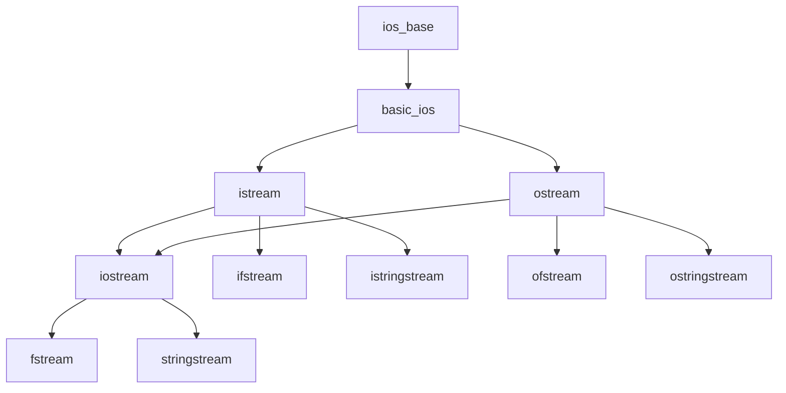

# 11장 — C++ 입출력 시스템

[레포지토리 안내](../../README.ko.md) | [English](Concepts_Lecture.md) | [한국어](Concepts_Lecture.ko.md)

> **최종 수정일:** 2026-11-19

> **학습 목표:**
> 1. 스트림과 버퍼의 개념을 설명하고 표준 스트림 객체 `cin`, `cout`, `cerr`, `clog`의 차이를 구별할 수 있다
> 2. `ostream`의 `put()`, `write()`, `flush()`와 `istream`의 `get()`, `getline()`, `ignore()`, `peek()`, `gcount()`로 문자 단위 입출력을 작성할 수 있다
> 3. 스트림 상태 비트를 해석하고 잘못된 입력을 받은 스트림을 복구할 수 있다
> 4. 포맷 플래그, `width()`, `fill()`, `precision()`과 조작자로 출력 형식을 지정할 수 있다
> 5. 사용자 정의 클래스의 삽입 연산자와 추출 연산자, 사용자 조작자를 작성할 수 있다
> 6. 문자열 스트림으로 문자열을 분석하고 만들 수 있다

---

## 목차

- [1. C++ 입출력의 기초](#1-c-입출력의-기초)
  - [1.1 스트림](#11-스트림)
  - [1.2 버퍼](#12-버퍼)
  - [1.3 입출력 클래스의 계층](#13-입출력-클래스의-계층)
  - [1.4 표준 스트림 객체](#14-표준-스트림-객체)
  - [1.5 C 표준 입출력과의 동기화](#15-c-표준-입출력과의-동기화)
- [2. ostream의 멤버 함수를 이용한 문자 출력](#2-ostream의-멤버-함수를-이용한-문자-출력)
  - [2.1 `put()`](#21-put)
  - [2.2 `write()`](#22-write)
  - [2.3 `flush()`](#23-flush)
  - [2.4 연쇄 호출과 참조 리턴](#24-연쇄-호출과-참조-리턴)
- [3. istream의 멤버 함수를 이용한 문자 입력](#3-istream의-멤버-함수를-이용한-문자-입력)
  - [3.1 `>>` 연산자와 공백 문자](#31--연산자와-공백-문자)
  - [3.2 `get()`의 세 가지 형태](#32-get의-세-가지-형태)
  - [3.3 `getline()`](#33-getline)
  - [3.4 `ignore()`, `peek()`, `putback()`, `gcount()`](#34-ignore-peek-putback-gcount)
  - [3.5 `>>`와 줄 단위 입력을 섞을 때](#35-와-줄-단위-입력을-섞을-때)
- [4. 스트림 상태](#4-스트림-상태)
  - [4.1 상태 비트](#41-상태-비트)
  - [4.2 입력 실패의 원인과 결과](#42-입력-실패의-원인과-결과)
  - [4.3 `clear()`와 입력 복구](#43-clear와-입력-복구)
  - [4.4 반복문 조건으로 쓰는 스트림](#44-반복문-조건으로-쓰는-스트림)
- [5. 포맷 입출력](#5-포맷-입출력)
  - [5.1 포맷 플래그](#51-포맷-플래그)
  - [5.2 `width()`, `fill()`, `precision()`](#52-width-fill-precision)
  - [5.3 조작자](#53-조작자)
  - [5.4 포맷 상태의 보존](#54-포맷-상태의-보존)
- [6. 삽입 연산자와 추출 연산자](#6-삽입-연산자와-추출-연산자)
  - [6.1 표준 삽입 연산자의 구조](#61-표준-삽입-연산자의-구조)
  - [6.2 사용자 정의 삽입 연산자](#62-사용자-정의-삽입-연산자)
  - [6.3 사용자 정의 추출 연산자](#63-사용자-정의-추출-연산자)
- [7. 사용자 조작자](#7-사용자-조작자)
  - [7.1 조작자의 동작 원리](#71-조작자의-동작-원리)
  - [7.2 매개변수가 없는 조작자](#72-매개변수가-없는-조작자)
  - [7.3 매개변수가 있는 조작자](#73-매개변수가-있는-조작자)
  - [7.4 입력 조작자](#74-입력-조작자)
- [8. 문자열 스트림](#8-문자열-스트림)
  - [8.1 `istringstream`, `ostringstream`, `stringstream`](#81-istringstream-ostringstream-stringstream)
  - [8.2 문자열 스트림의 활용](#82-문자열-스트림의-활용)
- [개념 적용](#개념-적용)
- [용어 사전](#용어-사전)
- [요약](#요약)
- [점검 문제](#점검-문제)
- [참고 문헌](#참고-문헌)

---

<br>

## 1. C++ 입출력의 기초

### 1.1 스트림

프로그램이 다루는 입출력 장치는 키보드, 화면, 디스크의 파일, 네트워크 연결처럼 종류가 다양하고, 장치마다 데이터를 주고받는 방식도 다르다. C++는 이 차이를 프로그램에서 감추기 위해 모든 입출력을 **스트림**이라는 하나의 모형으로 다룬다. 프로그램은 스트림에 바이트를 넣거나 스트림에서 바이트를 꺼내기만 하고, 그 바이트가 실제로 어느 장치에서 오거나 어느 장치로 가는지는 스트림 객체와 운영체제가 처리한다.

> **용어 정의:** **스트림(stream)** 은 프로그램과 입출력 장치 사이를 순서대로 흐르는 바이트의 논리적 통로이며, C++에서는 그 통로를 제어하는 객체로 표현된다.

스트림에는 방향이 있다. 장치에서 프로그램으로 들어오는 스트림을 **입력 스트림**, 프로그램에서 장치로 나가는 스트림을 **출력 스트림**이라 한다. 입력 스트림은 들어온 순서대로만 바이트를 꺼낼 수 있고, 출력 스트림은 넣은 순서대로 장치에 전달한다. 이 성질 때문에 스트림에서 앞의 바이트를 건너뛰고 뒤의 바이트만 먼저 읽을 수는 없으며, 파일처럼 위치를 옮길 수 있는 장치에서만 위치 이동 함수를 따로 제공한다(12장).


*그림 1. 키보드에서 프로그램을 거쳐 화면으로 가는 입출력 스트림*

C++ 스트림은 C의 `FILE *`과 달리 객체이므로 연산자와 멤버 함수로 다룬다. `cin >> n`은 `cin`이라는 입력 스트림 객체에서 정수 하나를 꺼내는 연산이고, `cout << n`은 `cout`이라는 출력 스트림 객체에 정수 하나를 넣는 연산이다. 스트림이 객체라는 점은 두 가지 장점을 준다. 첫째, `<<`와 `>>`를 데이터 타입마다 중복하여 정의하므로 `printf`의 `%d` 같은 형식 지정자 없이 타입이 자동으로 결정된다. 둘째, 사용자가 만든 클래스에도 같은 연산자를 정의할 수 있어 기본 타입과 같은 문법으로 입출력할 수 있다(6절).

### 1.2 버퍼

키보드로 한 글자를 입력할 때마다 프로그램이 그 글자를 받고, `cout`에 한 글자를 쓸 때마다 화면 장치에 그 글자를 보낸다면 장치와의 통신이 너무 잦아진다. 운영체제의 입출력 호출은 함수 호출보다 비용이 크므로, 스트림은 바이트를 메모리의 임시 공간에 모았다가 한꺼번에 처리한다.

> **용어 정의:** **버퍼(buffer)** 는 스트림이 장치와 주고받을 바이트를 잠시 모아 두는 메모리 공간이다.

입력 쪽에서는 버퍼 덕분에 사용자가 한 줄을 입력하는 동안 `<Backspace>`로 글자를 고칠 수 있다. 키보드로 입력한 글자는 `<Enter>`를 누를 때까지 입력 버퍼에 머물고, `<Enter>`를 누르면 개행 문자 `'\n'`을 포함한 한 줄이 프로그램에 전달된다. 그래서 `cin >> n`은 숫자를 다 입력해도 `<Enter>`를 누르기 전에는 끝나지 않으며, 한 번에 `10 20`처럼 여러 값을 입력하면 앞의 값만 읽고 나머지는 버퍼에 남아 다음 입력 연산이 사용한다([2장 3.1절](../Ch02_CPP-Programming-Basics/Concepts_Lecture.ko.md#31-cin과-)).

출력 쪽에서는 버퍼에 쌓인 바이트를 장치로 보내는 일을 **플러시(flush)** 라 한다. 출력 버퍼는 다음 경우에 플러시된다.

| 경우 | 예 |
|:-----|:-----|
| 버퍼가 가득 찼을 때 | 많은 양을 연속으로 출력할 때 |
| 플러시를 명시적으로 요청할 때 | `cout << endl`, `cout << flush`, `cout.flush()` |
| 스트림에 `unitbuf` 플래그가 켜져 있을 때 | 출력 연산마다 플러시 (`cerr`의 기본 설정) |
| 묶인 입력 스트림에서 읽기 직전 | `cin >> n` 직전에 `cout`을 플러시 (1.4절의 `tie`) |
| 프로그램이 정상 종료할 때 | `main`의 `return`, `exit()` 호출 |

*표 1. 출력 버퍼가 플러시되는 경우*

`endl`은 개행 문자를 출력한 뒤 버퍼를 플러시하고, `'\n'`은 개행 문자만 출력한다([2장 2.2절](../Ch02_CPP-Programming-Basics/Concepts_Lecture.ko.md#22-endl-vs-n)). 출력할 줄이 많은 프로그램에서 줄마다 `endl`을 쓰면 줄마다 장치와 통신하므로 느려진다. 반대로 `abort()`처럼 정상 종료 절차를 거치지 않고 끝나는 경우에는 버퍼에 남은 출력이 사라질 수 있으므로, 디버깅 메시지처럼 반드시 보여야 하는 출력은 플러시가 보장되는 `cerr`로 내보낸다.

> **[시스템프로그래밍]** 시스템프로그래밍에서 배우는 시스템 I/O에서 운영체제는 열린 파일을 파일 디스크립터로 구별하고, 프로그램은 `read`와 `write` 시스템 콜로 바이트를 주고받는다. 표준 입출력 라이브러리의 버퍼는 이 시스템 콜의 횟수를 줄이기 위한 것이며, 표준 출력이 터미널이면 보통 줄 단위로, 파일이나 파이프이면 버퍼가 찰 때 시스템 콜을 호출한다.

출력 순서가 버퍼에 따라 어떻게 달라지는지는 [Example_TieOrder.cpp](Example_TieOrder.cpp)로 확인할 수 있다. 이 프로그램은 `cout`, `cerr`, `cout`, `clog`, `cout`의 순서로 한 줄씩 출력한다.

```cpp
cout << "1 cout\n";
cerr << "2 cerr\n";      // cerr는 cout에 묶여 있으므로 쓰기 전에 cout을 플러시한다
cout << "3 cout\n";
clog << "4 clog\n";      // clog는 묶여 있지 않으므로 cout의 버퍼에 "3 cout"이 남아 있을 수 있다
cout << "5 cout\n";
```

```text
$ ./tie_order                터미널에 출력        $ ./tie_order 2>&1 | cat     파이프에 출력
1 cout                                            1 cout
2 cerr                                            2 cerr
3 cout                                            4 clog
4 clog                                            3 cout
5 cout                                            5 cout
```

터미널에서는 `cout`이 줄마다 장치로 전달되므로 다섯 줄이 코드 순서대로 나타난다. 표준 출력을 파이프에 연결하면 `cout`의 바이트는 버퍼가 찰 때까지 모인다. `clog`는 표준상 버퍼를 쓰는 스트림이지만, C 표준 입출력과 동기화된 기본 상태(1.5절)에서는 그 출력이 버퍼가 없는 C의 `stderr`로 곧바로 전달되므로, `4 clog`가 아직 `cout`의 버퍼에 있는 `3 cout`보다 먼저 나타난다. 반면 `2 cerr`는 파이프에서도 순서가 지켜지는데, `cerr`가 출력하기 전에 `cout`을 먼저 플러시하기 때문이다(1.4절). 파이프 쪽의 순서는 버퍼의 동작에 달린 결과이므로 구현에 따라 다를 수 있다.

> **참고:** 이 장의 실행 결과는 macOS(arm64)의 Apple clang 21과 libc++에서 `-std=c++17`로 컴파일하여 얻은 것이다. 표준이 구현에 맡긴 부분(버퍼의 크기, 일부 오류 메시지)은 다른 컴파일러나 표준 라이브러리에서 다를 수 있다.

### 1.3 입출력 클래스의 계층

C++ 표준 라이브러리의 입출력 클래스는 모두 템플릿이다. 문자 타입을 매개변수로 받아 `char` 스트림과 `wchar_t` 스트림을 같은 코드로 만들고, 자주 쓰는 구체화에는 짧은 이름을 붙였다. 예를 들어 `istream`은 `basic_istream<char>`의 별칭이고, `wistream`은 `basic_istream<wchar_t>`의 별칭이다[1]. 이 장에서는 짧은 이름으로 설명한다.



*그림 2. 입출력 스트림 클래스의 상속 계층 (화살표는 기본 클래스에서 파생 클래스로 향함)*

| 클래스 | 맡은 일 |
|:-----|:-----|
| `ios_base` | 문자 타입과 무관한 상태: 포맷 플래그, 필드 폭, 정밀도, 파일 모드와 위치 기준의 상수 |
| `basic_ios` (`ios`) | 스트림 상태 비트, 연결된 스트림 버퍼, 채움 문자, 묶인 스트림 |
| `istream` | 입력: `>>` 연산자, `get()`, `getline()`, `read()`, `ignore()`, `peek()` |
| `ostream` | 출력: `<<` 연산자, `put()`, `write()`, `flush()` |
| `iostream` | `istream`과 `ostream`을 모두 상속하여 입력과 출력을 함께 제공 |
| `ifstream`, `ofstream`, `fstream` | 파일에 연결된 스트림 (12장) |
| `istringstream`, `ostringstream`, `stringstream` | `string`에 연결된 스트림 (8절) |

*표 2. 입출력 클래스와 맡은 일*

`iostream`은 `istream`과 `ostream`을 다중 상속하는데, 두 클래스가 모두 `basic_ios`를 상속하므로 그대로라면 `basic_ios`가 두 번 포함된다. 표준은 `istream`과 `ostream`이 `basic_ios`를 가상 기본 클래스로 상속하게 하여 `iostream` 객체 안에 상태와 버퍼가 하나만 있게 한다[1]. 따라서 `fstream` 객체 하나로 읽고 쓰면 두 작업이 같은 상태 비트와 같은 버퍼를 공유한다.

계층이 이렇게 나뉘어 있으므로 `istream&`을 매개변수로 받는 함수는 `cin`, 파일 스트림, 문자열 스트림을 모두 받을 수 있다. 업캐스팅([8장](../Ch08_Inheritance/Concepts_Lecture.ko.md))이 스트림에도 그대로 적용되는 것이다. 6절의 사용자 정의 연산자와 12장의 파일 입출력은 이 성질을 이용한다.

| 헤더 | 선언하는 것 |
|:-----|:-----|
| `<ios>` | `ios_base`, `basic_ios`, 매개변수 없는 포맷 조작자(`hex`, `fixed`, `left` 등) |
| `<istream>` | `istream`, `iostream`, 조작자 `ws` |
| `<ostream>` | `ostream`, 조작자 `endl`, `ends`, `flush` |
| `<iostream>` | 표준 스트림 객체 `cin`, `cout`, `cerr`, `clog`와 그 넓은 문자 버전 |
| `<iomanip>` | 매개변수가 있는 조작자(`setw`, `setfill`, `setprecision` 등) |
| `<fstream>` | 파일 스트림 클래스 |
| `<sstream>` | 문자열 스트림 클래스 |

*표 3. 입출력 헤더와 선언하는 내용*

`<iostream>`은 표준 스트림 객체를 선언하면서 `<ios>`, `<istream>`, `<ostream>`을 포함하므로, 콘솔 입출력만 하는 프로그램은 `<iostream>` 하나로 충분하다. `setw`처럼 괄호가 붙는 조작자를 쓰려면 `<iomanip>`를 따로 포함해야 한다.

### 1.4 표준 스트림 객체

프로그램이 시작되면 `<iostream>`이 선언한 네 개의 `char` 스트림 객체가 이미 만들어져 있다. 이 객체들은 C의 표준 스트림 `stdin`, `stdout`, `stderr`에 연결된 버퍼를 통해 입출력한다[1].

| 객체 | 클래스 | 연결된 C 스트림 | 버퍼링 | 묶인 스트림 (`tie()`) |
|:-----|:-----|:-----|:-----|:-----|
| `cin` | `istream` | `stdin` | 버퍼 사용 | `&cout` |
| `cout` | `ostream` | `stdout` | 버퍼 사용 | 없음 |
| `cerr` | `ostream` | `stderr` | `unitbuf`로 출력마다 플러시 | `&cout` |
| `clog` | `ostream` | `stderr` | 버퍼 사용 | 없음 |

*표 4. 표준 스트림 객체의 연결과 버퍼링*

**묶음(tie).** 스트림 A가 출력 스트림 B에 묶여 있으면 A에서 입출력하기 직전에 B가 플러시된다. 표준은 `cin.tie()`가 `&cout`을 리턴하도록 정한다[1]. 그래서 `cout << "이름: "; cin >> name;`처럼 개행 없이 안내 문구를 출력해도, `cin`이 읽기 전에 `cout`이 플러시되어 안내 문구가 먼저 화면에 나타난다. `cerr`도 `cout`에 묶여 있고 `unitbuf` 플래그가 켜져 있으므로[1], 앞서 `cout`으로 쓴 내용이 먼저 나온 뒤 오류 메시지가 즉시 나온다. `clog`는 `cerr`와 같은 장치로 출력하지만 버퍼를 사용하므로 로그처럼 양이 많은 진단 출력에 쓴다.

**표준 오류를 쓰는 이유.** `cerr`와 `clog`는 표준 오류에 출력하므로 셸에서 `./p > out.txt`처럼 표준 출력만 파일로 보내도 오류 메시지는 터미널에 남는다. 결과 파일에 오류 메시지가 섞이지 않게 하려면 정상 결과는 `cout`으로, 오류와 진단 메시지는 `cerr`나 `clog`로 출력한다.

**기본 상태.** 표준 스트림 객체를 포함한 모든 스트림은 만들어질 때 포맷 플래그가 `skipws | dec`, 필드 폭이 0, 정밀도가 6, 채움 문자가 공백인 상태로 초기화된다[1]. 즉 입력할 때 앞의 공백 문자를 건너뛰고, 정수를 10진수로 다루며, 실수를 유효 숫자 6자리로 출력하고, 필드 폭을 따로 주지 않으면 필요한 만큼만 출력한다. 5절의 포맷 기능은 이 기본 상태를 바꾸는 방법이다.

`wcin`, `wcout`, `wcerr`, `wclog`는 같은 역할의 `wchar_t` 스트림이다. 한 프로그램에서 같은 C 스트림에 `char` 스트림과 `wchar_t` 스트림을 섞어 쓰면 출력이 깨질 수 있으므로 한 종류만 쓴다.

### 1.5 C 표준 입출력과의 동기화

C++ 프로그램에서도 `printf`, `scanf` 같은 C 표준 입출력 함수를 쓸 수 있다. 기본 설정에서 C++ 표준 스트림은 C 표준 스트림과 **동기화**되어 있으므로, `printf`와 `cout`을 섞어 써도 출력은 코드의 순서대로 나타난다. 이 동기화는 `ios_base::sync_with_stdio(false)`로 끌 수 있다.

```cpp
int main() {
    ios_base::sync_with_stdio(false);   // C 표준 입출력과의 동기화를 끈다 (첫 입출력 전에 호출)
    cin.tie(nullptr);                   // cin이 읽기 전에 cout을 플러시하지 않게 한다
    // ... 이후에는 cin과 cout만 사용한다
}
```

동기화를 끄면 C++ 스트림이 자신의 버퍼를 따로 쓰게 되어 대량의 입출력이 빨라지지만, 그 뒤로 `printf`와 `cout`을 섞으면 두 버퍼가 따로 플러시되어 순서가 뒤섞일 수 있다. `cin.tie(nullptr)`는 묶음을 풀어 읽을 때마다 일어나는 플러시를 없앤다. 이 두 줄은 입력과 출력이 수십만 줄에 이르는 프로그램(예: 코딩 테스트의 채점 환경)에서 쓰는 설정이며, 사용자와 주고받는 대화형 프로그램에서는 안내 문구가 늦게 나타나므로 쓰지 않는다.

> **주의:** `sync_with_stdio(false)`는 프로그램의 첫 입출력 전에 호출해야 한다. 이미 입출력을 한 뒤에 호출하면 그 효과는 구현이 정한다[1].

---

<br>

## 2. ostream의 멤버 함수를 이용한 문자 출력

`<<` 연산자는 값을 텍스트로 바꾸어 출력하는 **형식화 출력** 함수이다. 정수 65를 넣으면 문자 `'6'`과 `'5'`를 출력하고, 필드 폭과 포맷 플래그의 영향을 받는다. 반면 `ostream`의 멤버 함수 `put()`과 `write()`는 받은 바이트를 변환 없이 그대로 내보내는 **비형식 출력** 함수이며, 필드 폭과 포맷 플래그를 무시한다.

### 2.1 `put()`

```cpp
ostream& put(char ch);
```

`put()`은 문자 하나를 출력 스트림에 넣고 자기 자신(`*this`)의 참조를 리턴한다. 매개변수가 `char`이므로 정수를 넘기면 그 코드 값의 문자가 출력된다. 같은 65라도 `cout << 65`는 텍스트 `65`를, `cout.put(65)`는 문자 `A`를 출력한다.

```cpp
cout.put('C').put('+').put('+').put('\n');   // C++와 개행을 출력한다
cout << 65 << ' ';                           // 정수 65를 텍스트 "65"로 바꾸어 출력한다
cout.put(65);                                // 코드 값 65의 문자 'A'를 출력한다
```

### 2.2 `write()`

```cpp
ostream& write(const char* s, streamsize n);
```

`write()`는 주소 `s`부터 정확히 `n`바이트를 출력한다. 널 문자를 만나도 멈추지 않고, 문자열 끝을 찾지도 않는다. 따라서 문자열의 일부만 출력하거나, 12장에서 다루는 바이너리 데이터처럼 중간에 0바이트가 들어 있는 데이터를 출력할 때 쓴다. `streamsize`는 입출력에서 바이트 수를 나타내는 부호 있는 정수 타입이다.

```cpp
const char* msg = "Hello, stream world";
cout.write(msg, 5);                          // 앞의 5바이트 "Hello"만 출력한다
cout.write(msg, strlen(msg)).put('\n');      // 문자열 전체를 출력한다
```

> **주의:** `write(msg, n)`에서 `n`이 실제 데이터보다 크면 문자열 뒤의 메모리까지 읽어 출력하므로 정의되지 않은 동작이 된다. 문자열 전체를 출력하려면 `strlen(msg)`처럼 실제 길이를 넘긴다.

### 2.3 `flush()`

```cpp
ostream& flush();
```

`flush()`는 출력 버퍼에 쌓인 바이트를 즉시 장치로 보낸다. 조작자 `flush`(`cout << flush`)와 같은 일을 한다. 진행 상황을 한 줄에 이어 출력하다가 중간 결과를 바로 보여 주어야 할 때처럼, 개행 없이 화면에 내보내야 하는 경우에 쓴다.

[Example_CharOutput.cpp](Example_CharOutput.cpp)는 세 함수를 모두 사용한다. 실행 결과는 다음과 같다.

```text
C++
Hello
Hello, stream world
65 A
before flush, after flush
```

### 2.4 연쇄 호출과 참조 리턴

`cout.put('C').put('+')`가 동작하는 이유는 `put()`이 출력을 마친 뒤 `cout` 자신의 참조를 리턴하기 때문이다. 이 식은 왼쪽부터 다음과 같이 계산된다.

1. `cout.put('C')`가 `'C'`를 `cout`의 버퍼에 넣고 `cout`의 참조를 리턴한다.
2. 리턴된 참조는 `cout` 자체이므로 `.put('+')`는 다시 `cout`의 멤버 함수를 호출한다.
3. 마지막 `put('\n')`까지 같은 객체에 차례로 넣는다.

만약 `put()`이 참조가 아니라 `ostream`을 값으로 리턴한다면, 두 번째 `put()`은 `cout`이 아니라 리턴된 복사본에 적용되어야 한다. 그러나 스트림 객체는 버퍼와 장치 연결을 가진 객체이므로 복사가 금지되어 있다. C++11부터 `basic_ostream`의 복사 생성자는 `= delete`로 삭제되어 있어[1] 이런 함수는 컴파일되지 않는다. 사용자가 `<<` 연산자를 정의할 때도 매개변수와 리턴 타입을 `ostream&`으로 쓰는 이유가 여기에 있다(6.2절, [7장 5절](../Ch07_Friend-Functions-and-Operator-Overloads/Concepts_Lecture.ko.md#5-스트림-연산자-중복)).

| 구분 | 함수 | 포맷 플래그와 필드 폭 | 주된 용도 |
|:-----|:-----|:-----|:-----|
| 형식화 출력 | `operator<<` | 적용됨 | 값을 사람이 읽는 텍스트로 출력 |
| 비형식 출력 | `put()` | 무시됨 | 문자 하나를 그대로 출력 |
| 비형식 출력 | `write()` | 무시됨 | 바이트 블록을 그대로 출력 |

*표 5. 형식화 출력과 비형식 출력*

---

<br>

## 3. istream의 멤버 함수를 이용한 문자 입력

### 3.1 `>>` 연산자와 공백 문자

`>>` 연산자는 형식화 입력 함수이다. 기본 상태에서는 읽기 전에 앞쪽의 **공백 문자**(스페이스 `' '`, 탭 `'\t'`, 개행 `'\n'`, 수직 탭 `'\v'`, 폼 피드 `'\f'`, 캐리지 리턴 `'\r'`)를 건너뛰고, 그 데이터 타입으로 해석할 수 없는 문자를 만나면 멈춘다. 이 동작은 포맷 플래그 `skipws`가 켜져 있기 때문이다.

`char` 변수로 읽을 때도 공백 문자를 건너뛰므로, `>>`만으로는 입력에 있는 공백을 그대로 읽을 수 없다. 입력이 `A B`일 때 `in >> c`를 두 번 실행하면 `'A'`와 `'B'`를 읽고 사이의 공백은 버려진다. 조작자 `noskipws`로 `skipws`를 끄면 공백도 문자로 읽혀 두 번째 값이 `' '`가 된다.

| 입력 `A B` | 첫 번째 `in >> c` | 두 번째 `in >> c` |
|:-----|:-----|:-----|
| 기본 상태 (`skipws`) | `'A'` | `'B'` (공백을 건너뜀) |
| `in >> noskipws` 뒤 | `'A'` | `' '` |

*표 6. `skipws` 설정에 따른 `char` 입력*

공백을 포함한 모든 문자를 읽으려면 `noskipws`를 켜는 것보다 비형식 입력 함수인 `get()`을 쓰는 편이 의도가 분명하다.

### 3.2 `get()`의 세 가지 형태

`istream`은 이름이 같은 `get()` 함수를 세 가지 형태로 중복하여 제공한다. 세 형태 모두 비형식 입력 함수이므로 공백 문자를 건너뛰지 않는다.

| 형태 | 리턴 | 동작 |
|:-----|:-----|:-----|
| `int get()` | 읽은 문자의 코드 값, 끝이면 `EOF` | 문자 하나를 꺼낸다 |
| `istream& get(char& ch)` | 스트림 자신 | 문자 하나를 꺼내 `ch`에 저장하고, 실패하면 `ch`를 바꾸지 않는다 |
| `istream& get(char* s, streamsize n, char delim = '\n')` | 스트림 자신 | 최대 `n - 1`개의 문자를 `s`에 저장하고 끝에 `'\0'`을 붙인다. 구분 문자 `delim`을 만나면 그 앞에서 멈추고 `delim`은 스트림에 남긴다 |

*표 7. `get()`의 세 가지 형태*

**`int get()`의 리턴 타입.** 첫 번째 형태가 `char`가 아니라 `int`를 리턴하는 이유는 입력의 끝을 알리는 값 `EOF`(보통 -1)를 모든 문자 값과 구별하기 위해서이다. 읽은 값을 `char` 변수에 저장한 뒤 `EOF`와 비교하면, `char`가 부호 있는 타입인 환경에서는 바이트 `0xFF`가 -1이 되어 입력이 일찍 끝나고, 부호 없는 타입인 환경에서는 `EOF`와 같아질 수 없어 반복이 끝나지 않는다. 따라서 결과는 반드시 `int` 변수로 받는다.

```cpp
int ch;
while ((ch = cin.get()) != EOF)   // ch는 int여야 EOF와 문자를 구별할 수 있다
    cout.put(ch);
```

**`get(char& ch)`의 장점.** 두 번째 형태는 스트림을 리턴하므로 반복문의 조건에 바로 쓸 수 있다. `while (cin.get(c))`는 문자를 읽는 데 성공하는 동안 반복하고, 입력의 끝에서 `cin`이 실패 상태가 되면 끝난다(4.4절).

**`get(char* s, n)`의 추적.** 세 번째 형태는 한 줄의 일부를 배열에 읽는다. 입력 `"Hello World\nSecond line\n"`에서 `char buf[6]`에 `get(buf, 6)`을 반복하면 다음과 같다.

| 호출 | 저장된 문자열 | 꺼낸 문자 수 | 스트림에 남은 앞부분 | 상태 |
|:-----|:-----|:-----|:-----|:-----|
| 1번째 `get(buf, 6)` | `"Hello"` | 5 | `" World\nSecond..."` | 정상 |
| 2번째 `get(buf, 6)` | `" Worl"` | 5 | `"d\nSecond..."` | 정상 |
| 3번째 `get(buf, 6)` | `"d"` | 1 | `"\nSecond..."` | 정상 |
| 4번째 `get(buf, 6)` | `""` | 0 | `"\nSecond..."` | `failbit` |

*표 8. `get(buf, 6)`을 반복할 때의 결과*

세 번째 호출은 구분 문자 `'\n'` 앞에서 멈추고 `'\n'`을 스트림에 남긴다. 그래서 네 번째 호출은 첫 문자부터 구분 문자를 만나 아무것도 저장하지 못하고, 표준에 따라 `failbit`를 설정한다[1]. 남은 `'\n'`을 직접 꺼내지 않으면 이후의 `get(buf, n)`은 계속 실패한다. 이 점이 다음 절의 `getline()`과 다른 점이다.

### 3.3 `getline()`

```cpp
istream& getline(char* s, streamsize n, char delim = '\n');
```

멤버 함수 `getline()`은 `get(char* s, n, delim)`처럼 최대 `n - 1`개의 문자를 저장하고 `'\0'`을 붙이지만, 구분 문자를 만나면 **꺼내서 버린다**. 따라서 한 줄씩 반복하여 읽을 수 있다. 다만 `n - 1`개를 저장했는데 다음 문자가 구분 문자가 아니면 줄이 배열보다 길다는 뜻이므로 `failbit`를 설정한다[1]. 줄의 길이가 정확히 `n - 1`이면 이어지는 구분 문자를 꺼내고 정상으로 끝난다.

입력 `"abc\ndef"`(마지막 줄에 개행 없음)를 `char buf[10]`에 `getline(buf, 10)`으로 반복하여 읽으면 다음과 같다. `gcount()`는 마지막 비형식 입력 함수가 꺼낸 문자 수이며, 버린 구분 문자도 센다.

| 호출 | 저장된 문자열 | `gcount()` | `eof()` | `fail()` |
|:-----|:-----|:-----|:-----|:-----|
| 1번째 | `"abc"` | 4 (`'\n'` 포함) | 0 | 0 |
| 2번째 | `"def"` | 3 | 1 | 0 |
| 3번째 | `""` | 0 | 1 | 1 |

*표 9. `getline(buf, 10)`의 결과와 상태*

두 번째 호출은 구분 문자 대신 입력의 끝을 만나 멈추므로 `eofbit`가 켜지지만, 문자를 저장했으므로 실패가 아니다. 세 번째 호출은 아무것도 저장하지 못해 `failbit`까지 켜진다. `"Hello World"`처럼 배열보다 긴 줄을 `char buf[6]`에 읽으면 `"Hello"`만 저장되고 `failbit`가 켜지는데, 이때는 4.3절의 `clear()`를 호출하지 않으면 다음 줄을 읽을 수 없다.

길이를 알 수 없는 줄은 배열 대신 `string`으로 읽는다. `<string>`의 **전역 함수** `getline(istream& in, string& str, char delim = '\n')`는 길이 제한 없이 구분 문자 앞까지를 `str`에 저장하고 구분 문자를 버린다. 문자를 하나도 꺼내지 못하면, 즉 이미 입력의 끝이면 `failbit`를 설정한다. 이름은 같지만 멤버 함수(`cin.getline(buf, n)`)와 전역 함수(`getline(cin, str)`)는 서로 다른 함수이다.

> **핵심:** `get(buf, n)`은 구분 문자를 스트림에 남기고, `getline(buf, n)`과 `getline(in, str)`은 구분 문자를 꺼내서 버린다. 배열을 쓰는 두 멤버 함수는 최대 `n - 1`개만 저장하며, `string`을 쓰는 전역 함수에는 길이 제한이 없다.

### 3.4 `ignore()`, `peek()`, `putback()`, `gcount()`

| 함수 | 동작 |
|:-----|:-----|
| `ignore(n = 1, delim = EOF)` | 최대 `n`개의 문자를 꺼내 버리며, `delim`을 꺼내면 그 직후에 멈춘다 |
| `peek()` | 다음 문자를 꺼내지 않고 그 코드 값을 리턴하며, 끝이면 `EOF`를 리턴한다 |
| `putback(c)` | 마지막으로 꺼낸 문자 `c`를 스트림에 되돌린다 |
| `unget()` | 마지막으로 꺼낸 문자를 되돌린다 (문자를 지정하지 않음) |
| `gcount()` | 마지막 비형식 입력 함수가 꺼낸 문자 수를 리턴한다 |

*표 10. 입력 위치를 다루는 `istream`의 멤버 함수*

`peek()`은 다음 문자에 따라 읽는 방법을 고를 때 쓴다. 예를 들어 다음 문자가 숫자이면 `>>`로 정수를 읽고, `'#'`이면 줄 전체를 주석으로 버리는 식이다(7.4절). `putback()`과 `unget()`은 한 문자를 미리 읽어 본 뒤 되돌릴 때 쓴다. 되돌리기는 스트림 버퍼가 허용하는 범위에서만 성공하므로, 문자를 꺼낸 직후에 한 문자만 되돌리는 용도로 쓴다.

`gcount()`의 값은 **비형식** 입력 함수(`get`, `getline`, `read`, `ignore`, `peek` 등)가 바꾸고, `>>`는 바꾸지 않는다. `peek()`도 비형식 입력 함수이므로 호출하면 `gcount()`가 0이 된다. 꺼낸 문자 수가 필요하면 그 입력 함수를 호출한 직후에 `gcount()`를 읽어야 한다.

[Example_CharInput.cpp](Example_CharInput.cpp)는 세 줄의 입력을 서로 다른 방법으로 읽는다.

```cpp
int ch;
int count = 0;
while ((ch = cin.get()) != '\n' && ch != EOF) {   // 공백을 포함한 모든 문자를 읽는다
    cout.put(ch);
    count++;
}
cout << " (" << count << " characters)" << endl;

int year;
cin >> year;                         // 2024 뒤의 공백에서 멈춘다
string word;
cin >> word;                         // 공백을 건너뛰고 "fall"을 읽은 뒤 '\n'에서 멈춘다
cout << "year=" << year << ", word=" << word << endl;
cout << "next code: " << cin.peek() << endl;      // '\n'(10)이 아직 스트림에 있다

cin.ignore(100, '\n');               // '\n'까지 꺼내 버린다
char name[20];
cin.getline(name, 20);               // "Kim Minsu"를 읽고 '\n'을 버린다
cout << "name=" << name << ", gcount=" << cin.gcount() << endl;
```

```text
$ printf 'C++ IO\n2024 fall\nKim Minsu\n' | ./char_input
C++ IO (6 characters)
year=2024, word=fall
next code: 10
name=Kim Minsu, gcount=10
```

코드의 흐름을 줄별로 보면 다음과 같다.

- 첫 반복문은 `get()`으로 `'\n'`이 나올 때까지 문자를 읽는다. `C++ IO`의 공백도 문자로 읽으므로 6개를 센다. `'\n'`은 꺼냈지만 출력하지 않는다.
- `cin >> year`는 둘째 줄의 `2024`를 정수로 읽고 뒤의 공백 앞에서 멈춘다. `cin >> word`는 그 공백을 건너뛰고 `fall`을 읽은 뒤 `'\n'` 앞에서 멈춘다.
- `cin.peek()`은 남아 있는 `'\n'`의 코드 값 10을 리턴하며, 꺼내지는 않는다.
- `cin.ignore(100, '\n')`는 그 `'\n'`을 꺼내 버린다. 이 줄이 없으면 다음 `getline()`은 빈 줄을 읽는다(3.5절).
- `cin.getline(name, 20)`은 `Kim Minsu` 9글자와 `'\n'`을 꺼내므로 `gcount()`는 10이다.

### 3.5 `>>`와 줄 단위 입력을 섞을 때

`>>`는 값 뒤의 개행 문자를 스트림에 남기므로, 바로 뒤에 `getline()`을 호출하면 남은 개행 문자를 만나 빈 문자열을 읽는다. 이 현상과 `cin.ignore()`를 쓰는 해결 방법은 [2장 3.2절](../Ch02_CPP-Programming-Basics/Concepts_Lecture.ko.md#32-getline)에 있다. 여기서는 해결 방법 사이의 차이를 정리한다.

| 방법 | 입력 `"42\nKim\n"` | 입력 `"42   \nKim\n"` (숫자 뒤에 공백) |
|:-----|:-----|:-----|
| `cin.ignore()` | `'\n'` 하나를 버림, 성공 | 공백 하나만 버림, 이름이 `"  "`가 됨 |
| `cin.ignore(numeric_limits<streamsize>::max(), '\n')` | 줄의 나머지를 버림, 성공 | 줄의 나머지를 버림, 성공 |
| `getline(cin >> ws, name)` | 공백 문자를 모두 건너뜀, 성공 | 공백 문자를 모두 건너뜀, 성공 |

*표 11. `>>` 뒤에 줄을 읽는 세 가지 방법*

`ws`는 앞쪽의 공백 문자를 모두 꺼내 버리는 입력 조작자이다(5.3절). `cin >> ws`는 `cin`을 리턴하므로 `getline(cin >> ws, name)`처럼 한 식으로 쓸 수 있다. 다만 `ws`는 빈 줄까지 건너뛰므로 빈 줄 자체가 의미 있는 입력(예: 빈 이름을 허용하는 경우)에서는 `ignore(max, '\n')`를 쓴다.

---

<br>

## 4. 스트림 상태

### 4.1 상태 비트

입출력 연산은 실패할 수 있다. 정수를 읽으려는데 입력이 `abc`일 수 있고, 파일의 끝에 도달할 수 있으며, 디스크 오류가 날 수도 있다. C의 `scanf`는 리턴값으로 실패를 알리지만, C++ 스트림은 객체 안의 **상태 비트**에 결과를 기록하고 연산자는 스트림 자신을 리턴한다. 상태 비트는 `ios_base::iostate` 타입이며 다음 세 비트와 그 비트가 모두 꺼진 값 `goodbit`로 이루어진다[1].

| 비트 | 켜지는 경우 | 확인 함수 |
|:-----|:-----|:-----|
| `eofbit` | 입력 연산이 입력의 끝에 도달함 | `eof()` |
| `failbit` | 입력 연산이 기대한 문자를 읽지 못했거나, 출력 연산이 기대한 문자를 만들지 못함 | `fail()` (`failbit` 또는 `badbit`이면 참) |
| `badbit` | 스트림의 무결성을 잃음 (복구할 수 없는 읽기 오류 등) | `bad()` |
| `goodbit` (값 0) | 세 비트가 모두 꺼짐 | `good()` |

*표 12. 스트림의 상태 비트*

> **용어 정의:** **스트림 상태(stream state)** 는 스트림의 입출력 연산이 입력의 끝에 도달했는지, 실패했는지, 스트림이 손상되었는지를 `eofbit`, `failbit`, `badbit`의 조합으로 기록한 값이며, 실패 비트가 켜져 있는 동안 그 스트림의 입출력 연산은 아무 일도 하지 않는다.

`fail()`은 `failbit`뿐 아니라 `badbit`이 켜져 있어도 참이다. 스트림 객체를 조건식에 쓰면 `explicit operator bool()`이 `!fail()`을 리턴하므로, `if (cin)`은 "마지막 연산까지 실패하지 않았다"는 뜻이다. `rdstate()`는 세 비트를 한꺼번에 리턴한다.

| 상태 | `good()` | `eof()` | `fail()` | `bad()` | `bool(in)` |
|:-----|:-----|:-----|:-----|:-----|:-----|
| 정상 | 1 | 0 | 0 | 0 | 1 |
| 마지막 값을 읽으며 끝에 도달 (`eofbit`) | 0 | 1 | 0 | 0 | 1 |
| 형식이 맞지 않음 (`failbit`) | 0 | 0 | 1 | 0 | 0 |
| 끝에서 더 읽으려 함 (`eofbit`, `failbit`) | 0 | 1 | 1 | 0 | 0 |
| 장치 오류 (`badbit`) | 0 | 0 | 1 | 1 | 0 |

*표 13. 상태 조합에 따른 확인 함수의 값*

둘째 행이 중요하다. 입력 `"12"`에서 정수를 읽으면 숫자 뒤에 더 읽을 문자가 없는지 확인하다가 끝에 도달하므로 `eofbit`가 켜지지만, 값 12는 정상으로 읽혔으므로 `fail()`은 거짓이다. 같은 값을 `"12 "`처럼 뒤에 공백이 있는 입력에서 읽으면 공백에서 멈추므로 `eofbit`도 켜지지 않는다. 그래서 `eof()`만으로는 마지막 읽기가 성공했는지 판단할 수 없다. 다만 `eofbit`만 켜진 이 상태에서도 다음 입력 연산은 읽기를 시작하지 못하고 `failbit`를 켠다.

### 4.2 입력 실패의 원인과 결과

`int n`에 `>>`로 정수를 읽을 때 입력에 따라 결과는 다음과 같다. 표의 값은 `n`을 7로 초기화하고 `istringstream`(8절)에서 읽은 결과이다.

| 입력 | 읽은 뒤 `n` | `fail()` | `eof()` | 설명 |
|:-----|:-----|:-----|:-----|:-----|
| `"12"` | 12 | 0 | 1 | 성공, 숫자 뒤에서 끝에 도달 |
| `"12 "` | 12 | 0 | 0 | 성공, 공백 앞에서 멈춤 |
| `"3.7"` | 3 | 0 | 0 | `3`까지만 정수이므로 `.7`이 남음 |
| `"abc"` | 0 | 1 | 0 | 숫자가 없음, 0을 저장 |
| `"99999999999"` | 2147483647 | 1 | 1 | `int` 범위 초과, 최댓값을 저장 |
| `""` | 7 (그대로) | 1 | 1 | 읽을 문자가 없어 변환을 시작하지 못함 |

*표 14. 정수 입력의 결과 (`int`가 32비트인 환경)*

C++11부터 표준은 변환할 수 없는 입력에는 0을, 범위를 넘는 입력에는 그 타입의 최댓값이나 최솟값을 저장하고 `failbit`를 켜도록 정한다[1]. 입력이 비어 있으면 숫자를 찾기 전에 끝에 도달하므로 변수가 바뀌지 않는다. `"3.7"`은 실패가 아니라는 점에 유의해야 한다. `>>`는 정수로 해석할 수 있는 가장 긴 앞부분 `3`을 읽고 멈추며, 남은 `.7`은 다음 입력 연산이 만난다.

> **주의:** 실패 비트가 켜진 스트림에서는 이후의 모든 입력 연산이 즉시 실패한다. 잘못된 입력 한 번 때문에 이후의 `cin >> n`이 모두 건너뛰어진 것처럼 보이면, 상태를 지우지 않았거나(4.3절) 잘못된 문자가 스트림에 그대로 남아 있는 것이다.

### 4.3 `clear()`와 입력 복구

`clear(state = goodbit)`는 상태 비트를 주어진 값으로 바꾸고, `setstate(bit)`는 기존 상태에 비트를 더한다. 잘못된 입력에서 복구하려면 두 단계가 필요하다.

1. `clear()`로 상태를 `goodbit`로 되돌린다. 실패 상태에서는 `ignore()`도 아무 일도 하지 않으므로 이 단계가 먼저이다.
2. `ignore()`로 실패의 원인이 된 문자를 꺼내 버린다. 이 단계가 없으면 다음 `>>`가 같은 문자를 다시 만나 또 실패한다.

[Example_StreamState.cpp](Example_StreamState.cpp)는 입력 `abc 17 x 25`에서 이 과정을 보인다.

```cpp
int n = -1;
cin >> n;                            // "abc"는 정수가 아니다
cout << "after reading abc: n=" << n << endl;
showState(cin);

cin >> n;                            // failbit가 남아 있으므로 즉시 실패한다
cout << "second attempt without clear: n=" << n << endl;

cin.clear();                         // 상태를 goodbit로 되돌린다
cin.ignore(numeric_limits<streamsize>::max(), ' ');   // "abc "를 버린다
cin >> n;
cout << "after clear and ignore: n=" << n << endl;
showState(cin);

int sum = 0, value;
while (true) {                       // 나머지를 읽으며 잘못된 토큰은 건너뛴다
    if (cin >> value) {
        sum += value;
    } else if (cin.eof()) {
        break;
    } else {
        cin.clear();
        cin.ignore(numeric_limits<streamsize>::max(), ' ');
    }
}
```

```text
$ printf 'abc 17 x 25' | ./stream_state
after reading abc: n=0
  good=0 eof=0 fail=1 bad=0
second attempt without clear: n=0
after clear and ignore: n=17
  good=1 eof=0 fail=0 bad=0
sum of the remaining integers: 25
  good=0 eof=1 fail=1 bad=0
```

첫 읽기는 `abc`에서 실패하여 `n`에 0을 저장한다. 두 번째 읽기는 상태를 지우지 않았으므로 입력을 보지도 않고 실패하며 `n`은 0 그대로이다. 상태를 지우고 `"abc "`를 버리면 17을 정상으로 읽는다. 마지막 반복은 `x`에서 실패하면 상태를 지우고 그 토큰을 버린 뒤 25를 더하고, 입력의 끝에서 실패하면 `eof()`가 참이므로 끝난다. `showState`는 상태 비트를 출력하는 함수이다.

> **주의:** 반복문에서 `cin >> value`가 실패했을 때 `clear()`만 하고 `ignore()`를 빠뜨리면, 다음 반복에서 같은 문자 `x`를 만나 다시 실패하므로 무한 반복에 빠진다.

### 4.4 반복문 조건으로 쓰는 스트림

`>>`와 `get(char&)`, `getline()`은 스트림 자신을 리턴하므로 반복문의 조건에 그대로 쓸 수 있다.

```cpp
int x, sum = 0;
while (cin >> x)          // 읽기에 성공하는 동안 반복한다
    sum += x;
```

이 조건은 "읽기를 시도하고, 그 시도가 성공했으면 본문을 실행한다"는 순서를 한 식에 담는다. 키보드 입력의 끝은 줄의 처음에서 macOS와 Linux는 `Ctrl+D`, Windows는 `Ctrl+Z`와 `<Enter>`로 알린다. 입력의 끝뿐 아니라 정수가 아닌 문자에서도 반복이 끝나므로, 끝난 뒤 `eof()`와 `bad()`로 원인을 구별할 수 있다. `eof()`를 반복 조건으로 쓰면 마지막 값을 두 번 처리하는 오류가 생기며, 이 오류는 파일 입력에서 흔하므로 [12장 7절](../Ch12_CPP-File-IO/Concepts_Lecture.ko.md#7-스트림-상태-검사)에서 추적한다. 코딩 테스트에서 입력의 끝까지 읽는 방법은 [10장 9.1절](../Ch10_Templates-and-STL/Concepts_Lecture.ko.md#91-eof까지-입력-읽기)에 있다.

---

<br>

## 5. 포맷 입출력

### 5.1 포맷 플래그

스트림은 정수를 몇 진법으로 출력할지, 실수를 어떤 표기로 출력할지 같은 형식을 `ios_base`의 **포맷 플래그**로 기억한다.

> **용어 정의:** **포맷 플래그(format flag)** 는 스트림의 입출력 형식을 나타내는 `ios_base::fmtflags` 타입의 비트이며, 켜진 플래그는 끌 때까지 그 스트림의 모든 연산에 적용된다.

| 플래그 | 켜져 있을 때의 효과 |
|:-----|:-----|
| `boolalpha` | `bool`을 `true`, `false`라는 단어로 입출력 |
| `dec`, `oct`, `hex` | 정수를 10진수, 8진수, 16진수로 입출력 |
| `fixed` | 실수를 고정 소수점 표기로 출력 |
| `scientific` | 실수를 지수 표기로 출력 |
| `left`, `right`, `internal` | 필드 폭이 남을 때 채움 문자를 오른쪽에, 왼쪽에, 부호나 진법 접두사 뒤에 둠 |
| `showbase` | 정수 앞에 진법 접두사(`0`, `0x`)를 붙임 |
| `showpoint` | 실수에 소수점과 뒤의 0을 항상 출력 |
| `showpos` | 0과 양수 앞에 `+`를 붙임 |
| `skipws` | 형식화 입력 전에 공백 문자를 건너뜀 |
| `unitbuf` | 출력 연산마다 플러시 |
| `uppercase` | 16진수의 `a`\~`f`, 접두사 `x`, 지수의 `e`를 대문자로 출력 |

*표 15. 포맷 플래그와 그 효과*

같은 종류의 플래그 가운데 하나만 켜져 있어야 의미가 있는 것들은 묶음 상수로 함께 다룬다[1]. `basefield`는 `dec | oct | hex`, `adjustfield`는 `left | right | internal`, `floatfield`는 `scientific | fixed`이다.

| 멤버 함수 | 동작 |
|:-----|:-----|
| `flags()` | 현재 플래그 전체를 리턴 |
| `flags(f)` | 플래그 전체를 `f`로 바꾸고 이전 값을 리턴 |
| `setf(f)` | 플래그 `f`를 켜고(기존 플래그 유지) 이전 값을 리턴 |
| `setf(f, mask)` | `mask`에 속한 플래그를 모두 끈 뒤 `f`를 켜고 이전 값을 리턴 |
| `unsetf(mask)` | `mask`에 속한 플래그를 끔 |

*표 16. 포맷 플래그를 다루는 멤버 함수*

인자가 하나인 `setf(f)`는 플래그를 더하기만 한다. 따라서 `cout.setf(ios::hex)`만 호출하면 기본으로 켜져 있던 `dec`가 그대로 남아 `basefield`에 `dec`와 `hex`가 함께 켜지고, 이때 정수는 10진수로 출력된다. 진법처럼 하나를 고르는 플래그는 인자가 둘인 `setf(ios::hex, ios::basefield)`로 바꾸어야 한다.

```cpp
cout << 255 << ' ';                          // 255
cout.setf(ios::hex, ios::basefield);         // basefield 안에서 dec를 hex로 바꾼다
cout << 255 << ' ';                          // ff
cout.setf(ios::showbase | ios::uppercase);   // 두 플래그를 더한다
cout << 255 << endl;                         // 0XFF
```

> **주의:** `cout.setf(ios::hex)`만으로는 16진수로 출력되지 않는다. `dec`가 함께 켜져 있으면 정수는 10진수로 출력되므로, 진법, 정렬, 실수 표기는 묶음 상수를 두 번째 인자로 주는 `setf(f, mask)`로 바꾼다.

### 5.2 `width()`, `fill()`, `precision()`

**필드 폭.** `width(n)`은 다음 형식화 출력 하나가 최소 `n`칸을 차지하게 한다. 값이 `n`칸보다 짧으면 남는 칸을 채움 문자로 채우고, 길면 잘라 내지 않고 모두 출력한다. 필드 폭은 **다음 한 번의 출력에만** 적용되며, 그 출력이 끝나면 0으로 돌아간다[1].

```cpp
cout.width(8);
cout << 42 << '|' << 42 << '|' << endl;      // "      42|42|"
```

첫 번째 42는 8칸 오른쪽 정렬로 출력되고, 필드 폭이 0으로 돌아갔으므로 두 번째 42는 2칸만 차지한다. `width(2)` 뒤에 `12345`를 출력하면 다섯 자리가 모두 출력된다.

**채움 문자.** `fill(c)`는 남는 칸을 채울 문자를 `c`로 바꾸고 이전 문자를 리턴한다. 필드 폭과 달리 채움 문자는 바꿀 때까지 유지된다.

```cpp
cout.fill('.');
cout.setf(ios::left, ios::adjustfield);
cout.width(8);
cout << "Kim" << '|' << endl;                // "Kim.....|"
```

**정밀도.** `precision(n)`은 실수를 출력할 자릿수를 정한다. 기본값은 6이며, 그 뜻은 `floatfield`의 설정에 따라 달라진다.

| `floatfield` 설정 | 정밀도의 뜻 | `3.14159265358979` | `1234567.0` |
|:-----|:-----|:-----|:-----|
| 없음 (일반 표기), 정밀도 6 | 유효 숫자의 최대 개수 | `3.14159` | `1.23457e+06` |
| 없음 (일반 표기), 정밀도 3 | 유효 숫자의 최대 개수 | `3.14` | `1.23e+06` |
| `fixed`, 정밀도 3 | 소수점 아래 자릿수 | `3.142` | `1234567.000` |
| `scientific`, 정밀도 3 | 소수점 아래 자릿수 (지수 표기) | `3.142e+00` | `1.235e+06` |

*표 17. `floatfield`와 정밀도에 따른 실수 출력*

일반 표기는 C의 `%g`처럼 동작한다. 정밀도가 6이면 `1234567.0`은 유효 숫자 6자리로 표현할 수 없으므로 지수 표기 `1.23457e+06`으로 바뀌고, 뒤에 붙는 0은 출력하지 않는다(`100.0`은 `100`으로 출력된다). `showpoint`를 켜면 일반 표기에서도 소수점과 뒤의 0이 나타나 `100.0`이 `100.000`이 된다. `fixed`와 `scientific`에서는 정밀도가 소수점 아래 자릿수이므로, 금액처럼 자릿수를 맞춰야 하는 출력은 `fixed`와 함께 정밀도를 정한다.

> **주의:** 반올림은 실수가 메모리에 저장된 2진수 값에 대해 일어난다. `2.675`는 2진수로 정확히 표현되지 않고 2.67499999...로 저장되므로 `fixed`와 정밀도 2로 출력하면 `2.68`이 아니라 `2.67`이 된다. 정확한 10진 반올림이 필요하면 정수 단위(예: 원, 센트)로 계산한다.

[Example_FormatFlags.cpp](Example_FormatFlags.cpp)는 이 절의 함수를 모두 사용하며, 실행 결과는 다음과 같다. 마지막 두 줄은 5.4절에서 설명한다.

```text
255 ff 0XFF
      42|42|
Kim.....|
3.14159 1.23457e+06
3.14 1.23e+06
3.142 1234567.000
3.142e+00 1.235e+06
+2.5000 +10
2.5 10
```

### 5.3 조작자

멤버 함수로 형식을 바꾸려면 출력문을 끊어야 하지만, 조작자를 쓰면 `<<` 연쇄 안에서 형식을 바꿀 수 있다.

> **용어 정의:** **조작자(manipulator)** 는 `<<`나 `>>`의 피연산자로 쓰여 데이터를 입출력하는 대신 스트림의 형식이나 상태를 바꾸는 함수나 객체이다.

매개변수가 없는 조작자는 `<ios>`, `<istream>`, `<ostream>`에, 매개변수가 있는 조작자는 `<iomanip>`에 선언되어 있다.

| 조작자 | 효과 | 헤더 |
|:-----|:-----|:-----|
| `endl` | `'\n'`을 출력하고 플러시 | `<ostream>` |
| `ends` | 널 문자 `'\0'`을 출력 | `<ostream>` |
| `flush` | 플러시 | `<ostream>` |
| `ws` | 앞쪽의 공백 문자를 모두 꺼내 버림 (입력) | `<istream>` |
| `dec`, `oct`, `hex` | 정수의 진법을 바꿈 (`basefield`) | `<ios>` |
| `fixed`, `scientific` | 실수 표기를 바꿈 (`floatfield`) | `<ios>` |
| `defaultfloat` (C++11) | `floatfield`를 지워 일반 표기로 되돌림 | `<ios>` |
| `left`, `right`, `internal` | 정렬을 바꿈 (`adjustfield`) | `<ios>` |
| `showbase`, `noshowbase` | 진법 접두사를 켬, 끔 | `<ios>` |
| `showpoint`, `noshowpoint` | 소수점 표시를 켬, 끔 | `<ios>` |
| `showpos`, `noshowpos` | `+` 기호를 켬, 끔 | `<ios>` |
| `uppercase`, `nouppercase` | 대문자 출력을 켬, 끔 | `<ios>` |
| `boolalpha`, `noboolalpha` | `bool`의 단어 입출력을 켬, 끔 | `<ios>` |
| `skipws`, `noskipws` | 공백 건너뛰기를 켬, 끔 | `<ios>` |
| `unitbuf`, `nounitbuf` | 출력마다 플러시를 켬, 끔 | `<ios>` |
| `setw(n)` | 다음 출력의 필드 폭을 `n`으로 | `<iomanip>` |
| `setfill(c)` | 채움 문자를 `c`로 | `<iomanip>` |
| `setprecision(n)` | 정밀도를 `n`으로 | `<iomanip>` |
| `setbase(b)` | 진법을 `b`(8, 10, 16)로 | `<iomanip>` |
| `setiosflags(f)`, `resetiosflags(f)` | 플래그 `f`를 켬, 끔 | `<iomanip>` |

*표 18. 표준 조작자*

형식을 바꾸는 조작자는 `setw`를 제외하고 모두 다시 바꿀 때까지 효과가 유지된다. `setw`는 `width()`와 같으므로 다음 출력 하나에만 적용되고, `endl`, `ends`, `flush`, `ws`는 형식을 바꾸지 않고 그 자리에서 한 번 동작한다. `oct`, `hex`, `fixed`, `left` 같은 조작자는 해당 묶음 상수를 마스크로 하는 `setf(f, mask)`와 같은 일을 하므로 5.1절의 `setf(ios::hex)` 문제가 생기지 않는다.

[Example_Manipulators.cpp](Example_Manipulators.cpp)는 조작자로 영수증 표를 출력한다.

```cpp
cout << left << setw(10) << "Item" << right << setw(5) << "Qty"
     << setw(10) << "Price" << setw(10) << "Total" << '\n';
cout << setfill('-') << setw(35) << "" << setfill(' ') << '\n';

cout << fixed << setprecision(2);            // 이 두 설정은 바꿀 때까지 유지된다
double sum = 0;
for (const Item& it : items) {
    double total = it.quantity * it.price;
    sum += total;
    cout << left << setw(10) << it.name << right << setw(5) << it.quantity
         << setw(10) << it.price << setw(10) << total << '\n';
}
cout << left << setw(25) << "Sum" << right << setw(10) << sum << '\n';
```

```text
Item        Qty     Price     Total
-----------------------------------
Notebook      3      1.50      4.50
Pen          12      0.75      9.00
Backpack      1     24.99     24.99
Sum                           38.49
0xff 0377 255
false 0
[-    42] [-42    ]
```

열의 폭은 10, 5, 10, 10칸이므로 한 줄은 35칸이다. 구분선은 빈 문자열 `""`을 폭 35, 채움 문자 `'-'`로 출력하여 만든다. `Notebook` 행을 계산하면, 이름 `Notebook`(8글자)은 왼쪽 정렬로 10칸을 채우므로 뒤에 공백 2개가 붙고, 수량 `3`은 오른쪽 정렬 5칸이므로 앞에 공백 4개가 붙는다. 가격 1.5는 `fixed`와 정밀도 2 때문에 `1.50`(4글자)이 되어 앞에 공백 6개가 붙고, 합계 3 × 1.5 = 4.5는 `4.50`이 된다. 세 합계 4.5, 9.0, 24.99를 더한 `sum`은 2진수 오차 때문에 38.489999999999995로 저장되지만 소수점 아래 두 자리로 반올림하면 `38.49`이다. `Sum` 행은 앞의 세 열(10 + 5 + 10 = 25칸)을 하나로 합쳐 `setw(25)`로 출력한다. 마지막 세 줄은 진법 접두사, `boolalpha`, `internal` 정렬의 결과이다. `internal`은 부호 `-`를 왼쪽 끝에 두고 그 뒤를 채운다.

> **핵심:** 표를 출력할 때는 매 칸 앞에 `setw`를 다시 쓰고, `fixed`, `setprecision`, `setfill`, 정렬처럼 유지되는 설정은 바꾼 뒤 필요한 곳에서 되돌린다.

### 5.4 포맷 상태의 보존

포맷 플래그, 채움 문자, 정밀도는 바꿀 때까지 유지되므로, 함수 안에서 `cout`의 형식을 바꾸고 되돌리지 않으면 그 함수를 호출한 쪽의 출력까지 바뀐다. 예를 들어 금액을 출력하는 함수가 `fixed`와 정밀도 2를 설정하고 끝나면, 그 뒤에 출력하는 모든 실수가 소수점 아래 두 자리로 나온다. 형식을 바꾸는 함수는 처음에 현재 상태를 저장하고 끝에서 되돌린다.

```cpp
ios::fmtflags saved = cout.flags();          // 포맷 플래그 전체를 저장한다
streamsize savedPrecision = cout.precision();
cout.setf(ios::showpos | ios::showpoint);
cout.precision(5);
cout << 2.5 << ' ' << 10 << endl;            // "+2.5000 +10"
cout.flags(saved);                           // 플래그를 되돌린다
cout.precision(savedPrecision);
cout << 2.5 << ' ' << 10 << endl;            // "2.5 10"
```

`showpoint`와 정밀도 5 때문에 2.5는 유효 숫자 다섯 자리인 `2.5000`으로, `showpos` 때문에 정수 10은 `+10`으로 출력된다. 상태를 되돌린 뒤에는 기본 형식으로 돌아간다. 채움 문자도 바꾸었다면 `fill()`의 리턴값으로 함께 저장한다. 저장과 복원을 생성자와 소멸자에 맡기는 클래스를 만들면 함수 중간에 `return`이나 예외로 빠져나가도 형식이 되돌려진다. 이 기법은 13장의 RAII와 같은 생각이다.

C++20의 `std::format`은 형식을 스트림의 상태로 기억하지 않고 호출마다 형식 문자열로 지정하므로 이런 문제가 생기지 않는다([2장 2절](../Ch02_CPP-Programming-Basics/Concepts_Lecture.ko.md#2-콘솔-출력)). 스트림의 형식 기능은 C++20 이전의 코드와 사용자 정의 `<<` 연산자에서 여전히 쓰인다.

---

<br>

## 6. 삽입 연산자와 추출 연산자

`<<`를 **삽입 연산자(insertion operator)**, `>>`를 **추출 연산자(extraction operator)** 라 한다. 출력 스트림에 데이터를 넣고, 입력 스트림에서 데이터를 꺼내기 때문이다.

### 6.1 표준 삽입 연산자의 구조

`cout << 3`은 `ostream`의 멤버 함수 `cout.operator<<(3)`을 호출한다. `ostream`은 `bool`, `short`, `int`, `long`, `double`, `void*` 같은 산술 타입과 포인터 타입마다 멤버 함수 `operator<<`를 중복하여 정의한다. 문자와 문자열은 멤버가 아니라 전역 함수 `operator<<(ostream&, char)`와 `operator<<(ostream&, const char*)`로 정의된다. 어느 쪽이든 리턴 타입은 `ostream&`이므로 `cout << a << b`는 `(cout << a) << b`로 계산된다.

| 식 | 호출되는 함수 | 출력 |
|:-----|:-----|:-----|
| `cout << 65` | `cout.operator<<(int)` | `65` |
| `cout << 'A'` | `operator<<(ostream&, char)` | `A` |
| `cout << "Hi"` | `operator<<(ostream&, const char*)` | `Hi` |
| `cout << static_cast<int>('A')` | `cout.operator<<(int)` | `65` |
| `cout << int8_t(65)` | `operator<<(ostream&, signed char)` | `A` |

*표 19. 피연산자의 타입에 따라 선택되는 삽입 연산자*

`int8_t`와 `uint8_t`는 대부분의 환경에서 `signed char`와 `unsigned char`의 별칭이므로 숫자가 아니라 문자로 출력된다. 작은 정수를 숫자로 출력하려면 `static_cast<int>(x)`나 단항 `+x`로 `int`로 바꾼다.

### 6.2 사용자 정의 삽입 연산자

사용자 정의 클래스의 `<<`는 왼쪽 피연산자가 `ostream`이므로 클래스의 멤버 함수가 될 수 없고, 전역 함수로 정의하며 필요하면 `friend`로 선언한다. 작성 방법과 멤버 함수로 만들 수 없는 이유는 [7장 5절](../Ch07_Friend-Functions-and-Operator-Overloads/Concepts_Lecture.ko.md#5-스트림-연산자-중복)에 있다. 여기서는 7장에서 다루지 않은 형식 관련 주의점을 정리한다.

```cpp
ostream& operator<<(ostream& out, const Point& p) {
    out << '(' << p.x << ", " << p.y << ')';
    return out;                                  // 스트림을 리턴해야 연쇄할 수 있다
}
```

- **`cout`이 아니라 `out`에 쓴다.** 매개변수 `out`은 `cout`일 수도, 파일 스트림이나 문자열 스트림일 수도 있다. 함수 안에서 `cout`에 쓰면 `fout << p`가 파일이 아닌 화면에 출력된다.
- **`endl`을 넣지 않는다.** 개행 여부는 호출한 쪽이 정한다. `cout << p << ", " << q`처럼 한 줄에 여러 객체를 출력할 수 있어야 한다.
- **필드 폭은 첫 출력에만 적용된다.** `cout << setw(10) << p`에서 폭 10은 함수 안의 첫 출력인 `'('`에만 적용되어 `"         (3, 4)"`가 출력된다. 객체 전체를 10칸에 맞추려면 함수 안에서 `ostringstream`(8절)에 먼저 쓴 뒤 그 문자열을 `out << s.str()`처럼 한 번에 출력한다. 아직 쓰이지 않은 폭 10이 문자열 전체에 적용되어 `"    (3, 4)"`가 된다. 호출하는 쪽에서 문자열로 바꾸어 출력해도 된다.

### 6.3 사용자 정의 추출 연산자

`>>`는 사용자가 입력한 텍스트를 해석하므로 `<<`보다 신경 쓸 것이 많다. 입력 형식이 틀렸을 때 스트림이 실패 상태가 되어야 호출한 쪽이 `while (in >> p)`처럼 표준 타입과 같은 방법으로 실패를 감지할 수 있다. [Example_PointIO.cpp](Example_PointIO.cpp)는 `(x, y)` 형식의 점을 읽는다.

```cpp
istream& operator>>(istream& in, Point& p) {
    char open, comma, close;
    int x, y;
    if (in >> open >> x >> comma >> y >> close) {   // >>가 각 부분 앞의 공백을 건너뛴다
        if (open == '(' && comma == ',' && close == ')') {
            p = Point(x, y);                     // 모두 읽은 뒤에만 p를 바꾼다
            return in;
        }
        in.setstate(ios::failbit);               // 형식이 틀렸으므로 실패를 알린다
    }
    return in;
}
```

- `in >> open >> x >> comma >> y >> close`는 각 부분을 차례로 읽는다. `char`로 읽는 괄호와 쉼표도 `>>`이므로 앞의 공백이 건너뛰어져 `( 10 ,20 )`처럼 공백이 섞인 입력도 받는다.
- 다섯 부분 중 하나라도 읽지 못하면 그 시점에 스트림이 이미 실패 상태이므로 `if`의 조건이 거짓이 되고 그대로 `in`을 리턴한다.
- 다섯 부분을 모두 읽었지만 괄호나 쉼표가 다른 문자이면 `setstate(ios::failbit)`로 직접 실패를 알린다.
- 지역 변수에 먼저 읽고, 성공한 뒤에만 `p`에 대입한다. 중간에 실패해도 `p`는 이전 값을 유지한다.

```text
a = (3, 4)
read (1, 2)
read (10, 20)
fail=1, last good value (10, 20)
```

입력 `"(1, 2) ( 10 ,20 ) [5, 6] (7, 8)"`에서 앞의 두 점은 읽히고, 세 번째 `[5, 6]`은 여는 괄호가 `'['`이므로 `failbit`가 켜져 반복이 끝난다. 실패한 뒤에도 `p`는 마지막으로 성공한 `(10, 20)`이다. 실패 상태에서 남은 입력 `(7, 8)`을 읽으려면 4.3절처럼 상태를 지우고 잘못된 부분을 버려야 한다.

> **주의:** 형식 검사에 실패했을 때 `setstate(ios::failbit)`를 빠뜨리면 스트림은 정상 상태로 남고, `while (in >> p)`는 잘못된 입력에서도 계속 반복하며 `p`는 이전 값을 되풀이한다.

---

<br>

## 7. 사용자 조작자

### 7.1 조작자의 동작 원리

매개변수가 없는 조작자는 스트림의 참조를 받아 스트림의 참조를 리턴하는 함수이다. `ostream`은 이런 함수의 포인터를 받는 `<<`를 멤버로 가지고 있으며, 이 연산자는 받은 함수를 자기 자신에 대해 호출한다[1].

```cpp
// ostream의 멤버 (개념적으로 보인 것)
ostream& ostream::operator<<(ostream& (*pf)(ostream&)) {
    return pf(*this);                   // cout << endl은 endl(cout)을 호출한다
}
```

따라서 `cout << endl`은 함수 `endl`의 주소를 `operator<<`에 넘기고, `operator<<`는 `endl(cout)`을 호출한다. `endl`은 `cout.put('\n')`과 `cout.flush()`를 실행한 뒤 `cout`을 리턴하므로 연쇄가 이어진다. `istream`에도 같은 모양의 `>>`가 있어 `cin >> ws`가 `ws(cin)`을 호출한다.

```text
cout << "Hi" << endl << 42;

(cout << "Hi")            → cout을 리턴
       << endl            → cout.operator<<(endl) → endl(cout) → '\n' 출력, 플러시, cout을 리턴
               << 42      → cout.operator<<(42)   → "42" 출력
```

*그림 3. 조작자 `endl`이 연쇄 안에서 호출되는 과정*

### 7.2 매개변수가 없는 조작자

같은 모양의 함수를 만들면 그것이 곧 사용자 조작자이다. [Example_UserManipulators.cpp](Example_UserManipulators.cpp)의 `bar`는 구분자를 출력하고, `money`는 여러 형식 설정을 한 번에 바꾼다.

```cpp
ostream& bar(ostream& out) {                     // 조작자는 이 모양의 함수이다
    return out << " | ";
}

ostream& money(ostream& out) {                   // 여러 설정을 한 번에 바꾼다
    out.setf(ios::fixed, ios::floatfield);
    out.precision(2);
    return out << '$';
}

cout << "name" << bar << "score" << bar << "rank" << endl;   // name | score | rank
cout << money << 1234.5 << endl;                             // $1234.50
```

`bar` 뒤에 괄호를 붙이지 않는 점에 유의해야 한다. `cout << bar()`라고 쓰면 인자 없이 함수를 호출하려는 것이 되어 컴파일 오류이다. `money`처럼 형식을 바꾸는 조작자는 그 효과가 유지되므로, 사용한 쪽에서 필요할 때 되돌린다(5.4절).

### 7.3 매개변수가 있는 조작자

`setw(10)`처럼 인자를 받는 조작자는 함수 포인터 하나로 만들 수 없다. `<<`에 넘어가는 것은 함수 호출의 결과값이기 때문이다. 표준 라이브러리는 `setw(n)`이 `n`을 담은 객체를 리턴하고, 그 객체 타입에 대한 `<<`가 `width(n)`을 호출하도록 구현한다. 사용자도 같은 방법으로, 인자를 저장하는 클래스와 그 클래스에 대한 `<<`를 정의한다.

```cpp
class Repeat {                                   // 인자가 있는 조작자는 객체로 만든다
    char ch;
    int count;
public:
    Repeat(char ch, int count) : ch(ch), count(count) {}
    friend ostream& operator<<(ostream& out, const Repeat& r) {
        for (int i = 0; i < r.count; i++)
            out.put(r.ch);
        return out;
    }
};

cout << Repeat('=', 20) << endl;                 // ====================
```

`Repeat('=', 20)`은 문자와 횟수를 담은 임시 객체를 만들고, `<<`가 그 객체를 받아 `'='`를 20번 출력한다. 클래스 대신 객체를 리턴하는 함수 `repeat(char, int)`를 따로 두면 `setw(10)`과 같은 모양으로 쓸 수 있다.

### 7.4 입력 조작자

입력 조작자는 `istream&`을 받아 `istream&`을 리턴하는 함수이다. 다음 `skipComment`는 설정 파일처럼 `#`으로 시작하는 주석 줄이 섞인 입력에서 주석을 건너뛴다.

```cpp
istream& skipComment(istream& in) {              // "# ... \n" 형태의 줄을 버린다
    in >> ws;                                    // 앞쪽의 공백 문자를 버린다
    while (in.peek() == '#') {
        in.ignore(1000, '\n');
        in >> ws;
    }
    return in;
}

istringstream config("# width setting\n# second comment\n  80\n");
int width;
config >> skipComment >> width;                  // width = 80
```

`peek()`으로 다음 문자가 `'#'`인지 확인하고, 그렇다면 그 줄을 `ignore()`로 버린 뒤 다시 공백을 건너뛴다. 주석 두 줄을 버리면 다음 문자는 `8`이므로 반복이 끝나고, 이어지는 `>> width`가 80을 읽는다. 실행 결과는 다음과 같다.

```text
name | score | rank
====================
$1234.50
width = 80
```

---

<br>

## 8. 문자열 스트림

### 8.1 `istringstream`, `ostringstream`, `stringstream`

> **용어 정의:** **문자열 스트림(string stream)** 은 장치 대신 메모리의 `string`에 연결된 스트림이며, 콘솔 스트림과 같은 연산자와 멤버 함수로 문자열을 읽고 쓴다.

`<sstream>`의 `istringstream`은 주어진 문자열에서 읽고, `ostringstream`은 내부의 문자열에 쓰며, `stringstream`은 둘 다 한다. 그림 2처럼 각각 `istream`, `ostream`, `iostream`을 상속하므로 이 장에서 다룬 `>>`, `getline()`, 조작자, 상태 비트가 모두 그대로 적용된다. 멤버 함수 `str()`은 내부 문자열을 리턴하고, `str(s)`는 내부 문자열을 `s`로 바꾼다.

[Example_StringStream.cpp](Example_StringStream.cpp)는 두 방향을 모두 사용한다.

```cpp
string line = "Kim 90 85 77";
istringstream in(line);                      // line의 문자에서 읽는다
string name;
int score, total = 0, count = 0;
in >> name;
while (in >> score) {
    total += score;
    count++;
}

ostringstream out;                           // 내부 문자열에 쓴다
out << name << " average " << fixed << setprecision(2) << double(total) / count;
string report = out.str();
```

```text
Kim: 3 scores, total 252
Kim average 84.00 (17 characters)
apple x3 at 1.2
Lee 100
```

`in >> name`이 `"Kim"`을 읽은 뒤 반복문이 90, 85, 77을 읽어 합계 252를 구하고, 문자열의 끝에서 읽기가 실패하여 반복이 끝난다. `ostringstream`은 출력 형식 기능을 그대로 쓰므로 평균 252 / 3 = 84를 `fixed`와 정밀도 2로 `"84.00"`으로 만든다. 만든 문자열 `"Kim average 84.00"`은 17글자이다.

### 8.2 문자열 스트림의 활용

**줄 단위 입력의 분석.** 사용자 입력을 `cin >> a >> b`로 바로 읽으면 한 값의 형식이 틀렸을 때 4.3절의 복구 절차가 필요하고, 값이 한 줄에 몇 개 있는지도 알 수 없다. 한 줄을 `getline()`으로 먼저 읽고 그 줄을 `istringstream`으로 분석하면, 잘못된 줄은 그 문자열 스트림만 실패하고 `cin`은 정상 상태로 남는다. 다음 줄은 새 문자열 스트림으로 분석하면 된다.

**구분 문자로 나누기.** 전역 함수 `getline()`의 세 번째 인자로 구분 문자를 주면 쉼표로 구분한 값을 나눌 수 있다. 나눈 문자열은 `stoi()`, `stod()`로 수로 바꾼다([10장 5.5절](../Ch10_Templates-and-STL/Concepts_Lecture.ko.md#55-변환)).

```cpp
string csv = "apple,3,1.20";
istringstream fields(csv);
string item, qty, price;
getline(fields, item, ',');                  // 쉼표 앞까지 읽는다
getline(fields, qty, ',');
getline(fields, price);
cout << item << " x" << stoi(qty) << " at " << stod(price) << endl;   // apple x3 at 1.2
```

**값을 문자열로 바꾸기.** `ostringstream`은 여러 값을 형식에 맞춰 하나의 문자열로 만든다. `to_string()`은 형식을 지정할 수 없지만 `ostringstream`은 이 장의 모든 형식 기능을 쓸 수 있으며, 6.2절의 필드 폭 문제를 피하는 데도 쓰인다.

**재사용.** 이미 끝까지 읽은 문자열 스트림은 `eofbit`가 켜져 있으므로, 새 내용을 넣어 다시 쓰려면 `clear()`로 상태를 지우고 `str()`로 내용을 바꾼다.

```cpp
in.clear();                                  // 앞의 반복에서 켜진 eofbit와 failbit를 지운다
in.str("Lee 100");                           // 새 내용으로 다시 쓴다
in >> name >> score;                         // Lee 100
```

> **주의:** `str("")`로 내용만 비우고 `clear()`를 호출하지 않으면 실패 비트가 남아 이후의 읽기가 모두 실패한다. 반대로 `clear()`는 상태만 지우고 내용은 바꾸지 않는다.

---

<br>

## 개념 적용

**T/F 점검:**

| 문장 | 판단과 근거 |
|:-----|:-----|
| `cout.put(65)`과 `cout << 65`는 같은 내용을 출력한다. | **F.** `put()`은 코드 값 65의 문자 `A`를, `<<`는 텍스트 `65`를 출력한다(2.1절). |
| `cout << setw(5) << 1 << 2`는 두 수를 모두 5칸에 출력한다. | **F.** 필드 폭은 다음 출력 하나에만 적용되므로 `"    12"`가 출력된다(5.2절). |
| `cout.setf(ios::hex)`를 호출하면 이후의 정수가 16진수로 출력된다. | **F.** 기본으로 켜진 `dec`가 남아 10진수로 출력된다. `setf(ios::hex, ios::basefield)`나 `hex`를 쓴다(5.1절). |
| `get(buf, n)`과 `getline(buf, n)`은 모두 구분 문자를 스트림에 남긴다. | **F.** `get()`만 남기고 `getline()`은 꺼내서 버린다(3.2절, 3.3절). |
| 입력 `"3.7"`을 `int`로 읽으면 `failbit`가 켜진다. | **F.** `3`을 읽고 성공하며 `.7`이 스트림에 남는다(4.2절). |
| 실패 상태의 스트림에서 `ignore()`를 호출하면 잘못된 문자가 버려진다. | **F.** 실패 상태에서는 입력 연산이 아무 일도 하지 않으므로 먼저 `clear()`를 호출한다(4.3절). |
| `cin.tie()`가 `&cout`이므로 개행 없는 안내 문구도 입력 전에 화면에 나타난다. | **T.** `cin`이 읽기 직전에 묶인 `cout`이 플러시된다(1.4절). |
| `fixed`를 켠 뒤의 정밀도는 유효 숫자의 개수이다. | **F.** `fixed`와 `scientific`에서는 소수점 아래 자릿수이고, 일반 표기에서 유효 숫자의 개수이다(5.2절). |

---

<br>

## 용어 사전

| 영문 | 한국어 | 한 줄 정의 |
|:-----|:-----|:-----|
| input stream / output stream | 입력 스트림 / 출력 스트림 | 장치에서 프로그램으로, 프로그램에서 장치로 흐르는 스트림 |
| flush | 플러시 | 출력 버퍼에 쌓인 바이트를 장치로 보내는 일 |
| tie | 묶음 | 한 스트림에서 입출력하기 직전에 다른 출력 스트림을 플러시하게 하는 연결 |
| formatted I/O function | 형식화 입출력 함수 | 값과 텍스트 사이를 변환하며 포맷 플래그의 영향을 받는 함수 (`<<`, `>>`) |
| unformatted I/O function | 비형식 입출력 함수 | 바이트를 변환 없이 다루는 함수 (`put`, `write`, `get`, `getline`, `read`, `ignore`) |
| whitespace character | 공백 문자 | 스페이스, 탭, 개행, 수직 탭, 폼 피드, 캐리지 리턴 |
| delimiter | 구분 문자 | `get()`이나 `getline()`이 읽기를 멈추는 기준 문자 |
| field width | 필드 폭 | 다음 형식화 출력이 차지할 최소 칸 수 |
| fill character | 채움 문자 | 필드 폭에서 남는 칸을 채우는 문자 |
| precision | 정밀도 | 실수 출력의 유효 숫자 개수나 소수점 아래 자릿수 |
| insertion operator / extraction operator | 삽입 연산자 / 추출 연산자 | 스트림에 데이터를 넣는 `<<`와 꺼내는 `>>` |
| synchronization with stdio | C 표준 입출력과의 동기화 | C++ 표준 스트림과 C 표준 스트림의 출력 순서를 맞추는 기본 설정 |

*표 20. 용어 사전*

---

<br>

## 요약

| 개념 | 핵심 요약 |
|:-----|:-----|
| 스트림 | 프로그램과 장치 사이를 순서대로 흐르는 바이트의 통로이며, C++에서는 연산자와 멤버 함수를 가진 객체이다. |
| 버퍼와 플러시 | 스트림은 바이트를 버퍼에 모았다가 보내며, 버퍼가 차거나 `endl`, `flush`, `unitbuf`, 묶인 입력, 정상 종료 때 플러시된다. |
| 클래스 계층 | `ios_base`와 `basic_ios` 아래에 `istream`, `ostream`, `iostream`이 있고, 파일 스트림과 문자열 스트림이 이를 상속한다. |
| 표준 스트림 객체 | `cin`은 `cout`에 묶여 있고, `cerr`는 출력마다 플러시하며 `cout`에 묶여 있고, `clog`는 버퍼를 쓰는 표준 오류 스트림이다. |
| `sync_with_stdio(false)` | C 표준 입출력과의 동기화를 꺼서 입출력을 빠르게 하지만, 그 뒤로 C와 C++ 입출력을 섞으면 안 된다. |
| `put()`, `write()` | 문자 하나나 바이트 블록을 변환 없이 출력하는 비형식 출력 함수이며 스트림의 참조를 리턴한다. |
| `get()` | 공백을 건너뛰지 않고 문자를 읽으며, `int get()`은 `EOF`와 구별하기 위해 `int`를 리턴하고, `get(buf, n)`은 구분 문자를 남긴다. |
| `getline()` | 최대 `n - 1`개를 저장하고 구분 문자를 버리며, 배열이 차면 `failbit`를 켜고, `string`용 전역 함수에는 길이 제한이 없다. |
| `ignore()`, `peek()`, `gcount()` | 문자를 버리고, 꺼내지 않고 보고, 마지막 비형식 입력이 꺼낸 문자 수를 알려 준다. |
| 상태 비트 | `eofbit`, `failbit`, `badbit`로 입력의 끝과 실패 원인을 기록하며, 실패 비트가 켜진 동안 입력 연산은 아무 일도 하지 않는다. |
| 입력 복구 | `clear()`로 상태를 지운 뒤 `ignore()`로 잘못된 문자를 버려야 다음 입력이 가능하다. |
| 포맷 플래그 | 진법, 정렬, 실수 표기는 `setf(f, mask)`나 조작자로 바꾸며, 인자 하나의 `setf()`는 플래그를 더하기만 한다. |
| `width()`, `setw()` | 다음 출력 하나에만 적용되는 최소 칸 수이며, 값이 길면 잘리지 않는다. |
| 정밀도 | 일반 표기에서는 유효 숫자의 개수, `fixed`와 `scientific`에서는 소수점 아래 자릿수이며 기본값은 6이다. |
| 조작자 | `<<`, `>>` 안에서 형식이나 상태를 바꾸는 함수나 객체이며, 형식을 바꾸는 조작자는 `setw`를 제외하고 다시 바꿀 때까지 효과가 유지된다. |
| 사용자 정의 `>>` | 지역 변수에 먼저 읽고 성공한 뒤에만 객체를 바꾸며, 형식이 틀리면 `setstate(failbit)`로 실패를 알린다. |
| 사용자 조작자 | 매개변수가 없으면 스트림 참조를 받고 리턴하는 함수로, 매개변수가 있으면 인자를 담은 객체와 그 `<<`로 만든다. |
| 문자열 스트림 | `string`에 연결된 스트림으로 줄 분석과 문자열 만들기에 쓰며, 재사용할 때는 `clear()`와 `str()`을 함께 호출한다. |

---

<br>

## 점검 문제

1. **연쇄 출력:** 다음 코드의 출력을 쓰라.

   ```cpp
   cout << setfill('*') << setw(6) << 42 << setw(4) << "ab" << 7 << endl;
   ```

   <details>
   <summary>정답</summary>

   `****42**ab7`이다. 42는 폭 6에서 앞에 `*` 4개가 붙고, `"ab"`는 폭 4에서 앞에 `*` 2개가 붙는다. 7은 필드 폭이 0으로 돌아간 뒤이므로 그대로 출력된다. 채움 문자 `*`는 유지되지만 폭이 없으면 채울 칸이 없다.

   </details>

2. **실수 출력:** `double v = 0.000123456;`을 기본 상태, `setprecision(3)`, `fixed` 뒤의 정밀도 3, `scientific` 뒤의 정밀도 3에서 출력하면 각각 어떻게 나오는가?

   <details>
   <summary>정답</summary>

   기본 상태에서는 유효 숫자 6자리의 일반 표기로 `0.000123456`이다. `setprecision(3)`이면 유효 숫자 3자리인 `0.000123`이다. `fixed`와 정밀도 3이면 소수점 아래 세 자리인 `0.000`이다. `scientific`과 정밀도 3이면 `1.235e-04`이다.

   </details>

3. **`get`과 `getline`:** 입력이 `"one\ntwo\n"`일 때 다음 코드가 출력하는 내용을 쓰고, `getline` 대신 `get`을 썼을 때 무엇이 달라지는지 설명하라.

   ```cpp
   char a[10], b[10];
   cin.getline(a, 10);
   cin.getline(b, 10);
   cout << a << "|" << b << endl;
   ```

   <details>
   <summary>정답</summary>

   `one|two`가 출력된다. `getline`은 각 줄의 `'\n'`을 버리므로 두 번째 호출이 `two`를 읽는다. `get(a, 10)`, `get(b, 10)`으로 바꾸면 첫 호출이 `'\n'`을 스트림에 남기고, 두 번째 호출은 바로 그 `'\n'`을 만나 아무것도 저장하지 못한 채 `failbit`를 켠다. `b`는 빈 문자열이 되어 `one|`가 출력된다.

   </details>

4. **상태 추적:** `istringstream in("5 x");`에서 `int a = -1, b = -1; in >> a >> b;`를 실행한 뒤 `a`, `b`, `in.fail()`, `in.eof()`의 값을 쓰라.

   <details>
   <summary>정답</summary>

   `a`는 5, `b`는 0, `in.fail()`은 1(참), `in.eof()`는 0(거짓)이다. `b`를 읽을 때 공백을 건너뛰고 `x`를 만나 변환에 실패하므로 C++11 규칙에 따라 0이 저장되고 `failbit`가 켜진다. `x`가 아직 스트림에 남아 있으므로 끝에 도달하지 않았다.

   </details>

5. **무한 반복:** 다음 코드에 `abc`를 입력하면 무한 반복에 빠진다. 원인과 수정 방법을 쓰라.

   ```cpp
   int n;
   do {
       cout << "양수 입력: ";
       cin >> n;
   } while (n <= 0);
   ```

   <details>
   <summary>정답</summary>

   `abc`를 읽지 못해 `n`에 0이 저장되고 `failbit`가 켜진다. 이후의 `cin >> n`은 상태 때문에 즉시 실패하므로 `n`은 0으로 남고 조건 `n <= 0`이 계속 참이다. 실패하면 `cin.clear()`와 `cin.ignore(numeric_limits<streamsize>::max(), '\n')`를 호출하고 다시 묻도록 고친다. 입력의 끝(`cin.eof()`)에서는 반복을 끝내는 처리도 필요하다.

   </details>

6. **사용자 정의 `>>`:** 6.3절의 `operator>>`에서 `p = Point(x, y);`를 형식 검사 전에 실행하도록 순서를 바꾸면 어떤 문제가 생기는가?

   <details>
   <summary>정답</summary>

   `[5, 6]`처럼 괄호만 틀린 입력에서도 `p`가 `(5, 6)`으로 바뀐 뒤에 실패가 알려진다. 호출한 쪽은 실패를 감지해도 `p`가 이미 잘못된 값으로 덮어쓰여 마지막으로 성공한 값을 잃는다. 입력 연산자는 모든 검사를 통과한 뒤에만 대상 객체를 바꿔야 한다.

   </details>

7. **조작자 작성:** 출력 스트림에 탭 문자를 넣는 조작자 `tab`을 작성하고, `cout << "a" << tab << "b";`가 동작하는 원리를 설명하라.

   <details>
   <summary>정답</summary>

   `ostream& tab(ostream& out) { return out.put('\t'); }`이다. `cout << tab`은 함수 포인터를 받는 `ostream`의 멤버 `operator<<`를 호출하고, 그 연산자가 `tab(cout)`을 실행한다. `tab`이 `cout`의 참조를 리턴하므로 이어지는 `<< "b"`가 같은 스트림에 출력된다.

   </details>

8. **문자열 스트림 재사용:** 다음 코드의 두 번째 출력이 기대와 다른 이유와 수정 방법을 쓰라.

   ```cpp
   istringstream in("10 20");
   int a, b, c = -1;
   in >> a >> b;
   in.str("30");
   in >> c;
   cout << c << endl;
   ```

   <details>
   <summary>정답</summary>

   `in >> b`가 20을 읽으며 문자열의 끝에 도달해 `eofbit`가 켜졌다. `str("30")`은 내용만 바꾸고 상태는 그대로 두므로 `in >> c`는 즉시 실패하고, `c`는 -1 그대로 출력된다. `in.str("30");` 앞이나 뒤에 `in.clear();`를 호출하면 30이 출력된다.

   </details>

---

<br>

## 참고 문헌

1. ISO/IEC JTC 1/SC 22/WG 21, "Working Draft, Standard for Programming Language C++," Document N4659, Mar. 2017. https://www.open-std.org/jtc1/sc22/wg21/docs/papers/2017/n4659.pdf
