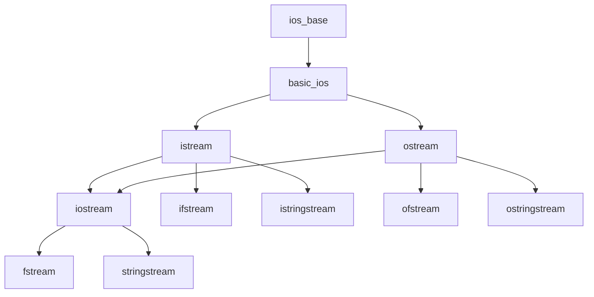

# Chapter 11 — The C++ I/O System

[Repository Guide](../../README.md) | [English](Concepts_Lecture.md) | [한국어](Concepts_Lecture.ko.md)

> **Last Updated:** 2026-11-19

> **Learning Objectives:**
> 1. Explain the concepts of streams and buffers, and distinguish the standard stream objects `cin`, `cout`, `cerr`, and `clog`
> 2. Write character-level I/O with the `ostream` functions `put()`, `write()`, `flush()` and the `istream` functions `get()`, `getline()`, `ignore()`, `peek()`, `gcount()`
> 3. Interpret the stream state bits and recover a stream that received invalid input
> 4. Specify output formats with format flags, `width()`, `fill()`, `precision()`, and manipulators
> 5. Write insertion and extraction operators for user-defined classes, and user-defined manipulators
> 6. Parse and build strings with string streams

---

## Table of Contents

- [1. Basics of C++ I/O](#1-basics-of-c-io)
  - [1.1 Streams](#11-streams)
  - [1.2 Buffers](#12-buffers)
  - [1.3 The I/O Class Hierarchy](#13-the-io-class-hierarchy)
  - [1.4 Standard Stream Objects](#14-standard-stream-objects)
  - [1.5 Synchronization with C Standard I/O](#15-synchronization-with-c-standard-io)
- [2. Character Output with ostream Member Functions](#2-character-output-with-ostream-member-functions)
  - [2.1 `put()`](#21-put)
  - [2.2 `write()`](#22-write)
  - [2.3 `flush()`](#23-flush)
  - [2.4 Chained Calls and Reference Returns](#24-chained-calls-and-reference-returns)
- [3. Character Input with istream Member Functions](#3-character-input-with-istream-member-functions)
  - [3.1 The `>>` Operator and Whitespace](#31-the--operator-and-whitespace)
  - [3.2 The Three Forms of `get()`](#32-the-three-forms-of-get)
  - [3.3 `getline()`](#33-getline)
  - [3.4 `ignore()`, `peek()`, `putback()`, `gcount()`](#34-ignore-peek-putback-gcount)
  - [3.5 Mixing `>>` with Line Input](#35-mixing--with-line-input)
- [4. Stream State](#4-stream-state)
  - [4.1 State Bits](#41-state-bits)
  - [4.2 Causes and Results of Input Failure](#42-causes-and-results-of-input-failure)
  - [4.3 `clear()` and Input Recovery](#43-clear-and-input-recovery)
  - [4.4 Streams as Loop Conditions](#44-streams-as-loop-conditions)
- [5. Formatted I/O](#5-formatted-io)
  - [5.1 Format Flags](#51-format-flags)
  - [5.2 `width()`, `fill()`, `precision()`](#52-width-fill-precision)
  - [5.3 Manipulators](#53-manipulators)
  - [5.4 Preserving the Format State](#54-preserving-the-format-state)
- [6. Insertion and Extraction Operators](#6-insertion-and-extraction-operators)
  - [6.1 Structure of the Standard Insertion Operators](#61-structure-of-the-standard-insertion-operators)
  - [6.2 User-Defined Insertion Operators](#62-user-defined-insertion-operators)
  - [6.3 User-Defined Extraction Operators](#63-user-defined-extraction-operators)
- [7. User-Defined Manipulators](#7-user-defined-manipulators)
  - [7.1 How Manipulators Work](#71-how-manipulators-work)
  - [7.2 Manipulators Without Parameters](#72-manipulators-without-parameters)
  - [7.3 Manipulators with Parameters](#73-manipulators-with-parameters)
  - [7.4 Input Manipulators](#74-input-manipulators)
- [8. String Streams](#8-string-streams)
  - [8.1 `istringstream`, `ostringstream`, `stringstream`](#81-istringstream-ostringstream-stringstream)
  - [8.2 Uses of String Streams](#82-uses-of-string-streams)
- [Concept Applications](#concept-applications)
- [Glossary](#glossary)
- [Summary](#summary)
- [Self-Check Questions](#self-check-questions)
- [References](#references)

---

<br>

## 1. Basics of C++ I/O

### 1.1 Streams

The I/O devices a program works with vary widely, from the keyboard and the screen to files on disk and network connections, and each device exchanges data in its own way. To hide these differences from the program, C++ treats all I/O through a single model called the **stream**. The program only puts bytes into a stream or takes bytes out of it; the stream object and the operating system handle which device the bytes actually come from or go to.

> **Definition:** A **stream** is a logical channel through which bytes flow in order between a program and an I/O device; in C++ it is represented by an object that controls that channel.

A stream has a direction. A stream that comes from a device into the program is an **input stream**, and a stream that goes from the program to a device is an **output stream**. An input stream lets the program take bytes only in the order they arrived, and an output stream delivers bytes to the device in the order they were put in. Because of this property, a stream cannot skip earlier bytes to read later bytes first; only devices whose position can be moved, such as files, provide separate positioning functions (Chapter 12).


*Figure 1. Input and output streams from the keyboard through the program to the screen*

Unlike C's `FILE *`, a C++ stream is an object, so it is used through operators and member functions. `cin >> n` takes one integer out of the input stream object `cin`, and `cout << n` puts one integer into the output stream object `cout`. Streams being objects gives two advantages. First, `<<` and `>>` are overloaded for each data type, so the type is determined automatically without format specifiers such as `printf`'s `%d`. Second, the same operators can be defined for user-made classes, so they can be read and written with the same syntax as built-in types (Section 6).

### 1.2 Buffers

If the program received each character as soon as it was typed on the keyboard, and sent each character to the screen device as soon as it was written to `cout`, it would communicate with devices far too often. Operating system I/O calls cost more than function calls, so a stream collects bytes in a temporary area of memory and processes them together.

> **Definition:** A **buffer** is a memory area where a stream temporarily collects the bytes it exchanges with a device.

On the input side, the buffer lets the user correct characters with `<Backspace>` while typing a line. Characters typed on the keyboard stay in the input buffer until `<Enter>` is pressed, and then the whole line including the newline character `'\n'` is delivered to the program. That is why `cin >> n` does not finish before `<Enter>` is pressed even after the number has been typed, and why typing several values at once, such as `10 20`, reads only the first value and leaves the rest in the buffer for the next input operation ([Chapter 2, Section 3.1](../Ch02_CPP-Programming-Basics/Concepts_Lecture.md#31-cin-and-)).

On the output side, sending the bytes accumulated in the buffer to the device is called a **flush**. The output buffer is flushed in the following cases.

| Case | Example |
|:-----|:-----|
| The buffer is full | When a large amount is output continuously |
| A flush is requested explicitly | `cout << endl`, `cout << flush`, `cout.flush()` |
| The stream has the `unitbuf` flag set | Flush after every output operation (the default for `cerr`) |
| Just before reading from a tied input stream | `cout` is flushed just before `cin >> n` (`tie` in Section 1.4) |
| The program terminates normally | `return` from `main`, a call to `exit()` |

*Table 1. Cases in which the output buffer is flushed*

`endl` outputs a newline character and then flushes the buffer, whereas `'\n'` outputs only the newline character ([Chapter 2, Section 2.2](../Ch02_CPP-Programming-Basics/Concepts_Lecture.md#22-endl-vs-n)). In a program that outputs many lines, using `endl` on every line communicates with the device on every line and slows the program down. Conversely, when a program ends without the normal termination procedure, as with `abort()`, output left in the buffer may be lost, so output that must appear, such as debugging messages, goes to `cerr`, whose flushing is guaranteed.

> **[Systems Programming]** In the system I/O covered in Systems Programming, the operating system identifies open files by file descriptors, and a program exchanges bytes through the `read` and `write` system calls. The buffers of the standard I/O library exist to reduce the number of these system calls; when standard output is a terminal, the system call is usually made per line, and when it is a file or a pipe, it is made when the buffer fills.

[Example_TieOrder.cpp](Example_TieOrder.cpp) shows how the output order changes with buffering. The program outputs one line each through `cout`, `cerr`, `cout`, `clog`, and `cout`, in that order.

```cpp
cout << "1 cout\n";
cerr << "2 cerr\n";      // cerr is tied to cout, so cout is flushed before writing
cout << "3 cout\n";
clog << "4 clog\n";      // clog is not tied, so "3 cout" may still be in cout's buffer
cout << "5 cout\n";
```

```text
$ ./tie_order                to the terminal      $ ./tie_order 2>&1 | cat     to a pipe
1 cout                                            1 cout
2 cerr                                            2 cerr
3 cout                                            4 clog
4 clog                                            3 cout
5 cout                                            5 cout
```

On a terminal, `cout` is delivered to the device line by line, so the five lines appear in the order of the code. When standard output is connected to a pipe, the bytes of `cout` collect until the buffer fills. By the standard, `clog` is a buffered stream, but in the default state synchronized with C standard I/O (Section 1.5) its output goes straight to the unbuffered C stream `stderr`, so `4 clog` appears before `3 cout`, which is still in the buffer of `cout`. On the other hand, `2 cerr` keeps its place even with the pipe, because `cerr` flushes `cout` before it outputs anything (Section 1.4). The order on the pipe side depends on the behavior of the buffers, so it may differ between implementations.

> **Note:** The run results in this chapter were obtained with Apple clang 21 and libc++ on macOS (arm64), compiled with `-std=c++17`. Parts that the standard leaves to the implementation (buffer sizes, some error messages) may differ with other compilers or standard libraries.

### 1.3 The I/O Class Hierarchy

All I/O classes of the C++ standard library are templates. They take the character type as a parameter so that `char` streams and `wchar_t` streams come from the same code, and the commonly used instantiations have short names. For example, `istream` is an alias for `basic_istream<char>`, and `wistream` is an alias for `basic_istream<wchar_t>`[1]. This chapter uses the short names.



*Figure 2. Inheritance hierarchy of the I/O stream classes (arrows point from base class to derived class)*

| Class | Responsibility |
|:-----|:-----|
| `ios_base` | State independent of the character type: format flags, field width, precision, constants for file modes and seek directions |
| `basic_ios` (`ios`) | Stream state bits, the associated stream buffer, the fill character, the tied stream |
| `istream` | Input: the `>>` operator, `get()`, `getline()`, `read()`, `ignore()`, `peek()` |
| `ostream` | Output: the `<<` operator, `put()`, `write()`, `flush()` |
| `iostream` | Inherits both `istream` and `ostream` to provide input and output together |
| `ifstream`, `ofstream`, `fstream` | Streams connected to files (Chapter 12) |
| `istringstream`, `ostringstream`, `stringstream` | Streams connected to a `string` (Section 8) |

*Table 2. The I/O classes and their responsibilities*

`iostream` inherits from both `istream` and `ostream`, and since both of these inherit from `basic_ios`, `basic_ios` would otherwise be included twice. The standard has `istream` and `ostream` inherit `basic_ios` as a virtual base class, so that an `iostream` object contains only one state and one buffer[1]. Therefore, reading and writing through a single `fstream` object share the same state bits and the same buffer.

Because the hierarchy is divided this way, a function that takes an `istream&` parameter accepts `cin`, a file stream, and a string stream alike. Upcasting ([Chapter 8](../Ch08_Inheritance/Concepts_Lecture.md)) applies to streams as it does to any class. The user-defined operators in Section 6 and the file I/O in Chapter 12 rely on this property.

| Header | What it declares |
|:-----|:-----|
| `<ios>` | `ios_base`, `basic_ios`, the format manipulators without parameters (`hex`, `fixed`, `left`, and so on) |
| `<istream>` | `istream`, `iostream`, the manipulator `ws` |
| `<ostream>` | `ostream`, the manipulators `endl`, `ends`, `flush` |
| `<iostream>` | The standard stream objects `cin`, `cout`, `cerr`, `clog` and their wide-character versions |
| `<iomanip>` | The manipulators with parameters (`setw`, `setfill`, `setprecision`, and so on) |
| `<fstream>` | The file stream classes |
| `<sstream>` | The string stream classes |

*Table 3. The I/O headers and what they declare*

`<iostream>` declares the standard stream objects and includes `<ios>`, `<istream>`, and `<ostream>`, so a program that does only console I/O needs only `<iostream>`. Manipulators with parentheses, such as `setw`, require including `<iomanip>` separately.

### 1.4 Standard Stream Objects

When a program starts, the four `char` stream objects declared in `<iostream>` already exist. These objects perform I/O through buffers associated with C's standard streams `stdin`, `stdout`, and `stderr`[1].

| Object | Class | Associated C stream | Buffering | Tied stream (`tie()`) |
|:-----|:-----|:-----|:-----|:-----|
| `cin` | `istream` | `stdin` | Buffered | `&cout` |
| `cout` | `ostream` | `stdout` | Buffered | None |
| `cerr` | `ostream` | `stderr` | Flushed after every output by `unitbuf` | `&cout` |
| `clog` | `ostream` | `stderr` | Buffered | None |

*Table 4. Associations and buffering of the standard stream objects*

**Tie.** If stream A is tied to output stream B, B is flushed just before any I/O on A. The standard specifies that `cin.tie()` returns `&cout`[1]. That is why, even when a prompt is printed without a newline, as in `cout << "Name: "; cin >> name;`, `cout` is flushed before `cin` reads and the prompt appears on the screen first. `cerr` is also tied to `cout` and has the `unitbuf` flag set[1], so whatever was written to `cout` earlier appears first and the error message appears immediately after. `clog` writes to the same device as `cerr` but uses a buffer, so it is used for diagnostic output that comes in large amounts, such as logs.

**Why standard error is used.** `cerr` and `clog` write to standard error, so even if only standard output is sent to a file in the shell, as in `./p > out.txt`, the error messages stay on the terminal. To keep error messages out of the result file, normal results go to `cout`, and error and diagnostic messages go to `cerr` or `clog`.

**Default state.** Every stream, including the standard stream objects, is initialized with the format flags `skipws | dec`, a field width of 0, a precision of 6, and a space as the fill character[1]. That is, it skips leading whitespace on input, treats integers as decimal, outputs floating-point numbers with 6 significant digits, and outputs only as many characters as needed unless a field width is given. The formatting features of Section 5 change this default state.

`wcin`, `wcout`, `wcerr`, and `wclog` are `wchar_t` streams with the same roles. Mixing a `char` stream and a `wchar_t` stream on the same C stream in one program may corrupt the output, so only one kind is used.

### 1.5 Synchronization with C Standard I/O

C++ programs can also use C standard I/O functions such as `printf` and `scanf`. By default, the C++ standard streams are **synchronized** with the C standard streams, so even when `printf` and `cout` are mixed, the output appears in the order of the code. This synchronization can be turned off with `ios_base::sync_with_stdio(false)`.

```cpp
int main() {
    ios_base::sync_with_stdio(false);   // turns off synchronization with C standard I/O (call before the first I/O)
    cin.tie(nullptr);                   // stops cin from flushing cout before each read
    // ... from here on, use only cin and cout
}
```

With synchronization off, the C++ streams use their own buffers, which makes large amounts of I/O faster; however, if `printf` and `cout` are mixed afterward, the two buffers are flushed separately and the order may become scrambled. `cin.tie(nullptr)` unties the streams and removes the flush that happens on every read. These two lines are settings for programs whose input and output run to hundreds of thousands of lines (for example, the judging environment of a coding test), and they are not used in interactive programs that exchange messages with a user, because prompts would appear late.

> **Caution:** `sync_with_stdio(false)` must be called before the program's first I/O. If it is called after I/O has already taken place, its effect is implementation-defined[1].

---

<br>

## 2. Character Output with ostream Member Functions

The `<<` operator is a **formatted output** function that converts a value to text before output. Given the integer 65, it outputs the characters `'6'` and `'5'`, and it is affected by the field width and the format flags. In contrast, the `ostream` member functions `put()` and `write()` are **unformatted output** functions that send the bytes they receive without conversion, and they ignore the field width and the format flags.

### 2.1 `put()`

```cpp
ostream& put(char ch);
```

`put()` puts one character into the output stream and returns a reference to the stream itself (`*this`). Because the parameter is a `char`, passing an integer outputs the character with that code value. For the same 65, `cout << 65` outputs the text `65`, and `cout.put(65)` outputs the character `A`.

```cpp
cout.put('C').put('+').put('+').put('\n');   // outputs C++ and a newline
cout << 65 << ' ';                           // converts the integer 65 to the text "65"
cout.put(65);                                // outputs the character 'A' with code value 65
```

### 2.2 `write()`

```cpp
ostream& write(const char* s, streamsize n);
```

`write()` outputs exactly `n` bytes starting at the address `s`. It does not stop at a null character and does not look for the end of a string. It is therefore used to output part of a string, or data that contains zero bytes in the middle, such as the binary data covered in Chapter 12. `streamsize` is the signed integer type that represents byte counts in I/O.

```cpp
const char* msg = "Hello, stream world";
cout.write(msg, 5);                          // outputs only the first 5 bytes, "Hello"
cout.write(msg, strlen(msg)).put('\n');      // outputs the whole string
```

> **Caution:** In `write(msg, n)`, if `n` is larger than the actual data, the memory after the string is read and output as well, which is undefined behavior. To output the whole string, pass its actual length, such as `strlen(msg)`.

### 2.3 `flush()`

```cpp
ostream& flush();
```

`flush()` immediately sends the bytes accumulated in the output buffer to the device. It does the same as the manipulator `flush` (`cout << flush`). It is used when output must reach the screen without a newline, for example when progress is printed on one line and an intermediate result must be shown right away.

[Example_CharOutput.cpp](Example_CharOutput.cpp) uses all three functions. Its output is as follows.

```text
C++
Hello
Hello, stream world
65 A
before flush, after flush
```

### 2.4 Chained Calls and Reference Returns

`cout.put('C').put('+')` works because `put()` returns a reference to `cout` itself after the output. The expression is evaluated from the left as follows.

1. `cout.put('C')` puts `'C'` into the buffer of `cout` and returns a reference to `cout`.
2. The returned reference is `cout` itself, so `.put('+')` again calls a member function of `cout`.
3. Up to the last `put('\n')`, characters are put into the same object in turn.

If `put()` returned an `ostream` by value instead of a reference, the second `put()` would have to apply to the returned copy rather than to `cout`. However, a stream object owns a buffer and a connection to a device, so copying is prohibited. Since C++11 the copy constructor of `basic_ostream` is deleted with `= delete`[1], so such a function does not compile. This is also why a user who defines a `<<` operator writes `ostream&` as the parameter type and the return type (Section 6.2, [Chapter 7, Section 5](../Ch07_Friend-Functions-and-Operator-Overloads/Concepts_Lecture.md#5-stream-operator-overloading)).

| Kind | Function | Format flags and field width | Main use |
|:-----|:-----|:-----|:-----|
| Formatted output | `operator<<` | Applied | Output a value as human-readable text |
| Unformatted output | `put()` | Ignored | Output one character as it is |
| Unformatted output | `write()` | Ignored | Output a block of bytes as it is |

*Table 5. Formatted and unformatted output*

---

<br>

## 3. Character Input with istream Member Functions

### 3.1 The `>>` Operator and Whitespace

The `>>` operator is a formatted input function. In the default state it skips leading **whitespace characters** (space `' '`, tab `'\t'`, newline `'\n'`, vertical tab `'\v'`, form feed `'\f'`, carriage return `'\r'`) before reading, and it stops at a character that cannot be interpreted as the target data type. This behavior comes from the format flag `skipws` being set.

Whitespace is skipped even when reading into a `char` variable, so `>>` alone cannot read the whitespace in the input. When the input is `A B`, running `in >> c` twice reads `'A'` and `'B'`, and the space between them is discarded. If `skipws` is turned off with the manipulator `noskipws`, whitespace is also read as a character and the second value becomes `' '`.

| Input `A B` | First `in >> c` | Second `in >> c` |
|:-----|:-----|:-----|
| Default state (`skipws`) | `'A'` | `'B'` (the space is skipped) |
| After `in >> noskipws` | `'A'` | `' '` |

*Table 6. `char` input depending on the `skipws` setting*

To read every character including whitespace, using the unformatted input function `get()` states the intent more clearly than turning on `noskipws`.

### 3.2 The Three Forms of `get()`

`istream` provides functions with the same name `get()` in three overloaded forms. All three are unformatted input functions, so none of them skips whitespace.

| Form | Returns | Behavior |
|:-----|:-----|:-----|
| `int get()` | The code value of the character read, or `EOF` at the end | Takes one character |
| `istream& get(char& ch)` | The stream itself | Takes one character and stores it in `ch`; on failure, `ch` is unchanged |
| `istream& get(char* s, streamsize n, char delim = '\n')` | The stream itself | Stores at most `n - 1` characters in `s` and appends `'\0'`. It stops before the delimiter `delim` and leaves `delim` in the stream |

*Table 7. The three forms of `get()`*

**The return type of `int get()`.** The first form returns `int` rather than `char` so that the end-of-input value `EOF` (usually -1) can be distinguished from every character value. If the value read is stored in a `char` variable and then compared with `EOF`, on an environment where `char` is signed the byte `0xFF` becomes -1 and input ends early, and on an environment where `char` is unsigned the variable can never equal `EOF` and the loop never ends. The result must therefore be received in an `int` variable.

```cpp
int ch;
while ((ch = cin.get()) != EOF)   // ch must be an int to tell EOF from a character
    cout.put(ch);
```

**The advantage of `get(char& ch)`.** The second form returns the stream, so it can be used directly as a loop condition. `while (cin.get(c))` repeats while characters are read successfully and ends when `cin` enters a failure state at the end of input (Section 4.4).

**Tracing `get(char* s, n)`.** The third form reads part of a line into an array. Repeating `get(buf, 6)` with `char buf[6]` on the input `"Hello World\nSecond line\n"` gives the following.

| Call | Stored string | Characters taken | Start of what remains in the stream | State |
|:-----|:-----|:-----|:-----|:-----|
| 1st `get(buf, 6)` | `"Hello"` | 5 | `" World\nSecond..."` | Normal |
| 2nd `get(buf, 6)` | `" Worl"` | 5 | `"d\nSecond..."` | Normal |
| 3rd `get(buf, 6)` | `"d"` | 1 | `"\nSecond..."` | Normal |
| 4th `get(buf, 6)` | `""` | 0 | `"\nSecond..."` | `failbit` |

*Table 8. Results of repeating `get(buf, 6)`*

The third call stops before the delimiter `'\n'` and leaves `'\n'` in the stream. So the fourth call meets the delimiter at its first character, stores nothing, and, as the standard specifies, sets `failbit`[1]. Unless the remaining `'\n'` is taken out explicitly, every later `get(buf, n)` keeps failing. This is how it differs from `getline()` in the next section.

### 3.3 `getline()`

```cpp
istream& getline(char* s, streamsize n, char delim = '\n');
```

The member function `getline()` stores at most `n - 1` characters and appends `'\0'`, like `get(char* s, n, delim)`, but when it meets the delimiter, it **takes it out and discards it**. Lines can therefore be read one after another. However, if it has stored `n - 1` characters and the next character is not the delimiter, the line is longer than the array, and it sets `failbit`[1]. If the line has exactly `n - 1` characters, it takes out the delimiter that follows and ends normally.

Reading the input `"abc\ndef"` (no newline on the last line) repeatedly into `char buf[10]` with `getline(buf, 10)` gives the following. `gcount()` is the number of characters taken by the last unformatted input function, and it counts the discarded delimiter too.

| Call | Stored string | `gcount()` | `eof()` | `fail()` |
|:-----|:-----|:-----|:-----|:-----|
| 1st | `"abc"` | 4 (including `'\n'`) | 0 | 0 |
| 2nd | `"def"` | 3 | 1 | 0 |
| 3rd | `""` | 0 | 1 | 1 |

*Table 9. Results and states of `getline(buf, 10)`*

The second call stops at the end of input instead of a delimiter, so `eofbit` is set, but it stored characters, so it is not a failure. The third call stores nothing, so `failbit` is set as well. If a line longer than the array, such as `"Hello World"`, is read into `char buf[6]`, only `"Hello"` is stored and `failbit` is set; in that case the next line cannot be read without calling `clear()` from Section 4.3.

A line of unknown length is read into a `string` instead of an array. The **global function** `getline(istream& in, string& str, char delim = '\n')` in `<string>` stores everything before the delimiter into `str` with no length limit and discards the delimiter. If it takes no character at all, that is, if input has already ended, it sets `failbit`. Despite the shared name, the member function (`cin.getline(buf, n)`) and the global function (`getline(cin, str)`) are different functions.

> **Key Point:** `get(buf, n)` leaves the delimiter in the stream, while `getline(buf, n)` and `getline(in, str)` take it out and discard it. The two member functions that use arrays store at most `n - 1` characters, and the global function that uses a `string` has no length limit.

### 3.4 `ignore()`, `peek()`, `putback()`, `gcount()`

| Function | Behavior |
|:-----|:-----|
| `ignore(n = 1, delim = EOF)` | Takes and discards at most `n` characters, stopping right after it takes `delim` |
| `peek()` | Returns the code value of the next character without taking it, or `EOF` at the end |
| `putback(c)` | Returns the last character taken, `c`, to the stream |
| `unget()` | Returns the last character taken to the stream (without naming the character) |
| `gcount()` | Returns the number of characters taken by the last unformatted input function |

*Table 10. `istream` member functions that work with the input position*

`peek()` is used to choose how to read depending on the next character. For example, if the next character is a digit, an integer is read with `>>`, and if it is `'#'`, the whole line is discarded as a comment (Section 7.4). `putback()` and `unget()` are used to return a character after looking ahead. Returning succeeds only as far as the stream buffer allows, so they are used to return a single character right after it was taken.

The value of `gcount()` is changed by **unformatted** input functions (`get`, `getline`, `read`, `ignore`, `peek`, and so on), not by `>>`. `peek()` is also an unformatted input function, so calling it sets `gcount()` to 0. When the number of characters taken is needed, `gcount()` must be read right after calling that input function.

[Example_CharInput.cpp](Example_CharInput.cpp) reads three lines of input in different ways.

```cpp
int ch;
int count = 0;
while ((ch = cin.get()) != '\n' && ch != EOF) {   // reads every character, spaces included
    cout.put(ch);
    count++;
}
cout << " (" << count << " characters)" << endl;

int year;
cin >> year;                         // stops at the space after 2024
string word;
cin >> word;                         // skips the space, reads "fall", stops at '\n'
cout << "year=" << year << ", word=" << word << endl;
cout << "next code: " << cin.peek() << endl;      // the '\n' (10) is still in the stream

cin.ignore(100, '\n');               // discards characters up to and including '\n'
char name[20];
cin.getline(name, 20);               // reads "Kim Minsu" and discards the '\n'
cout << "name=" << name << ", gcount=" << cin.gcount() << endl;
```

```text
$ printf 'C++ IO\n2024 fall\nKim Minsu\n' | ./char_input
C++ IO (6 characters)
year=2024, word=fall
next code: 10
name=Kim Minsu, gcount=10
```

The flow of the code, line by line, is as follows.

- The first loop reads characters with `get()` until `'\n'` appears. It also reads the space in `C++ IO` as a character, so it counts 6. The `'\n'` is taken but not printed.
- `cin >> year` reads `2024` on the second line as an integer and stops before the following space. `cin >> word` skips that space, reads `fall`, and stops before `'\n'`.
- `cin.peek()` returns 10, the code value of the remaining `'\n'`, without taking it.
- `cin.ignore(100, '\n')` takes and discards that `'\n'`. Without this line, the following `getline()` reads an empty line (Section 3.5).
- `cin.getline(name, 20)` takes the 9 characters of `Kim Minsu` and the `'\n'`, so `gcount()` is 10.

### 3.5 Mixing `>>` with Line Input

`>>` leaves the newline character after a value in the stream, so a `getline()` called right after it meets the remaining newline and reads an empty string. This behavior and the solution with `cin.ignore()` are in [Chapter 2, Section 3.2](../Ch02_CPP-Programming-Basics/Concepts_Lecture.md#32-getline). This section compares the solutions.

| Method | Input `"42\nKim\n"` | Input `"42   \nKim\n"` (spaces after the number) |
|:-----|:-----|:-----|
| `cin.ignore()` | Discards one `'\n'`, succeeds | Discards only one space, the name becomes `"  "` |
| `cin.ignore(numeric_limits<streamsize>::max(), '\n')` | Discards the rest of the line, succeeds | Discards the rest of the line, succeeds |
| `getline(cin >> ws, name)` | Skips all whitespace, succeeds | Skips all whitespace, succeeds |

*Table 11. Three ways to read a line after `>>`*

`ws` is an input manipulator that takes and discards all leading whitespace (Section 5.3). `cin >> ws` returns `cin`, so it can be written in one expression as `getline(cin >> ws, name)`. However, `ws` also skips empty lines, so where an empty line is meaningful input (for example, when an empty name is allowed), `ignore(max, '\n')` is used.

---

<br>

## 4. Stream State

### 4.1 State Bits

I/O operations can fail. The input may be `abc` when an integer is expected, the end of a file may be reached, or a disk error may occur. C's `scanf` reports failure through its return value, whereas a C++ stream records the result in **state bits** inside the object, and the operators return the stream itself. The state bits have the type `ios_base::iostate` and consist of the following three bits and `goodbit`, the value with all three cleared[1].

| Bit | Set when | Test function |
|:-----|:-----|:-----|
| `eofbit` | An input operation reached the end of input | `eof()` |
| `failbit` | An input operation failed to read the expected characters, or an output operation failed to generate the desired characters | `fail()` (true if `failbit` or `badbit`) |
| `badbit` | The stream lost its integrity (an irrecoverable read error and the like) | `bad()` |
| `goodbit` (value 0) | All three bits are cleared | `good()` |

*Table 12. The state bits of a stream*

> **Definition:** The **stream state** is a value that records, as a combination of `eofbit`, `failbit`, and `badbit`, whether the I/O operations of a stream reached the end of input, failed, or damaged the stream; while a failure bit is set, the I/O operations of that stream do nothing.

`fail()` is true not only when `failbit` is set but also when `badbit` is set. When a stream object is used in a condition, `explicit operator bool()` returns `!fail()`, so `if (cin)` means "nothing has failed up to the last operation." `rdstate()` returns all three bits at once.

| State | `good()` | `eof()` | `fail()` | `bad()` | `bool(in)` |
|:-----|:-----|:-----|:-----|:-----|:-----|
| Normal | 1 | 0 | 0 | 0 | 1 |
| Reached the end while reading the last value (`eofbit`) | 0 | 1 | 0 | 0 | 1 |
| Format did not match (`failbit`) | 0 | 0 | 1 | 0 | 0 |
| Tried to read past the end (`eofbit`, `failbit`) | 0 | 1 | 1 | 0 | 0 |
| Device error (`badbit`) | 0 | 0 | 1 | 1 | 0 |

*Table 13. Values of the test functions for each combination of states*

The second row matters. When an integer is read from the input `"12"`, the stream reaches the end while checking whether more digits follow, so `eofbit` is set; but the value 12 was read correctly, so `fail()` is false. When the same value is read from an input with a trailing space, such as `"12 "`, the read stops at the space and `eofbit` is not set either. Therefore `eof()` alone cannot tell whether the last read succeeded. Even in this state, where only `eofbit` is set, the next input operation cannot start reading and sets `failbit`.

### 4.2 Causes and Results of Input Failure

When an integer is read into `int n` with `>>`, the result depends on the input as follows. The values in the table were obtained by initializing `n` to 7 and reading from an `istringstream` (Section 8).

| Input | `n` after the read | `fail()` | `eof()` | Explanation |
|:-----|:-----|:-----|:-----|:-----|
| `"12"` | 12 | 0 | 1 | Success, reached the end after the digits |
| `"12 "` | 12 | 0 | 0 | Success, stopped before the space |
| `"3.7"` | 3 | 0 | 0 | Only `3` is an integer, so `.7` remains |
| `"abc"` | 0 | 1 | 0 | No digits, 0 is stored |
| `"99999999999"` | 2147483647 | 1 | 1 | Out of `int` range, the maximum is stored |
| `""` | 7 (unchanged) | 1 | 1 | No characters to read, the conversion cannot start |

*Table 14. Results of integer input (on an environment where `int` is 32 bits)*

Since C++11, the standard specifies that 0 is stored for input that cannot be converted, that the maximum or minimum of the type is stored for out-of-range input, and that `failbit` is set in both cases[1]. When the input is empty, the end is reached before any digit is found, so the variable is not changed. Note that `"3.7"` is not a failure: `>>` reads `3`, the longest leading part that can be interpreted as an integer, and stops, and the remaining `.7` is met by the next input operation.

> **Caution:** On a stream with a failure bit set, every later input operation fails immediately. If, after one invalid input, all later `cin >> n` seem to be skipped, either the state was not cleared (Section 4.3) or the invalid characters are still in the stream.

### 4.3 `clear()` and Input Recovery

`clear(state = goodbit)` changes the state bits to the given value, and `setstate(bit)` adds a bit to the existing state. Recovering from invalid input takes two steps.

1. Reset the state to `goodbit` with `clear()`. In a failure state even `ignore()` does nothing, so this step comes first.
2. Take out and discard the characters that caused the failure with `ignore()`. Without this step, the next `>>` meets the same characters again and fails again.

[Example_StreamState.cpp](Example_StreamState.cpp) shows this process with the input `abc 17 x 25`.

```cpp
int n = -1;
cin >> n;                            // "abc" is not an integer
cout << "after reading abc: n=" << n << endl;
showState(cin);

cin >> n;                            // fails at once because failbit is still set
cout << "second attempt without clear: n=" << n << endl;

cin.clear();                         // resets the state to goodbit
cin.ignore(numeric_limits<streamsize>::max(), ' ');   // drops "abc "
cin >> n;
cout << "after clear and ignore: n=" << n << endl;
showState(cin);

int sum = 0, value;
while (true) {                       // reads the rest, skipping bad tokens
    if (cin >> value) {
        sum += value;
    } else if (cin.eof()) {
        break;
    } else {
        cin.clear();
        cin.ignore(numeric_limits<streamsize>::max(), ' ');
    }
}
```

```text
$ printf 'abc 17 x 25' | ./stream_state
after reading abc: n=0
  good=0 eof=0 fail=1 bad=0
second attempt without clear: n=0
after clear and ignore: n=17
  good=1 eof=0 fail=0 bad=0
sum of the remaining integers: 25
  good=0 eof=1 fail=1 bad=0
```

The first read fails at `abc` and stores 0 in `n`. The second read fails without even looking at the input, because the state was not cleared, and `n` stays 0. After the state is cleared and `"abc "` is discarded, 17 is read correctly. The last loop clears the state and discards the token when it fails at `x`, then adds 25, and when it fails at the end of input, `eof()` is true and the loop ends. `showState` is a function that prints the state bits.

> **Caution:** If, when `cin >> value` fails in a loop, only `clear()` is called and `ignore()` is left out, the next iteration meets the same character `x`, fails again, and the loop never ends.

### 4.4 Streams as Loop Conditions

`>>`, `get(char&)`, and `getline()` return the stream itself, so they can be used directly as loop conditions.

```cpp
int x, sum = 0;
while (cin >> x)          // repeats while reads succeed
    sum += x;
```

This condition puts the order "attempt a read, and run the body if the attempt succeeded" into one expression. The end of keyboard input is signaled at the start of a line with `Ctrl+D` on macOS and Linux, and with `Ctrl+Z` followed by `<Enter>` on Windows. The loop ends not only at the end of input but also at a character that is not an integer, so after it ends, `eof()` and `bad()` can tell the causes apart. Using `eof()` as the loop condition causes the error of processing the last value twice; this error is common with file input, so it is traced in [Chapter 12, Section 7](../Ch12_CPP-File-IO/Concepts_Lecture.md#7-checking-the-stream-state). How to read to the end of input in coding tests is in [Chapter 10, Section 9.1](../Ch10_Templates-and-STL/Concepts_Lecture.md#91-reading-input-until-eof).

---

<br>

## 5. Formatted I/O

### 5.1 Format Flags

A stream remembers formats, such as the base in which to output integers and the notation in which to output floating-point numbers, as **format flags** of `ios_base`.

> **Definition:** A **format flag** is a bit of type `ios_base::fmtflags` that represents an I/O format of a stream; a flag that is set applies to every operation on that stream until it is cleared.

| Flag | Effect when set |
|:-----|:-----|
| `boolalpha` | Reads and writes `bool` as the words `true` and `false` |
| `dec`, `oct`, `hex` | Reads and writes integers in decimal, octal, hexadecimal |
| `fixed` | Writes floating-point numbers in fixed-point notation |
| `scientific` | Writes floating-point numbers in scientific notation |
| `left`, `right`, `internal` | Puts the fill characters to the right, to the left, or after the sign or base prefix when the field width leaves room |
| `showbase` | Puts a base prefix (`0`, `0x`) before integers |
| `showpoint` | Always writes the decimal point and trailing zeros of floating-point numbers |
| `showpos` | Puts `+` before zero and positive numbers |
| `skipws` | Skips whitespace before formatted input |
| `unitbuf` | Flushes after every output operation |
| `uppercase` | Writes hexadecimal `a`-`f`, the prefix `x`, and the exponent `e` in uppercase |

*Table 15. Format flags and their effects*

Flags of the same group, among which only one is meaningful at a time, are handled together through group constants[1]. `basefield` is `dec | oct | hex`, `adjustfield` is `left | right | internal`, and `floatfield` is `scientific | fixed`.

| Member function | Behavior |
|:-----|:-----|
| `flags()` | Returns all current flags |
| `flags(f)` | Replaces all flags with `f` and returns the previous value |
| `setf(f)` | Sets the flags `f` (keeping the others) and returns the previous value |
| `setf(f, mask)` | Clears all flags in `mask`, then sets `f`, and returns the previous value |
| `unsetf(mask)` | Clears the flags in `mask` |

*Table 16. Member functions that work with format flags*

The one-argument `setf(f)` only adds flags. So if only `cout.setf(ios::hex)` is called, `dec`, which was set by default, remains, `basefield` has both `dec` and `hex` set, and integers are then output in decimal. Flags of which exactly one is chosen, such as the base, must be changed with the two-argument `setf(ios::hex, ios::basefield)`.

```cpp
cout << 255 << ' ';                          // 255
cout.setf(ios::hex, ios::basefield);         // replaces dec with hex inside basefield
cout << 255 << ' ';                          // ff
cout.setf(ios::showbase | ios::uppercase);   // adds two flags
cout << 255 << endl;                         // 0XFF
```

> **Caution:** `cout.setf(ios::hex)` alone does not produce hexadecimal output. If `dec` is also set, integers are output in decimal, so the base, alignment, and floating-point notation are changed with `setf(f, mask)`, giving the group constant as the second argument.

### 5.2 `width()`, `fill()`, `precision()`

**Field width.** `width(n)` makes the next formatted output occupy at least `n` positions. If the value is shorter than `n` positions, the remaining positions are filled with the fill character; if it is longer, it is output in full without being cut. The field width applies **only to the next single output**, and it returns to 0 after that output[1].

```cpp
cout.width(8);
cout << 42 << '|' << 42 << '|' << endl;      // "      42|42|"
```

The first 42 is output right-aligned in 8 positions, and because the field width has returned to 0, the second 42 occupies only 2 positions. Outputting `12345` after `width(2)` outputs all five digits.

**Fill character.** `fill(c)` changes the character that fills the remaining positions to `c` and returns the previous character. Unlike the field width, the fill character stays until it is changed.

```cpp
cout.fill('.');
cout.setf(ios::left, ios::adjustfield);
cout.width(8);
cout << "Kim" << '|' << endl;                // "Kim.....|"
```

**Precision.** `precision(n)` sets the number of digits used to output floating-point numbers. The default is 6, and its meaning depends on the `floatfield` setting.

| `floatfield` setting | Meaning of precision | `3.14159265358979` | `1234567.0` |
|:-----|:-----|:-----|:-----|
| None (general notation), precision 6 | Maximum number of significant digits | `3.14159` | `1.23457e+06` |
| None (general notation), precision 3 | Maximum number of significant digits | `3.14` | `1.23e+06` |
| `fixed`, precision 3 | Digits after the decimal point | `3.142` | `1234567.000` |
| `scientific`, precision 3 | Digits after the decimal point (scientific notation) | `3.142e+00` | `1.235e+06` |

*Table 17. Floating-point output by `floatfield` and precision*

General notation behaves like C's `%g`. With precision 6, `1234567.0` cannot be expressed in 6 significant digits, so it changes to the scientific notation `1.23457e+06`, and trailing zeros are not output (`100.0` is output as `100`). With `showpoint` set, the decimal point and trailing zeros appear even in general notation, and `100.0` becomes `100.000`. In `fixed` and `scientific`, the precision is the number of digits after the decimal point, so output whose digits must line up, such as amounts of money, sets the precision together with `fixed`.

> **Caution:** Rounding happens on the binary value stored in memory. `2.675` cannot be represented exactly in binary and is stored as 2.67499999..., so output with `fixed` and precision 2 gives `2.67`, not `2.68`. When exact decimal rounding is needed, compute in integer units (for example, won or cents).

[Example_FormatFlags.cpp](Example_FormatFlags.cpp) uses all the functions of this section, and its output is as follows. The last two lines are explained in Section 5.4.

```text
255 ff 0XFF
      42|42|
Kim.....|
3.14159 1.23457e+06
3.14 1.23e+06
3.142 1234567.000
3.142e+00 1.235e+06
+2.5000 +10
2.5 10
```

### 5.3 Manipulators

Changing the format with member functions requires breaking the output statement, but manipulators change the format inside a chain of `<<`.

> **Definition:** A **manipulator** is a function or object used as an operand of `<<` or `>>` that changes the format or state of a stream instead of reading or writing data.

Manipulators without parameters are declared in `<ios>`, `<istream>`, and `<ostream>`, and manipulators with parameters are declared in `<iomanip>`.

| Manipulator | Effect | Header |
|:-----|:-----|:-----|
| `endl` | Outputs `'\n'` and flushes | `<ostream>` |
| `ends` | Outputs the null character `'\0'` | `<ostream>` |
| `flush` | Flushes | `<ostream>` |
| `ws` | Takes and discards all leading whitespace (input) | `<istream>` |
| `dec`, `oct`, `hex` | Changes the base of integers (`basefield`) | `<ios>` |
| `fixed`, `scientific` | Changes the floating-point notation (`floatfield`) | `<ios>` |
| `defaultfloat` (C++11) | Clears `floatfield` to return to general notation | `<ios>` |
| `left`, `right`, `internal` | Changes the alignment (`adjustfield`) | `<ios>` |
| `showbase`, `noshowbase` | Turns the base prefix on, off | `<ios>` |
| `showpoint`, `noshowpoint` | Turns the decimal-point display on, off | `<ios>` |
| `showpos`, `noshowpos` | Turns the `+` sign on, off | `<ios>` |
| `uppercase`, `nouppercase` | Turns uppercase output on, off | `<ios>` |
| `boolalpha`, `noboolalpha` | Turns word I/O of `bool` on, off | `<ios>` |
| `skipws`, `noskipws` | Turns whitespace skipping on, off | `<ios>` |
| `unitbuf`, `nounitbuf` | Turns flushing after every output on, off | `<ios>` |
| `setw(n)` | Sets the field width of the next output to `n` | `<iomanip>` |
| `setfill(c)` | Sets the fill character to `c` | `<iomanip>` |
| `setprecision(n)` | Sets the precision to `n` | `<iomanip>` |
| `setbase(b)` | Sets the base to `b` (8, 10, 16) | `<iomanip>` |
| `setiosflags(f)`, `resetiosflags(f)` | Sets, clears the flags `f` | `<iomanip>` |

*Table 18. Standard manipulators*

Every manipulator that changes the format, except `setw`, keeps its effect until it is changed again. `setw` is the same as `width()`, so it applies only to the next output, and `endl`, `ends`, `flush`, and `ws` do not change the format but act once at that point. Manipulators such as `oct`, `hex`, `fixed`, and `left` do the same as `setf(f, mask)` with the corresponding group constant as the mask, so the `setf(ios::hex)` problem of Section 5.1 does not arise.

[Example_Manipulators.cpp](Example_Manipulators.cpp) outputs a receipt table with manipulators.

```cpp
cout << left << setw(10) << "Item" << right << setw(5) << "Qty"
     << setw(10) << "Price" << setw(10) << "Total" << '\n';
cout << setfill('-') << setw(35) << "" << setfill(' ') << '\n';

cout << fixed << setprecision(2);            // these two settings stay until changed
double sum = 0;
for (const Item& it : items) {
    double total = it.quantity * it.price;
    sum += total;
    cout << left << setw(10) << it.name << right << setw(5) << it.quantity
         << setw(10) << it.price << setw(10) << total << '\n';
}
cout << left << setw(25) << "Sum" << right << setw(10) << sum << '\n';
```

```text
Item        Qty     Price     Total
-----------------------------------
Notebook      3      1.50      4.50
Pen          12      0.75      9.00
Backpack      1     24.99     24.99
Sum                           38.49
0xff 0377 255
false 0
[-    42] [-42    ]
```

The columns are 10, 5, 10, and 10 positions wide, so a line is 35 positions. The separator line is made by outputting the empty string `""` with width 35 and fill character `'-'`. Working through the `Notebook` row: the name `Notebook` (8 characters) fills 10 positions left-aligned, so 2 spaces follow it, and the quantity `3` is right-aligned in 5 positions, so 4 spaces precede it. The price 1.5 becomes `1.50` (4 characters) because of `fixed` and precision 2, so 6 spaces precede it, and the total 3 × 1.5 = 4.5 becomes `4.50`. The `sum` of the three totals 4.5, 9.0, and 24.99 is stored as 38.489999999999995 because of binary error, but rounded to two decimal places it is `38.49`. The `Sum` row merges the first three columns (10 + 5 + 10 = 25 positions) into one and outputs it with `setw(25)`. The last three lines are the results of the base prefix, `boolalpha`, and `internal` alignment. `internal` puts the sign `-` at the left end and fills after it.

> **Key Point:** When outputting a table, write `setw` again before every cell, and restore settings that stay, such as `fixed`, `setprecision`, `setfill`, and alignment, where needed after changing them.

### 5.4 Preserving the Format State

Format flags, the fill character, and the precision stay until changed, so if a function changes the format of `cout` and does not restore it, the output of the code that called the function changes too. For example, if a function that outputs amounts of money sets `fixed` and precision 2 and returns, every floating-point number output afterward comes out with two decimal places. A function that changes the format saves the current state at the start and restores it at the end.

```cpp
ios::fmtflags saved = cout.flags();          // saves every format flag
streamsize savedPrecision = cout.precision();
cout.setf(ios::showpos | ios::showpoint);
cout.precision(5);
cout << 2.5 << ' ' << 10 << endl;            // "+2.5000 +10"
cout.flags(saved);                           // restores the flags
cout.precision(savedPrecision);
cout << 2.5 << ' ' << 10 << endl;            // "2.5 10"
```

Because of `showpoint` and precision 5, 2.5 is output as `2.5000` with five significant digits, and because of `showpos`, the integer 10 is output as `+10`. After the state is restored, the default format returns. If the fill character was also changed, it is saved together through the return value of `fill()`. A class that saves the state in its constructor and restores it in its destructor restores the format even when the function is left in the middle by `return` or an exception. This technique is the same idea as RAII in Chapter 13.

C++20's `std::format` does not remember the format as stream state but specifies it with a format string on every call, so this problem does not arise ([Chapter 2, Section 2](../Ch02_CPP-Programming-Basics/Concepts_Lecture.md#2-console-output)). The formatting features of streams are still used in pre-C++20 code and in user-defined `<<` operators.

---

<br>

## 6. Insertion and Extraction Operators

`<<` is called the **insertion operator**, and `>>` the **extraction operator**, because they put data into an output stream and take data out of an input stream.

### 6.1 Structure of the Standard Insertion Operators

`cout << 3` calls the `ostream` member function `cout.operator<<(3)`. `ostream` overloads the member function `operator<<` for each arithmetic type and pointer type, such as `bool`, `short`, `int`, `long`, `double`, and `void*`. Characters and strings are defined not as members but as the global functions `operator<<(ostream&, char)` and `operator<<(ostream&, const char*)`. Either way the return type is `ostream&`, so `cout << a << b` is evaluated as `(cout << a) << b`.

| Expression | Function called | Output |
|:-----|:-----|:-----|
| `cout << 65` | `cout.operator<<(int)` | `65` |
| `cout << 'A'` | `operator<<(ostream&, char)` | `A` |
| `cout << "Hi"` | `operator<<(ostream&, const char*)` | `Hi` |
| `cout << static_cast<int>('A')` | `cout.operator<<(int)` | `65` |
| `cout << int8_t(65)` | `operator<<(ostream&, signed char)` | `A` |

*Table 19. Insertion operators selected by operand type*

On most environments `int8_t` and `uint8_t` are aliases for `signed char` and `unsigned char`, so they are output as characters rather than numbers. To output a small integer as a number, convert it to `int` with `static_cast<int>(x)` or the unary `+x`.

### 6.2 User-Defined Insertion Operators

The `<<` of a user-defined class has an `ostream` as its left operand, so it cannot be a member function of the class; it is defined as a global function and declared as a `friend` when needed. How to write it and why it cannot be a member function are in [Chapter 7, Section 5](../Ch07_Friend-Functions-and-Operator-Overloads/Concepts_Lecture.md#5-stream-operator-overloading). This section covers the formatting points that Chapter 7 does not cover.

```cpp
ostream& operator<<(ostream& out, const Point& p) {
    out << '(' << p.x << ", " << p.y << ')';
    return out;                                  // returning the stream allows chaining
}
```

- **Write to `out`, not to `cout`.** The parameter `out` may be `cout`, a file stream, or a string stream. If the function writes to `cout`, `fout << p` outputs to the screen instead of the file.
- **Do not put `endl` inside.** The caller decides whether a newline follows. It must be possible to output several objects on one line, as in `cout << p << ", " << q`.
- **The field width applies only to the first output.** In `cout << setw(10) << p`, the width 10 applies only to `'('`, the first output inside the function, and `"         (3, 4)"` is output. To fit the whole object into 10 positions, write to an `ostringstream` (Section 8) inside the function first and output that string at once, as in `out << s.str()`. The width 10, still unused, then applies to the whole string, giving `"    (3, 4)"`. Converting to a string on the caller's side before output also works.

### 6.3 User-Defined Extraction Operators

`>>` interprets text typed by a user, so it needs more care than `<<`. When the input format is wrong, the stream must enter a failure state so that the caller can detect the failure the same way as with standard types, as in `while (in >> p)`. [Example_PointIO.cpp](Example_PointIO.cpp) reads a point in the form `(x, y)`.

```cpp
istream& operator>>(istream& in, Point& p) {
    char open, comma, close;
    int x, y;
    if (in >> open >> x >> comma >> y >> close) {   // >> skips spaces before each part
        if (open == '(' && comma == ',' && close == ')') {
            p = Point(x, y);                     // changes p only after a complete read
            return in;
        }
        in.setstate(ios::failbit);               // the shape is wrong: report failure
    }
    return in;
}
```

- `in >> open >> x >> comma >> y >> close` reads each part in turn. The parentheses and the comma read as `char` are also read with `>>`, so leading spaces are skipped and input with spaces mixed in, such as `( 10 ,20 )`, is accepted.
- If any of the five parts cannot be read, the stream is already in a failure state at that point, so the `if` condition is false and `in` is returned as it is.
- If all five parts are read but a parenthesis or the comma is a different character, `setstate(ios::failbit)` reports the failure explicitly.
- The parts are read into local variables first and assigned to `p` only after success. Even if a failure occurs midway, `p` keeps its previous value.

```text
a = (3, 4)
read (1, 2)
read (10, 20)
fail=1, last good value (10, 20)
```

From the input `"(1, 2) ( 10 ,20 ) [5, 6] (7, 8)"`, the first two points are read, and for the third, `[5, 6]`, the opening bracket is `'['`, so `failbit` is set and the loop ends. Even after the failure, `p` is `(10, 20)`, the last successful value. To read the remaining input `(7, 8)` from the failed stream, the state must be cleared and the invalid part discarded, as in Section 4.3.

> **Caution:** If `setstate(ios::failbit)` is left out when the format check fails, the stream stays in a normal state, `while (in >> p)` keeps repeating even on invalid input, and `p` repeats its previous value.

---

<br>

## 7. User-Defined Manipulators

### 7.1 How Manipulators Work

A manipulator without parameters is a function that takes a reference to a stream and returns a reference to a stream. `ostream` has a member `<<` that takes a pointer to such a function, and this operator calls the received function on itself[1].

```cpp
// a member of ostream (shown conceptually)
ostream& ostream::operator<<(ostream& (*pf)(ostream&)) {
    return pf(*this);                   // cout << endl calls endl(cout)
}
```

So `cout << endl` passes the address of the function `endl` to `operator<<`, and `operator<<` calls `endl(cout)`. `endl` runs `cout.put('\n')` and `cout.flush()` and then returns `cout`, so the chain continues. `istream` has a `>>` of the same shape, so `cin >> ws` calls `ws(cin)`.

```text
cout << "Hi" << endl << 42;

(cout << "Hi")            → returns cout
       << endl            → cout.operator<<(endl) → endl(cout) → outputs '\n', flushes, returns cout
               << 42      → cout.operator<<(42)   → outputs "42"
```

*Figure 3. How the manipulator `endl` is called inside a chain*

### 7.2 Manipulators Without Parameters

A function of the same shape is itself a user-defined manipulator. In [Example_UserManipulators.cpp](Example_UserManipulators.cpp), `bar` outputs a separator, and `money` changes several format settings at once.

```cpp
ostream& bar(ostream& out) {                     // a manipulator is a function of this shape
    return out << " | ";
}

ostream& money(ostream& out) {                   // changes several settings at once
    out.setf(ios::fixed, ios::floatfield);
    out.precision(2);
    return out << '$';
}

cout << "name" << bar << "score" << bar << "rank" << endl;   // name | score | rank
cout << money << 1234.5 << endl;                             // $1234.50
```

Note that no parentheses follow `bar`. Writing `cout << bar()` tries to call the function without arguments and is a compile error. The effects of a manipulator that changes the format, like `money`, stay, so the code that used it restores them when needed (Section 5.4).

### 7.3 Manipulators with Parameters

A manipulator that takes an argument, such as `setw(10)`, cannot be made from a single function pointer, because what is passed to `<<` is the result of a function call. The standard library implements `setw(n)` so that it returns an object holding `n`, and the `<<` for that object type calls `width(n)`. A user does the same: define a class that stores the arguments and a `<<` for that class.

```cpp
class Repeat {                                   // a manipulator with arguments needs an object
    char ch;
    int count;
public:
    Repeat(char ch, int count) : ch(ch), count(count) {}
    friend ostream& operator<<(ostream& out, const Repeat& r) {
        for (int i = 0; i < r.count; i++)
            out.put(r.ch);
        return out;
    }
};

cout << Repeat('=', 20) << endl;                 // ====================
```

`Repeat('=', 20)` creates a temporary object holding a character and a count, and `<<` receives that object and outputs `'='` 20 times. Adding a separate function `repeat(char, int)` that returns the object instead of naming the class allows the same form as `setw(10)`.

### 7.4 Input Manipulators

An input manipulator is a function that takes an `istream&` and returns an `istream&`. The following `skipComment` skips comments in input that mixes in comment lines starting with `#`, as configuration files do.

```cpp
istream& skipComment(istream& in) {              // an input manipulator: drops "# ... \n"
    in >> ws;                                    // ws discards leading whitespace
    while (in.peek() == '#') {
        in.ignore(1000, '\n');
        in >> ws;
    }
    return in;
}

istringstream config("# width setting\n# second comment\n  80\n");
int width;
config >> skipComment >> width;                  // width = 80
```

`peek()` checks whether the next character is `'#'`, and if so, the line is discarded with `ignore()` and whitespace is skipped again. After the two comment lines are discarded, the next character is `8`, so the loop ends, and the following `>> width` reads 80. The output is as follows.

```text
name | score | rank
====================
$1234.50
width = 80
```

---

<br>

## 8. String Streams

### 8.1 `istringstream`, `ostringstream`, `stringstream`

> **Definition:** A **string stream** is a stream connected to a `string` in memory instead of a device, which reads and writes strings with the same operators and member functions as the console streams.

In `<sstream>`, `istringstream` reads from a given string, `ostringstream` writes into an internal string, and `stringstream` does both. As in Figure 2, they inherit `istream`, `ostream`, and `iostream` respectively, so `>>`, `getline()`, manipulators, and the state bits covered in this chapter all apply as they are. The member function `str()` returns the internal string, and `str(s)` replaces the internal string with `s`.

[Example_StringStream.cpp](Example_StringStream.cpp) uses both directions.

```cpp
string line = "Kim 90 85 77";
istringstream in(line);                      // reads from the characters of line
string name;
int score, total = 0, count = 0;
in >> name;
while (in >> score) {
    total += score;
    count++;
}

ostringstream out;                           // writes into an internal string
out << name << " average " << fixed << setprecision(2) << double(total) / count;
string report = out.str();
```

```text
Kim: 3 scores, total 252
Kim average 84.00 (17 characters)
apple x3 at 1.2
Lee 100
```

After `in >> name` reads `"Kim"`, the loop reads 90, 85, and 77 to get the total 252, and the loop ends when a read fails at the end of the string. `ostringstream` uses the output formatting features as they are, so it turns the average 252 / 3 = 84 into `"84.00"` with `fixed` and precision 2. The resulting string `"Kim average 84.00"` has 17 characters.

### 8.2 Uses of String Streams

**Parsing line-based input.** If user input is read directly with `cin >> a >> b`, a value with the wrong format requires the recovery procedure of Section 4.3, and how many values a line contains is also unknown. If a line is first read with `getline()` and then parsed with an `istringstream`, an invalid line fails only that string stream, and `cin` stays in a normal state. The next line is parsed with a new string stream.

**Splitting by a delimiter.** Giving a delimiter as the third argument of the global function `getline()` splits comma-separated values. The pieces are converted to numbers with `stoi()` and `stod()` ([Chapter 10, Section 5.5](../Ch10_Templates-and-STL/Concepts_Lecture.md#55-conversion)).

```cpp
string csv = "apple,3,1.20";
istringstream fields(csv);
string item, qty, price;
getline(fields, item, ',');                  // reads up to each comma
getline(fields, qty, ',');
getline(fields, price);
cout << item << " x" << stoi(qty) << " at " << stod(price) << endl;   // apple x3 at 1.2
```

**Turning values into a string.** `ostringstream` builds one string from several values according to a format. `to_string()` cannot specify a format, but `ostringstream` can use every formatting feature in this chapter, and it is also used to avoid the field-width problem of Section 6.2.

**Reuse.** A string stream that has already been read to the end has `eofbit` set, so to put in new contents and use it again, clear the state with `clear()` and replace the contents with `str()`.

```cpp
in.clear();                                  // clears the eofbit and failbit set by the earlier loop
in.str("Lee 100");                           // reuses the stream with new contents
in >> name >> score;                         // Lee 100
```

> **Caution:** If only the contents are emptied with `str("")` and `clear()` is not called, the failure bits remain and every later read fails. Conversely, `clear()` only clears the state and does not change the contents.

---

<br>

## Concept Applications

**True/False Check:**

| Statement | Judgment and Reason |
|:-----|:-----|
| `cout.put(65)` and `cout << 65` output the same thing. | **F.** `put()` outputs the character `A` with code value 65, and `<<` outputs the text `65` (Section 2.1). |
| `cout << setw(5) << 1 << 2` outputs both numbers in 5 positions. | **F.** The field width applies only to the next output, so `"    12"` is output (Section 5.2). |
| Calling `cout.setf(ios::hex)` makes later integers print in hexadecimal. | **F.** `dec`, set by default, remains and they print in decimal. Use `setf(ios::hex, ios::basefield)` or `hex` (Section 5.1). |
| `get(buf, n)` and `getline(buf, n)` both leave the delimiter in the stream. | **F.** Only `get()` leaves it; `getline()` takes it out and discards it (Sections 3.2, 3.3). |
| Reading the input `"3.7"` as an `int` sets `failbit`. | **F.** It reads `3` and succeeds, leaving `.7` in the stream (Section 4.2). |
| Calling `ignore()` on a stream in a failure state discards the invalid characters. | **F.** In a failure state input operations do nothing, so `clear()` is called first (Section 4.3). |
| Because `cin.tie()` is `&cout`, a prompt without a newline appears on the screen before input. | **T.** The tied `cout` is flushed just before `cin` reads (Section 1.4). |
| After `fixed` is set, the precision is the number of significant digits. | **F.** In `fixed` and `scientific` it is the number of digits after the decimal point; in general notation it is the number of significant digits (Section 5.2). |

---

<br>

## Glossary

| English | Korean | One-Line Definition |
|:-----|:-----|:-----|
| input stream / output stream | 입력 스트림 / 출력 스트림 | A stream that flows from a device into the program, or from the program to a device |
| flush | 플러시 | Sending the bytes accumulated in an output buffer to the device |
| tie | 묶음 | A link that flushes another output stream just before I/O on a stream |
| formatted I/O function | 형식화 입출력 함수 | A function that converts between values and text and is affected by the format flags (`<<`, `>>`) |
| unformatted I/O function | 비형식 입출력 함수 | A function that handles bytes without conversion (`put`, `write`, `get`, `getline`, `read`, `ignore`) |
| whitespace character | 공백 문자 | Space, tab, newline, vertical tab, form feed, carriage return |
| delimiter | 구분 문자 | The character at which `get()` or `getline()` stops reading |
| field width | 필드 폭 | The minimum number of positions the next formatted output occupies |
| fill character | 채움 문자 | The character that fills the positions left over in the field width |
| precision | 정밀도 | The number of significant digits, or of digits after the decimal point, in floating-point output |
| insertion operator / extraction operator | 삽입 연산자 / 추출 연산자 | `<<`, which puts data into a stream, and `>>`, which takes data out |
| synchronization with stdio | C 표준 입출력과의 동기화 | The default setting that keeps the output order of the C++ standard streams and the C standard streams consistent |

*Table 20. Glossary*

---

<br>

## Summary

| Concept | Key Summary |
|:-----|:-----|
| Stream | A channel of bytes flowing in order between a program and a device; in C++ it is an object with operators and member functions. |
| Buffer and flush | A stream collects bytes in a buffer before sending them, and it is flushed when the buffer fills, on `endl`, `flush`, `unitbuf`, tied input, and normal termination. |
| Class hierarchy | Under `ios_base` and `basic_ios` are `istream`, `ostream`, and `iostream`, which the file streams and string streams inherit. |
| Standard stream objects | `cin` is tied to `cout`, `cerr` flushes after every output and is tied to `cout`, and `clog` is a buffered standard error stream. |
| `sync_with_stdio(false)` | Turns off synchronization with C standard I/O to speed up I/O, but C and C++ I/O must not be mixed afterward. |
| `put()`, `write()` | Unformatted output functions that output one character or a block of bytes without conversion and return a reference to the stream. |
| `get()` | Reads characters without skipping whitespace; `int get()` returns `int` to distinguish `EOF`, and `get(buf, n)` leaves the delimiter. |
| `getline()` | Stores at most `n - 1` characters and discards the delimiter, sets `failbit` when the array fills, and the global function for `string` has no length limit. |
| `ignore()`, `peek()`, `gcount()` | Discard characters, look at a character without taking it, and report the number of characters taken by the last unformatted input. |
| State bits | `eofbit`, `failbit`, and `badbit` record the end of input and the cause of failure, and while a failure bit is set, input operations do nothing. |
| Input recovery | The state must be cleared with `clear()` and the invalid characters discarded with `ignore()` before the next input can succeed. |
| Format flags | The base, alignment, and floating-point notation are changed with `setf(f, mask)` or manipulators, and the one-argument `setf()` only adds flags. |
| `width()`, `setw()` | The minimum number of positions, applied only to the next output; a longer value is not cut. |
| Precision | The number of significant digits in general notation and of digits after the decimal point in `fixed` and `scientific`; the default is 6. |
| Manipulators | Functions or objects that change the format or the state inside `<<` and `>>`; the effects of format-changing manipulators, except `setw`, stay until changed again. |
| User-defined `>>` | Reads into local variables first and changes the object only after success, and reports a wrong format with `setstate(failbit)`. |
| User-defined manipulators | Without parameters, a function that takes and returns a stream reference; with parameters, an object holding the arguments and its `<<`. |
| String streams | Streams connected to a `string`, used to parse lines and build strings; reuse requires calling both `clear()` and `str()`. |

---

<br>

## Self-Check Questions

1. **Chained output:** Write the output of the following code.

   ```cpp
   cout << setfill('*') << setw(6) << 42 << setw(4) << "ab" << 7 << endl;
   ```

   <details>
   <summary>Answer</summary>

   It is `****42**ab7`. 42 gets 4 `*` in front in width 6, and `"ab"` gets 2 `*` in front in width 4. 7 comes after the field width has returned to 0, so it is output as it is. The fill character `*` stays, but without a width there are no positions to fill.

   </details>

2. **Floating-point output:** How is `double v = 0.000123456;` output in the default state, with `setprecision(3)`, with precision 3 after `fixed`, and with precision 3 after `scientific`?

   <details>
   <summary>Answer</summary>

   In the default state it is general notation with 6 significant digits, `0.000123456`. With `setprecision(3)` it is 3 significant digits, `0.000123`. With `fixed` and precision 3 it is three digits after the decimal point, `0.000`. With `scientific` and precision 3 it is `1.235e-04`.

   </details>

3. **`get` and `getline`:** For the input `"one\ntwo\n"`, write what the following code outputs, and explain what changes if `get` is used instead of `getline`.

   ```cpp
   char a[10], b[10];
   cin.getline(a, 10);
   cin.getline(b, 10);
   cout << a << "|" << b << endl;
   ```

   <details>
   <summary>Answer</summary>

   It outputs `one|two`. `getline` discards the `'\n'` of each line, so the second call reads `two`. If they are changed to `get(a, 10)` and `get(b, 10)`, the first call leaves `'\n'` in the stream, and the second call meets that `'\n'` at once, stores nothing, and sets `failbit`. `b` becomes an empty string and `one|` is output.

   </details>

4. **State trace:** With `istringstream in("5 x");`, after running `int a = -1, b = -1; in >> a >> b;`, write the values of `a`, `b`, `in.fail()`, and `in.eof()`.

   <details>
   <summary>Answer</summary>

   `a` is 5, `b` is 0, `in.fail()` is 1 (true), and `in.eof()` is 0 (false). Reading `b` skips the space, meets `x`, and fails to convert, so by the C++11 rule 0 is stored and `failbit` is set. `x` is still in the stream, so the end has not been reached.

   </details>

5. **Infinite loop:** Entering `abc` into the following code causes an infinite loop. Write the cause and the fix.

   ```cpp
   int n;
   do {
       cout << "Enter a positive number: ";
       cin >> n;
   } while (n <= 0);
   ```

   <details>
   <summary>Answer</summary>

   `abc` cannot be read, so 0 is stored in `n` and `failbit` is set. Every later `cin >> n` fails at once because of the state, so `n` stays 0 and the condition `n <= 0` remains true. Fix it so that on failure it calls `cin.clear()` and `cin.ignore(numeric_limits<streamsize>::max(), '\n')` and asks again. Handling that ends the loop at the end of input (`cin.eof()`) is also needed.

   </details>

6. **User-defined `>>`:** What problem arises if `p = Point(x, y);` in the `operator>>` of Section 6.3 is moved before the format check?

   <details>
   <summary>Answer</summary>

   Even for input where only a bracket is wrong, such as `[5, 6]`, `p` is changed to `(5, 6)` before the failure is reported. The caller detects the failure, but `p` has already been overwritten with an invalid value, and the last successful value is lost. An input operator must change the target object only after every check has passed.

   </details>

7. **Writing a manipulator:** Write a manipulator `tab` that puts a tab character into an output stream, and explain how `cout << "a" << tab << "b";` works.

   <details>
   <summary>Answer</summary>

   It is `ostream& tab(ostream& out) { return out.put('\t'); }`. `cout << tab` calls the `ostream` member `operator<<` that takes a function pointer, and that operator runs `tab(cout)`. Because `tab` returns a reference to `cout`, the following `<< "b"` outputs to the same stream.

   </details>

8. **Reusing a string stream:** Write why the output of the following code is not what is expected, and how to fix it.

   ```cpp
   istringstream in("10 20");
   int a, b, c = -1;
   in >> a >> b;
   in.str("30");
   in >> c;
   cout << c << endl;
   ```

   <details>
   <summary>Answer</summary>

   `in >> b` read 20 and reached the end of the string, so `eofbit` was set. `str("30")` changes only the contents and leaves the state as it is, so `in >> c` fails at once and `c` is output as -1, unchanged. Calling `in.clear();` before or after `in.str("30");` makes it output 30.

   </details>

---

<br>

## References

1. ISO/IEC JTC 1/SC 22/WG 21, "Working Draft, Standard for Programming Language C++," Document N4659, Mar. 2017. https://www.open-std.org/jtc1/sc22/wg21/docs/papers/2017/n4659.pdf
