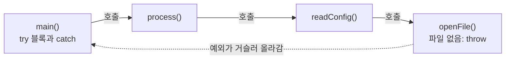
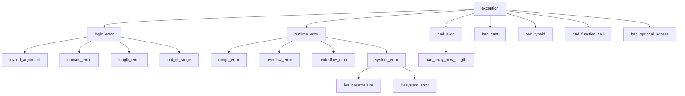
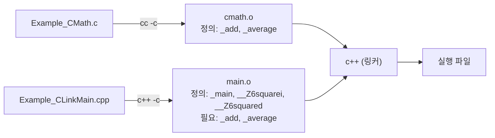

# 13장 — 예외 처리와 C 언어와의 링크 지정

[레포지토리 안내](../../README.ko.md) | [English](Concepts_Lecture.md) | [한국어](Concepts_Lecture.ko.md)

> **최종 수정일:** 2026-11-19

> **학습 목표:**
> 1. 리턴값으로 오류를 알리는 방법의 한계와 예외 처리가 필요한 이유를 설명할 수 있다
> 2. `try`, `throw`, `catch`의 실행 흐름과 처리기를 고르는 규칙을 추적할 수 있다
> 3. 스택 되감기에서 소멸자가 호출되는 순서를 예측하고 다시 던지기와 `noexcept`를 올바르게 쓸 수 있다
> 4. 표준 예외 클래스의 계층을 활용하고 사용자 정의 예외 클래스를 작성할 수 있다
> 5. 예외 안전성의 보장 수준을 구별하고 RAII와 복사 후 교환으로 강한 보장을 구현할 수 있다
> 6. 이름 장식과 `extern "C"`를 이용하여 C 코드와 C++ 코드를 함께 링크할 수 있다

---

## 목차

- [1. 실행 오류와 오류 처리](#1-실행-오류와-오류-처리)
  - [1.1 오류의 종류](#11-오류의-종류)
  - [1.2 리턴값으로 오류 알리기](#12-리턴값으로-오류-알리기)
  - [1.3 프로그램 종료로 오류 알리기](#13-프로그램-종료로-오류-알리기)
  - [1.4 예외 처리의 생각](#14-예외-처리의-생각)
- [2. 예외와 예외 처리](#2-예외와-예외-처리)
  - [2.1 `try`, `throw`, `catch`](#21-try-throw-catch)
  - [2.2 실행 흐름의 추적](#22-실행-흐름의-추적)
  - [2.3 함수 밖으로 전파되는 예외](#23-함수-밖으로-전파되는-예외)
  - [2.4 예외 객체](#24-예외-객체)
  - [2.5 중첩된 `try` 블록](#25-중첩된-try-블록)
- [3. 예외 처리에 대한 자세한 설명](#3-예외-처리에-대한-자세한-설명)
  - [3.1 처리기를 고르는 규칙](#31-처리기를-고르는-규칙)
  - [3.2 스택 되감기](#32-스택-되감기)
  - [3.3 다시 던지기](#33-다시-던지기)
  - [3.4 생성자와 소멸자의 예외](#34-생성자와-소멸자의-예외)
  - [3.5 예외 지정과 `noexcept`](#35-예외-지정과-noexcept)
- [4. 예외 클래스 만들기](#4-예외-클래스-만들기)
  - [4.1 객체를 던지는 이유](#41-객체를-던지는-이유)
  - [4.2 표준 예외 클래스의 계층](#42-표준-예외-클래스의-계층)
  - [4.3 사용자 정의 예외 클래스](#43-사용자-정의-예외-클래스)
- [5. 예외 안전성](#5-예외-안전성)
  - [5.1 예외 안전성의 보장 수준](#51-예외-안전성의-보장-수준)
  - [5.2 RAII와 자원 해제](#52-raii와-자원-해제)
  - [5.3 강한 보장과 복사 후 교환](#53-강한-보장과-복사-후-교환)
  - [5.4 예외를 쓰지 않는 곳](#54-예외를-쓰지-않는-곳)
  - [5.5 오류를 알리는 방법의 선택](#55-오류를-알리는-방법의-선택)
- [6. C++ 코드와 C 코드의 링킹](#6-c-코드와-c-코드의-링킹)
  - [6.1 번역 단위와 심볼](#61-번역-단위와-심볼)
  - [6.2 이름 장식](#62-이름-장식)
  - [6.3 `extern "C"` 링크 지정](#63-extern-c-링크-지정)
  - [6.4 C와 C++가 함께 쓰는 헤더](#64-c와-c가-함께-쓰는-헤더)
  - [6.5 C에서 C++ 함수 호출하기](#65-c에서-c-함수-호출하기)
- [개념 적용](#개념-적용)
- [용어 사전](#용어-사전)
- [요약](#요약)
- [점검 문제](#점검-문제)
- [참고 문헌](#참고-문헌)

---

<br>

## 1. 실행 오류와 오류 처리

### 1.1 오류의 종류

프로그램의 오류는 발견되는 시점에 따라 나뉜다. 문법이 틀리면 컴파일러가, 선언만 있고 정의가 없는 함수는 링커가 알려 준다([1장](../Ch01_Introduction-to-CPP/Concepts_Lecture.ko.md)). 이 장이 다루는 것은 컴파일과 링크를 모두 통과한 뒤 **실행 중에** 생기는 오류이다.

실행 오류는 다시 두 가지로 볼 수 있다. 하나는 배열의 범위를 넘는 인덱스나 0으로 나누는 계산처럼 프로그램의 논리가 잘못되어 생기는 오류로, 원칙적으로 코드를 고쳐 없앨 수 있다. 다른 하나는 열려는 파일이 없거나, 메모리가 부족하거나, 사용자가 형식에 맞지 않는 값을 입력하는 것처럼 프로그램 바깥의 사정 때문에 생기는 오류로, 아무리 올바른 프로그램이라도 일어날 수 있으므로 미리 대비해야 한다. C++ 표준 라이브러리의 예외 클래스도 이 구분을 따라 **논리 오류**와 **실행 시간 오류**로 나뉜다(4.2절)[1].

### 1.2 리턴값으로 오류 알리기

C에서 이어진 전통적인 방법은 함수의 리턴값으로 성공과 실패를 알리는 것이다. 예를 들어 배열의 평균을 구하는 함수가 원소가 없을 때 -1을 리턴하도록 만들 수 있다.

```cpp
double average(const int* a, int n) {
    if (n <= 0)
        return -1;                          // 오류를 뜻하는 특별한 값
    int sum = 0;
    for (int i = 0; i < n; i++)
        sum += a[i];
    return static_cast<double>(sum) / n;
}
```

이 방법에는 다음과 같은 한계가 있다.

- **오류 값과 정상 값이 겹칠 수 있다.** 점수에 음수가 있으면 평균이 실제로 -1일 수 있으므로, 호출한 쪽은 -1이 오류인지 결과인지 구별할 수 없다.
- **검사를 빠뜨리기 쉽다.** 함수에 C++17의 `[[nodiscard]]` 속성을 붙이지 않는 한 리턴값을 검사하지 않아도 컴파일러는 경고하지 않으므로, 오류 값 -1이 그대로 다음 계산에 쓰인다.
- **여러 단계를 거쳐 전달해야 한다.** 오류를 발견한 함수와 처리할 수 있는 함수 사이에 호출이 여러 단계 있으면, 중간의 모든 함수가 리턴값을 검사하여 다시 위로 전달해야 한다. 정상 흐름의 코드와 오류를 전달하는 코드가 뒤섞인다.
- **리턴값을 쓸 수 없는 함수가 있다.** 생성자는 리턴값이 없고, `operator+`처럼 결과를 리턴해야 하는 연산자는 오류를 알릴 자리가 없다.

리턴값 대신 결과를 참조 매개변수로 돌려주고 `bool`로 성공 여부를 리턴하거나, C의 `errno`처럼 전역 변수에 오류 번호를 남기는 방법도 있지만, 검사를 빠뜨리기 쉽고 여러 단계로 전달해야 한다는 문제는 그대로 남는다.

### 1.3 프로그램 종료로 오류 알리기

오류를 발견한 곳에서 `exit()`나 `abort()`로 프로그램을 끝내는 방법도 있다. 작은 도구 프로그램에서는 간단하지만, 라이브러리 함수가 프로그램 전체를 끝내 버리면 그 함수를 쓰는 쪽은 오류에서 회복할 기회를 잃는다. 저장하지 않은 문서를 편집하던 프로그램이 파일 하나를 열지 못했다고 종료되어서는 안 된다.

`<cassert>`의 `assert(조건)`은 조건이 거짓이면 진단 메시지를 출력하고 `abort()`를 호출한다. `assert`는 "이 조건은 항상 참이어야 한다"는 프로그래머의 가정을 확인하는 도구이며, `NDEBUG` 매크로를 정의하고 컴파일하면 검사 자체가 사라진다. 따라서 사용자의 입력이나 파일의 존재처럼 실행할 때마다 달라지는 상황의 검사에는 쓰지 않는다.

### 1.4 예외 처리의 생각

예외 처리는 오류를 **발견하는 곳**과 **처리하는 곳**을 분리한다. 오류를 발견한 함수는 오류를 나타내는 값을 던지고 즉시 실행을 멈추며, 호출 사슬을 따라 거슬러 올라가다가 그 오류를 처리하겠다고 표시한 곳에서 처리가 시작된다. 중간의 함수들은 오류를 전달하는 코드를 쓸 필요가 없다.

> **용어 정의:** **예외(exception)** 는 함수가 정상적인 방법으로 처리를 계속할 수 없는 상황이 실행 중에 생겼음을 알리기 위해, 그 함수가 호출 사슬의 바깥쪽으로 던지는 값이다.



*그림 1. 호출 사슬의 가장 안쪽에서 던진 예외가 `main()`의 처리기로 전달되는 흐름*

그림 1에서 `openFile()`은 파일이 없다는 것을 발견하지만 그 상황에서 무엇을 할지(다른 파일을 열지, 사용자에게 물을지, 기본값을 쓸지)는 알지 못한다. 그 판단은 프로그램 전체를 아는 `main()`이 한다. `process()`와 `readConfig()`는 예외가 지나가는 길일 뿐 예외에 관한 코드를 갖지 않는다.

---

<br>

## 2. 예외와 예외 처리

### 2.1 `try`, `throw`, `catch`

예외 처리는 세 키워드로 이루어진다.

```cpp
try {
    // 예외가 발생할 수 있는 문장 (try 블록)
    throw 식;                  // 예외를 던진다
}
catch (타입1 매개변수) {
    // 타입1의 예외를 처리한다 (처리기)
}
catch (타입2 매개변수) {
    // 타입2의 예외를 처리한다
}
```

- **`throw` 식:** 식의 값으로 예외 객체를 만들어 던진다. `throw` 뒤의 문장은 실행되지 않는다.
- **`try` 블록:** 예외를 감시할 영역이다. 이 블록 안에서, 또는 이 블록에서 호출한 함수 안에서 던진 예외는 뒤따르는 처리기로 전달된다.
- **`catch` 처리기:** 괄호 안의 매개변수 선언으로 받을 예외의 타입을 지정한다. `try` 블록 하나에 처리기를 여러 개 둘 수 있으며 적어도 하나는 있어야 한다.

> **용어 정의:** **예외 처리기(exception handler)** 는 `try` 블록 뒤의 `catch` 절이며, 선언한 타입과 맞는 예외가 던져지면 그 예외 객체로 매개변수를 초기화하고 본문을 실행한다.

처리기의 본문이 끝나면 실행은 마지막 처리기 다음의 문장으로 이어진다. 예외가 던져진 지점으로 돌아가지 않는다는 점이 함수 호출과 다르다.

[4장 5절](../Ch04_Pointers-Arrays-and-Dynamic-Memory/Concepts_Lecture.ko.md#5-예외-처리)에서는 `new`가 던지는 `bad_alloc`과 문자열을 던지는 예를 보였다. 이 장은 그 문법이 어떤 규칙으로 동작하는지를 다룬다.

### 2.2 실행 흐름의 추적

[Example_ThrowCatch.cpp](Example_ThrowCatch.cpp)는 세 쌍의 수로 나눗셈을 하며, 나누는 수가 0이면 `divide()`가 예외를 던진다.

```cpp
int divide(int a, int b) {
    if (b == 0)
        throw b;                                 // divide()를 즉시 떠나며 int 0을 던진다
    return a / b;
}

int main() {
    int pairs[3][2] = {{10, 2}, {7, 0}, {9, 3}};
    for (auto& p : pairs) {
        cout << "try " << p[0] << " / " << p[1] << endl;
        try {
            int q = divide(p[0], p[1]);
            cout << "  quotient " << q << endl;  // divide()가 던지면 건너뛴다
        } catch (int divisor) {                  // 던진 int의 복사본을 받는다
            cout << "  caught: divisor " << divisor << endl;
        }
        cout << "  after the try-catch" << endl;
    }
    return 0;
}
```

```text
try 10 / 2
  quotient 5
  after the try-catch
try 7 / 0
  caught: divisor 0
  after the try-catch
try 9 / 3
  quotient 3
  after the try-catch
```

| 쌍 | `divide()`의 동작 | 실행된 문장 | 건너뛴 문장 |
|:-----|:-----|:-----|:-----|
| 10, 2 | 5를 리턴 | `quotient 5` 출력, `after` 출력 | 처리기 |
| 7, 0 | `throw b`로 0을 던짐 | 처리기의 `caught` 출력, `after` 출력 | `return a / b`, `q`의 초기화, `quotient` 출력 |
| 9, 3 | 3을 리턴 | `quotient 3` 출력, `after` 출력 | 처리기 |

*표 1. 세 번의 반복에서 실행된 문장과 건너뛴 문장*

두 번째 반복에서 `throw b`가 실행되면 `divide()`의 나머지 문장과 `try` 블록의 나머지 문장(`q`의 초기화와 출력)이 모두 건너뛰어지고, 타입이 맞는 `catch (int divisor)`가 실행된다. 처리기가 끝나면 `after the try-catch`가 출력되고 반복이 계속되므로, 예외 하나가 프로그램 전체를 멈추지 않는다.

### 2.3 함수 밖으로 전파되는 예외

예외를 던진 함수 안에 맞는 처리기가 없으면 그 함수는 즉시 끝나고, 예외는 그 함수를 호출한 곳으로 넘어가 거기서 다시 처리기를 찾는다. 이 탐색은 맞는 처리기를 찾을 때까지 호출 사슬을 따라 바깥으로 이어진다[1]. `main()`까지 거슬러 올라가도 맞는 처리기가 없으면 `std::terminate()`가 호출되어 프로그램이 비정상 종료한다. 이 경우 지역 객체의 소멸자가 호출되는지(스택이 되감기는지)는 구현이 정한다[1].

```cpp
int main() {
    throw std::runtime_error("disk full");      // 받는 처리기가 없다
}
```

```text
libc++abi: terminating due to uncaught exception of type std::runtime_error: disk full
```

macOS에서 이 프로그램은 위 메시지를 출력하고 `abort()`로 끝나며, 셸이 보는 종료 상태는 134이다. 처리하지 못한 예외는 프로그램의 결함이므로, 예외를 던질 수 있는 함수를 호출하는 프로그램은 적어도 `main()`에 마지막 처리기를 둔다.

### 2.4 예외 객체

`throw 식`은 식의 값으로 **예외 객체**를 새로 만든다. 예외 객체는 던진 함수의 지역 변수와 별개로 구현이 관리하는 메모리에 놓이며, 그 예외를 처리하는 마지막 처리기가 끝날 때까지 살아 있다. 그래서 `throw b`에서 `b`가 `divide()`의 매개변수라서 함수가 끝나면 사라지더라도, 처리기는 그 값을 안전하게 받는다.

처리기의 매개변수는 이 예외 객체로 초기화된다. 매개변수가 값(`catch (int divisor)`)이면 예외 객체의 복사본을, 참조(`catch (const Error& e)`)이면 예외 객체 자체를 가리킨다. 클래스 타입의 예외는 4.1절의 이유로 `const` 참조로 받는다.

> **주의:** 지역 변수의 주소를 던지면(`throw &local;`) 처리기가 받을 때는 이미 그 변수가 사라진 뒤이므로 댕글링 포인터가 된다. 예외는 값으로 던진다.

### 2.5 중첩된 `try` 블록

`try` 블록은 다른 `try` 블록 안에 있을 수 있고, 호출한 함수의 `try` 블록 안에서 실행 중인 함수가 자신의 `try` 블록을 가질 수도 있다. 예외가 던져지면 가장 안쪽의 `try` 블록부터 처리기를 검사하고, 맞는 것이 없으면 그것을 둘러싼 `try` 블록으로 나아간다[1]. [Example_NestedTry.cpp](Example_NestedTry.cpp)는 세 단계의 `try` 블록을 둔다.

```cpp
void inner() {
    try {
        throw out_of_range("index 9");
    } catch (const invalid_argument&) {          // out_of_range와 맞지 않는다
        cout << "inner handler" << endl;
    }
    cout << "inner end" << endl;                 // 건너뛴다: 예외가 inner()를 떠났다
}

void middle() {
    try {
        inner();
    } catch (const out_of_range& e) {
        cout << "middle caught: " << e.what() << endl;
        throw runtime_error("middle gave up");   // 처리기 안에서 던진 새 예외
    } catch (const runtime_error& e) {           // 같은 try의 다른 처리기는 이 예외를 보지 못한다
        cout << "middle sibling: " << e.what() << endl;
    }
}

int main() {
    try {
        middle();
    } catch (const out_of_range&) {
        cout << "main: out_of_range" << endl;
    } catch (const runtime_error& e) {
        cout << "main caught: " << e.what() << endl;
    }
    return 0;
}
```

```text
middle caught: index 9
main caught: middle gave up
```

1. `inner()`의 `try` 블록이 `out_of_range`를 던진다. 처리기 `catch (const invalid_argument&)`는 맞지 않으므로 `inner()`는 그 자리에서 끝나고 `inner end`는 출력되지 않는다.
2. `middle()`의 `try` 블록에서 첫 처리기 `catch (const out_of_range& e)`가 맞아 `middle caught: index 9`를 출력한다.
3. 그 처리기 안에서 `runtime_error`를 새로 던진다. 처리기 안의 문장은 그 `try` 블록의 바깥에 있으므로, 바로 아래의 `catch (const runtime_error& e)`는 이 예외를 받지 못한다. 탐색은 `middle()`을 호출한 `main()`의 `try` 블록으로 넘어간다.
4. `main()`의 처리기 중 `runtime_error`에 맞는 두 번째 처리기가 `main caught: middle gave up`을 출력한다.

처리기에서 다른 타입의 예외를 던지는 방식은 낮은 수준의 오류(`out_of_range`)를 그 함수를 쓰는 쪽이 이해하는 높은 수준의 오류로 바꿀 때 쓴다.

---

<br>

## 3. 예외 처리에 대한 자세한 설명

### 3.1 처리기를 고르는 규칙

예외가 던져지면 처리기는 **나열된 순서대로** 검사되며, 처음으로 맞는 처리기 하나만 실행된다[1]. 타입 `E`의 예외 객체에 처리기가 맞는 경우는 다음과 같다[1].

| 처리기의 타입 | 맞는 경우 |
|:-----|:-----|
| `T` 또는 `T&` (`const` 포함) | `E`가 `T`와 같은 타입이거나, `T`가 `E`의 모호하지 않은 `public` 기본 클래스일 때 |
| 포인터 `T` | `E`가 포인터이고 표준 포인터 변환(파생 클래스에서 기본 클래스로, `void*`로)이나 `const` 추가로 `T`가 될 수 있을 때 |
| `...` | 모든 예외 |

*표 2. 예외 객체의 타입과 처리기가 맞는 경우*

표에 없는 변환은 일어나지 않는다. 특히 함수 호출에서는 자동으로 일어나는 **산술 변환**이 처리기를 고를 때는 일어나지 않는다. `int`를 던지면 `catch (long)`이나 `catch (double)`은 맞지 않고, `float`를 던지면 `catch (double)`이 맞지 않는다. 문자열 리터럴 `"message"`를 던지면 배열이 포인터로 바뀌어 예외 객체의 타입은 `const char*`가 되므로 `catch (const char*)`로 받아야 하고 `catch (std::string)`으로는 받을 수 없다.

[Example_HandlerMatching.cpp](Example_HandlerMatching.cpp)는 다섯 가지 타입을 던지고 같은 처리기 목록으로 받는다.

```cpp
switch (kind) {
case 0: throw 42;                        // int
case 1: throw 3.5f;                      // float: double로 변환되지 않는다
case 2: throw "message";                 // const char*
case 3: throw Derived();                 // const Base&에 맞는다
case 4: throw string("text");            // 아래 처리기 중 std::string에 맞는 것이 없다
}
// catch (int) → catch (double) → catch (const char*) → catch (const Base&) → catch (...)
```

```text
0: int 42
1: caught by ...
2: const char* message
3: Base& holding Derived
4: caught by ...
```

`float` 3.5는 `catch (double)`을 지나쳐 `catch (...)`에서 잡힌다. `Derived` 객체는 `public` 기본 클래스의 참조인 `catch (const Base& b)`에 맞고, `b.name()`은 가상 함수이므로 `Derived`의 버전이 호출된다. `catch (...)`는 모든 예외에 맞으므로 반드시 마지막에 둔다[1].

**순서의 함정.** 기본 클래스의 처리기를 파생 클래스의 처리기보다 앞에 두면, 파생 클래스의 예외도 앞의 처리기가 모두 받으므로 뒤의 처리기는 실행될 수 없다. Clang은 이런 코드를 `warning: exception of type 'const D &' will be caught by earlier handler`로 경고한다. 처리기는 **가장 구체적인 파생 클래스부터 기본 클래스 순서로** 둔다.

### 3.2 스택 되감기

예외가 함수를 빠져나갈 때, 그 함수에서 생성이 끝난 지역 객체는 버려지는 것이 아니라 소멸자가 호출된다.

> **용어 정의:** **스택 되감기(stack unwinding)** 는 예외가 던져진 지점에서 처리기까지 제어가 이동하는 동안, 그 사이에서 생성이 끝나고 아직 소멸하지 않은 자동 객체의 소멸자를 생성의 역순으로 호출하는 과정이다.

[Example_StackUnwinding.cpp](Example_StackUnwinding.cpp)는 생성과 소멸을 출력하는 `Tracer` 객체를 함수마다 하나씩 두고, 가장 안쪽 함수에서 예외를 던진다.

```cpp
void level3(int n) {
    Tracer t("t3");
    if (n < 0)
        throw invalid_argument("negative input");
    cout << "  level3 finished" << endl;          // n < 0이면 건너뛴다
}

void level2(int n) {
    Tracer t("t2");
    level3(n);
    cout << "  level2 finished" << endl;
}

int main() {
    Tracer t0("t0");
    try {
        Tracer t1("t1");
        level2(-5);
        cout << "  main continues inside try" << endl;
    } catch (const invalid_argument& e) {
        cout << "  caught: " << e.what() << endl;
    }
    cout << "  after catch" << endl;
    return 0;
}
```

```text
  construct t0
  construct t1
  construct t2
  construct t3
  destroy   t3
  destroy   t2
  destroy   t1
  caught: negative input
  after catch
  destroy   t0
```

- 예외가 던져질 때 살아 있는 객체는 `t0`, `t1`, `t2`, `t3`이다.
- 처리기를 찾으며 `level3`, `level2`, `try` 블록을 차례로 빠져나가므로 `t3`, `t2`, `t1`이 그 순서로 소멸한다. 세 소멸이 모두 끝난 뒤에 처리기가 실행되어 `caught`가 출력된다. 표준은 처리기의 매개변수 초기화가 끝났을 때 스택이 이미 되감겨 있다고 정한다[1].
- `t0`은 `try` 블록 바깥에서 만들어졌으므로 되감기의 대상이 아니고, `main()`이 끝날 때 소멸한다.
- `level3 finished`, `level2 finished`, `main continues inside try`는 모두 건너뛰어진다.

스택 되감기 덕분에 소멸자에서 자원을 해제하는 객체는 예외가 생겨도 자원을 잃지 않는다. 이 성질을 이용하는 기법이 5.2절의 RAII이다.

### 3.3 다시 던지기

처리기 안에서 예외를 일부만 처리하고(예: 로그를 남기고) 나머지 처리를 바깥에 맡기려면 피연산자 없는 `throw;`로 **다시 던진다**. `throw;`는 현재 처리 중인 예외 객체를 그대로 다시 던진다. 처리 중인 예외가 없을 때 `throw;`를 실행하면 `std::terminate()`가 호출된다[1].

[Example_Rethrow.cpp](Example_Rethrow.cpp)는 `runtime_error`를 상속한 `FileError`를 던지고, 중간 함수가 `const exception&`으로 받은 뒤 두 가지 방법으로 다시 던진다.

```cpp
void rethrowSame() {
    try { open(); }
    catch (const exception& e) {
        cout << "  log: " << e.what() << endl;
        throw;                                   // 원래의 FileError 객체를 다시 던진다
    }
}

void rethrowCopy() {
    try { open(); }
    catch (const exception& e) {
        throw e;                                 // exception 부분만 복사한다: 슬라이싱
    }
}
```

```text
  log: config.txt not found
throw;  -> FileError: config.txt not found
throw e -> exception: std::exception
by value  -> std::exception
```

`throw;`로 다시 던진 예외는 여전히 `FileError`이므로 바깥의 `catch (const FileError& e)`가 받는다. 반면 `throw e;`는 `e`의 **정적 타입**인 `exception`으로 새 예외 객체를 복사하므로, `FileError`의 부분이 잘려 나가 바깥에서는 `catch (const exception& e)`가 받고 `what()`도 `exception`의 기본 문자열(libc++에서는 `std::exception`)을 리턴한다. 마지막 줄은 처리기의 매개변수를 값(`catch (exception e)`)으로 선언했을 때도 같은 슬라이싱이 일어나는 것을 보인다([9장](../Ch09_Virtual-Functions-and-Abstract-Classes/Concepts_Lecture.ko.md)의 객체 슬라이싱).

> **핵심:** 예외는 값으로 던지고 `const` 참조로 받으며, 처리기 안에서 다시 던질 때는 `throw e;`가 아니라 `throw;`를 쓴다.

### 3.4 생성자와 소멸자의 예외

**생성자의 예외.** 생성자는 리턴값이 없으므로 객체를 만들 수 없는 상황은 예외로 알린다. 생성자가 예외로 끝나면 그 객체는 만들어지지 않은 것으로 처리되어 **그 객체의 소멸자는 호출되지 않는다**. 대신 그때까지 생성이 끝난 멤버와 기본 클래스는 역순으로 소멸한다. [Example_ConstructorFailure.cpp](Example_ConstructorFailure.cpp)의 `Car`는 멤버 `body`, `engine`, `wheels`를 이 순서로 가지며, `engine`의 생성자가 예외를 던진다.

```cpp
struct Car {
    Part body;                                   // 멤버는 선언 순서로 만들어진다
    Engine engine;
    Part wheels;
    Car() try : body("body"), engine(), wheels("wheels") {
        cout << "  Car built" << endl;
    } catch (const exception& e) {               // 함수 try 블록은 초기화 목록의 예외도 받는다
        cout << "  Car's handler: " << e.what() << endl;
    }                                            // 여기서 예외가 자동으로 다시 던져진다
    ~Car() { cout << "  ~Car" << endl; }
};
```

```text
  Part body built
  Engine throws
  Part body destroyed
  Car's handler: engine failure
main caught: engine failure
```

- `body`는 생성이 끝났으므로 소멸한다. `engine`은 생성자가 끝나지 않았으므로 `~Engine`이 호출되지 않고, `wheels`는 만들어지지도 않았다.
- `Car` 자신도 만들어지지 않았으므로 `~Car`는 호출되지 않는다. 따라서 생성자 본문에서 `new`로 얻은 메모리는 소멸자가 아니라 5.2절의 RAII 멤버로 관리해야 새지 않는다.
- 생성자의 본문 앞에 `try`를 쓰고 본문 뒤에 처리기를 붙인 형태를 **함수 try 블록**이라 한다. 일반 `try` 블록은 초기화 목록을 감쌀 수 없으므로, 멤버 초기화의 예외를 생성자 안에서 받으려면 이 형태를 쓴다. 생성자의 함수 try 블록의 처리기가 끝나면 예외는 자동으로 다시 던져지므로[1] 객체를 살려 낼 수는 없고, 로그를 남기거나 예외를 다른 타입으로 바꾸어 던지는 용도로 쓴다.

**소멸자의 예외.** C++11부터 `noexcept`를 적지 않은 소멸자도 컴파일러가 암묵적으로 선언하는 소멸자와 같은 예외 지정을 가지므로[1], 멤버나 기본 클래스의 소멸자가 예외를 던질 수 있다고 선언되어 있지 않으면 예외를 던지지 않는 함수가 된다. 소멸자에서 예외가 빠져나가면 `std::terminate()`가 호출된다. 스택 되감기 도중에 소멸자가 예외로 끝나는 경우에도 `std::terminate()`가 호출되는데[1], 전파 중인 예외가 이미 있는 상태에서 두 번째 예외를 처리할 방법이 없기 때문이다. 소멸자 안에서 실패할 수 있는 작업(파일 닫기, 네트워크 연결 끊기)은 소멸자 안에서 예외를 잡아 처리하거나, `close()` 같은 별도의 함수로 제공하여 호출한 쪽이 결과를 검사하게 한다.

### 3.5 예외 지정과 `noexcept`

**동적 예외 지정의 제거.** 오래된 C++ 코드와 교재에서는 함수가 던질 수 있는 예외의 타입을 `int get() throw(char*)`처럼 함수 선언 뒤에 나열했다. 이 **동적 예외 지정**은 C++11에서 사용 자제 대상이 되었고, 예외를 던질 수 있다고 적은 형태는 C++17에서 제거되었다[1][2]. C++17 이상으로 컴파일하면 다음과 같은 오류가 난다.

```text
error: ISO C++17 does not allow dynamic exception specifications [-Wdynamic-exception-spec]
note: use 'noexcept(false)' instead
```

**`noexcept` 지정자.** C++11부터는 함수가 예외를 던지지 않는다는 사실만 `noexcept`로 표시한다. `void f() noexcept;`는 예외를 던지지 않겠다는 약속이고, `noexcept(조건)`은 컴파일 시간 상수 조건이 참일 때만 그 약속을 한다. `noexcept` 함수에서 예외가 빠져나가려 하면 처리기를 찾는 대신 `std::terminate()`가 호출된다[1].

**`noexcept` 연산자.** `noexcept(식)`은 식이 예외를 던질 수 있는지를 컴파일 시간에 계산하여 `bool`을 돌려준다. 식은 실행되지 않는다. [Example_Noexcept.cpp](Example_Noexcept.cpp)는 두 기능을 모두 보인다.

```cpp
int twice(int x) noexcept { return 2 * x; }
int parse(int x) { if (x < 0) throw invalid_argument("negative"); return x; }

void careless(int x) noexcept {
    cout << "careless(" << x << ")" << endl;
    parse(x);                                    // noexcept 함수 안에서 예외가 날 수 있다
}

struct Quiet { ~Quiet() {} };                    // 소멸자는 기본으로 noexcept이다
```

```text
$ ./noexcept_demo x
noexcept(twice(1)) = true
noexcept(parse(1)) = false
is_nothrow_destructible<Quiet> = true
careless(-1)
libc++abi: terminating due to uncaught exception of type std::invalid_argument: negative
```

인자를 주어 실행하면 `careless(-1)`이 호출되고 `parse(-1)`이 던진 예외가 `noexcept` 함수 밖으로 나가려 한다. `main()`에는 `catch (...)`가 있지만 그 처리기는 실행되지 않고 프로그램이 종료된다(종료 상태 134). `noexcept`는 컴파일러가 검사해 주는 약속이 아니라 위반하면 프로그램을 끝내는 약속이다.

**`noexcept`를 붙이는 곳.** 예외를 던지지 않는다는 것이 분명한 함수, 특히 소멸자, 이동 생성자와 이동 대입 연산자, `swap` 함수에 붙인다. 표준 컨테이너는 복사할 수 있는 원소이면 그 이동 생성자가 `noexcept`일 때만 재할당에서 이동을 쓰므로, 이동 연산의 `noexcept` 여부는 성능에 직접 영향을 준다([14장](../Ch14_Move-Semantics-and-Modern-CPP/Concepts_Lecture.ko.md)).

---

<br>

## 4. 예외 클래스 만들기

### 4.1 객체를 던지는 이유

`throw` 뒤에는 어떤 타입의 값이든 올 수 있지만, `int`나 문자열을 던지면 다음 문제가 생긴다.

- **종류를 구별할 수 없다.** 오류 코드 `throw 3;`과 `throw 7;`은 같은 처리기 `catch (int)`가 받으므로, 처리기 안에서 값을 다시 비교해야 한다.
- **정보가 부족하다.** 문자열 하나에는 실패한 파일 이름, 줄 번호, 원인 코드 같은 정보를 구조적으로 담을 수 없다.
- **관련된 오류를 묶을 수 없다.** 파일 오류, 네트워크 오류를 모두 "입출력 오류"로 한꺼번에 처리하고 싶어도 `int`에는 계층이 없다.

예외 클래스를 만들면 타입 자체가 오류의 종류를 나타내고, 멤버로 필요한 정보를 담으며, 상속으로 오류를 분류할 수 있다. 처리기는 3.1절의 규칙에 따라 기본 클래스의 참조로 여러 파생 클래스를 한꺼번에 받는다. 클래스 타입의 예외를 `const` 참조로 받으면 복사가 일어나지 않고, 3.3절의 슬라이싱도 생기지 않는다.

### 4.2 표준 예외 클래스의 계층

표준 라이브러리가 던지는 예외는 모두 `<exception>`의 `std::exception`을 기본 클래스로 한다[1]. `std::exception`은 오류를 설명하는 문자열을 리턴하는 가상 함수 `virtual const char* what() const noexcept`를 가진다. `<stdexcept>`는 오류를 프로그램 내부의 논리가 잘못되어 생기는 **논리 오류**(`logic_error`)와 프로그램 바깥의 사정으로 생겨 미리 예측하기 어려운 **실행 시간 오류**(`runtime_error`)로 나눈다[1].



*그림 2. 표준 예외 클래스의 주요 상속 계층*

[Example_StandardExceptions.cpp](Example_StandardExceptions.cpp)는 표준 라이브러리의 연산으로 여러 예외를 일으킨다.

| 연산 | 던지는 예외 | 분류 |
|:-----|:-----|:-----|
| `v.at(5)` (`v`의 크기가 3) | `out_of_range` | 논리 오류 |
| `stoi("abc")` | `invalid_argument` | 논리 오류 |
| `stoi("99999999999")` | `out_of_range` | 논리 오류 |
| 실패하는 참조 `dynamic_cast<Circle&>(s)` | `bad_cast` | 언어 지원 |
| 만족할 수 없는 크기의 `new int[n]` | `bad_alloc` | 메모리 |
| `exceptions()`를 설정한 스트림의 실패 | `ios_base::failure` | 실행 시간 오류 (12장 7.4절) |
| 비어 있는 `std::function`의 호출 | `bad_function_call` | 언어 지원 (14장) |

*표 3. 표준 라이브러리 연산과 던지는 예외*

```text
out_of_range
stoi("12x") = 12
invalid_argument from stoi("abc")
out_of_range from stoi("99999999999")
bad_cast
bad_alloc
```

`stoi("12x")`는 앞부분 `12`를 변환하고 `x`에서 멈출 뿐 예외를 던지지 않는다는 점에 유의해야 한다. 숫자가 하나도 없을 때만 `invalid_argument`를 던진다. `v[5]`처럼 `at()` 대신 `[]`를 쓰면 범위를 검사하지 않으므로 예외 없이 정의되지 않은 동작이 된다.

`what()`이 리턴하는 문자열은 생성자에 준 문자열이거나, 기본 생성자로 만든 경우 구현이 정한 문자열이다. 표준은 `exception`을 상속한 표준 라이브러리의 클래스가 예외를 던지지 않는 복사 생성자와 복사 대입 연산자를 가지도록 요구한다[1]. 예외 객체는 던지고 받는 과정에서 복사될 수 있는데, 그 복사가 다시 예외를 던지면 처리할 방법이 없기 때문이다.

### 4.3 사용자 정의 예외 클래스

사용자 정의 예외 클래스는 표준 예외 클래스 가운데 의미가 맞는 것을 상속하여 만든다. 그러면 `catch (const std::exception& e)` 하나로 표준 예외와 사용자 예외를 모두 받을 수 있고, `what()`도 그대로 쓸 수 있다. 같은 예제의 `InsufficientFunds`는 잔액이 부족할 때 던지며, 모자란 금액을 멤버로 담는다.

```cpp
class InsufficientFunds : public runtime_error {   // 사용자 정의 예외 클래스
    double shortage;
public:
    InsufficientFunds(double need, double have)
        : runtime_error("insufficient funds"), shortage(need - have) {}
    double amount() const noexcept { return shortage; }
};

void withdraw(double amount) {
    if (amount <= 0)
        throw invalid_argument("amount must be positive");
    if (amount > balance)
        throw InsufficientFunds(amount, balance);
    balance -= amount;
}
```

```cpp
for (double r : requests) {                      // requests = {30, -5, 200}, 잔액 100에서 시작
    try {
        acc.withdraw(r);
        cout << "withdrew " << r << ", balance " << acc.get() << endl;
    } catch (const InsufficientFunds& e) {       // 가장 구체적인 클래스를 먼저 둔다
        cout << e.what() << ": short by " << e.amount() << endl;
    } catch (const logic_error& e) {
        cout << "logic_error: " << e.what() << endl;
    } catch (const exception& e) {
        cout << "other: " << e.what() << endl;
    }
}
```

```text
withdrew 30, balance 70
logic_error: amount must be positive
insufficient funds: short by 130
```

- 30을 출금하면 잔액이 100 - 30 = 70이 된다.
- -5는 `invalid_argument`를 던지고, `invalid_argument`는 `logic_error`의 파생 클래스이므로 두 번째 처리기가 받는다.
- 200은 잔액 70보다 크므로 `InsufficientFunds(200, 70)`을 던지고, 모자란 금액은 200 - 70 = 130이다. 첫 번째 처리기가 받아 `amount()`로 그 값을 출력한다.
- 기본 클래스 `runtime_error`의 생성자에 문자열 `"insufficient funds"`를 넘겼으므로 `what()`은 그 문자열을 리턴한다.

예외 클래스를 작성할 때는 다음을 지킨다.

- 표준 예외 클래스(`runtime_error`, `logic_error` 또는 그 파생 클래스)를 `public`으로 상속한다.
- 멤버 함수, 특히 정보를 꺼내는 함수와 `what()`의 재정의는 `noexcept`로 만든다.
- 멤버로 `std::string`을 많이 두면 복사할 때 메모리를 할당하다 실패할 수 있으므로, 메시지는 기본 클래스의 생성자에 넘겨 저장한다.
- `new`로 만든 예외 객체의 포인터를 던지지 않는다. 받은 쪽이 `delete`해야 하는지 알 수 없다.

---

<br>

## 5. 예외 안전성

### 5.1 예외 안전성의 보장 수준

예외가 생기면 함수의 나머지 문장이 실행되지 않으므로, 함수가 하던 작업은 중간에 끊긴다. **예외 안전성**은 그런 상황에서도 프로그램이 올바른 상태로 남는지를 나타내는 성질이다.

> **용어 정의:** **예외 안전성(exception safety)** 은 함수가 예외로 끝나더라도 자원이 새지 않고 객체가 올바른 상태로 남는지를 나타내는 성질이며, 보장하는 정도에 따라 몇 가지 수준으로 나뉜다.

| 수준 | 함수가 예외로 끝났을 때 보장하는 것 | 예 |
|:-----|:-----|:-----|
| 예외 없음 보장 (no-throw) | 예외를 던지지 않는다 | 소멸자, `swap`, `noexcept` 이동 생성자 |
| 강한 보장 (strong) | 상태가 함수를 호출하기 전과 같다 (전부 되거나 전혀 안 됨) | `vector::push_back` (원소의 복사나 이동이 조건을 만족할 때) |
| 기본 보장 (basic) | 자원이 새지 않고 객체는 쓸 수 있는 상태이지만 값은 바뀌었을 수 있다 | 여러 원소를 차례로 바꾸는 대부분의 함수 |
| 보장 없음 | 자원이 새거나 객체가 깨질 수 있다 | `new`와 `delete`를 직접 쓰며 예외를 고려하지 않은 코드 |

*표 4. 예외 안전성의 보장 수준*

표준은 `vector`의 끝에 원소 하나를 넣다가 예외가 생겨도, 원소가 복사 가능하거나 이동 생성자가 예외를 던지지 않으면 아무 효과가 없도록(강한 보장) 정한다[1]. 사용자가 만드는 함수도 적어도 기본 보장을 제공하고, 가능하면 강한 보장을 제공하는 것이 목표이다.

### 5.2 RAII와 자원 해제

`new`로 얻은 메모리를 지역 포인터에 담아 쓰다가 예외가 생기면, `delete`가 있는 문장까지 실행이 이르지 못해 메모리가 샌다. 스택 되감기는 객체의 소멸자를 호출할 뿐, 포인터 변수가 가리키는 객체를 해제하지는 않는다. [Example_RaiiCleanup.cpp](Example_RaiiCleanup.cpp)는 두 방법을 비교한다.

```cpp
void rawVersion(bool fail) {
    Resource* r = new Resource(1);
    work(fail);                                  // 여기서 던지면 아래의 delete를 건너뛴다
    delete r;
}

void raiiVersion(bool fail) {
    auto r = make_unique<Resource>(2);           // 되감기 중에 r의 소멸자가 실행된다
    work(fail);
}
```

```text
  acquire 1
caught: work failed (resource 1 leaked)
  acquire 2
  release 2
caught: work failed
```

`rawVersion`에서는 자원 1을 얻은 뒤 예외가 나서 `release 1`이 출력되지 않는다. `raiiVersion`에서는 `unique_ptr` 객체 `r`이 지역 객체이므로 되감기 중에 소멸자가 호출되고, 그 소멸자가 자원 2를 해제한다. 자원을 생성자에서 얻고 소멸자에서 해제하는 클래스로 감싸 자원의 수명을 객체의 수명에 묶는 이 기법을 **RAII**라 한다([4장 6절](../Ch04_Pointers-Arrays-and-Dynamic-Memory/Concepts_Lecture.ko.md#6-스마트-포인터-현대-c)). 메모리뿐 아니라 파일 스트림(12장), 잠금, 네트워크 연결도 같은 방식으로 관리하면, 예외가 어디서 생기든 자원이 해제된다.

> **핵심:** 예외 안전한 코드의 기본은 `try`와 `catch`를 많이 쓰는 것이 아니라 자원을 RAII 객체에 맡기는 것이다. 그러면 예외가 지나가는 함수에는 정리 코드가 필요 없다.

### 5.3 강한 보장과 복사 후 교환

여러 단계로 객체를 바꾸는 함수는 중간에 예외가 나면 객체가 반쯤 바뀐 상태로 남는다. **복사 후 교환(copy-and-swap)** 은 예외가 날 수 있는 작업을 모두 임시 객체에서 먼저 하고, 성공한 뒤에 예외를 던지지 않는 교환으로 결과를 옮겨 강한 보장을 얻는 기법이다. [Example_StrongGuarantee.cpp](Example_StrongGuarantee.cpp)는 문자열 두 개를 동적으로 가지는 `Pair`의 대입을 두 가지로 구현하고, 전역 변수 `budget`으로 할당 한도를 흉내 내어 큰 할당을 실패하게 한다.

```cpp
void assignUnsafe(const Pair& o) {           // 많아야 기본 보장
    delete first;
    first = allocate(*o.first);              // 성공한다
    delete second;
    second = nullptr;
    second = allocate(*o.second);            // 던질 수 있다: *this는 반은 새 값, 반은 빈 상태가 된다
}
void assignStrong(const Pair& o) {           // 강한 보장
    Pair temp(o);                            // 던질 수 있는 단계는 모두 여기서 일어난다
    swap(first, temp.first);                 // 포인터 교환은 던지지 않는다
    swap(second, temp.second);
}                                            // temp가 이전 내용을 해제한다
```

```text
assignStrong failed
after assignStrong: red, blue
assignUnsafe failed
after assignUnsafe: green, <empty>
```

`p`는 `("red", "blue")`, `big`은 `("green", 60글자 문자열)`이고, 한도를 10바이트로 줄인 뒤 `p`에 `big`을 대입한다.

- `assignStrong`은 복사 생성자로 `temp`를 만드는 중에 60글자의 할당이 실패한다. `p`는 아직 손대지 않았으므로 `red, blue` 그대로이다. 실패한 `temp`의 생성자는 이미 할당한 `"green"`을 스스로 해제한다.
- `assignUnsafe`는 `first`를 `"green"`으로 바꾼 뒤 `second`의 할당에서 실패한다. `p`는 `green, <empty>`가 되어 원래 값도 새 값도 아닌 상태로 남는다. 자원은 새지 않으므로 기본 보장은 지켰지만 강한 보장은 아니다.
- 강한 보장의 비용은 임시 객체를 하나 더 만드는 것이다. 대입 연산자를 `Pair& operator=(Pair o) { swap(...); return *this; }`처럼 값으로 받아 쓰면 같은 생각을 더 짧게 표현할 수 있다.

### 5.4 예외를 쓰지 않는 곳

예외는 드물게 일어나는 실패를 알리는 수단이다. 다음 경우에는 다른 방법을 쓴다.

- **소멸자, 이동 연산, `swap`.** 3.4절과 14장의 이유로 예외를 던지지 않게 만든다.
- **흔히 일어나는 결과.** 사용자 입력의 형식 오류처럼 자주 생기는 상황은 정상적인 결과로 다루는 편이 알맞다. 스트림은 상태 비트로(11장 4절), 값이 없을 수 있는 결과는 `std::optional`로([10장](../Ch10_Templates-and-STL/Concepts_Lecture.ko.md)) 알린다.
- **C 코드와의 경계.** C 함수는 예외를 알지 못하므로 C++ 예외가 C 코드를 통과해서는 안 된다. C에서 호출하는 C++ 함수는 안에서 예외를 모두 잡아 오류 코드로 바꾼다(6.5절).

### 5.5 오류를 알리는 방법의 선택

1절의 방법과 예외는 서로 대신하는 관계가 아니라 상황에 따라 고르는 도구이다.

| 방법 | 알맞은 상황 | 주의할 점 |
|:-----|:-----|:-----|
| 예외 | 드물게 일어나고, 발견한 곳에서는 처리할 수 없으며, 처리할 곳이 호출 사슬의 먼 위쪽에 있는 실패 | 예외 안전성을 갖춘 코드(RAII)가 필요하다 |
| 리턴값, `std::optional` | 자주 일어나고 호출한 쪽이 바로 처리하는 결과 (검색 실패, 형식이 틀린 입력) | 호출한 쪽이 검사를 빠뜨리지 않아야 한다 |
| 스트림 상태 비트 | 입출력의 실패 (11장, 12장) | 연산마다 결과를 검사해야 한다 |
| `assert` | 프로그래머의 가정이 깨진 논리 오류의 발견 (디버그 빌드) | `NDEBUG`로 컴파일하면 검사가 사라진다 |
| 프로그램 종료 | 회복할 방법이 없는 상황 (초기화 실패 등) | 저장하지 않은 데이터와 버퍼의 출력을 잃을 수 있다 |

*표 5. 오류를 알리는 방법과 알맞은 상황*

예를 들어 설정 파일을 읽는 함수는 파일이 없으면 예외를 던지는 것이 알맞다. 그 함수는 기본 설정을 쓸지 프로그램을 끝낼지 판단할 수 없기 때문이다. 반면 `map`에서 키를 찾는 함수는 키가 없는 일이 흔하므로 반복자나 `optional`로 결과를 돌려주고, `vector::at()`처럼 범위 검사가 실패하는 것이 프로그래머의 실수인 경우에는 예외를 던진다.

---

<br>

## 6. C++ 코드와 C 코드의 링킹

### 6.1 번역 단위와 심볼

C++ 프로그램은 오래전에 C로 작성된 라이브러리(운영체제 API, 수치 계산 라이브러리, 압축 라이브러리 등)를 그대로 쓰는 경우가 많다. C 소스 파일은 C 컴파일러로, C++ 소스 파일은 C++ 컴파일러로 각각 목적 파일을 만든 뒤 링커가 하나의 실행 파일로 합친다([1장](../Ch01_Introduction-to-CPP/Concepts_Lecture.ko.md)의 빌드 과정). 목적 파일에는 그 파일이 정의하는 함수와 전역 변수의 이름, 그리고 다른 파일에서 찾아야 하는 이름의 목록이 들어 있다. 이 이름을 **심볼**이라 하며, 링커는 정의되지 않은 심볼마다 같은 이름으로 정의된 심볼을 찾아 연결한다.



*그림 3. C 목적 파일과 C++ 목적 파일을 링크하는 과정 (심볼은 macOS의 표기)*

링크가 성공하려면 C++ 목적 파일이 찾는 심볼의 이름과 C 목적 파일이 정의한 심볼의 이름이 **글자까지 같아야** 한다. 문제는 C++ 컴파일러가 함수 이름을 그대로 심볼로 쓰지 않는다는 데 있다.

### 6.2 이름 장식

C++는 함수 중복([6장](../Ch06_Overloading-and-Static-Members/Concepts_Lecture.ko.md))을 허용하므로 `int square(int)`와 `double square(double)`이 한 프로그램에 함께 있을 수 있다. 두 함수의 심볼이 모두 `square`이면 링커가 구별할 수 없으므로, C++ 컴파일러는 함수의 이름에 매개변수 타입, 클래스, 이름 공간의 정보를 덧붙여 심볼을 만든다.

> **용어 정의:** **이름 장식(name mangling)** 은 컴파일러가 함수와 변수의 이름에 매개변수 타입, 소속 클래스, 이름 공간 같은 정보를 부호화하여 덧붙여, 중복된 이름도 서로 다른 심볼이 되게 하는 변환이다.

이 장의 실행 환경(macOS의 Clang)에서 [Example_CLinkMain.cpp](Example_CLinkMain.cpp)를 컴파일한 목적 파일의 심볼을 `nm`으로 보면 다음과 같다.

```text
$ nm main.o
000000000000001c T __Z6squared
0000000000000000 T __Z6squarei
                 U _add
                 U _average
0000000000000038 T _main
$ nm cmath.o
0000000000000000 T _add
0000000000000020 T _average
```

`T`는 이 파일이 정의한 심볼, `U`는 다른 파일에서 찾아야 하는 심볼이다. `nm`이 출력하는 나머지 심볼(표준 라이브러리의 이름 등)은 생략했다. 이 이름은 Itanium C++ ABI의 규칙[3]과 같다.

| 선언 | 장식된 이름 (ABI 규칙) | 부분의 뜻 |
|:-----|:-----|:-----|
| `int square(int)` | `_Z6squarei` | `_Z` 접두사, 이름 길이 6, `square`, 매개변수 `i`(`int`) |
| `double square(double)` | `_Z6squared` | 매개변수 `d`(`double`) |
| `int add(int, int)` (C++ 링크) | `_Z3addii` | 이름 길이 3, `add`, 매개변수 `i`, `i` |
| `int add(int, int)` (C 링크) | `add` | 장식 없음 |

*표 6. Itanium C++ ABI의 이름 장식 예*

- 리턴 타입은 일반 함수의 이름에 들어가지 않는다. 리턴 타입만 다른 함수 중복은 허용되지 않으므로, 리턴 타입이 없어도 심볼이 서로 구별되기 때문이다.
- macOS는 모든 심볼 앞에 밑줄 하나를 더 붙이므로 `nm`에서는 `__Z6squarei`, `_add`처럼 보인다. 이 밑줄은 운영체제의 목적 파일 형식이 붙이는 것이며 ABI 규칙의 이름에는 들어 있지 않다.
- `c++filt` 도구는 장식된 이름을 원래의 선언으로 되돌려 보여 준다. `c++filt -_ __Z6squared`는 `square(double)`을 출력한다.
- 장식 규칙은 C++ 표준이 정하지 않으며 컴파일러마다 다르다. Microsoft의 컴파일러는 `int a(char)`를 `?a@@YAHD@Z`로 장식한다[4]. 그래서 서로 다른 컴파일러로 만든 C++ 목적 파일은 일반적으로 함께 링크할 수 없고, C의 장식 없는 이름이 언어와 컴파일러 사이의 공통 접점 역할을 한다.

### 6.3 `extern "C"` 링크 지정

C 컴파일러는 이름을 장식하지 않으므로 `add`의 정의는 심볼 `add`(macOS에서 `_add`)가 된다. C++ 파일이 `int add(int, int);`라고만 선언하고 호출하면 C++ 컴파일러는 장식된 이름 `_Z3addii`를 찾으므로 링크가 실패한다.

```text
$ c++ nolink.o cmath.o -o nolink
Undefined symbols for architecture arm64:
  "add(int, int)", referenced from:
      _main in nolink.o
   NOTE: found '_add' in cmath.o, declaration possibly missing 'extern "C"'
ld: symbol(s) not found for architecture arm64
```

링커는 장식된 이름을 사람이 읽는 형태 `add(int, int)`로 보여 주며, 비슷한 C 심볼 `_add`를 찾았다는 안내까지 준다. 해결 방법은 C++ 컴파일러에게 그 함수가 C의 이름 규칙을 따른다고 알리는 **링크 지정(linkage specification)** 이다.

```cpp
extern "C" int add(int a, int b);        // 선언 하나에 지정

extern "C" {                             // 여러 선언을 묶어 지정
    int add(int a, int b);
    double average(const int* values, int count);
}
```

표준은 모든 함수 타입과 외부 연결을 가진 함수와 변수의 이름이 **언어 링크**를 가지며, 기본은 C++ 언어 링크라고 정한다[1]. `extern "C"`는 그 선언에 C 언어 링크를 주며, 실제 구현은 그 이름을 C 컴파일러와 같은 방식(장식 없는 이름)으로 표현하고 C와 같은 호출 규약으로 호출한다. 모든 구현은 `"C"`와 `"C++"` 두 가지를 반드시 지원한다[1].

C 언어 링크에는 C의 제약이 따른다.

- **함수 중복을 할 수 없다.** 표준은 같은 이름의 함수 가운데 C 언어 링크를 가질 수 있는 것은 하나뿐이라고 정한다[1]. `extern "C" int area(int, int)`와 `extern "C" double area(double)`을 함께 정의하면 `error: conflicting types for 'area'`가 난다.
- **클래스 멤버 함수에는 적용되지 않는다.** `extern "C"` 블록 안에서 선언한 클래스의 멤버 함수도 C++ 언어 링크를 가진다[1]. C에서 객체를 다루게 하려면 객체의 포인터를 받는 전역 함수를 `extern "C"`로 제공한다.
- **이름 공간이 구별되지 않는다.** 서로 다른 이름 공간에서 같은 이름으로 선언한 C 링크 함수는 같은 함수를 가리킨다[1].

### 6.4 C와 C++가 함께 쓰는 헤더

`extern "C"`는 C++ 문법이므로 C 컴파일러는 이해하지 못한다. 하나의 헤더를 C 파일과 C++ 파일이 함께 포함하게 하려면 C++ 컴파일러만 정의하는 매크로 `__cplusplus`로 그 부분을 감싼다. [Example_CMath.h](Example_CMath.h)는 다음과 같다.

```c
#ifndef EXAMPLE_CMATH_H
#define EXAMPLE_CMATH_H

#ifdef __cplusplus
extern "C" {                 /* C++ 컴파일러만 보는 부분: 이름에 C 언어 링크를 준다 */
#endif

int add(int a, int b);
double average(const int *values, int count);

#ifdef __cplusplus
}
#endif

#endif /* EXAMPLE_CMATH_H */
```

C 컴파일러로 [Example_CMath.c](Example_CMath.c)를 컴파일할 때는 `__cplusplus`가 정의되지 않으므로 두 함수의 평범한 선언만 남는다. C++ 컴파일러로 [Example_CLinkMain.cpp](Example_CLinkMain.cpp)를 컴파일할 때는 선언이 `extern "C" { }`로 감싸진다. `__cplusplus`의 값은 표준의 판을 나타내며 C++17에서는 `201703L`이다[1]. 표준 C 라이브러리의 헤더(`<stdio.h>` 등)도 같은 방식으로 작성되어 있어 C++ 프로그램에서 그대로 포함할 수 있다.

```text
$ cc -std=c17 -Wall -Wextra -c Example_CMath.c -o cmath.o
$ c++ -std=c++17 -Wall -Wextra -c Example_CLinkMain.cpp -o main.o
$ c++ main.o cmath.o -o clink
$ ./clink
add(3, 5) = 8
average = 84
square(4) = 16, square(1.5) = 2.25
__cplusplus = 201703
```

`average(scores, 3)`은 C 함수 안에서 (90 + 85 + 77) / 3 = 252 / 3 = 84를 계산한다. 같은 프로그램에서 C++ 링크의 중복 함수 `square`도 그대로 쓸 수 있다.

> **[시스템프로그래밍]** 시스템프로그래밍에서 배우는 링킹에서 링커는 각 목적 파일의 심볼 테이블을 읽어, 정의되지 않은 심볼 참조를 같은 이름의 정의와 연결한다. 이름 장식과 `extern "C"`는 이 단계에서 C++의 중복 함수와 C의 함수가 서로 다른 이름으로 구별되거나 같은 이름으로 만나게 하는 장치이다.

### 6.5 C에서 C++ 함수 호출하기

반대로 C 코드가 C++로 작성한 함수를 호출하게 하려면, C++ 파일에서 그 함수를 `extern "C"`로 정의한다. 함수 안에서는 클래스와 표준 라이브러리를 자유롭게 쓸 수 있지만, 매개변수와 리턴 타입은 C가 이해하는 타입이어야 한다. [Example_CppGreet.cpp](Example_CppGreet.cpp)와 [Example_CCaller.c](Example_CCaller.c)가 그 예이다.

```cpp
extern "C" int greet_length(const char* name) {   // C에서 호출할 수 있다
    try {
        std::string s = std::string("Hello, ") + name;
        std::printf("%s\n", s.c_str());
        return static_cast<int>(s.size());
    } catch (...) {                                // 예외가 C 쪽으로 넘어가지 않게 한다
        return -1;
    }
}
```

```text
$ c++ -std=c++17 -c Example_CppGreet.cpp -o greet.o
$ cc -std=c17 -c Example_CCaller.c -o caller.o
$ c++ caller.o greet.o -o ccall
$ ./ccall
Hello, C
length 8
```

- **링크는 C++ 드라이버로 한다.** C++ 함수는 `std::string` 같은 C++ 표준 라이브러리를 쓰므로, `cc caller.o greet.o`처럼 C 드라이버로 링크하면 `std::__1::basic_string<...>` 같은 심볼을 찾지 못해 실패한다. `c++`로 링크하면 C++ 표준 라이브러리가 함께 링크된다.
- **예외를 경계 안에서 잡는다.** C 코드는 스택 되감기를 알지 못하므로, C에서 호출한 함수에서 예외가 빠져나가는 것은 피해야 한다. 함수 전체를 `try`로 감싸고 `catch (...)`에서 오류 코드로 바꾸어 리턴한다(5.4절).

---

<br>

## 개념 적용

**T/F 점검:**

| 문장 | 판단과 근거 |
|:-----|:-----|
| `throw 3;`은 `catch (long)`으로 받을 수 있다. | **F.** 처리기를 고를 때는 산술 변환이 일어나지 않으므로 `catch (int)`나 `catch (...)`가 필요하다(3.1절). |
| 처리기 목록에서 `catch (const exception&)`를 `catch (const out_of_range&)`보다 앞에 두어도 `out_of_range`는 뒤의 처리기가 받는다. | **F.** 처리기는 순서대로 검사되므로 앞의 기본 클래스 처리기가 받는다(3.1절). |
| 예외가 함수를 빠져나갈 때 그 함수의 지역 객체는 소멸자가 호출되지 않는다. | **F.** 스택 되감기 중에 생성이 끝난 자동 객체의 소멸자가 역순으로 호출된다(3.2절). |
| 처리기 안의 `throw e;`와 `throw;`는 같은 예외를 다시 던진다. | **F.** `throw e;`는 정적 타입으로 새 객체를 복사하여 슬라이싱이 생길 수 있고, `throw;`는 원래 객체를 다시 던진다(3.3절). |
| 생성자가 예외로 끝나면 그 객체의 소멸자가 호출되어 자원이 해제된다. | **F.** 객체가 만들어지지 않았으므로 소멸자는 호출되지 않고, 생성이 끝난 멤버만 소멸한다(3.4절). |
| `noexcept` 함수에서 예외가 빠져나가면 바깥의 `catch (...)`가 받는다. | **F.** 처리기를 찾지 않고 `std::terminate()`가 호출된다(3.5절). |
| `extern "C"`로 선언한 함수는 중복할 수 없다. | **T.** 같은 이름의 함수 중 C 언어 링크를 가질 수 있는 것은 하나뿐이다(6.3절). |
| C와 C++ 목적 파일을 링크할 때는 C 드라이버 `cc`를 써야 한다. | **F.** C++ 표준 라이브러리가 필요하므로 `c++`로 링크한다(6.5절). |

---

<br>

## 용어 사전

| 영문 | 한국어 | 한 줄 정의 |
|:-----|:-----|:-----|
| runtime error | 실행 오류 | 컴파일과 링크를 통과한 프로그램이 실행 중에 만나는 오류 |
| logic error / runtime error (category) | 논리 오류 / 실행 시간 오류 | 프로그램 내부의 잘못으로 생겨 막을 수 있는 오류와, 바깥 사정으로 생겨 예측하기 어려운 오류 |
| try block | `try` 블록 | 던져진 예외를 뒤따르는 처리기로 전달하는 감시 영역 |
| throw expression | `throw` 식 | 예외 객체를 만들어 던지는 식 |
| exception object | 예외 객체 | `throw`가 만들어 마지막 처리기가 끝날 때까지 유지되는 객체 |
| rethrow | 다시 던지기 | 처리기 안에서 `throw;`로 현재 예외를 바깥으로 다시 보내는 일 |
| function-try-block | 함수 try 블록 | 함수 본문 전체(생성자의 초기화 목록 포함)를 감싸는 `try` 블록 |
| dynamic exception specification | 동적 예외 지정 | 함수가 던질 수 있는 예외 타입을 `throw(T)`로 나열하던, C++17에서 제거된 문법 |
| noexcept specifier / operator | `noexcept` 지정자 / 연산자 | 함수가 예외를 던지지 않는다는 표시와, 식이 예외를 던질 수 있는지 알려 주는 연산자 |
| strong guarantee / basic guarantee | 강한 보장 / 기본 보장 | 실패해도 상태가 그대로인 보장과, 자원이 새지 않고 객체가 쓸 수 있는 상태로 남는 보장 |
| copy-and-swap | 복사 후 교환 | 임시 객체에서 작업한 뒤 예외 없는 교환으로 결과를 옮기는 기법 |
| symbol | 심볼 | 목적 파일에 기록되어 링커가 연결하는 함수와 변수의 이름 |
| language linkage | 언어 링크 | 이름과 함수 타입이 따르는 언어의 규칙(`"C"` 또는 `"C++"`) |

*표 7. 용어 사전*

---

<br>

## 요약

| 개념 | 핵심 요약 |
|:-----|:-----|
| 리턴값 방식의 한계 | 오류 값이 정상 값과 겹치고, 검사를 빠뜨리기 쉬우며, 여러 단계로 전달해야 하고, 생성자와 연산자에는 쓸 수 없다. |
| 예외 처리의 생각 | 오류를 발견한 곳은 던지고, 처리할 수 있는 곳이 받으며, 중간 함수에는 전달 코드가 필요 없다. |
| `try`, `throw`, `catch` | `throw`는 예외 객체를 던지고, `try` 블록 뒤의 처리기 중 처음 맞는 하나가 실행되며, 실행은 처리기 다음 문장으로 이어진다. |
| 전파와 `terminate` | 맞는 처리기가 없으면 호출한 함수로 계속 거슬러 올라가고, 끝까지 없으면 `std::terminate()`가 호출된다. |
| 중첩된 `try` 블록 | 가장 안쪽의 `try` 블록부터 바깥으로 처리기를 찾으며, 처리기 안에서 던진 새 예외는 같은 `try`의 다른 처리기가 받지 않는다. |
| 처리기를 고르는 규칙 | 같은 타입, `public` 기본 클래스, 포인터 변환만 맞으며 산술 변환은 일어나지 않고, 처리기는 파생 클래스부터 둔다. |
| 스택 되감기 | 처리기로 가는 동안 생성이 끝난 자동 객체의 소멸자가 생성의 역순으로 호출된다. |
| 다시 던지기 | `throw;`는 원래 예외 객체를 다시 던지고, `throw e;`와 값으로 받는 처리기는 슬라이싱을 일으킨다. |
| 생성자와 소멸자의 예외 | 생성자가 던지면 그 객체의 소멸자는 실행되지 않고 생성이 끝난 멤버만 소멸하며, 소멸자는 기본으로 `noexcept`이다. |
| `noexcept` | 함수가 예외를 던지지 않는다는 약속이며 위반하면 `std::terminate()`가 호출되고, 동적 예외 지정 `throw(T)`는 C++17에서 제거되었다. |
| 표준 예외 계층 | `std::exception` 아래 `logic_error`와 `runtime_error`가 있고, `what()`이 설명 문자열을 리턴한다. |
| 사용자 정의 예외 | 표준 예외 클래스를 상속하고 필요한 정보를 멤버로 담으며, 값으로 던지고 `const` 참조로 받는다. |
| 예외 안전성 | 예외 없음, 강한, 기본 보장의 수준이 있고, 함수는 적어도 기본 보장을 제공해야 한다. |
| RAII | 자원을 객체의 수명에 묶으면 스택 되감기가 소멸자를 호출하여 예외가 생겨도 자원이 해제된다. |
| 복사 후 교환 | 임시 객체에서 실패할 수 있는 작업을 끝낸 뒤 예외 없는 교환으로 결과를 옮겨 강한 보장을 얻는다. |
| 이름 장식 | C++ 컴파일러는 함수 이름에 매개변수 타입 등을 부호화하여 심볼을 만들며, 규칙은 컴파일러마다 다르다. |
| `extern "C"` | 선언에 C 언어 링크를 주어 장식 없는 이름으로 C 코드와 링크하게 하며, 그 함수는 중복할 수 없다. |
| 공용 헤더 | `#ifdef __cplusplus`로 `extern "C" { }`를 감싸 C와 C++ 파일이 같은 헤더를 포함하게 한다. |
| C에서 C++ 호출 | C++ 쪽에 `extern "C"` 함수를 정의하고, 예외를 안에서 잡으며, C++ 드라이버로 링크한다. |

---

<br>

## 점검 문제

1. **실행 흐름:** 다음 코드의 출력을 쓰라.

   ```cpp
   void f(int n) {
       cout << "f start ";
       if (n > 0) throw n;
       cout << "f end ";
   }
   int main() {
       try { f(0); f(2); cout << "after "; }
       catch (int x) { cout << "caught " << x << " "; }
       cout << "done" << endl;
   }
   ```

   <details>
   <summary>정답</summary>

   `f start f end f start caught 2 done`이다. `f(0)`은 던지지 않고 끝까지 실행된다. `f(2)`는 `f start`를 출력한 뒤 2를 던지므로 `f end`와 `try` 블록의 `after`가 건너뛰어지고 처리기가 `caught 2`를 출력한다. 그 뒤 `done`이 출력된다.

   </details>

2. **처리기 선택:** 처리기가 `catch (double)`, `catch (const char*)`, `catch (const std::exception&)`, `catch (...)`의 순서로 있을 때 `throw 1;`, `throw 1.0;`, `throw "x";`, `throw std::out_of_range("y");`, `throw std::string("z");`는 각각 어느 처리기가 받는가?

   <details>
   <summary>정답</summary>

   `throw 1;`은 `int`이므로 `double`로 변환되지 않아 `catch (...)`가 받는다. `throw 1.0;`은 `catch (double)`, `throw "x";`는 `catch (const char*)`, `out_of_range`는 `exception`의 파생 클래스이므로 `catch (const std::exception&)`가 받는다. `std::string`은 `exception`을 상속하지 않으므로 `catch (...)`가 받는다.

   </details>

3. **되감기 순서:** 다음에서 `g()`가 예외를 던질 때 출력되는 소멸 순서를 쓰라. `T`는 생성자 인자를 소멸자에서 출력하는 클래스이다.

   ```cpp
   void g() { T c("c"); throw 1; }
   void f() { T b("b"); g(); T d("d"); }
   int main() { T a("a"); try { f(); } catch (int) { cout << "handler "; } }
   ```

   <details>
   <summary>정답</summary>

   `c`, `b`가 소멸한 뒤 `handler`가 출력되고, `main()`이 끝날 때 `a`가 소멸한다. `d`는 `g()`가 던진 뒤의 문장이므로 만들어지지 않았고, 따라서 소멸하지도 않는다. `a`는 `try` 블록 바깥의 객체이므로 되감기의 대상이 아니다.

   </details>

4. **슬라이싱:** `class NetError : public runtime_error`의 객체를 던졌고, 중간 함수가 `catch (runtime_error e) { throw e; }`로 받아 다시 던졌다. 바깥의 `catch (const NetError&)`가 받을 수 있는가? 고치는 방법을 두 가지 쓰라.

   <details>
   <summary>정답</summary>

   받을 수 없다. 값으로 받은 `e`는 이미 `runtime_error` 부분만 복사된 객체이고, `throw e;`도 `runtime_error` 타입의 새 예외를 던진다. 매개변수를 `const runtime_error& e`로 바꾸어 복사를 없애고, 다시 던질 때 `throw e;` 대신 `throw;`를 쓴다.

   </details>

5. **생성자의 실패:** 멤버를 `A a; B b; C c;`의 순서로 가진 클래스의 생성자에서 `B`의 생성자가 예외를 던졌다. 어떤 생성자와 소멸자가 실행되는가? 클래스 자신의 소멸자는 어떤가?

   <details>
   <summary>정답</summary>

   `A`의 생성자가 끝나고 `B`의 생성자가 던진다. 생성이 끝난 `a`만 소멸자가 호출되고, `b`는 생성이 끝나지 않았으므로, `c`는 만들어지지도 않았으므로 소멸자가 호출되지 않는다. 클래스 자신도 만들어지지 않았으므로 그 소멸자는 호출되지 않는다.

   </details>

6. **예외 안전성:** 다음 함수가 예외를 만났을 때 생기는 문제와 고친 코드를 쓰라.

   ```cpp
   void process() {
       int* buf = new int[1000];
       compute(buf);            // 예외를 던질 수 있다
       delete[] buf;
   }
   ```

   <details>
   <summary>정답</summary>

   `compute()`가 던지면 `delete[] buf;`가 실행되지 않아 메모리가 샌다. `auto buf = std::make_unique<int[]>(1000);`이나 `std::vector<int> buf(1000);`을 쓰면 스택 되감기 중에 소멸자가 메모리를 해제하므로 `delete[]`가 필요 없다.

   </details>

7. **이름 장식:** Itanium C++ ABI의 규칙으로 `void print(int, double)`과 `void log(char)`의 장식된 이름을 쓰라. `void`는 `v`, `char`는 `c`, `double`은 `d`로 부호화되며 리턴 타입은 이름에 들어가지 않는다.

   <details>
   <summary>정답</summary>

   `print`는 5글자이므로 `_Z5printid`이고, `log`는 3글자이므로 `_Z3logc`이다. macOS의 `nm`에서는 앞에 밑줄이 하나 더 붙어 `__Z5printid`, `__Z3logc`로 보인다.

   </details>

8. **링크 오류:** C로 작성한 `int checksum(const char*)`를 C++ 프로그램에서 `int checksum(const char*);`로 선언하고 호출했더니 `Undefined symbols: "checksum(char const*)"` 오류가 났다. 원인과 수정 방법을 쓰라.

   <details>
   <summary>정답</summary>

   C++ 컴파일러는 선언을 C++ 언어 링크로 보고 장식된 이름(`_Z8checksumPKc`)을 찾지만, C 목적 파일에는 장식되지 않은 `checksum`만 있다. 선언을 `extern "C" int checksum(const char*);`로 바꾸거나, C 헤더를 `#ifdef __cplusplus`와 `extern "C" { }`로 감싸 포함한다.

   </details>

---

<br>

## 참고 문헌

1. ISO/IEC JTC 1/SC 22/WG 21, "Working Draft, Standard for Programming Language C++," Document N4659, Mar. 2017. https://www.open-std.org/jtc1/sc22/wg21/docs/papers/2017/n4659.pdf
2. cppreference.com, "Dynamic exception specification (until C++17)." https://en.cppreference.com/w/cpp/language/except_spec
3. "Itanium C++ ABI," Itanium C++ ABI working group. https://itanium-cxx-abi.github.io/cxx-abi/abi.html
4. Microsoft, "Decorated names," *Microsoft Learn*. https://learn.microsoft.com/en-us/cpp/build/reference/decorated-names
