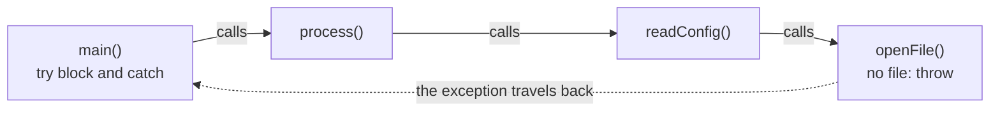
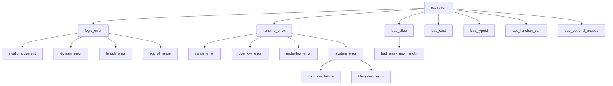
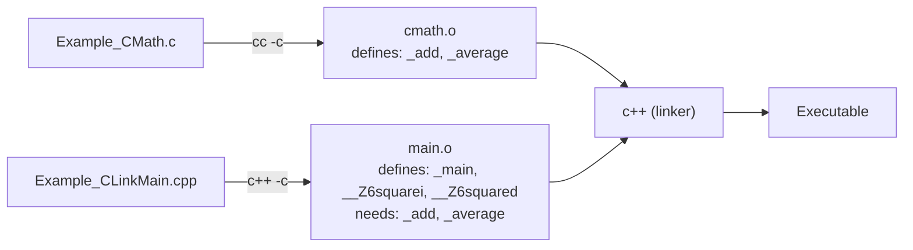

# Chapter 13 — Exception Handling and Linkage with C

[Repository Guide](../../README.md) | [English](Concepts_Lecture.md) | [한국어](Concepts_Lecture.ko.md)

> **Last Updated:** 2026-11-19

> **Learning Objectives:**
> 1. Explain the limits of reporting errors through return values and why exception handling is needed
> 2. Trace the control flow of `try`, `throw`, and `catch` and the rules for choosing a handler
> 3. Predict the order in which destructors run during stack unwinding, and use rethrowing and `noexcept` correctly
> 4. Use the hierarchy of standard exception classes and write user-defined exception classes
> 5. Distinguish the levels of exception safety and implement the strong guarantee with RAII and copy-and-swap
> 6. Link C code and C++ code together using name mangling and `extern "C"`

---

## Table of Contents

- [1. Runtime Errors and Error Handling](#1-runtime-errors-and-error-handling)
  - [1.1 Kinds of Errors](#11-kinds-of-errors)
  - [1.2 Reporting Errors through Return Values](#12-reporting-errors-through-return-values)
  - [1.3 Reporting Errors by Terminating the Program](#13-reporting-errors-by-terminating-the-program)
  - [1.4 The Idea of Exception Handling](#14-the-idea-of-exception-handling)
- [2. Exceptions and Exception Handling](#2-exceptions-and-exception-handling)
  - [2.1 `try`, `throw`, `catch`](#21-try-throw-catch)
  - [2.2 Tracing the Control Flow](#22-tracing-the-control-flow)
  - [2.3 Exceptions Propagating out of Functions](#23-exceptions-propagating-out-of-functions)
  - [2.4 The Exception Object](#24-the-exception-object)
  - [2.5 Nested `try` Blocks](#25-nested-try-blocks)
- [3. Exception Handling in Detail](#3-exception-handling-in-detail)
  - [3.1 Rules for Choosing a Handler](#31-rules-for-choosing-a-handler)
  - [3.2 Stack Unwinding](#32-stack-unwinding)
  - [3.3 Rethrowing](#33-rethrowing)
  - [3.4 Exceptions in Constructors and Destructors](#34-exceptions-in-constructors-and-destructors)
  - [3.5 Exception Specifications and `noexcept`](#35-exception-specifications-and-noexcept)
- [4. Writing Exception Classes](#4-writing-exception-classes)
  - [4.1 Why Objects Are Thrown](#41-why-objects-are-thrown)
  - [4.2 The Standard Exception Class Hierarchy](#42-the-standard-exception-class-hierarchy)
  - [4.3 User-Defined Exception Classes](#43-user-defined-exception-classes)
- [5. Exception Safety](#5-exception-safety)
  - [5.1 Levels of Exception Safety](#51-levels-of-exception-safety)
  - [5.2 RAII and Releasing Resources](#52-raii-and-releasing-resources)
  - [5.3 The Strong Guarantee and Copy-and-Swap](#53-the-strong-guarantee-and-copy-and-swap)
  - [5.4 Where Exceptions Are Not Used](#54-where-exceptions-are-not-used)
  - [5.5 Choosing How to Report Errors](#55-choosing-how-to-report-errors)
- [6. Linking C++ Code with C Code](#6-linking-c-code-with-c-code)
  - [6.1 Translation Units and Symbols](#61-translation-units-and-symbols)
  - [6.2 Name Mangling](#62-name-mangling)
  - [6.3 The `extern "C"` Linkage Specification](#63-the-extern-c-linkage-specification)
  - [6.4 Headers Shared by C and C++](#64-headers-shared-by-c-and-c)
  - [6.5 Calling C++ Functions from C](#65-calling-c-functions-from-c)
- [Concept Applications](#concept-applications)
- [Glossary](#glossary)
- [Summary](#summary)
- [Self-Check Questions](#self-check-questions)
- [References](#references)

---

<br>

## 1. Runtime Errors and Error Handling

### 1.1 Kinds of Errors

Errors in a program are classified by when they are found. The compiler reports wrong syntax, and the linker reports a function that is declared but never defined ([Chapter 1](../Ch01_Introduction-to-CPP/Concepts_Lecture.md)). This chapter deals with errors that arise **during execution**, after the program has passed both compilation and linking.

Runtime errors can be seen in two kinds. One kind arises because the program's logic is wrong, such as an index outside the bounds of an array or a division by zero; in principle it can be removed by fixing the code. The other kind arises from circumstances outside the program, such as a missing file, insufficient memory, or a user entering a value with the wrong format; it can happen to even a correct program, so it must be prepared for. The exception classes of the C++ standard library follow this distinction as well, dividing errors into **logic errors** and **runtime errors** (Section 4.2)[1].

### 1.2 Reporting Errors through Return Values

The traditional method inherited from C is to report success or failure through a function's return value. For example, a function that computes the average of an array can be made to return -1 when there are no elements.

```cpp
double average(const int* a, int n) {
    if (n <= 0)
        return -1;                          // a special value that means an error
    int sum = 0;
    for (int i = 0; i < n; i++)
        sum += a[i];
    return static_cast<double>(sum) / n;
}
```

This method has the following limits.

- **Error values and normal values can overlap.** If the scores include negative numbers, the average can actually be -1, so the caller cannot tell whether -1 is an error or a result.
- **Checks are easy to forget.** Unless the function carries the C++17 attribute `[[nodiscard]]`, the compiler does not warn when the return value is not checked, so the error value -1 is used as it is in the next computation.
- **The error must be passed through several levels.** If there are several levels of calls between the function that finds the error and the function that can handle it, every function in between must check the return value and pass it up again. Code for the normal flow gets mixed with code that passes errors along.
- **Some functions cannot use the return value.** A constructor has no return value, and an operator such as `operator+`, which must return its result, has no room to report an error.

Instead of the return value, a function can return the result through a reference parameter and return a `bool` for success, or leave an error number in a global variable like C's `errno`, but the problems of forgotten checks and passing through several levels remain.

### 1.3 Reporting Errors by Terminating the Program

Another method is to end the program with `exit()` or `abort()` where the error is found. It is simple in small tool programs, but when a library function ends the whole program, the code using that function loses the chance to recover from the error. A program editing an unsaved document must not terminate because it failed to open one file.

`assert(condition)` from `<cassert>` prints a diagnostic message and calls `abort()` if the condition is false. `assert` is a tool for checking the programmer's assumption that "this condition must always be true," and when the program is compiled with the `NDEBUG` macro defined, the check itself disappears. It is therefore not used to check situations that differ on every run, such as user input or the existence of a file.

### 1.4 The Idea of Exception Handling

Exception handling separates the place that **finds** an error from the place that **handles** it. The function that finds the error throws a value representing the error and stops executing immediately; the throw travels back along the call chain, and handling begins at a place that has declared that it handles that error. The functions in between need no code to pass the error along.

> **Definition:** An **exception** is a value that a function throws outward along the call chain to report that a situation has arisen during execution in which the function cannot continue its work in the normal way.



*Figure 1. An exception thrown at the innermost point of a call chain is delivered to the handler in `main()`*

In Figure 1, `openFile()` finds that the file does not exist, but it does not know what to do in that situation (open another file, ask the user, use default values). That judgment belongs to `main()`, which knows the whole program. `process()` and `readConfig()` are only the path the exception passes through and contain no code about the exception.

---

<br>

## 2. Exceptions and Exception Handling

### 2.1 `try`, `throw`, `catch`

Exception handling consists of three keywords.

```cpp
try {
    // statements that may raise an exception (the try block)
    throw expression;          // throws an exception
}
catch (Type1 parameter) {
    // handles exceptions of Type1 (a handler)
}
catch (Type2 parameter) {
    // handles exceptions of Type2
}
```

- **`throw` expression:** Creates an exception object from the value of the expression and throws it. The statements after `throw` are not executed.
- **`try` block:** The region in which exceptions are watched. An exception thrown inside this block, or inside a function called from this block, is delivered to the handlers that follow.
- **`catch` handler:** The parameter declaration in parentheses specifies the type of exception it receives. A `try` block can have several handlers and must have at least one.

> **Definition:** An **exception handler** is a `catch` clause after a `try` block; when an exception matching the declared type is thrown, it initializes its parameter with that exception object and executes its body.

When the body of a handler ends, execution continues with the statement after the last handler. Unlike a function call, it does not return to the point where the exception was thrown.

[Chapter 4, Section 5](../Ch04_Pointers-Arrays-and-Dynamic-Memory/Concepts_Lecture.md#5-exception-handling) showed the `bad_alloc` thrown by `new` and an example that throws a string. This chapter covers the rules by which that syntax works.

### 2.2 Tracing the Control Flow

[Example_ThrowCatch.cpp](Example_ThrowCatch.cpp) divides three pairs of numbers, and `divide()` throws an exception when the divisor is 0.

```cpp
int divide(int a, int b) {
    if (b == 0)
        throw b;                                 // leaves divide() at once; the int 0 is thrown
    return a / b;
}

int main() {
    int pairs[3][2] = {{10, 2}, {7, 0}, {9, 3}};
    for (auto& p : pairs) {
        cout << "try " << p[0] << " / " << p[1] << endl;
        try {
            int q = divide(p[0], p[1]);
            cout << "  quotient " << q << endl;  // skipped when divide() throws
        } catch (int divisor) {                  // receives a copy of the thrown int
            cout << "  caught: divisor " << divisor << endl;
        }
        cout << "  after the try-catch" << endl;
    }
    return 0;
}
```

```text
try 10 / 2
  quotient 5
  after the try-catch
try 7 / 0
  caught: divisor 0
  after the try-catch
try 9 / 3
  quotient 3
  after the try-catch
```

| Pair | What `divide()` does | Statements executed | Statements skipped |
|:-----|:-----|:-----|:-----|
| 10, 2 | Returns 5 | Prints `quotient 5`, prints `after` | The handler |
| 7, 0 | Throws 0 with `throw b` | Prints `caught` in the handler, prints `after` | `return a / b`, the initialization of `q`, printing `quotient` |
| 9, 3 | Returns 3 | Prints `quotient 3`, prints `after` | The handler |

*Table 1. Statements executed and skipped in the three iterations*

In the second iteration, when `throw b` runs, the rest of `divide()` and the rest of the `try` block (the initialization and printing of `q`) are all skipped, and `catch (int divisor)`, whose type matches, runs. After the handler ends, `after the try-catch` is printed and the loop continues, so one exception does not stop the whole program.

### 2.3 Exceptions Propagating out of Functions

If there is no matching handler inside the function that threw the exception, that function ends immediately, and the exception passes to the place that called the function, where handlers are searched again. This search continues outward along the call chain until a matching handler is found[1]. If there is no matching handler even after reaching `main()`, `std::terminate()` is called and the program terminates abnormally. In this case, whether the destructors of local objects are called (whether the stack is unwound) is implementation-defined[1].

```cpp
int main() {
    throw std::runtime_error("disk full");      // no handler receives it
}
```

```text
libc++abi: terminating due to uncaught exception of type std::runtime_error: disk full
```

On macOS this program prints the message above and ends through `abort()`, and the exit status seen by the shell is 134. An unhandled exception is a defect of the program, so a program that calls functions that may throw has at least a final handler in `main()`.

### 2.4 The Exception Object

`throw expression` creates a new **exception object** from the value of the expression. The exception object is placed in memory managed by the implementation, separate from the local variables of the throwing function, and it lives until the last handler that handles the exception ends. So even though `b` in `throw b` is a parameter of `divide()` and disappears when the function ends, the handler receives its value safely.

The handler's parameter is initialized from this exception object. If the parameter is a value (`catch (int divisor)`), it receives a copy of the exception object; if it is a reference (`catch (const Error& e)`), it refers to the exception object itself. Exceptions of class type are received by `const` reference, for the reasons in Section 4.1.

> **Caution:** Throwing the address of a local variable (`throw &local;`) gives a dangling pointer, because by the time the handler receives it, the variable has already disappeared. Throw exceptions by value.

### 2.5 Nested `try` Blocks

A `try` block can be inside another `try` block, and a function running inside the `try` block of its caller can have its own `try` block. When an exception is thrown, the handlers of the innermost `try` block are examined first, and if none matches, the search moves to the `try` block that surrounds it[1]. [Example_NestedTry.cpp](Example_NestedTry.cpp) has `try` blocks at three levels.

```cpp
void inner() {
    try {
        throw out_of_range("index 9");
    } catch (const invalid_argument&) {          // does not match out_of_range
        cout << "inner handler" << endl;
    }
    cout << "inner end" << endl;                 // skipped: the exception left inner()
}

void middle() {
    try {
        inner();
    } catch (const out_of_range& e) {
        cout << "middle caught: " << e.what() << endl;
        throw runtime_error("middle gave up");   // a new exception from inside a handler
    } catch (const runtime_error& e) {           // a sibling handler never sees it
        cout << "middle sibling: " << e.what() << endl;
    }
}

int main() {
    try {
        middle();
    } catch (const out_of_range&) {
        cout << "main: out_of_range" << endl;
    } catch (const runtime_error& e) {
        cout << "main caught: " << e.what() << endl;
    }
    return 0;
}
```

```text
middle caught: index 9
main caught: middle gave up
```

1. The `try` block of `inner()` throws `out_of_range`. The handler `catch (const invalid_argument&)` does not match, so `inner()` ends at that point and `inner end` is not printed.
2. In the `try` block of `middle()`, the first handler, `catch (const out_of_range& e)`, matches and prints `middle caught: index 9`.
3. Inside that handler a new `runtime_error` is thrown. The statements inside a handler are outside its `try` block, so the `catch (const runtime_error& e)` right below does not receive this exception. The search moves to the `try` block of `main()`, which called `middle()`.
4. Of the handlers in `main()`, the second one, which matches `runtime_error`, prints `main caught: middle gave up`.

Throwing an exception of another type from a handler is used to turn a low-level error (`out_of_range`) into a higher-level error that the users of the function understand.

---

<br>

## 3. Exception Handling in Detail

### 3.1 Rules for Choosing a Handler

When an exception is thrown, the handlers are examined **in the order in which they appear**, and only the first matching handler runs[1]. A handler matches an exception object of type `E` in the following cases[1].

| Handler type | Matches when |
|:-----|:-----|
| `T` or `T&` (including `const`) | `E` is the same type as `T`, or `T` is an unambiguous `public` base class of `E` |
| Pointer `T` | `E` is a pointer that can become `T` through a standard pointer conversion (derived to base, to `void*`) or by adding `const` |
| `...` | Every exception |

*Table 2. Exception object types and the handlers that match them*

Conversions not in the table do not happen. In particular, the **arithmetic conversions** that happen automatically in function calls do not happen when a handler is chosen. Throwing an `int` does not match `catch (long)` or `catch (double)`, and throwing a `float` does not match `catch (double)`. Throwing the string literal `"message"` converts the array to a pointer, so the exception object has type `const char*`; it must be received with `catch (const char*)` and cannot be received with `catch (std::string)`.

[Example_HandlerMatching.cpp](Example_HandlerMatching.cpp) throws five types and receives them with the same list of handlers.

```cpp
switch (kind) {
case 0: throw 42;                        // int
case 1: throw 3.5f;                      // float: no conversion to double
case 2: throw "message";                 // const char*
case 3: throw Derived();                 // matches const Base&
case 4: throw string("text");            // no handler below matches std::string
}
// catch (int) → catch (double) → catch (const char*) → catch (const Base&) → catch (...)
```

```text
0: int 42
1: caught by ...
2: const char* message
3: Base& holding Derived
4: caught by ...
```

The `float` 3.5 passes over `catch (double)` and is caught by `catch (...)`. The `Derived` object matches `catch (const Base& b)`, a reference to its `public` base class, and because `b.name()` is a virtual function, the `Derived` version is called. `catch (...)` matches every exception, so it must be placed last[1].

**The ordering trap.** If a handler for a base class comes before a handler for a derived class, the earlier handler receives the exceptions of the derived class too, so the later handler can never run. Clang warns about such code with `warning: exception of type 'const D &' will be caught by earlier handler`. Place handlers **from the most specific derived class to the base class**.

### 3.2 Stack Unwinding

When an exception leaves a function, the local objects that were fully constructed in that function are not abandoned; their destructors are called.

> **Definition:** **Stack unwinding** is the process in which, while control moves from the point where an exception was thrown to the handler, the destructors of the automatic objects constructed in between and not yet destroyed are called in the reverse order of construction.

[Example_StackUnwinding.cpp](Example_StackUnwinding.cpp) puts one `Tracer` object, which prints its construction and destruction, in each function and throws an exception from the innermost function.

```cpp
void level3(int n) {
    Tracer t("t3");
    if (n < 0)
        throw invalid_argument("negative input");
    cout << "  level3 finished" << endl;          // skipped when n < 0
}

void level2(int n) {
    Tracer t("t2");
    level3(n);
    cout << "  level2 finished" << endl;
}

int main() {
    Tracer t0("t0");
    try {
        Tracer t1("t1");
        level2(-5);
        cout << "  main continues inside try" << endl;
    } catch (const invalid_argument& e) {
        cout << "  caught: " << e.what() << endl;
    }
    cout << "  after catch" << endl;
    return 0;
}
```

```text
  construct t0
  construct t1
  construct t2
  construct t3
  destroy   t3
  destroy   t2
  destroy   t1
  caught: negative input
  after catch
  destroy   t0
```

- When the exception is thrown, the live objects are `t0`, `t1`, `t2`, and `t3`.
- The search for a handler leaves `level3`, `level2`, and the `try` block in turn, so `t3`, `t2`, and `t1` are destroyed in that order. Only after all three destructions does the handler run and print `caught`. The standard specifies that the stack has already been unwound when the initialization of the handler's parameter is complete[1].
- `t0` was created outside the `try` block, so it is not part of the unwinding and is destroyed when `main()` ends.
- `level3 finished`, `level2 finished`, and `main continues inside try` are all skipped.

Thanks to stack unwinding, objects that release resources in their destructors do not lose those resources even when an exception occurs. The technique that uses this property is RAII in Section 5.2.

### 3.3 Rethrowing

To handle an exception only partly inside a handler (for example, by writing a log) and leave the rest of the handling to an outer level, **rethrow** it with `throw;`, which has no operand. `throw;` rethrows the exception object currently being handled as it is. Executing `throw;` when no exception is being handled calls `std::terminate()`[1].

[Example_Rethrow.cpp](Example_Rethrow.cpp) throws `FileError`, which inherits `runtime_error`; an intermediate function receives it as `const exception&` and rethrows it in two ways.

```cpp
void rethrowSame() {
    try { open(); }
    catch (const exception& e) {
        cout << "  log: " << e.what() << endl;
        throw;                                   // rethrows the original FileError object
    }
}

void rethrowCopy() {
    try { open(); }
    catch (const exception& e) {
        throw e;                                 // copies only the exception part: slicing
    }
}
```

```text
  log: config.txt not found
throw;  -> FileError: config.txt not found
throw e -> exception: std::exception
by value  -> std::exception
```

An exception rethrown with `throw;` is still a `FileError`, so the outer `catch (const FileError& e)` receives it. In contrast, `throw e;` copies a new exception object with the **static type** of `e`, `exception`, so the `FileError` part is sliced off; on the outside, `catch (const exception& e)` receives it, and `what()` returns the default string of `exception` (`std::exception` in libc++). The last line shows that the same slicing occurs when the handler's parameter is declared by value (`catch (exception e)`) (object slicing in [Chapter 9](../Ch09_Virtual-Functions-and-Abstract-Classes/Concepts_Lecture.md)).

> **Key Point:** Throw exceptions by value, catch them by `const` reference, and when rethrowing inside a handler, use `throw;`, not `throw e;`.

### 3.4 Exceptions in Constructors and Destructors

**Exceptions in constructors.** A constructor has no return value, so a situation in which the object cannot be created is reported with an exception. When a constructor ends with an exception, the object is treated as never having been created, and **its destructor is not called**. Instead, the members and base classes constructed up to that point are destroyed in reverse order. The `Car` of [Example_ConstructorFailure.cpp](Example_ConstructorFailure.cpp) has the members `body`, `engine`, and `wheels`, in this order, and the constructor of `engine` throws an exception.

```cpp
struct Car {
    Part body;                                   // members are built in declaration order
    Engine engine;
    Part wheels;
    Car() try : body("body"), engine(), wheels("wheels") {
        cout << "  Car built" << endl;
    } catch (const exception& e) {               // a function-try-block sees initializer exceptions
        cout << "  Car's handler: " << e.what() << endl;
    }                                            // the exception is rethrown automatically here
    ~Car() { cout << "  ~Car" << endl; }
};
```

```text
  Part body built
  Engine throws
  Part body destroyed
  Car's handler: engine failure
main caught: engine failure
```

- `body` was fully constructed, so it is destroyed. The constructor of `engine` did not finish, so `~Engine` is not called, and `wheels` was never even created.
- `Car` itself was not created either, so `~Car` is not called. Memory obtained with `new` in the constructor body must therefore be managed by the RAII members of Section 5.2, not by the destructor, to avoid a leak.
- The form with `try` before the constructor body and handlers after the body is called a **function-try-block**. An ordinary `try` block cannot enclose the initializer list, so this form is used to receive exceptions from member initialization inside the constructor. When a handler of a constructor's function-try-block ends, the exception is rethrown automatically[1], so the object cannot be saved; the form is used to write a log or to throw the exception again as a different type.

**Exceptions in destructors.** Since C++11, a destructor without `noexcept` has the same exception specification as the destructor the compiler would declare implicitly[1], so unless the destructor of a member or base class is declared as potentially throwing, it is a function that does not throw. If an exception leaves a destructor, `std::terminate()` is called. `std::terminate()` is also called when a destructor ends with an exception during stack unwinding[1], because there is no way to handle a second exception while one is already propagating. Operations that may fail inside a destructor (closing a file, disconnecting from a network) catch and handle the exception inside the destructor, or are provided as a separate function such as `close()` so that the caller can check the result.

### 3.5 Exception Specifications and `noexcept`

**Removal of dynamic exception specifications.** Old C++ code and textbooks listed the types of exceptions a function could throw after its declaration, as in `int get() throw(char*)`. This **dynamic exception specification** was deprecated in C++11, and the form that states the function may throw was removed in C++17[1][2]. Compiling with C++17 or later gives an error like the following.

```text
error: ISO C++17 does not allow dynamic exception specifications [-Wdynamic-exception-spec]
note: use 'noexcept(false)' instead
```

**The `noexcept` specifier.** Since C++11, only the fact that a function does not throw is marked, with `noexcept`. `void f() noexcept;` is a promise not to throw exceptions, and `noexcept(condition)` makes that promise only when the compile-time constant condition is true. If an exception tries to leave a `noexcept` function, `std::terminate()` is called instead of a search for a handler[1].

**The `noexcept` operator.** `noexcept(expression)` computes at compile time whether the expression can throw an exception and yields a `bool`. The expression is not executed. [Example_Noexcept.cpp](Example_Noexcept.cpp) shows both features.

```cpp
int twice(int x) noexcept { return 2 * x; }
int parse(int x) { if (x < 0) throw invalid_argument("negative"); return x; }

void careless(int x) noexcept {
    cout << "careless(" << x << ")" << endl;
    parse(x);                                    // may throw inside a noexcept function
}

struct Quiet { ~Quiet() {} };                    // destructors are noexcept by default
```

```text
$ ./noexcept_demo x
noexcept(twice(1)) = true
noexcept(parse(1)) = false
is_nothrow_destructible<Quiet> = true
careless(-1)
libc++abi: terminating due to uncaught exception of type std::invalid_argument: negative
```

Run with an argument, the program calls `careless(-1)`, and the exception thrown by `parse(-1)` tries to leave the `noexcept` function. `main()` has a `catch (...)`, but that handler does not run, and the program terminates (exit status 134). `noexcept` is not a promise the compiler checks for you; it is a promise whose violation ends the program.

**Where to put `noexcept`.** Put it on functions that clearly do not throw, especially destructors, move constructors and move assignment operators, and `swap` functions. For elements that can be copied, the standard containers use moves during reallocation only when the move constructor of the element is `noexcept`, so whether move operations are `noexcept` directly affects performance ([Chapter 14](../Ch14_Move-Semantics-and-Modern-CPP/Concepts_Lecture.md)).

---

<br>

## 4. Writing Exception Classes

### 4.1 Why Objects Are Thrown

A value of any type can follow `throw`, but throwing an `int` or a string causes the following problems.

- **The kinds cannot be told apart.** The error codes `throw 3;` and `throw 7;` are received by the same handler `catch (int)`, so the handler must compare the value again.
- **Information is lacking.** A single string cannot hold information such as the name of the failed file, a line number, and a cause code in a structured way.
- **Related errors cannot be grouped.** Even if file errors and network errors should all be handled together as "I/O errors," an `int` has no hierarchy.

With exception classes, the type itself represents the kind of error, members hold the needed information, and inheritance classifies the errors. By the rules of Section 3.1, a handler receives several derived classes at once through a reference to their base class. Receiving exceptions of class type by `const` reference involves no copy, and the slicing of Section 3.3 does not occur.

### 4.2 The Standard Exception Class Hierarchy

Every exception thrown by the standard library has `std::exception` from `<exception>` as its base class[1]. `std::exception` has the virtual function `virtual const char* what() const noexcept`, which returns a string describing the error. `<stdexcept>` divides errors into **logic errors** (`logic_error`), which arise because the internal logic of the program is wrong, and **runtime errors** (`runtime_error`), which arise from circumstances outside the program and are hard to predict in advance[1].



*Figure 2. The main inheritance hierarchy of the standard exception classes*

[Example_StandardExceptions.cpp](Example_StandardExceptions.cpp) raises several exceptions through standard library operations.

| Operation | Exception thrown | Category |
|:-----|:-----|:-----|
| `v.at(5)` (`v` has size 3) | `out_of_range` | Logic error |
| `stoi("abc")` | `invalid_argument` | Logic error |
| `stoi("99999999999")` | `out_of_range` | Logic error |
| A failing reference `dynamic_cast<Circle&>(s)` | `bad_cast` | Language support |
| `new int[n]` with an unsatisfiable size | `bad_alloc` | Memory |
| A failure on a stream with `exceptions()` set | `ios_base::failure` | Runtime error (Chapter 12, Section 7.4) |
| Calling an empty `std::function` | `bad_function_call` | Language support (Chapter 14) |

*Table 3. Standard library operations and the exceptions they throw*

```text
out_of_range
stoi("12x") = 12
invalid_argument from stoi("abc")
out_of_range from stoi("99999999999")
bad_cast
bad_alloc
```

Note that `stoi("12x")` converts the leading `12` and stops at `x`; it does not throw. It throws `invalid_argument` only when there are no digits at all. Using `[]` instead of `at()`, as in `v[5]`, does not check the range, so it is undefined behavior without any exception.

The string returned by `what()` is the string given to the constructor or, for an object created by the default constructor, an implementation-defined string. The standard requires the classes of the standard library that derive from `exception` to have copy constructors and copy assignment operators that do not throw[1]. An exception object can be copied while it is thrown and caught, and if that copy threw another exception, there would be no way to handle it.

### 4.3 User-Defined Exception Classes

A user-defined exception class is made by inheriting the standard exception class whose meaning fits. Then a single `catch (const std::exception& e)` receives both standard and user exceptions, and `what()` can be used as it is. In the same example, `InsufficientFunds` is thrown when the balance is insufficient and holds the missing amount as a member.

```cpp
class InsufficientFunds : public runtime_error {   // a user-defined exception class
    double shortage;
public:
    InsufficientFunds(double need, double have)
        : runtime_error("insufficient funds"), shortage(need - have) {}
    double amount() const noexcept { return shortage; }
};

void withdraw(double amount) {
    if (amount <= 0)
        throw invalid_argument("amount must be positive");
    if (amount > balance)
        throw InsufficientFunds(amount, balance);
    balance -= amount;
}
```

```cpp
for (double r : requests) {                      // requests = {30, -5, 200}, starting from a balance of 100
    try {
        acc.withdraw(r);
        cout << "withdrew " << r << ", balance " << acc.get() << endl;
    } catch (const InsufficientFunds& e) {       // the most derived class comes first
        cout << e.what() << ": short by " << e.amount() << endl;
    } catch (const logic_error& e) {
        cout << "logic_error: " << e.what() << endl;
    } catch (const exception& e) {
        cout << "other: " << e.what() << endl;
    }
}
```

```text
withdrew 30, balance 70
logic_error: amount must be positive
insufficient funds: short by 130
```

- Withdrawing 30 leaves a balance of 100 - 30 = 70.
- -5 throws `invalid_argument`, and since `invalid_argument` is a derived class of `logic_error`, the second handler receives it.
- 200 is greater than the balance 70, so `InsufficientFunds(200, 70)` is thrown, and the missing amount is 200 - 70 = 130. The first handler receives it and prints that value through `amount()`.
- The string `"insufficient funds"` was passed to the constructor of the base class `runtime_error`, so `what()` returns that string.

Follow these points when writing exception classes.

- Inherit a standard exception class (`runtime_error`, `logic_error`, or one of their derived classes) as `public`.
- Make member functions, especially those that retrieve information and any override of `what()`, `noexcept`.
- Many `std::string` members can fail while allocating memory during a copy, so pass the message to the base class constructor to be stored there.
- Do not throw a pointer to an exception object created with `new`. The receiver cannot know whether it must `delete` it.

---

<br>

## 5. Exception Safety

### 5.1 Levels of Exception Safety

When an exception occurs, the rest of the function's statements are not executed, so the work the function was doing is cut off midway. **Exception safety** is the property that tells whether the program is left in a correct state even in that situation.

> **Definition:** **Exception safety** is the property that tells whether resources do not leak and objects are left in a correct state even when a function ends with an exception; it is divided into several levels by how much is guaranteed.

| Level | What is guaranteed when the function ends with an exception | Example |
|:-----|:-----|:-----|
| No-throw guarantee | It does not throw | Destructors, `swap`, `noexcept` move constructors |
| Strong guarantee | The state is the same as before the call (all or nothing) | `vector::push_back` (when copying or moving the element meets the conditions) |
| Basic guarantee | No resources leak and objects are usable, but values may have changed | Most functions that change several elements in turn |
| No guarantee | Resources may leak or objects may break | Code that uses `new` and `delete` directly without considering exceptions |

*Table 4. Levels of exception safety*

The standard specifies that if an exception occurs while inserting a single element at the end of a `vector`, there is no effect (the strong guarantee), provided the element is copyable or its move constructor does not throw[1]. Functions that users write should provide at least the basic guarantee, and the strong guarantee where possible.

### 5.2 RAII and Releasing Resources

If memory obtained with `new` is held in a local pointer and an exception occurs while it is in use, execution never reaches the statement with `delete`, and the memory leaks. Stack unwinding only calls the destructors of objects; it does not free the object a pointer variable points to. [Example_RaiiCleanup.cpp](Example_RaiiCleanup.cpp) compares the two approaches.

```cpp
void rawVersion(bool fail) {
    Resource* r = new Resource(1);
    work(fail);                                  // if this throws, the delete below is skipped
    delete r;
}

void raiiVersion(bool fail) {
    auto r = make_unique<Resource>(2);           // the destructor of r runs during unwinding
    work(fail);
}
```

```text
  acquire 1
caught: work failed (resource 1 leaked)
  acquire 2
  release 2
caught: work failed
```

In `rawVersion`, the exception occurs after resource 1 is acquired, so `release 1` is not printed. In `raiiVersion`, the `unique_ptr` object `r` is a local object, so its destructor is called during unwinding, and that destructor releases resource 2. This technique of wrapping a resource in a class that acquires it in the constructor and releases it in the destructor, tying the resource's lifetime to the object's lifetime, is called **RAII** ([Chapter 4, Section 6](../Ch04_Pointers-Arrays-and-Dynamic-Memory/Concepts_Lecture.md#6-smart-pointers-modern-c)). If not only memory but also file streams (Chapter 12), locks, and network connections are managed the same way, resources are released wherever an exception occurs.

> **Key Point:** The foundation of exception-safe code is not using many `try` and `catch` blocks but entrusting resources to RAII objects. Then the functions an exception passes through need no cleanup code.

### 5.3 The Strong Guarantee and Copy-and-Swap

A function that changes an object in several steps leaves the object half-changed if an exception occurs midway. **Copy-and-swap** is a technique that obtains the strong guarantee by first doing all the work that may throw on a temporary object and, after it succeeds, moving the result over with a swap that does not throw. [Example_StrongGuarantee.cpp](Example_StrongGuarantee.cpp) implements the assignment of `Pair`, which holds two strings dynamically, in two ways, and simulates an allocation limit with the global variable `budget` to make a large allocation fail.

```cpp
void assignUnsafe(const Pair& o) {           // basic guarantee at best
    delete first;
    first = allocate(*o.first);              // succeeds
    delete second;
    second = nullptr;
    second = allocate(*o.second);            // may throw: *this is now half new, half empty
}
void assignStrong(const Pair& o) {           // strong guarantee
    Pair temp(o);                            // every step that may throw happens here
    swap(first, temp.first);                 // swapping pointers cannot throw
    swap(second, temp.second);
}                                            // temp releases the old contents
```

```text
assignStrong failed
after assignStrong: red, blue
assignUnsafe failed
after assignUnsafe: green, <empty>
```

`p` is `("red", "blue")` and `big` is `("green", a 60-character string)`; after the limit is reduced to 10 bytes, `big` is assigned to `p`.

- `assignStrong` fails at the 60-character allocation while building `temp` with the copy constructor. `p` has not been touched yet, so it is still `red, blue`. The failed constructor of `temp` frees the `"green"` it had already allocated by itself.
- `assignUnsafe` changes `first` to `"green"` and then fails at the allocation of `second`. `p` becomes `green, <empty>`, a state that is neither the original value nor the new one. No resources leak, so the basic guarantee holds, but it is not the strong guarantee.
- The cost of the strong guarantee is creating one more temporary object. Writing the assignment operator to take its parameter by value, as in `Pair& operator=(Pair o) { swap(...); return *this; }`, expresses the same idea more briefly.

### 5.4 Where Exceptions Are Not Used

Exceptions are a means of reporting failures that happen rarely. Other means are used in the following cases.

- **Destructors, move operations, `swap`.** For the reasons in Section 3.4 and Chapter 14, they are made not to throw.
- **Common outcomes.** Situations that happen often, such as format errors in user input, are better treated as normal outcomes. Streams report them through state bits (Chapter 11, Section 4), and results that may have no value report it through `std::optional` ([Chapter 10](../Ch10_Templates-and-STL/Concepts_Lecture.md)).
- **The boundary with C code.** C functions know nothing of exceptions, so a C++ exception must not pass through C code. A C++ function called from C catches every exception inside and converts it to an error code (Section 6.5).

### 5.5 Choosing How to Report Errors

The methods of Section 1 and exceptions do not replace each other; they are tools chosen according to the situation.

| Method | Suitable situations | Points to watch |
|:-----|:-----|:-----|
| Exceptions | Failures that happen rarely, cannot be handled where they are found, and are handled far up the call chain | Exception-safe code (RAII) is needed |
| Return values, `std::optional` | Outcomes that happen often and are handled by the caller immediately (a failed search, malformed input) | The caller must not forget the check |
| Stream state bits | I/O failures (Chapters 11 and 12) | The result of each operation must be checked |
| `assert` | Detecting logic errors where the programmer's assumptions break (debug builds) | The check disappears when compiled with `NDEBUG` |
| Terminating the program | Situations with no way to recover (initialization failure and the like) | Unsaved data and buffered output may be lost |

*Table 5. Ways to report errors and the situations they suit*

For example, a function that reads a configuration file should throw an exception if the file does not exist, because that function cannot decide whether to use default settings or to end the program. In contrast, a function that looks up a key in a `map` returns its result through an iterator or an `optional`, because a missing key is common, while functions such as `vector::at()`, where a failed range check is the programmer's mistake, throw exceptions.

---

<br>

## 6. Linking C++ Code with C Code

### 6.1 Translation Units and Symbols

C++ programs often use libraries written in C long ago (operating system APIs, numerical libraries, compression libraries, and so on) as they are. C source files are compiled into object files by a C compiler and C++ source files by a C++ compiler, and the linker combines them into one executable (the build process in [Chapter 1](../Ch01_Introduction-to-CPP/Concepts_Lecture.md)). An object file contains the names of the functions and global variables it defines and a list of the names that must be found in other files. These names are called **symbols**, and for each undefined symbol, the linker finds and connects a symbol defined with the same name.



*Figure 3. Linking a C object file and a C++ object file (symbols as written on macOS)*

For linking to succeed, the name of the symbol the C++ object file looks for and the name of the symbol the C object file defines must be **identical, character for character**. The problem is that a C++ compiler does not use a function's name as its symbol as it is.

### 6.2 Name Mangling

C++ allows function overloading ([Chapter 6](../Ch06_Overloading-and-Static-Members/Concepts_Lecture.md)), so `int square(int)` and `double square(double)` can exist together in one program. If both functions had the symbol `square`, the linker could not tell them apart, so a C++ compiler builds symbols by adding information about parameter types, classes, and namespaces to function names.

> **Definition:** **Name mangling** is the transformation in which a compiler encodes information such as parameter types, the enclosing class, and the namespace into the names of functions and variables, so that even overloaded names become different symbols.

In the environment of this chapter (Clang on macOS), viewing the symbols of the object file compiled from [Example_CLinkMain.cpp](Example_CLinkMain.cpp) with `nm` gives the following.

```text
$ nm main.o
000000000000001c T __Z6squared
0000000000000000 T __Z6squarei
                 U _add
                 U _average
0000000000000038 T _main
$ nm cmath.o
0000000000000000 T _add
0000000000000020 T _average
```

`T` marks a symbol defined by this file, and `U` marks a symbol that must be found in another file. The other symbols that `nm` prints (names from the standard library and so on) are omitted. These names follow the rules of the Itanium C++ ABI[3].

| Declaration | Mangled name (ABI rule) | Meaning of the parts |
|:-----|:-----|:-----|
| `int square(int)` | `_Z6squarei` | Prefix `_Z`, name length 6, `square`, parameter `i` (`int`) |
| `double square(double)` | `_Z6squared` | Parameter `d` (`double`) |
| `int add(int, int)` (C++ linkage) | `_Z3addii` | Name length 3, `add`, parameters `i`, `i` |
| `int add(int, int)` (C linkage) | `add` | No mangling |

*Table 6. Examples of name mangling in the Itanium C++ ABI*

- The return type is not part of the name of an ordinary function. Overloads that differ only in return type are not allowed, so the symbols are distinct without the return type.
- macOS adds one more underscore in front of every symbol, so in `nm` the names appear as `__Z6squarei` and `_add`. This underscore is added by the operating system's object file format and is not part of the names in the ABI rules.
- The `c++filt` tool turns a mangled name back into the original declaration. `c++filt -_ __Z6squared` prints `square(double)`.
- The C++ standard does not specify the mangling rules, and they differ between compilers. Microsoft's compiler mangles `int a(char)` as `?a@@YAHD@Z`[4]. That is why C++ object files built by different compilers generally cannot be linked together, and the unmangled names of C serve as the common meeting point between languages and compilers.

### 6.3 The `extern "C"` Linkage Specification

A C compiler does not mangle names, so the definition of `add` becomes the symbol `add` (`_add` on macOS). If a C++ file only declares `int add(int, int);` and calls it, the C++ compiler looks for the mangled name `_Z3addii`, and linking fails.

```text
$ c++ nolink.o cmath.o -o nolink
Undefined symbols for architecture arm64:
  "add(int, int)", referenced from:
      _main in nolink.o
   NOTE: found '_add' in cmath.o, declaration possibly missing 'extern "C"'
ld: symbol(s) not found for architecture arm64
```

The linker shows the mangled name in human-readable form, `add(int, int)`, and even notes that it found the similar C symbol `_add`. The solution is a **linkage specification**, which tells the C++ compiler that the function follows C's naming rules.

```cpp
extern "C" int add(int a, int b);        // applied to one declaration

extern "C" {                             // applied to a group of declarations
    int add(int a, int b);
    double average(const int* values, int count);
}
```

The standard specifies that all function types and all names of functions and variables with external linkage have a **language linkage**, and that the default is C++ language linkage[1]. `extern "C"` gives the declaration C language linkage, and in practice the implementation represents the name the same way a C compiler does (an unmangled name) and calls it with the same calling convention as C. Every implementation must support the two linkages `"C"` and `"C++"`[1].

C language linkage comes with C's restrictions.

- **Overloading is not possible.** The standard specifies that, among functions with the same name, at most one can have C language linkage[1]. Defining `extern "C" int area(int, int)` and `extern "C" double area(double)` together gives `error: conflicting types for 'area'`.
- **It does not apply to class member functions.** Member functions of a class declared inside an `extern "C"` block still have C++ language linkage[1]. To let C work with objects, provide global functions that take a pointer to the object, declared `extern "C"`.
- **Namespaces are not distinguished.** C-linkage functions declared with the same name in different namespaces refer to the same function[1].

### 6.4 Headers Shared by C and C++

`extern "C"` is C++ syntax, so a C compiler does not understand it. To let C files and C++ files include the same header, wrap that part with the macro `__cplusplus`, which only C++ compilers define. [Example_CMath.h](Example_CMath.h) is as follows.

```c
#ifndef EXAMPLE_CMATH_H
#define EXAMPLE_CMATH_H

#ifdef __cplusplus
extern "C" {                 /* seen only by a C++ compiler: give the names C language linkage */
#endif

int add(int a, int b);
double average(const int *values, int count);

#ifdef __cplusplus
}
#endif

#endif /* EXAMPLE_CMATH_H */
```

When [Example_CMath.c](Example_CMath.c) is compiled with a C compiler, `__cplusplus` is not defined, so only the plain declarations of the two functions remain. When [Example_CLinkMain.cpp](Example_CLinkMain.cpp) is compiled with a C++ compiler, the declarations are wrapped in `extern "C" { }`. The value of `__cplusplus` indicates the edition of the standard and is `201703L` in C++17[1]. The headers of the standard C library (`<stdio.h>` and so on) are written the same way, so they can be included in C++ programs as they are.

```text
$ cc -std=c17 -Wall -Wextra -c Example_CMath.c -o cmath.o
$ c++ -std=c++17 -Wall -Wextra -c Example_CLinkMain.cpp -o main.o
$ c++ main.o cmath.o -o clink
$ ./clink
add(3, 5) = 8
average = 84
square(4) = 16, square(1.5) = 2.25
__cplusplus = 201703
```

`average(scores, 3)` computes (90 + 85 + 77) / 3 = 252 / 3 = 84 inside the C function. The overloaded C++-linkage function `square` can be used in the same program as usual.

> **[Systems Programming]** In the linking covered in Systems Programming, the linker reads the symbol table of each object file and connects each undefined symbol reference to the definition with the same name. Name mangling and `extern "C"` are the devices that, at this stage, make C++ overloads distinguishable by different names or let C functions meet C++ code under the same name.

### 6.5 Calling C++ Functions from C

Conversely, to let C code call a function written in C++, define that function in the C++ file with `extern "C"`. Inside the function, classes and the standard library can be used freely, but the parameter and return types must be types that C understands. [Example_CppGreet.cpp](Example_CppGreet.cpp) and [Example_CCaller.c](Example_CCaller.c) are an example.

```cpp
extern "C" int greet_length(const char* name) {   // callable from C
    try {
        std::string s = std::string("Hello, ") + name;
        std::printf("%s\n", s.c_str());
        return static_cast<int>(s.size());
    } catch (...) {                                // keeps exceptions from crossing into C
        return -1;
    }
}
```

```text
$ c++ -std=c++17 -c Example_CppGreet.cpp -o greet.o
$ cc -std=c17 -c Example_CCaller.c -o caller.o
$ c++ caller.o greet.o -o ccall
$ ./ccall
Hello, C
length 8
```

- **Link with the C++ driver.** The C++ function uses the C++ standard library, such as `std::string`, so linking with the C driver, as in `cc caller.o greet.o`, fails because symbols such as `std::__1::basic_string<...>` cannot be found. Linking with `c++` links the C++ standard library as well.
- **Catch exceptions inside the boundary.** C code knows nothing of stack unwinding, so exceptions should not leave a function called from C. Wrap the whole function in `try` and, in `catch (...)`, convert the failure to an error code and return it (Section 5.4).

---

<br>

## Concept Applications

**True/False Check:**

| Statement | Judgment and Reason |
|:-----|:-----|
| `throw 3;` can be received with `catch (long)`. | **F.** No arithmetic conversion happens when a handler is chosen, so `catch (int)` or `catch (...)` is needed (Section 3.1). |
| Even if `catch (const exception&)` comes before `catch (const out_of_range&)` in the handler list, the later handler receives `out_of_range`. | **F.** Handlers are examined in order, so the earlier base-class handler receives it (Section 3.1). |
| When an exception leaves a function, the destructors of its local objects are not called. | **F.** During stack unwinding, the destructors of fully constructed automatic objects are called in reverse order (Section 3.2). |
| `throw e;` and `throw;` inside a handler rethrow the same exception. | **F.** `throw e;` copies a new object of the static type, which can cause slicing, while `throw;` rethrows the original object (Section 3.3). |
| When a constructor ends with an exception, the object's destructor is called and the resources are released. | **F.** The object was never created, so its destructor is not called; only the fully constructed members are destroyed (Section 3.4). |
| If an exception leaves a `noexcept` function, an outer `catch (...)` receives it. | **F.** No handler is searched for; `std::terminate()` is called (Section 3.5). |
| A function declared `extern "C"` cannot be overloaded. | **T.** Among functions with the same name, at most one can have C language linkage (Section 6.3). |
| Linking C and C++ object files must be done with the C driver `cc`. | **F.** The C++ standard library is needed, so link with `c++` (Section 6.5). |

---

<br>

## Glossary

| English | Korean | One-Line Definition |
|:-----|:-----|:-----|
| runtime error | 실행 오류 | An error that a program meets during execution after passing compilation and linking |
| logic error / runtime error (category) | 논리 오류 / 실행 시간 오류 | An error caused by a mistake inside the program that can be prevented, and an error caused by outside circumstances that is hard to predict |
| try block | `try` 블록 | The watched region that delivers thrown exceptions to the handlers that follow |
| throw expression | `throw` 식 | The expression that creates and throws an exception object |
| exception object | 예외 객체 | The object created by `throw` and kept until the last handler ends |
| rethrow | 다시 던지기 | Sending the current exception outward again with `throw;` inside a handler |
| function-try-block | 함수 try 블록 | A `try` block that encloses an entire function body (including a constructor's initializer list) |
| dynamic exception specification | 동적 예외 지정 | The syntax, removed in C++17, that listed the exception types a function could throw with `throw(T)` |
| noexcept specifier / operator | `noexcept` 지정자 / 연산자 | The mark that a function does not throw, and the operator that tells whether an expression can throw |
| strong guarantee / basic guarantee | 강한 보장 / 기본 보장 | The guarantee that the state is unchanged on failure, and the guarantee that no resources leak and objects remain usable |
| copy-and-swap | 복사 후 교환 | The technique of working on a temporary object and then moving the result over with a non-throwing swap |
| symbol | 심볼 | A name of a function or variable recorded in an object file and connected by the linker |
| language linkage | 언어 링크 | The language rules (`"C"` or `"C++"`) that a name and a function type follow |

*Table 7. Glossary*

---

<br>

## Summary

| Concept | Key Summary |
|:-----|:-----|
| Limits of return values | Error values overlap with normal values, checks are easy to forget, errors must be passed through several levels, and constructors and operators cannot use them. |
| The idea of exception handling | The place that finds the error throws, the place that can handle it catches, and the functions in between need no code to pass it along. |
| `try`, `throw`, `catch` | `throw` throws an exception object, the first matching handler after the `try` block runs, and execution continues with the statement after the handlers. |
| Propagation and `terminate` | Without a matching handler the exception keeps moving back to the calling functions, and if none is found at all, `std::terminate()` is called. |
| Nested `try` blocks | The search moves from the innermost `try` block outward, and a new exception thrown inside a handler is not received by the other handlers of the same `try`. |
| Rules for choosing a handler | Only the same type, a `public` base class, and pointer conversions match; arithmetic conversions do not happen, and handlers are ordered from the derived classes. |
| Stack unwinding | On the way to the handler, the destructors of fully constructed automatic objects are called in the reverse order of construction. |
| Rethrowing | `throw;` rethrows the original exception object, while `throw e;` and handlers that receive by value cause slicing. |
| Exceptions in constructors and destructors | If a constructor throws, the object's destructor does not run and only the fully constructed members are destroyed; destructors are `noexcept` by default. |
| `noexcept` | A promise that a function does not throw; violating it calls `std::terminate()`, and the dynamic exception specification `throw(T)` was removed in C++17. |
| Standard exception hierarchy | Under `std::exception` are `logic_error` and `runtime_error`, and `what()` returns a description string. |
| User-defined exceptions | Inherit a standard exception class, hold the needed information as members, throw by value, and catch by `const` reference. |
| Exception safety | There are no-throw, strong, and basic guarantees, and functions should provide at least the basic guarantee. |
| RAII | Tying resources to object lifetimes makes stack unwinding call the destructors, so resources are released even when exceptions occur. |
| Copy-and-swap | Finishing the work that may fail on a temporary object and moving the result over with a non-throwing swap gives the strong guarantee. |
| Name mangling | A C++ compiler builds symbols by encoding parameter types and the like into function names, and the rules differ between compilers. |
| `extern "C"` | Gives a declaration C language linkage so that it links with C code under an unmangled name, and such a function cannot be overloaded. |
| Shared headers | Wrapping `extern "C" { }` in `#ifdef __cplusplus` lets C and C++ files include the same header. |
| Calling C++ from C | Define an `extern "C"` function on the C++ side, catch exceptions inside it, and link with the C++ driver. |

---

<br>

## Self-Check Questions

1. **Control flow:** Write the output of the following code.

   ```cpp
   void f(int n) {
       cout << "f start ";
       if (n > 0) throw n;
       cout << "f end ";
   }
   int main() {
       try { f(0); f(2); cout << "after "; }
       catch (int x) { cout << "caught " << x << " "; }
       cout << "done" << endl;
   }
   ```

   <details>
   <summary>Answer</summary>

   It is `f start f end f start caught 2 done`. `f(0)` does not throw and runs to the end. `f(2)` prints `f start` and then throws 2, so `f end` and the `after` in the `try` block are skipped, and the handler prints `caught 2`. Then `done` is printed.

   </details>

2. **Choosing a handler:** With handlers in the order `catch (double)`, `catch (const char*)`, `catch (const std::exception&)`, `catch (...)`, which handler receives each of `throw 1;`, `throw 1.0;`, `throw "x";`, `throw std::out_of_range("y");`, and `throw std::string("z");`?

   <details>
   <summary>Answer</summary>

   `throw 1;` is an `int`, which is not converted to `double`, so `catch (...)` receives it. `throw 1.0;` goes to `catch (double)`, `throw "x";` to `catch (const char*)`, and `out_of_range` is a derived class of `exception`, so `catch (const std::exception&)` receives it. `std::string` does not inherit `exception`, so `catch (...)` receives it.

   </details>

3. **Unwinding order:** Write the order of destruction printed when `g()` throws in the following code. `T` is a class that prints its constructor argument in its destructor.

   ```cpp
   void g() { T c("c"); throw 1; }
   void f() { T b("b"); g(); T d("d"); }
   int main() { T a("a"); try { f(); } catch (int) { cout << "handler "; } }
   ```

   <details>
   <summary>Answer</summary>

   `c` and `b` are destroyed, then `handler` is printed, and `a` is destroyed when `main()` ends. `d` comes after the statement in which `g()` throws, so it was never created and is not destroyed. `a` is an object outside the `try` block, so it is not part of the unwinding.

   </details>

4. **Slicing:** An object of `class NetError : public runtime_error` was thrown, and an intermediate function received and rethrew it with `catch (runtime_error e) { throw e; }`. Can the outer `catch (const NetError&)` receive it? Write two ways to fix it.

   <details>
   <summary>Answer</summary>

   It cannot. `e`, received by value, is already an object into which only the `runtime_error` part was copied, and `throw e;` also throws a new exception of type `runtime_error`. Change the parameter to `const runtime_error& e` to remove the copy, and rethrow with `throw;` instead of `throw e;`.

   </details>

5. **Constructor failure:** In the constructor of a class whose members are `A a; B b; C c;` in that order, the constructor of `B` threw an exception. Which constructors and destructors run? What about the class's own destructor?

   <details>
   <summary>Answer</summary>

   The constructor of `A` finishes and the constructor of `B` throws. Only `a`, which was fully constructed, has its destructor called; `b` did not finish construction, and `c` was never created, so their destructors are not called. The class itself was not created either, so its destructor is not called.

   </details>

6. **Exception safety:** Write the problem that arises when the following function meets an exception, and the corrected code.

   ```cpp
   void process() {
       int* buf = new int[1000];
       compute(buf);            // may throw
       delete[] buf;
   }
   ```

   <details>
   <summary>Answer</summary>

   If `compute()` throws, `delete[] buf;` does not run and the memory leaks. With `auto buf = std::make_unique<int[]>(1000);` or `std::vector<int> buf(1000);`, the destructor frees the memory during stack unwinding, so no `delete[]` is needed.

   </details>

7. **Name mangling:** Write the mangled names of `void print(int, double)` and `void log(char)` by the rules of the Itanium C++ ABI. `void` is encoded as `v`, `char` as `c`, and `double` as `d`, and the return type is not part of the name.

   <details>
   <summary>Answer</summary>

   `print` has 5 characters, so it is `_Z5printid`, and `log` has 3 characters, so it is `_Z3logc`. In `nm` on macOS one more underscore is added in front, giving `__Z5printid` and `__Z3logc`.

   </details>

8. **Link error:** A C++ program declared `int checksum(const char*);` for `int checksum(const char*)`, written in C, and called it, and got the error `Undefined symbols: "checksum(char const*)"`. Write the cause and the fix.

   <details>
   <summary>Answer</summary>

   The C++ compiler treats the declaration as having C++ language linkage and looks for the mangled name (`_Z8checksumPKc`), but the C object file has only the unmangled `checksum`. Change the declaration to `extern "C" int checksum(const char*);`, or include a C header wrapped in `#ifdef __cplusplus` and `extern "C" { }`.

   </details>

---

<br>

## References

1. ISO/IEC JTC 1/SC 22/WG 21, "Working Draft, Standard for Programming Language C++," Document N4659, Mar. 2017. https://www.open-std.org/jtc1/sc22/wg21/docs/papers/2017/n4659.pdf
2. cppreference.com, "Dynamic exception specification (until C++17)." https://en.cppreference.com/w/cpp/language/except_spec
3. "Itanium C++ ABI," Itanium C++ ABI working group. https://itanium-cxx-abi.github.io/cxx-abi/abi.html
4. Microsoft, "Decorated names," *Microsoft Learn*. https://learn.microsoft.com/en-us/cpp/build/reference/decorated-names
