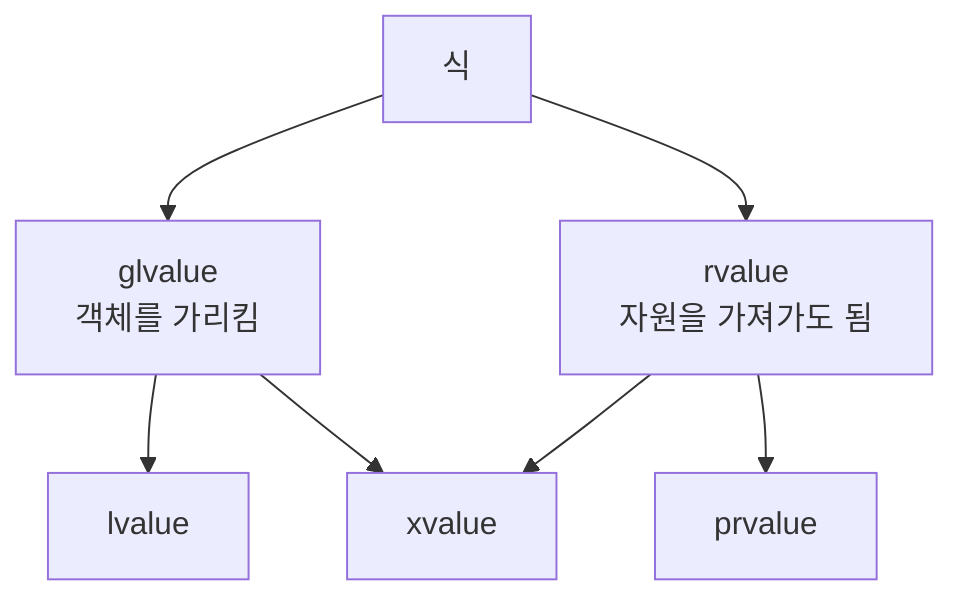
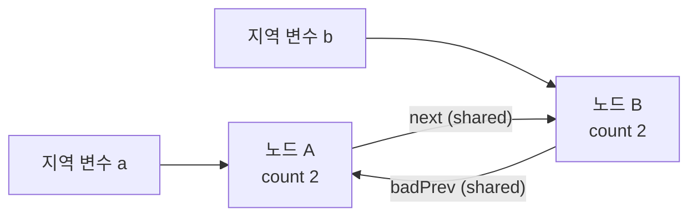

# 14장 — 이동 의미론과 모던 C++

[레포지토리 안내](../../README.ko.md) | [English](Concepts_Lecture.md) | [한국어](Concepts_Lecture.ko.md)

> **최종 수정일:** 2026-11-19

> **학습 목표:**
> 1. 식의 값 범주(lvalue, xvalue, prvalue)를 구별하고 rvalue 참조가 어떤 식에 결합하는지 판단할 수 있다
> 2. 이동 생성자와 이동 대입 연산자를 작성하고 `std::move`가 실제로 하는 일을 설명할 수 있다
> 3. 5의 법칙과 0의 법칙에 따라 특수 멤버 함수를 선언하거나 생략할 수 있다
> 4. 복사 생략과 `noexcept` 이동이 프로그램의 동작과 성능에 주는 영향을 설명할 수 있다
> 5. `unique_ptr`의 소유권 이전, `weak_ptr`로 순환 참조를 끊는 방법, `std::function`을 이용한 콜백을 구현할 수 있다
> 6. `nullptr`, `enum class`, 중괄호 초기화, `constexpr`로 더 안전한 코드를 작성할 수 있다

---

## 목차

- [1. 복사의 비용과 이동의 생각](#1-복사의-비용과-이동의-생각)
  - [1.1 복사가 낭비가 되는 경우](#11-복사가-낭비가-되는-경우)
  - [1.2 자원을 옮기는 이동](#12-자원을-옮기는-이동)
- [2. 값 범주와 rvalue 참조](#2-값-범주와-rvalue-참조)
  - [2.1 값 범주](#21-값-범주)
  - [2.2 rvalue 참조와 중복 해석](#22-rvalue-참조와-중복-해석)
  - [2.3 이름이 있는 rvalue 참조](#23-이름이-있는-rvalue-참조)
  - [2.4 `std::move`](#24-stdmove)
- [3. 이동 생성자와 이동 대입 연산자](#3-이동-생성자와-이동-대입-연산자)
  - [3.1 이동 생성자](#31-이동-생성자)
  - [3.2 이동 대입 연산자](#32-이동-대입-연산자)
  - [3.3 실행 추적](#33-실행-추적)
  - [3.4 이동한 뒤의 객체](#34-이동한-뒤의-객체)
- [4. 특수 멤버 함수의 규칙](#4-특수-멤버-함수의-규칙)
  - [4.1 컴파일러가 만드는 함수](#41-컴파일러가-만드는-함수)
  - [4.2 5의 법칙](#42-5의-법칙)
  - [4.3 0의 법칙](#43-0의-법칙)
  - [4.4 `= default`와 `= delete`](#44--default와--delete)
- [5. 복사 생략과 `noexcept` 이동](#5-복사-생략과-noexcept-이동)
  - [5.1 복사 생략](#51-복사-생략)
  - [5.2 `noexcept` 이동과 `vector`의 재할당](#52-noexcept-이동과-vector의-재할당)
- [6. 완벽한 전달](#6-완벽한-전달)
  - [6.1 전달 참조와 참조 축약](#61-전달-참조와-참조-축약)
  - [6.2 `std::forward`](#62-stdforward)
  - [6.3 `emplace_back`](#63-emplace_back)
- [7. 스마트 포인터의 소유권](#7-스마트-포인터의-소유권)
  - [7.1 `unique_ptr`의 소유권 이전](#71-unique_ptr의-소유권-이전)
  - [7.2 사용자 지정 삭제자](#72-사용자-지정-삭제자)
  - [7.3 `shared_ptr`의 순환 참조](#73-shared_ptr의-순환-참조)
  - [7.4 `weak_ptr`](#74-weak_ptr)
- [8. 호출 가능한 객체와 `std::function`](#8-호출-가능한-객체와-stdfunction)
  - [8.1 함수 객체](#81-함수-객체)
  - [8.2 `std::function`](#82-stdfunction)
  - [8.3 람다의 캡처 심화](#83-람다의-캡처-심화)
- [9. 더 안전한 기본 문법](#9-더-안전한-기본-문법)
  - [9.1 `nullptr`](#91-nullptr)
  - [9.2 `enum class`](#92-enum-class)
  - [9.3 중괄호 초기화와 `initializer_list`](#93-중괄호-초기화와-initializer_list)
  - [9.4 `constexpr`](#94-constexpr)
- [개념 적용](#개념-적용)
- [용어 사전](#용어-사전)
- [요약](#요약)
- [점검 문제](#점검-문제)
- [참고 문헌](#참고-문헌)

---

<br>

## 1. 복사의 비용과 이동의 생각

### 1.1 복사가 낭비가 되는 경우

[5장](../Ch05_Functions-and-Copy-Control/Concepts_Lecture.ko.md)의 깊은 복사는 포인터 멤버가 가리키는 힙 메모리까지 새로 할당하여 복사하므로, 원본과 복사본이 서로 영향을 주지 않는다. 그런데 복사할 원본이 곧 사라질 객체라면 이 작업은 낭비이다. 다음 코드에서 `makeNames()`가 리턴하는 `vector`는 호출한 식이 끝나면 사라지는 임시 객체이다.

```cpp
vector<string> makeNames() {
    vector<string> v;
    // ... 원소를 10만 개 넣는다
    return v;
}

vector<string> names;
names = makeNames();      // 리턴된 임시 객체의 내용을 names로 옮겨야 한다
```

C++03까지는 `names = makeNames();`가 복사 대입으로 처리되었다. 임시 `vector`의 원소 10만 개와 각 문자열의 문자를 모두 새로 할당하여 복사한 뒤, 바로 다음 순간 임시 객체가 소멸하면서 원본을 모두 해제한다. 결과적으로 같은 내용을 한 번 만들었다가 버리는 일을 10만 번 넘게 반복한다.

### 1.2 자원을 옮기는 이동

원본이 곧 사라진다면, 원본이 가진 힙 메모리를 새 객체가 그대로 넘겨받고 원본은 빈 상태로 두면 된다. 할당과 복사 없이 포인터 몇 개만 바꾸면 끝난다.

```text
복사 (깊은 복사)
원본 a:    data ──► [1][2][3]
새 객체 b: data ──► [1][2][3]   (새로 할당하여 복사, a와 b가 각자의 배열을 가짐)

이동
원본 a:    data ──► nullptr     (원본은 빈 상태가 됨)
새 객체 b: data ──► [1][2][3]   (a가 가리키던 배열을 포인터만 바꾸어 가져옴)
```

*그림 1. 깊은 복사와 이동의 차이*

> **용어 정의:** **이동 의미론(move semantics)** 은 곧 사라지거나 더는 쓰이지 않을 객체가 가진 자원을, 복사하지 않고 새 객체로 넘겨주어 초기화나 대입을 하는 C++11의 방식이다.

이동을 쓰려면 두 가지가 필요하다. 첫째, 컴파일러가 "이 원본은 곧 사라지므로 자원을 가져가도 된다"는 사실을 식의 모양으로 판단할 수 있어야 한다(2절의 값 범주). 둘째, 클래스가 자원을 넘겨받는 방법을 알려 주어야 한다(3절의 이동 생성자와 이동 대입 연산자).

---

<br>

## 2. 값 범주와 rvalue 참조

### 2.1 값 범주

C++의 모든 식은 **값 범주**를 가진다. 값 범주는 그 식이 이름을 가진 객체를 가리키는지, 그 객체의 자원을 가져가도 되는지를 나타낸다.

> **용어 정의:** **값 범주(value category)** 는 식을 lvalue, xvalue, prvalue 가운데 정확히 하나로 분류한 성질이며, lvalue와 xvalue를 합쳐 glvalue, xvalue와 prvalue를 합쳐 rvalue라 한다[1].



*그림 2. 값 범주의 분류*

표준은 세 범주를 다음과 같이 정한다[1]. **glvalue**는 계산하면 어떤 객체나 함수를 가리키는 식이고, **prvalue**는 계산하면 객체를 초기화하거나 연산자의 피연산자 값을 계산하는 식이다. **xvalue**는 자원을 다시 써도 되는 객체(보통 수명이 끝나 가는 객체)를 가리키는 glvalue이고, **lvalue**는 xvalue가 아닌 glvalue이다. 이름의 l과 r은 대입문의 왼쪽(left)과 오른쪽(right)에 올 수 있다는 데서 왔지만, 지금은 그 기준이 정확히 맞지 않는다.

| 식 | 값 범주 | 이유 |
|:-----|:-----|:-----|
| `s` (변수 이름) | lvalue | 이름을 가진 객체를 가리킨다 |
| `*p`, `a[i]`, `++x` | lvalue | 이미 있는 객체를 가리킨다 |
| `f()` (`string&`을 리턴) | lvalue | 리턴된 참조가 기존 객체를 가리킨다 |
| `42`, `true`, `nullptr` | prvalue | 이름 없는 값이다 |
| `s + "!"`, `x++`, `a + b` | prvalue | 연산의 결과로 새 값이 만들어진다 |
| `make()` (`string`을 값으로 리턴) | prvalue | 리턴값으로 임시 객체가 만들어진다 |
| `std::move(s)`, `static_cast<string&&>(s)` | xvalue | rvalue 참조로 바꾼 식이다 |

*표 1. 식과 값 범주*

lvalue인 식은 그 식이 끝난 뒤에도 같은 객체를 다시 쓸 수 있으므로 자원을 가져가면 안 된다. prvalue와 xvalue, 즉 rvalue는 그 식이 끝나면 쓰이지 않거나(prvalue) 프로그래머가 더는 쓰지 않겠다고 표시한 것(xvalue)이므로 자원을 가져가도 된다. 값 범주는 값이 아니라 **식**의 성질이라는 점에 유의해야 한다. 같은 변수 `s`라도 `s`라고 쓰면 lvalue이고, `std::move(s)`라고 쓰면 xvalue이다.

### 2.2 rvalue 참조와 중복 해석

C++11은 rvalue에만 결합하는 참조인 **rvalue 참조** `T&&`를 도입했다. 지금까지의 참조 `T&`는 이와 구별하여 lvalue 참조라 부른다.

| 매개변수 | 결합하는 식 |
|:-----|:-----|
| `T&` | `const`가 아닌 lvalue |
| `const T&` | 모든 식 (lvalue, rvalue, `const` 포함) |
| `T&&` | `const`가 아닌 rvalue |

*표 2. 참조의 종류와 결합하는 식*

세 형태를 모두 중복 정의하면 중복 해석이 식의 값 범주에 따라 함수를 고른다. `const T&`는 모든 식을 받지만, rvalue에는 `T&&`가 더 잘 맞으므로 `T&&` 버전이 선택된다. [Example_ValueCategories.cpp](Example_ValueCategories.cpp)는 여러 식을 같은 이름의 함수에 넘긴다.

```cpp
void take(string&)        { cout << "string&       (modifiable lvalue)" << endl; }
void take(const string&)  { cout << "const string& (const lvalue)" << endl; }
void take(string&&)       { cout << "string&&      (rvalue)" << endl; }

string s = "name";
const string cs = "fixed";
string&& r = make();                         // r은 이름이 있는 rvalue 참조이다
```

```text
take(s)            -> string&       (modifiable lvalue)
take(cs)           -> const string& (const lvalue)
take(make())       -> string&&      (rvalue)
take(s + "!")      -> string&&      (rvalue)
take(r)            -> string&       (modifiable lvalue)
take(std::move(s)) -> string&&      (rvalue)
s after the call   = name
```

`make()`와 `s + "!"`는 prvalue이므로 `string&&` 버전이 호출된다. 이동 생성자와 이동 대입 연산자는 바로 이 규칙을 이용한다. 매개변수가 `T&&`인 생성자를 정의해 두면, 초기화하는 식이 rvalue일 때만 그 생성자가 선택된다.

### 2.3 이름이 있는 rvalue 참조

`take(r)`의 결과는 의외로 `string&`이다. `r`의 타입은 `string&&`이지만, `r`이라는 **식**은 이름을 가진 변수이므로 lvalue이다. 타입과 값 범주는 다른 개념이며, 중복 해석은 식의 값 범주를 본다.

이 규칙에는 이유가 있다. 이름이 있으면 그 뒤의 문장에서 다시 쓸 수 있다. 만약 `r`이 rvalue로 취급되어 첫 번째 사용에서 자원을 빼앗기면, 두 번째 사용에서는 빈 객체를 보게 된다. 그래서 이동 생성자 안에서도 매개변수 `other`는 lvalue이며, 멤버를 이동하려면 `std::move(other.member)`처럼 다시 rvalue로 표시해야 한다(5.2절의 `Item`).

### 2.4 `std::move`

`<utility>`의 `std::move(x)`는 이름과 달리 아무것도 옮기지 않는다. 표준은 `std::move(t)`가 `static_cast<remove_reference_t<T>&&>(t)`를 리턴한다고 정한다[1]. 즉 인자를 rvalue 참조로 바꾸는 **캐스트**일 뿐이고, 결과 식은 xvalue가 되어 이동 생성자나 이동 대입 연산자가 선택될 수 있게 할 뿐이다. 실제로 자원을 옮기는 것은 그렇게 선택된 함수이다.

앞 절의 출력에서 `take(std::move(s))`를 호출한 뒤에도 `s`는 `name` 그대로이다. `take(string&&)`가 매개변수를 받기만 하고 그 내용을 다른 곳으로 옮기지 않았기 때문이다. `std::move`는 "이 객체는 이제 자원을 가져가도 된다"는 허락이고, 그 허락을 사용할지는 받는 함수가 정한다.

> **주의:** `const` 객체에 `std::move`를 쓰면 결과는 `const T&&`이다. 이동 생성자의 매개변수 `T&&`는 `const`를 받을 수 없으므로 `const T&`를 받는 복사 생성자가 선택되어 조용히 복사가 일어난다. 실제로 `const Buffer cb; Buffer x = std::move(cb);`는 복사 생성자를 호출한다. 옮길 객체는 `const`로 선언하지 않는다.

---

<br>

## 3. 이동 생성자와 이동 대입 연산자

[Example_MoveTrace.cpp](Example_MoveTrace.cpp)의 `Buffer`는 크기 `n`과 힙 배열을 가리키는 포인터 `data`를 가지며, 다섯 가지 특수 멤버 함수가 실행될 때마다 이름을 출력한다. 복사 생성자와 복사 대입 연산자는 [5장 4.8절](../Ch05_Functions-and-Copy-Control/Concepts_Lecture.ko.md#48-복사-대입-연산자)의 깊은 복사와 같은 방식이다.

### 3.1 이동 생성자

```cpp
Buffer(Buffer&& o) noexcept : n(o.n), data(o.data) {     // 4. 이동 생성자
    o.n = 0;
    o.data = nullptr;                        // 원본을 비어 있지만 올바른 상태로 둔다
    cout << "  move ctor(" << n << ")" << endl;
}
```

- **매개변수가 `Buffer&&`이다.** 초기화하는 식이 rvalue일 때 이 생성자가 선택된다. `const`가 없어야 원본을 바꿀 수 있다.
- **자원을 가져온다.** 초기화 목록에서 원본의 `n`과 `data`를 그대로 복사한다. 포인터를 복사할 뿐 배열을 새로 할당하지 않는다.
- **원본을 비운다.** `o.data = nullptr`가 없으면 원본과 새 객체가 같은 배열을 가리키게 되고, 두 객체의 소멸자가 같은 배열을 두 번 `delete[]`한다. 원본은 `nullptr`를 가지므로 소멸자의 `delete[] nullptr`는 아무 일도 하지 않는다.
- **`noexcept`를 붙인다.** 포인터를 옮기기만 하므로 예외를 던질 일이 없다. 복사도 할 수 있는 `Buffer`는 이 표시가 있어야 `vector`가 재할당에서 이동을 쓴다(5.2절).

### 3.2 이동 대입 연산자

```cpp
Buffer& operator=(Buffer&& o) noexcept {                 // 5. 이동 대입 연산자
    if (this != &o) {
        delete[] data;                       // 자신이 가진 자원을 먼저 해제한다
        data = o.data;
        n = o.n;
        o.data = nullptr;
        o.n = 0;
    }
    cout << "  move assign(" << n << ")" << endl;
    return *this;
}
```

이동 대입은 이미 자원을 가진 객체에 일어나므로, 원본의 자원을 가져오기 전에 자기 자원을 해제해야 한다. 그렇지 않으면 원래 가리키던 배열이 샌다. `this != &o` 검사는 `a = std::move(a)`처럼 자기 자신을 이동 대입하는 경우를 막는다. 이 검사가 없으면 자기 배열을 먼저 해제한 뒤 해제된 포인터를 다시 가져와 댕글링 포인터가 된다. 마지막의 `return *this`는 복사 대입과 같은 이유로 연쇄 대입을 위해 둔다.

### 3.3 실행 추적

`main()`은 여섯 가지 상황에서 어떤 함수가 호출되는지 출력한다.

```cpp
Buffer a(3);
Buffer b = a;                                // 1
Buffer c = std::move(a);                     // 2
b = makeBuffer(5);                           // 3: makeBuffer는 지역 Buffer local(n)을 리턴한다
Buffer d = Buffer(7);                        // 4
vector<Buffer> v;
v.reserve(2);
v.push_back(Buffer(1));                      // 5
v.push_back(std::move(c));
```

```text
1. Buffer a(3); Buffer b = a;
  ctor(3)
  copy ctor(3)
2. Buffer c = std::move(a);
  move ctor(3)
  a.size() = 0
3. b = makeBuffer(5);
  ctor(5)
  move assign(5)
  dtor(empty)
4. Buffer d = Buffer(7);
  ctor(7)
5. vector push_back
  ctor(1)
  move ctor(1)
  dtor(empty)
  move ctor(3)
6. end of main
  dtor(3)
  dtor(1)
  dtor(7)
  dtor(empty)
  dtor(5)
  dtor(empty)
```

| 단계 | 문장 | 호출된 함수 | 이유 |
|:-----|:-----|:-----|:-----|
| 1 | `Buffer b = a;` | 복사 생성자 | `a`는 lvalue이므로 자원을 가져갈 수 없다 |
| 2 | `Buffer c = std::move(a);` | 이동 생성자 | `std::move(a)`는 xvalue이다. 이동 뒤 `a.size()`는 0이다 |
| 3 | `b = makeBuffer(5);` | 생성자, 이동 대입, 빈 객체의 소멸자 | 리턴값은 prvalue이다. 이 환경에서는 함수 안의 `local`이 리턴값 자리에 바로 만들어졌다(5.1절) |
| 4 | `Buffer d = Buffer(7);` | 생성자만 | 같은 타입의 prvalue로 초기화하면 복사도 이동도 일어나지 않는다(5.1절) |
| 5 | `v.push_back(Buffer(1));` | 생성자, 이동 생성자, 빈 객체의 소멸자 | 임시 객체를 만든 뒤 `vector` 안으로 이동한다 |
| 5 | `v.push_back(std::move(c));` | 이동 생성자 | `c`의 배열이 `vector` 안의 원소로 옮겨진다 |

*표 3. `Example_MoveTrace`의 실행 추적*

- 3단계에서 `b`가 원래 가지던 배열(크기 3)은 이동 대입 연산자 안의 `delete[] data`로 해제된다. 그 뒤의 `dtor(empty)`는 자원을 넘겨준 임시 객체의 소멸이다.
- 6단계의 소멸 순서는 생성의 역순이다. 마지막에 만든 `v`가 먼저 소멸하며 원소 두 개(크기 3, 1)를 해제하고, `d`(7), 이동으로 비워진 `c`, 이동 대입을 받은 `b`(5), 이동으로 비워진 `a`가 차례로 소멸한다. `vector`가 원소를 뒤에서부터 소멸시킨 것은 libc++의 동작이며 표준이 순서를 정하지는 않는다.
- 전체 실행에서 배열의 할당은 생성자 4번(3, 5, 7, 1)과 복사 생성자 1번뿐이다. 이동이 없었다면 2, 3, 5단계마다 할당과 복사가 더 일어났다.

### 3.4 이동한 뒤의 객체

이동한 뒤의 원본은 소멸자가 호출될 때까지 여전히 살아 있는 객체이다. 이동 연산은 원본을 다음 두 가지가 안전한 상태로 남겨야 한다.

- 소멸자가 안전하게 실행된다.
- 새 값을 대입하면 다시 정상적으로 쓸 수 있다.

표준 라이브러리의 타입은 따로 정하지 않은 한 이동한 뒤 **유효하지만 지정되지 않은 상태**(valid but unspecified state)에 놓인다[1]. 객체의 불변 조건은 지켜지므로 `size()`나 `empty()`를 호출하는 것은 안전하지만, 그 값이 무엇인지는 정해지지 않았다. 예를 들어 이동한 뒤의 `string`이 빈 문자열이라고 가정하는 코드는 이식성이 없다. `unique_ptr`처럼 이동한 뒤의 상태를 명시한 타입은 예외이며, 이동한 뒤의 `unique_ptr`는 반드시 널이다[1]. 사용자 클래스는 `Buffer`처럼 이동한 뒤의 상태를 직접 정하고 그 상태를 문서화한다.

> **주의:** `v.push_back(std::move(name));` 뒤에 `name`을 다시 출력하거나 비교하면 그 값은 보장되지 않는다. 이동한 객체는 새 값을 대입하거나 소멸시키는 용도로만 쓴다.

---

<br>

## 4. 특수 멤버 함수의 규칙

### 4.1 컴파일러가 만드는 함수

소멸자, 복사 생성자, 복사 대입 연산자, 이동 생성자, 이동 대입 연산자를 **특수 멤버 함수**라 한다. 사용자가 선언하지 않으면 컴파일러가 멤버별로 같은 연산을 하는 버전을 묵시적으로 선언한다. 이동 함수의 묵시적 선언에는 조건이 있다. 표준은 클래스가 사용자가 선언한 복사 생성자, 복사 대입 연산자, 이동 대입 연산자, 소멸자를 하나도 가지지 않을 때만 이동 생성자를 묵시적으로 선언하고[1], 이동 대입 연산자도 같은 방식으로 사용자가 선언한 복사 함수, 이동 생성자, 소멸자가 없을 때만 묵시적으로 선언한다[1].

| 사용자가 선언한 것 | 묵시적 복사 함수 | 묵시적 이동 함수 |
|:-----|:-----|:-----|
| 없음 | 만들어짐 | 만들어짐 |
| 소멸자 | 만들어짐 (사용 자제 대상) | 만들어지지 않음 |
| 복사 생성자나 복사 대입 연산자 | 선언한 것 외의 복사 함수는 만들어짐 (사용 자제 대상) | 만들어지지 않음 |
| 이동 생성자나 이동 대입 연산자 | 삭제됨 (`= delete`와 같음) | 선언한 것 외의 이동 함수는 만들어지지 않음 |

*표 4. 사용자가 선언한 함수에 따른 묵시적 특수 멤버 함수*

둘째와 셋째 행이 중요하다. 소멸자나 복사 함수를 직접 쓴 클래스(5장의 깊은 복사 클래스가 모두 그렇다)는 이동 함수를 갖지 않는다. 이동 함수가 없으면 rvalue로 초기화해도 `const T&`를 받는 복사 생성자가 선택되므로[1], 프로그램은 오류 없이 동작하지만 이동의 이점을 얻지 못한다. 넷째 행은 이동 함수만 선언하면 복사가 금지된다는 뜻이며, `unique_ptr`처럼 이동만 가능한 타입이 이런 모양이다.

### 4.2 5의 법칙

[5장 4.9절](../Ch05_Functions-and-Copy-Control/Concepts_Lecture.ko.md#49-3의-법칙)의 3의 법칙은 소멸자, 복사 생성자, 복사 대입 연산자 중 하나를 직접 정의해야 하는 클래스는 셋 모두를 정의해야 한다는 원칙이다. 표 4에 따라 이 셋 중 하나라도 선언하면 이동 함수가 사라지므로, C++11에서는 이 원칙이 다섯 함수로 늘어난다.

> **핵심:** **5의 법칙.** 자원을 직접 관리하여 소멸자, 복사 생성자, 복사 대입 연산자, 이동 생성자, 이동 대입 연산자 가운데 하나를 정의해야 하는 클래스는 다섯 함수를 모두 정의하거나, 필요 없는 것을 `= delete`로 명시한다.

`Buffer`는 다섯 함수를 모두 정의한 예이다. 다섯 함수를 매번 올바르게 작성하는 일은 번거롭고 실수하기 쉬우므로, 실제로는 다음 절의 방법을 먼저 고려한다.

### 4.3 0의 법칙

자원을 관리하는 일은 그 일만 하는 클래스(`string`, `vector`, `unique_ptr`, 파일 스트림)에 맡기고, 나머지 클래스는 그런 클래스를 멤버로 가지기만 하면, 특수 멤버 함수를 하나도 선언할 필요가 없다. 컴파일러가 만드는 버전이 멤버별로 복사하고 이동하며, 각 멤버는 자신의 자원을 올바르게 다루기 때문이다. 이것을 **0의 법칙**이라 한다. [Example_RuleOfZero.cpp](Example_RuleOfZero.cpp)의 두 클래스는 특수 멤버 함수를 하나도 선언하지 않는다.

```cpp
class Playlist {                                 // 다섯 함수를 하나도 선언하지 않는다
    string title;
    vector<string> songs;
public:
    explicit Playlist(string t) : title(std::move(t)) {}
    void add(string s) { songs.push_back(std::move(s)); }
    // ...
};

class Owner {                                    // unique_ptr 때문에 이동만 가능하다
    unique_ptr<Playlist> list;
public:
    explicit Owner(string t) : list(make_unique<Playlist>(std::move(t))) {}
};
```

```text
copy: road trip, 2 songs
moved: road trip, 2 songs
source after move: "", 0 songs
Playlist copyable true, nothrow movable true
Owner copyable false, movable true
o1 empty true, o2 empty false
```

- `Playlist copy = p;`는 `title`과 `songs`를 멤버별로 복사하고, `Playlist moved = std::move(p);`는 멤버별로 이동한다. 이동한 뒤 원본 `p`의 두 멤버가 비어 있는 것은 libc++의 결과이며, 3.4절처럼 표준이 보장하는 값은 아니다.
- `string`과 `vector`의 이동 생성자가 `noexcept`이므로 컴파일러가 만든 `Playlist`의 이동 생성자도 `noexcept`가 된다(`is_nothrow_move_constructible`이 참).
- `Owner`는 복사할 수 없는 `unique_ptr`를 멤버로 가지므로 묵시적 복사 생성자가 삭제되고, 이동만 가능하다. 이동한 뒤 `o1`의 포인터는 널이다.
- 생성자와 `add()`의 매개변수를 값으로 받은 뒤 `std::move`로 멤버에 옮기는 것은 자주 쓰는 방식이다. 호출하는 쪽이 lvalue를 넘기면 매개변수로 한 번 복사되고, rvalue를 넘기면 이동만 일어난다.

### 4.4 `= default`와 `= delete`

특수 멤버 함수를 직접 정의하지 않으면서 선언만 하고 싶을 때는 `= default`를, 그 함수를 쓰지 못하게 하려면 `= delete`를 쓴다.

```cpp
class Logger {
public:
    Logger() = default;                          // 컴파일러가 만드는 버전을 명시적으로 요청한다
    virtual ~Logger() = default;                 // 가상 소멸자를 두면서 내용은 기본 버전으로
    Logger(const Logger&) = delete;              // 복사 금지
    Logger& operator=(const Logger&) = delete;
    Logger(Logger&&) = default;                  // 소멸자를 선언했으므로 이동은 직접 요청해야 한다
    Logger& operator=(Logger&&) = default;
};
```

`= default`는 소멸자를 `virtual`로 선언하는 것처럼 함수의 성질만 바꾸고 내용은 기본 버전으로 두고 싶을 때 쓴다. 표 4에 따라 소멸자를 선언하면 이동 함수가 사라지므로, 이동이 필요하면 위처럼 `= default`로 다시 요청한다. `= delete`는 특수 멤버 함수가 아닌 함수에도 쓸 수 있어, 원하지 않는 변환을 막는 데도 쓰인다(9.4절의 `Meters(int) = delete`).

---

<br>

## 5. 복사 생략과 `noexcept` 이동

### 5.1 복사 생략

**복사 생략(copy elision)** 은 복사나 이동으로 만들 객체를 처음부터 최종 위치에 만들어, 복사 생성자나 이동 생성자의 호출 자체를 없애는 것이다. 표준은 두 가지 경우를 구별한다.

- **반드시 일어나는 생략 (C++17).** 같은 타입의 prvalue로 객체를 초기화하면, 그 prvalue가 대상 객체를 직접 초기화한다[1]. `Buffer d = Buffer(7);`과 `T x = T(T(T()));`는 생성자를 한 번만 호출한다. 이 경우에는 복사 생성자와 이동 생성자가 없거나 삭제되어 있어도 컴파일된다.
- **허용되는 생략.** 함수가 지역 변수의 이름을 리턴할 때(`return local;`), 컴파일러는 그 지역 변수를 리턴값의 자리에 바로 만들어 이동을 생략할 수 있다[1]. 이름 있는 리턴값 최적화(NRVO)라 부르며, 표준은 허용할 뿐 요구하지는 않는다.

Clang의 `-fno-elide-constructors` 옵션은 허용되는 생략을 끈다. 같은 `Example_MoveTrace`를 이 옵션으로 컴파일하면 3단계와 4단계의 출력이 다음과 같이 달라진다.

| 컴파일 방식 | 3단계 `b = makeBuffer(5);` | 4단계 `Buffer d = Buffer(7);` |
|:-----|:-----|:-----|
| `-std=c++17` (기본) | 생성자, 이동 대입 | 생성자 |
| `-std=c++17 -fno-elide-constructors` | 생성자, 이동 생성자, 이동 대입 | 생성자 |
| `-std=c++14 -fno-elide-constructors` | 생성자, 이동 생성자, 이동 대입 | 생성자, 이동 생성자 |

*표 5. 복사 생략 여부에 따른 호출 (빈 객체의 소멸자는 생략)*

NRVO를 끄면 3단계에서 `local`이 리턴값으로 **이동**된다. 복사가 아니라 이동인 이유는, 표준이 `return local;`의 `local`을 먼저 rvalue로 보고 생성자를 고르도록 정하기 때문이다[1]. 4단계는 C++17에서 반드시 생략되므로 옵션과 관계없이 생성자만 호출되고, C++14에서는 생략을 끄면 이동이 일어난다.

> **주의:** 지역 변수를 리턴할 때 `return std::move(local);`이라고 쓰면 오히려 느려진다. 리턴하는 식이 지역 변수의 이름이 아니게 되어 NRVO가 불가능해지고 이동이 강제되기 때문이다. Clang은 `warning: moving a local object in a return statement prevents copy elision`으로 경고한다. 지역 변수는 `std::move` 없이 `return local;`로 리턴한다.

### 5.2 `noexcept` 이동과 `vector`의 재할당

`vector`는 용량이 모자라면 더 큰 배열을 새로 할당하고 기존 원소를 옮긴다. 이때 원소를 이동하는지 복사하는지는 원소의 이동 생성자가 `noexcept`인지에 달려 있다. [Example_NoexceptMove.cpp](Example_NoexceptMove.cpp)는 이동 생성자의 `noexcept` 여부만 다른 두 타입을 용량 2의 `vector`에 세 개씩 넣는다.

```cpp
template <bool NoThrow>
struct Item {
    string tag;
    explicit Item(string t) : tag(t) {}
    Item(const Item& o) : tag(o.tag) { cout << " copy(" << tag << ")"; }
    Item(Item&& o) noexcept(NoThrow) : tag(std::move(o.tag)) { cout << " move(" << tag << ")"; }
};
```

```text
nothrow move: true, false
noexcept(true)  capacity 2 -> move(a) move(b)  (capacity 4)
noexcept(false) capacity 2 -> copy(a) copy(b)  (capacity 4)
```

세 번째 원소를 넣을 때 재할당이 일어나며, 이동 생성자가 `noexcept`인 타입은 기존 원소 `a`, `b`를 이동하고, 그렇지 않은 타입은 복사한다. 이유는 5.1절이 아니라 예외 안전성에 있다. 표준은 `push_back`이 끝에 원소 하나를 넣다가 예외가 생기면, 원소가 복사 가능하거나 이동 생성자가 예외를 던지지 않는 한 아무 효과도 없어야 한다고 정한다[1]. 재할당 도중 세 번째 원소를 옮기다가 이동 생성자가 예외를 던지면, 이미 옮긴 두 원소는 원래 배열에서 내용을 잃었으므로 되돌릴 수 없다. 복사라면 원래 배열이 그대로 남아 있어 새 배열을 버리기만 하면 된다. 그래서 `vector`는 복사할 수 있는 원소이면 이동이 예외를 던지지 않을 때만 이동을 쓰고, 복사할 수 없는 원소이면 예외를 던질 수 있는 이동이라도 쓴다. 구현은 이 선택에 `std::move_if_noexcept`를 쓴다. 용량이 2에서 4로 늘어난 것은 libc++의 증가 방식이다.

> **핵심:** 이동 생성자와 이동 대입 연산자에는 가능한 한 `noexcept`를 붙인다. 붙이지 않으면 `vector` 같은 컨테이너가 이동 대신 복사를 써서 이동 의미론의 이점이 사라진다.

---

<br>

## 6. 완벽한 전달

### 6.1 전달 참조와 참조 축약

함수 템플릿의 매개변수를 `T&&`로 쓰고 `T`를 인자로부터 추론하게 하면, 그 매개변수는 rvalue 참조가 아니라 **전달 참조**가 된다.

> **용어 정의:** **전달 참조(forwarding reference)** 는 함수 템플릿에서 `const`가 없는 템플릿 매개변수 `T`에 대해 `T&&`로 선언한 매개변수이며, 인자가 lvalue이면 lvalue 참조로, rvalue이면 rvalue 참조로 결합한다[1].

이 동작은 템플릿 인자 추론과 **참조 축약** 규칙이 합쳐진 결과이다. lvalue `s`(타입 `string`)를 넘기면 `T`가 `string&`으로 추론되어 매개변수 타입 `T&&`는 `string& &&`가 되고, rvalue를 넘기면 `T`가 `string`으로 추론되어 `string&&`가 된다. 참조의 참조는 다음 규칙으로 하나의 참조로 축약되므로[1], `string& &&`는 `string&`이 된다.

| `T`가 나타내는 타입 | `T&`의 결과 | `T&&`의 결과 |
|:-----|:-----|:-----|
| `X&` | `X&` | `X&` |
| `X&&` | `X&` | `X&&` |
| `X` (참조가 아님) | `X&` | `X&&` |

*표 6. 참조 축약 규칙 (어느 한쪽이라도 lvalue 참조이면 결과는 lvalue 참조)*

`auto&&`로 선언한 변수도 같은 규칙을 따르는 전달 참조이다. 반면 `void f(string&& s)`처럼 템플릿 매개변수가 아닌 타입이나, `void f(const T&& x)`처럼 `const`가 붙은 형태는 전달 참조가 아니라 rvalue 참조이다.

### 6.2 `std::forward`

전달 참조로 받은 인자를 다른 함수에 넘길 때, 원래 인자가 rvalue였다면 rvalue로, lvalue였다면 lvalue로 넘겨야 받는 함수가 이동과 복사를 올바르게 고를 수 있다. 이것을 **완벽한 전달**이라 한다. 2.3절의 규칙에 따라 매개변수 `arg`라는 이름은 항상 lvalue이므로 그대로 넘기면 원래의 값 범주를 잃는다. [Example_Forwarding.cpp](Example_Forwarding.cpp)는 두 방식을 비교한다.

```cpp
void sink(const string&) { cout << "copy path" << endl; }
void sink(string&&)      { cout << "move path" << endl; }

template <typename T>
void relayWrong(T&& arg) { sink(arg); }                      // arg는 이름이 있으므로 항상 lvalue이다

template <typename T>
void relay(T&& arg) { sink(std::forward<T>(arg)); }          // 원래의 값 범주를 되살린다
```

```text
relayWrong(s):            copy path
relayWrong(string("t")):  copy path
relay(s):                 copy path
relay(string("t")):       move path
```

`std::forward<T>(arg)`는 `T`가 lvalue 참조 타입(lvalue를 받은 경우)이면 lvalue를, 참조가 아닌 타입(rvalue를 받은 경우)이면 rvalue를 돌려준다. `std::move`가 항상 rvalue로 바꾸는 것과 달리 `std::forward`는 원래 상태를 복원한다. 그래서 `std::move`는 rvalue 참조 매개변수에, `std::forward`는 전달 참조 매개변수에 쓴다.

### 6.3 `emplace_back`

완벽한 전달의 대표적인 쓰임은 컨테이너의 `emplace` 계열 함수이다. `push_back(x)`는 이미 만들어진 객체를 받아 컨테이너 안으로 복사하거나 이동하지만, `emplace_back(args...)`는 생성자의 인자를 전달 참조로 받아 컨테이너 안의 자리에서 바로 객체를 만든다.

```cpp
vector<Point> v;
v.reserve(4);
v.push_back(Point(1, 2));                    // 임시 객체를 만든 뒤 이동한다
v.emplace_back(3, 4);                        // 3과 4를 생성자에 전달한다
```

```text
push_back(Point(1, 2)):
  Point(1, 2)
  move
emplace_back(3, 4):
  Point(3, 4)
```

`push_back`은 생성자와 이동 생성자를 한 번씩 호출하고 임시 객체를 소멸시키지만, `emplace_back`은 생성자만 호출한다. 다만 `emplace_back`은 `explicit` 생성자도 호출할 수 있어 의도하지 않은 변환이 일어날 수 있으므로(예: `vector<unique_ptr<int>>`에 날 포인터를 넣는 경우), 이미 만들어진 객체를 넣을 때는 `push_back`이 의도를 더 분명히 드러낸다.

---

<br>

## 7. 스마트 포인터의 소유권

[4장 6절](../Ch04_Pointers-Arrays-and-Dynamic-Memory/Concepts_Lecture.ko.md#6-스마트-포인터-현대-c)은 `unique_ptr`, `shared_ptr`와 `make_unique`, `make_shared`의 기본 사용법을 다룬다. 이 절은 이동 의미론으로 설명되는 소유권의 이전과, `shared_ptr`만으로는 해결할 수 없는 순환 참조를 다룬다.

### 7.1 `unique_ptr`의 소유권 이전

`unique_ptr`는 복사 생성자가 삭제되고 이동 생성자만 있는 클래스이다(4.1절의 넷째 행). 그래서 함수의 매개변수와 리턴 타입만 보고도 소유권이 어떻게 움직이는지 알 수 있다.

| 함수의 모양 | 뜻 |
|:-----|:-----|
| `unique_ptr<T> create()` | 새 객체를 만들어 소유권을 호출한 쪽에 넘긴다 |
| `void consume(unique_ptr<T> p)` | 소유권을 넘겨받는다. 호출하는 쪽은 `std::move`로 넘겨야 한다 |
| `void show(const T& t)` 또는 `void show(T* t)` | 소유권 없이 객체를 쓰기만 한다 |
| `void reset(unique_ptr<T>& p)` | 호출한 쪽의 `unique_ptr` 자체를 바꿀 수 있다 |

*표 7. 함수의 모양과 소유권의 의미*

[Example_UniqueOwnership.cpp](Example_UniqueOwnership.cpp)는 표의 앞 세 가지를 사용한다.

```cpp
auto t1 = createTask("write report");
show(*t1);

vector<unique_ptr<Task>> queue;
queue.push_back(std::move(t1));              // t1은 널이 된다
queue.push_back(createTask("send mail"));

consume(std::move(queue[0]));                // consume 안에서 소멸한다
cout << "  after consume" << endl;
```

```text
  show write report
  t1 is null, queue size 2
  consume write report
  ~Task(write report)
  after consume
  fclose called
  end of main
  ~Task(send mail)
```

- `createTask()`의 리턴값은 prvalue이므로 `std::move` 없이 `t1`과 `queue`로 옮겨진다.
- `queue.push_back(t1)`이라고 쓰면 복사 생성자가 삭제되어 있으므로 컴파일 오류이다. `std::move(t1)`으로 소유권을 넘기면 `t1`은 널이 된다.
- `consume(std::move(queue[0]))`은 소유권을 매개변수 `t`로 넘기고, 함수가 끝날 때 `t`가 소멸하면서 `Task`도 소멸한다. `~Task(write report)`가 `after consume`보다 먼저 출력되는 것이 그 증거이다.
- 남은 `send mail`은 `main()`이 끝나 `queue`가 소멸할 때 해제된다.

### 7.2 사용자 지정 삭제자

`unique_ptr<T, D>`의 두 번째 템플릿 인자는 소멸할 때 `delete` 대신 호출할 **삭제자**이다. 이를 이용하면 `new`로 얻지 않은 자원도 RAII로 관리할 수 있다. 예제는 C의 `FILE*`를 `fclose()`로 닫는 삭제자를 정의한다.

```cpp
struct FileCloser {
    void operator()(FILE* f) const {
        cout << "  fclose called" << endl;
        fclose(f);
    }
};

{
    unique_ptr<FILE, FileCloser> log(fopen("log.txt", "w"));
    if (log)
        fputs("first line\n", log.get());    // get()으로 C 함수에 넘길 원시 포인터를 얻는다
}                                            // 여기서 FileCloser가 실행된다
```

블록을 벗어나면 `fclose called`가 출력되고, 실행한 디렉터리에 만들어진 `log.txt`에는 `first line`이 기록된다. `fopen()`이 실패하여 널을 리턴한 경우에는 `unique_ptr`가 널을 가지며, 널인 `unique_ptr`는 소멸할 때 삭제자를 호출하지 않는다[1]. 같은 방식으로 운영체제의 핸들, 라이브러리가 만든 객체를 해제 함수와 함께 관리할 수 있다.

### 7.3 `shared_ptr`의 순환 참조

`shared_ptr`는 같은 객체를 가리키는 `shared_ptr`의 개수(참조 카운트)를 **제어 블록**에 기록하고, 개수가 0이 되면 객체를 삭제한다. 그런데 두 객체가 서로를 `shared_ptr`로 가리키면 개수가 0이 될 수 없다. [Example_WeakPtr.cpp](Example_WeakPtr.cpp)의 첫 블록은 노드 A와 B를 양방향으로 연결한다.

```cpp
struct Node {
    string name;
    shared_ptr<Node> next;                       // 소유하는 연결
    weak_ptr<Node> prev;                         // 소유하지 않는 역방향 연결
    shared_ptr<Node> badPrev;                    // 소유하는 역방향 연결: 순환을 만든다
    // 생성자와 소멸자는 이름을 출력한다
};

{
    auto a = make_shared<Node>("A");
    auto b = make_shared<Node>("B");
    a->next = b;
    b->badPrev = a;
}                                                // A와 B는 소멸하지 않는다
```



*그림 3. 서로를 `shared_ptr`로 가리키는 두 노드*

블록 안에서 각 노드의 참조 카운트는 2이다(지역 변수 하나, 상대 노드의 멤버 하나). 블록을 벗어나며 지역 변수 `a`, `b`가 소멸하면 카운트는 각각 1로 줄지만, 남은 1은 상대 노드가 가진 것이므로 0이 되지 않는다. 두 노드는 프로그램의 어느 변수에서도 닿을 수 없는데도 해제되지 않으며, 출력에 `destroy A`와 `destroy B`가 끝내 나타나지 않는다. 이것이 **순환 참조**로 인한 메모리 누수이다.

```text
1. cycle with two shared_ptr links
  create A
  create B
  use_count A=2, B=2
  end of block 1
```

### 7.4 `weak_ptr`

> **용어 정의:** **`weak_ptr`** 는 `shared_ptr`가 관리하는 객체를 참조 카운트를 늘리지 않고 가리키는 스마트 포인터이며, 객체를 쓰려면 `lock()`으로 `shared_ptr`를 얻어야 한다.

순환을 끊으려면 연결 가운데 하나를 소유하지 않는 연결로 바꾼다. 부모와 자식, 앞 노드와 뒤 노드처럼 방향이 있는 관계에서는 보통 앞에서 뒤로의 연결이 소유하고, 뒤에서 앞으로의 연결은 `weak_ptr`로 둔다. 같은 예제의 두 번째 블록은 역방향 연결을 `weak_ptr`로 바꾼다.

```cpp
weak_ptr<Node> watcher;
{
    auto c = make_shared<Node>("C");
    auto d = make_shared<Node>("D");
    c->next = d;
    d->prev = c;                             // C의 카운트를 늘리지 않는다
    watcher = d;
    if (shared_ptr<Node> p = d->prev.lock())  // lock()은 shared_ptr이나 널을 준다
        cout << "  D's previous node is " << p->name << endl;
}
cout << "  end of block 2, watcher expired = " << boolalpha << watcher.expired() << endl;
```

```text
2. back link as weak_ptr
  create C
  create D
  use_count C=1, D=2
  D's previous node is C
  destroy C
  destroy D
  end of block 2, watcher expired = true
```

| 시점 | C의 카운트 | D의 카운트 | 일어나는 일 |
|:-----|:-----|:-----|:-----|
| 연결을 마친 뒤 | 1 (`c`) | 2 (`d`, `C.next`) | `d->prev`는 카운트를 늘리지 않는다 |
| 블록 끝: `d` 소멸 | 1 | 1 (`C.next`) | 지역 변수는 선언의 역순으로 소멸한다 |
| 블록 끝: `c` 소멸 | 0 | 1 | C가 삭제되고, 그 멤버 `next`가 소멸한다 |
| C의 `next` 소멸 | | 0 | D가 삭제된다 |

*표 8. `weak_ptr`로 연결한 두 노드의 참조 카운트*

- `lock()`은 객체가 아직 살아 있으면 그 객체를 가리키는 `shared_ptr`를 만들어 주고, 이미 삭제되었으면 빈 `shared_ptr`를 준다[1]. 얻은 `shared_ptr`가 살아 있는 동안 객체가 삭제되지 않으므로 안전하게 쓸 수 있다.
- `expired()`는 객체가 이미 삭제되었는지를 알려 준다. 블록이 끝난 뒤 `watcher.expired()`가 참인 것은 D가 삭제되었다는 뜻이다.
- `weak_ptr`는 객체를 소유하지 않을 뿐 제어 블록에는 연결되어 있으므로, 객체가 삭제된 뒤에도 `expired()`를 안전하게 호출할 수 있다. 원시 포인터로 역방향을 연결하면 이 확인이 불가능하다.

> **[자료구조]** 자료구조에서 배우는 이중 연결 리스트와 트리의 부모 포인터는 두 노드가 서로를 가리키는 구조이다. 이런 구조를 `shared_ptr`로 만들 때는 한 방향(다음 노드, 자식)만 소유하고 반대 방향(이전 노드, 부모)은 `weak_ptr`나 소유하지 않는 원시 포인터로 두어야 노드가 해제된다.

---

<br>

## 8. 호출 가능한 객체와 `std::function`

### 8.1 함수 객체

함수처럼 `()`로 호출할 수 있는 것을 **호출 가능한 객체**라 한다. 일반 함수와 함수 포인터 외에, 함수 호출 연산자 `operator()`를 중복한 클래스의 객체도 호출할 수 있으며, 이를 **함수 객체**(functor)라 한다.

```cpp
struct Multiply {                                // 함수 객체: operator()를 가진 클래스
    int calls = 0;
    int operator()(int a, int b) { calls++; return a * b; }
};

Multiply mul;
int r = mul(6, 7);                               // mul.operator()(6, 7), r은 42
```

함수 객체는 일반 함수와 달리 멤버 변수로 상태를 가질 수 있다. 위의 `calls`는 호출된 횟수를 센다. [10장 8.3절](../Ch10_Templates-and-STL/Concepts_Lecture.ko.md#83-람다-표현식-c11)의 람다식은 컴파일러가 이름 없는 함수 객체 클래스를 만들고 그 객체를 생성하는 문법이다. 캡처한 변수는 그 클래스의 멤버가 되고, 람다의 본문은 `operator()`의 본문이 된다.

### 8.2 `std::function`

람다식의 타입은 컴파일러만 아는 이름 없는 타입이고, 람다마다 다르다. 그래서 서로 다른 람다, 함수, 함수 객체를 하나의 변수나 컨테이너에 담으려면 공통의 타입이 필요하다. `<functional>`의 `std::function<R(Args...)>`는 매개변수 타입이 `Args...`이고 리턴 타입이 `R`인 호출 가능한 객체라면 무엇이든 담을 수 있는 클래스 템플릿이다. [Example_StdFunction.cpp](Example_StdFunction.cpp)는 네 가지 호출 가능한 객체를 같은 `map`에 담는다.

```cpp
map<string, function<int(int, int)>> ops;    // 다른 종류의 호출 가능한 객체를 하나의 타입으로
ops["+"] = add;                              // 일반 함수
ops["*"] = Multiply();                       // 함수 객체
ops["-"] = [](int a, int b) { return a - b; };
int base = 10;
ops["b"] = [base](int a, int b) { return base * a + b; };   // base의 복사본을 캡처한다
for (const auto& [symbol, f] : ops)
    cout << "7 " << symbol << " 3 = " << f(7, 3) << endl;
```

```text
7 * 3 = 21
7 + 3 = 10
7 - 3 = 4
7 b 3 = 73
```

`map`은 키를 문자 코드 순서(`*` 42, `+` 43, `-` 45, `b` 98)로 정렬하므로 출력 순서가 넣은 순서와 다르다. 마지막 줄은 캡처한 `base`(10)를 써서 10 × 7 + 3 = 73을 계산한다.

**콜백.** `std::function`은 "어떤 일이 일어나면 호출할 함수"를 나중에 정하는 콜백에 자주 쓰인다. 같은 예제의 `Button`은 클릭될 때 호출할 함수들을 `vector<function<void(const string&)>>`에 모아 둔다.

```cpp
Button b;
int clicks = 0;
b.onClick([](const string& who) { cout << "  hello, " << who << endl; });
b.onClick([&clicks](const string&) { clicks++; });   // 참조로 캡처한 clicks를 바꾼다
b.click("Kim");
b.click("Lee");                                      // clicks = 2
```

**빈 `function`.** 아무것도 담지 않은 `std::function`을 호출하면 `std::bad_function_call` 예외가 발생한다[1]. 호출하기 전에 `if (f)`로 비어 있는지 확인할 수 있다.

> **주의:** 참조로 캡처한 람다를 `std::function`에 저장하여 나중에 호출하면, 그때 캡처한 지역 변수가 이미 사라졌을 수 있다. 위의 `[&clicks]`는 `clicks`가 `b`보다 오래 살기 때문에 안전하지만, 함수 안의 지역 변수를 참조로 캡처한 콜백을 그 함수 밖에 저장하면 댕글링 참조가 된다. 오래 저장할 콜백은 값으로 캡처한다.

`std::function`은 담은 객체의 실제 타입을 감추는 대가로, 호출할 때 간접 호출이 한 단계 더 생기고 큰 객체를 담을 때 힙 할당이 일어날 수 있다. 템플릿 매개변수로 호출 가능한 객체를 받는 `sort(v.begin(), v.end(), comp)` 같은 함수는 람다의 타입을 그대로 알고 호출하므로 이런 비용이 없다. 여러 종류를 한곳에 담거나 나중에 호출할 함수를 저장해야 할 때 `std::function`을 쓴다.

### 8.3 람다의 캡처 심화

10장에서 다룬 값 캡처와 참조 캡처 외에, 다음 세 가지 형태가 자주 쓰인다.

```cpp
int count = 0;
auto counter = [count]() mutable { return ++count; };       // 자신의 복사본을 바꾼다

auto p = make_unique<int>(5);
auto owner = [q = std::move(p)]() { return *q * 2; };       // 초기화 캡처로 p를 옮겨 넣는다

auto twice = [](auto x) { return x + x; };   // 일반화된 람다 (C++14)
```

```text
counter: 1 2, outer count 0
init capture: 10, p is null
generic: 8 abab
```

- **`mutable`.** 값으로 캡처한 변수는 기본적으로 람다 안에서 바꿀 수 없다. 컴파일러가 만드는 `operator()`가 `const` 멤버 함수이기 때문이다. `mutable`을 붙이면 람다가 가진 복사본을 바꿀 수 있다. `counter()`를 두 번 호출하면 1, 2를 리턴하지만 바깥의 `count`는 0 그대로이다.
- **초기화 캡처 (C++14).** `[q = std::move(p)]`는 람다 안에 새 멤버 `q`를 만들고 그 초기값을 지정한다. 복사할 수 없는 `unique_ptr`도 이동하여 람다에 넣을 수 있으며, 옮긴 뒤 `p`는 널이다.
- **일반화된 람다 (C++14).** 매개변수를 `auto`로 선언하면 `operator()`가 템플릿이 되어 여러 타입에 쓸 수 있다. `twice(4)`는 8, `twice(string("ab"))`는 `"abab"`이다.

---

<br>

## 9. 더 안전한 기본 문법

### 9.1 `nullptr`

C와 C++03에서 널 포인터는 정수 0이나 매크로 `NULL`(구현에 따라 `0`, `0L` 등)로 나타냈다. 이 값은 정수이기도 하므로 함수 중복에서 문제가 생긴다. [Example_ModernBasics.cpp](Example_ModernBasics.cpp)의 두 함수 `f(int)`와 `f(char*)`로 확인한다.

```cpp
void f(int)   { cout << "f(int)" << endl; }
void f(char*) { cout << "f(char*)" << endl; }

f(0);                                        // f(int): 0은 int이다
f(nullptr);                                  // f(char*): nullptr는 포인터 타입으로만 변환된다
// f(NULL);                                  // 이 환경에서는 error: call to 'f' is ambiguous
```

C++11의 `nullptr`는 `std::nullptr_t` 타입의 prvalue인 포인터 리터럴이다[1]. 모든 포인터 타입으로 변환되지만 정수 타입으로는 변환되지 않으므로, 포인터를 받는 함수만 선택된다. `NULL`은 구현에 따라 `f(int)`가 선택되거나 이 환경처럼 모호성 오류가 나므로, C++에서는 널 포인터를 항상 `nullptr`로 쓴다.

### 9.2 `enum class`

C에서 이어진 열거형 `enum`에는 두 가지 약점이 있다. 열거자의 이름이 열거형을 둘러싼 유효 범위에 그대로 퍼지므로 다른 열거형과 이름이 겹치면 `error: redefinition of enumerator 'Green'`이 나고, 열거자가 `int`로 묵시적으로 변환되어 서로 다른 열거형이나 정수와 섞여 비교된다.

C++11의 **범위 있는 열거형** `enum class`는 두 약점을 모두 없앤다.

```cpp
enum Color { Red, Green };                       // 범위 없는 열거형: 이름이 바깥으로 퍼진다
enum class Signal : unsigned char { Red, Yellow, Green };   // 범위 있는 열거형, 내부 타입 지정

Signal s = Signal::Yellow;                   // Signal::을 붙여 쓴다
int c = Green;                               // 범위 없는 열거형은 int로 조용히 변환된다
int code = static_cast<int>(s);              // 범위 있는 열거형은 명시적 캐스트가 필요하다
```

```text
Green=1, Signal::Yellow=1, sizeof(Signal)=1
```

- `Signal`의 열거자는 `Signal::Red`처럼 이름을 붙여 쓰므로 `Color`의 `Red`, `Green`과 겹치지 않는다.
- `Signal`을 `int`에 대입하거나 `int`와 비교하려면 `static_cast`가 필요하다. 실수로 다른 종류의 값과 섞는 코드가 컴파일 오류가 된다.
- `: unsigned char`로 열거형이 쓰는 정수 타입(내부 타입)을 지정할 수 있다. 지정하지 않으면 범위 있는 열거형의 내부 타입은 `int`이다[1]. 이 예에서 `sizeof(Signal)`은 1이다.

### 9.3 중괄호 초기화와 `initializer_list`

C++11부터 거의 모든 초기화를 중괄호로 쓸 수 있다. 이를 **목록 초기화**라 하며, 변수, 배열, 구조체, 클래스, 컨테이너에 같은 문법을 쓴다는 점에서 통일된 초기화라고도 부른다.

```cpp
int x{5};
double d{2.5};
// int y{d};                                 // error: type 'double' cannot be narrowed to 'int' in initializer list
int y = static_cast<int>(d);                 // 의도한 변환은 명시적으로 쓴다
```

**축소 변환의 금지.** 목록 초기화에서는 값의 정보를 잃을 수 있는 **축소 변환**(`double`에서 `int`로, 큰 정수 타입에서 작은 정수 타입으로 등)이 허용되지 않는다[1]. `int y = d;`는 `-Wall -Wextra`로 컴파일해도 경고 없이 2.5를 2로 자르지만 `int y{d};`는 컴파일 오류이므로, 데이터를 잃는 변환을 실수로 쓰는 일을 막아 준다.

**`initializer_list` 생성자의 우선.** `vector`처럼 `std::initializer_list<T>`를 받는 생성자가 있는 클래스를 중괄호로 초기화하면, 그 생성자가 먼저 후보가 된다[1]. 그래서 괄호와 중괄호가 다른 뜻이 된다.

| 선언 | 호출되는 생성자 | 결과 |
|:-----|:-----|:-----|
| `vector<int> a(3, 7);` | `vector(size_type n, const T& value)` | 원소 3개 `7 7 7` |
| `vector<int> b{3, 7};` | `vector(initializer_list<int>)` | 원소 2개 `3 7` |

*표 9. 괄호 초기화와 중괄호 초기화의 차이*

예제를 실행하면 `a.size()=3, b.size()=2`가 출력된다. 원소의 개수와 초기값을 지정하려면 괄호를, 원소 목록을 그대로 주려면 중괄호를 쓴다.

> **주의:** 기본 생성자로 객체를 만들려고 `Widget w();`라고 쓰면 변수가 아니라 `Widget`을 리턴하는 함수 `w`의 선언이 된다. Clang은 `warning: empty parentheses interpreted as a function declaration`으로 경고한다. `Widget w;`나 `Widget w{};`로 쓴다.

### 9.4 `constexpr`

`constexpr` 함수는 인자가 상수이면 컴파일 시간에 계산될 수 있는 함수이다. 결과를 `constexpr` 변수에 저장하면 반드시 컴파일 시간에 계산되며, 배열의 크기나 `static_assert`의 조건처럼 상수가 필요한 곳에 쓸 수 있다.

```cpp
constexpr int factorial(int n) { return n <= 1 ? 1 : n * factorial(n - 1); }

constexpr int f5 = factorial(5);             // 컴파일러가 계산한다
static_assert(f5 == 120, "factorial(5) must be 120");
int arr[factorial(4)];                       // 상수식이므로 배열의 크기로 쓸 수 있다

int n = 6;
cout << "runtime factorial(6)=" << factorial(n) << endl;     // 실행 시간에도 호출할 수 있다
```

```text
factorial(5)=120, array length 24
runtime factorial(6)=720
```

- `static_assert(조건, 메시지)`는 조건이 거짓이면 컴파일을 실패시킨다. `f5`가 120이 아니면 프로그램이 만들어지지 않으므로, 계산의 정확성을 컴파일 시간에 확인한다.
- `factorial(4)`는 4 × 3 × 2 × 1 = 24이므로 `arr`의 원소는 24개이다.
- 같은 함수를 변수 `n`으로 호출하면 일반 함수처럼 실행 시간에 계산되어 6! = 720을 리턴한다.
- C++11의 `constexpr` 함수는 본문이 `return` 문 하나여야 했지만, C++14부터 지역 변수와 반복문을 쓸 수 있다. 위 예제는 두 판에서 모두 쓸 수 있는 형태이다.

**삭제된 함수로 변환 막기.** 4.4절의 `= delete`는 원하지 않는 변환을 막는 데도 쓴다. 예제의 `Meters`는 `double`을 받는 생성자만 쓰게 하려고 `int` 생성자를 삭제한다.

```cpp
struct Meters {
    double value;
    explicit Meters(double v) : value(v) {}
    Meters(int) = delete;                        // Meters(3)을 금지하여 단위를 명시하게 한다
};
// Meters bad(3);                            // error: call to deleted constructor of 'Meters'
```

삭제된 함수도 중복 해석에는 참여하므로, `Meters(3)`은 `int` 버전이 더 잘 맞아 선택된 뒤 삭제되어 있어 컴파일 오류가 된다. `int`에서 `double`로의 묵시적 변환으로 의도하지 않은 값이 들어오는 것을 막는다.

---

<br>

## 개념 적용

**T/F 점검:**

| 문장 | 판단과 근거 |
|:-----|:-----|
| `std::move(x)`를 호출하면 `x`의 내용이 다른 곳으로 옮겨진다. | **F.** `std::move`는 rvalue 참조로 바꾸는 캐스트일 뿐이며, 옮기는 일은 그 결과를 받은 이동 생성자나 이동 대입 연산자가 한다(2.4절). |
| `string&& r = make();`에서 `take(r)`은 `take(string&&)`를 호출한다. | **F.** `r`은 이름이 있으므로 lvalue이고 `take(string&)`이 선택된다(2.3절). |
| 소멸자를 직접 정의한 클래스도 컴파일러가 이동 생성자를 만들어 준다. | **F.** 사용자가 선언한 소멸자가 있으면 이동 함수는 묵시적으로 선언되지 않고, rvalue도 복사된다(4.1절). |
| 지역 변수를 리턴할 때 `return std::move(local);`이 `return local;`보다 효율적이다. | **F.** NRVO를 막고 이동을 강제하므로 오히려 비용이 늘어난다(5.1절). |
| 이동 생성자에 `noexcept`가 없어도 `vector`는 재할당에서 이동을 쓴다. | **F.** 원소가 복사 가능하면 강한 보장을 위해 복사를 쓴다(5.2절). |
| 함수 템플릿의 매개변수 `T&&`는 항상 rvalue만 받는다. | **F.** 추론되는 `T&&`는 전달 참조이며 lvalue도 받는다(6.1절). |
| 서로를 `shared_ptr`로 가리키는 두 객체는 바깥의 포인터가 모두 사라지면 해제된다. | **F.** 서로가 가진 참조 카운트 때문에 0이 되지 않아 누수가 생긴다(7.3절). |
| `vector<int> v{3, 7};`은 원소 3개를 7로 초기화한다. | **F.** `initializer_list` 생성자가 우선하여 원소 2개 `3, 7`을 만든다(9.3절). |

---

<br>

## 용어 사전

| 영문 | 한국어 | 한 줄 정의 |
|:-----|:-----|:-----|
| lvalue / xvalue / prvalue | lvalue / xvalue / prvalue | 식이 끝난 뒤에도 다시 쓸 수 있는 객체를 가리키는 식, 자원을 다시 써도 되는 객체를 가리키는 식, 새 값을 만드는 식 |
| rvalue reference | rvalue 참조 | `T&&`로 선언하여 rvalue에만 결합하는 참조 |
| move constructor / move assignment operator | 이동 생성자 / 이동 대입 연산자 | 원본의 자원을 넘겨받아 객체를 초기화하거나 대입하는 특수 멤버 함수 |
| special member function | 특수 멤버 함수 | 소멸자, 복사 생성자, 복사 대입 연산자, 이동 생성자, 이동 대입 연산자 |
| rule of five / rule of zero | 5의 법칙 / 0의 법칙 | 다섯 함수를 함께 정의하라는 원칙과, 자원 관리를 멤버에 맡겨 하나도 정의하지 않는 원칙 |
| copy elision | 복사 생략 | 복사나 이동으로 만들 객체를 처음부터 최종 위치에 만들어 그 호출을 없애는 것 |
| NRVO (named return value optimization) | 이름 있는 리턴값 최적화 | 리턴하는 지역 변수를 리턴값의 자리에 바로 만드는 허용된 복사 생략 |
| reference collapsing | 참조 축약 | 참조의 참조를 하나의 참조로 줄이는 규칙 |
| perfect forwarding | 완벽한 전달 | 받은 인자를 원래의 값 범주 그대로 다른 함수에 넘기는 것 |
| deleter | 삭제자 | `unique_ptr`가 소멸할 때 `delete` 대신 호출하는 호출 가능한 객체 |
| control block | 제어 블록 | `shared_ptr`가 참조 카운트와 삭제자를 기록하는 별도의 메모리 |
| reference cycle | 순환 참조 | 객체들이 서로를 소유하여 참조 카운트가 0이 되지 않는 구조 |
| function object (functor) | 함수 객체 | `operator()`를 중복하여 함수처럼 호출할 수 있는 객체 |
| init capture | 초기화 캡처 | 람다 안에 새 멤버를 만들고 그 초기값을 식으로 지정하는 캡처 |
| scoped enumeration | 범위 있는 열거형 | 열거자가 열거형의 이름 안에 머물고 정수로 묵시적 변환되지 않는 `enum class` |
| list initialization, narrowing conversion | 목록 초기화, 축소 변환 | 중괄호로 하는 초기화와, 그 안에서 금지되는 정보 손실 변환 |

*표 10. 용어 사전*

---

<br>

## 요약

| 개념 | 핵심 요약 |
|:-----|:-----|
| 이동 의미론 | 곧 사라질 객체의 자원을 복사하지 않고 넘겨받아 할당과 복사의 비용을 없앤다. |
| 값 범주 | 모든 식은 lvalue, xvalue, prvalue 중 하나이며, rvalue(xvalue와 prvalue)는 자원을 가져가도 되는 식이다. |
| rvalue 참조 | `T&&`는 rvalue에만 결합하므로, 중복 해석이 rvalue에 대해 이동 버전을 고르게 한다. |
| 이름 있는 rvalue 참조 | 타입이 `T&&`여도 이름이 있는 변수는 lvalue이므로, 다시 옮기려면 `std::move`가 필요하다. |
| `std::move` | rvalue 참조로 바꾸는 캐스트일 뿐 아무것도 옮기지 않으며, `const` 객체에 쓰면 복사가 일어난다. |
| 이동 생성자와 이동 대입 | 원본의 포인터를 가져오고 원본을 비우며, 이동 대입은 자기 자원을 먼저 해제하고 자기 대입을 검사한다. |
| 이동한 뒤의 객체 | 표준 라이브러리 타입은 유효하지만 지정되지 않은 상태가 되므로 새 값을 대입하거나 소멸시키는 용도로만 쓴다. |
| 묵시적 이동 함수 | 사용자가 소멸자, 복사 함수, 다른 이동 함수를 선언하지 않았을 때만 만들어지며, 이동 함수를 선언하면 복사 함수가 삭제된다. |
| 5의 법칙과 0의 법칙 | 자원을 직접 관리하면 다섯 함수를 모두 정의하고, 가능하면 자원 관리를 멤버에 맡겨 하나도 정의하지 않는다. |
| `= default`, `= delete` | 기본 버전을 명시적으로 요청하거나 함수의 사용을 금지하며, 원하지 않는 변환을 막는 데도 쓴다. |
| 복사 생략 | 같은 타입의 prvalue로 초기화하면 C++17부터 반드시 생략되고, 지역 변수의 리턴(NRVO)은 허용되며, `return std::move(local)`은 이를 막는다. |
| `noexcept` 이동 | `vector`는 복사할 수 있는 원소이면 이동 생성자가 `noexcept`일 때만 재할당에서 이동을 쓰므로 이동 연산에는 `noexcept`를 붙인다. |
| 전달 참조와 `std::forward` | 추론되는 `T&&`는 lvalue와 rvalue를 모두 받고, `std::forward<T>`가 원래의 값 범주로 다시 넘긴다. |
| `emplace_back` | 생성자의 인자를 전달하여 컨테이너 안의 자리에서 바로 객체를 만든다. |
| `unique_ptr`의 소유권 | 이동만 가능하므로 값으로 받는 매개변수는 소유권을 넘겨받고, 이동한 뒤의 원본은 반드시 널이다. |
| 사용자 지정 삭제자 | `unique_ptr<T, D>`의 `D`로 `fclose` 같은 해제 함수를 지정하여 `new`로 얻지 않은 자원도 RAII로 관리한다. |
| 순환 참조와 `weak_ptr` | 서로를 `shared_ptr`로 가리키면 해제되지 않으므로 한 방향을 카운트를 늘리지 않는 `weak_ptr`로 두고 `lock()`으로 쓴다. |
| `std::function` | 같은 호출 모양의 함수, 함수 객체, 람다를 하나의 타입으로 담으며, 비어 있을 때 호출하면 `bad_function_call`을 던진다. |
| 람다의 캡처 심화 | `mutable`은 복사본의 변경을, 초기화 캡처는 이동해 넣기를, `auto` 매개변수는 일반화된 람다를 가능하게 한다. |
| `nullptr` | `std::nullptr_t` 타입의 포인터 리터럴로, 정수와 섞이지 않아 포인터를 받는 중복 함수가 선택된다. |
| `enum class` | 열거자가 열거형 이름 안에 머물고 정수로 묵시적 변환되지 않으며, 내부 타입을 지정할 수 있다. |
| 중괄호 초기화 | 축소 변환을 금지하고, `initializer_list` 생성자가 있으면 그것을 먼저 고른다. |
| `constexpr`와 `static_assert` | 상수 인자로 호출한 `constexpr` 함수는 컴파일 시간에 계산되어 배열 크기와 `static_assert`에 쓸 수 있다. |

---

<br>

## 점검 문제

1. **값 범주:** `int x = 3; int& rx = x; int&& rr = 5;`일 때 `x + 1`, `rx`, `rr`, `std::move(x)`, `x++`, `++x`의 값 범주를 쓰라.

   <details>
   <summary>정답</summary>

   `x + 1`은 prvalue, `rx`는 lvalue, `rr`은 이름이 있으므로 lvalue, `std::move(x)`는 xvalue, `x++`는 이전 값의 복사본을 만드는 prvalue, `++x`는 증가한 `x` 자체를 가리키는 lvalue이다.

   </details>

2. **함수 선택:** 2.2절의 세 `take` 함수가 있을 때 `take(string("a") + "b")`, `take(cs)`, `take(std::move(cs))`(`cs`는 `const string`)가 각각 어느 함수를 호출하는지 쓰라.

   <details>
   <summary>정답</summary>

   `string("a") + "b"`는 prvalue이므로 `take(string&&)`이다. `take(cs)`는 `const` lvalue이므로 `take(const string&)`이다. `std::move(cs)`는 `const string&&`이므로 `string&&`에 결합할 수 없고 `take(const string&)`이 호출된다.

   </details>

3. **이동 생성자의 결함:** 다음 이동 생성자의 문제와 그 결과를 설명하라.

   ```cpp
   Buffer(Buffer&& o) : n(o.n), data(o.data) {}
   ```

   <details>
   <summary>정답</summary>

   원본의 `data`를 `nullptr`로 바꾸지 않으므로 이동한 뒤 두 객체가 같은 배열을 가리킨다. 두 객체가 소멸할 때 같은 배열에 `delete[]`가 두 번 실행되어 정의되지 않은 동작이 된다. 또 `noexcept`가 없어 `vector`의 재할당에서 이동 대신 복사가 쓰인다. `o.data = nullptr; o.n = 0;`을 본문에 넣고 `noexcept`를 붙인다.

   </details>

4. **묵시적 이동:** 소멸자에서 로그만 출력하도록 `~Widget() { cout << "bye\n"; }`를 추가한 클래스 `Widget`(멤버는 `vector<int>` 하나)이 있다. `Widget b = std::move(a);`는 무엇을 호출하는가? 이동하게 하려면 어떻게 고치는가?

   <details>
   <summary>정답</summary>

   사용자가 소멸자를 선언했으므로 이동 생성자가 묵시적으로 선언되지 않고, `std::move(a)`는 `const Widget&`을 받는 묵시적 복사 생성자로 처리되어 `vector`가 복사된다. `Widget(Widget&&) = default;`와 `Widget& operator=(Widget&&) = default;`를 선언하면 이동한다. 이때 복사 함수가 삭제되므로 복사도 필요하면 `= default`로 함께 선언한다.

   </details>

5. **복사 생략:** C++17에서 다음 코드가 호출하는 `T`의 생성자를 모두 쓰라. `T`는 기본 생성자, 복사 생성자, 이동 생성자를 가진다.

   ```cpp
   T make() { return T(); }
   T a = make();
   T b = a;
   T c = std::move(b);
   ```

   <details>
   <summary>정답</summary>

   `make()`의 `return T();`는 prvalue를 리턴하고, `T a = make();`는 같은 타입의 prvalue로 초기화하므로 C++17에서 생략이 보장되어 기본 생성자 한 번만 호출된다. `T b = a;`는 복사 생성자, `T c = std::move(b);`는 이동 생성자를 호출한다.

   </details>

6. **완벽한 전달:** 다음 `wrapper`가 `wrapper(string("x"))`로 호출될 때 `sink`의 어느 버전이 실행되는지 쓰고, 이동 경로로 가게 고치라.

   ```cpp
   template <typename T>
   void wrapper(T&& arg) { sink(arg); }
   ```

   <details>
   <summary>정답</summary>

   `arg`는 이름이 있는 변수이므로 lvalue이고 `sink(const string&)`이 실행된다. `sink(std::forward<T>(arg));`로 고치면 rvalue를 받았을 때 `T`가 `string`으로 추론되어 rvalue로 전달되고 `sink(string&&)`이 실행된다. lvalue를 받았을 때는 그대로 lvalue로 전달된다.

   </details>

7. **순환 참조:** 부모가 자식들을 `vector<shared_ptr<Child>>`로 가지고 자식이 부모를 `shared_ptr<Parent>`로 가리키는 트리가 있다. 루트를 가리키는 마지막 `shared_ptr`가 사라졌을 때 어떤 일이 생기며, 어떻게 고치는가?

   <details>
   <summary>정답</summary>

   부모와 자식이 서로의 참조 카운트를 1 이상으로 유지하므로 트리 전체가 해제되지 않는 누수가 생긴다. 자식이 부모를 가리키는 멤버를 `weak_ptr<Parent>`로 바꾸고, 부모를 써야 할 때 `lock()`으로 얻은 `shared_ptr`가 널이 아닌지 확인한 뒤 쓴다.

   </details>

8. **중괄호 초기화:** `vector<int> a(5);`, `vector<int> b{5};`, `vector<int> c(5, 1);`, `vector<int> d{5, 1};`의 원소를 각각 쓰고, `int n{3.0};`이 컴파일되는지 설명하라.

   <details>
   <summary>정답</summary>

   `a`는 0이 5개, `b`는 5 하나, `c`는 1이 5개, `d`는 5와 1의 두 개이다. 중괄호를 쓰면 `initializer_list` 생성자가 먼저 선택된다. `int n{3.0};`은 `double`에서 `int`로의 축소 변환이므로 목록 초기화에서 허용되지 않아 컴파일 오류이다.

   </details>

---

<br>

## 참고 문헌

1. ISO/IEC JTC 1/SC 22/WG 21, "Working Draft, Standard for Programming Language C++," Document N4659, Mar. 2017. https://www.open-std.org/jtc1/sc22/wg21/docs/papers/2017/n4659.pdf
