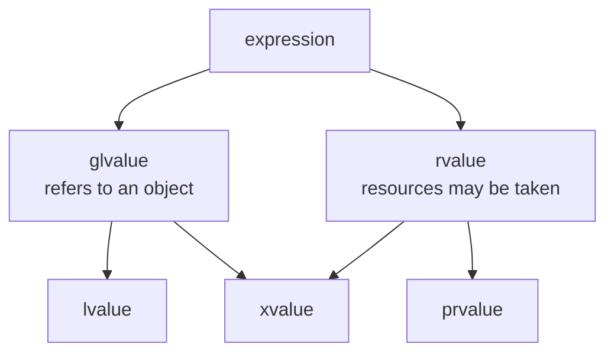
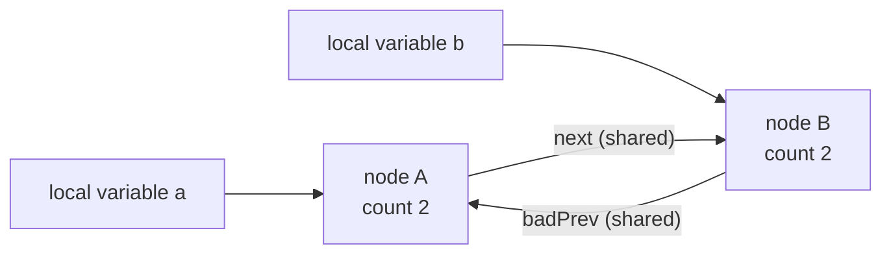

# Chapter 14 — Move Semantics and Modern C++

[Repository Guide](../../README.md) | [English](Concepts_Lecture.md) | [한국어](Concepts_Lecture.ko.md)

> **Last Updated:** 2026-11-19

> **Learning Objectives:**
> 1. Distinguish the value categories of expressions (lvalue, xvalue, prvalue) and determine which expressions an rvalue reference binds to
> 2. Write move constructors and move assignment operators and explain what `std::move` actually does
> 3. Declare or omit special member functions according to the rule of five and the rule of zero
> 4. Explain the effects of copy elision and `noexcept` moves on program behavior and performance
> 5. Implement `unique_ptr` ownership transfer, breaking reference cycles with `weak_ptr`, and callbacks with `std::function`
> 6. Write safer code with `nullptr`, `enum class`, brace initialization, and `constexpr`

---

## Table of Contents

- [1. The Cost of Copying and the Idea of Moving](#1-the-cost-of-copying-and-the-idea-of-moving)
  - [1.1 When Copying Is Wasteful](#11-when-copying-is-wasteful)
  - [1.2 Moving Resources](#12-moving-resources)
- [2. Value Categories and Rvalue References](#2-value-categories-and-rvalue-references)
  - [2.1 Value Categories](#21-value-categories)
  - [2.2 Rvalue References and Overload Resolution](#22-rvalue-references-and-overload-resolution)
  - [2.3 Named Rvalue References](#23-named-rvalue-references)
  - [2.4 `std::move`](#24-stdmove)
- [3. Move Constructors and Move Assignment Operators](#3-move-constructors-and-move-assignment-operators)
  - [3.1 The Move Constructor](#31-the-move-constructor)
  - [3.2 The Move Assignment Operator](#32-the-move-assignment-operator)
  - [3.3 Execution Trace](#33-execution-trace)
  - [3.4 Objects after a Move](#34-objects-after-a-move)
- [4. Rules for Special Member Functions](#4-rules-for-special-member-functions)
  - [4.1 Functions the Compiler Generates](#41-functions-the-compiler-generates)
  - [4.2 The Rule of Five](#42-the-rule-of-five)
  - [4.3 The Rule of Zero](#43-the-rule-of-zero)
  - [4.4 `= default` and `= delete`](#44--default-and--delete)
- [5. Copy Elision and `noexcept` Moves](#5-copy-elision-and-noexcept-moves)
  - [5.1 Copy Elision](#51-copy-elision)
  - [5.2 `noexcept` Moves and `vector` Reallocation](#52-noexcept-moves-and-vector-reallocation)
- [6. Perfect Forwarding](#6-perfect-forwarding)
  - [6.1 Forwarding References and Reference Collapsing](#61-forwarding-references-and-reference-collapsing)
  - [6.2 `std::forward`](#62-stdforward)
  - [6.3 `emplace_back`](#63-emplace_back)
- [7. Ownership with Smart Pointers](#7-ownership-with-smart-pointers)
  - [7.1 Transferring `unique_ptr` Ownership](#71-transferring-unique_ptr-ownership)
  - [7.2 Custom Deleters](#72-custom-deleters)
  - [7.3 Reference Cycles with `shared_ptr`](#73-reference-cycles-with-shared_ptr)
  - [7.4 `weak_ptr`](#74-weak_ptr)
- [8. Callable Objects and `std::function`](#8-callable-objects-and-stdfunction)
  - [8.1 Function Objects](#81-function-objects)
  - [8.2 `std::function`](#82-stdfunction)
  - [8.3 More on Lambda Captures](#83-more-on-lambda-captures)
- [9. Safer Basic Syntax](#9-safer-basic-syntax)
  - [9.1 `nullptr`](#91-nullptr)
  - [9.2 `enum class`](#92-enum-class)
  - [9.3 Brace Initialization and `initializer_list`](#93-brace-initialization-and-initializer_list)
  - [9.4 `constexpr`](#94-constexpr)
- [Concept Applications](#concept-applications)
- [Glossary](#glossary)
- [Summary](#summary)
- [Self-Check Questions](#self-check-questions)
- [References](#references)

---

<br>

## 1. The Cost of Copying and the Idea of Moving

### 1.1 When Copying Is Wasteful

The deep copy of [Chapter 5](../Ch05_Functions-and-Copy-Control/Concepts_Lecture.md) allocates and copies even the heap memory that pointer members point to, so the original and the copy do not affect each other. But if the original being copied is an object that is about to disappear, this work is wasted. In the following code, the `vector` returned by `makeNames()` is a temporary object that disappears when the calling expression ends.

```cpp
vector<string> makeNames() {
    vector<string> v;
    // ... puts 100,000 elements in
    return v;
}

vector<string> names;
names = makeNames();      // the contents of the returned temporary must be moved into names
```

Up to C++03, `names = makeNames();` was handled as a copy assignment. All 100,000 elements of the temporary `vector`, and the characters of every string, were newly allocated and copied, and the very next moment the temporary object was destroyed, freeing all of the originals. In effect, making the same contents once and throwing them away was repeated more than 100,000 times.

### 1.2 Moving Resources

If the original is about to disappear, the new object can simply take over the heap memory the original owns and leave the original empty. The job is done by changing a few pointers, with no allocation and no copying.

```text
Copy (deep copy)
original a: data ──► [1][2][3]
new b:      data ──► [1][2][3]   (newly allocated and copied; a and b each own an array)

Move
original a: data ──► nullptr     (the source is left empty)
new b:      data ──► [1][2][3]   (takes the array that a pointed to by moving the pointer)
```

*Figure 1. The difference between a deep copy and a move*

> **Definition:** **Move semantics** is the C++11 approach of initializing or assigning by handing over, without copying, the resources owned by an object that is about to disappear or will no longer be used.

Using moves takes two things. First, the compiler must be able to tell from the form of an expression that "this original is about to disappear, so its resources may be taken" (the value categories of Section 2). Second, the class must say how to take over its resources (the move constructor and move assignment operator of Section 3).

---

<br>

## 2. Value Categories and Rvalue References

### 2.1 Value Categories

Every expression in C++ has a **value category**. The value category tells whether the expression refers to an object with an identity and whether that object's resources may be taken.

> **Definition:** A **value category** is the property that classifies an expression as exactly one of lvalue, xvalue, or prvalue; lvalues and xvalues together are called glvalues, and xvalues and prvalues together are called rvalues[1].



*Figure 2. The classification of value categories*

The standard defines the three categories as follows[1]. A **glvalue** is an expression whose evaluation determines the identity of an object or function, and a **prvalue** is an expression whose evaluation initializes an object or computes the value of an operand of an operator. An **xvalue** is a glvalue that denotes an object whose resources can be reused (usually because it is near the end of its lifetime), and an **lvalue** is a glvalue that is not an xvalue. The l and r in the names come from being able to appear on the left and right of an assignment, but that criterion no longer fits exactly.

| Expression | Value category | Reason |
|:-----|:-----|:-----|
| `s` (a variable name) | lvalue | It refers to an object with a name |
| `*p`, `a[i]`, `++x` | lvalue | It refers to an existing object |
| `f()` (returns `string&`) | lvalue | The returned reference refers to an existing object |
| `42`, `true`, `nullptr` | prvalue | It is a value without a name |
| `s + "!"`, `x++`, `a + b` | prvalue | A new value is created as the result of an operation |
| `make()` (returns `string` by value) | prvalue | A temporary object is created as the return value |
| `std::move(s)`, `static_cast<string&&>(s)` | xvalue | It is an expression converted to an rvalue reference |

*Table 1. Expressions and their value categories*

An lvalue expression refers to an object that can be used again after the expression ends, so its resources must not be taken. Prvalues and xvalues, that is, rvalues, are either no longer used after the expression ends (prvalues) or have been marked by the programmer as no longer to be used (xvalues), so their resources may be taken. Note that a value category is a property of an **expression**, not of a value. The same variable `s` is an lvalue when written as `s` and an xvalue when written as `std::move(s)`.

### 2.2 Rvalue References and Overload Resolution

C++11 introduced the **rvalue reference** `T&&`, a reference that binds only to rvalues. The reference `T&` used so far is called an lvalue reference to distinguish it.

| Parameter | Expressions it binds to |
|:-----|:-----|
| `T&` | Non-`const` lvalues |
| `const T&` | Every expression (lvalues, rvalues, `const` included) |
| `T&&` | Non-`const` rvalues |

*Table 2. Kinds of references and the expressions they bind to*

If all three forms are overloaded, overload resolution chooses a function according to the value category of the expression. `const T&` accepts every expression, but `T&&` fits an rvalue better, so the `T&&` version is chosen. [Example_ValueCategories.cpp](Example_ValueCategories.cpp) passes several expressions to functions of the same name.

```cpp
void take(string&)        { cout << "string&       (modifiable lvalue)" << endl; }
void take(const string&)  { cout << "const string& (const lvalue)" << endl; }
void take(string&&)       { cout << "string&&      (rvalue)" << endl; }

string s = "name";
const string cs = "fixed";
string&& r = make();                         // r is a named rvalue reference
```

```text
take(s)            -> string&       (modifiable lvalue)
take(cs)           -> const string& (const lvalue)
take(make())       -> string&&      (rvalue)
take(s + "!")      -> string&&      (rvalue)
take(r)            -> string&       (modifiable lvalue)
take(std::move(s)) -> string&&      (rvalue)
s after the call   = name
```

`make()` and `s + "!"` are prvalues, so the `string&&` version is called. Move constructors and move assignment operators rely on exactly this rule. If a constructor whose parameter is `T&&` is defined, that constructor is chosen only when the initializing expression is an rvalue.

### 2.3 Named Rvalue References

The result of `take(r)` is, surprisingly, `string&`. The type of `r` is `string&&`, but the **expression** `r` names a variable, so it is an lvalue. Type and value category are different concepts, and overload resolution looks at the value category of the expression.

There is a reason for this rule. Something with a name can be used again in later statements. If `r` were treated as an rvalue and its resources were taken at its first use, the second use would see an empty object. That is why even inside a move constructor the parameter `other` is an lvalue, and to move a member it must be marked as an rvalue again, as in `std::move(other.member)` (the `Item` of Section 5.2).

### 2.4 `std::move`

Despite its name, `std::move(x)` in `<utility>` moves nothing. The standard specifies that `std::move(t)` returns `static_cast<remove_reference_t<T>&&>(t)`[1]. That is, it is only a **cast** that converts its argument to an rvalue reference; the resulting expression is an xvalue, which merely allows a move constructor or move assignment operator to be chosen. What actually moves the resources is the function chosen that way.

In the output of the previous section, `s` is still `name` even after `take(std::move(s))` is called. This is because `take(string&&)` only received the parameter and did not move its contents anywhere. `std::move` is permission that "this object's resources may now be taken," and the receiving function decides whether to use that permission.

> **Caution:** Using `std::move` on a `const` object gives `const T&&`. The move constructor's parameter `T&&` cannot accept `const`, so the copy constructor taking `const T&` is chosen and a copy happens silently. In fact, `const Buffer cb; Buffer x = std::move(cb);` calls the copy constructor. Do not declare objects that will be moved from as `const`.

---

<br>

## 3. Move Constructors and Move Assignment Operators

The `Buffer` of [Example_MoveTrace.cpp](Example_MoveTrace.cpp) has a size `n` and a pointer `data` to a heap array, and it prints its name whenever one of the five special member functions runs. The copy constructor and copy assignment operator work the same way as the deep copy of [Chapter 5, Section 4.8](../Ch05_Functions-and-Copy-Control/Concepts_Lecture.md#48-copy-assignment-operator).

### 3.1 The Move Constructor

```cpp
Buffer(Buffer&& o) noexcept : n(o.n), data(o.data) {     // 4. move constructor
    o.n = 0;
    o.data = nullptr;                        // leaves the source empty but valid
    cout << "  move ctor(" << n << ")" << endl;
}
```

- **The parameter is `Buffer&&`.** This constructor is chosen when the initializing expression is an rvalue. There must be no `const` so that the source can be changed.
- **It takes the resources.** The initializer list copies the source's `n` and `data` as they are. It copies only the pointer and does not allocate a new array.
- **It empties the source.** Without `o.data = nullptr`, the source and the new object would point to the same array, and the destructors of both objects would `delete[]` the same array twice. The source holds `nullptr`, so `delete[] nullptr` in its destructor does nothing.
- **It is marked `noexcept`.** It only moves pointers, so it has no reason to throw. Because `Buffer` can also be copied, only with this mark does `vector` use moves during reallocation (Section 5.2).

### 3.2 The Move Assignment Operator

```cpp
Buffer& operator=(Buffer&& o) noexcept {                 // 5. move assignment
    if (this != &o) {
        delete[] data;                       // releases its own resource first
        data = o.data;
        n = o.n;
        o.data = nullptr;
        o.n = 0;
    }
    cout << "  move assign(" << n << ")" << endl;
    return *this;
}
```

Move assignment happens to an object that already owns a resource, so it must release its own resource before taking the source's. Otherwise, the array it originally pointed to leaks. The `this != &o` check guards against moving an object into itself, as in `a = std::move(a)`. Without the check, it would release its own array first and then take back the released pointer, leaving a dangling pointer. The final `return *this` is there for chained assignment, for the same reason as in copy assignment.

### 3.3 Execution Trace

`main()` prints which functions are called in six situations.

```cpp
Buffer a(3);
Buffer b = a;                                // 1
Buffer c = std::move(a);                     // 2
b = makeBuffer(5);                           // 3: makeBuffer returns a local Buffer local(n)
Buffer d = Buffer(7);                        // 4
vector<Buffer> v;
v.reserve(2);
v.push_back(Buffer(1));                      // 5
v.push_back(std::move(c));
```

```text
1. Buffer a(3); Buffer b = a;
  ctor(3)
  copy ctor(3)
2. Buffer c = std::move(a);
  move ctor(3)
  a.size() = 0
3. b = makeBuffer(5);
  ctor(5)
  move assign(5)
  dtor(empty)
4. Buffer d = Buffer(7);
  ctor(7)
5. vector push_back
  ctor(1)
  move ctor(1)
  dtor(empty)
  move ctor(3)
6. end of main
  dtor(3)
  dtor(1)
  dtor(7)
  dtor(empty)
  dtor(5)
  dtor(empty)
```

| Step | Statement | Functions called | Reason |
|:-----|:-----|:-----|:-----|
| 1 | `Buffer b = a;` | Copy constructor | `a` is an lvalue, so its resources cannot be taken |
| 2 | `Buffer c = std::move(a);` | Move constructor | `std::move(a)` is an xvalue. After the move, `a.size()` is 0 |
| 3 | `b = makeBuffer(5);` | Constructor, move assignment, destructor of the empty object | The return value is a prvalue. In this environment, the `local` inside the function was built directly in the return value's place (Section 5.1) |
| 4 | `Buffer d = Buffer(7);` | Constructor only | Initializing from a prvalue of the same type involves neither a copy nor a move (Section 5.1) |
| 5 | `v.push_back(Buffer(1));` | Constructor, move constructor, destructor of the empty object | A temporary is created and then moved into the `vector` |
| 5 | `v.push_back(std::move(c));` | Move constructor | The array of `c` is moved into the element inside the `vector` |

*Table 3. Execution trace of `Example_MoveTrace`*

- In step 3, the array that `b` originally owned (size 3) is released by `delete[] data` inside the move assignment operator. The `dtor(empty)` after it is the destruction of the temporary that handed over its resource.
- The order of destruction in step 6 is the reverse of construction. `v`, created last, is destroyed first and releases its two elements (sizes 3 and 1), and then `d` (7), the emptied-by-move `c`, `b` (5), which received the move assignment, and the emptied-by-move `a` are destroyed in turn. That the `vector` destroyed its elements from the back is libc++'s behavior; the standard does not specify the order.
- In the whole run, arrays are allocated only by the constructor 4 times (3, 5, 7, 1) and by the copy constructor once. Without moves, more allocation and copying would have happened in each of steps 2, 3, and 5.

### 3.4 Objects after a Move

The source after a move is still a live object until its destructor is called. A move operation must leave the source in a state in which the following two things are safe.

- Its destructor runs safely.
- If a new value is assigned, it can be used normally again.

Unless otherwise specified, types of the standard library are left in a **valid but unspecified state** after a move[1]. The object's invariants hold, so calling `size()` or `empty()` is safe, but what the value is, is not specified. For example, code that assumes a moved-from `string` is empty is not portable. Types that specify their moved-from state, such as `unique_ptr`, are the exception; a moved-from `unique_ptr` is always null[1]. User classes define their moved-from state themselves, as `Buffer` does, and document it.

> **Caution:** After `v.push_back(std::move(name));`, printing or comparing `name` again gives no guaranteed value. Use a moved-from object only to assign a new value or to destroy it.

---

<br>

## 4. Rules for Special Member Functions

### 4.1 Functions the Compiler Generates

The destructor, the copy constructor, the copy assignment operator, the move constructor, and the move assignment operator are called **special member functions**. If the user does not declare them, the compiler implicitly declares versions that perform the same operation member by member. The implicit declaration of the move functions has conditions. The standard implicitly declares a move constructor only when the class has no user-declared copy constructor, copy assignment operator, move assignment operator, or destructor[1], and in the same way implicitly declares a move assignment operator only when there is no user-declared copy function, move constructor, or destructor[1].

| What the user declared | Implicit copy functions | Implicit move functions |
|:-----|:-----|:-----|
| Nothing | Generated | Generated |
| Destructor | Generated (deprecated) | Not generated |
| Copy constructor or copy assignment operator | Copy functions other than the declared one are generated (deprecated) | Not generated |
| Move constructor or move assignment operator | Deleted (same as `= delete`) | Move functions other than the declared one are not generated |

*Table 4. Implicit special member functions depending on what the user declared*

The second and third rows matter. A class that writes its own destructor or copy functions (as every deep-copy class of Chapter 5 does) has no move functions. Without move functions, even initialization from an rvalue chooses the copy constructor that takes `const T&`[1], so the program works without errors but gains none of the benefits of moving. The fourth row means that declaring only move functions prohibits copying, and move-only types such as `unique_ptr` have this shape.

### 4.2 The Rule of Five

The rule of three in [Chapter 5, Section 4.9](../Ch05_Functions-and-Copy-Control/Concepts_Lecture.md#49-rule-of-three) is the principle that a class that must define one of the destructor, copy constructor, and copy assignment operator must define all three. By Table 4, declaring any of these three makes the move functions disappear, so in C++11 the principle grows to five functions.

> **Key Point:** **The rule of five.** A class that manages a resource directly and must define one of the destructor, copy constructor, copy assignment operator, move constructor, and move assignment operator defines all five, or marks the unneeded ones with `= delete`.

`Buffer` is an example that defines all five functions. Writing all five correctly every time is tedious and error-prone, so in practice the method of the next section is considered first.

### 4.3 The Rule of Zero

If the work of managing resources is left to classes that do only that work (`string`, `vector`, `unique_ptr`, file streams), and other classes merely hold such classes as members, no special member function needs to be declared at all. The versions the compiler generates copy and move member by member, and each member handles its own resource correctly. This is called the **rule of zero**. The two classes of [Example_RuleOfZero.cpp](Example_RuleOfZero.cpp) declare no special member function.

```cpp
class Playlist {                                 // declares none of the five special functions
    string title;
    vector<string> songs;
public:
    explicit Playlist(string t) : title(std::move(t)) {}
    void add(string s) { songs.push_back(std::move(s)); }
    // ...
};

class Owner {                                    // unique_ptr makes the class move-only
    unique_ptr<Playlist> list;
public:
    explicit Owner(string t) : list(make_unique<Playlist>(std::move(t))) {}
};
```

```text
copy: road trip, 2 songs
moved: road trip, 2 songs
source after move: "", 0 songs
Playlist copyable true, nothrow movable true
Owner copyable false, movable true
o1 empty true, o2 empty false
```

- `Playlist copy = p;` copies `title` and `songs` member by member, and `Playlist moved = std::move(p);` moves them member by member. That both members of the source `p` are empty after the move is libc++'s result and, as in Section 3.4, not a value the standard guarantees.
- The move constructors of `string` and `vector` are `noexcept`, so the move constructor the compiler generates for `Playlist` is also `noexcept` (`is_nothrow_move_constructible` is true).
- `Owner` has a `unique_ptr` member, which cannot be copied, so its implicit copy constructor is deleted and it can only be moved. After the move, the pointer of `o1` is null.
- Taking constructor and `add()` parameters by value and then moving them into members with `std::move` is a common style. If the caller passes an lvalue, it is copied once into the parameter; if the caller passes an rvalue, only moves happen.

### 4.4 `= default` and `= delete`

To declare a special member function without defining it yourself, use `= default`; to prevent the function from being used, use `= delete`.

```cpp
class Logger {
public:
    Logger() = default;                          // explicitly requests the compiler-generated version
    virtual ~Logger() = default;                 // a virtual destructor with the default body
    Logger(const Logger&) = delete;              // no copying
    Logger& operator=(const Logger&) = delete;
    Logger(Logger&&) = default;                  // the destructor was declared, so moves must be requested
    Logger& operator=(Logger&&) = default;
};
```

`= default` is used when only a property of the function is to change, such as declaring the destructor `virtual`, while the body stays the default version. By Table 4, declaring a destructor makes the move functions disappear, so if moves are needed, request them again with `= default` as above. `= delete` can also be used on functions that are not special member functions, so it is also used to prevent unwanted conversions (`Meters(int) = delete` in Section 9.4).

---

<br>

## 5. Copy Elision and `noexcept` Moves

### 5.1 Copy Elision

**Copy elision** is building an object that would be created by a copy or a move in its final place from the start, removing the call to the copy constructor or move constructor altogether. The standard distinguishes two cases.

- **Mandatory elision (C++17).** When an object is initialized from a prvalue of the same type, the prvalue initializes the target object directly[1]. `Buffer d = Buffer(7);` and `T x = T(T(T()));` call the constructor only once. In this case the code compiles even if the copy constructor and move constructor are missing or deleted.
- **Permitted elision.** When a function returns the name of a local variable (`return local;`), the compiler may build that local variable directly in the place of the return value and omit the move[1]. This is called named return value optimization (NRVO), and the standard permits it but does not require it.

Clang's `-fno-elide-constructors` option turns off permitted elision. Compiling the same `Example_MoveTrace` with this option changes the output of steps 3 and 4 as follows.

| Compilation | Step 3 `b = makeBuffer(5);` | Step 4 `Buffer d = Buffer(7);` |
|:-----|:-----|:-----|
| `-std=c++17` (default) | Constructor, move assignment | Constructor |
| `-std=c++17 -fno-elide-constructors` | Constructor, move constructor, move assignment | Constructor |
| `-std=c++14 -fno-elide-constructors` | Constructor, move constructor, move assignment | Constructor, move constructor |

*Table 5. Calls with and without copy elision (destructors of empty objects omitted)*

With NRVO off, in step 3 `local` is **moved** into the return value. It is a move rather than a copy because the standard specifies that the `local` in `return local;` is first treated as an rvalue when choosing the constructor[1]. Step 4 is mandatorily elided in C++17, so only the constructor is called regardless of the option, while in C++14 turning off elision causes a move.

> **Caution:** Writing `return std::move(local);` when returning a local variable actually makes things slower. The returned expression is no longer the name of a local variable, so NRVO becomes impossible and a move is forced. Clang warns with `warning: moving a local object in a return statement prevents copy elision`. Return a local variable with `return local;`, without `std::move`.

### 5.2 `noexcept` Moves and `vector` Reallocation

When its capacity runs out, a `vector` allocates a new, larger array and moves the existing elements into it. Whether the elements are moved or copied depends on whether the element's move constructor is `noexcept`. [Example_NoexceptMove.cpp](Example_NoexceptMove.cpp) puts three elements each of two types, which differ only in whether the move constructor is `noexcept`, into a `vector` of capacity 2.

```cpp
template <bool NoThrow>
struct Item {
    string tag;
    explicit Item(string t) : tag(t) {}
    Item(const Item& o) : tag(o.tag) { cout << " copy(" << tag << ")"; }
    Item(Item&& o) noexcept(NoThrow) : tag(std::move(o.tag)) { cout << " move(" << tag << ")"; }
};
```

```text
nothrow move: true, false
noexcept(true)  capacity 2 -> move(a) move(b)  (capacity 4)
noexcept(false) capacity 2 -> copy(a) copy(b)  (capacity 4)
```

Reallocation happens when the third element is inserted; the type whose move constructor is `noexcept` moves the existing elements `a` and `b`, and the other type copies them. The reason lies not in Section 5.1 but in exception safety. The standard specifies that if an exception occurs while `push_back` inserts a single element at the end, there are no effects, provided the element is copyable or its move constructor does not throw[1]. If a move constructor threw while moving the third element during reallocation, the two elements already moved would have lost their contents in the original array and could not be restored. With copies, the original array remains as it was, and the new array is simply discarded. So for elements that can be copied, `vector` uses moves only when moving does not throw, and for elements that cannot be copied it uses the move even if it may throw. Implementations make this choice with `std::move_if_noexcept`. That the capacity grew from 2 to 4 is libc++'s growth policy.

> **Key Point:** Put `noexcept` on move constructors and move assignment operators whenever possible. Without it, containers such as `vector` use copies instead of moves, and the benefit of move semantics disappears.

---

<br>

## 6. Perfect Forwarding

### 6.1 Forwarding References and Reference Collapsing

When a function template's parameter is written as `T&&` and `T` is deduced from the argument, the parameter is not an rvalue reference but a **forwarding reference**.

> **Definition:** A **forwarding reference** is a parameter of a function template declared as `T&&` for a template parameter `T` without `const`; it binds as an lvalue reference if the argument is an lvalue and as an rvalue reference if the argument is an rvalue[1].

This behavior is the combined result of template argument deduction and the **reference collapsing** rules. Passing the lvalue `s` (of type `string`) deduces `T` as `string&`, so the parameter type `T&&` becomes `string& &&`; passing an rvalue deduces `T` as `string`, giving `string&&`. A reference to a reference collapses into a single reference by the following rules[1], so `string& &&` becomes `string&`.

| Type that `T` denotes | Result of `T&` | Result of `T&&` |
|:-----|:-----|:-----|
| `X&` | `X&` | `X&` |
| `X&&` | `X&` | `X&&` |
| `X` (not a reference) | `X&` | `X&&` |

*Table 6. Reference collapsing rules (if either side is an lvalue reference, the result is an lvalue reference)*

A variable declared with `auto&&` is also a forwarding reference that follows the same rules. In contrast, a type that is not a template parameter, as in `void f(string&& s)`, or a form with `const`, as in `void f(const T&& x)`, is an rvalue reference, not a forwarding reference.

### 6.2 `std::forward`

When an argument received through a forwarding reference is passed to another function, it must be passed as an rvalue if the original argument was an rvalue and as an lvalue if it was an lvalue, so that the receiving function can choose correctly between moving and copying. This is called **perfect forwarding**. By the rule of Section 2.3, the parameter name `arg` is always an lvalue, so passing it as it is loses the original value category. [Example_Forwarding.cpp](Example_Forwarding.cpp) compares the two ways.

```cpp
void sink(const string&) { cout << "copy path" << endl; }
void sink(string&&)      { cout << "move path" << endl; }

template <typename T>
void relayWrong(T&& arg) { sink(arg); }                      // arg has a name: always an lvalue

template <typename T>
void relay(T&& arg) { sink(std::forward<T>(arg)); }          // restores the original category
```

```text
relayWrong(s):            copy path
relayWrong(string("t")):  copy path
relay(s):                 copy path
relay(string("t")):       move path
```

`std::forward<T>(arg)` yields an lvalue if `T` is an lvalue reference type (an lvalue was received) and an rvalue if `T` is a non-reference type (an rvalue was received). Unlike `std::move`, which always converts to an rvalue, `std::forward` restores the original state. So `std::move` is used on rvalue reference parameters, and `std::forward` on forwarding reference parameters.

### 6.3 `emplace_back`

A typical use of perfect forwarding is the `emplace` family of container functions. `push_back(x)` receives an object that has already been built and copies or moves it into the container, whereas `emplace_back(args...)` receives the constructor arguments through forwarding references and builds the object directly in its place inside the container.

```cpp
vector<Point> v;
v.reserve(4);
v.push_back(Point(1, 2));                    // builds a temporary, then moves it
v.emplace_back(3, 4);                        // forwards 3 and 4 to the constructor
```

```text
push_back(Point(1, 2)):
  Point(1, 2)
  move
emplace_back(3, 4):
  Point(3, 4)
```

`push_back` calls the constructor and the move constructor once each and destroys the temporary, whereas `emplace_back` calls only the constructor. However, `emplace_back` can also call `explicit` constructors, so unintended conversions may occur (for example, putting a raw pointer into a `vector<unique_ptr<int>>`); when inserting an object that has already been built, `push_back` shows the intent more clearly.

---

<br>

## 7. Ownership with Smart Pointers

[Chapter 4, Section 6](../Ch04_Pointers-Arrays-and-Dynamic-Memory/Concepts_Lecture.md#6-smart-pointers-modern-c) covers the basic use of `unique_ptr`, `shared_ptr`, `make_unique`, and `make_shared`. This section covers the transfer of ownership, which move semantics explains, and reference cycles, which `shared_ptr` alone cannot solve.

### 7.1 Transferring `unique_ptr` Ownership

`unique_ptr` is a class whose copy constructor is deleted and which has only a move constructor (the fourth row of Section 4.1). So the parameter and return types of a function alone show how ownership moves.

| Shape of the function | Meaning |
|:-----|:-----|
| `unique_ptr<T> create()` | Creates a new object and hands ownership to the caller |
| `void consume(unique_ptr<T> p)` | Takes over ownership. The caller must pass it with `std::move` |
| `void show(const T& t)` or `void show(T* t)` | Only uses the object, without ownership |
| `void reset(unique_ptr<T>& p)` | Can change the caller's `unique_ptr` itself |

*Table 7. Shapes of functions and what they mean for ownership*

[Example_UniqueOwnership.cpp](Example_UniqueOwnership.cpp) uses the first three entries of the table.

```cpp
auto t1 = createTask("write report");
show(*t1);

vector<unique_ptr<Task>> queue;
queue.push_back(std::move(t1));              // t1 becomes null
queue.push_back(createTask("send mail"));

consume(std::move(queue[0]));                // destroyed inside consume
cout << "  after consume" << endl;
```

```text
  show write report
  t1 is null, queue size 2
  consume write report
  ~Task(write report)
  after consume
  fclose called
  end of main
  ~Task(send mail)
```

- The return value of `createTask()` is a prvalue, so it is moved into `t1` and into `queue` without `std::move`.
- Writing `queue.push_back(t1)` is a compile error because the copy constructor is deleted. Handing over ownership with `std::move(t1)` makes `t1` null.
- `consume(std::move(queue[0]))` hands ownership to the parameter `t`, and when the function ends and `t` is destroyed, the `Task` is destroyed too. That `~Task(write report)` is printed before `after consume` is the evidence.
- The remaining `send mail` is released when `main()` ends and `queue` is destroyed.

### 7.2 Custom Deleters

The second template argument of `unique_ptr<T, D>` is a **deleter**, which is called instead of `delete` on destruction. With it, resources not obtained with `new` can also be managed with RAII. The example defines a deleter that closes a C `FILE*` with `fclose()`.

```cpp
struct FileCloser {
    void operator()(FILE* f) const {
        cout << "  fclose called" << endl;
        fclose(f);
    }
};

{
    unique_ptr<FILE, FileCloser> log(fopen("log.txt", "w"));
    if (log)
        fputs("first line\n", log.get());    // get() gives the raw pointer for C functions
}                                            // FileCloser runs here
```

When control leaves the block, `fclose called` is printed, and `first line` is recorded in `log.txt`, which is created in the directory from which the program was run. If `fopen()` fails and returns null, the `unique_ptr` holds null, and a null `unique_ptr` does not call its deleter on destruction[1]. In the same way, operating system handles and objects created by libraries can be managed together with their release functions.

### 7.3 Reference Cycles with `shared_ptr`

`shared_ptr` records the number of `shared_ptr`s pointing to the same object (the reference count) in a **control block** and deletes the object when the count reaches 0. However, if two objects point to each other with `shared_ptr`, the counts can never reach 0. The first block of [Example_WeakPtr.cpp](Example_WeakPtr.cpp) links nodes A and B in both directions.

```cpp
struct Node {
    string name;
    shared_ptr<Node> next;                       // owning link
    weak_ptr<Node> prev;                         // non-owning link back
    shared_ptr<Node> badPrev;                    // owning link back: creates a cycle
    // the constructor and destructor print the name
};

{
    auto a = make_shared<Node>("A");
    auto b = make_shared<Node>("B");
    a->next = b;
    b->badPrev = a;
}                                                // A and B are never destroyed
```



*Figure 3. Two nodes pointing to each other with `shared_ptr`*

Inside the block, the reference count of each node is 2 (one local variable and one member of the other node). When control leaves the block and the local variables `a` and `b` are destroyed, each count drops to 1, but the remaining 1 is held by the other node, so it never reaches 0. The two nodes are not released even though no variable in the program can reach them, and `destroy A` and `destroy B` never appear in the output. This is a memory leak caused by a **reference cycle**.

```text
1. cycle with two shared_ptr links
  create A
  create B
  use_count A=2, B=2
  end of block 1
```

### 7.4 `weak_ptr`

> **Definition:** **`weak_ptr`** is a smart pointer that points to an object managed by `shared_ptr` without increasing the reference count; to use the object, a `shared_ptr` must be obtained with `lock()`.

To break the cycle, change one of the links into a non-owning link. In relationships with a direction, such as parent and child or front and back nodes, the link from front to back usually owns, and the link from back to front is a `weak_ptr`. The second block of the same example changes the back link to a `weak_ptr`.

```cpp
weak_ptr<Node> watcher;
{
    auto c = make_shared<Node>("C");
    auto d = make_shared<Node>("D");
    c->next = d;
    d->prev = c;                             // does not raise C's count
    watcher = d;
    if (shared_ptr<Node> p = d->prev.lock())  // lock() gives a shared_ptr or null
        cout << "  D's previous node is " << p->name << endl;
}
cout << "  end of block 2, watcher expired = " << boolalpha << watcher.expired() << endl;
```

```text
2. back link as weak_ptr
  create C
  create D
  use_count C=1, D=2
  D's previous node is C
  destroy C
  destroy D
  end of block 2, watcher expired = true
```

| Moment | Count of C | Count of D | What happens |
|:-----|:-----|:-----|:-----|
| After linking | 1 (`c`) | 2 (`d`, `C.next`) | `d->prev` does not increase the count |
| End of block: `d` destroyed | 1 | 1 (`C.next`) | Local variables are destroyed in reverse order of declaration |
| End of block: `c` destroyed | 0 | 1 | C is deleted, and its member `next` is destroyed |
| C's `next` destroyed | | 0 | D is deleted |

*Table 8. Reference counts of two nodes linked with `weak_ptr`*

- `lock()` gives a `shared_ptr` pointing to the object if it is still alive, and an empty `shared_ptr` if it has already been deleted[1]. While the obtained `shared_ptr` is alive, the object is not deleted, so it can be used safely.
- `expired()` tells whether the object has already been deleted. That `watcher.expired()` is true after the block ends means D has been deleted.
- `weak_ptr` does not own the object but is still connected to the control block, so `expired()` can be called safely even after the object is deleted. With a raw pointer for the back link, this check would be impossible.

> **[Data Structures]** The doubly linked lists and the parent pointers of trees covered in Data Structures are structures in which two nodes point to each other. When building such structures with `shared_ptr`, only one direction (the next node, the children) should own, and the opposite direction (the previous node, the parent) should be a `weak_ptr` or a non-owning raw pointer so that the nodes are released.

---

<br>

## 8. Callable Objects and `std::function`

### 8.1 Function Objects

Something that can be called with `()` like a function is called a **callable object**. Besides ordinary functions and function pointers, objects of a class that overloads the function call operator `operator()` can also be called; these are called **function objects** (functors).

```cpp
struct Multiply {                                // a function object: a class with operator()
    int calls = 0;
    int operator()(int a, int b) { calls++; return a * b; }
};

Multiply mul;
int r = mul(6, 7);                               // mul.operator()(6, 7), r is 42
```

Unlike ordinary functions, function objects can hold state in member variables. The `calls` above counts the number of calls. The lambda expressions of [Chapter 10, Section 8.3](../Ch10_Templates-and-STL/Concepts_Lecture.md#83-lambda-expressions-c11) are syntax with which the compiler creates an unnamed function object class and an object of it. The captured variables become members of that class, and the lambda's body becomes the body of `operator()`.

### 8.2 `std::function`

The type of a lambda expression is an unnamed type known only to the compiler, and it differs for each lambda. So to hold different lambdas, functions, and function objects in one variable or container, a common type is needed. `std::function<R(Args...)>` in `<functional>` is a class template that can hold any callable object whose parameter types are `Args...` and whose return type is `R`. [Example_StdFunction.cpp](Example_StdFunction.cpp) puts four kinds of callable objects into the same `map`.

```cpp
map<string, function<int(int, int)>> ops;    // one type for different callables
ops["+"] = add;                              // an ordinary function
ops["*"] = Multiply();                       // a function object
ops["-"] = [](int a, int b) { return a - b; };
int base = 10;
ops["b"] = [base](int a, int b) { return base * a + b; };   // captures a copy of base
for (const auto& [symbol, f] : ops)
    cout << "7 " << symbol << " 3 = " << f(7, 3) << endl;
```

```text
7 * 3 = 21
7 + 3 = 10
7 - 3 = 4
7 b 3 = 73
```

`map` sorts its keys in character-code order (`*` 42, `+` 43, `-` 45, `b` 98), so the output order differs from the insertion order. The last line computes 10 × 7 + 3 = 73 using the captured `base` (10).

**Callbacks.** `std::function` is often used for callbacks, where the function to call "when something happens" is decided later. The `Button` of the same example collects the functions to call when it is clicked in a `vector<function<void(const string&)>>`.

```cpp
Button b;
int clicks = 0;
b.onClick([](const string& who) { cout << "  hello, " << who << endl; });
b.onClick([&clicks](const string&) { clicks++; });   // changes clicks, captured by reference
b.click("Kim");
b.click("Lee");                                      // clicks = 2
```

**An empty `function`.** Calling a `std::function` that holds nothing throws a `std::bad_function_call` exception[1]. Before calling, `if (f)` checks whether it is empty.

> **Caution:** If a lambda that captures by reference is stored in a `std::function` and called later, the captured local variable may already be gone by then. The `[&clicks]` above is safe because `clicks` outlives `b`, but storing a callback that captures a function's local variable by reference outside that function creates a dangling reference. Capture by value in callbacks that are stored for a long time.

In return for hiding the actual type of what it holds, `std::function` adds one more level of indirection to each call and may allocate on the heap when holding a large object. Functions that take a callable object as a template parameter, such as `sort(v.begin(), v.end(), comp)`, know the lambda's type directly when calling it, so they have no such cost. Use `std::function` when several kinds must be held in one place or when a function to be called later must be stored.

### 8.3 More on Lambda Captures

Besides the capture by value and by reference covered in Chapter 10, the following three forms are often used.

```cpp
int count = 0;
auto counter = [count]() mutable { return ++count; };       // changes its own copy

auto p = make_unique<int>(5);
auto owner = [q = std::move(p)]() { return *q * 2; };       // init capture moves p in

auto twice = [](auto x) { return x + x; };   // generic lambda (C++14)
```

```text
counter: 1 2, outer count 0
init capture: 10, p is null
generic: 8 abab
```

- **`mutable`.** A variable captured by value cannot be changed inside the lambda by default, because the `operator()` the compiler creates is a `const` member function. Adding `mutable` allows the lambda to change its own copy. Calling `counter()` twice returns 1 and 2, but the outer `count` stays 0.
- **Init capture (C++14).** `[q = std::move(p)]` creates a new member `q` inside the lambda and specifies its initial value. Even a `unique_ptr`, which cannot be copied, can be moved into a lambda, and after the move `p` is null.
- **Generic lambda (C++14).** Declaring a parameter as `auto` makes `operator()` a template, so the lambda works with several types. `twice(4)` is 8, and `twice(string("ab"))` is `"abab"`.

---

<br>

## 9. Safer Basic Syntax

### 9.1 `nullptr`

In C and C++03, the null pointer was written as the integer 0 or the macro `NULL` (`0`, `0L`, and so on, depending on the implementation). This value is also an integer, which causes problems with overloading. The two functions `f(int)` and `f(char*)` of [Example_ModernBasics.cpp](Example_ModernBasics.cpp) show this.

```cpp
void f(int)   { cout << "f(int)" << endl; }
void f(char*) { cout << "f(char*)" << endl; }

f(0);                                        // f(int): 0 is an int
f(nullptr);                                  // f(char*): nullptr converts only to pointer types
// f(NULL);                                  // in this environment, error: call to 'f' is ambiguous
```

C++11's `nullptr` is a pointer literal, a prvalue of type `std::nullptr_t`[1]. It converts to every pointer type but not to integer types, so only the function taking a pointer is chosen. With `NULL`, depending on the implementation, either `f(int)` is chosen or, as in this environment, an ambiguity error occurs, so in C++ the null pointer is always written as `nullptr`.

### 9.2 `enum class`

The enumeration `enum` inherited from C has two weaknesses. The names of its enumerators spread into the scope that encloses the enumeration, so a name clash with another enumeration gives `error: redefinition of enumerator 'Green'`, and enumerators convert implicitly to `int`, so they get mixed and compared with other enumerations or integers.

C++11's **scoped enumeration**, `enum class`, removes both weaknesses.

```cpp
enum Color { Red, Green };                       // unscoped: names leak into the enclosing scope
enum class Signal : unsigned char { Red, Yellow, Green };   // scoped, with a chosen underlying type

Signal s = Signal::Yellow;                   // written with Signal::
int c = Green;                               // an unscoped enum converts to int silently
int code = static_cast<int>(s);              // a scoped enum needs an explicit cast
```

```text
Green=1, Signal::Yellow=1, sizeof(Signal)=1
```

- The enumerators of `Signal` are written with the name attached, as in `Signal::Red`, so they do not clash with `Red` and `Green` of `Color`.
- Assigning a `Signal` to an `int` or comparing it with an `int` requires `static_cast`. Code that accidentally mixes it with values of another kind becomes a compile error.
- `: unsigned char` specifies the integer type the enumeration uses (the underlying type). If it is not specified, the underlying type of a scoped enumeration is `int`[1]. In this example, `sizeof(Signal)` is 1.

### 9.3 Brace Initialization and `initializer_list`

Since C++11, almost every initialization can be written with braces. This is called **list initialization**, and because the same syntax is used for variables, arrays, structures, classes, and containers, it is also called uniform initialization.

```cpp
int x{5};
double d{2.5};
// int y{d};                                 // error: type 'double' cannot be narrowed to 'int' in initializer list
int y = static_cast<int>(d);                 // write an intended conversion explicitly
```

**Narrowing conversions are prohibited.** In list initialization, **narrowing conversions** that can lose information about a value (from `double` to `int`, from a larger integer type to a smaller one, and so on) are not allowed[1]. `int y = d;` truncates 2.5 to 2 without a warning even with `-Wall -Wextra`, but `int y{d};` is a compile error, which prevents conversions that lose data from being written by accident.

**Priority of `initializer_list` constructors.** When a class that has a constructor taking `std::initializer_list<T>`, such as `vector`, is initialized with braces, that constructor becomes a candidate first[1]. So parentheses and braces mean different things.

| Declaration | Constructor called | Result |
|:-----|:-----|:-----|
| `vector<int> a(3, 7);` | `vector(size_type n, const T& value)` | 3 elements `7 7 7` |
| `vector<int> b{3, 7};` | `vector(initializer_list<int>)` | 2 elements `3 7` |

*Table 9. The difference between parenthesized and brace initialization*

Running the example prints `a.size()=3, b.size()=2`. Use parentheses to specify the number of elements and an initial value, and braces to give the list of elements as it is.

> **Caution:** Writing `Widget w();` to create an object with the default constructor declares not a variable but a function `w` that returns a `Widget`. Clang warns with `warning: empty parentheses interpreted as a function declaration`. Write `Widget w;` or `Widget w{};`.

### 9.4 `constexpr`

A `constexpr` function is a function that can be evaluated at compile time when its arguments are constants. If the result is stored in a `constexpr` variable, it is always computed at compile time, and it can be used where a constant is required, such as an array size or the condition of `static_assert`.

```cpp
constexpr int factorial(int n) { return n <= 1 ? 1 : n * factorial(n - 1); }

constexpr int f5 = factorial(5);             // computed by the compiler
static_assert(f5 == 120, "factorial(5) must be 120");
int arr[factorial(4)];                       // a constant expression can size an array

int n = 6;
cout << "runtime factorial(6)=" << factorial(n) << endl;     // also callable at run time
```

```text
factorial(5)=120, array length 24
runtime factorial(6)=720
```

- `static_assert(condition, message)` makes compilation fail if the condition is false. If `f5` is not 120, the program is not built, so the correctness of the computation is checked at compile time.
- `factorial(4)` is 4 × 3 × 2 × 1 = 24, so `arr` has 24 elements.
- Called with the variable `n`, the same function is computed at run time like an ordinary function and returns 6! = 720.
- A C++11 `constexpr` function had to consist of a single `return` statement, but since C++14 it can use local variables and loops. The example above is in a form usable under both editions.

**Preventing conversions with deleted functions.** The `= delete` of Section 4.4 is also used to prevent unwanted conversions. The `Meters` of the example deletes the `int` constructor so that only the constructor taking `double` is used.

```cpp
struct Meters {
    double value;
    explicit Meters(double v) : value(v) {}
    Meters(int) = delete;                        // forbids Meters(3) so that units stay explicit
};
// Meters bad(3);                            // error: call to deleted constructor of 'Meters'
```

Deleted functions still take part in overload resolution, so for `Meters(3)` the `int` version fits better and is chosen, and because it is deleted, it is a compile error. This prevents unintended values from coming in through the implicit conversion from `int` to `double`.

---

<br>

## Concept Applications

**True/False Check:**

| Statement | Judgment and Reason |
|:-----|:-----|
| Calling `std::move(x)` moves the contents of `x` somewhere else. | **F.** `std::move` is only a cast to an rvalue reference; the moving is done by the move constructor or move assignment operator that receives the result (Section 2.4). |
| With `string&& r = make();`, `take(r)` calls `take(string&&)`. | **F.** `r` has a name, so it is an lvalue and `take(string&)` is chosen (Section 2.3). |
| The compiler generates a move constructor even for a class that defines its own destructor. | **F.** With a user-declared destructor, the move functions are not implicitly declared, and rvalues are copied (Section 4.1). |
| When returning a local variable, `return std::move(local);` is more efficient than `return local;`. | **F.** It prevents NRVO and forces a move, so it actually increases the cost (Section 5.1). |
| `vector` uses moves during reallocation even if the move constructor is not `noexcept`. | **F.** If the element is copyable, it uses copies for the strong guarantee (Section 5.2). |
| The parameter `T&&` of a function template always receives only rvalues. | **F.** A deduced `T&&` is a forwarding reference and also receives lvalues (Section 6.1). |
| Two objects pointing to each other with `shared_ptr` are released when all outside pointers disappear. | **F.** The reference counts they hold on each other never reach 0, so they leak (Section 7.3). |
| `vector<int> v{3, 7};` initializes 3 elements to 7. | **F.** The `initializer_list` constructor takes priority and creates 2 elements, `3, 7` (Section 9.3). |

---

<br>

## Glossary

| English | Korean | One-Line Definition |
|:-----|:-----|:-----|
| lvalue / xvalue / prvalue | lvalue / xvalue / prvalue | An expression referring to an object that can be used again after the expression, an expression referring to an object whose resources can be reused, and an expression creating a new value |
| rvalue reference | rvalue 참조 | A reference declared as `T&&` that binds only to rvalues |
| move constructor / move assignment operator | 이동 생성자 / 이동 대입 연산자 | Special member functions that initialize or assign an object by taking over the source's resources |
| special member function | 특수 멤버 함수 | The destructor, copy constructor, copy assignment operator, move constructor, and move assignment operator |
| rule of five / rule of zero | 5의 법칙 / 0의 법칙 | The principle of defining the five functions together, and the principle of defining none by leaving resource management to members |
| copy elision | 복사 생략 | Building an object that would be created by a copy or move in its final place from the start, removing that call |
| NRVO (named return value optimization) | 이름 있는 리턴값 최적화 | Permitted copy elision that builds a returned local variable directly in the place of the return value |
| reference collapsing | 참조 축약 | The rules that reduce a reference to a reference to a single reference |
| perfect forwarding | 완벽한 전달 | Passing a received argument to another function with its original value category |
| deleter | 삭제자 | The callable object a `unique_ptr` calls instead of `delete` on destruction |
| control block | 제어 블록 | The separate memory in which `shared_ptr` records the reference count and the deleter |
| reference cycle | 순환 참조 | A structure in which objects own each other so that the reference counts never reach 0 |
| function object (functor) | 함수 객체 | An object that overloads `operator()` so that it can be called like a function |
| init capture | 초기화 캡처 | A capture that creates a new member in a lambda and specifies its initial value with an expression |
| scoped enumeration | 범위 있는 열거형 | An `enum class` whose enumerators stay within the enumeration's name and do not convert implicitly to integers |
| list initialization, narrowing conversion | 목록 초기화, 축소 변환 | Initialization with braces, and the information-losing conversions prohibited in it |

*Table 10. Glossary*

---

<br>

## Summary

| Concept | Key Summary |
|:-----|:-----|
| Move semantics | Takes over the resources of an object that is about to disappear instead of copying them, removing the cost of allocation and copying. |
| Value categories | Every expression is one of lvalue, xvalue, and prvalue, and rvalues (xvalues and prvalues) are expressions whose resources may be taken. |
| Rvalue references | `T&&` binds only to rvalues, so overload resolution chooses the move version for rvalues. |
| Named rvalue references | Even with type `T&&`, a named variable is an lvalue, so moving it again requires `std::move`. |
| `std::move` | Only a cast to an rvalue reference that moves nothing; used on a `const` object, it results in a copy. |
| Move constructor and move assignment | Take the source's pointer and empty the source; move assignment releases its own resource first and checks for self-assignment. |
| Objects after a move | Standard library types are left in a valid but unspecified state, so use them only to assign a new value or to destroy them. |
| Implicit move functions | Generated only when the user has declared no destructor, copy function, or other move function, and declaring a move function deletes the copy functions. |
| Rule of five and rule of zero | When managing a resource directly, define all five functions; where possible, leave resource management to members and define none. |
| `= default`, `= delete` | Explicitly request the default version or prohibit a function's use, and also serve to prevent unwanted conversions. |
| Copy elision | Initialization from a prvalue of the same type is always elided since C++17, returning a local variable (NRVO) is permitted, and `return std::move(local)` prevents it. |
| `noexcept` moves | For copyable elements, `vector` uses moves during reallocation only when the move constructor is `noexcept`, so put `noexcept` on move operations. |
| Forwarding references and `std::forward` | A deduced `T&&` accepts both lvalues and rvalues, and `std::forward<T>` passes the argument on with its original value category. |
| `emplace_back` | Forwards constructor arguments to build the object directly in its place inside the container. |
| `unique_ptr` ownership | It can only be moved, so a by-value parameter takes over ownership, and a moved-from source is always null. |
| Custom deleters | The `D` of `unique_ptr<T, D>` specifies a release function such as `fclose`, so resources not obtained with `new` are also managed with RAII. |
| Reference cycles and `weak_ptr` | Objects pointing to each other with `shared_ptr` are not released, so one direction becomes a `weak_ptr`, which does not increase the count and is used through `lock()`. |
| `std::function` | Holds functions, function objects, and lambdas with the same call signature in one type, and throws `bad_function_call` when called while empty. |
| More on lambda captures | `mutable` allows changing the copy, init capture allows moving values in, and `auto` parameters make generic lambdas. |
| `nullptr` | A pointer literal of type `std::nullptr_t` that does not mix with integers, so the overload taking a pointer is chosen. |
| `enum class` | Its enumerators stay within the enumeration's name and do not convert implicitly to integers, and its underlying type can be specified. |
| Brace initialization | Prohibits narrowing conversions and, if there is an `initializer_list` constructor, chooses it first. |
| `constexpr` and `static_assert` | A `constexpr` function called with constant arguments is computed at compile time and can be used for array sizes and `static_assert`. |

---

<br>

## Self-Check Questions

1. **Value categories:** With `int x = 3; int& rx = x; int&& rr = 5;`, write the value categories of `x + 1`, `rx`, `rr`, `std::move(x)`, `x++`, and `++x`.

   <details>
   <summary>Answer</summary>

   `x + 1` is a prvalue, `rx` is an lvalue, `rr` has a name and so is an lvalue, `std::move(x)` is an xvalue, `x++` is a prvalue that makes a copy of the old value, and `++x` is an lvalue that refers to the incremented `x` itself.

   </details>

2. **Choosing a function:** With the three `take` functions of Section 2.2, write which function each of `take(string("a") + "b")`, `take(cs)`, and `take(std::move(cs))` (where `cs` is a `const string`) calls.

   <details>
   <summary>Answer</summary>

   `string("a") + "b"` is a prvalue, so it calls `take(string&&)`. `take(cs)` is a `const` lvalue, so it calls `take(const string&)`. `std::move(cs)` is a `const string&&`, which cannot bind to `string&&`, so `take(const string&)` is called.

   </details>

3. **A flawed move constructor:** Explain the problem with the following move constructor and its consequence.

   ```cpp
   Buffer(Buffer&& o) : n(o.n), data(o.data) {}
   ```

   <details>
   <summary>Answer</summary>

   It does not set the source's `data` to `nullptr`, so after the move both objects point to the same array. When the two objects are destroyed, `delete[]` runs twice on the same array, which is undefined behavior. Also, without `noexcept`, `vector` reallocation uses copies instead of moves. Put `o.data = nullptr; o.n = 0;` in the body and add `noexcept`.

   </details>

4. **Implicit moves:** A class `Widget` (with a single `vector<int>` member) got a destructor that only logs, `~Widget() { cout << "bye\n"; }`. What does `Widget b = std::move(a);` call? How do you make it move?

   <details>
   <summary>Answer</summary>

   Because the user declared a destructor, no move constructor is implicitly declared, and `std::move(a)` is handled by the implicit copy constructor taking `const Widget&`, so the `vector` is copied. Declaring `Widget(Widget&&) = default;` and `Widget& operator=(Widget&&) = default;` makes it move. The copy functions are then deleted, so if copying is also needed, declare them with `= default` as well.

   </details>

5. **Copy elision:** In C++17, write all the constructors of `T` called by the following code. `T` has a default constructor, a copy constructor, and a move constructor.

   ```cpp
   T make() { return T(); }
   T a = make();
   T b = a;
   T c = std::move(b);
   ```

   <details>
   <summary>Answer</summary>

   `return T();` in `make()` returns a prvalue, and `T a = make();` initializes from a prvalue of the same type, so elision is guaranteed in C++17 and the default constructor is called only once. `T b = a;` calls the copy constructor, and `T c = std::move(b);` calls the move constructor.

   </details>

6. **Perfect forwarding:** When the following `wrapper` is called as `wrapper(string("x"))`, write which version of `sink` runs, and fix it so that it takes the move path.

   ```cpp
   template <typename T>
   void wrapper(T&& arg) { sink(arg); }
   ```

   <details>
   <summary>Answer</summary>

   `arg` is a named variable, so it is an lvalue and `sink(const string&)` runs. Changing it to `sink(std::forward<T>(arg));` makes `T` deduce as `string` when an rvalue is received, so it is forwarded as an rvalue and `sink(string&&)` runs. When an lvalue is received, it is forwarded as an lvalue as before.

   </details>

7. **Reference cycles:** In a tree, a parent holds its children in a `vector<shared_ptr<Child>>` and each child points to its parent with a `shared_ptr<Parent>`. What happens when the last `shared_ptr` pointing to the root disappears, and how do you fix it?

   <details>
   <summary>Answer</summary>

   Parents and children keep each other's reference counts at 1 or more, so the whole tree leaks without being released. Change the member through which a child points to its parent to `weak_ptr<Parent>`, and when the parent is needed, check that the `shared_ptr` obtained with `lock()` is not null before using it.

   </details>

8. **Brace initialization:** Write the elements of `vector<int> a(5);`, `vector<int> b{5};`, `vector<int> c(5, 1);`, and `vector<int> d{5, 1};`, and explain whether `int n{3.0};` compiles.

   <details>
   <summary>Answer</summary>

   `a` has five 0s, `b` a single 5, `c` five 1s, and `d` two elements, 5 and 1. With braces, the `initializer_list` constructor is chosen first. `int n{3.0};` is a narrowing conversion from `double` to `int`, which list initialization does not allow, so it is a compile error.

   </details>

---

<br>

## References

1. ISO/IEC JTC 1/SC 22/WG 21, "Working Draft, Standard for Programming Language C++," Document N4659, Mar. 2017. https://www.open-std.org/jtc1/sc22/wg21/docs/papers/2017/n4659.pdf
